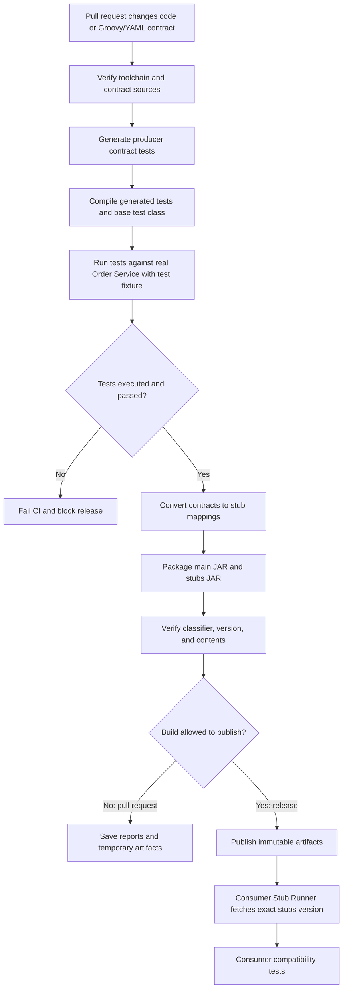

# Producer pipeline: contract verification, test generation, and validation

When a producer modifies an API or message format, what matters is not just that the Java code still compiles. A small change such as removing the `totalAmount` field, changing `200 OK` to `202 Accepted`, or publishing an event to a different destination can break running consumers. The **producer pipeline** must check these changes *before release* by turning the agreed contracts into **executable tests against the real implementation**.

In the **SPRING_CLOUD_CONTRACT** learning path, the team uses **Spring Cloud Contract** to define HTTP or messaging behavior using **Groovy/YAML DSL**, generate producer tests, package stubs, use **Stub Runner** on the consumer side, and integrate **CI/CD** to detect incompatible API changes. This lesson belongs to the **CI/CD** chapter, focusing on **Producer pipeline: contract verification, test generation, and validation**. The focus is designing a pipeline with **clear ordering**, **test evidence**, **release gates**, **artifact provenance**, and **reproducibility**.

After this lesson, you will be able to distinguish generation from verification, configure an appropriate Maven/Gradle flow, inspect generated tests and the stubs JAR, separate the pull request path from the release path, build a sample CI workflow, and diagnose cases where **a build is green but contracts were never actually verified**.

## 1. Goals of the producer pipeline

Suppose **Order Service** is a producer with two consumers:

- **Checkout Service** calls HTTP `GET /api/orders/ORDER-42` to retrieve payment status.
- **Billing Service** receives the `ORDER_PAID` message to create an invoice.

The team wants to modify Order Service, without breaking Checkout or Billing due to unexpected API or event changes.

A reliable producer pipeline must answer:

1. Which **source contracts** are published by the producer and must be supported?
2. Is the Groovy/YAML DSL recognized and parsed successfully by the plugin?
3. Has the plugin **generated producer tests** for the expected contracts?
4. Do those tests **compile, execute against the real producer implementation**, and pass?
5. Are the test base, fixtures, database, HTTP adapter, and message binder configured properly?
6. Are the stub mappings and stubs artifact generated from the **same set of contracts**?
7. Does the stubs artifact have the right **classifier, version, and contents**?
8. Is there evidence that tests actually ran, rather than being skipped or running `0 tests`?
9. Can the released artifact be traced back to the producer commit, contract source, and test report?
10. Can consumers consume the exact stubs version via Stub Runner to detect breaking changes?

A pipeline is a **chain of evidence**, not just a single `mvn package` command.

### 1.1. Producer CI/CD diagram



For simplicity, the diagram places mapping conversion after producer verification. **In the actual Maven/Gradle lifecycle**, the generator, converter, test runner, and packaging may be bound to specific phases depending on the plugin version; the pipeline must still ensure **no artifact is published as verified before producer tests actually pass**.

## 2. Distinguishing five easily confused steps

| Step | What it does | Evidence to check |
|---|---|---|
| **Contract discovery/validation** | Finds and parses Groovy/YAML DSL | List of contracts, no syntax errors, no missing sources |
| **Generate tests** | Generates producer-side JUnit/Spock test sources | Generated files and expected test classes/methods |
| **Verify producer** | Runs generated tests against the implementation | Test report showing executed test count, not skipped, passing result |
| **Generate/package stubs** | Converts DSL into mappings and packages the artifact | `-stubs.jar` containing contracts/mappings and the right classifier |
| **Publish** | Pushes artifacts to a Maven/Git repository per policy | Coordinates, checksum, commit/build ID, access permissions |

**Generating tests ≠ running tests.** Dozens of generated Java test classes may exist, yet Maven Surefire does not run them because class names do not match, the plugin is not activated, the test framework lacks an engine, or CI sets `-DskipTests`.

**Packaging stubs ≠ verifying the producer.** WireMock mappings can be generated from DSL even when the Order Service implementation does not return the expected response. A consumer test via Stub Runner only proves the client handles the **sample stub**, not that the producer implementation is correct.

### 2.1. Why does ordering matter?

A safe release artifact should satisfy these conditions:

```text
Source contracts are identified
          +
Generated producer tests exist
          +
Producer tests execute and pass
          +
Stub mappings are created from the exact same contracts
          +
Stubs artifact has the right version/classifier
          =
Release candidate verified within the scope of the contracts
```

Even when those conditions are met, appropriate integration, security, performance, and consumer-specific tests are still needed. Contract verification protects **the documented commitments**, not the entire business domain or infrastructure.

## 3. Before writing the pipeline: define verification scope

For Order Service:

```text
order-service/
├── pom.xml
├── src/
│   ├── main/java/com/example/order/
│   │   ├── OrderServiceApplication.java
│   │   └── OrderController.java
│   └── test/
│       ├── java/com/example/order/contract/
│       │   ├── OrderContractTestBase.java
│       │   └── OrderContractFixture.java
│       └── resources/contracts/
│           ├── checkout-service/
│           │   ├── get_paid_order_200.groovy
│           │   └── get_missing_order_404.yml
│           └── billing-service/
│               └── order_paid_event.groovy
└── target/                  # Only appears after a Maven build
```

This is an **illustrative** layout for Maven. Gradle projects typically use `src/contractTest/resources/contracts` or a path configured by the Gradle plugin, which should be checked against the version in use.

### 3.1. Ownership rules

- **Producer and consumer** agree on the contract behavior.
- **Producer** is responsible for ensuring its implementation satisfies the contract.
- **Contract Verifier** generates producer tests from the DSL.
- **Test base** and fixtures are written by the producer team, not auto-generated by the plugin.
- **CI** executes the tests and retains evidence.
- **Artifact repository** stores the main artifact and the stubs artifact.
- **Consumer** uses Stub Runner with the right artifact/version and tests its real client/handler.

Do not delegate producer verification to Stub Runner consumer tests. The two test suites have different scopes.

### 3.2. Information to pin

| Item | Example | Reason |
|---|---|---|
| JDK | JDK 17, if supported by the release train | Generated Java/tests require a compatible environment |
| Maven Wrapper | `./mvnw` from the repository | Local and CI share the same toolchain |
| Spring Boot | Version selected per support matrix | Determines Spring TestContext and dependencies |
| Spring Cloud | Compatible release train | Avoid mixing module generations |
| Spring Cloud Contract | Compatible plugin and verifier versions | DSL, generated tests, and mappings may vary |
| Contract source revision | Commit SHA or artifact version | Know which contract set was verified |
| Producer artifact version | `1.4.0` | Release traceability |
| Stubs classifier | `stubs` | Consumer resolves the right artifact |
| Test infrastructure | DB/broker image version | Reproducible fixtures and message verification |

Do not copy a specific version from a lesson and assume it works for every application. **Check the Spring Boot/Cloud/Contract compatibility matrix** before applying a POM or Gradle configuration.

## 4. Groovy contract for HTTP success

Checkout needs to read a paid order:

```http
GET /api/orders/ORDER-42
Accept: application/json
```

Expected response:

```http
HTTP/1.1 200 OK
Content-Type: application/json

{"id":"ORDER-42","status":"PAID","totalAmount":125000}
```

A file `src/test/resources/contracts/checkout-service/get_paid_order_200.groovy`:

```groovy
import org.springframework.cloud.contract.spec.Contract

Contract.make {
    name 'checkout_get_paid_order_200'

    request {
        method GET()
        url '/api/orders/ORDER-42'
        headers {
            header 'Accept', 'application/json'
        }
    }

    response {
        status OK()
        headers {
            contentType(applicationJson())
        }
        body(
            id: 'ORDER-42',
            status: 'PAID',
            totalAmount: 125000
        )
    }
}
```

This is a producer-side contract that **must be verified**:

- Correct method/path.
- `Accept` and response `Content-Type` as promised.
- HTTP `200`.
- JSON has `id`, `status`, and `totalAmount` as expected.
- Fixture `ORDER-42` exists in `PAID` status.

If the producer modifies the implementation to return `status=CANCELLED` or drops `totalAmount`, the generated tests must catch it **provided the assertions protecting those fields are actually generated and executed**.

## 5. YAML contract for HTTP error

Checkout needs to distinguish "order not found" from a network failure or a WireMock error with no matching mapping.

File `src/test/resources/contracts/checkout-service/get_missing_order_404.yml`:

```yaml
name: checkout_get_missing_order_404
description: Return business error when order does not exist
request:
  method: GET
  url: /api/orders/ORDER-MISSING
  headers:
    Accept: application/json
response:
  status: 404
  headers:
    Content-Type: application/json
  body:
    code: ORDER_NOT_FOUND
    message: Order not found
```

Seeding/cleanup is required so `ORDER-MISSING` is guaranteed not to exist. If a WireMock server returns `404` because the request did not match any mapping, that is **not** evidence that the producer returned the `ORDER_NOT_FOUND` body per the contract.

**Do not duplicate the same scenario in both Groovy and YAML** unless intentional. Each contract should have a stable scenario name and distinct enough request matchers when packaged together in the stubs artifact.

## 6. Message contract: the pipeline must verify the producer emits the event

Order Service also emits an event for Billing:

```groovy
import org.springframework.cloud.contract.spec.Contract

Contract.make {
    name 'billing_order_paid_v1'
    label 'billing_order_paid_event_v1'

    input {
        triggeredBy('publishOrderPaid()')
    }

    outputMessage {
        sentTo('orders.events')
        headers {
            header('contentType', 'application/json')
            header('eventType', 'ORDER_PAID')
        }
        body(
            eventId: 'EVENT-42',
            eventType: 'ORDER_PAID',
            orderId: 'ORDER-42',
            totalAmount: 125000
        )
    }
}
```

During **producer verification**:

1. The generated test calls the `publishOrderPaid()` hook provided by the base test.
2. The hook triggers **real Order Service business logic**, not just a manually constructed sample message.
3. The test messaging infrastructure captures the emitted output.
4. Assertions verify the destination, headers, and body against the contract.
5. The test fails if the producer changes `eventType` or `sentTo` contrary to the agreement.

A compatible Spring Cloud Stream/Integration/binder/test broker is required for the chosen **version and messaging type**. `testMode=MOCKMVC` for HTTP does not automatically configure Kafka/RabbitMQ. If the project has both HTTP and messaging contracts, you may need `baseClassMappings` or separate test bases by contract group.

### 6.1. Consumer-side message trigger does not replace producer tests

When Billing uses Stub Runner to trigger label `billing_order_paid_event_v1`, it receives a **sample message from stubs**; the real Order Service is not called. Therefore, a passing consumer message test does not prove the real producer emits the event with the right destination/headers.

The producer pipeline must run message verification against the implementation, while consumer CI can run Stub Runner to protect Billing's listener/deserialization/side effects.

## 7. Maven: declaring Contract Verifier and plugin

In a Maven producer, the core elements typically include **test dependencies**, the **plugin**, and the **base test class**.

Sample **POM fragment**:

```xml
<properties>
    <spring-cloud-contract.version>COMPATIBLE_CONTRACT_VERSION</spring-cloud-contract.version>
</properties>

<dependencyManagement>
    <dependencies>
        <dependency>
            <groupId>org.springframework.cloud</groupId>
            <artifactId>spring-cloud-contract-dependencies</artifactId>
            <version>${spring-cloud-contract.version}</version>
            <type>pom</type>
            <scope>import</scope>
        </dependency>
    </dependencies>
</dependencyManagement>

<dependencies>
    <dependency>
        <groupId>org.springframework.boot</groupId>
        <artifactId>spring-boot-starter-test</artifactId>
        <scope>test</scope>
    </dependency>
    <dependency>
        <groupId>org.springframework.cloud</groupId>
        <artifactId>spring-cloud-starter-contract-verifier</artifactId>
        <scope>test</scope>
    </dependency>
</dependencies>

<build>
    <plugins>
        <plugin>
            <groupId>org.springframework.cloud</groupId>
            <artifactId>spring-cloud-contract-maven-plugin</artifactId>
            <version>${spring-cloud-contract.version}</version>
            <extensions>true</extensions>
            <configuration>
                <baseClassForTests>
                    com.example.order.contract.OrderContractTestBase
                </baseClassForTests>
                <testMode>MOCKMVC</testMode>
                <testFramework>JUNIT5</testFramework>
                <failOnNoContracts>true</failOnNoContracts>
            </configuration>
        </plugin>
    </plugins>
</build>
```

**This is a fragment**, not a complete `pom.xml`; the producer still needs groupId/artifactId/version, Spring Boot/Cloud parent/BOM, runtime dependencies, repositories, and other plugin configurations. Replace `COMPATIBLE_CONTRACT_VERSION` with a real version compatible with your chosen Boot/Cloud release train.

Key points to understand:

- `spring-cloud-starter-contract-verifier` provides test-side integration.
- `spring-cloud-contract-maven-plugin` provides the generate/convert/package goals.
- `<extensions>true</extensions>` appears in common official Maven plugin configurations.
- `baseClassForTests` is the **FQN** of the class that generated tests will extend.
- `testMode=MOCKMVC` fits the Spring MVC/MockMvc setup in the example; do not copy it for a WebFlux-only app.
- `testFramework=JUNIT5` must match the plugin/test runtime version.
- `failOnNoContracts=true` causes a failure when the producer expects contracts but none are found, as supported by the plugin version.

**Do not just put the plugin in `pluginManagement` and assume it is active in the producer module.** In a multi-module build, the plugin must appear in `build/plugins` of the module that actually owns the contracts, or be activated via a verified inheritance/lifecycle mechanism.

## 8. Base test class: the part the producer must build itself

The plugin generates test methods, but it **cannot know in advance** which database your project needs, which security test token to use, which external systems to mock, or how to seed fixtures.

An illustrative base class for Spring MVC:

```java
package com.example.order.contract;

import io.restassured.module.mockmvc.RestAssuredMockMvc;
import org.junit.jupiter.api.BeforeEach;
import org.springframework.beans.factory.annotation.Autowired;
import org.springframework.boot.test.autoconfigure.web.servlet.AutoConfigureMockMvc;
import org.springframework.boot.test.context.SpringBootTest;
import org.springframework.test.web.servlet.MockMvc;

@SpringBootTest
@AutoConfigureMockMvc
public abstract class OrderContractTestBase {

    @Autowired
    MockMvc mockMvc;

    @Autowired
    OrderContractFixture fixture;

    @BeforeEach
    void prepareContractFixture() {
        fixture.resetTestState();
        fixture.insertPaidOrder("ORDER-42", 125000);
        fixture.ensureOrderDoesNotExist("ORDER-MISSING");

        RestAssuredMockMvc.mockMvc(mockMvc);
    }
}
```

**`OrderContractFixture` is an application-provided helper** that you must implement yourself. The example cannot compile as-is without the corresponding class, repositories, and test database.

### 8.1. Conditions for a valid fixture

- `ORDER-42` data is always seeded with `PAID` status.
- `ORDER-MISSING` does not exist before the test.
- No dependency on test execution order.
- Do not use random data unless assertions control those values.
- Separate the test database from the production environment.
- If transactions are involved, understand transaction boundaries between the test and HTTP handler.
- If using Testcontainers, pin images and configure startup/lifecycle properly.
- If running multiple jobs in parallel, isolate databases/schemas/ports.
- For messaging, use a properly configured broker/test binder and reset message state.

### 8.2. What errors does a misconfigured base test class cause?

| Misconfiguration | Symptom |
|---|---|
| `baseClassForTests` FQN does not exist | Generated tests fail to compile |
| Using a MockMvc base for `EXPLICIT` test mode | Tests lack the proper HTTP server/client setup |
| Using MockMvc for a WebFlux-only producer without MVC support | Test context or adapter fails |
| Fixtures not seeded | `200` contract receives `404` |
| Shared seed data without reset | Tests pass individually but fail in the suite |
| Missing security test setup | Unexpected `401` or `403` |
| Message hook `publishOrderPaid()` is missing | Generated messaging test fails to compile/run |
| Hook emits a fake message from test code instead of production code path | Risk of false-green tests |

For contracts of different types, split base classes or mappings **as supported by your plugin version**. The goal is for generated tests to verify the real producer, not just construct mock responses matching the DSL.

## 9. Maven goals and lifecycle positions

According to the Spring Cloud Contract Maven plugin documentation, the primary goals are:

| Goal | Role | Relationship to CI |
|---|---|---|
| `generateTests` | Generates producer verification tests from contracts | Ensures test sources appear |
| `convert` | Converts DSL into WireMock mappings | Ensures mappings match contracts |
| `generateStubs` | Packages converted mappings/contracts into a stubs JAR | Ensures the classifier artifact has content |
| `help` | Looks up goals and parameters for the plugin version | Useful for debugging |
| `run` | Runs stubs for experimentation | Does not replace producer verification |
| `pushStubsToScm` | Pushes stubs per configured SCM workflow | Only use when the organization actually adopts SCM publication |

In several documented plugin lines, `generateTests` binds to the Maven **`generate-test-sources`** phase, `generateStubs` binds to **`package`**, and `generateStubs` depends on the output of `convert`. Check the bindings/executions in your **specific plugin version**; do not add duplicate executions when the lifecycle already binds the goals automatically.

### 9.1. Minimal Maven producer pipeline

In a project with the plugin and dependencies properly configured:

```bash
./mvnw -version
./mvnw -B -ntp clean verify
```

`-B` enables batch mode, and `-ntp` suppresses download progress output so CI logs stay readable. `clean verify` runs through the required Maven lifecycle; the plugin must be configured correctly so generated tests are compiled and executed.

When publishing to a Maven repository, use `deploy` according to release permissions/phase:

```bash
./mvnw -B -ntp deploy
```

`deploy` also runs earlier phases in the Maven lifecycle; hence it may re-run tests. In a release job, choose a strategy that reuses the already verified artifact or re-runs the lifecycle so that **the published artifact is guaranteed to be the output of a build that passed tests**, rather than building and publishing stubs from a different source.

### 9.2. Goal generation does not mean verification

The command:

```bash
./mvnw org.springframework.cloud:spring-cloud-contract-maven-plugin:generateTests
```

can be used to inspect the test generation step. However, it **does not execute JUnit assertions**. For a producer pipeline, the release gate must require test reports showing that generated tests were executed and passed.

## 10. Inspecting actual generated test sources

Generated tests in common Maven plugin versions appear under:

```text
target/generated-test-sources/contracts/
```

In the Gradle plugin, output is usually placed under `build/generated-test-sources/contractTest/` or a path configured per version.

**Do not edit generated sources by hand.** If a test is wrong, fix the contract DSL, base test, plugin config, or producer implementation and regenerate. Generated files will be overwritten on the next build.

### 10.1. What exactly should you check?

1. Do generated source files exist?
2. Is there a generated test for `checkout_get_paid_order_200`?
3. Is there a generated test for `checkout_get_missing_order_404`?
4. Is there a messaging test for `billing_order_paid_v1`?
5. Does each test extend the right base class?
6. Does the test mode use the right MockMvc/server/WebTestClient setup?
7. Do assertions protect HTTP status, headers, body, and message destination/type per the contract?
8. Is the generated code included in test compilation and the test task?

Generated class/method names may be derived from **directory and contract names**; do not insist on exact literal class names across all versions without inspecting the actual generated source.

### 10.2. Using `find` and `jar` in Linux CI environments

Diagnostic command examples:

```bash
find target/generated-test-sources/contracts \
  -type f -name '*.java' -print

find target/surefire-reports \
  -type f -name 'TEST-*.xml' -print

jar tf target/order-service-1.4.0-stubs.jar
```

These paths and JAR names are examples for producer `order-service:1.4.0`; if you use Spock/Groovy generated tests or different plugin output, adjust the checks accordingly.

**Having generated files does not guarantee tests ran.** You must inspect the actual Surefire/Failsafe reports.

## 11. Checking Maven Surefire/Failsafe reports

A pipeline can pass green without running a single contract test if the test engine, naming pattern, or skip flags are wrong.

Common report locations:

```text
target/
└── surefire-reports/
    ├── TEST-com.example.order.SomeTest.xml
    └── com.example.order.SomeTest.txt
```

If generated tests are run by Failsafe instead of Surefire, reports typically reside in `target/failsafe-reports/`. **Do not assume** one directory always contains every test in every project.

### 11.1. Metrics to confirm

| Check | Expectation |
|---|---|
| Generated contract test classes | Expected classes/scenarios are present |
| Total executed tests | Greater than 0 and not lower than expected |
| Failures/errors | 0 for a release candidate |
| Skipped contract tests | No critical cases skipped |
| Contract coverage | Covers the contracts published by the producer |
| Test framework | Correct JUnit 5/Spock engine |
| Generated source root | Added to test compilation |
| Test report artifact | Saved on CI for investigation |

If the output shows `Tests run: 0`, **do not treat it as a PASS for producer verification**. The plugin may not have picked up contracts, test class naming may not match Surefire, the JUnit Engine may be missing, or a Maven profile may have inadvertently excluded generated tests.

### 11.2. Blocking `skipTests` and `maven.test.skip` in releases

Flags such as:

```text
-DskipTests
-Dmaven.test.skip=true
-Dspring.cloud.contract.verifier.skip=true
```

can bypass test execution or generation depending on the plugin/version. Do not use them in a step that **publishes verified stubs**. If a CI job only checks quick compilation, name it a **build/lint job**, not `producer contract verification`.

### 11.3. `failOnNoContracts` does not replace test reports

In some Maven plugin versions, `failOnNoContracts` defaults to `true`. That helps fail if no contracts are found during the relevant plugin step, but it **only matters when the plugin/goal actually runs**.

The pipeline still needs to verify:

- The plugin is activated in the producer module.
- The source directory is correct.
- Generated tests execute.
- Expected tests are not ignored/skipped.
- No Maven profile empties the entire test set.

For a producer with both HTTP and messaging contracts, also observe **the test count for each group**, not just a single total.

## 12. Distinguishing contract failures from fixture/infrastructure failures

When contract verification fails, not every failure is a breaking change.

| Symptom | Likely cause | Diagnostic direction |
|---|---|---|
| `200` contract receives `404` | Order fixture missing or route wrong | Seed test DB, check path/handler |
| Unexpected `403` | Security filter/test token wrong | Test security context |
| `503` due to unstarted test dependency | Upstream mock/broker/container failed | Test infrastructure readiness |
| Generated test fails to compile | Wrong baseClass FQN/imports/dependencies | Test classpath/generated source |
| Payload differs from contract | Producer implementation changed schema | Compare contract and actual response |
| Event does not appear | Hook did not run or broker/binder unavailable | Message producer test setup |
| Event sent to wrong destination | Routing config changed | Contract outputMessage.sentTo |
| Test passes alone, fails in suite | Shared DB/cache/broker state | Reset and isolation |
| Fails only in CI | Different toolchain/version, port conflict | Pin JDK/Maven/images, dynamic port |
| All Stub Runner requests `404` on consumer | Wrong GAV/classifier or request matcher | Inspect stubs JAR/mapping/port |

**Do not change the contract to match accidental infrastructure errors.** Categorize the root cause first and fix the right layer. Conversely, never use "flaky" as an excuse to ignore an API-breaking change.

## 13. Converting DSL and inspecting the stubs JAR

Once producer tests pass, the plugin can convert contracts into **HTTP stub mappings** and package the stubs artifact. A Maven producer `com.example:order-service:1.4.0` can produce:

```text
target/
├── order-service-1.4.0.jar
└── order-service-1.4.0-stubs.jar
```

The main JAR and stubs JAR are **not interchangeable**.

- Main JAR: code to run Order Service.
- Stubs JAR: generated mappings and contracts for consumers to use via Stub Runner.
- Classifier `stubs`: indicates the artifact variant; the version remains `1.4.0`.
- Do not manually rename the main JAR to `-stubs.jar` and treat it as a stubs artifact.

An illustrative layout:

```text
order-service-1.4.0-stubs.jar
└── META-INF/
    └── com.example/
        └── order-service/
            └── 1.4.0/
                ├── contracts/
                │   ├── checkout-service/
                │   │   ├── get_paid_order_200.groovy
                │   │   └── get_missing_order_404.yml
                │   └── billing-service/
                │       └── order_paid_event.groovy
                └── mappings/
                    └── checkout-service/
                        ├── checkout_get_paid_order_200.json
                        └── checkout_get_missing_order_404.json
```

**This is a diagram**, not a byte-for-byte structure guaranteed across every Spring Cloud Contract version. A message-only contract may not produce an HTTP mapping JSON; do not treat every message contract lacking an HTTP mapping as an error.

### 13.1. Archive inspection checks

```bash
jar tf target/order-service-1.4.0-stubs.jar
```

When consumers require HTTP stubs, verify:

- The archive contains appropriate `mappings`/response body resources.
- Mappings exist for the agreed `200` and `404` cases.
- The archive preserves consumer directory structure if `stubsPerConsumer` is used.
- Required message contracts and labels remain in the artifact.
- The artifact classifier/version matches the build.
- It contains no secrets, real bearer tokens, or real customer data.

The `jar tf` command only lists entries; to verify JSON mappings are right, inspect the relevant generated mappings or run a **stub smoke test** in a temporary environment.

## 14. Pull request pipeline vs. release pipeline

Not every PR should publish artifacts to the release repository. You can split them as:

| Pipeline | Trigger | Required | Output |
|---|---|---|---|
| **PR validation** | Pull request / open merge request | Generate + verify producer tests, package/check stubs | Reports, feedback, temporary artifacts |
| **Main branch CI** | Merge to main branch | Re-run verification, store artifacts per policy | Build with provenance |
| **Release** | Authorized tag or release command | Mandatory verification + artifact inspection + publish | Maven release and stubs classifier |
| **Consumer CI** | Consumer change or new producer stubs | Stub Runner runs consumer tests against target version | Compatibility matrix |
| **Nightly/compatibility** | Scheduled trigger | Matrix across multiple producer/consumer versions if needed | Regression report |

**Deployment secrets** should only be available to authorized release jobs/steps, not every PR from contributors or forks. This reduces the risk of leaking credentials through untrusted build scripts.

### 14.1. Gating logic

A clear rule set:

```text
PR:
  contract generation PASS
  + producer verification PASS
  + reports present
  + stubs artifact sanity PASS
  => PR can be considered for merge

Release:
  all PR checks on the exact source/revision being released
  + version/tag consistency PASS
  + artifact provenance PASS
  + valid deploy permissions
  => publish main JAR and stubs JAR
```

Specific merge/release conditions depend on organizational policy, but there should be no uncontrolled path to "skip verification and publish verified stubs."

## 15. Sample GitHub Actions workflow for a Maven producer

This example workflow is for **a Maven producer module at the repository root**, POM version `1.4.0`, JDK 17, with **already-selected compatible** Spring Boot/Spring Cloud Contract versions. The GitHub Actions and JDK versions below are examples; pin versions/hashes according to your organization's supply-chain security policy.

Illustrative file: `.github/workflows/order-producer-contracts.yml`

```yaml
name: Order producer contract verification

on:
  pull_request:
  push:
    branches: [main]
    tags: ['v*']

permissions:
  contents: read

jobs:
  producer-contracts:
    runs-on: ubuntu-latest
    steps:
      - name: Checkout source
        uses: actions/checkout@v4

      - name: Setup Java and Maven repository credentials
        uses: actions/setup-java@v4
        with:
          distribution: temurin
          java-version: '17'
          cache: maven
          server-id: company-releases
          server-username: MAVEN_USERNAME
          server-password: MAVEN_PASSWORD

      - name: Show toolchain
        run: ./mvnw -version

      - name: Generate, run producer tests and package
        run: ./mvnw -B -ntp clean verify

      - name: Check generated tests and stubs archive
        shell: bash
        run: |
          test -d target/generated-test-sources/contracts
          test -d target/surefire-reports
          find target/generated-test-sources/contracts -type f \
            \( -name '*.java' -o -name '*.groovy' \) \
            -print -quit | grep -q .
          find target/surefire-reports -type f \
            -name 'TEST-*.xml' -print -quit | grep -q .
          test -f target/order-service-1.4.0-stubs.jar
          jar tf target/order-service-1.4.0-stubs.jar \
            | grep -q 'mappings/'

      - name: Upload verification reports
        if: always()
        uses: actions/upload-artifact@v4
        with:
          name: producer-contract-reports
          path: |
            target/surefire-reports/
            target/failsafe-reports/
          if-no-files-found: warn

      - name: Check release tag matches POM version
        if: startsWith(github.ref, 'refs/tags/v')
        shell: bash
        run: |
          pom_version="$(./mvnw -q -ntp help:evaluate \
            -Dexpression=project.version -DforceStdout)"
          test "v${pom_version}" = "${GITHUB_REF_NAME}"

      - name: Deploy verified producer and stubs artifacts
        if: startsWith(github.ref, 'refs/tags/v')
        env:
          MAVEN_USERNAME: ${{ secrets.MAVEN_DEPLOY_USERNAME }}
          MAVEN_PASSWORD: ${{ secrets.MAVEN_DEPLOY_PASSWORD }}
        run: ./mvnw -B -ntp deploy
```

**Read carefully before applying:**

1. The YAML snippet assumes the producer project is at the **repository root**; multi-module setups must adjust working directories and output paths.
2. Version `1.4.0` in the JAR name is an example. If your POM uses another version, update the archive check or read the POM version dynamically.
3. `setup-java` can generate a Maven settings entry with `server-id` and environment variable names; `distributionManagement.repository.id` in the POM must match.
4. Secrets are passed only to the **deploy step**, not to steps running on PRs.
5. `./mvnw deploy` **re-runs the necessary Maven lifecycle phases** and may run tests again; do not add `-DskipTests` just to save time when releasing an artifact as verified.
6. The `find` and `jar tf` commands are **sanity checks**, not XML parsing of executed/skipped test counts or verification of specific mappings. A strict release pipeline should check XML test counts and the expected HTTP/message contract cases.
7. `pom_version` must match the tag; the example uses `v1.4.0` for artifact `1.4.0`.
8. `on:` in the GitHub Actions workflow is GitHub's trigger definition, unrelated to Contract Verifier.
9. `cache: maven` only caches dependencies for speed; it **does not replace an artifact repository** or evidence of the build just verified.
10. Third-party actions or runner environments can change; for high-security systems, pin GitHub Actions to audited commit SHAs.

This is an **illustrative template**. It requires an actual Maven repository, Spring Cloud Contract plugin, base test class, Maven Wrapper, `distributionManagement`, secrets, and CI permissions to be configured before running.

### 15.1. Why doesn't `verify` publish automatically?

`verify` runs the Maven lifecycle up to the verification phase; it **is not the same as `deploy`**. Publishing must be a conditional release step. A good pipeline does not publish stubs by default from an unreviewed PR.

### 15.2. How can GitHub Actions jobs be split?

If the system has many modules or longer tests:

- **Static/contract source check** job: parse, check naming/policy.
- **Producer verification** job: generate and run tests, save reports.
- **Artifact package validation** job: inspect archive, run smoke test.
- **Publish** job: only after required jobs pass on the right revision.
- **Consumer compatibility** job: use newly published stubs or verified temporary artifacts.

When splitting jobs, preserve **build identity**. Never take packaged artifacts from a different commit than the commit that passed tests.

## 16. GitLab CI or Jenkins: the principles stay the same

The same pipeline can be implemented in GitLab CI, Jenkins, Azure DevOps, or other systems. There is no requirement to use GitHub Actions.

Minimal **GitLab CI skeleton** for verification only:

```yaml
stages:
  - verify

producer_contract_verify:
  stage: verify
  image: maven:3.9-eclipse-temurin-17
  script:
    - mvn -B -ntp clean verify
  artifacts:
    when: always
    reports:
      junit:
        - target/surefire-reports/TEST-*.xml
    paths:
      - target/surefire-reports/
      - target/failsafe-reports/
```

This sample **excludes publishing** and uses the Maven CLI inside the image instead of the project's Maven Wrapper. In real deployments, add image version/commit pinning, Maven settings, private artifact repo, database/broker test services, multi-module paths, and a release job with proper credentials.

Jenkins can run `sh './mvnw -B -ntp clean verify'` and `junit 'target/surefire-reports/TEST-*.xml'`, though a single command also does not replace checking generated test counts or artifact provenance.

## 17. Gradle producer pipeline: same goal, different tasks

Spring Cloud Contract also provides a **Gradle plugin**. Task names and source/output locations differ from Maven; common plugin lines typically provide:

- `generateContractTests`: generates producer verification tests.
- `generateClientStubs`: converts contracts into mappings for consumers.
- `verifierStubsJar`: packages the stubs artifact.
- `contractTest`: runs generated contract tests per source set/plugin configuration.

An illustrative workflow after the project has configured the plugin properly:

```bash
./gradlew --version
./gradlew clean check
./gradlew verifierStubsJar
```

**Do not assume `check` in every Gradle project depends on `contractTest`.** Check the Gradle task graph, source set, test reports, and how the task/plugin version hooks into the lifecycle. `verifierStubsJar` may depend on generation/mappings, yet **it does not automatically prove producer contract tests were executed** in all configurations.

If using Kotlin DSL instead of Groovy Gradle DSL, plugin/source set syntax also changes. Regardless of the build tool, the release gate must rely on **test execution** and artifacts packaged from the exact same revision.

## 18. Multi-module and monorepo: run only the right producer

Suppose a Maven reactor looks like:

```text
commerce-platform/
├── pom.xml
├── order-service/
│   ├── pom.xml
│   └── src/test/resources/contracts/
├── checkout-service/
│   └── pom.xml
└── common-model/
    └── pom.xml
```

The producer pipeline can run:

```bash
./mvnw -B -ntp -pl order-service -am clean verify
```

Here:

- `-pl order-service` selects the Order Service module.
- `-am` builds the reactor dependencies that the module requires.
- Generated tests and Surefire reports must be checked under **`order-service/target`**, not just at the root.
- When publishing only one module, configure deploy/permissions clearly to avoid publishing unintended modules.
- Parent `pluginManagement` can manage versions, but must not cause modules without contracts to accidentally run Contract Verifier.

If the producer fetches contracts from an external artifact/repository, CI must pin the **contract source revision/version** and record it in build metadata. Never let a pipeline pull a mutable Git branch uncontrollably and publish a fixed stubs version without knowing which source was verified.

## 19. Message producer pipelines need dedicated test infrastructure

HTTP MockMvc tests may not need a broker, while message verification may require the Spring Cloud Stream test binder, a RabbitMQ/Kafka test container, or an appropriate adapter.

A messaging pipeline needs to:

1. Run a test broker/test binder of a supported version.
2. Ensure the base class provides the `publishOrderPaid()` hook.
3. Configure destinations, producer bindings, and serialization.
4. Generate and run message contract tests.
5. Assert headers, destination, and body against the contract.
6. Clean topics/queues or use isolated namespaces/groups between jobs.
7. Package message stubs only from the verified contract set.

**A message-only contract may have no HTTP mapping JSON**. When checking the stubs JAR, do not enforce "must contain WireMock mappings" on every producer type. For producers with both HTTP and messaging, inspect **each group** using appropriate criteria.

### 19.1. Avoiding false positives

If the `publishOrderPaid()` hook merely calls a test-only mock emitter instead of the real business producer code path, the generated test can pass even when the real implementation never emits an event. Check the producer test scope and confirm the hook goes through real code or the agreed integration adapter.

A test broker may lose connection or a consumer may read stale events; therefore, use correlation IDs, independent test fixtures, and clear timeouts.

## 20. Artifact publication: never release "unverified" stubs

Suppose a producer build creates:

```text
com.example:order-service:1.4.0
com.example:order-service:1.4.0:stubs
```

These are two related Maven artifacts:

| Artifact | Contents | Consumer |
|---|---|---|
| Main `order-service-1.4.0.jar` | Order Service implementation | Deployment/runtime |
| `order-service-1.4.0-stubs.jar` | Contracts and mappings/message samples | Stub Runner consumer tests |

### 20.1. GAV, classifier, and version

The stubs artifact typically has:

```text
groupId    = com.example
artifactId = order-service
version    = 1.4.0
classifier = stubs
extension  = jar
```

`stubs` is a classifier, not a new `artifactId`; `jar` is the extension. In Stub Runner notation:

```text
com.example:order-service:1.4.0:stubs:8085
```

the number `8085` is the **WireMock stub server port**, not part of the Maven artifact identity.

### 20.2. Release and SNAPSHOT

- Release `1.4.0` should be treated as **immutable**; never overwrite content at the same coordinates.
- SNAPSHOT `1.5.0-SNAPSHOT` can be built repeatedly; log the resolved timestamp/build revision when debugging.
- Do not use an uncontrolled "latest" version for a release compatibility gate.
- Before publishing, check that the version/tag/POM all point to **the same producer revision**.
- Publish to a repository with separate permissions and credentials; never store tokens in the POM or source code.

### 20.3. Minimal provenance

A useful CI record:

```text
module           = order-service
producerVersion  = 1.4.0
producerCommit   = <commit-sha>
contractsSource  = <contract-revision>
pluginVersion    = <spring-cloud-contract-version>
verification     = PASS
generatedTests   = <expected-count>
executedTests    = <actual-count>
skippedTests     = 0
stubsClassifier  = stubs
stubsArtifact    = com.example:order-service:1.4.0:stubs
```

This is **recommended metadata**, not a Maven-autogenerated format. It can be stored in a CI manifest or build attestation depending on policy. Never mark `verification=PASS` merely because a JAR file exists.

## 21. Build release gates on evidence, not step names

A check named "Run contract tests" does not guarantee contract tests ran. A solid release gate checks:

| Condition | What if it fails? |
|---|---|
| Source contracts exist to verify | Fail if the contract count does not match expectations |
| Generator picks up the right contract files | Fail on parse errors or missing test generation |
| Generated tests compile | Fail if base class/dependencies/test mode are wrong |
| Producer tests actually execute | Fail if 0 tests or all skipped |
| Producer assertions pass | Fail if status/headers/body/events are wrong |
| Mappings/stubs are created | Fail if required artifact contents are missing |
| Artifact GAV/version/classifier are right | Fail to prevent publishing the wrong variant |
| Test report/provenance is present | Fail or hold the build pending per policy |
| Secrets/repository permissions are valid | Fail closed, never bypass verification |
| Consumer compatibility is required | Block rollout if the mandatory matrix fails |

### 21.1. Checking "non-zero test count" is still not enough

A module with 100 unit tests and **0 generated contract tests** still produces a Surefire report with `tests>0`. Therefore, you must correlate **the expected contract list** with **generated test class/method names** or actual report groups.

Strategies may include:

- Verifying the generated tests directory is non-empty.
- Verifying generated tests exist for a required set of contracts.
- Confirming test classes are selected and run by Surefire/Failsafe.
- Parsing XML and failing if the corresponding tests are `skipped`.
- With a managed contract inventory, comparing expected vs. executed scenario counts.
- Never treating a sample unit test report file as contract verification.

Implement this mechanism via a script/tool owned and version-controlled in the repository; **not every project needs the exact same generated class naming structure**.

### 21.2. What should you verify after an intentional breaking change?

On a test branch:

1. Change the v1 controller from `200` to `202`.
2. Keep the `200` contract unchanged.
3. Run producer verification.
4. Confirm that **the specific generated test fails**.
5. Restore the controller, re-run, and confirm it passes.

Similarly, try removing `Location`, changing a JSON field type, or changing a message destination. If the test remains green, inspect the assertions/generator/test runner—**do not simply relax the contract to make the test pass**.

## 22. Should consumer tests be included in the producer pipeline?

Consumer tests and producer tests serve different purposes:

- Producer contract tests: does the producer implementation satisfy the contracts?
- Consumer Stub Runner tests: does the consumer client/handler process the stubs properly?
- Integration tests: real systems interacting together, including broker, auth, and database.

For a small set of consumers, the producer release pipeline can run a **downstream compatibility suite** of required consumers before rollout. For many independent consumers, you can use:

1. **Publish verified stubs to a staging/pre-release repository**.
2. Trigger consumer CI jobs with the exact artifact version.
3. Collect status per consumer/service.
4. Only promote/release when consumers covered by the support policy pass.

Do not let a producer PR block on an unbounded list of every consumer test in the world. Maintain a **list of critical consumers**, a compatibility policy, and clear timeouts. Before consumer CI is wired up, the producer pipeline must at least guarantee producer verification passes and artifact provenance is recorded; **never assume all consumers are already compatible**.

## 23. Situations that easily cause false-green pipelines

| Situation | Why is it dangerous? | Prevention |
|---|---|---|
| `-DskipTests` in release | Artifact published without verifying producer | Forbid skip flags in release jobs |
| `Tests run: 0` | No evidence of contract tests | Check generated and executed counts |
| Plugin only in `pluginManagement` | Goals never actually run in producer module | Inspect effective POM |
| `failOnNoContracts` disabled | Wrong source directory still passes green | Enable fail policy, check generated output |
| Generated tests excluded by Surefire | Sources exist but assertions never run | Inspect test runner/reports |
| Mock fixture returns DSL response even if implementation is broken | Tests verify the mock instead of the producer | Use a test base through real code paths |
| Main JAR renamed to stubs JAR | Missing mappings/contracts | Check archive and classifier |
| Maven deploy runs from a different revision than verified | Unverified release | Build provenance and source identity |
| SNAPSHOT overwritten without traceability | Consumers sometimes get old stubs, sometimes new | Pin resolved version/commit |
| Consumer still uses v1 stubs against v2 producer | Tests pass on stale contracts | Test the target version slated for deployment |
| Only HTTP tests run, message tests omitted | Event breaking changes go undetected | Separate message verification gate |
| Multi-module missing `-pl` or target path | CI inspects the wrong module | Module-specific source/report/artifact checks |
| Parallel jobs share DB/broker | Flakiness and false positives | Isolate fixtures/namespaces |
| Release secrets exposed to PRs | Supply-chain risk | Restrict secrets to publish job/step |
| PR tests against `latest` dependencies | Non-reproducible builds | Pin BOM/plugin/stub versions |
| JUnit test fails but workflow uses `continue-on-error` | Job still succeeds | Disallow ignoring critical gates |

### 23.1. Questions to ask when the pipeline fails

If `mvn verify` fails, ask:

1. Are the toolchain/BOM/plugin versions compatible?
2. Can the contract DSL be parsed?
3. Is the plugin scanning the right `contractsDirectory`?
4. Are generated tests placed in the right source root?
5. Does the base class compile and configure the right HTTP/messaging adapter?
6. Does the fixture have the required data without order dependency?
7. Does the implementation return the status/header/body/message specified in the contract?
8. Are Surefire/Failsafe running the generated classes?
9. Are mappings converted/packaged properly?
10. Is the pipeline reading stale artifacts/sources from cache?

Do not guess and modify the controller, contract, and plugin all at once. Walk layer by layer to isolate the root cause.

## 24. Hands-on lab: building a producer pipeline for Order Service

**Context:** the producer has HTTP contracts for Checkout and a message contract for Billing. The goal is to turn every contract-impacting change into a clear CI signal.

### Phase A — create contract sources

1. Write Groovy contract `checkout_get_paid_order_200`.
2. Write YAML contract `checkout_get_missing_order_404`.
3. Write Groovy message contract `billing_order_paid_v1`.
4. Place contracts into the source directory configured by the plugin.
5. Verify unique names, request matchers, and labels/destinations.

### Phase B — producer test base and fixtures

1. Create `OrderContractTestBase` for HTTP MockMvc.
2. Seed `ORDER-42` with `PAID` status and `totalAmount=125000`.
3. Ensure `ORDER-MISSING` is absent.
4. Create the message base/hook `publishOrderPaid()` going through real business implementation.
5. Configure the appropriate broker/test binder and clean up message state.
6. Do not use a production DB/broker.

### Phase C — Maven verification

1. Add the Spring Cloud Contract Verifier test dependency.
2. Declare the Maven plugin in `build/plugins` and select a valid version.
3. Configure the base class/test mode appropriately.
4. Run `./mvnw -B -ntp clean verify`.
5. Inspect generated tests and Surefire/Failsafe reports.
6. Ensure no generated test is unexpectedly skipped.

### Phase D — negative/mutation checks

1. Intentionally return `status=CANCELLED` for `ORDER-42`.
2. Run generated tests and confirm the `PAID` contract fails.
3. Restore the implementation.
4. Intentionally change message `ORDER_PAID` to `ORDER_CANCELLED`.
5. Confirm producer message verification fails.
6. Restore and verify the suite passes.

### Phase E — package and inspect stubs

1. Package `order-service-1.4.0-stubs.jar`.
2. Use `jar tf` to inspect contracts and HTTP mappings.
3. Verify the `stubs` classifier and `1.4.0` version.
4. Run a Stub Runner smoke test for `200`/`404` when needed.
5. Verify message labels are present according to the plugin-supported artifact/layout.
6. Ensure no real credentials or PII are included.

### Phase F — CI/CD

1. Create a PR workflow that runs verification.
2. Archive test reports even when tests fail.
3. Add a gate checking generated test counts and archive contents.
4. Add a release workflow that only publishes from authorized tags/revisions.
5. Never enable `skipTests` in releases.
6. Record artifact coordinates, producer commit, and contract revision.
7. Run consumer Stub Runner tests using the exact verified version.
8. Block rollout if the critical compatibility matrix fails.

**Completion criteria:** given a violated contract, the producer pipeline must **fail with a clear reason**; once fixed, generated tests must execute and pass, the stubs artifact with the right version/classifier is produced, and publishing happens only after mandatory gates pass.

## 25. Producer CI/CD checklist

- [ ] Repository has reviewed contracts recognized by the plugin.
- [ ] JDK/Maven/Gradle toolchain and Spring Boot/Cloud/Contract versions are pinned.
- [ ] Plugin is activated in the right producer module.
- [ ] Base test class fits the HTTP/messaging stack.
- [ ] Generated tests exist and are not placed in the wrong source root.
- [ ] Generated tests **actually execute**, not omitted by Surefire/Failsafe.
- [ ] Policy fails if no contracts are found unexpectedly.
- [ ] Test fixtures are isolated, without using production DB/broker.
- [ ] HTTP status, headers, and body are protected by contracts.
- [ ] Message destination, headers, and body are verified where applicable.
- [ ] Test reports clearly show executed/failed/skipped counts.
- [ ] `-DskipTests` and skip flags do not appear in verified release jobs.
- [ ] Main JAR and stubs JAR are built from the same producer revision.
- [ ] Stubs archive has valid contents, `stubs` classifier, and correct version.
- [ ] Release artifacts are never overwritten at the same coordinates.
- [ ] Maven repository credentials are least-privilege, scoped to release jobs.
- [ ] PR workflows have no permission to publish releases.
- [ ] Consumer compatibility tests use the target version's stubs artifact.
- [ ] Artifact provenance includes producer commit, contract revision, and build ID.
- [ ] Mutation testing confirms a real breaking change causes failure.
- [ ] Rollback/deprecation policy is defined for incompatible changes.

## 26. Self-check questions

1. **How does producer CI differ from consumer CI?** Producer CI verifies the real implementation satisfies contracts; consumer CI tests the client/handler against stubs.
2. **Does `generateTests` mean tests ran?** No, it only generates sources.
3. **What does `convert` do?** Converts contracts into stub mappings.
4. **What does `generateStubs` do?** Packages the stubs artifact from mappings/contracts per plugin behavior.
5. **Why is the existence of a stubs JAR insufficient to publish?** Generated producer tests might not have run.
6. **What is `baseClassForTests` used for?** Specifies the FQN of the base class for generated tests.
7. **Why are fixtures needed?** Producer tests need reproducible data and environment state.
8. **When is `MOCKMVC` appropriate?** Spring MVC with a corresponding MockMvc test setup.
9. **Where are Maven generated tests usually located?** A path such as `target/generated-test-sources/contracts` depending on plugin version.
10. **Does `Tests run: 0` count as passing contract verification?** No.
11. **Why inspect Surefire/Failsafe reports?** To confirm test execution and results.
12. **How does `failOnNoContracts` help?** It can fail the build when the plugin finds no contracts per configuration/version.
13. **Should `-DskipTests` be used when releasing verified stubs?** No.
14. **How does the main JAR differ from the stubs JAR?** One contains the application; the other contains stubs for consumers.
15. **Is the `stubs` classifier a new `artifactId`?** No.
16. **Is port `8085` in Stub Runner IDs part of the artifact identity?** No.
17. **Why pin the stubs version?** To know which contract set was tested and reproduce failures.
18. **What do producer message tests require besides DSL?** A business hook, verifier/binder/broker, and fixtures.
19. **Does triggering a Stub Runner label run the real producer?** No.
20. **Should PR pipelines have release deploy credentials?** Usually no; only authorized release jobs should.
21. **What if test reports show unit tests but no contract tests?** Do not consider it verified; check generated test and runner coverage.
22. **Why is artifact provenance needed?** To trace stubs back to the commit, contracts, and test results.
23. **Does Maven `verify` automatically publish remotely?** No; publishing usually happens via `deploy` or a dedicated process.
24. **How do you prove an assertion has value?** Intentionally break the implementation and confirm the test fails.
25. **When should you run a consumer compatibility matrix?** When there are multiple versions/consumers or potentially breaking changes.

## 27. References and version caveats

Official sources to verify configuration for your exact Spring Cloud Contract release train:

- [Spring Cloud Contract — Getting Started](https://docs.spring.io/spring-cloud-contract/reference/)
- [Spring Cloud Contract — Maven Project](https://docs.spring.io/spring-cloud-contract/reference/maven-project.html)
- [Spring Cloud Contract Maven Plugin — Goals](https://docs.spring.io/spring-cloud-contract/docs/current/spring-cloud-contract-maven-plugin/plugin-info.html)
- [Spring Cloud Contract Maven Plugin — generateTests Goal](https://docs.spring.io/spring-cloud-contract/docs/current/spring-cloud-contract-maven-plugin/generateTests-mojo.html)
- [Spring Cloud Contract Maven Plugin — generateStubs Goal](https://docs.spring.io/spring-cloud-contract/docs/current/spring-cloud-contract-maven-plugin/generateStubs-mojo.html)
- [Spring Cloud Contract — Gradle Project](https://docs.spring.io/spring-cloud-contract/reference/gradle-project.html)
- [Spring Cloud Contract — Stub Runner](https://docs.spring.io/spring-cloud-contract/reference/project-features-stubrunner/stub-runner-core.html)
- [GitHub Actions — Workflow Syntax](https://docs.github.com/en/actions/reference/workflows-and-actions/workflow-syntax)

The `docs/current` and `reference` pages may point to different releases. **Do not freely mix 4.x and 5.x examples**; verify plugin parameters, source/output directories, the JDK/Boot/Cloud matrix, and the task graph for the exact version you are using.

The CI examples above use `actions/checkout@v4`, `actions/setup-java@v4`, and `actions/upload-artifact@v4` as illustrative dependencies; in production organizations, verify current action versions/SHAs, permissions, and secret policies. This lesson is a process guide, not a report of a build run on a specific project.

## Conclusion

**A proper producer pipeline does not stop at checking Groovy/YAML syntax or generating a stubs JAR.** It must prove that **contracts were read**, **generated producer tests were compiled and executed**, **the real Order Service implementation satisfies HTTP/message expectations**, and **the stubs artifact was packaged/released from the same build that passed verification**.

A reproducible CI/CD pipeline pins the toolchain, keeps fixtures isolated, inspects test reports instead of merely looking at `BUILD SUCCESS`, verifies the contents/classifier/version of the stubs JAR, restricts publish permissions, records provenance, and runs consumer compatibility tests with **Stub Runner** when required. In doing so, incompatible API or message changes are caught early, before affecting Checkout, Billing, or other consumers in the system.
