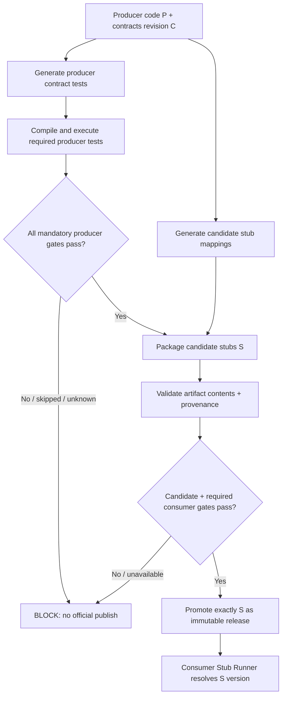
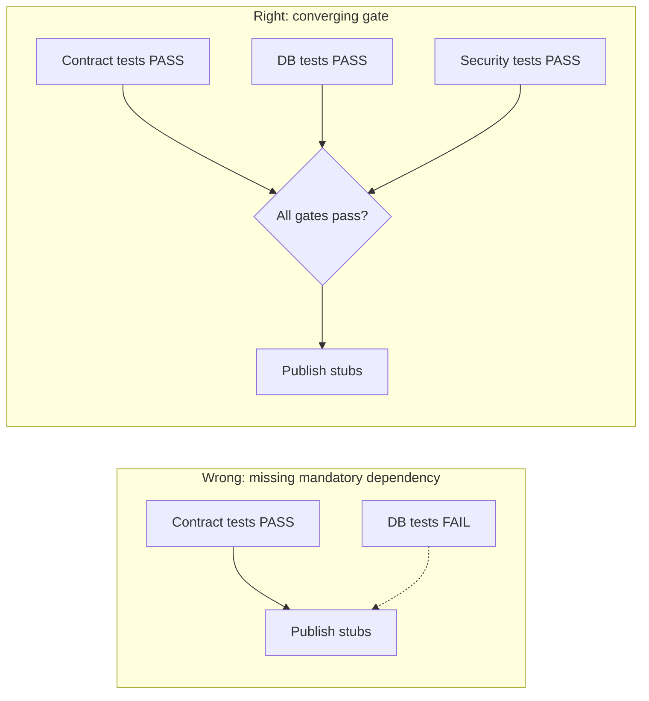
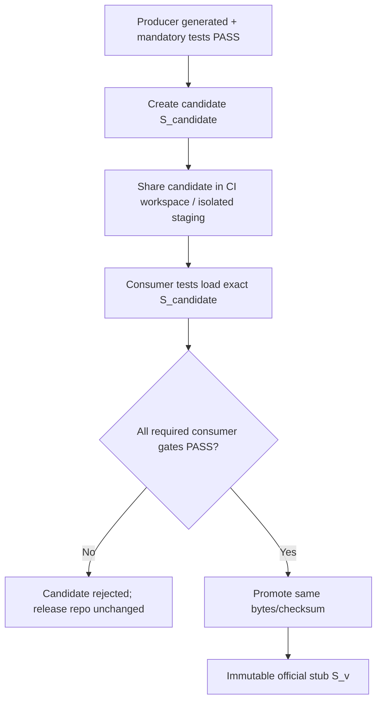

# Publish stubs only after all mandatory tests pass

A **Spring Cloud Contract** pipeline can generate `inventory-service-1.4.2-stubs.jar` very early, even when the producer code does not yet satisfy the contract or some tests have not run at all. If the CI/CD process automatically pushes that file to a public artifact repository for consumer teams, `OrderService` might run Stub Runner against a promise that the real `InventoryService` does not fulfill. Then consumer tests pass green while the release breaks integration.

The principle of this lesson is: **publish an official stub version only after all mandatory test gates for that version have executed and passed**. Not merely "the JAR file exists", not merely "a green build", and not merely "valid contract DSL". You must prove that tests executed against the **exact producer revision**, with the **exact contract set**, and then publish **the exact verified artifact** or one reproduced through a controlled process.

This lesson belongs to the **CI/CD** chapter of the **SPRING_CLOUD_CONTRACT** module. The module's scope is producer–consumer contract testing using **Groovy/YAML DSL**, generating producer tests, packaging stubs, using **Stub Runner**, and CI integration to detect incompatible API or message changes. We will use `InventoryService` as the producer, `OrderService` as the consumer, and an internal Maven artifact repository for illustration; all names, versions, and addresses are fictional data.

After this lesson, you will be able to:

- Distinguish **generate**, **verify**, **package**, **publish**, and **deploy**.
- Define and enforce a mandatory test list based on the risk of a producer release.
- Design a **fail-closed release gate**: if any condition fails, is skipped, or has an unknown result, do not publish.
- Prove that generated contract tests were **generated, discovered, and executed**, avoiding "0 tests, build success".
- Inspect a stub JAR for the right mappings, contracts, classifier, version, and provenance.
- Design CI for Maven or Gradle so publish never runs before required tests.
- Use candidate stubs for consumer compatibility testing before **promoting** them to an immutable release.
- Lock down the Git commit, contract revision, checksum, and artifact repository write permissions.
- Handle flaky tests, caches, SNAPSHOTs, release rollbacks, and pipelines misconfigured to bypass gates.

## 1. Five distinct actions in the stub lifecycle

| Action | Primary output | Sufficient for official publication? |
| --- | --- | --- |
| **Generate tests** | Java/Groovy producer test code from contracts | Not yet; code was only generated |
| **Generate stubs** | WireMock mappings/message contract definitions | Not yet; implementation not verified |
| **Run verification** | Test reports, pass/fail/skip status | Necessary, but insufficient without other gates |
| **Package** | `*-stubs.jar` file with version/classifier | Not yet; the file can be packaged even if tests fail or never run |
| **Publish/promote** | Official artifact in the repository for consumers to fetch | **Only after all mandatory gates pass** |

**Deploying the producer** is a separate step from **publishing stubs**. A published stub release does not mean containers/clusters are already running that exact producer version. Consumer tests backed by stubs protect the agreed interface; smoke/integration tests in the deployed environment are still needed to verify the runtime version and out-of-contract risks.

### A logical order, not necessarily the execution order of every Gradle/Maven task



You can **generate** stubs before or in parallel with generated tests to save time. What must never change is: **no official publish path may bypass mandatory verification gates**.

## 2. A dangerous scenario: stub matches contract, producer is wrong

Producer and consumer agreed on:

```http
POST /api/v1/reservations HTTP/1.1
Content-Type: application/json

{"sku":"SKU-001","quantity":2}
```

Contract output:

```http
HTTP/1.1 201 Created
Content-Type: application/json

{"reservationId":"RES-701","status":"HELD"}
```

Groovy DSL:

```groovy
import org.springframework.cloud.contract.spec.Contract

Contract.make {
    name 'create_reservation_success'
    description 'OrderService needs a reservation ID to proceed with checkout'

    request {
        method 'POST'
        url '/api/v1/reservations'
        headers {
            contentType(applicationJson())
        }
        body([
            sku     : 'SKU-001',
            quantity: 2
        ])
    }

    response {
        status 201
        headers {
            contentType(applicationJson())
        }
        body([
            reservationId: $(consumer('RES-701'),
                             producer(regex('RES-[0-9]+'))),
            status       : 'HELD'
        ])
    }
}
```

`consumer('RES-701')` is the sample response value for the stub, whereas `producer(regex('RES-[0-9]+'))` is the condition the generated producer test checks against the actual ID. `status=HELD` and HTTP `201` are fixed expectations.

Suppose the producer code was changed to return `200` and `status=PENDING`. The stub generator can still create a mapping returning `201 HELD` **based purely on the DSL**. Consumer tests against that mapping may pass, whereas if generated producer tests run against the real code, they will detect the discrepancy.

That is why **stub generation is not a quality gate**. Before publishing, what you must collect is a **passing test execution**, not a log line saying "Generated stubs".

### YAML DSL example for a dedicated error branch

```yaml
name: create_reservation_insufficient_stock
description: Consumer must handle insufficient stock error
request:
  method: POST
  url: /api/v1/reservations
  headers:
    Content-Type: application/json
  body:
    sku: SKU-EMPTY
    quantity: 2
response:
  status: 409
  headers:
    Content-Type: application/json
  body:
    code: INSUFFICIENT_STOCK
```

This is a **different scenario** from the Groovy success case, not the same contract written twice. If `409` is a mandatory commitment, the generator must discover it and the generated test must actually execute. Two passing tests do not prove every SKU/quantity, transaction, or concurrency case is right; mandatory tests must be chosen based on business risk.

## 3. What counts as "all mandatory tests"?

There is no fixed test list for every service. "Mandatory" is a **predefined release policy** agreed upon by the producer, consumer, and platform owners, based on the supported interface and the blast radius of failures.

A recommended matrix:

| Gate | Scope | When mandatory? | Evidence to retain |
| --- | --- | --- | --- |
| **G1 — DSL discovery** | Exact set of Groovy/YAML contracts found | Every release with contracts | File/contract count and source revision |
| **G2 — Producer contract tests** | Generated tests compile, run, and pass | Every release with verified stubs | JUnit results, executed/failed/skipped |
| **G3 — Unit tests** | Critical business rules are intact | If part of baseline release policy | Module-specific test report |
| **G4 — Integration tests** | DB, auth, external adapters, event transport | When producer scope depends on these layers | Test report and environment details |
| **G5 — Stub artifact validation** | JAR has valid mappings/contracts, version, classifier, body files | Every stub release | Manifest/checksum and JAR contents |
| **G6 — Consumer compatibility** | Real consumer code works with candidate stub | For supported consumer/release pairs | Consumer suite + resolved stub version |
| **G7 — Security/schema checks** | Auth/authorization and critical schemas | When required by risk or policy | Test/policy reports |
| **G8 — Release provenance** | Producer/contracts/tests/artifact from same authorized revision | Every official release | Git SHA, contract SHA, build ID, digest |

**Mandatory** does not mean every E2E, load, performance, and security scan must run on every PR of every service. However, if a gate is defined as mandatory for the release in question, **it must never be silently skipped to publish**. If the policy needs adjustment, it requires a separate, traceable approval—not merely editing an `if` in CI.

### A verifiable definition

Example project specification:

```text
Release inventory-service:
  required:
    - generated producer HTTP/message contract tests
    - unit tests
    - database integration tests
    - security tests for reservation endpoints
    - stub jar content/provenance validation
    - OrderService compatibility suite
    - CheckoutService compatibility suite
  conditional:
    - broker retry/DLQ test if message wiring changed
    - load test if concurrency/latency path changed
```

This is an **illustrative matrix**, not an automatic config format understood by Spring Cloud Contract. CI must translate this list into concrete job/task dependencies and status checks.

## 4. Fail-closed: no PASS means no permission to publish

A release gate can be expressed as:

\[
\text{ALLOW\_PUBLISH} =
\text{APPROVED\_REVISION}
\land \text{ALL\_REQUIRED\_GATES\_PASS}
\land \text{ARTIFACT\_PROVENANCE\_MATCH}.
\]

Here `ALL_REQUIRED_GATES_PASS` means each gate **ran completely, produced PASS, and had no out-of-policy skips**. `FAIL`, `CANCELLED`, `TIMED_OUT`, `NOT_RUN`, and `UNKNOWN` statuses do **not** allow publishing.

| Gate status | Publish stub release? | How to handle |
| --- | --- | --- |
| `PASS`, valid report | Possible, if other gates also pass | Proceed |
| `FAIL` | No | Fix and re-run |
| `SKIPPED` against policy | No | Restore tests or obtain approved policy exception |
| `NOT_RUN` / excluded | No | Fix task graph / CI workflow |
| `CANCELLED` / timeout | No | Re-run a build with an explicit revision |
| `UNKNOWN` / missing report artifact | No | Restore evidence and verify |
| `FLAKY` after retry | Per policy; treat as a signal to fix | Keep both failed and retry records, never erase traces |

### Do not use "just one green job is enough"

Suppose there are three jobs: `contract-test`, `integration-test`, and `publish-stubs`. If `publish-stubs` only depends on `contract-test` and not `integration-test`, a release can reach the repository even when integration tests fail.



Do not rely on the visual order of steps in the CI UI. The **dependency graph** and run conditions determine whether a path can bypass the gate.

## 5. Do not confuse "0 tests" with "all tests passed"

A failure more dangerous than a failing test is **tests not running while the pipeline stays green**.

Common causes:

- Contract sources are placed in the wrong directory.
- The Contract Verifier plugin is not applied to the producer module.
- Generated tests exist, but the runner does not discover the classes/methods.
- Maven Surefire/Failsafe or Gradle `contractTest` is skipped.
- The build invokes `test`, while contract tests live in another source set/task.
- The task is excluded via `-x contractTest` or test filtering.
- Monorepo runs only producer A and skips producer B.
- CI reads reports from a previous build or unit test reports instead of generated tests.

**Three conditions must be checked separately:**

1. **Discovered:** the right set of contract sources is recognized.
2. **Generated:** test sources are generated from those contracts.
3. **Executed:** those tests are compiled, executed, and pass against the implementation under protection.

The number of `*.groovy` files or a `*-stubs.jar` does not prove (3). A test report showing `Tests run: 0, Failures: 0` is also not a PASS for the contract gate.

### Checking reports and test counts

In Maven/Gradle, inspect results from the test runner:

```text
contract_source_count:  14
generated_contract_tests:  14
executed_contract_tests: 14
failed: 0
skipped: 0
gate: PASS
```

These numbers are **examples** only. The file-to-test ratio is not always 1:1: one Groovy file can contain multiple contracts, or the generator may group tests differently. Define **expected cases** per project instead of rigidly assuming file count equals test count.

When a test is intentionally marked disabled/ignored, it may only be excluded from requirements if **a policy exception is approved and documented**. Never treat all-skipped tests as PASS just because the runner returned exit code 0.

## 6. Producer verification scope must cover the code being released

A passing generated test is meaningful only if the base class and test mode cover the right boundary. For example, with a Spring MVC producer, the base class can use:

```java
package com.example.inventory;

import io.restassured.module.mockmvc.RestAssuredMockMvc;
import org.junit.jupiter.api.BeforeEach;
import org.springframework.beans.factory.annotation.Autowired;
import org.springframework.boot.test.context.SpringBootTest;
import org.springframework.web.context.WebApplicationContext;

@SpringBootTest
public abstract class ContractVerifierBase {

    @Autowired
    WebApplicationContext context;

    @BeforeEach
    void setup() {
        RestAssuredMockMvc.webAppContextSetup(context);
    }
}
```

This is a Spring MVC/MockMvc template; for WebFlux or message contracts, pick the test mode, adapter, and base class appropriate for your version. **Do not mock the controller/producer behavior itself** just to return fixtures the contract is supposed to verify. You may mock dependencies outside the boundary if policy allows, but state the limitation clearly: that test does not verify the real DB/broker.

### Distinguishing fixture categories

A generated test can fail due to missing SKU test data even when the implementation is right, or pass with a mock returning canned responses even when the implementation is broken. Therefore the gate requires:

- Stable, isolated, reproducible fixtures.
- Input/boundary cases representing actual risk.
- Setup that does not inadvertently disable authorization/validation that the contract claims to protect.
- Tight enough assertions (e.g., status `201`, `status=HELD`, ID format).
- Run results tied directly to the producer commit intended for publication.

If a test fails, investigate the root cause rather than loosening matchers or disabling the test just to unblock. If contract requirements genuinely change, review and re-verify from that same new contract revision.

## 7. Maven: `verify` and `deploy` do not mean the same thing

The Spring Cloud Contract Maven plugin can be used to generate producer tests and stubs; the Maven lifecycle handles compilation, testing, packaging, and then `install`/`deploy` when plugins are configured properly.

An **illustrative** Maven producer configuration fragment:

```xml
<build>
  <plugins>
    <plugin>
      <groupId>org.springframework.cloud</groupId>
      <artifactId>spring-cloud-contract-maven-plugin</artifactId>
      <version>VERSION_COMPATIBLE_WITH_PROJECT</version>
      <extensions>true</extensions>
      <configuration>
        <testFramework>JUNIT5</testFramework>
        <testMode>MOCKMVC</testMode>
        <baseClassForTests>
          com.example.inventory.ContractVerifierBase
        </baseClassForTests>
      </configuration>
    </plugin>
  </plugins>
</build>
```

This is **not a complete POM**. The plugin version must be compatible with your project's Spring Boot/Spring Cloud/JDK; add required test dependencies and manage versions via your existing BOM/configuration. `MOCKMVC` applies only to Spring MVC producers.

With a complete build:

```bash
# Generate/compile/run tests and produce outputs per the Maven lifecycle:
mvn -B -ntp clean verify

# Run the Maven lifecycle through deploy if repository/credentials are properly configured:
mvn -B -ntp clean deploy
```

`mvn deploy` normally runs the lifecycle phases preceding `deploy`, **but** that does not mean all required tests are wired properly or unskipped. If a job enables `-DskipTests`, `-Dmaven.test.skip=true`, excludes, incomplete profiles, or other overrides, Maven can still reach `deploy` without mandatory evidence.

### A loophole in the "verify job → deploy job" pattern

Suppose:

1. Job A checks out commit `P100` and `mvn clean verify` passes.
2. Job B checks out branch `main` at a later time, receiving commit `P101`.
3. Job B runs `mvn deploy -DskipTests`.

Artifact `P101` was **published under the test evidence of `P100`**. Even if both share the same version string, they do not share the same inputs.

Two safe approaches:

- **Re-verify in the publish job** from the **exact same immutable commit/tag** without skipping tests; verify reports/gates before actually uploading.
- **Promote the verified artifact** from CI/staging storage to the release repository, using checksums/digests to guarantee no different content is rebuilt.

Never use `-DskipTests` as a default "optimization". If your organization allows skipping re-running tests during promotion, that step must **not rebuild**—it must only move/attest **the exact bytes already verified**.

### Separating Maven tests across multiple plugins

| Category | Common plugin/task | What to verify |
| --- | --- | --- |
| Unit and generated producer tests | Maven Surefire | Test discovery, reports, and executed counts |
| Integration tests with matching suffixes | Maven Failsafe | `integration-test` + `verify` execute properly |
| Contract generation | Spring Cloud Contract Maven plugin | Contracts discovered and test sources generated |
| Stub packaging | Spring Cloud Contract/assembly/attached artifact config | `stubs` classifier correct, artifact contains mappings |
| Publish | Maven Deploy plugin or repository publisher | Runs only when all gates pass |

Do not assume a Surefire report means **Failsafe integration tests** ran. For projects using JUnit naming conventions or custom profiles, CI must collect both report sets from the exact module.

## 8. Gradle: `verifierStubsJar` is not verification evidence

The Spring Cloud Contract Gradle plugin typically provides tasks such as:

```text
generateContractTests
contractTest
generateClientStubs
copyContracts
verifierStubsJar
```

`generateContractTests` generates sources; `contractTest` runs producer tests if the task/source set is configured properly; `generateClientStubs` and `verifierStubsJar` produce outputs for Stub Runner. A successful `verifierStubsJar` run **does not automatically prove** `contractTest` ran and passed.

A Gradle producer can configure an explicit gate:

```groovy
// Illustrative build.gradle snippet, assuming Spring Cloud Contract
// and maven-publish plugins are already applied.
tasks.named('check') {
    dependsOn(tasks.named('contractTest'))
}

tasks.named('publish') {
    dependsOn(tasks.named('check'))
    dependsOn(tasks.named('verifierStubsJar'))
}
```

**Meaning:** invoking `publish` in this build requires Gradle to complete `check` and `verifierStubsJar`. If `check` fails, Gradle normally halts and does not run downstream publishing tasks, **unless** custom build/task/script logic suppresses errors or publishing is invoked via another path.

This snippet is **not a complete release gate**: it does not automatically check test counts, test coverage, consumer compatibility, security scans, or checksums. If there are custom publication tasks or another plugin that does not depend on `publish`, bind **every artifact publication entrypoint** to the gate or restrict publish permissions at the infrastructure level.

### Do not use `finalizedBy` to enforce publishing

Anti-pattern example:

```groovy
// ANTI-PATTERN: a finalizer is not a success gate.
tasks.named('check') {
    finalizedBy(tasks.named('publish'))
}
```

A finalizer is meant for cleanup or teardown steps; it can be scheduled even if the finalized task fails. Therefore, **never use `finalizedBy(publish)` to enforce "publish only when tests pass"**.

Similarly, when running Gradle with `--continue`, independent tasks may continue after another task fails. To stay safe, publication **must depend directly or indirectly on the gate**, not merely follow it on the command line.

### Inspection commands

```bash
# List tasks and verify task names for your plugin version:
./gradlew tasks --all

# Dry-run the task graph to trace publish paths before actually running:
./gradlew publish --dry-run

# Run producer verification:
./gradlew clean check
```

`--dry-run` only shows planned tasks; **it does not prove test results**. In a Gradle multi-module build, use full task paths like `:inventory-service:contractTest` and `:inventory-service:publish` to avoid publishing the wrong module.

### Dedicated source set and test discovery

Some Spring Cloud Contract Gradle plugin versions use a `contractTest` source set; generated tests do not necessarily run when calling only `test`. Verify whether the plugin actually wires `contractTest` into `check`. Also include `useJUnitPlatform()` if using JUnit 5:

```groovy
tasks.named('contractTest', Test) {
    useJUnitPlatform()
    testLogging {
        events 'passed', 'failed', 'skipped'
    }
}
```

You cannot infer a non-zero test count from `useJUnitPlatform()` alone; you still need a gate checking the executed test count in reports or test task results.

## 9. Artifact validation: what is inside `*-stubs.jar`?

After producer verification passes, CI must inspect the **artifact about to be published**, not just its filename.

Maven example:

```bash
jar tf target/inventory-service-1.4.2-stubs.jar
```

Gradle example:

```bash
jar tf build/libs/inventory-service-1.4.2-stubs.jar
```

Paths are illustrative; obtain the actual location from Maven `target` or Gradle `build/libs`, depending on packaging configuration.

With Spring Cloud Contract, a common HTTP stub artifact may contain:

```text
META-INF/
  com.example/
    inventory-service/
      1.4.2/
        mappings/
          create_reservation_success.json
          create_reservation_insufficient_stock.json
        contracts/
          create-reservation-success.groovy
          create-reservation-insufficient-stock.yml
```

This is a **reference layout**, not guaranteed identical across every Spring Cloud Contract version or custom packaging. For message contracts, contract definitions may be consumed by Stub Runner through a messaging adapter instead of WireMock HTTP mappings.

### Required checks

| Check | What error does it catch? |
| --- | --- |
| `stubs` artifact has exact group/artifact/version | Prevents consumers from downloading the producer JAR by mistake |
| JAR is non-empty and readable | Prevents publishing a corrupted file |
| Expected mappings/contracts exist | Catches omitted contracts or stale artifacts |
| `__files` present if mappings use `bodyFileName` | Prevents stubs from returning broken responses |
| Mappings match expected requests and responses | Catches generator/packaging bugs or manual overrides |
| Consumer subfolders exist if filtering per consumer | Prevents `stubsPerConsumer` from failing to load mappings |
| SHA-256/checksum recorded | Traces whether the same version has identical bytes |
| Clean Stub Runner test passes | Verifies runtime can load the artifact, not just file presence |

**A JAR with all files present can still be broken**: invalid JSON mapping syntax, missing body files, an overlapping fallback mapping, or a WireMock runtime version that does not support a matcher. Therefore, run at least one smoke/consumer test against the **final artifact**.

### Checking checksums

```bash
sha256sum target/inventory-service-1.4.2-stubs.jar
```

On PowerShell, use `Get-FileHash` with `SHA256`. Checksums reconcile content across verify, staging, and release steps; they do not replace artifact signing, repository access controls, or attestation provenance when required by your organization.

## 10. Candidate stubs, release stubs, and the consumer verification ordering problem

A practical question: **how do you run consumer compatibility tests before publishing the release stub**, if consumer tests need to fetch the stub via Stub Runner?

The answer is distinguishing **a candidate artifact used internally within the pipeline** from **a published release artifact that users/consumer teams are allowed to depend on**.



There are three ways to distribute candidates **without an official release**:

1. **CI artifact handoff:** pass the JAR between jobs via temporary CI artifact storage; the consumer job installs it into its local test repository before Stub Runner runs.
2. **Restricted staging repository:** publish the candidate into a pre-release namespace/version, never advertised as stable; consumer tests resolve the exact coordinates and checksum, then promote the verified bytes.
3. **Shared build workspace:** in a multi-module integration pipeline, the candidate JAR is available on the filesystem or in the test job's local Maven repository.

If using a staging repository, enforce retention policies, access controls, and rules separating candidates from releases so production consumers cannot accidentally pull an unverified version.

### Why not "publish stable first and check consumers later"?

If publishing stable is treated as a verified commitment and consumer systems automatically upgrade versions, then when a consumer gate fails, the published artifact may already be consumed unintentionally. Deleting or overwriting a release afterward violates immutability.

Under the "publish only after all gates" policy, verify the **candidate** first, then **promote** that exact candidate to release. A pipeline may not require consumer suites in the producer gate depending on the organization, but once they are marked mandatory, they must pass before publication.

## 11. Consumer compatibility tests must call real consumer code

A Stub Runner test such as:

```java
import org.springframework.boot.test.context.SpringBootTest;
import org.springframework.cloud.contract.stubrunner.spring.AutoConfigureStubRunner;
import org.springframework.cloud.contract.stubrunner.spring.StubRunnerProperties;

@SpringBootTest(properties = {
    "inventory.base-url=http://localhost:8090"
})
@AutoConfigureStubRunner(
    ids = "com.example:inventory-service:1.4.2:stubs:8090",
    stubsMode = StubRunnerProperties.StubsMode.LOCAL
)
class OrderConsumerContractTest {
    // Actual test calls OrderCheckoutService and InventoryClient of OrderService.
}
```

This example assumes the candidate JAR `1.4.2:stubs` was installed into the job's local Maven repository, port 8090 is free, and dependencies match your Spring Cloud Contract version.

A test that **only calls WireMock directly** with curl/RestAssured is a stub smoke test; it does not prove `OrderService`'s client works properly. A consumer compatibility gate needs to:

1. Boot **real consumer code** (HTTP client/service adapter).
2. Point the base URL to the **right Stub Runner instance/port**.
3. Send requests from consumer code, not synthetic requests built solely in the test harness.
4. Assert deserialized responses and business outcomes/side effects are correct.
5. Check the WireMock request journal / verify expected method, path, body/headers.
6. Exercise important error branches, such as `409`, not just the happy path.

When Stub Runner uses `StubsMode.REMOTE`, make sure `repositoryRoot` points to the exact candidate repository. When using `LOCAL`, the job must install/import the exact artifact into the local repository, avoiding stale cached versions.

### Testing current and older consumers

If a producer releases a new version while still claiming support for `OrderService 2.7` and `2.8`, the gate may need to run both suites against candidate `inventory-service:1.4.2:stubs`. `OrderService 2.8` passing does not guarantee consumer 2.7 accepts new JSON/enums/statuses.

Choose a **version-pair matrix** based on deployed versions, backward compatibility windows, and rolling upgrade plans—do not blindly require every combination that ever existed.

## 12. A release pipeline needs unbypassable stops

Organizational controls should separate:

| Control layer | Function |
| --- | --- |
| **Build/task graph** | Publication tasks depend properly on verification tasks |
| **CI job dependencies** | Publish job runs only after every mandatory job succeeds |
| **Branch/tag protection** | Releases happen only from reviewed revisions, not arbitrary PRs |
| **Repository permissions** | Publish credentials are granted only to the release job |
| **Artifact immutability** | Prevents overwriting release artifacts even if CI has a flaw |
| **Provenance/attestation** | Traces back to the build, contracts, and test results |

A mistake in a single layer should not be enough for anyone to push an unverified stub to the release repository.

**Example:** a `verify` job fails, yet a `publish` job with its own credentials and `if: always()` still uploads the artifact. Fix both **CI conditions** and **publish permissions** so PRs or other jobs cannot bypass the gate.

## 13. GitHub Actions: wire jobs by dependencies, not display order

Model:

```text
verify-producer ----+
                   +--> verify-consumers --> release-publish
validate-artifact -+
```

In practice, `validate-artifact` must use the **candidate JAR from the same build** instead of downloading `latest`. The `release-publish` job runs only when all mandatory jobs succeed and release is authorized.

A workflow **illustrating orchestration logic**, where the `ci/*.sh` scripts are components **the project must write and review**:

```yaml
name: Verify and release contract stubs

on:
  push:
    branches: [main]
    tags: ["v*"]
  pull_request:

permissions:
  contents: read

jobs:
  producer-gates:
    runs-on: ubuntu-latest
    steps:
      - uses: actions/checkout@v4
      - uses: actions/setup-java@v4
        with:
          distribution: temurin
          java-version: "21"
          cache: maven
      - name: Producer tests and candidate package
        run: mvn -B -ntp clean verify
      - name: Reject 0 tests, skipped contracts and missing mappings
        run: ./ci/check-producer-gates.sh
      - name: Upload candidate, not public release
        uses: actions/upload-artifact@v4
        with:
          name: inventory-candidate
          path: target/*-stubs.jar
          if-no-files-found: error

  consumer-gates:
    needs: [producer-gates]
    runs-on: ubuntu-latest
    steps:
      - uses: actions/checkout@v4
      - uses: actions/setup-java@v4
        with:
          distribution: temurin
          java-version: "21"
      - uses: actions/download-artifact@v4
        with:
          name: inventory-candidate
          path: candidate/
      - name: Check candidate SHA and consumer compatibility
        run: ./ci/test-consumers-with-candidate.sh candidate/

  release-publish:
    needs: [producer-gates, consumer-gates]
    if: startsWith(github.ref, 'refs/tags/v')
    runs-on: ubuntu-latest
    environment: production-artifacts
    steps:
      - uses: actions/checkout@v4
      - uses: actions/download-artifact@v4
        with:
          name: inventory-candidate
          path: candidate/
      - name: Promote verified candidate without rebuilding
        run: ./ci/promote-verified-candidate.sh candidate/
```

**Do not copy this workflow and assume automated releases work out of the box.** It intentionally references three scripts **that are not supplied**, with clear interfaces that must be implemented:

- `check-producer-gates.sh` must read test reports for the exact module, confirm required suites have executed and passed tests, verify `*-stubs.jar` contains mappings/contracts, and record commit + checksums.
- `test-consumers-with-candidate.sh` must verify the candidate digest, place the artifact in Stub Runner's source, run real consumer suites, and fail if any mandatory suite fails.
- `promote-verified-candidate.sh` must upload only **the exact verified JAR** with canonical metadata/version; never rebuild or use wildcards that could pick the wrong artifact.

The workflow must also ensure candidates include checksums/manifests and correct paths for **multi-module** builds. Time elapsed between jobs must not alter the Git SHA or artifact contents; `actions/download-artifact` fetches artifacts from the same workflow run, while checkout uses the same event commit.

### Hardening and limitations to add

- `permissions: contents: read` sets read-only defaults; **artifact repository write credentials** must live in a protected release environment and never be exposed to PR jobs.
- A `v*` tag does not automatically guarantee an approved tag. Require **protected tags**, release approvals, and source-commit policies.
- `on: pull_request` should only verify; `release-publish` is blocked by the tag condition.
- Test scripts should split out downstream jobs if producer/consumer live in **two separate repositories**; in that case use authenticated artifact handoff/dispatch, never download `latest`.
- The publication script must reject uploads if release coordinates already exist and **never overwrite**.
- If a consumer gate yields no result due to timeout or service outage, **fail closed** instead of accepting `UNKNOWN`.

### A small but important technical note

In GitHub Actions YAML, `on` is a special key processed by the platform as workflow triggers. Do not validate this file with an outdated YAML parser that has incompatible Boolean semantics and conclude the workflow has a syntax error; use workflow validation tools and a real CI environment.

## 14. Gates should evaluate results, not just exit codes

The exit code of `mvn verify` or `gradlew check` matters, but it is insufficient if the build has disabled tests, uninvoked source sets, or missing mandatory reports.

A release gate can be designed around a **conceptual algorithm**:

```text
expected_contracts = load_reviewed_contract_inventory(revision C)
assert expected_contracts is not empty

generation_report = load_generation_evidence()
assert generation_report.includes_all_required(expected_contracts)

for suite in mandatory_suites:
    report = load_report_from_current_run(suite)
    assert report exists
    assert report.executed > 0 or suite.explicitly_allows_zero
    assert report.failures == 0
    assert report.errors == 0
    assert report.skipped <= suite.approved_skip_limit
    assert suite.job_status == SUCCESS

candidate = read_candidate_stub_artifact()
assert candidate.exists and candidate.valid_jar
assert candidate.contains_required_contracts_and_mappings()
assert candidate.revision == verified_contract_revision
assert candidate.producer_commit == verified_producer_commit

for consumer in mandatory_consumers:
    assert consumer.tested_candidate_digest == candidate.sha256
    assert consumer.compatibility_job_status == SUCCESS

ALLOW_PUBLISH = true
```

This is **pseudo-code illustrating policy**, not a runnable off-the-shelf program. Each CI system needs adapters to fetch the contract inventory, JUnit reports, job statuses, manifests/digests, and skip policy; critically, it must **read data from the current workflow run itself**.

### Never rely on a naive "XML exists so PASS" check

A `TEST-ContractVerifier.xml` file from a prior build could remain in the workspace or cache while the current build ran zero tests. If the gate only checks file existence, it passes falsely.

Solution:

- Use a clean workspace or purge report outputs before running tests.
- Pull reports from the current test task/job, never mixing with unverified cached reports.
- Match test suite names against the mandatory list.
- Inspect **executed**, failures, errors, and skipped counts.
- Verify the test runner actually ran on the right producer commit.
- When a report cannot be parsed, return `UNKNOWN/BLOCK` instead of assuming pass.

## 15. CI configurations that accidentally allow bypassing gates

| Configuration/anti-pattern | Why it is dangerous | Alternative |
| --- | --- | --- |
| `continue-on-error: true` on test step | Job may continue or report success even when tests fail | Disallow on mandatory gates |
| `if: always()` on publish step | Publish can run after a failure | Use `needs` and success + approval conditions |
| Gradle `finalizedBy(publish)` | Finalizer does not mean run-on-success-only | Use explicit dependencies and release gates |
| Shell `mvn test; echo done` | Last command's exit code masks failure unless checked | Strict shell mode or explicit exit-code check |
| `mvn deploy -DskipTests` | Skips tests without verified-artifact promotion | Re-run tests or promote exact verified bytes |
| `gradle publish -x contractTest` | Can bypass verification | Block in task graph, CI, and repository permissions |
| Publish job only `needs: build` | Build may not include integration/security/consumer tests | Depend on all required job gates |
| Resolving `+`/`latest` stubs version | Two consumer test runs may pull two different versions | Pin version and digest |
| Publishing under an existing release version | Overwrites content, breaks reproducibility | Immutable release repositories |
| `if: failure()` uploading failed artifact to release repo for "debug" | Unverified artifacts mixed with stable releases | Use a separate CI artifact/staging namespace |

### When is `if: always()` still useful?

For **reports and cleanup**, never for release publication:

```yaml
- name: Upload test reports for diagnosis
  if: always()
  uses: actions/upload-artifact@v4
  with:
    name: test-reports
    path: target/surefire-reports/
```

Even when tests fail, reports should be preserved for investigation. However, this artifact is an **internal test report**, not a published stable `*-stubs.jar`. You may upload candidate stubs as CI artifacts for debugging; keep them strictly separate from public/release publication.

### Publication conditions on a dedicated job

```yaml
release-publish:
  needs: [producer-gates, consumer-gates, security-gates]
  if: startsWith(github.ref, 'refs/tags/v')
  environment: production-artifacts
```

This is a **workflow fragment**, without steps or full job definitions. In GitHub Actions, a job with `needs` normally does not run if a dependency fails or is skipped, unless the author adds overriding conditional logic. Still protect tags/environments and restrict credentials to the exact job.

## 16. Flaky tests: never erase traces just to ship

A broker integration test may occasionally fail due to environmental instability. Re-running the test and publishing only the final pass can hide real regressions or make policy opaque.

Your handling procedure should be defined upfront:

1. Classify the failure: code behavior, fixture, timeout, resource exhaustion, broker/network, or test isolation.
2. Record **both the failed attempt and the retry** in the CI record.
3. Retry only within bounded limits, against the exact same commit, contract revision, and candidate artifact.
4. If a retry passes while policy requires every attempt to pass, keep the gate blocked or require a traceable exception approval.
5. Fix the root cause of flakiness; never raise timeouts indefinitely or disable key assertions.
6. When quarantining a test, document owner, reason, expiration date, and compensating coverage/accepted risk.

**Not every retry is wrong.** Bounded retries are appropriate for transient infrastructure failures; the danger is **treating "eventually green" as "there was never an issue"** and releasing outside policy.

### Gate depends on an unavailable external service

For example, the consumer compatibility job cannot download the candidate from staging due to a repository outage. In that case:

- Do not switch `REMOTE` to `LOCAL` to fall back to an arbitrary stale stub.
- Do not mark the consumer gate PASS when it did not run.
- Halt the pipeline at `BLOCKED/UNKNOWN`.
- Re-run once the service recovers, keeping revision/digest fixed.

The goal is **fail closed and reproducible**, not finding any excuse to turn green.

## 17. Releases must not invert ordering on breaking changes

Suppose InventoryService v1.5 adds `expiresAt` and changes status `HELD` to `HELD_PENDING_REVIEW` in some cases. OrderService v2.8 does not yet understand the new enum.

A candidate stub from the new contract helps **detect breaking changes early**, but cannot automatically prove every consumer is safe. Evaluate the version pairs that can genuinely meet during rollout:

| Consumer/Producer | Inventory 1.4 | Inventory 1.5 |
| --- | --- | --- |
| Currently deployed Order 2.8 | Baseline to confirm | **Backward-compatibility gate** |
| Order 2.9 candidate | Gate if consumer deploys before producer | **Target gate** |

The release plan can choose:

1. Keep the old output in Inventory 1.5, add the new field without breaking old semantics; verify Order 2.8 against the candidate.
2. Then upgrade to Order 2.9, testing both pairs if rolling upgrades can encounter Inventory 1.4.
3. Only after old consumers are gone, remove old contracts/fields in a release following the breaking-change policy.

**If a version pair was not tested, record `NOT_TESTED`**, never auto-fill `PASS`. A stub release gate works best when it knows supported versions and currently deployed consumers.

## 18. Multi-module monorepo: all involved producer modules need evidence

Suppose a monorepo has:

```text
services/
├── inventory-service/
├── pricing-service/
└── order-service/
```

If a release bundle publishes stubs for both Inventory and Pricing simultaneously, CI cannot verify only Inventory and allow both to publish.

| Module | Required tests | Stub artifact | Decision |
| --- | --- | --- | --- |
| Inventory | Producer contract + DB + Order consumer tests | `inventory-service:1.4.2:stubs` | Publish if all pass |
| Pricing | Producer contract + tax integration + Order consumer tests | `pricing-service:2.1.0:stubs` | Publish if all pass |

If policy mandates an **atomic release bundle**, one failing module must block the whole bundle. If each producer releases independently, only the failing module is blocked. What matters is defining policy upfront rather than bending it to the color of the build.

### Exact task targeting

```bash
# Gradle multi-module: target the exact module.
./gradlew :inventory-service:contractTest
./gradlew :pricing-service:contractTest
./gradlew :inventory-service:check
./gradlew :pricing-service:check
```

Do not report just "25 total tests passed" if Inventory ran 25 tests and Pricing ran 0 due to misconfiguration. Reports must break down by **module/revision/gate**.

## 19. Conditionally reuse test outputs, never rebuild blindly

A release pipeline often spans multiple jobs or environments. Two valid models exist:

### Model A — build once, verify, and promote the same artifact

```text
Checkout exact commit
  -> Generate + test
  -> Package candidate
  -> Validate candidate + digest
  -> Consumer suites use same candidate
  -> Promote same digest to immutable release
```

**Pros:** guarantees the verified bytes are published. **Challenges:** requires managing artifact handoff, signatures/checksums, candidate store permissions, and trustworthy upload/promote steps.

### Model B — verified rebuild

```text
Release job checkout exact immutable commit
  -> Resolve exact contracts revision/dependencies
  -> Regenerate + rerun all mandatory tests
  -> Rebuild artifact
  -> Validate candidate + digest
  -> Publish
```

**Pros:** fits familiar Maven/Gradle lifecycles. **Challenges:** must ensure tests in the release job actually run and are not skipped; if producer/consumer tests ran in another job, verify all inputs and artifacts align accurately.

Never use "succeeded on the same branch" as proof that two models are equivalent. Branches move; SNAPSHOT dependencies change; Gradle/Maven caches introduce drift. Use immutable commit SHAs, artifact versions, and dependency locks per project policy.

## 20. Release versions, SNAPSHOTs, and immutability

| Artifact type | Example | Appropriate usage |
| --- | --- | --- |
| Local candidate | `inventory-service:1.4.3-candidate.57:stubs` | Internal pipeline testing, no stability guarantee |
| Snapshot | `inventory-service:1.4.3-SNAPSHOT:stubs` | Development integration, mutable across uploads |
| Immutable release | `inventory-service:1.4.3:stubs` | Consumer release tests and production-compatible contract consumption |

With SNAPSHOTs, **the same version string can resolve to different bytes** depending on timing/caching policy. If using snapshots in an important gate, record the resolved version/timestamp and checksum. For releases, the repository should reject overwrites at the same coordinates to prevent invalidating prior test evidence.

### Never delete a faulty release to "rewrite history"

If an official stub artifact is found incompatible after publication:

1. Never overwrite the release JAR with different contents under the same version.
2. Mark the release as problematic/deprecated per repository mechanisms and organizational policy.
3. Produce a new version after fixing the producer/contract and re-running all mandatory gates.
4. Guide consumers to pin a safe version.
5. Investigate why the publish gate allowed a faulty artifact through; add a regression/negative control.

Deleting artifacts can break reproducibility of older builds. Retention/yank policies must be deliberate, not improvised during an incident.

## 21. Security permissions and supply chain of the publish step

Even a pipeline with valid dependencies can be bypassed if publish credentials live on developer laptops or in every PR job.

Practical control layers:

- **Least privilege:** only the release job holds a token authorized to upload releases.
- **Protected branch/tag:** release only from reviewed commits, never arbitrary branches.
- **Approval/environment protection:** require approval if policy mandates it.
- **Immutable repository policy:** reject overwriting release versions.
- **Secrets isolation:** never put repository usernames/tokens in `pom.xml`, `build.gradle`, contract YAML, or logs.
- **Integrity:** checksums/digests and, when needed, artifact signatures/attestations.
- **Build provenance:** record producer Git SHA, contract revision, dependencies/toolchain, and CI run.
- **Untrusted PR boundary:** never expose release credentials to untrusted PR code simply because the pipeline is running tests.

Maven `settings.xml` server credentials or Gradle publishing credentials should be injected from the CI secret store. Having credentials is not proof a gate passed; upload permissions must only be exercised **after** the gate issues an allow decision.

### Suggested provenance payload

```yaml
producer:
  coordinates: com.example:inventory-service:1.4.2
  gitCommit: REPLACE_WITH_REAL_PRODUCER_SHA
contracts:
  revision: REPLACE_WITH_REAL_CONTRACT_SHA
  artifact: com.example.contracts:inventory-contracts:2.3.0
verification:
  runId: REPLACE_WITH_REAL_CI_RUN_ID
  contractTestsExecuted: 14
  contractTestsFailed: 0
  contractTestsSkipped: 0
  databaseIntegration: PASS
  securityGate: PASS
  requiredConsumers:
    order-service: PASS
    checkout-service: PASS
stub:
  coordinates: com.example:inventory-service:1.4.2:stubs
  sha256: REPLACE_WITH_REAL_SHA256
  released: true
```

This is an **illustrative organization-defined manifest**, not a default Spring Cloud Contract schema. The number 14 and `PASS` values here are examples; populate release reports solely with real test counts, SHAs, revisions, and results from the pipeline.

## 22. Messaging contracts: gates must check the right adapter and broker when needed

Spring Cloud Contract also supports message contracts for scenarios where producers emit or consume events. An illustrative Groovy contract:

```groovy
import org.springframework.cloud.contract.spec.Contract

Contract.make {
    name 'reservation_confirmed_event'
    label 'reservation_confirmed'
    input {
        triggeredBy('publishReservationConfirmed()')
    }
    outputMessage {
        sentTo('reservationEvents')
        body([
            reservationId: 'RES-701',
            status: 'CONFIRMED'
        ])
        headers {
            messagingContentType(applicationJson())
            header('eventType', 'reservation.confirmed')
        }
    }
}
```

This is a template for a version-appropriate messaging adapter; `publishReservationConfirmed()` must exist in the producer test base. `reservationEvents` may be a Spring Integration channel, not automatically a RabbitMQ exchange or Kafka topic.

**What generated messaging tests can prove:** payload/headers/destination were observed through the test adapter per contract. **What they do not automatically prove:** the live broker has the right exchange/binding/topic, events are not lost on transaction rollback, consumers are idempotent on redelivery, or ack/nack/DLQ behavior works properly.

If a release change touches message routing or broker reliability, policy may require **broker integration tests as mandatory**. In that case:

- Do not publish message stubs just because in-memory tests pass.
- Verify generated tests actually ran with the right messaging adapter.
- In consumer tests, `StubTrigger.trigger(...)` returning `true` is not proof the listener finished processing; assert state/side effects.
- If the broker integration gate times out or fails, fail-closed policy applies just like HTTP.

### Sample gate matrix by changed interface

| Change | Recommended mandatory tests |
| --- | --- |
| Modify HTTP `201` status/body | Producer HTTP contracts + consumer compatibility |
| Change authorization header | HTTP contracts + security integration |
| Change reservation DB transaction | Producer contracts + DB/state integration |
| Change Kafka topic or RabbitMQ routing key | Messaging contracts + broker integration + consumer listener test |
| Change retry/idempotency | Contract behavior + retry/duplicate/integration tests |
| Edit descriptions without changing behavior | Parse/validate docs/contracts per policy; load test not necessarily required |

This is a **sample policy** and must be tuned to risk. You cannot force every case to run the exact same test set while ignoring change-specific risks.

## 23. When producer and consumer live in two repositories

A producer release may need compatibility verification with consumers owned by other teams. In that case, `consumer-gates` may need to run in a **different repository** with separate access controls, networks, and toolchains.

Two common organizational patterns:

1. **Producer-orchestrated pipeline:** the producer builds a candidate stub, hands the digest-verified artifact to consumer CI, awaits results, and publishes the release only if all required consumers pass.
2. **Shared compatibility pipeline:** a central pipeline checks out pinned producer and consumer revisions, creates the candidate, runs tests, and triggers publication/promotion via a release approver.

The hard part is not the CI platform name, but **cross-repository evidence**:

| Component | Must be pinned |
| --- | --- |
| Producer checkout | Full Git SHA |
| Contract source | Git SHA or immutable contracts artifact |
| Candidate stub | Exact bytes/digest |
| Consumer checkout | Version/Git SHA per required consumer |
| Consumer test run | Run ID/status/report bound to candidate digest |
| Promotion | Upload only the digest accepted by all required jobs |

If consumer CI pulls `inventory-service:latest:stubs` while producer CI awaits testing of candidate `1.4.2-rc.57`, **a consumer PASS does not prove that candidate was tested**. That is an evidence-linking failure, even if both pipelines show green.

### Avoiding circular-dependency deadlocks

If producer policy says "must publish release stub before consumer tests can run", and consumer policy says "must run consumer tests before producer publishes release", the process deadlocks.

**Using candidate distribution before promotion** solves this: consumers can fetch a *temporary* or CI-local artifact, while the stable release appears only once results are approved. Candidate artifacts must never be treated as official releases.

## 24. Release decisions must record both scope and exceptions

Instead of writing merely:

> Stub published: SUCCESS

A more meaningful release record says:

> `InventoryService 1.4.2` (commit `P142`) verified against contracts revision `C230`; 14 generated HTTP/message tests executed, 0 failures/skips. Unit, DB integration, security, and consumer suites `OrderService 2.8` / `CheckoutService 1.7` all passed against candidate digest `D142`. Stub `com.example:inventory-service:1.4.2:stubs` promoted from exact digest `D142`. Broker behavior under prolonged disconnect was not tested; release policy requires dedicated operational monitoring if this behavior changes.

This is an **illustrative record**, not output from a real build. Fill in real data for every release.

If a mandatory gate has no report or failed, record:

> `BLOCKED: CheckoutService compatibility gate NOT_RUN`. Not authorized to publish stable stub; candidate retained in CI storage for investigation.

When an organization allows a controlled exception, record the approver, reason, scope, expiration, and mitigation plan. Never turn a one-off exception into an implicit "skip every time from now on".

## 25. Diagnosing when a stub was published despite failing or missing tests

| Symptom | Common cause | How to find and fix |
| --- | --- | --- |
| Contract tests failed yet JAR was published | Publish job does not depend on contract gate | Check `needs`/task graph and repository permissions |
| Test reports `0 tests` yet build is green | Wrong source directory, plugin not applied, or JUnit discovery miss | Check generated test sources + executed reports |
| Unit tests pass, integration tests never ran | CI ran only `test`, not `verify`/`check` fully | Identify mandatory tasks/phases and reports |
| Release job ran even though `verify` failed | `if: always()` or `continue-on-error` | Use success dependencies and restrict permissions |
| `gradlew publish` ran before `contractTest` | No dependency between publication and check | Wire `dependsOn` or external gate |
| `mvn deploy` published with tests skipped | Skip flag/profile/exclude | Forbid skips on release or promote verified bytes |
| Artifact version is right but mappings are stale | Stale build cache or staging artifact | Check source revision and SHA-256 |
| Consumer tests used a stub other than the candidate | Resolved `latest`, local Maven cache, or wrong repo | Pin coordinates and candidate digest |
| Mapping exists yet WireMock returns default 404 | Mapping failed to load or did not match | Check JAR contents, `/__admin/mappings`, and body |
| Consumer test only called WireMock directly | Real consumer client/service was not invoked | Invoke real code and verify request journal |
| Broker test skipped yet message stub published | Conditional gate not triggered for the change | Update release policy and job dependencies |
| Pipeline green despite missing XML report | Gate checked exit code/file existence, not suite/count | Parse reports from the current run, fail on UNKNOWN |
| Repeated publish produced two different versions | Jobs checked out a moving branch | Pin Git SHA, digest, immutable artifacts |
| Release coordinates already exist | Repository allows overwrites or version collision | Disallow overwrites and bump version |
| Flaky test passing on retry treated as 100% green | First attempt discarded / no retry policy | Preserve retry history and evaluate per policy |
| Unprotected tag has publish permissions | Anyone able to create a tag can trigger release | Protected tags/environments/least privilege |
| Release passed yet production serves wrong API | Deployed image/runtime version differs from verified build | Deployment digest and smoke test |

### Procedure for investigating an erroneous publish

1. **Temporarily block further publications** if the failure could recur.
2. Identify artifact coordinates, checksum, publish run, and Git SHA.
3. Inspect the dependency graph: which job/task granted publish execution?
4. Locate test reports from the exact same run; inspect test counts, failures, skips, and missing suites.
5. Compare the candidate artifact with the uploaded release artifact.
6. If consumers already fetched the artifact, notify affected consumers and help them pin a safe version.
7. Fix the gate/permissions/repository policy and add a test for the gate-bypass scenario.
8. Create a **verified new version**; never overwrite the old release to hide history.

Do not destroy evidence by deleting artifacts/logs before preserving investigative records per organizational policy.

## 26. Testing gate sensitivity with intentional failures

A release pipeline is trustworthy only if it **refuses to publish** when a critical condition is broken. Perform these checks on a test branch/namespace, never against the production release repository.

| Negative control test | Expected result |
| --- | --- |
| Producer returns `200` instead of `201` contract | Generated producer test fails, publish does not run |
| Empty the DSL source directory | "Missing contracts / 0 tests" gate fails |
| Skip all contract tests | Gate detects skipped/not-run, blocks publish |
| Break a DB integration test | Publish blocked if DB test is mandatory |
| Disable consumer compatibility job | Publish blocked if consumer job is mandatory |
| Alter one byte in candidate after consumer tests | Digest mismatch, promotion blocked |
| Keep same version but change release contents | Repository rejects overwrite |
| Add `if: always()` to publish step on a test branch | Policy/review catches unsafe publish path |
| Stub JAR missing `409` mapping | Artifact validation/smoke test fails |
| Consumer test calls WireMock directly only | Gate review/negative control catches missing consumer-path evidence |

**Run these tests in an isolated environment** and never grant real release credentials to test branches. The goal is to **test the control gate itself**, not produce broken artifacts that could reach users.

## 27. Pre-publication checklist for a stub version

- [ ] Supported producers/consumers and mandatory gate list are defined.
- [ ] Producer source commit is fixed; contract revision is pinned.
- [ ] Groovy/YAML contract DSL is read properly and no mandatory scenario is omitted.
- [ ] Generated producer tests are generated **and executed** against the real implementation.
- [ ] No zero test counts or out-of-policy skips.
- [ ] Mandatory unit, integration, and security tests pass.
- [ ] If messaging/broker behavior changed, required broker/consumer messaging gates pass.
- [ ] Required consumer compatibility suites run against the **exact candidate artifact**.
- [ ] Consumer tests exercise real clients/services and verify request/message delivery, not just stub smoke tests.
- [ ] Stub JAR contains mappings/contracts/body files with a layout suitable for Stub Runner.
- [ ] Artifact version/classifier and checksum are verified, not pulled from a stale JAR.
- [ ] Candidate carries provenance linking to producer Git SHA and contract revision.
- [ ] No `continue-on-error`, `always()`, or skip flags open a path around gates.
- [ ] Publish job depends on **all** required jobs, not just a single `build` job.
- [ ] Maven/Gradle publication tasks are properly bound to verification and inspect test reports.
- [ ] CI restricts publish credentials strictly to the protected release job.
- [ ] Stable artifact repository rejects overwriting published versions.
- [ ] Never publish when test/report/job status is `NOT_RUN`, `UNKNOWN`, or `CANCELLED`.
- [ ] Snapshots/candidates are clearly separated from stable artifacts.
- [ ] Promotion uploads **the exact verified bytes/digest**, without covertly rebuilding.
- [ ] Release record stores revision, test evidence, artifact checksum, and any approved exceptions.
- [ ] Deployment smoke test/rollout verifies image and runtime version when the producer is deployed.

### Hands-on exercise

You maintain `InventoryService`, preparing release `1.4.2`. `OrderService` uses Stub Runner and requires the endpoint:

```text
POST /api/v1/reservations
  Request:  {"sku":"SKU-001","quantity":2}
  Response: 201 {"reservationId":"RES-701","status":"HELD"}

POST /api/v1/reservations
  Request:  {"sku":"SKU-EMPTY","quantity":2}
  Response: 409 {"code":"INSUFFICIENT_STOCK"}
```

**Steps to perform:**

1. Write a Groovy contract for `201 HELD` and a YAML contract for `409 INSUFFICIENT_STOCK`, ensuring the success matcher does not swallow the out-of-stock SKU.
2. Select the mandatory suites: generated producer contracts, unit, DB integration, security, and OrderService compatibility; document why each is mandatory.
3. For a Maven producer, configure the Contract Verifier plugin, run `mvn -B -ntp clean verify`; locate the generated test reports and stubs artifact.
4. If the producer uses Gradle, run `contractTest`/`check` and `verifierStubsJar` per the module's task graph; explain why `verifierStubsJar` passing is not enough.
5. Build a report gate that catches 0 executed contract tests and out-of-policy skips.
6. Intentionally change the implementation to return `200` or `PENDING`; prove release publishing does not run.
7. Produce a candidate stubs JAR with classifier `stubs`; inspect contents with `jar tf` and SHA-256.
8. Configure OrderService CI to use Stub Runner fetching the **exact candidate version/digest**; call the real client/service and verify both the WireMock journal and business outcome.
9. Design a workflow with `producer-gates`, `consumer-gates`, and `release-publish` jobs; wire dependencies so every mandatory gate must pass.
10. Intentionally place `continue-on-error` on a test step; explain how it defeats the gate and fix it.
11. Simulate `contractTest` being skipped while `verifierStubsJar` still builds a JAR; confirm the report gate blocks publishing.
12. Simulate modifying the JAR after consumer tests; confirm the digest gate rejects promotion.
13. Choose a tag/branch protection strategy and restrict credentials strictly to the release job.
14. Explain when a candidate staging repository is needed versus when CI artifact handoff suffices.
15. Create a release manifest containing producer SHA, contract SHA, test counts, consumer results, stub coordinates, and checksum.
16. Simulate a RabbitMQ routing key change; add broker integration tests to mandatory gates per policy.
17. Plan a rollback or new version if a faulty artifact was accidentally published; do not overwrite the old stable release.
18. Demonstrate how to verify the pipeline "fails closed" when test reports are missing, jobs time out, or the candidate repository is temporarily unavailable.

**Completion criteria:** whenever a `*-stubs.jar` artifact appears in the release repository, you can answer **which producer commit**, **which contract revision**, **which mandatory tests actually ran**, **which consumers tested which exact candidate**, and **which checksum proves the published artifact is the verified artifact**. If any of these questions cannot be answered, there is insufficient evidence to publish an official stub.

## References

- [Spring Cloud Contract — Reference](https://docs.spring.io/spring-cloud-contract/reference/): overview of Contract Verifier, stub generation, Stub Runner, and CI.
- [Spring Cloud Contract — Maven Project](https://docs.spring.io/spring-cloud-contract/reference/maven-project.html): Maven plugin, generated tests, contract locations, and stub packaging.
- [Spring Cloud Contract — Gradle Project](https://docs.spring.io/spring-cloud-contract/reference/gradle-project.html): `generateContractTests`, `contractTest`, `generateClientStubs`, `verifierStubsJar`, and publication.
- [Spring Cloud Contract — Stub Runner](https://docs.spring.io/spring-cloud-contract/reference/project-features-stubrunner.html): how consumers consume stubs artifacts by version.
- [Spring Cloud Contract — Messaging](https://docs.spring.io/spring-cloud-contract/reference/project-features-messaging.html): verifier adapters, messaging contracts, and StubTrigger.
- [Apache Maven — Build Lifecycle](https://maven.apache.org/guides/introduction/introduction-to-the-lifecycle.html): test, verify, install, deploy, and phase relationships.
- [Gradle — Maven Publish Plugin](https://docs.gradle.org/current/userguide/publishing_maven.html): Maven publications and publishing tasks.
- [Gradle — Test Task](https://docs.gradle.org/current/dsl/org.gradle.api.tasks.testing.Test.html): JUnit Platform, test execution, and reporting.
- [GitHub Actions — Workflow Syntax](https://docs.github.com/en/actions/reference/workflows-and-actions/workflow-syntax): `needs`, `if`, environments, and job dependencies.
- [GitHub Actions — Security Hardening](https://docs.github.com/en/actions/security-for-github-actions/security-guides/security-hardening-for-github-actions): secrets, permissions, and untrusted workflows.
- [WireMock — Request Matching](https://wiremock.org/docs/request-matching/): HTTP stub matchers and mapping overlap.
- [Semantic Versioning](https://semver.org/): versioning conventions for compatible and breaking changes.
