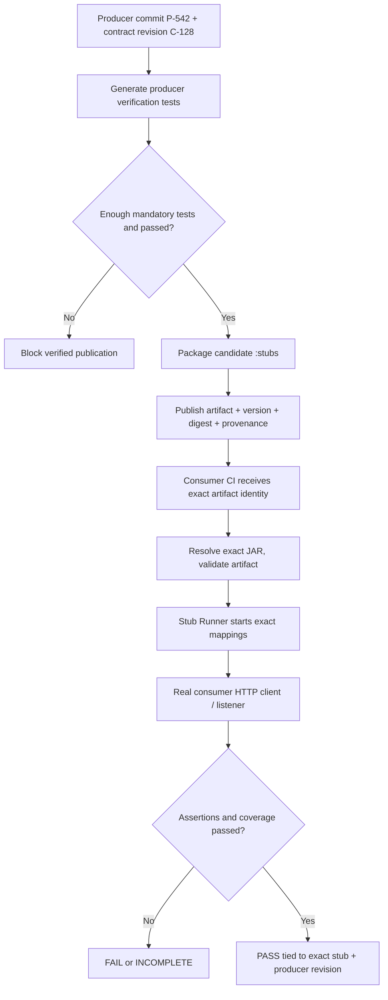
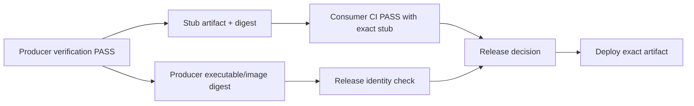

# Consumer pipeline using the exact stub version to verify

## 1. The problem: green CI that tested the wrong producer

**Spring Cloud Contract** helps producers and consumers agree on **HTTP** or **messaging** behavior via Groovy/YAML DSL. The producer generates and runs **contract verification tests** and packages **stubs**; the consumer uses **Stub Runner** to test requests, deserialization, error handling, or message listeners; and the **CI/CD** pipeline connects this evidence to catch incompatible API changes.

An especially dangerous bug occurs when selecting the **stub version**:

- `order-service` is about to deploy version **1.7.0**, adding a `state` field and accidentally dropping the `status` field.
- `checkout-service` version **3.2** still deserializes responses using `status`.
- Consumer CI pulls `order-service:1.6.0:stubs` from the local Maven cache and reports **PASS**.
- The release pipeline sees a green check, yet **Checkout 3.2 was never run against producer 1.7.0's stub**.

Consumer CI's result was not wrong for the input it used; **the error lies in the conclusion**: "consumer passed against stub 1.6.0" was interpreted as "consumer is compatible with producer 1.7.0".

> **Most important rule:** Before interpreting consumer test results, you must identify the **actual stub artifact downloaded**, the **producer build/revision it represents**, the **producer verification status**, and the **producer version that must be verified in this CI run**.

This lesson focuses on **a consumer pipeline selecting the right stub version**. After this lesson, you will be able to:

1. Distinguish **producer version**, **contract revision**, **stubs artifact version**, and **binary/image digest**.
2. Select stubs by **test goal**: currently deployed version, release candidate, or supported consumer matrix.
3. Design the producer CI → artifact repository → consumer CI handshake with **immutable versions and provenance**.
4. Configure Stub Runner in LOCAL/REMOTE/CLASSPATH modes while avoiding hardcoded stale versions and uncontrolled caches.
5. Turn verification of **right stub, right tests, right version** into an auditable release gate.
6. Troubleshoot false-green CI runs caused by fetching the wrong artifact, mapping, classifier, or version.

## 2. What defines a stub version?

In many projects using a Maven-compatible artifact repository, Spring Cloud Contract Stub Runner accepts coordinates in the common form:

```text
groupId:artifactId:version:classifier:port
```

Example:

```text
com.example:order-service:1.7.0-rc2:stubs:9090
```

| Part | Example | What to verify |
| --- | --- | --- |
| `groupId` | `com.example` | Exact namespace owned by the producer |
| `artifactId` | `order-service` | Exact producer that the consumer actually calls |
| `version` | `1.7.0-rc2` | Exact candidate/release the pipeline is evaluating |
| `classifier` | `stubs` | Selects the **stub JAR**, not the executable JAR or contracts JAR |
| `port` | `9090` | WireMock port for the consumer client to call, **not part of the Maven artifact** |

If a pipeline stores only `1.7.0-rc2` without `groupId`, `artifactId`, or `classifier`, it may resolve the wrong artifact. If the same version is overwritten, identical Maven coordinates **still do not uniquely identify the byte contents**. Critical releases therefore also require a **digest**, **build ID**, and source metadata.

### Contracts, stubs, and producer binaries are three distinct artifacts

```text
Git contract source C-128   ──┬──> generated producer tests
                              └──> generated stubs mappings
Git producer source P-542  ───────> executable/image order-service 1.7.0-rc2
Generated stubs mappings  ────────> order-service 1.7.0-rc2:stubs

Checkout consumer CKO-322 ────────> Stub Runner reads :stubs and runs client tests
```

A **contracts artifact** (when DSL lives in a separate repository) may hold `.groovy`/`.yml` sources. A **stubs artifact** holds HTTP/messaging data used in consumer tests. They are not interchangeable.

**Do not confuse:** `Spring Cloud Contract version` (the library/plugin version) is **not** the `order-service artifact version`. These two values can be completely different and must be managed compatibly via dependency BOM/build configuration.

## 3. "Right version" depends on the CI run's goal

A consumer pipeline can be triggered for different reasons:

| Run type | Producer version to use | Why |
| --- | --- | --- |
| **Consumer PR** | Currently supported producer release or the version the consumer will call | Detects whether new client code breaks live communication |
| **Producer candidate** | Stubs generated from the **exact producer candidate** under evaluation | Detects breaking changes before producer release |
| **Released producer** | Stubs of a **verified** release version | Tests consumer changes before production |
| **Multi-version migration** | A matrix of producer versions still present | Verifies canary, rollback, and slow client rollouts |
| **Experiment/candidate contract** | Separate candidate stub, labeled unverified if needed | Early feedback, **not release evidence** |

Never use a single default like `latest` for every goal. A consumer PR may want the **currently serving producer**; a producer release gate must select the **upcoming release**. Using the same old version for both causes CI to miss breaking changes in the new version.

### Three questions before starting tests

1. **Which producer are we proving compatibility with?** For example `order-service 1.7.0-rc2`, not merely "order-service".
2. **Who supplies those artifact coordinates?** Is there a manifest/test report from the producer pipeline, or does a human type a version manually?
3. **What does the pipeline do if resolution fails?** **Fail**, rather than silently falling back to `1.6.0` or searching `latest`.

A sound orchestration rule is: **the producer release pipeline passes the candidate stub identity to the consumer pipeline**; the consumer pipeline uses that identity and reports results bound to that exact artifact, instead of guessing from branch names.

## 4. The evidence chain to preserve



| Link | If skipped | Consequence |
| --- | --- | --- |
| Contract source | Unknown which contracts were generated | Producer and stub may diverge in promises |
| Producer verification | Only DSL/stubs exist without testing implementation | Consumer pass does not prove producer works |
| Artifact identity | No version/digest | CI may download an older build |
| Stub resolution | Unknown which JAR was actually loaded | Mappings may not represent the candidate |
| Consumer assertions | Stub Runner merely started | Unknown whether the client handles responses right |
| Release provenance | Deployed image differs from tested build | CI conclusion is disconnected from production |

**A `BUILD SUCCESS` badge does not replace this evidence table.** You must know which tests executed, which artifact was fetched, and which producer build was verified.

## 5. Producer CI: publish "verified" stubs only after running tests

An illustrative Groovy source contract:

```groovy
import org.springframework.cloud.contract.spec.Contract

Contract.make {
    description 'Checkout reads a confirmed order'
    request {
        method GET()
        url '/api/orders/42'
        headers {
            accept(applicationJson())
        }
    }
    response {
        status OK()
        headers {
            contentType(applicationJson())
        }
        body([
            orderId: 'ord-42',
            status: 'CONFIRMED'
        ])
    }
}
```

When the producer renames `status` to `state`, the **generated producer test** will catch it as long as the response contract still binds `status`. If tests have not run before stubs are published, the consumer only receives `status` from the simulated mapping and never learns the new implementation is broken.

### Sample Maven pipeline

When the producer **has configured** `spring-cloud-contract-maven-plugin`, base test class, and lifecycle:

```bash
./mvnw -B clean verify
# Only after tests pass and the artifact is properly attached:
./mvnw -B deploy
```

The `deploy` command may re-include related lifecycle phases; inspect your specific build config. If the plugin has not attached the `stubs` classifier or the runner does not discover generated tests, Maven exiting with code 0 is insufficient to call stubs verified.

### Sample Gradle pipeline

```bash
./gradlew clean contractTest
# Only after test reports and contract inventory meet requirements:
./gradlew verifierStubsJar
# Then invoke the exact publish task for the configured publication.
```

Task names and task dependencies vary by Gradle plugin version and multi-module configuration. Never assume `verifierStubsJar` forces `contractTest` to pass; **the CI release gate must verify explicitly**. Check the count of generated tests that actually executed, not merely the presence of generated source files.

### Conditions a producer gate should enforce

- Contract inputs match the exact source revision, without accidentally filtering out critical scenarios.
- Generated producer tests **compile, execute, and pass**, with required tests not skipped.
- The HTTP/messaging base class exercises the real producer implementation intended for verification.
- The stubs JAR is built from the **same contract revision** and marked `VERIFIED` only after producer tests pass.
- Maven coordinates, build ID, and stub digest are stored alongside test reports.
- The producer binary/image used for deployment is linked to the verified producer source/build.

If you want consumers to try an unimplemented contract, publish **candidate/unverified stubs** in a separate namespace/channel; never advertise them as "producer-verified".

## 6. Passing stub identity via a provenance-backed manifest

So consumer CI does not have to guess `1.7.0-rc2` from a Git branch name, producer CI can publish a **manifest** alongside the artifact. Example:

```yaml
producer:
  service: order-service
  sourceRevision: P-542
  artifactVersion: 1.7.0-rc2
  imageDigest: "<computed-producer-image-digest>"
contracts:
  revision: C-128
  requiredScenarioCount: 12
verification:
  status: PASS
  testsExecuted: 12
  testsFailed: 0
  testsSkipped: 0
stubs:
  groupId: com.example
  artifactId: order-service
  version: 1.7.0-rc2
  classifier: stubs
  sha256: "<computed-stubs-jar-sha256>"
  repository: "https://repo.example.org/maven-releases"
```

**This is a team-defined manifest schema**, not a file auto-generated by Spring Cloud Contract. The revisions, digests, and test counts in the example are fictional. In real CI, fields must come from the build, test reports, and published artifact; if a digest or test report is missing, mark `UNKNOWN`/`INCOMPLETE` instead of fabricating values.

### What must the producer publish?

| Field | Why it matters |
| --- | --- |
| `sourceRevision` | Identifies the exact producer code that was tested |
| `contracts.revision` | Identifies the exact Groovy/YAML content used for generation |
| `verification.status` + test counts | Distinguishes "passed" from "never ran" |
| `groupId/artifactId/version/classifier` | Enables consumers to resolve the exact JAR |
| `sha256` | Detects different bytes under the same coordinates |
| `repository` | Prevents pulling from the wrong local/private/public registry |
| `imageDigest` | Reconciles with the producer artifact to be deployed |

If contracts live in the **same Git repo as the producer**, both revisions may match. If contracts live in a **separate repository**, they can differ; having two different version strings is **not automatically an error** as long as there is a linked record and corresponding producer verification.

### Do not treat a manifest as the sole proof

A manifest can be misgenerated or copied from a previous build. For important releases, link to **test reports**, build job IDs, artifact repository metadata, checksums, and restricted publish permissions. If producer verification was `FAIL` yet the manifest says `PASS` because an old script ignored exit codes, the consumer pipeline should not trust that self-declared text alone.

## 7. Choosing where to load from: LOCAL, REMOTE, and CLASSPATH

`StubRunnerProperties.StubsMode` determines how Stub Runner locates stubs:

| Mode | Source | Suitable scenario | Version risks |
| --- | --- | --- | --- |
| `LOCAL` | Maven local repository | Developer runs producer then consumer on one machine; CI installs artifact per job | May pick up a **stale** JAR sitting in local cache |
| `REMOTE` | Maven-compatible artifact repository | Consumer CI independent from producer CI; published release/candidate version | Wrong registry, permissions, version, cache, or mutable artifact |
| `CLASSPATH` | Mappings/resources placed on test classpath | Demos or consumer tests bundling fixtures with tests | May contain data **that is not** a stub verified by a producer candidate |

### LOCAL does not mean "latest"

Running producer `./mvnw install` yesterday and checking out a new producer commit today **does not automatically update the local JAR**. `LOCAL` only tells Stub Runner **where** to look for the artifact, not whether it matches the commit under test.

If one pipeline builds both producer and consumer in the same job, you may choose `LOCAL`, provided you:

1. Build the producer at the target source revision.
2. Run full producer verification before installing the stubs artifact.
3. Install the **exact version** artifact into a job-isolated local repository.
4. Run consumer tests with the exact newly installed coordinates.
5. Inspect test reports and confirm no fallback to an artifact from a previous job.

### REMOTE is the common choice for multi-repository CI

With `REMOTE`, consumer CI uses a managed registry URL and the version passed by the producer pipeline. Never let `repositoryRoot` silently fall back to another mirror when an artifact fails to resolve, unless the mirror and provenance are controlled.

For Spring Cloud Contract versions supporting these properties, configuration typically uses `stubrunner.ids`, `stubrunner.stubs-mode`, and `stubrunner.repository-root`. When using `@AutoConfigureStubRunner` with inline attributes, avoid hardcoded values that **override** CI-injected configuration. Run a smoke test to verify property vs. annotation precedence in your project's exact SCC version.

### CLASSPATH is not automatically equivalent to a verified producer artifact

If a team copies JSON mappings into `src/test/resources` and runs in classpath mode, tests may be very fast and stable. However, if they did not come from **contracts verified against the producer release candidate**, the result only proves the consumer handles that fixture. Maintain a clear boundary between **mock fixtures** and **verified producer stubs**.

## 8. Configuring @AutoConfigureStubRunner for labs with a fixed version

A Spring Boot consumer can start Stub Runner via annotation:

```java
import org.junit.jupiter.api.Test;
import org.springframework.beans.factory.annotation.Autowired;
import org.springframework.boot.test.context.SpringBootTest;
import org.springframework.cloud.contract.stubrunner.StubRunnerProperties;
import org.springframework.cloud.contract.stubrunner.spring.AutoConfigureStubRunner;

import static org.assertj.core.api.Assertions.assertThat;

@SpringBootTest(properties =
    "clients.orders.base-url=http://localhost:9090")
@AutoConfigureStubRunner(
    ids = "com.example:order-service:1.7.0-rc2:stubs:9090",
    stubsMode = StubRunnerProperties.StubsMode.LOCAL
)
class CheckoutConsumerContractTest {

    @Autowired
    OrderClient orderClient;

    @Test
    void readsConfirmedOrderFromProducerCandidateStub() {
        OrderDto order = orderClient.getById("42");
        assertThat(order.status()).isEqualTo("CONFIRMED");
    }
}
```

`OrderClient` and `OrderDto` are **illustrative application types**, not Spring Cloud Contract classes. There must be a real HTTP client bean and matching DTO. The property `clients.orders.base-url` is a **consumer-defined application property** pointing the client to WireMock, not a default Stub Runner key.

This scenario is meaningful only if the producer published a stub for `GET /api/orders/42` and the test hits that exact mapping. If the consumer still calls `http://order-service:8080`, Stub Runner starting successfully does not prove the client is being tested against the stub.

### Why shouldn't the lab snippet be copied verbatim into a release pipeline?

The annotation above **hardcodes 1.7.0-rc2**. After the producer releases 1.7.0 or 1.8.0, tests might keep running against stub 1.7.0-rc2. In real CI, use a **version configuration injected from the artifact manifest/producer release event** rather than editing Java strings on every run.

If using a fixed set of producer versions to verify rollback compatibility, keep explicit versioned jobs/variants. When the goal is each release's new candidate, hardcoding versions in test source introduces drift risk.

## 9. Passing the version via CI configuration instead of editing source

A design can leverage external Stub Runner configuration. In several Spring Cloud Contract branches, `@AutoConfigureStubRunner` enables auto-configuration while `stubrunner.*` values come from the Spring environment:

```java
import org.springframework.boot.test.context.SpringBootTest;
import org.springframework.cloud.contract.stubrunner.spring.AutoConfigureStubRunner;

@SpringBootTest(properties =
    "clients.orders.base-url=http://localhost:9090")
@AutoConfigureStubRunner
class CheckoutConsumerContractTest {
    // Inject OrderClient; run tests/assertions as in section 8.
}
```

An illustrative `application-contract-test.yml` profile:

```yaml
stubrunner:
  ids:
    - "com.example:order-service:1.7.0-rc2:stubs:9090"
  stubs-mode: REMOTE
  repository-root: "https://repo.example.org/maven-releases"
clients:
  orders:
    base-url: "http://localhost:9090"
```

These are **example values**; the config file loads only when the corresponding profile/test context is active. In real CI, `ids` and `repository-root` should come from **controlled configuration variables**, rather than keeping a fixed candidate version in YAML by default. Verify exact property names, binding behavior, and **precedence between annotations and properties** for your SCC version using a small test.

### Passing via JVM system properties

In environments where Stub Runner supports these properties, an illustrative command:

```bash
STUB_VERSION="1.7.0-rc2"
STUB_REPOSITORY="https://repo.example.org/maven-releases"

./mvnw -B verify \
  "-Dstubrunner.ids=com.example:order-service:${STUB_VERSION}:stubs:9090" \
  "-Dstubrunner.stubs-mode=REMOTE" \
  "-Dstubrunner.repository-root=${STUB_REPOSITORY}"
```

**Important:** `-D` on Maven can become Maven user properties, which the Spring test context sees depending on how the plugin/test runner is configured; for any given project, verify those values actually reach the test JVM's `Spring Environment`. Do not just rely on a command that looks right. With Gradle, ensure system properties from the Gradle process are forwarded to the `Test` task, rather than assuming `-D` on the Gradle CLI is always forwarded to the forked test JVM.

A less ambiguous Gradle approach configures the `contractConsumerTest` or `test` task to pass properties into the test JVM:

```groovy
tasks.named('test', Test) {
    systemProperty(
        'stubrunner.ids',
        providers.gradleProperty('contractStubIds').get()
    )
    systemProperty('stubrunner.stubs-mode', 'REMOTE')
    systemProperty(
        'stubrunner.repository-root',
        providers.gradleProperty('contractStubRepository').get()
    )
}
```

This example **requires both Gradle properties** to exist; otherwise `get()` fails task configuration, matching the **fail closed** principle when the target test version is missing. In projects with multiple test tasks, apply this to the actual consumer integration test task rather than every unit test. Also verify how Spring Boot loads profiles and these properties with your SCC version.

### Avoid dangerous default versions

A pattern such as:

```text
STUB_VERSION=${STUB_VERSION:-1.6.0}
```

can cause a **false positive**: if producer candidate 1.7.0 omits the version, the pipeline silently falls back to 1.6.0 and turns green. For a release gate, **a missing version must fail**, never fall back to an older version. In this example, the syntax above is illustrative Bash shell syntax, not a Spring Cloud Contract property.
can cause a **false positive**: if producer candidate 1.7.0 omits the version, the pipeline silently falls back to 1.6.0 and turns green. For a release gate, **a missing version must fail**, never fall back to an older version. In this example, the syntax above is illustrative Bash shell syntax, not a Spring Cloud Contract property.

## 10. GitHub Actions example: picking the right version and checking checksum before testing

The following example illustrates a **consumer CI job triggered with a producer candidate version and SHA-256 from the producer pipeline**. The goals are:

1. Receive **mandatory** version/digest inputs from release orchestration.
2. Download the stubs JAR with **exact coordinates** from the configured registry.
3. **Compare the JAR checksum** against the expected digest.
4. Run Stub Runner in `LOCAL` mode on that exact verified JAR.
5. Save test reports for the release gate decision.

```yaml
name: Consumer contract compatibility

on:
  workflow_dispatch:
    inputs:
      stub_version:
        description: "Verified producer candidate version"
        required: true
        type: string
      stub_sha256:
        description: "Expected SHA-256 of stubs JAR"
        required: true
        type: string

jobs:
  verify-consumer:
    runs-on: ubuntu-latest
    steps:
      - uses: actions/checkout@v4
      - uses: actions/setup-java@v4
        with:
          distribution: temurin
          java-version: "21"
          cache: maven

      - name: Resolve exact stubs artifact
        env:
          STUB_VERSION: ${{ inputs.stub_version }}
          STUB_SHA256: ${{ inputs.stub_sha256 }}
        run: |
          set -euo pipefail
          test -n "$STUB_VERSION"
          test -n "$STUB_SHA256"
          ./mvnw -B dependency:get \
            "-Dartifact=com.example:order-service:${STUB_VERSION}:jar:stubs" \
            "-DremoteRepositories=contractRepo::default::https://repo.example.org/maven-releases" \
            "-Dtransitive=false"
          jar="$HOME/.m2/repository/com/example/order-service/${STUB_VERSION}/order-service-${STUB_VERSION}-stubs.jar"
          test -f "$jar"
          actual="$(sha256sum "$jar" | cut -d ' ' -f 1)"
          test "$actual" = "$STUB_SHA256"

      - name: Run consumer tests against verified local JAR
        env:
          STUB_VERSION: ${{ inputs.stub_version }}
        run: |
          set -euo pipefail
          ./mvnw -B verify \
            "-Dstubrunner.ids=com.example:order-service:${STUB_VERSION}:stubs:9090" \
            "-Dstubrunner.stubs-mode=LOCAL"

      - name: Preserve JUnit reports
        if: always()
        uses: actions/upload-artifact@v4
        with:
          name: consumer-test-reports
          path: |
            target/surefire-reports/
            target/failsafe-reports/
          if-no-files-found: warn
```

**This is an illustrative workflow** that must be adapted to your real build/repository. It assumes:

- Maven has the `dependency:get` goal available and a compatible plugin/test lifecycle.
- The repository URL in the example is replaced with a real registry; if private, credentials live in **Maven settings/secret store**, never hardcoded tokens.
- `./mvnw verify` actually runs consumer contract tests, not just unit tests. If tests live in another Maven module, target the right module/goal.
- `@AutoConfigureStubRunner` picks up `stubrunner.ids` and `stubrunner.stubs-mode` from the test environment in your SCC version; confirm with a smoke test.
- SHA-256 and version **come from a verified producer manifest**, not arbitrary manual input in an automated release gate.
- If checking out an older consumer version, the workflow checks out the **exact commit/tag** of the supported consumer, rather than defaulting to the latest branch.

In automated release flows, the producer can trigger `workflow_dispatch`/`workflow_call` or an equivalent event mechanism and pass metadata over a controlled channel. **Do not treat arbitrary user-supplied input as proof that producer verification passed.** The release gate must cross-check a trusted manifest/test report source.

### Why pre-download and then run LOCAL?

In this example, the job verifies the digest of a JAR in the local Maven repository, then runs Stub Runner `LOCAL` against those exact coordinates. That reduces the risk of tests **fetching from another registry** after the checksum check. If a job uses `REMOTE` directly, you need a mechanism to verify **the exact bytes Stub Runner resolved**, rather than hashing an unused file.

### A warning about caching

`actions/setup-java` can cache Maven dependencies. If a registry allows overwriting a release artifact at the same version, Maven might retain an older JAR. **The SHA-256 check above catches byte mismatches against the manifest**, yet you still need an **immutable** repository so producer and consumer do not pull different builds. Never fix a checksum failure by disabling the check or falling back to another version.

### CI step still missing for strict enforcement

The sample workflow saves JUnit reports, yet does not verify **executed test counts**, **the required scenarios list**, or **producer image provenance**. In a real system, add a quality-gate step that parses reports/test inventory before concluding `PASS`; if reports are missing or show **0 consumer contract tests**, fail. That is the pipeline's responsibility, not default behavior when uploading artifacts.

## 11. Multi-consumer pipelines: choosing the right version for each cell

A producer often has multiple supported consumers, or one consumer must run against multiple producer versions during canary/rollback. Never treat a single job with `order-service:1.7.0-rc2:stubs` as representing the entire matrix.

Example compatibility matrix:

| Consumer version | Producer 1.6.0 (deployed) | Producer 1.7.0-rc2 (candidate) | Why run |
| --- | --- | --- | --- |
| Checkout 3.2 | PASS | **FAIL** if `status` is dropped | Older supported consumer |
| Checkout 3.3 | PASS | PASS | Newer consumer supports both |
| Reporting 2.7 | PASS | NOT_RUN | Batch consumer gate incomplete |
| Mobile Gateway 4.0 | NOT_REQUIRED if not routed to 1.6 | PASS | Client uses API v2 only |

**This matrix is an example**, not real results. `NOT_RUN` differs from `NOT_REQUIRED`. If Reporting 2.7 is still supported and must tolerate producer 1.7, an unexecuted cell must report **INCOMPLETE**, not pass.

### Required inputs for each job

```text
producerArtifactVersion
producerSourceRevision
stubsArtifactCoordinates
stubsArtifactDigest
contractSourceRevision
consumerService
consumerVersionOrGitRevision
requiredScenarioIds
expectedTestRunner
```

Not all of these need to be environment variables; they can live in a release manifest, versioned matrix, or orchestrator. When inspecting results, however, you must know **which version was tested against which**.

### Avoid testing every combination mechanically

If a system has 30 producer versions and 20 consumer versions, running 600 combinations on every PR may be impractical. Select a subset based on **support policy**, currently deployed versions, rollback horizon, and risk surface:

- Each producer candidate against **every supported consumer version** that will actually call it.
- Consumer PRs against the currently deployed producer and upcoming producer candidate if required.
- Expanded matrices for releases/canaries, major schema changes, or migrations.
- Combinations that **cannot occur** must be marked `NOT_REQUIRED` with routing/deployment justification, never simply omitted.

The result is an **explainable** matrix, rather than a large test count missing critical scenarios.

## 12. Do not confuse stub version with API version and consumer version

Three different axes often appear in the same log:

```text
Order API version:      /v2/api/orders
Producer JAR version:   order-service:1.7.0-rc2
Stubs JAR version:      order-service:1.7.0-rc2:stubs
Consumer app version:   checkout-service:3.2.4
```

`/v2` can be the **HTTP interface version**, not meaning the producer artifact must carry version 2.0. A producer 1.7 can serve both `/v1` and `/v2`. Consumer 3.2 may call API v1 while consumer 4.0 calls v2.

If a pipeline infers `stub version = consumer version` or `stub version = API path version`, it can download the wrong artifact. Obtain the **producer stub version from the producer release manifest**, and the **consumer version from the deployment/support inventory**.

### Migration testing does not necessarily use a single stub

A consumer preparing to migrate from `order-service 1.6` to `1.7` needs at least:

1. Test the current consumer against **producer stub 1.6** for a baseline.
2. Test the same consumer against **candidate stub 1.7** to detect differences.
3. If differences exist, run producer verification and decide between a backward-compatible fix or a versioned migration.

Without keeping both results separate, green tests against 1.6 can mask failures against 1.7; conversely, an unverified candidate stub can raise false alarms about production.

## 13. Verifying tests actually called the right stub

Stub Runner starting up is not enough. The consumer HTTP client must also call the right host, port, and path:

```text
Producer candidate stub:
  com.example:order-service:1.7.0-rc2:stubs:9090

Consumer property:
  clients.orders.base-url = http://localhost:9090

Actual request:
  GET http://localhost:9090/api/orders/42
```

When a test receives **HTTP 404**, distinguish:

| Which 404? | Cause | What to assert |
| --- | --- | --- |
| **Business 404** | Mapping `GET /api/orders/999` intentionally returns `ORDER_NOT_FOUND` | HTTP 404 **and** JSON `code` |
| **Unmatched WireMock 404** | URL/method/query/header/body did not match | Do not treat as business success; inspect request journal |
| **404 from another real service** | Client does not point to WireMock and calls another environment | Verify actual destination and test profile |

To investigate, inspect the **actual request**, loaded mappings, and artifact/version/digest. A consumer test asserting only `status == 404` can pass falsely if it doesn't know where the 404 came from.

### Dynamic ports and parallel tests

Port `9090` is convenient in a lab, but can collide when jobs run in parallel on the same worker. Stub Runner supports dynamic port allocation/lookup in compatible versions; when using that approach, the HTTP client must receive the exact port assigned by Stub Runner during the test lifecycle. **Never leave the base URL hardcoded to 9090 when the server moved to a dynamic port.**

### If consumer tests use messaging

For event contracts such as `OrderConfirmed`, Stub Runner can use `StubTrigger` to emit sample messages via a supported adapter. "Right stub" then also includes:

- The artifact contains the message contract and right `label`;
- Destination/binding matches Spring Cloud Stream, Integration, AMQP, Kafka, or another adapter;
- The real consumer listener is registered before triggering;
- Assertions verify listener side effects, **not merely `trigger() == true`**;
- Producer messaging verification ran against the candidate revision.

Stub messaging tests do not by themselves prove broker delivery, ordering, duplicates/acks, or transactions/outbox; add integration tests if those properties are business requirements.

## 14. Fail closed: conditions that must stop the consumer pipeline

For a release gate, **unable to verify** is different from **compatible**. A reporting convention:

| Status | Meaning | Eligible for automated release? |
| --- | --- | --- |
| **PASS** | Exact verified artifact, mandatory tests executed and passed | Possible, after other gates |
| **FAIL** | Tests executed and detected a mismatch | No |
| **NOT_RUN** | Tests did not run / missing report | No |
| **INCOMPLETE** | Missing checksum, provenance, artifact, or mandatory scenarios | No |
| **SKIPPED** | Tests exist but did not run due to filter/disabled | Requires exception policy, never automatic |
| **CANDIDATE_ONLY** | Used a stub not yet verified by producer for early feedback | Cannot count as release compatibility PASS |
| **NOT_REQUIRED** | A combination confirmed unnecessary by support policy | Not PASS; must record justification |

These statuses are **CI conventions**, not default Spring Cloud Contract enums.

### Specific stop conditions

1. **No version received** from the producer release manifest → fail, no fallback.
2. **Unable to resolve `group:artifact:version:stubs`** → fail, do not try other coordinates.
3. **Actual digest differs from manifest digest** → fail, investigate mutable artifact/cache or wrong repository.
4. **No producer verification PASS at the right revision** → mark release evidence incomplete.
5. **Stub Runner loads wrong mapping or HTTP client calls wrong port** → fail.
6. **Zero consumer contract tests executed** → fail if this job is mandatory.
7. **Missing required scenarios** even though other tests ran → fail/INCOMPLETE.
8. **Consumer contract assertion fails** → fail, do not hide with broad matchers or hand-edit the stub JAR.
9. **Test job cancelled/timed out** → NOT_RUN/INCOMPLETE per policy, never convert to PASS.

### Test filters can create misleading reports

If a developer runs only:

```bash
./mvnw -B -Dtest=CheckoutHappyPathTest test
```

that test passing does **not** mean error, pagination, authentication, or message listener tests ran. Gradle `--tests` carries the same risk. For releases, execute the required set defined by the inventory and inspect test reports.

### Mismatch 404 stubs cannot substitute for error contracts

A test meant to verify the consumer handles `ORDER_NOT_FOUND` that asserts only HTTP 404 can still pass even if the mapping for `GET /api/orders/999` is missing. Assert **`body.code`**, content type, and error-mapping logic; when debugging, inspect WireMock's unmatched request journal in an authorized test environment. This is one reason "tests ran" still requires "tests verify what must be proven".

## 15. Caches, snapshots, and overwritable artifacts

Caching speeds up builds but can introduce **stale stubs**. Breakdown by case:

| Case | What can happen | How to control |
| --- | --- | --- |
| Shared Maven `~/.m2` across jobs | Old JAR persists under the same version | Isolate local repo per job or check digest |
| Gradle dependency cache | Cached dependency metadata/artifacts | Pin artifact/revision, inspect dependency resolution, checksum |
| `-SNAPSHOT` republished | Same logical version has multiple timestamps/builds | Record exact timestamped artifact/digest |
| `latest` / version range | Resolves to different versions today and tomorrow | Pick an exact version for release |
| Release repo allows overwrites | Two different JARs share identical coordinates | Immutable publication + checksum/provenance |
| Wrong mirror/public repo priority | Downloads artifact with same namespace from wrong source | Control repository order, ownership, checksum |
| Reused Docker image tag | Deploys different build than verified code | Pin image digest, not just tag |

### Why aren't `-U` or "clear cache" a release policy?

Maven `-U` forces checking snapshot updates, yet **does not make a mutable version immutable** and does not prove the artifact came from a passing producer build. Clearing caches can aid debugging, but the durable fix is **immutable versions**, **digests**, and manifests linked to producer verification.

### A sensible caching strategy

- Cache **common tools/dependencies** via CI mechanisms.
- Verified stubs artifacts should use **immutable coordinates** with checksum verification.
- When publishing candidates, use unique versions/build IDs that never collide with older builds.
- If an artifact must come from a private registry, isolate namespaces/repositories to avoid mixing sources.
- If checksum fails, **fail** and investigate; never overwrite the expected checksum with the newly downloaded file.

## 16. Security and registry access controls in consumer CI

Stubs are test data, yet the artifact repository and CI credentials remain privileged resources. When a consumer job downloads from a registry:

- Use a **read-only** account to fetch stubs artifacts; consumers do not need publish/overwrite permissions.
- Store tokens/passwords in the **CI secret store**, Maven `settings.xml`/Gradle credentials, never committed to `application-test.yml`, code, or workflows.
- Use HTTPS/trusted registry endpoints and configure certificates appropriate for internal environments.
- Never print `Authorization` headers or credential-embedded URLs in logs when debugging 401/403 download errors.
- Scope producer CI permissions so it can publish only to namespaces the producer owns.
- Avoid putting real tokens, personal emails/addresses, or production transaction data into contract/stub fixtures.
- Store manifests/digests in a location with proper integrity/permissions; never allow an untrusted pull request to rewrite "expected SHA-256" and declare a candidate verified.

### Fork PRs and secret permissions

Consumer CI running on a pull request from a fork may **not receive registry secrets** by platform policy. In that case, remote stub tests cannot run; report **NOT_RUN/INCOMPLETE** for release purposes or use an approved set of public/synthetic stubs for early feedback. Never open registry write access or check tokens into the repository just to turn a job green.

### Remember to distinguish data sources

A manifest published by producer CI typically contains `sourceRevision`, tested artifact ID, and checksum. **Do not trust an arbitrary manifest file edited by a contributor** when the release gate needs independent verification evidence. Artifact signing/attestation or build metadata verification may be required depending on organizational risk.

## 17. Diagnosing wrong-stub-version incidents

| Symptom | Possible cause | First check |
| --- | --- | --- |
| Consumer PASS even though producer just changed response | Consumer is using a **stale stub** | Print downloaded artifact coordinates/digest, compare with candidate manifest |
| Stub Runner reports artifact not found | Wrong group/artifact/version/classifier | Check registry publication and repository URL |
| Works locally, CI gets 404 resolving artifact | `LOCAL` has old artifact while `REMOTE` not published | Check producer candidate publication |
| Registry 401/403 | Missing/expired/under-privileged token | Maven/Gradle credentials, CI secrets |
| SHA-256 mismatch | Stale cache, overwritten artifact, or wrong repo | Compare local file bytes against producer digest |
| Stub Runner starts but client gets connection error | Client URL port differs from stub port | Compare effective base URL and `ids` |
| WireMock returns 404 | Mapping missing or request matcher failed | Inspect actual HTTP request, mappings, and version |
| Stub Runner loads 1.6 though CI asked for 1.7 | Hardcoded annotation, property precedence, stale profile | Check effective configuration and runtime logs |
| CI reports 0 tests | Wrong test runner/source set/filter | JUnit reports, Surefire/Failsafe, Gradle tasks |
| Maven `verify` passes yet consumer IT never ran | Failsafe not wired or test name mismatch | Plugin test lifecycle and reports |
| Producer verification FAIL, consumer PASS | Simulated stub still passes; producer code is wrong | Read producer assertions, block release |
| Producer PASS, consumer 3.2 fails against 1.7 | Breaking change or strict consumer deserializer | Compare contract with DTO/client version 3.2 |
| Consumer messaging trigger returns true, listener does nothing | Wrong adapter/destination or missing assertion | Inspect listener side effects |
| CI tested 1.7 yet deployed image tag 1.8 | Released artifact differs from verified build | Compare image digest and build provenance |
| A supported consumer is missing from the matrix | Missing inventory/trigger | Check versioned support policy |

### Outside-in investigation procedure

```text
1. GOAL: which producer version must be verified?
2. IDENTITY: exact group/artifact/version/classifier/digest?
3. SOURCE: producer code + contract revision + verification report?
4. RESOLUTION: which file did Stub Runner actually load?
5. ROUTING: did the HTTP client/listener hit the right stub?
6. ASSERTIONS: did tests verify real consumer behavior?
7. COVERAGE: did all mandatory scenarios/consumer versions run?
8. DEPLOY: is the production artifact the verified build?
```

Do not modify the producer controller just because the consumer got a 404 from WireMock; first verify whether the request matched the right stub. And never alter a contract just so a consumer passes against an artifact that does not represent the producer candidate.

## 18. Hands-on lab: releasing Order Service 1.7 without accidentally testing 1.6

### Context

Producer `order-service` has two release candidates:

| Artifact | Producer implementation | Producer verification | Notes |
| --- | --- | --- | --- |
| `1.6.0` | Response includes `status` | PASS | Currently deployed release |
| `1.7.0-rc1` | Renamed `status` to `state` | FAIL against old contract | Incompatible candidate |
| `1.7.0-rc2` | Keeps `status` and adds `state` | PASS per required contracts | Candidate awaiting consumer tests |

Consumers:

- `checkout-service 3.2` requires `status = CONFIRMED`.
- `reporting-service 2.7` requires HTTP 404 with `code = ORDER_NOT_FOUND`.
- `mobile-gateway 4.0` requires `state` on API v2.

Suppose the producer pipeline for `1.7.0-rc2` publishes the stubs artifact:

```text
com.example:order-service:1.7.0-rc2:stubs
Producer revision: P-542
Contract revision: C-128
Verification: PASS, 12 executed, 0 failed
SHA-256: <from-producer-build>
```

### Part A — Choosing the version to test

Evaluate the three choices in Checkout 3.2 CI:

1. `com.example:order-service:1.6.0:stubs`
2. `com.example:order-service:1.7.0-rc1:stubs`
3. `com.example:order-service:1.7.0-rc2:stubs`

**Answer:** If the goal is the **release gate for 1.7.0-rc2**, only option **(3)** is meaningful. (1) is the old release baseline. (2) is a candidate whose producer verification is FAIL, useful only for investigation or feedback, not release compatibility evidence. Confirm artifact (3) has the exact source/digest and passing test report.

### Part B — Verifying responses and error APIs

Sample producer contract for Checkout 3.2:

```yaml
description: Checkout 3.2 reads order status
request:
  method: GET
  url: /api/orders/42
  headers:
    Accept: application/json
response:
  status: 200
  headers:
    Content-Type: application/json
  body:
    orderId: "ord-42"
    status: "CONFIRMED"
```

Another contract for Reporting 2.7:

```yaml
description: Reporting 2.7 handles missing order
request:
  method: GET
  url: /api/orders/999
response:
  status: 404
  headers:
    Content-Type: application/json
  body:
    code: "ORDER_NOT_FOUND"
```

Each consumer must use the HTTP client of its **corresponding consumer version**, connecting to Stub Runner loaded with `1.7.0-rc2:stubs`. Checkout asserts `status`; Reporting asserts both status and error `code`. If WireMock returns 404 due to an unmatched request, Reporting **must not be marked passing**.

### Part C — Building a versioned pipeline

Design a job accepting inputs:

```text
STUB_GROUP=com.example
STUB_ARTIFACT=order-service
STUB_VERSION=1.7.0-rc2
STUB_CLASSIFIER=stubs
STUB_SHA256=<from-producer-manifest>
PRODUCER_REVISION=P-542
CONTRACT_REVISION=C-128
```

Execute:

1. Verify no mandatory input is empty.
2. Download the exact artifact from a controlled registry; use a read-only secret if required.
3. Compare SHA-256 against the digest supplied by the producer.
4. Load the artifact via Stub Runner in the selected mode.
5. Run consumer assertions and collect executed/failed/skipped test counts.
6. Attach producer revision, contract revision, stub identity/digest, and consumer revision to the report.

Never allow a default `1.6.0` when `STUB_VERSION` is missing. If `1.7.0-rc2` is absent from the registry, the pipeline must **FAIL/INCOMPLETE**, rather than retrying `1.6.0` until green.

### Part D — Injecting intentional errors and predicting outcomes

| Mutation | Expected result |
| --- | --- |
| Omit `STUB_VERSION` | Job stops before testing, reporting missing input |
| Change version to `1.6.0` in the 1.7 release gate | Identity gate catches wrong candidate; does not count as 1.7 PASS |
| Keep version but alter expected SHA-256 | Digest gate fails |
| Change client `Content-Type` to `text/plain` when contract requires JSON | Request matcher fails to match or client test fails |
| Remove `status` in producer 1.7.0-rc2 | Producer contract verification fails |
| Run consumer against stale stub 1.6 | Consumer may pass; proves nothing about 1.7 |
| Change `/api/orders/999` to `/api/order/999` | Fails to match business 404; error code test must fail |
| Disable/skip all consumer contract tests | Execution gate fails due to 0 required tests |
| Producer and consumer are valid, yet registry returns 403 | Job must not report PASS; fix permissions |
| Reporting 2.7 CI did not run | Overall matrix is `INCOMPLETE`, not PASS |

### Part E — Writing the compatibility report

A **hypothetical report after jobs actually run**:

```text
Producer target: order-service 1.7.0-rc2 (P-542)
Contracts revision: C-128
Producer verification: PASS (12 executed, 0 failed)
Exact stubs: com.example:order-service:1.7.0-rc2:stubs
Stub digest check: PASS
Checkout 3.2 consumer contract tests: PASS (3 executed)
Reporting 2.7 consumer contract tests: NOT_RUN
Mobile 4.0 consumer contract tests: PASS (2 executed)
Release compatibility evidence: INCOMPLETE
```

**Explanation:** Even though Checkout and Mobile passed, Reporting is still in the supported set and has not run; you cannot claim "all supported consumers are compatible with producer 1.7.0-rc2". If the organization approves an exception, record the owner, risk, and due date—never rewrite `NOT_RUN` to `PASS`.

### Exercise extension

The producer deploys via canary: 10% traffic goes to 1.7.0-rc2 and the rest to 1.6.0. Mobile 4.0 only supports API v2 introduced in 1.7. What should you do?

- Test Mobile against **both** producer versions if it can encounter both.
- Or guarantee Mobile routes only to 1.7, with a verified feature flag/rollback strategy.
- Avoid rolling out Mobile 4.0 globally before producer v2 is ready in every region serving it.

When a broker or database is involved, add integration tests; contract compatibility only protects the documented interfaces.

## 19. Release gate: from producer stub to actual deployed artifact

Another essential condition after consumer CI is that **the deployed producer artifact must be the build that passed verification**. If tests ran on `P-542` while the deployed image was built from unverified `P-550`, `P-542` tests cannot serve as solid proof for `P-550`.



### Minimum release conditions

- Producer verification passed on code/sources matching the target version.
- The stubs artifact was generated from contracts at the **same revision** and carries provenance.
- Consumer suites for **every version supported under policy** ran against the candidate stub, or hold an explicitly approved exception.
- Artifact checksums are verified when resolving from the registry.
- Test reports explicitly state **executed/failed/skipped** counts and scenario coverage, not just job exit codes.
- The deployed producer artifact/image matches the version/digest evaluated by the release gate.
- Out-of-contract concerns (auth, broker routing, DB commits, idempotency, timeouts) are tested at appropriate layers.

### How to phrase an auditable conclusion

Say:

> Producer `order-service 1.7.0-rc2` at revision `P-542` passed producer contract tests from `C-128`; `checkout-service 3.2` and the listed consumer versions passed against the stubs JAR with digest `D`. This conclusion applies to the **executed scenarios** and the **verified artifact**.

Do not say:

> The entire system is guaranteed compatible because Stub Runner returned 200 and the pipeline is green.

That is the difference between **version-bound evidence** and **over-extrapolating from a single test**.

## 20. Checklist for a consumer pipeline using the right stub version

- [ ] **Goal** is identified: currently deployed producer, producer candidate, or rollback matrix.
- [ ] Producer pipeline publishes **exact artifact coordinates** including group/artifact/version/classifier.
- [ ] There is a trusted source for the verified producer source revision and contract revision.
- [ ] Generated producer tests actually executed and passed on the right revision; no zero required tests.
- [ ] Stubs artifact is published only after the producer gate, or is clearly labeled candidate/unverified.
- [ ] Registry and publications enforce immutable versions / proper SNAPSHOT controls.
- [ ] Consumer CI receives version/digest **from the producer manifest/release orchestration**, never guessing from branch names.
- [ ] No silent fallback to an old stub or `latest` version in release gates.
- [ ] `LOCAL`, `REMOTE`, `CLASSPATH` are chosen deliberately; it is clear where Stub Runner loads the artifact from.
- [ ] Artifact resolves from the right repo, with `stubs` classifier and expected checksum.
- [ ] If Maven/Gradle caching is enabled, the actually loaded artifact is verified to prevent stale artifacts.
- [ ] Stub Runner annotation/property config does not hardcode a different version than CI.
- [ ] **Real consumer** HTTP client or message listener runs against the right stub host/port/destination.
- [ ] Consumer tests verify status, headers, body/error codes, and key side effects; not just that the stub server started.
- [ ] Test runner executed all **required consumer contract tests**, with zero unexpected skips or zero test counts.
- [ ] Each result record binds **consumer version/revision** and **producer candidate version/digest**.
- [ ] Compatibility matrix clearly reports PASS, FAIL, NOT_RUN, SKIPPED, NOT_REQUIRED, and INCOMPLETE.
- [ ] Rollout/canary/rollback have been evaluated for all possible producer–consumer combinations.
- [ ] Producer executable/image used for deployment is reconciled against the verified artifact.
- [ ] Registry secrets are protected; consumer CI holds only necessary read permissions.
- [ ] Failures from missing version, checksum mismatch, artifact 404/403, or missing tests **block release**, without mutating expected inputs.

## 21. Knowledge self-check and reference docs

| Question | Short answer |
| --- | --- |
| Does consumer passing against stub 1.6.0 prove producer 1.7.0? | **No**, you need verified stubs from 1.7.0 and tests on the right consumer |
| Does an identical Maven version mean identical bytes? | No if snapshots/releases are overwritten; checksums and immutability policy are needed |
| Does `@AutoConfigureStubRunner` starting make a consumer test valid? | Not yet; the client must call the stub and assert real behavior |
| Does `LOCAL` with yesterday's JAR represent today's commit? | No; matching provenance/build is required |
| If `STUB_VERSION` is missing, should it fall back to stable? | **No** in a release candidate gate; it must fail |
| Does an unexecuted consumer test count as PASS? | No, it must report NOT_RUN/INCOMPLETE |
| Do producer verification and consumer Stub Runner replace each other? | No; they verify opposite sides |
| Must we run every version combination that ever existed? | No; run combinations **still supported and actually possible** |
| What if the deployed artifact differs from the verified image? | Release evidence is no longer bound to the target artifact |

During real implementation, consult documentation for the **exact pinned version** of Spring Cloud Contract:

- [Spring Cloud Contract — Reference](https://docs.spring.io/spring-cloud-contract/reference/): overview of producer verification, stubs, and Stub Runner.
- [Spring Cloud Contract — Stub Runner](https://docs.spring.io/spring-cloud-contract/reference/project-features-stubrunner.html): artifact resolution, loading modes, annotations/properties, and HTTP/messaging stubs.
- [Spring Cloud Contract — Maven Project](https://docs.spring.io/spring-cloud-contract/reference/maven-project.html) and [Gradle Project](https://docs.spring.io/spring-cloud-contract/reference/gradle-project.html): generating tests, packaging/publishing artifacts, and lifecycles.

Documentation URLs may change across branches; never copy a configuration from another version without verifying it via a smoke test. This is a learning guide, not a claim that the illustrative CI configs were executed in a workspace.

**Remember:** A consumer pipeline is meaningful only when the **right consumer version is tested**, against the **right producer candidate**, using the **right verified stubs artifact**, with the **right checksum**, hitting the **right mapping/destination**, and executing **sufficient assertions**. Spring Cloud Contract generates tests and stubs from Groovy/YAML DSL; CI/CD must preserve the link **producer source + contract revision → verified stubs → consumer test result → release artifact**. A green result against the **wrong stub version** is not compatibility evidence for the upcoming producer release.
