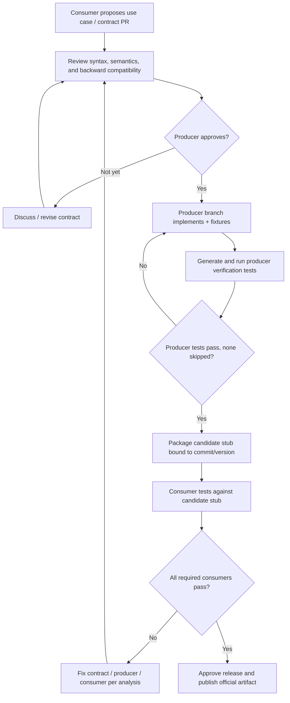
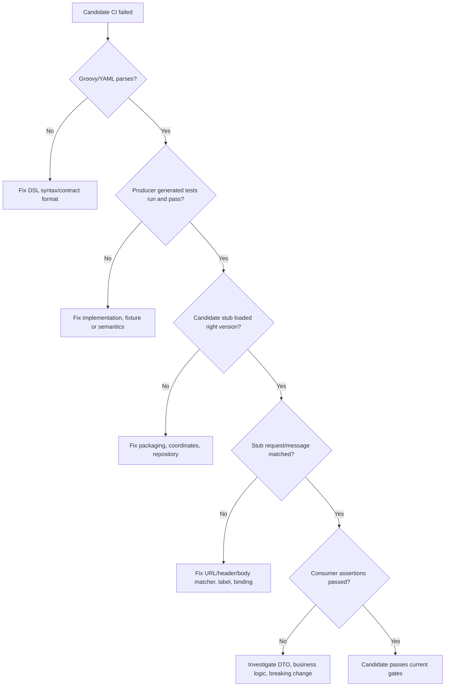

# Testing proposed changes before producer release

## 1. Why test while a change is still a proposal?

In **Spring Cloud Contract** (`SPRING_CLOUD_CONTRACT` module), teams describe **HTTP** or **messaging** interactions using **Groovy/YAML DSL**. From contracts, the producer can generate tests proving the real application satisfies the behavior; the tool also produces stubs for consumers to run via **Stub Runner**. When those steps are wired into **CI/CD**, teams catch incompatible API changes **before the producer releases**.

Timing matters: if a producer deploys a change that breaks a consumer and it is only discovered when the consumer reaches production, remediation is far harder than fixing the contract or implementation right inside a pull request (PR).

For example, Inventory Producer plans to change its response from:

```json
{
  "sku": "SKU-001",
  "available": true,
  "quantityAvailable": 12
}
```

to:

```json
{
  "sku": "SKU-001",
  "availability": "IN_STOCK",
  "quantityAvailable": "12"
}
```

If Checkout Consumer currently uses a boolean `available` and numeric `quantityAvailable`, the producer just **removed a field** and **changed a data type**. Producer unit tests alone might still pass, yet the real consumer may fail to deserialize or make incorrect ordering decisions.

**The goal of proposal testing** is to answer three questions before release:

1. **Is the proposed contract accurate and accepted by all parties?**
2. **Does the producer candidate actually satisfy that contract?**
3. **Do supported consumers work properly with that candidate's stubs?**

This lesson presents a pipeline following **proposal → producer verification → candidate stub → consumer compatibility → release decision**, with gates, evidence, and procedures for resolving unagreed behavior.

### Learning outcomes

After this lesson, you will be able to:

- Design a PR workflow allowing consumers to propose contracts and producers to review before release.
- Distinguish an **unverified proposed stub** from a **candidate stub that passed producer verification**.
- Generate, run, and count generated producer tests with Maven; convert HTTP contracts into WireMock mappings.
- Run consumer tests against **real client/handler code** with Stub Runner using the exact candidate version.
- Build a compatibility matrix across multiple supported consumers/branches.
- Use `inProgress` in a controlled way without turning release CI "false green".
- Configure release gates, preserve artifact provenance, and handle failures.
- Structure CI to prevent publishing artifacts or exposing secrets from untrusted PRs.

## 2. Three distinct states of a change

| State | Who creates it? | Existing evidence | What is **not yet** proven |
| --- | --- | --- | --- |
| **Proposed contract** | Consumer or producer opens a PR | Use case and DSL express expectations; trial stubs may be generated | Real producer satisfies it |
| **Verified candidate** | Producer CI after review/implementation | Generated producer tests ran and passed; candidate stub has provenance | All consumers and production are compatible |
| **Released contract/stub** | Approved release workflow | Producer gate and consumer compatibility gate passed; official artifact published | Every runtime/production scenario is covered |

During a complex change, the consumer may use stubs from a **proposed contract** to write code early. This helps design and parallel development, yet **must never be treated as proof the producer completed the feature**.

### 2.1. Verification timing diagram



Each arrow is a step in the **proposal workflow**; how organizations use merge queues, branch protection, or release trains may vary. Not all jobs have to run in one repository, but you must preserve the **exact contract revision and candidate build** throughout test results.

## 3. What evidence must accompany a proposal?

A PR saying merely "change JSON field" is insufficient for producer and consumer to make safe decisions. It should include:

| Element | Example |
| --- | --- |
| Requesting consumer | Checkout Service, Inventory Dashboard |
| Producer to change | Inventory Service |
| Required behavior | `GET /api/inventory/{sku}` returns availability details |
| Scope of change | Add `reservedQuantity`, preserve `available` and `quantityAvailable` |
| Request/response expectations | Groovy/YAML contract with a concrete example |
| Branches to protect | In stock, out of stock, non-existent SKU |
| Compatibility impact | Which fields and types do current consumers read? |
| Producer owner | Person approving semantics, fixtures, and implementation |
| Consumer owners | Teams required to test against the candidate |
| Test evidence | Proposal can generate trial stubs; producer verification pending |
| Release intent | Breaking or non-breaking; is a parallel rollout needed? |

In the PR, clearly label `PROPOSED / VERIFIED / RELEASED` status per team convention, avoiding a single CI checkmark that misleads others into thinking the producer already satisfies the contract.

### 3.1. Prefer small changes with control cases

Rather than a PR that changes `GET`, a message topic, and authentication all at once, split by goal. A change can be guarded by these cases:

- `SKU-001`: in stock, `200`, `available=true`.
- `SKU-002`: out of stock, `200`, `available=false`.
- `SKU-MISSING`: does not exist, `404` with `code=SKU_NOT_FOUND`.

These scenarios catch bugs like **always returning true**, **querying the wrong SKU**, or **getting `404` from an unmatched WireMock request** rather than a real business error.

## 4. Proposed contract for an HTTP API

Suppose the Checkout team proposes keeping the three existing fields while adding one optional field. The producer can check feasibility and semantics before approving.

### 4.1. Groovy DSL: in stock

File `src/test/resources/contracts/inventory/get_inventory_available.groovy`:

```groovy
import org.springframework.cloud.contract.spec.Contract

Contract.make {
    name 'get_inventory_available'
    description 'Checkout checks whether SKU can be ordered'

    request {
        method GET()
        url '/api/inventory/SKU-001'
        headers {
            header 'Accept': 'application/json'
        }
    }

    response {
        status 200
        headers {
            contentType(applicationJson())
        }
        body([
            sku              : 'SKU-001',
            available        : true,
            quantityAvailable: 12,
            reservedQuantity : 3
        ])
    }
}
```

**Explanation:**

- Request has a concrete method, URL, and header; producer tests need the `SKU-001` fixture.
- Response uses `quantityAvailable` as a **number**, not a string `"12"`.
- `reservedQuantity` is a **new** field; both sides must agree whether it can be absent/null and what "reserved" means.
- Adding a field to a contract does not automatically prove compatibility: a consumer with a strict deserializer may reject unknown fields.

### 4.2. YAML DSL: non-existent SKU

File `src/test/resources/contracts/inventory/get_inventory_not_found.yml`:

```yaml
name: get_inventory_not_found
description: Missing SKU is distinguished from out of stock
request:
  method: GET
  url: /api/inventory/SKU-MISSING
  headers:
    Accept: application/json
response:
  status: 404
  headers:
    Content-Type: application/json
  body:
    code: SKU_NOT_FOUND
```

This is a dedicated scenario, not "any unmatched URL counts as `SKU_NOT_FOUND`". When testing error branches on the consumer, assert the exact **business code** to avoid passing due to WireMock returning `404` for a **missing mapping**.

### 4.3. Out-of-stock contract and overlapping mapping issues

For an existing SKU with quantity 0:

```json
{
  "sku": "SKU-002",
  "available": false,
  "quantityAvailable": 0,
  "reservedQuantity": 5
}
```

The consumer should have a contract/control test for that response. Do not use an overly broad URL matcher like `/api/inventory/.*` returning `available=true` when the producer actually distinguishes out-of-stock from non-existent SKUs.

**Different directories or filenames do not automatically make WireMock distinguish two identical requests.** The producer must design consistent request matchers, fixtures, and response logic.

## 5. Testing a proposal before producer code is finished

This is an **early development** branch intended solely for consumers to validate expectations:

1. Consumer authors a Groovy/YAML contract and consumer test.
2. Contract is parsed/linted; it can be converted into mappings or generated as stubs at runtime.
3. Consumer uses the proposed stub to develop its client/DTO and test business handling.
4. Result is recorded as `PROPOSAL_VALIDATED / PRODUCER_UNVERIFIED`.
5. Producer reviews and implements once consensus is reached.

Spring Cloud Contract documentation describes **generating stubs at runtime** or using **in progress** contracts when consumers need to develop ahead of the producer.

### 5.1. What is `inProgress`?

A Groovy contract can declare:

```groovy
import org.springframework.cloud.contract.spec.Contract

Contract.make {
    inProgress()
    name 'inventory_status_proposal'

    request {
        method GET()
        url '/api/inventory/SKU-NEW'
    }
    response {
        status 200
        headers {
            contentType(applicationJson())
        }
        body([sku: 'SKU-NEW', available: true])
    }
}
```

YAML DSL can be written as:

```yaml
name: inventory_status_proposal
inProgress: true
request:
  method: GET
  url: /api/inventory/SKU-NEW
response:
  status: 200
  headers:
    Content-Type: application/json
  body:
    sku: SKU-NEW
    available: true
```

**Critical difference:** a contract marked `inProgress` **can produce stubs** for consumers, yet **does not generate a producer verification test** for that contract. Consequently, consumer tests against this stub can pass green even when the producer does not yet support the endpoint. Never include it as producer verification evidence.

### 5.2. The `failOnInProgress` gate

In the Maven producer plugin for release environments, you can configure:

```xml
<configuration>
  <failOnInProgress>true</failOnInProgress>
  <failOnNoContracts>true</failOnNoContracts>
</configuration>
```

These options are supported by Spring Cloud Contract depending on the plugin version; recent documentation notes `failOnInProgress=true` by default to prevent false positives. Development environments may use **configurations allowing** unfinished contracts, yet the **release gate must block** whenever any contract remains `inProgress`.

**Do not use `ignored()` or skip options to mask a failing producer test.** That erases evidence instead of solving the issue.

### 5.3. Generating stubs at runtime is not release certification

An experimental mechanism documented in SCC is enabling `generateStubs=true` for Stub Runner in an appropriate setup. It can create mappings from source contracts for early consumer testing. Results remain **an unverified producer proposal**, unless the producer subsequently runs generated tests against that exact contract revision.

Therefore, CI reports should distinguish:

```text
Contract syntax: PASS
Local proposal stub: AVAILABLE
Consumer test against proposal: PASS
Producer implementation verification: NOT YET PASSED
Release readiness: BLOCKED
```

Never name a job that only creates proposed stubs `contract-release-verified` or use that job's status to permit publishing.

## 6. Producer must verify the change against real code

Once the producer approves the proposal, a PR/candidate branch must run **generated producer tests** against the real application with reproducible fixtures.

### 6.1. Base test class example with Spring MVC + MockMvc

Suppose the producer is Spring Boot MVC using JUnit 5:

```java
package com.example.inventory.contract;

import io.restassured.module.mockmvc.RestAssuredMockMvc;
import org.junit.jupiter.api.BeforeEach;
import org.springframework.beans.factory.annotation.Autowired;
import org.springframework.boot.test.autoconfigure.web.servlet.AutoConfigureMockMvc;
import org.springframework.boot.test.context.SpringBootTest;
import org.springframework.test.web.servlet.MockMvc;

@SpringBootTest
@AutoConfigureMockMvc
public abstract class InventoryContractBase {

    @Autowired
    private MockMvc mockMvc;

    @Autowired
    private InventoryContractFixtures fixtures;

    @BeforeEach
    protected void prepare() {
        fixtures.reset();
        fixtures.setQuantities("SKU-001", 12, 3);
        fixtures.setQuantities("SKU-002", 0, 5);
        fixtures.ensureMissing("SKU-MISSING");
        RestAssuredMockMvc.mockMvc(mockMvc);
    }
}
```

`InventoryContractFixtures`, `setQuantities`, and `ensureMissing` are **project-implemented helpers**, not built-in Spring Cloud Contract APIs. In the example, `setQuantities(sku, quantityAvailable, reservedQuantity)` prepares the exact two quantities published by the contract; the real application must enforce its own inventory rules. The goal is deterministic state so the **real controller/service** returns responses; never mock the entire controller and claim the producer implemented the API.

### 6.2. Maven plugin and dependencies

In a producer with a compatible Spring Boot parent and dependency management:

```xml
<dependencies>
  <dependency>
    <groupId>org.springframework.boot</groupId>
    <artifactId>spring-boot-starter-test</artifactId>
    <scope>test</scope>
  </dependency>
  <dependency>
    <groupId>org.springframework.cloud</groupId>
    <artifactId>spring-cloud-starter-contract-verifier</artifactId>
    <scope>test</scope>
  </dependency>
</dependencies>

<build>
  <plugins>
    <plugin>
      <groupId>org.springframework.cloud</groupId>
      <artifactId>spring-cloud-contract-maven-plugin</artifactId>
      <version>REPLACE_WITH_COMPATIBLE_VERSION</version>
      <extensions>true</extensions>
      <configuration>
        <testFramework>JUNIT5</testFramework>
        <testMode>MOCKMVC</testMode>
        <baseClassForTests>
          com.example.inventory.contract.InventoryContractBase
        </baseClassForTests>
        <failOnNoContracts>true</failOnNoContracts>
        <failOnInProgress>true</failOnInProgress>
      </configuration>
    </plugin>
  </plugins>
</build>
```

`REPLACE_WITH_COMPATIBLE_VERSION` is a **placeholder** that must be replaced with a Spring Cloud Contract version compatible with your Spring Boot/Cloud/JDK. This is an illustrative POM fragment, not a complete `pom.xml`. Projects using WebFlux or another test mode need a corresponding base class.

### 6.3. Maven goals vs. lifecycle

| Goal / phase | Meaning | Gate to observe |
| --- | --- | --- |
| `spring-cloud-contract:generateTests` | Generates Java producer tests from DSL | Generated test sources exist for new scenarios |
| `spring-cloud-contract:convert` | Creates WireMock HTTP mappings | Mappings match method, URL, matchers, and responses |
| `spring-cloud-contract:generateStubs` | Packages stubs after convert step | Artifact contains contracts and HTTP mappings |
| `mvn test` | Runs tests via configured runner | Generated tests **executed and passed** |
| `mvn verify` | Executes lifecycle through verify | No critical gate was bypassed |
| `mvn install` | Installs artifact into local Maven repository | Candidate has right coordinates/classifier |
| `mvn deploy` | Publishes per Maven distribution configuration | **Runs only on authorized branches/workflows** |

Per Maven plugin docs, `generateTests` binds to `generate-test-sources`, `convert` to `process-test-resources`, and `generateStubs` to `package`. **Generating tests does not equal running tests**; `package` likewise does not prove a Failsafe suite bound to `verify` passed.

### 6.4. Candidate verification commands

```bash
# Run on the producer branch containing implementation and proposed contracts.
./mvnw -B -ntp clean verify

# Only after passing, inspect the generated stub:
jar tf target/inventory-producer-1.9.0-pr123-stubs.jar
```

The second command assumes the producer's version is `1.9.0-pr123` and the plugin produces an artifact with this name; check your actual build output. Never run `mvn deploy -DskipTests` just to quickly push an unverified artifact to a release repository.

### 6.5. Indispensable evidence

- Contracts root scanned properly; no new contracts silently skipped.
- Generated producer tests appear for `SKU-001`, `SKU-002`, `SKU-MISSING`.
- Reports show **tests run/passed/failed/skipped**, not just source files.
- Fixtures match branches; no test passes thanks to a controller mock returning constants.
- Generated HTTP mappings match requests and responses.
- No unapproved `inProgress`/`ignored` contracts in the release candidate.
- Stub artifact has `stubs` classifier, candidate-bound version, and clear provenance.

## 7. Packaging candidate stubs without publishing a release

Passing producer tests is a prerequisite. The next step is creating a **candidate artifact** for consumer compatibility tests without **releasing it as a stable release**.

### 7.1. Two ways to hand off candidates to consumer CI

| Approach | Description | What to protect |
| --- | --- | --- |
| **CI build artifact** | Save `-stubs.jar` from producer job, pass to consumer job | Do not mix different versions/builds; verify checksum |
| **Dedicated snapshot/candidate repo** | Publish `1.9.0-pr123-<sha>` or unique coordinates | Test repo permits only authorized actors; release repository remains untouched |

**PR builds should have unique versions**, such as `1.9.0-pr123-a1b2c3`, to prevent two different commits from sharing coordinates and causing caches to return stale stubs. `<sha>` here is descriptive notation; real pipelines should use the short commit SHA or build ID provided by CI.

If using the local Maven repository within a single CI job, run `install` after producer verification and have consumer tests use `StubsMode.LOCAL`. `install` writes only to the **runner's local repository**, without publishing to remote repositories.

### 7.2. Why not publish directly to releases?

If every PR published to `maven-releases`:

- Artifacts not yet approved by reviewers could be downloaded accidentally by other consumers.
- Risk of overwriting releases with the same version or corrupting provenance.
- CI for untrusted PRs might receive overly broad publish credentials.
- Consumer compatibility tests could run on builds not yet verified by the producer.

**Rule:** PR test jobs have only **read** access to dependencies and write access to internal CI artifacts. Only protected release workflows hold permission to publish releases.

### 7.3. Stub JAR structure must be valid

Example:

```text
inventory-producer-1.9.0-pr123-stubs.jar
└── META-INF/
    └── com.example/
        └── inventory-producer/
            └── 1.9.0-pr123/
                ├── contracts/
                │   └── inventory/
                │       ├── get_inventory_available.groovy
                │       └── get_inventory_not_found.yml
                └── mappings/
                    └── inventory/
                        └── <generated-http-mappings>.json
```

This is an **illustrative layout**; actual JSON filenames are decided by the converter. When inspecting the JAR with `jar tf`, check contracts, HTTP mappings, the right version, and any body resources referenced by mappings (if any). For messaging, contracts/metadata may matter without necessarily producing a corresponding WireMock HTTP JSON.

### 7.4. Provenance linked to test results

A useful candidate record:

```yaml
candidate:
  producer: inventory-producer
  commit: a1b2c3d4
  pullRequest: 123
  version: 1.9.0-pr123
  classifier: stubs
  sourceContractsRevision: a1b2c3d4
  producerVerification: PASSED
  generatedContractTestsRun: 3
  artifactSha256: COMPUTE_FROM_REAL_FILE
  publication: CI_ARTIFACT_ONLY
```

This is **illustrative metadata for CI reporting**, not contract YAML DSL. `COMPUTE_FROM_REAL_FILE` must be replaced with the real digest in practice; never use a placeholder as a verification checksum.

If producer CI tests commit A yet publishes a JAR rebuilt from commit B, test results **do not guarantee** artifact B matches. Across jobs, pass **the exact verified artifact**, or use a reproducible rebuild with appropriate provenance/attestation.

## 8. Consumer tests must use the exact candidate artifact

A producer-verified change can still break existing consumers. Therefore, run **real consumer code** with Stub Runner loaded with the exact candidate version.

### 8.1. Consumer JUnit 5 example

```java
import org.junit.jupiter.api.Test;
import org.springframework.beans.factory.annotation.Autowired;
import org.springframework.boot.test.context.SpringBootTest;
import org.springframework.cloud.contract.stubrunner.StubRunnerProperties;
import org.springframework.cloud.contract.stubrunner.spring.AutoConfigureStubRunner;

import static org.assertj.core.api.Assertions.assertThat;
import static org.assertj.core.api.Assertions.assertThatThrownBy;

@SpringBootTest(properties = {
    "clients.inventory.base-url=http://localhost:8090"
})
@AutoConfigureStubRunner(
    ids = "com.example:inventory-producer:1.9.0-pr123:stubs:8090",
    stubsMode = StubRunnerProperties.StubsMode.LOCAL
)
class CheckoutInventoryCompatibilityTest {

    @Autowired
    private CheckoutAvailabilityService checkoutAvailabilityService;

    @Test
    void availableSkuCanBeOrdered() {
        AvailabilityView view = checkoutAvailabilityService.check("SKU-001");

        assertThat(view.sku()).isEqualTo("SKU-001");
        assertThat(view.canOrder()).isTrue();
    }

    @Test
    void outOfStockSkuCannotBeOrdered() {
        AvailabilityView view = checkoutAvailabilityService.check("SKU-002");

        assertThat(view.canOrder()).isFalse();
    }

    @Test
    void missingSkuIsReportedAsDomainError() {
        assertThatThrownBy(() ->
            checkoutAvailabilityService.check("SKU-MISSING")
        ).isInstanceOf(SkuNotFoundException.class);
    }
}
```

`CheckoutAvailabilityService`, `AvailabilityView`, and `SkuNotFoundException` are illustrative **consumer-defined application APIs**. Tests must exercise the consumer's real HTTP client; never mock the client itself and call it a contract compatibility test. The example uses a fixed port for readability, whereas parallel CI runs should consider dynamic ports and `StubFinder`.

**Specifically:** the Stub Runner ID is `com.example:inventory-producer:1.9.0-pr123:stubs:8090`. If the producer builds candidate `1.9.0-pr124` while the consumer still loads `1.9.0-pr123`, passing results do not apply to the changed build.

### 8.2. Installing stubs to the local Maven repository for the consumer

If both modules build in the same environment and the producer POM has the exact candidate version:

```bash
# Producer: run verification and install candidate into local Maven repo.
./mvnw -B -ntp -pl inventory-producer -am clean install

# Consumer: same runner or same controlled local Maven repository.
./mvnw -B -ntp -pl checkout-consumer -am verify
```

Commands are examples for a **two-module Maven reactor** with `./mvnw` at repository root. Before running, ensure:

1. Producer `pom.xml` declares exact version `1.9.0-pr123` (matching the annotation).
2. The Maven plugin creates and attaches the `stubs` classifier.
3. `clean install` executes all mandatory producer verification gates without skipping.
4. Consumer uses `LOCAL` to load the newly installed artifact from the runner's local Maven repository.
5. Consumer tests execute and assert the published branches.

If producer and consumer reside in separate repositories, pass the candidate JAR via **CI artifacts or a candidate repository**, rather than assuming two jobs share `~/.m2`. Never use dynamic dependencies like `+` to "auto-pick the latest" and treat results as reproducible.

### 8.3. Smoke tests vs. consumer compatibility tests

| Test | Question it answers |
| --- | --- |
| `curl` to WireMock returns expected JSON | Were stub mappings loaded and served over HTTP? |
| Consumer HTTP client deserializes JSON to DTO | Does the contract match real client code? |
| Consumer service computes `canOrder` | Does business logic after reading the API hold? |
| Consumer handles `404 SKU_NOT_FOUND` | Is the contractual error branch recognized? |

**Calling the stub directly and asserting the JSON fixture alone is not enough**. Tests must verify consumer code actually uses the data published by the producer.

## 9. Compatibility testing across multiple consumers

One producer often serves multiple distinct consumers. Running only Checkout `main` can leave a release branch of Catalog or Mobile Gateway broken.

### 9.1. Versioned test matrix

| Consumer | Supported branch/version | Current producer stub | Candidate `1.9.0-pr123` | Decision |
| --- | --- | --- | --- | --- |
| Checkout `main` | Yes | PASS | PASS | May proceed |
| Catalog `main` | Yes | PASS | FAIL: new enum | **Block or clarify migration** |
| Mobile Gateway `release/lts` | Yes | PASS | Not yet run | **Insufficient evidence** |
| Data Analytics `main` | Yes | PASS | PASS | May proceed |

This is a **hypothetical matrix**. Never substitute a PASS row for consumer A as consumer B's result.

### 9.2. Rules for selecting consumers to test

Inventory:

- Registered consumers of the API/event.
- Branches/releases still supported by the organization.
- Clients using strict serializers/deserializers.
- New or modified API paths and error codes.
- Messaging consumers relying on labels, destinations, and content types.
- Consumers using standalone Stub Runner outside Java.

When running the entire suite on every PR is impractical, adopt **gating tiers**:

| Tier | Scope | Action |
| --- | --- | --- |
| PR fast gate | Producer generated tests, contract lint, critical consumers | Block merge early |
| Pre-release full gate | All designated supported consumers, compatibility matrix | Block publish |
| Post-release observation | Rollout monitoring, consumer feedback, backward compatibility | Never replaces the first two gates |

If a supported consumer **has no result**, mark `NOT_TESTED`. Never auto-mark it `PASS`. Any waiver policy must require responsible owner approval, expiration, and documented risk—never silently drop tests.

### 9.3. Detecting incompatible "additive field" changes

In the Inventory example, the producer only added `reservedQuantity`. A consumer using a Jackson DTO with a strict fail-on-unknown-fields policy can fail even though producer tests pass. Running **consumer tests against the candidate** catches what standalone producer verification cannot guarantee.

Likewise, changing an enum like `IN_STOCK`, timezone formatting, the type of `quantityAvailable`, or `null` representation may satisfy producer tests while breaking consumer parsing.

## 10. Proposal testing for messaging contracts

For messages, changes can affect **event type, headers, content type, destination, payload, or stub label**.

### 10.1. Proposed message contract example

```groovy
import org.springframework.cloud.contract.spec.Contract

Contract.make {
    name 'inventory_reserved_event'
    label 'inventory_reserved'

    input {
        triggeredBy('publishInventoryReserved()')
    }

    outputMessage {
        sentTo('inventory.events')
        body([
            eventType     : 'INVENTORY_RESERVED',
            reservationId : 'res-1001',
            productId     : 'SKU-001',
            quantity      : 2
        ])
        headers {
            header('eventType', 'INVENTORY_RESERVED')
            messagingContentType(applicationJson())
        }
    }
}
```

`publishInventoryReserved()` is a helper **the producer must implement** in its base test to trigger real message emission. `label 'inventory_reserved'` enables triggering the stub in consumer tests when messaging integration is wired.

### 10.2. Consumer message tests must verify side effects

Conceptual example with Stub Runner, Awaitility, and a consumer handler:

```java
// Precondition: read model does not yet contain the reservation.
readModel.deleteByReservationId("res-1001");
assertThat(readModel.exists("res-1001")).isFalse();

// Trigger sample message from the candidate stub artifact.
assertThat(stubTrigger.trigger("inventory_reserved")).isTrue();

// Oracle: real handler must update state asynchronously.
await().atMost(Duration.ofSeconds(5)).untilAsserted(() -> {
    var reserved = readModel.findById("res-1001");
    assertThat(reserved).isPresent();
    assertThat(reserved.get().quantity()).isEqualTo(2);
});
```

This is an **illustrative snippet**, not a complete Java file. `readModel`/`stubTrigger` must be injected in the consumer test; a compatible messaging test binder/broker must be configured. Never pre-seed `res-1001` and only assert it exists, because the test could pass even if the handler never ran.

### 10.3. Do not confuse "having a message stub" with the producer sending the event

Messaging contracts can generate stubs early while producer tests have not run. For messaging, the producer gate must verify **destination + headers + body** from real producer behavior; the consumer gate must prove the **real handler** processes the event. Both sides complement rather than replace each other.

Additionally, stubs do not prove exactly-once delivery, ordering, retries, or broker security. Those properties require integration tests against the real transport.

## 11. CI workflow example for multi-module Maven

Suppose an illustrative repository:

```text
commerce/
  pom.xml
  mvnw
  .mvn/
  inventory-producer/
    pom.xml
    src/test/resources/contracts/inventory/...
  checkout-consumer/
    pom.xml
    src/test/java/.../CheckoutInventoryCompatibilityTest.java
```

In this **version-pinned example**, both the producer candidate POM and consumer test use exact version `1.9.0-pr123`. Plugin/build dependencies are configured as in previous sections, the runner has a compatible JDK, and the local Maven repository starts clean.

### 11.1. GitHub Actions example for PRs

```yaml
name: Candidate contract compatibility

on:
  pull_request:
    branches: [main]

permissions:
  contents: read

jobs:
  verify-candidate:
    runs-on: ubuntu-latest
    timeout-minutes: 25
    steps:
      - name: Checkout PR revision
        uses: actions/checkout@v4

      - name: Set up JDK
        uses: actions/setup-java@v4
        with:
          distribution: temurin
          java-version: '17'
          cache: maven

      - name: Verify producer and install candidate locally
        run: ./mvnw -B -ntp -pl inventory-producer -am clean install

      - name: Verify consumer against candidate
        run: ./mvnw -B -ntp -pl checkout-consumer -am verify

      - name: Upload test reports for review
        if: always()
        uses: actions/upload-artifact@v4
        with:
          name: candidate-test-reports
          path: |
            inventory-producer/target/surefire-reports/
            checkout-consumer/target/surefire-reports/
          if-no-files-found: warn
```

**This is an illustrative workflow and will not run unmodified in every repository.** Adjust module names, Maven profiles, runner/JDK, Surefire/Failsafe reports, candidate version, test config, and multi-consumer strategy. It contains no `deploy` and has no release publish permissions.

Items to verify:

1. `inventory-producer` POM actually carries version `1.9.0-pr123`.
2. Producer tests executed without skips and without `inProgress` contracts.
3. The plugin produces and attaches `-stubs.jar` during `mvn install`.
4. `CheckoutInventoryCompatibilityTest` requests **exact** version `1.9.0-pr123` and `LOCAL` mode.
5. Consumer tests make HTTP calls to Stub Runner rather than mocks or external servers.
6. If Failsafe runs integration tests during `verify`, inspect its reports and gates too.

For fork PRs or untrusted code, **never pass deploy credentials** and never run PR code in workflows with write secrets. Pin GitHub Actions to commit SHAs in sensitive pipelines; `@v4` is only a readable example tag.

### 11.2. When producer and consumer reside in two repositories

Split the workflow into separate jobs:

```text
Producer candidate job
  -> checkout exact proposed producer commit
  -> run contract generator + producer tests
  -> package candidate stub JAR
  -> store CI artifact with SHA-256 and source revision

Consumer compatibility job(s)
  -> checkout supported consumer revision(s)
  -> download EXACT candidate artifact
  -> verify checksum/provenance
  -> install stub in isolated Maven local repo or use candidate repository
  -> set Stub Runner IDs to EXACT candidate coordinates
  -> run actual consumer tests
  -> report results against producer candidate SHA

Release approval job
  -> require producer PASS + required consumer PASS
  -> confirm review, version, no inProgress and no skip flags
  -> allow protected publication workflow
```

Never assume GitHub Actions jobs share `~/.m2` or `target` outputs. Always **pass verified artifacts** or fetch from an appropriate candidate repository. For external repositories, grant consumer jobs read-only access and never expose production credentials to untrusted PRs.

### 11.3. Avoid rebuilding unverified artifacts

A mistake:

```text
Job A -> commit X -> producer tests PASS -> stub.jar A
Job B -> commit Y -> rebuild and publish -> stub.jar B
Release ticket -> cites tests from Job A
```

This **breaks the chain of evidence**. Job B must publish the artifact with provenance from Job A, or run a reproducible rebuild with strict content verification. Never report "candidate is producer-verified" when testing and publishing actually used two different revisions.

## 12. Classifying CI gates by risk type

| Gate | Mandatory checks | If failed |
| --- | --- | --- |
| **Contract syntax** | Groovy/YAML parses cleanly, unique names, right contracts root | Block PR |
| **Contract semantics** | Producer/API owner reviews method, status, schema, error codes, auth, and field meanings | Block approval |
| **Producer verification** | Generated producer tests executed, valid fixtures, no `inProgress` left | Block publish |
| **Stub packaging** | JAR version/classifier and mappings/definitions accurate | Block consumer candidate gate |
| **Consumer compatibility** | Required consumers/branches handle candidate via Stub Runner | Block publish or require waiver decision |
| **Security** | No real secrets/PII, no deploy tokens exposed to PR code | Block |
| **Provenance** | Test runs and candidate artifact share commit/version/digest | Block |
| **Release policy** | Approvals, rollout, and rollback plans for breaking changes | Block release |

### 12.1. When can a PR merge before release?

A PR may contain a **proposal contract** whose design the team agrees on while implementation is incomplete. An organization may allow merging into a development branch or proposal store, **provided you strictly separate**:

- Without passing the producer verification gate, **do not publish stable stubs/APIs**.
- Consumer tests against proposed stubs do not prove the API exists in reality.
- If `inProgress` is used during development, the release gate must block until resolved.
- Never flip `failOnInProgress=false` in releases just to make the pipeline green.

An "accepted design, pending implementation" branch is valid if status is clearly communicated and never misrepresented as production readiness.

### 12.2. Conversely, passing producer tests alone is not enough

Generated producer tests verify the producer against the **selected contracts**. They do not check every consumer still calling that API. For example, the producer deletes `available` and updates the new contract so producer tests PASS, while Checkout v1 still requires the old field. Only the consumer compatibility gate or proper backward-compatibility checks will catch this.

## 13. Comparing the original contract with the proposed contract

Not every change is breaking. However, **evaluate based on real consumers**, not gut feel like "adding a field is probably fine".

### 13.1. Risk matrix when reviewing diffs

| Proposed change | Risk | Additional test needed before release |
| --- | --- | --- |
| Add optional JSON field | Strict-schema consumer may fail | Consumer deserialization/behavior test |
| Remove `available` | Older consumer loses field | Regression across supported consumer versions |
| Change `quantityAvailable` from number to string | DTO/numeric comparison may break | Data type and negative case tests |
| Change `200` to `204` | Consumer no longer receives JSON | Status/empty-body tests |
| Change `404 SKU_NOT_FOUND` to `200 []` | Error handling changes | Domain error tests |
| Change URL/path | Older client calls non-existent endpoint | Routing compatibility tests |
| Change `Content-Type` or encoding | Deserializer/handler may fail | Raw headers + client parsing tests |
| Change message destination | Handler misses events | Messaging binding tests |
| Rename messaging contract label | Consumer test's StubTrigger misses label | Stub Runner message trigger tests |
| Add error example only for existing behavior | Low runtime risk, adds obligation | Producer error fixture + consumer negative test |

### 13.2. Review decision categories

| Conclusion | Meaning | Next step |
| --- | --- | --- |
| `ACCEPT_NON_BREAKING` | Does not break supported consumers based on current evidence | Producer/consumer gates, standard release |
| `ACCEPT_WITH_MIGRATION` | Carries breaking risk with a migration plan | Old/new matrix testing, controlled rollout |
| `REQUEST_CHANGES` | Contract has wrong semantics/types/error behavior | Revise DSL/implementation and re-run |
| `DEFER` | Missing dependencies or business decisions | Hold proposal in pending state |
| `REJECT` | Violates security/domain policy or better API exists | Document reason, do not publish candidate |

These are **suggested workflow labels**, not built-in Spring Cloud Contract states.

## 14. When consumer tests fail: fix the right layer

Do not alter expected responses to match whatever the producer currently returns; first locate where the mismatch originates.



### 14.1. Consumer tests that only assert fixtures

Poor example:

```java
String expected = "{\"sku\":\"SKU-001\",\"available\":true}";
assertThat(expected).contains("\"available\":true");
```

This test always passes without calling consumer code. Even a `curl` smoke test directly against WireMock proves only that mappings loaded, not that Checkout code handles them properly. **Consumer compatibility tests must execute real clients/handlers and assert business impact.**

### 14.2. WireMock no-match `404` vs. business `404`

If a consumer calls `GET /api/inventory/SKU-MISSING` and asserts only `status=404`, the test can pass even if the error contract is missing: WireMock returns `404` when no mapping matches. Also assert `{"code":"SKU_NOT_FOUND"}` or the domain exception mapped accurately from the body, and inspect the generated error-branch mapping.

### 14.3. An untested consumer is not PASS

If a release candidate impacts Mobile Gateway yet its consumer test suite could not run due to infrastructure, the status must be `NOT_TESTED / BLOCKED`, not `GREEN`. If policy permits a waiver, record owner, reason, expiration, scope, and compensating controls.

## 15. Testing dynamic data and avoiding "overly broad stubs"

When APIs have dynamic IDs/timestamps, DSL matchers distinguish **sample values** from **constraints**. However, avoid using `.*` regexes on every field merely so consumer test authors can send arbitrary requests easily.

### 15.1. Requests and responses play distinct roles in practice

For consumer HTTP requests, stub mappings usually need to accept **consumer-sent data satisfying constraints**, while generated producer tests use **concrete sample values**. For HTTP responses, producer tests can use matchers to validate dynamic data, while stubs send a concrete sample response to consumers.

For example, an order ID shaped `ord-1234` may require:

- A valid regex matching the published ID format.
- A stable sample so producer fixtures can construct it.
- Ensuring the `404` branch is not accidentally matched by the `200` regex.
- Never ignoring types and values of status, amount, and currency.

### 15.2. When are multiple contracts needed?

If an API has distinct behavioral branches:

```text
GET /api/orders/ord-1001   -> 200
GET /api/orders/ord-2002   -> 200, status PAID
GET /api/orders/ord-missing -> 404 ORDER_NOT_FOUND
```

A single regex contract `GET /api/orders/.* → 200` is not a valid substitute for all three. Producer PRs should include **control scenarios** covering the decisions consumers rely on.

## 16. Governance: who decides whether to release?

A release gate is a **cross-team** decision, not determined solely by the producer's build status.

| Role | Evidence/approval required |
| --- | --- |
| Proposing consumer | Use case, contract diff, real tests, compatibility requirements |
| Producer/API owner | Approved semantics and implementation |
| Producer CI | Generated tests executed/passed, candidate artifact/provenance |
| Consumer owners | Compatibility results or policy-compliant waivers |
| Security/data owner if needed | No secret/PII leaks, auth/tenant policy satisfied |
| Release owner | Versioning, rollout, rollback, and publication gate |

### 16.1. Block publishing when evidence is missing

Situations that must **block**:

1. Producer tests fail, did not run, or were skipped.
2. Release contracts remain `inProgress` or `ignored` contrary to policy.
3. DSL changes were not approved by the producer/domain owner.
4. Stub JAR lacks critical HTTP mappings or messaging definitions.
5. Consumer tests are using an old artifact rather than the candidate version.
6. A required consumer branch fails or did not run without a valid waiver.
7. Candidate artifact cannot be traced to the tested commit.
8. PR job requires publish secrets or attempts to push into releases.
9. Breaking behavior lacks a migration/rollout plan.

### 16.2. Do not use deletion to force migration

If an LTS consumer still uses stub `1.8.0`, the producer should not delete older artifacts as soon as candidate `1.9.0` passes. Verify supported consumers, rollback windows, and retention policies; deleting old stubs can break rebuild/hotfix CI even while the production API keeps running.

## 17. Case study: changing inventory fields across two PRs

### 17.1. First PR

The producer wants to change:

```text
Before: available: true, quantityAvailable: 12
After:  availability: "IN_STOCK", quantityAvailable: "12"
```

The producer updates the contract to the new data and generated tests PASS. However, Checkout Consumer v2.1 uses record:

```java
record InventoryDto(String sku, boolean available, int quantityAvailable) {}
```

Consumer candidate tests FAIL due to missing boolean `available` and incompatible type for `quantityAvailable`. Because consumer v2.1 is still supported, this proposal does not qualify for release under backward-compatibility policy.

### 17.2. Negotiated solution

The producer decides to keep the old fields and add the new field **optionally**:

```json
{
  "sku": "SKU-001",
  "available": true,
  "quantityAvailable": 12,
  "availability": "IN_STOCK"
}
```

Still, the producer must run consumer tests because a DTO configured to **fail on unknown fields** may reject `availability` even though old fields remain intact. If needed, both teams agree on explicit schema/versioning or split responses via a new media type/version.

### 17.3. Release candidate evidence

```text
Contract review: APPROVED
Producer generated tests: 3 run, 3 pass, 0 skipped
In-progress contracts: 0
Candidate: com.example:inventory-producer:1.9.0-pr123:stubs
Artifact source commit: a1b2c3d4
Checkout v2.1: PASS
Catalog main: PASS
Mobile Gateway LTS: PASS
Security/provenance: PASS
Release approval: READY
```

These lines are an **illustrative report**, not logs from an executed pipeline. The core idea is basing release decisions on **complete evidence and the exact revision**, not a single green badge from Maven.

## 18. Hands-on exercise: designing a pre-release gate for Payments API

### 18.1. Context

Payments Producer has an API:

```text
POST /api/payments
  201 {paymentId, status: "PENDING"}
  400 {code: "INVALID_AMOUNT"}
```

The producer proposes adding:

```text
POST /api/payments
  201 {paymentId, status: "AUTHORIZED", currency}
  400 {code: "INVALID_AMOUNT"}
  409 {code: "DUPLICATE_PAYMENT"}
```

Consumer **Checkout** still expects `PENDING`. Consumer **Settlement** awaits event `PAYMENT_AUTHORIZED`. The team has two separate PRs and wants to ship quickly.

### 18.2. Learner tasks

1. Identify which fields/statuses could break compatibility with Checkout.
2. Write a Groovy or YAML contract `POST /api/payments -> 201` for the new scenario.
3. Write a separate error contract `409 DUPLICATE_PAYMENT`, distinguishing requests/fixtures so it does not overlap with `201`.
4. Propose at least two fixtures: valid request and duplicate idempotency key.
5. Write the producer base test setup required so generated tests run against real code.
6. Explain why `generateTests` succeeding is not enough for publishing.
7. Design Stub Runner consumer tests against both old Checkout and new Checkout.
8. For Settlement, write a messaging contract with appropriate `label`, `outputMessage`, `sentTo`, body, and headers.
9. Build a results matrix across supported consumers, including the LTS branch.
10. Design a candidate version and artifact handoff between producer and consumer CI.
11. Define at least five pre-release blocking gates.
12. Write a final decision: `ACCEPT`, `ACCEPT_WITH_MIGRATION`, or `REQUEST_CHANGES` with rationale.

### 18.3. Sample Groovy contract for the new branch

```groovy
import org.springframework.cloud.contract.spec.Contract

Contract.make {
    name 'authorize_payment_success'

    request {
        method POST()
        url '/api/payments'
        headers {
            contentType(applicationJson())
            header 'Idempotency-Key': 'pay-request-1001'
        }
        body([
            orderId : 'ord-1001',
            amount  : 125000,
            currency: 'VND'
        ])
    }

    response {
        status 201
        headers {
            contentType(applicationJson())
        }
        body([
            paymentId: 'pay-1001',
            status   : 'AUTHORIZED',
            currency : 'VND'
        ])
    }
}
```

Producer tests need fixtures/payment state so `pay-request-1001` gets authorized. For the duplicate branch, use an **explicit ID/idempotency key or seeded state** so repeated generated tests do not depend on execution order.

### 18.4. Exercise grading rubric

| Question | Evidence required |
| --- | --- |
| Who reviewed the contract? | Consumer owner + Payments API owner |
| Are error response branches clear? | `400` and `409` per approved semantics |
| Did producer tests run? | Report showing test cases/passed/failed/skipped |
| Did consumers use the exact candidate? | Matching IDs/version/checksum |
| Does legacy Checkout accept `AUTHORIZED`? | Real test or migration plan |
| Does Settlement handler process the new event? | Message consumer test with side-effect assertions |
| Are any `inProgress` contracts in release? | No |
| Are deploy secrets in PRs? | No |
| Is there a version/rollback plan? | Yes |

### 18.5. Self-check questions

**Q1.** If a consumer creates stubs from a new contract and tests PASS, does that mean the producer already supports the contract?

**A:** No. Proposed stubs can be generated before the producer implements anything; generated producer tests must actually run and pass.

**Q2.** How does `inProgress()` differ critically from `ignored()` in Spring Cloud Contract?

**A:** With `inProgress`, the tool can generate stubs without generating producer tests for that contract. It is an early-development mode, **not release-readiness evidence**. `ignored` skips contracts in testing per configuration and must never be used to bypass gates.

**Q3.** Does `./mvnw clean verify` passing always prove all consumers are compatible?

**A:** No. It verifies the producer against the executed contracts; you must run supported consumers against the candidate stub version.

**Q4.** Why avoid `: + :stubs` or dynamic versions in a release gate?

**A:** Coordinates may resolve to different builds between runs; results no longer prove compatibility for the exact candidate intended for release.

**Q5.** Why doesn't a `201` from a stub prove a payment transaction succeeded?

**A:** Stubs only return sample responses; they do not invoke a real PSP/gateway or commit production transactions. Producer verification and appropriate integration/operational tests are still required.

**Q6.** What status should be recorded if a critical consumer did not run due to a CI outage?

**A:** `NOT_TESTED/BLOCKED`, unless an approved waiver exists with owner, reason, expiration, and accepted risk.

## 19. Checklist before producer release

### Before accepting a proposal

- [ ] Consumer use case and API/message semantics are clear, with a producer owner.
- [ ] Groovy/YAML contracts have valid syntax, right directory, and no dangerous overlapping matchers.
- [ ] Critical success/failure branches have fixtures.
- [ ] Breaking changes have been evaluated against supported consumers/branches.
- [ ] PR clearly distinguishes **proposed** from **verified** behavior.

### Producer verification

- [ ] Maven/Gradle plugin version is compatible and contracts root is scanned.
- [ ] Generated producer tests actually **executed**, not just generated as source.
- [ ] Test counts and mandatory cases appear in reports.
- [ ] Base test class boots real producer logic and stable fixtures.
- [ ] No out-of-policy `inProgress`/`ignored` contracts or skip flags hiding failures.
- [ ] HTTP mappings/message definitions match contracts accurately.
- [ ] Candidate stubs carry classifier/version/provenance tied to the tested commit.

### Consumer compatibility

- [ ] Consumers load the **exact** candidate artifact, not stale releases or local caches.
- [ ] Real consumer HTTP clients/handlers run against Stub Runner.
- [ ] Assertions verify business logic, not merely fixture JSON.
- [ ] `404` branches are distinguished from WireMock no-match responses.
- [ ] Messaging labels/destinations/schemas and asynchronous side effects are tested where applicable.
- [ ] Supported consumers/branches matrix is complete; `NOT_TESTED` is never treated as PASS.

### Release decision

- [ ] Security/PII review and secret policies pass.
- [ ] No release credentials exist in untrusted PR runners.
- [ ] Producer and consumer owners reviewed per policy.
- [ ] Artifact about to be published is the exact verified artifact or has valid reproducible provenance.
- [ ] Breaking changes have migration, rollout, and rollback plans.
- [ ] Stable release repository is updated only from protected workflows.
- [ ] Old stub versions are not deleted while LTS/hotfix consumers still rely on them.

### References

- [Spring Cloud Contract — Consumer-Driven Contracts Step-by-Step](https://docs.spring.io/spring-cloud-contract/reference/getting-started/cdc.html): consumer proposals, producer review, and CDC verification workflow.
- [Spring Cloud Contract — Contracts in Progress](https://docs.spring.io/spring-cloud-contract/reference/project-features-contract/common-top-elements.html): `inProgress`, `ignored`, and risks of generating stubs before producer implementation.
- [Spring Cloud Contract — Generating Stubs at Runtime](https://docs.spring.io/spring-cloud-contract/reference/project-features-stubrunner/stub-runner-generate-stubs-at-runtime.html): approach for consumers to use proposed stubs before producer completion.
- [Spring Cloud Contract Maven Plugin — Goals](https://docs.spring.io/spring-cloud-contract/docs/current/spring-cloud-contract-maven-plugin/plugin-info.html): `generateTests`, `convert`, and `generateStubs`.
- [Spring Cloud Contract — Maven Project](https://docs.spring.io/spring-cloud-contract/reference/maven-project.html): producer base tests, plugin, and Maven lifecycle.
- [Spring Cloud Contract — Stub Runner Core](https://docs.spring.io/spring-cloud-contract/reference/project-features-stubrunner/stub-runner-core.html): `CLASSPATH`/`LOCAL`/`REMOTE` and artifact coordinates.
- [GitHub Actions — Security hardening](https://docs.github.com/en/actions/security-for-github-actions/security-guides/security-hardening-for-github-actions): workflow permissions, secrets, and executing pull-request code.

**Remember:** testing a **proposed change** differs from testing a **published release**. Consumers can use proposed stubs for early development, yet only **producer verification** proves the producer candidate meets the contract; only **consumer compatibility tests** prove supported consumers handle that candidate. To release safely, CI must bind commit–contract–artifact–test reports together, block false-green outcomes, and grant publish permissions solely to approved release workflows.
