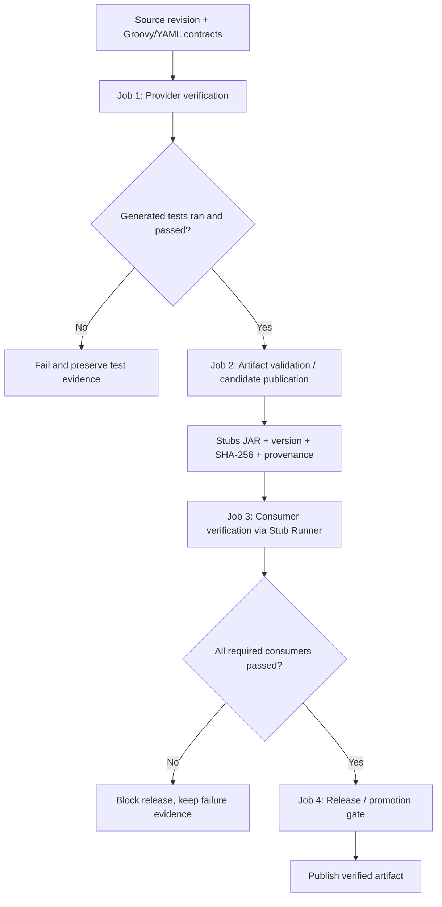
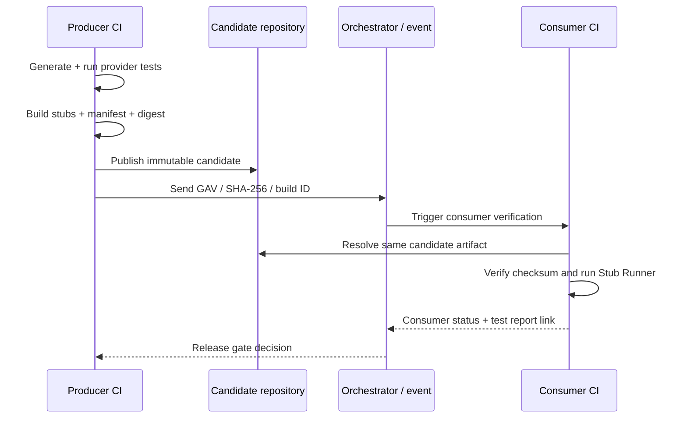
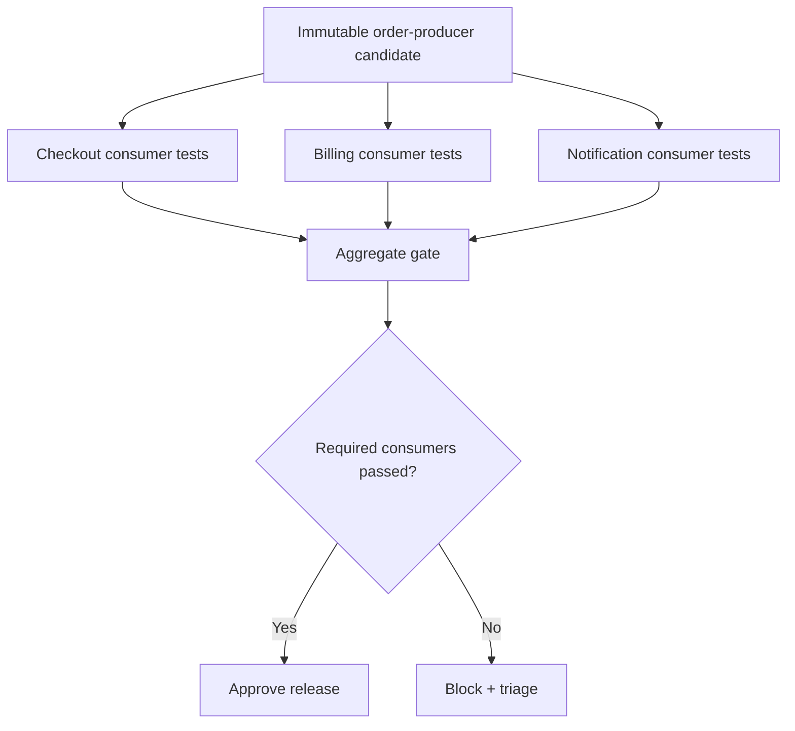

# Splitting jobs and preserving evidence from tests to artifacts in Spring Cloud Contract CI/CD

**Spring Cloud Contract (SCC)** helps producers and consumers verify HTTP or messaging interface compatibility. The producer defines contracts using **Groovy/YAML DSL**, generates and runs provider verification tests, and packages a **stubs JAR**. The consumer uses **Stub Runner**, typically paired with **WireMock** for HTTP, to test its real client or listener against the published stubs.

In CI/CD, these steps often execute in **different jobs**, sometimes across different repositories, accounts, or runner machines. The key question is then not merely *"are any jobs green?"* but:

> **Which producer tests verified which artifact, how was that artifact handed off across jobs, and did consumer tests actually use the exact verified artifact?**

If the provider test job uses commit A, the publish job rebuilds the JAR from commit B, and the consumer job accidentally downloads stale version C from the Maven cache, three green statuses **do not form a unified compatibility proof**.

This lesson belongs to the **CI/CD** chapter, on the topic **Splitting jobs and preserving evidence from tests to artifacts**, guiding task-graph design, storing test reports, managing candidate artifacts, verifying checksums and provenance, testing multiple consumers, failing fast, securing secrets, and tracing failures when pipelines fail.

The running example uses `order-producer` providing `GET /api/orders/1001` and the `OrderCreated` event, with `checkout-consumer` testing via Stub Runner.

## 1. Goal: a chain of evidence, not disconnected green lights

An ideal pipeline must answer the following questions:

1. **Source:** Which commit do the contracts and producer implementation come from?
2. **Producer testing:** Which generated tests were generated and executed? What were the results, counts, and skips?
3. **Artifact:** What are the stubs JAR's classifier, version, and checksum? Does it contain the right mappings?
4. **Handoff:** Does the downstream job receive the **exact file** just verified, or rebuild from scratch?
5. **Distribution:** Which artifact store hosts the candidate stubs? Does it prevent overwrites?
6. **Consumer testing:** Did Stub Runner resolve the **exact candidate** or an older release?
7. **Results:** Which consumers passed/failed against that candidate?
8. **Release decision:** Does it genuinely block release whenever any mandatory gate fails?

A workflow showing only:

```text
producer-build = SUCCESS
consumer-test = SUCCESS
publish = SUCCESS
```

is insufficient to prove ordering and artifact consistency. You must know **which job depends on which**, **what data is transferred**, and **what evidence is preserved**.

### 1.1. Why split jobs?

A single job doing everything can still work for small projects. As systems grow, splitting jobs helps:

- Run unit/integration tests and consumer suites with **dedicated resources**.
- Enforce **least-privilege access**: test jobs do not need publish tokens.
- Run multiple consumers **in parallel** once the same artifact is produced.
- Preserve reports even if a later stage fails.
- Easily re-run consumer verification alone against a **fixed candidate**.
- Place release approvals behind quality gates.
- Separate root causes across contract, packaging, resolution, consumer, and deployment failures.

**Splitting jobs pays off when responsibility boundaries are clear.** Splitting into too many jobs without propagating artifacts/provenance can make pipelines harder to debug.

## 2. Five layers in the contract testing chain

A foundational design:



This is a **dependency and responsibility model**, not a claim that Maven/Gradle/SCC automatically registers all these jobs. Your CI platform must define these constraints via `needs`, `dependencies`, `stages`, or equivalent mechanisms.

| Layer | Primary inputs | Outputs/evidence |
| --- | --- | --- |
| Source | Git commit, contract revision, toolchain | Commit SHA and build configuration |
| Provider verify | Producer code + contracts | Generated test report, test counts, status |
| Artifact package | Verified source/build | Stubs JAR, manifest, hash, mappings |
| Consumer verify | Consumer commit + exact candidate artifact | Consumer reports, request/listener assertions |
| Release gate | All results and artifact identity | Publish/promote decision, audit trail |

**Never equate "job succeeded" with "job produced valid evidence"**. A test job that discovers zero tests can still exit with code 0 depending on framework/configuration.

## 3. Distinguishing job, step, task, and artifact

Commonly confused terms:

**CI job:** an execution unit with its own runner, permissions, environment, and steps. Jobs can run in parallel or via dependencies.

**Step:** a single action inside a job, such as checkout, running Maven, downloading an artifact, or verifying a checksum.

**Build task/goal:** an operation managed by the build tool, such as Gradle `contractTest` or Maven plugin goals. One CI job can invoke multiple tasks.

**Artifact:** a persisted or distributed file: stubs JAR, test reports, manifests, logs, or release bundles.

**Cache:** reusable data for speed, such as `~/.m2` or Gradle caches. A cache is **not proof** of the same build artifact; it can hold stale files.

**Evidence/provenance:** traceability data showing what ran on which source, produced which bytes, and yielded which result.

Example:

```text
Job: provider-verification
  Step: setup JDK
  Step: ./mvnw clean verify
    Maven phase/test goals: generate, compile, run tests
  Step: upload Surefire/Failsafe XML reports
  Step: upload candidate stubs JAR + SHA-256

Job: consumer-verification
  Step: download exact candidate artifact
  Step: verify hash / install or resolve artifact
  Step: run consumer tests via Stub Runner
  Step: upload JUnit XML and test logs
```

### 3.1. A file existing does not mean it was used

A stubs JAR sitting in a consumer job's directory **does not prove** Stub Runner loaded and started that file. Tests also need `ids`/repository/classifier config, logging of the resolved artifact, and the HTTP client/listener pointing at the real stub.

Conversely, Stub Runner can start successfully from the local Maven cache **even if the job never downloaded the candidate**. Without locking versions and checking provenance, CI produces "false-green" results.

## 4. Splitting jobs by responsibility and access permissions

A DAG (directed acyclic graph) might look like:

| Job | Depends on | Responsibility | Has publish token? |
| --- | --- | --- | --- |
| `validate-contracts` | Source checkout | Parse/validate DSL and conventions | No |
| `producer-verify` | `validate-contracts` | Generate + run provider tests | No |
| `artifact-prepare` | `producer-verify` | Inspect JAR, digest, and manifest | Not needed |
| `publish-candidate` | `artifact-prepare` | Publish immutable candidate | Yes, minimal scope |
| `consumer-checkout` | `publish-candidate` | Consumer tests candidate with Stub Runner | Usually read-only suffices |
| `consumer-billing` | `publish-candidate` | Another consumer uses the same candidate | Usually read-only suffices |
| `release-gate` | Mandatory consumers | Review/approval/promote | Yes, dedicated scope and approval |

This is a **sufficiently granular split**, not a mandatory minimum job count.

### 4.1. Verification jobs do not need release publish permissions

A provider verification job often runs test code from a pull request. Granting it write access directly to the release repository creates supply-chain risk. A safer design:

1. Tests run in a low-privilege runner without release credentials.
2. An artifact job prepares a candidate bundle with metadata.
3. A separate publish job executes only after required checks pass.
4. The release job has dedicated approvals and tokens, isolated from jobs running untrusted PR code.

### 4.2. Avoid circular dependencies

Wrong example:

```text
producer-test waits for publish
publish waits for consumer-test
consumer-test waits for publish
```

To let consumers test a candidate artifact, there must be a way to **deliver the artifact into tests** prior to final release. Options include CI run artifacts, local installation, a candidate repository, or a dedicated staging store. **Candidate publication** is distinct from **production release**.

## 5. Producer step: from Groovy/YAML contract to generated test

Example contract for `order-producer`:

```groovy
import org.springframework.cloud.contract.spec.Contract

Contract.make {
    description 'GET order 1001 returns a stable schema'

    request {
        method GET()
        url '/api/orders/1001'
        headers {
            header('Accept', 'application/json')
        }
    }

    response {
        status OK()
        headers {
            contentType(applicationJson())
        }
        body(
            id: 1001,
            status: 'CREATED',
            currency: 'VND'
        )
    }
}
```

Equivalent YAML DSL:

```yaml
description: "GET order 1001 returns a stable schema"
request:
  method: GET
  url: /api/orders/1001
  headers:
    Accept: application/json
response:
  status: 200
  headers:
    Content-Type: application/json
  body:
    id: 1001
    status: CREATED
    currency: VND
```

**In real builds, pick only one—Groovy or YAML—for the same scenario**, to avoid generating duplicate tests/mappings.

After configuring the SCC Maven plugin, verifier dependencies, and appropriate base class, the producer job can run:

```bash
./mvnw -B -ntp clean verify
```

With Gradle, common tasks in several versions are `generateContractTests` and `contractTest`, or the corresponding test task wired by the plugin into the lifecycle. The job must verify **tasks actually ran**, rather than inferring from task names.

### 5.1. What provider verification proves

- Generated tests actually executed against the producer implementation.
- HTTP status, response headers, and body match the declared contract cases.
- For message contracts, the appropriate verifier checks input/output messages per test setup.
- The producer does not violate active matchers/assertions within test scope.

It does **not** prove every consumer handles a new schema, does not exhaust all network errors, and does not guarantee performance or broker delivery semantics.

## 6. Guarding against false-green gates: 0 tests and skipped tests

This is the single most important gate before publishing a candidate.

Several misconfigurations can still yield `BUILD SUCCESS`:

- The SCC plugin was not applied to the module holding contracts.
- Wrong contracts directory, so zero files are scanned.
- Generated tests are produced, yet the test engine fails to discover them.
- Maven Surefire/Failsafe or the Gradle test task is skipped.
- The pipeline passes `-DskipTests`, `-Dmaven.test.skip=true`, or `-x contractTest`.
- Unit tests run, while generated provider tests do not.
- Another module has passing tests, misleading the team into thinking the contract module ran.
- The generation task passes, yet generated test classes are never compiled/executed.

### 6.1. The gate must check execution counts

In the module owning contracts, the pipeline must know:

```text
contractFilesDiscovered > 0
generatedProviderTests > 0
providerTestsExecuted > 0
providerTestsFailed == 0
providerTestsSkipped == 0  # if policy forbids skipping
```

These are **illustrative logical conditions**, not variables automatically exported by SCC. Actual counting depends on Maven Surefire/Failsafe, Gradle test reports, or project tooling.

One test that actually executed and passed is far more trustworthy than hundreds of generated source files with no execution report.

### 6.2. JUnit XML and HTML reports

In Maven, test reports commonly appear in directories such as:

```text
target/surefire-reports/
target/failsafe-reports/
```

In Gradle:

```text
build/test-results/test/
build/reports/tests/test/
```

Paths can vary when using a separate task/test suite like `contractTest`. **Do not hardcode a single path and conclude tests do not exist if the plugin writes elsewhere.**

A minimal evidence package needs:

- Test suite names.
- Counts of tests, failures, errors, skipped.
- Relevant timestamps/durations.
- Producer source revision.
- Logs for generated test setup and errors if any.
- Link to the contract/revision used in the build.

### 6.3. Intentional fault injection

Change the producer implementation so `GET /api/orders/1001` returns `PAID` while the contract still expects `CREATED`. **The provider job must fail.** If it still passes, inspect generation, test discovery, base class, or contract sources.

This is how you verify the **pipeline genuinely protects behavior**, not just that the JVM starts cleanly.

## 7. Artifacts after the provider job: package both files and evidence

A minimal candidate bundle:

```text
candidate-bundle/
  order-producer-2.4.0-rc.7-stubs.jar
  stubs.sha256
  candidate-manifest.yml
  producer-test-report/
    TEST-....xml
  provenance/
    source-commit.txt
    build-id.txt
    toolchain.txt
```

The names and layout above are **example conventions**, not a mandatory Spring Cloud Contract layout.

### 7.1. Do not keep only the JAR file

If only `*-stubs.jar` is uploaded, operators struggle to answer:

- Which commit generated this file?
- Did provider tests actually execute?
- Does it carry the `stubs` classifier, or is it just named like that?
- What is its SHA-256?
- Does it contain the mapping for the new endpoint?
- Which consumer jobs verified it?
- Did the build tool or contract plugin version change?

That is why **manifest + test reports + artifact bytes** must be treated as a single chain of evidence.

### 7.2. CI artifact name vs. Maven classifier

CI may upload a bundle named `order-stubs-candidate`, yet that name is **not the Maven classifier**. The classifier is `stubs` in GAV/type/classifier when the file is installed/published/resolved.

```text
CI artifact name: order-stubs-candidate
Maven artifact:   com.example:order-producer:2.4.0-rc.7:jar:stubs
File:             order-producer-2.4.0-rc.7-stubs.jar
```

Never rely on the CI upload artifact name to assert that Stub Runner resolved the right Maven coordinates.

## 8. Three ways to transfer artifacts between jobs

| Transfer method | Example | Pros | Risks / what to control |
| --- | --- | --- | --- |
| CI run artifacts | Upload/download within the same workflow | Clean, no public repository publish needed | Scoped/limited by CI retention policy |
| Maven/Gradle local install | Transfer file, then install to consumer runner's local repo | Easy with Stub Runner `LOCAL` | Different runners do not share `~/.m2` automatically |
| Immutable candidate repository | Publish stubs JAR to test Maven repo; consumer resolves `REMOTE` | Fits multiple repositories/teams | Publish permissions, no-redeploy, version, and checksum |
| Rebuild in consumer job | Check out producer and rebuild stubs | Self-contained in some setups | **Does not guarantee identical bytes/commit** without strict controls |

**Prefer transferring the exact verified artifact**, rather than creating another build when the consumer step begins.

### 8.1. Different jobs usually have different filesystems

If `provider-verify` runs on runner A and `consumer-verify` runs on runner B, the file:

```text
/home/runner/work/order-producer/target/order-producer-stubs.jar
```

does not automatically appear on runner B. CI requires **upload/download**, a repository, or a shared artifact service. Never use `needs` solely to order jobs and expect the filesystem to be shared automatically.

### 8.2. Caches do not replace artifact transfer

A Maven cache speeds up dependency downloads, but is not a deterministic candidate artifact handoff mechanism. A broad cache key can cause consumers to pick up a stubs JAR from an older run. Pin unique versions, verify hashes, and transfer candidates explicitly.

## 9. Checksums and provenance: proving the file did not change between jobs

Compute SHA-256 for the JAR:

```bash
sha256sum order-producer-2.4.0-rc.7-stubs.jar
```

A `stubs.sha256` file created alongside it:

```bash
sha256sum order-producer-2.4.0-rc.7-stubs.jar > stubs.sha256
```

In the downstream job:

```bash
sha256sum -c stubs.sha256
```

This proves the file matches the recorded digest. **However, if an untrusted actor alters both the JAR and the hash**, they will still match. Therefore, the manifest/hash must come from a **protected CI job**, or carry digital signatures/attestations with appropriate access controls.

### 9.1. What errors do hashes catch?

| Situation | Signal from hash |
| --- | --- |
| JAR corrupted in transit | Mismatch |
| Consumer downloads wrong artifact with same name | Mismatch if expected comes from producer CI |
| Repository overwrites a fixed release | Mismatch |
| Publish job rebuilds JAR with different bytes | Mismatch |
| Producer builds wrong content, yet hash was recorded accurately | Hash still matches; requires provider tests and content inspection |
| Consumer uses different artifact version with identical bytes | Hashes may match; still verify coordinates/version |

**Never substitute checksums for generated provider verification.** Integrity and correctness are two separate layers.

### 9.2. Never assume identical sources always yield identical JAR bytes

Timestamps, archive metadata, plugin/version differences, or build environments can alter output bytes. If a job rebuilds a JAR from the same commit, inspect the digest; if it differs, never label the rebuild "the exact artifact that was tested".

Whenever feasible, choose **build once, verify, transfer exact bytes, then publish/promote**.

## 10. Manifest: linking source commit, test report, and classifier

A **CI-defined** `candidate-manifest.yml` file, not Spring Cloud Contract DSL YAML:

```yaml
manifestVersion: 1
service: order-producer
source:
  repository: git://example/order-producer
  commit: REPLACE_WITH_FULL_PRODUCER_COMMIT_SHA
  contractRevision: REPLACE_WITH_CONTRACT_COMMIT_SHA
build:
  ciRunId: producer-run-107
  jdk: "21"
  sccPluginVersion: REPLACE_WITH_SCC_VERSION
  providerVerification:
    status: PASSED
    executed: REPLACE_WITH_REAL_TEST_COUNT
    failed: 0
    skipped: 0
artifact:
  repositoryId: maven-candidates
  groupId: com.example
  artifactId: order-producer
  version: 2.4.0-rc.7
  type: jar
  classifier: stubs
  filename: order-producer-2.4.0-rc.7-stubs.jar
  sha256: REPLACE_WITH_FULL_SHA256
consumerVerification:
  required:
    - checkout-consumer
    - billing-consumer
  resultsLocation: REPLACE_WITH_CI_REPORT_LOCATION
```

The `REPLACE_WITH...` fields are **placeholders populated from real CI**, not verified data. Never hardcode `providerVerification.status: PASSED` unconditionally and treat it as proof. Compute it from actual test execution results.

### 10.1. Manifests must be outputs, not bare claims

The job should:

1. Capture the commit SHA from the actual checkout.
2. Read the version/classifier from the artifact Maven/Gradle actually built.
3. Parse provider test reports and test counts.
4. Compute the hash from the final JAR file.
5. Record the job URL/build ID for traceability.
6. Upload the manifest to a location with proper access protections.
7. Have the consumer job reconcile the manifest against the downloaded file.

If the consumer knows only the artifact name without the source commit, it is hard to distinguish a code regression from a wrong stub source.

## 11. GitHub Actions workflow example: splitting jobs and preserving reports

The example below illustrates **using `needs` and artifact upload/download in a single workflow**. Assumptions:

- Repository contains `order-producer/` and `checkout-consumer/`.
- Maven Wrapper `./mvnw` is at root, and modules have all required dependencies configured.
- The SCC plugin generates and packages the stubs JAR during the `verify` lifecycle.
- The candidate version is set in the producer POM and is **unique** per build.
- Consumer tests read Stub Runner properties from JVM/system properties.
- This example **excludes publishing to a remote Maven repo**; it transfers the JAR internally and installs it into the consumer job's local repository.

All assumptions must be checked and adapted for a real project; this workflow is not a drop-in configuration for every repository.

```yaml
name: Contract compatibility
on:
  pull_request:
  workflow_dispatch:

jobs:
  producer-verify:
    runs-on: ubuntu-latest
    steps:
      - name: Checkout
        uses: actions/checkout@v4

      - name: Setup Java
        uses: actions/setup-java@v4
        with:
          distribution: temurin
          java-version: "21"
          cache: maven

      - name: Verify producer
        run: ./mvnw -B -ntp -pl order-producer -am clean verify

      - name: Preserve test reports even on failure
        if: always()
        uses: actions/upload-artifact@v4
        with:
          name: producer-test-reports
          path: |
            order-producer/target/surefire-reports/
            order-producer/target/failsafe-reports/
          if-no-files-found: warn

      - name: Prepare candidate bundle
        shell: bash
        run: |
          mkdir -p candidate
          VERSION=$(./mvnw -q -pl order-producer \
            help:evaluate -Dexpression=project.version -DforceStdout)
          printf '%s\n' "$VERSION" > candidate/version.txt
          test -n "$VERSION"

          JAR="order-producer/target/order-producer-$VERSION-stubs.jar"
          test -f "$JAR"
          cp "$JAR" candidate/
          (
            cd candidate
            sha256sum "order-producer-$VERSION-stubs.jar" \
              > stubs.sha256
          )
          git rev-parse HEAD > candidate/producer-commit.txt

      - name: Upload candidate bytes
        uses: actions/upload-artifact@v4
        with:
          name: verified-order-stubs
          path: candidate/
          if-no-files-found: error

  consumer-verify:
    needs: producer-verify
    runs-on: ubuntu-latest
    steps:
      - uses: actions/checkout@v4

      - uses: actions/setup-java@v4
        with:
          distribution: temurin
          java-version: "21"
          cache: maven

      - name: Download exact candidate bundle
        uses: actions/download-artifact@v4
        with:
          name: verified-order-stubs
          path: candidate/

      - name: Validate transferred bytes
        shell: bash
        run: |
          cd candidate
          sha256sum -c stubs.sha256

      - name: Install stubs into this runner's Maven local repo
        shell: bash
        run: |
          VERSION=$(cat candidate/version.txt)
          ./mvnw -B -ntp install:install-file \
            -Dfile="candidate/order-producer-$VERSION-stubs.jar" \
            -DgroupId=com.example \
            -DartifactId=order-producer \
            -Dversion="$VERSION" \
            -Dpackaging=jar \
            -Dclassifier=stubs \
            -DgeneratePom=true

      - name: Run consumer tests against local candidate
        shell: bash
        run: |
          VERSION=$(cat candidate/version.txt)
          ./mvnw -B -ntp -pl checkout-consumer test \
            -Dspring.cloud.contract.stubrunner.ids="com.example:order-producer:$VERSION:stubs:8085" \
            -Dspring.cloud.contract.stubrunner.stubs-mode=LOCAL

      - name: Preserve consumer reports
        if: always()
        uses: actions/upload-artifact@v4
        with:
          name: consumer-test-reports
          path: |
            checkout-consumer/target/surefire-reports/
            checkout-consumer/target/failsafe-reports/
          if-no-files-found: warn
```

### 11.1. What does this workflow illustrate?

- `producer-verify` runs verification and uploads the candidate only after prior verification steps pass.
- `consumer-verify` declares `needs: producer-verify`, so it starts only if upstream succeeds per default workflow policy.
- `actions/upload-artifact` and `download-artifact` transfer files between the two runners.
- `sha256sum -c` detects byte changes in transit (assuming the bundle/hash came from a protected source).
- `install:install-file` places the stubs JAR into the **consumer runner's** local Maven repo, not the producer runner's.
- Consumer tests receive candidate `ids` and `stubs-mode=LOCAL`.
- Test reports upload with `if: always()` so evidence remains when tests fail.

### 11.2. What needs hardening before production use?

The example does not yet automatically assert **generated provider tests > 0**. Add a controlled step that parses XML reports and fails if the contract module produced zero tests or skipped all of them.

In addition:

- Verify the plugin actually produces the JAR at the expected name/path. Some projects customize `finalName` or packaging layout.
- Confirm `help:evaluate` prints a clean version string in your Maven environment.
- Ensure the producer `pom.xml` version matches the finalized candidate.
- Ensure consumer tests actually read and apply properties rather than being overridden by hardcoded annotations.
- Confirm installing a standalone classified artifact with a generated POM works with Stub Runner/dependency resolution in your version; otherwise install/deploy using the producer's real POM.
- When the consumer job uses a multi-module build, add `-am` or install internal dependencies as needed.
- Ensure artifacts use fixed versions and never collide with stale caches at the same coordinates.
- Control permissions and behavior when workflows run from fork PRs.
- If the pipeline needs real releases, add a candidate/promotion repository job **with separate secrets and approvals**.

**This lesson teaches the evidence-transfer mechanism**, not a claim that all Maven/SCC details are identical across every project.

## 12. Stub Runner: must use the exact candidate just transferred

A consumer Spring Boot test can configure Stub Runner:

```java
import org.springframework.boot.test.context.SpringBootTest;
import org.springframework.cloud.contract.stubrunner.spring.AutoConfigureStubRunner;

@SpringBootTest(properties = {
    "order.api.base-url=http://localhost:8085"
})
@AutoConfigureStubRunner
class CheckoutConsumerContractTest {
    // Stub Runner receives ids and stubs-mode from the test environment.
    // Inject real OrderClient, call GET /api/orders/1001.
    // Assert id=1001, status=CREATED, currency=VND.
}
```

The example assumes the Spring environment receives:

```text
spring.cloud.contract.stubrunner.ids=com.example:order-producer:2.4.0-rc.7:stubs:8085
spring.cloud.contract.stubrunner.stubs-mode=LOCAL
```

If your project hardcodes `@AutoConfigureStubRunner(ids=..., stubsMode=...)` in annotations, ensure it **does not accidentally override the candidate version** passed by CI via properties.

### 12.1. A test that merely starts Stub Runner is not enough

Tests must:

1. Call the consumer's **real client**, not just an ad-hoc `HttpClient` written in the test.
2. Send requests matching the contract to the stub URL.
3. Assert response DTOs/logic and error handling the consumer genuinely relies on.
4. Verify requests reached the stub server when debugging.
5. Include tests for agreed critical error scenarios.

A pipeline can turn green because Stub Runner started cleanly while consumer unit tests never called the producer stub at all. That is not consumer compatibility verification.

### 12.2. LOCAL and REMOTE change artifact retrieval, not the goal

- **LOCAL:** artifact was installed into the current runner's local Maven repo.
- **REMOTE:** Stub Runner resolves the candidate from a Maven-compatible repository with matching URL/access credentials.

With `REMOTE`, the job should log `repositoryRoot`, resolved GAV/classifier, checksum, and version. Never use dynamic `+` in gates needing reproducible verification of a specific candidate.

## 13. Splitting jobs when producer and consumer live in two repositories

When producer and consumer teams have independent CI, GitHub Actions `needs` coordinates jobs only **within the same workflow**; it cannot express dependencies on another repository's workflow.

A multi-repository architecture:



Crucially, **messages between CI pipelines must carry the pinned artifact coordinates**, not merely "new version available" or "use latest".

### 13.1. Sample candidate event payload

```json
{
  "producer": "order-producer",
  "producerCommit": "REPLACE_WITH_FULL_COMMIT_SHA",
  "providerBuildId": "producer-run-107",
  "artifact": {
    "groupId": "com.example",
    "artifactId": "order-producer",
    "version": "2.4.0-rc.7",
    "classifier": "stubs",
    "type": "jar",
    "sha256": "REPLACE_WITH_TRUSTED_SHA256",
    "repositoryId": "maven-candidates"
  }
}
```

This payload is an **integration model**, not a built-in Spring Cloud Contract schema. Consumer CI must authenticate the event source, accept inputs, verify the artifact, and emit results tagged with the exact `producerBuildId`.

### 13.2. Returning results to the exact producer build

A slow consumer job may finish after the producer creates a newer candidate. If it reports only `PASS` without artifact version/build ID, the orchestrator could attribute candidate A's result to candidate B.

Results should carry:

```text
producerCommit
artifactVersion
artifactSha256
consumerCommit
consumerTestJobId
testStatus
testReportUrl
```

The release gate accepts results only for the **exact requested candidate identity**.

## 14. Multiple consumers: running a parallel matrix and aggregating results

A producer often serves multiple consumers:

```text
order-producer
  ├── checkout-consumer
  ├── billing-consumer
  └── notification-consumer
```

Consumers can run in parallel against the **same candidate stubs artifact**, followed by an aggregation gate:



### 14.1. "Required" must be agreed upon

Not every historical consumer can run on every PR. Classify them:

- **Required gate:** critical consumers that producer changes could break.
- **Advisory:** runs and notifies without blocking when an approved rationale exists.
- **Unknown/unmaintained:** requires ownership and deprecation policy; never ignore silently forever.

Never silently downgrade a failing consumer from required to advisory just to ship faster. Gate changes need owners and traceable rationale.

### 14.2. Separate reports per consumer

A results manifest might include:

| Consumer | Commit | Stub version/hash | Result | Report |
| --- | --- | --- | --- | --- |
| Checkout | `c1...` | `2.4.0-rc.7 / H1` | PASS | CI Link |
| Billing | `c2...` | `2.4.0-rc.7 / H1` | FAIL | CI Link |
| Notification | `c3...` | `2.4.0-rc.7 / H1` | PASS | CI Link |

In this example, **release must be blocked if Billing is a required gate**. Never treat `2/3 PASS` as "mostly compatible" when policy requires all.

### 14.3. Consumer contract tests differ from full broker testing

For `notification-consumer`, message stubs via `StubTrigger` help test listener handling of `OrderCreated`, yet do not automatically verify Kafka offsets, RabbitMQ ack/nack, retries, DLQs, or transactions. Design separate infrastructure jobs for those when they are part of release criteria.

## 15. Managing reports when a job fails

Key principle: **a failing job must still preserve relevant evidence**.

When tests fail, subsequent steps are skipped by default CI behavior. Place log/report upload steps under an `always()` condition or platform equivalent, **without turning the job outcome into PASS**.

### 15.1. Different failure outputs by stage

| Job failed at | Remaining evidence | How to handle |
| --- | --- | --- |
| Checkout/dependency resolve | Dependency logs, source revision | Upload error log, do not fabricate test reports |
| Contract generation | Plugin logs, input DSL | Preserve logs and commit/contract file reference |
| Test compile | Compiler errors, generated sources if any | Preserve compilation log and source path |
| Provider test assertion | JUnit XML, stack traces, request/response | Upload reports and block candidate publish |
| Stubs packaging | Build log, file listing, partial manifest | Fail artifact gate; never upload an empty JAR as valid |
| Candidate resolution | Coordinates, repo/HTTP status, checksum error | Fail consumer job before running assertions |
| Consumer assertion | JUnit XML, WireMock request journal | Keep reports and block release |
| Release publish | Deploy logs, previous verified digest | Triage repo/permissions; never rebuild uncontrollably |

### 15.2. Never use `continue-on-error` to turn a gate optional

A CI step can be configured to allow failure so the job proceeds. That can help **collect extra diagnostics**, yet the release gate must evaluate **real outcomes** and never turn "false green".

If provider contract tests fail yet the pipeline publishes stubs anyway due to `continue-on-error: true` without a downstream gate, contract verification loses all value.

### 15.3. Reports can contain sensitive data

Test logs and request journals sometimes contain tokens, emails, addresses, or customer payloads. Before uploading evidence:

- Use synthetic fixtures, never real PII.
- Redact secrets and sensitive headers.
- Restrict CI artifact viewing permissions.
- Set retention per security policy.
- Never print Maven repository tokens or credentials in error logs.

Preserving more evidence never justifies storing sensitive data carelessly.

## 16. Artifact retention and reproducibility

A CI run may retain artifacts for days or weeks; a Maven candidate repository may keep them longer. Distinguish:

| Storage | Purpose | Common limits |
| --- | --- | --- |
| CI run artifact store | Job handoff, downloading reports within the same pipeline | Retention policy and access controls |
| Maven candidate repository | Resolving stubs across multiple repos/jobs | Immutability policy, caching, repo auth |
| Maven release repository | Distributing official releases | Should disallow overwrites |
| Provenance store | Storing build IDs, commits, digests, approvals | Must be protected from tampering |
| Issue/PR links | Tracing decisions and bugs | May lose completeness when logs expire |

If a bug must be reproduced six months later while the JAR and test reports were deleted after seven days, pinning coordinates alone will not guarantee replay.

### 16.1. Minimum retention policy

An organizational rule might be:

- Unmerged candidates: retain for PR lifecycle plus investigation window.
- Release artifacts: retain at least through the supported consumer lifecycle.
- Provider/consumer test reports: retain long enough for regression audits.
- Manifests/digests/approvals: retain alongside release records.
- Secrets and sensitive data: **never** retain raw credentials just to extend audit logs.

Specific timeframes depend on company policy; SCC has no single default retention period.

## 17. Build once, verify, transfer, promote: avoiding uncontrolled rebuilds

An anti-pattern:

```text
Job A:
  checkout producer commit P1
  mvn clean verify
  JAR hash = H1
  provider tests PASS

Job B:
  checkout latest main commit P2
  mvn clean deploy
  JAR hash = H2
  publish artifact

Job C:
  consumer tests use H2, yet the report claims provider verified H1
```

This **breaks the chain of evidence**. Provider verification of H1 is not automatically verification of H2.

A cleaner workflow:

```text
Job A: build producer from fixed commit P1
       run provider verification and produce candidate H1

Job B: validate H1 + immutable coordinates
       publish/promote exact candidate H1

Job C: resolve H1 (verify hash)
       run consumer contract tests

Job D: release decision for P1/H1 only
```

### 17.1. In which phase does Maven packaging occur?

In the standard Maven lifecycle, `package` happens **before** `verify`. Thus the stubs JAR may already exist during `mvn verify` before all checks finish. What matters is **blocking trusted publication when verification fails**, not necessarily forbidding file creation before tests.

### 17.2. When a rebuild is unavoidable

If a pipeline must bump the version from `2.4.0-rc.7` to `2.4.0` and build a new JAR, bytes can differ due to metadata. In that case:

- Record it as a **new artifact**, never pretending it is H1.
- Compute the new digest and build provenance.
- Run appropriate verification on the release artifact.
- When possible, re-run consumer tests against that exact new release candidate.
- Link candidate H1 and release H2.

## 18. CI security: publish permissions, fork PRs, and artifact poisoning

Contract pipelines execute repository code and sometimes untrusted pull requests. If test jobs carry credentials capable of publishing to the release repository, malicious or misconfigured changes can compromise the supply chain.

Principles:

1. **Least privilege:** only publish jobs need write access.
2. **Branch/approval protection:** release stages enforce dedicated approval policies.
3. **Immutable candidate versions:** forbid redeploying the same GAV/classifier.
4. **Secret isolation:** never inject tokens into jobs running untrusted PR code.
5. **Artifact provenance:** verify hashes and sources of inputs passed between jobs.
6. **Pin tooling appropriately:** record/pin plugin versions, JDK, Maven/Gradle, and action/container versions per policy.
7. **Trust boundary:** jobs holding secrets must never run scripts/artifacts from unreviewed PRs by default.
8. **Audit logs:** record who published, from which run, and which version/hash.

### 18.1. Cache poisoning vs. artifact transfer

A shared dependency cache can hold corrupted or wrong-source files. Using artifact upload/download from the exact job and verifying digests reduces drift. For release-critical checks, scope cache keys properly or isolate local repositories.

### 18.2. Never take secrets or targets from PR-editable metadata

If a PR can alter `repositoryRoot` or deploy paths, a publish token could be sent to an unintended endpoint. Publish target configuration must live in **protected environment/repository settings**, never read directly from unverified inputs.

## 19. Retrying CI infrastructure errors: do not confuse them with contract failures

Not every job failure is an API incompatibility.

| Error | Initial classification | How to respond |
| --- | --- | --- |
| Provider assertion: expected 200, got 500 | Contract/provider failure | Fix producer/fixture/contract accordingly |
| Consumer JSON failed to parse changed field | Compatibility failure | Coordinate producer and consumer |
| Maven repository returned 503 | Infrastructure/repository | Bounded retry; do not alter API contract |
| Artifact download timed out | CI infrastructure | Retry download, keep candidate version fixed |
| Checksum mismatch | Integrity/provenance issue | **Hard fail**, never accept silently |
| Flaky test from port collision | Test environment | Isolate ports/runners |
| Stub Runner resolved wrong classifier | Configuration | Fix GAV/classifier/repository |
| Job ran 0 tests yet succeeded | Quality gate defect | Fail the test-count gate |
| Consumer test failed on broker redelivery | Integration behavior | Triage broker/listener, not automatically an HTTP stub bug |

**Do not auto-retry an entire consumer test repeatedly until green and accept the final green run** when the first red run might indicate a genuine compatibility issue. Retrying repository downloads is reasonable; retrying business assertions requires transparent flakiness policy.

### 19.1. When re-running a job

When re-running, keep constant:

- Source commits and candidate artifact version/digest.
- Test configuration and toolchain within required bounds.
- List of required consumers.
- Valid test data/fixtures or snapshots.

If a re-run resolves `latest` and fetches a different artifact, the new result **is no longer a re-verification of the same test case**.

## 20. Messaging in CI: identical artifacts are not enough

An `OrderCreated` contract might be:

```groovy
import org.springframework.cloud.contract.spec.Contract

Contract.make {
    description 'OrderCreated v1 emitted when creating an order'
    label 'order_created_v1'

    input {
        triggeredBy('publishOrderCreated()')
    }

    outputMessage {
        sentTo('orders.created')
        headers {
            messagingContentType(applicationJson())
        }
        body(
            eventId: 'EVT-1001',
            eventType: 'OrderCreated',
            schemaVersion: 1,
            orderId: 'ORD-1001'
        )
    }
}
```

The producer job needs generated provider verification for messages; the consumer job can use Stub Runner/`StubTrigger` with a compatible test binder/transport and assert the listener processes the sample message.

### 20.1. Separating contract-message tests from broker integration tests

| Job/test | Primary evidence |
| --- | --- |
| Message contract verification | Payload, headers/destination per contract |
| Consumer StubTrigger test | Listener reads and processes sample event |
| Kafka/RabbitMQ integration | Ack/nack, redelivery, DLQ, partitions, ordering |
| Database/outbox integration | Transactions, duplicate prevention, side effects |
| End-to-end environment | Cross-service routing/configuration |

**An immutable stubs JAR does not by itself prove broker delivery semantics.** If event retries/DLQ or transactional outbox are release criteria, run dedicated jobs with a real broker/DB or appropriate Testcontainers.

### 20.2. What extra metadata do messaging job reports need?

Beyond artifact identity, record:

- Contract label.
- Logical destination.
- Schema version.
- Test binder/broker type and version.
- Listener/consumer application revision.
- Assertions on side effects, not merely "trigger returned".
- Retry/duplicate policies in jobs covering that scope.

## 21. Results dashboard: how to read a release gate accurately

A helpful summary table:

| Item | Status | Evidence | Notes |
| --- | --- | --- | --- |
| Contract parse/generate | PASS | Generation log | Actual contract count |
| Provider HTTP verification | PASS | JUnit XML | Zero skipped tests |
| Producer messaging verification | PASS | JUnit XML | Compatible test binder |
| Stubs packaging | PASS | JAR + manifest | Contains mappings |
| Artifact SHA-256 | PASS | Trusted hash | Matches across jobs |
| Candidate publish | PASS | Repository GAV | No redeploy |
| Checkout consumer | PASS | Test report | Used candidate H1 |
| Billing consumer | FAIL | Test report | Wrong `currency` field |
| Notification consumer | PASS | Test report | Listener assertion |
| Release decision | **BLOCKED** | Gate evaluation | Billing is required |

Here, even though most jobs passed, release remains **blocked** because Billing is required. Never use an aggregate PASS percentage to hide a failure in a contract-critical consumer.

### 21.1. Minimal gate states

A gate can return:

- **PASS:** all required results present with identical artifact identity.
- **FAIL:** a required test/verification failed.
- **INCOMPLETE:** missing reports, cancelled/timed-out job, or unresolvable artifact.
- **NOT_APPLICABLE/WAIVED:** only when policy allows, with recorded owner and rationale.

**INCOMPLETE is not PASS.** If a required consumer CI did not run due to an infrastructure outage, "no errors reported" cannot count as compatible.

## 22. Runbook: from failing test to the exact artifact

When someone reports "consumer failed after producer updated a contract", proceed in order:

```text
1. Identify producer commit and candidate build ID.
2. Obtain stubs GAV/type/classifier and repository source.
3. Compute/compare artifact SHA-256 on both producer and consumer.
4. Inspect producer generated test count, status, and skips.
5. Verify the JAR contains mappings for the failing request/message.
6. Check Stub Runner ids, mode, repositoryRoot, and resolved version.
7. Confirm the real consumer HTTP client/listener routed through the stub.
8. Compare request method/path/query/headers/body against the mapping.
9. Read consumer assertions, request journal, and test reports.
10. Distinguish breaking contract, bad fixture, and environment error.
11. If re-running, keep source + artifact hash identical.
12. Record resolution and link the fix to producer/consumer PRs.
```

### 22.1. Symptoms and first checkpoints

| Symptom | Where to check first |
| --- | --- |
| Producer build green yet no stubs exist | Packaging plugin/task outputs |
| Stubs JAR exists yet lacks mappings | Contract source directory and generated mappings |
| Provider tests missing from reports | Plugin/test engine/test discovery |
| Consumer Stub Runner fails to resolve | Repository, version, classifier, and permissions |
| Consumer receives HTTP 404 from WireMock | Request match, unmatched vs. contractual 404 |
| Consumer data differs from candidate | Cache, hash, GAV, artifact source |
| Fails only in CI | Ports, clock, shared state, JDK, network |
| Publish succeeded despite failing tests | Job dependencies, conditions, and secrets boundary |
| Re-run green after red run | Did inputs change? Random state? Flaky test? |
| Artifact reports expired | Retention policy and provenance store |

### 22.2. Observe negative evidence too

Do not log only "tests that ran". Also record:

- Did any contract fail to generate tests?
- Was any task skipped?
- Did any required consumer fail to run?
- Is any artifact classifier missing?
- Did any test report fail to upload?
- Was a candidate fetched from a repository other than expected?
- Were there warnings about authentication, deprecated configs, or mismatched versions?

These gaps usually explain why a green pipeline produced a broken release.

## 23. Hands-on lab: designing and testing a traceable pipeline

Prepare `order-producer`, `checkout-consumer`, a CI platform, and a test artifact repository (or use upload/download within a single workflow).

1. **Write contract:** create Groovy or YAML for `GET /api/orders/1001` returning 200 JSON.
2. **Provider verification:** configure the SCC plugin and run generated tests against the implementation.
3. **Check test counts:** if contracts are removed or tests skipped, the gate must report missing evidence.
4. **Package stubs:** create the `stubs` classifier JAR and inspect mappings with `jar tf`.
5. **Produce manifest:** record producer commit, JDK/SCC versions, test count, GAV/classifier, and SHA-256.
6. **Upload artifact:** split producer and consumer jobs using CI upload/download, without assuming a shared filesystem.
7. **Verify digest:** consumer job compares bytes against the producer manifest.
8. **LOCAL mode:** install the exact candidate JAR into the consumer runner's local Maven repo.
9. **Consumer tests:** call the real client and assert DTO `CREATED`, plus error mappings where needed.
10. **Keep reports on failure:** use `always()` or equivalent for uploading JUnit XML.
11. **Block publish:** intentionally change the producer to return `PAID`; confirm no "verified" candidate is published.
12. **Wrong classifier:** configure Stub Runner to look for `tests` instead of `stubs`; job must fail with clear reporting.
13. **Wrong version:** force consumer to use an old version; the manifest-check gate must detect the mismatch.
14. **Multi-repository:** if applicable, pass candidate coordinates via event/orchestrator and wait for consumer reports bound to the exact build ID.
15. **Parallel consumers:** add a Billing consumer and make it fail; the release gate must block.
16. **Cache:** test a worker with a stale Maven cache; use unique versions/SHAs to spot wrong sources.
17. **Re-run:** re-run from a pinned manifest and fixed source revisions, never selecting `latest`.
18. **Evidence retention:** set retention policies for test reports, JARs, and provenance covering the support window.
19. **Review secrets:** confirm PR jobs hold no release tokens and publishing happens only in a protected environment.
20. **Summary:** trace the full chain `test → JAR → hash → consumer test → release` with concrete evidence at every link.

### 23.1. Self-assessment rubric

| Capability | Passing evidence |
| --- | --- |
| Split jobs | Explicit `needs` or dependencies across verify, artifact, consumer, and release |
| Distinguish task/job | Know which Maven/Gradle tasks run in which CI job |
| Provider verification | Generated tests actually execute, not merely generate |
| Guard against false greens | Detect zero tests and skips |
| Candidate artifact | Clear GAV/type/classifier/version |
| File transfer | Consumer receives exact same JAR instead of rebuilding |
| Byte check | SHA-256 matches producer CI |
| Consumer verification | Stub Runner exercises real client/listener |
| Multi-consumer | Gate aggregates required consumers on the exact candidate |
| Failure evidence | Reports preserved when test jobs fail |
| Security | Publish tokens restricted to protected jobs |
| Reproducibility | Manifest contains enough info to reproduce the exact build |
| Release | Never publishes when required gates are missing or failing |

## 24. Conclusion: an artifact must carry a complete testing story

In Spring Cloud Contract, **splitting CI/CD jobs** does more than make pipelines faster or easier to manage. The deeper goal is preserving a **continuous chain of evidence**:

**Approved contract → generated provider tests executed → stubs JAR packaged from exact source → artifact identified by version/classifier/hash → consumer Stub Runner loads exact build → consumer assertions pass → release gate approves.**

Remember:

- **A green job is not enough:** you need test counts, results, and artifact evidence.
- **A JAR file is not enough:** you need metadata, checksums, and build provenance.
- **`needs` does not transfer files:** use an artifact store or repository.
- **Caches are not a source of truth:** candidates need explicit versions and hashes.
- **Consumer passing against an old build is not enough:** test the exact candidate version.
- **Uploading reports on failure does not turn fail into pass:** the gate must still block release.
- **Publish needs isolated permissions:** never grant release credentials to every test job.
- **Re-runs must keep inputs constant:** never switch candidates mid-investigation.

When pipelines follow these principles, teams can do more than say *"contract tests ran"*—they can **prove which exact artifact both producer and consumers verified, at which version, with which outcome, and why that artifact qualifies for release**.
