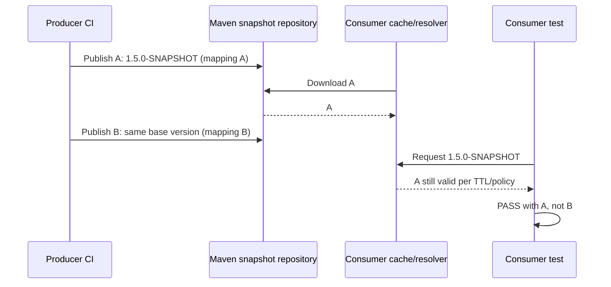
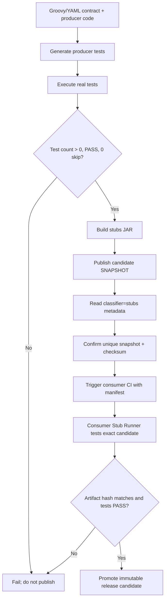

# Dependency caching while controlling SNAPSHOT freshness

> **Chapter:** CI/CD  
> **Module:** Spring Cloud Contract (`SPRING_CLOUD_CONTRACT`) — producer–consumer contract testing using Groovy/YAML DSL for HTTP or messaging, generating producer tests, publishing stubs, using Stub Runner, and CI integration to detect incompatible API changes.

## Learning objectives

After this lesson, you will be able to:

1. Explain **why dependency caching is needed** in CI while still controlling the **exact SNAPSHOT version** of the producer and stub JAR consumed by the consumer.
2. Distinguish Maven base version `1.5.0-SNAPSHOT` from a **timestamped/unique snapshot** (e.g., `1.5.0-20261124.051500-7`) and understand the role of `maven-metadata.xml`.
3. Identify independent cache layers: Maven local repository, Gradle dependency cache, CI cache actions, artifact repository proxies, Spring Cloud Contract **Stub Runner Aether resolver**, and Gradle task/build cache.
4. Use Maven `<updatePolicy>` and `mvn -U`, Gradle `cacheChangingModulesFor(...)` and `--refresh-dependencies` **within their exact scope**, without confusing one tool's flag with another downloader's behavior.
5. Configure Stub Runner with `REMOTE` and `group:artifact:version:stubs` coordinates, and understand when `LOCAL` or `CLASSPATH` can cause tests to consume stale data.
6. Design a policy with **stable caching for release dependencies** and **dedicated freshness for candidate SNAPSHOTs**, avoiding unnecessary full-cache wipes.
7. Verify **where the actual artifact came from, which timestamp/build number, which checksum, and which producer commit**, rather than relying solely on a passing test.
8. Orchestrate producer verification → publish candidate → verify artifact availability → consumer compatibility tests → promote/release with clear quality gates.
9. Diagnose green tests passing against stale stubs, negative caches, stale proxy metadata, offline runners, cache hits, and wrong repository URLs.
10. Prefer **immutable candidate artifacts** when release reproducibility is required, using SNAPSHOTs deliberately during active development.

## 1. Scenario: producer changed the API, consumer stays green on an old stub

Suppose two teams have separate pipelines:

- `inventory-service` (producer): publishes HTTP contracts and `inventory-service-*-stubs.jar`.
- `checkout-service` (consumer): uses Stub Runner to test its HTTP client against those stubs.

The producer is publishing:

```text
com.example:inventory-service:1.5.0-SNAPSHOT:stubs
```

In publish A, the contract describes:

```json
{
  "sku": "SKU-001",
  "available": true,
  "quantity": 4
}
```

The next day, the producer changes the implementation or contract; publish B adds `warehouse` or fixes a bug in `quantity`. Producer CI verifies and uploads **a new SNAPSHOT under the same base version**.

However, consumer CI still uses the cache from publish A. Even though a developer reads the new producer code and expects the consumer to test B, the actual test calls WireMock loaded with mapping A. Consumer tests may stay green, yet **they are not testing the latest contract**.



**The bug does not necessarily lie in Spring Cloud Contract.** The consumer accurately tested what stub A stated, yet **the pipeline lacks proof that stub A is the candidate the release intends to evaluate**.

### 1.1. Both goals matter

| Goal | If handled poorly | What to control |
| --- | --- | --- |
| **Speed** | Every job re-downloads hundreds of release dependencies | Policy-driven caching for release dependencies / Gradle / Maven local |
| **Freshness** | Consumer tests against a stale SNAPSHOT stub | Metadata freshness, candidate resolution, checksum/provenance |
| **Reproducibility** | The same `-SNAPSHOT` string resolves to different bytes today and tomorrow | Record resolved unique snapshot or use immutable candidate versions |
| **Security** | Cache/repository replaced by unintended artifacts | Repository allowlists, checksums, write permissions, secrets |
| **Quality** | New stub published before producer verification | Producer verification and test report gates |

Do not solve this by **permanently disabling all caching**: that slows CI without guaranteeing the right artifact if the repository or URL is wrong. Verify the **exact candidate**.

## 2. What is a SNAPSHOT really?

In Maven, `1.5.0-SNAPSHOT` is a **mutable base version**. Maven repositories supporting *unique snapshots* store individual deployments under names containing a timestamp and build number:

```text
Base version:
  1.5.0-SNAPSHOT

Two publishes (illustrative values):
  1.5.0-20261124.045000-6
  1.5.0-20261124.051500-7
```

A stub artifact with classifier `stubs` and type `jar` can have the physical filename:

```text
inventory-service-1.5.0-20261124.051500-7-stubs.jar
```

While the dependency is declared as:

```text
com.example:inventory-service:1.5.0-SNAPSHOT:stubs
```

### 2.1. `maven-metadata.xml` selects which unique snapshot

In a Maven-compatible repository, metadata under:

```text
com/example/inventory-service/1.5.0-SNAPSHOT/maven-metadata.xml
```

can contain fields similar to:

```xml
<metadata>
  <groupId>com.example</groupId>
  <artifactId>inventory-service</artifactId>
  <version>1.5.0-SNAPSHOT</version>
  <versioning>
    <snapshot>
      <timestamp>20261124.051500</timestamp>
      <buildNumber>7</buildNumber>
    </snapshot>
    <lastUpdated>20261124051500</lastUpdated>
    <snapshotVersions>
      <snapshotVersion>
        <classifier>stubs</classifier>
        <extension>jar</extension>
        <value>1.5.0-20261124.051500-7</value>
        <updated>20261124051500</updated>
      </snapshotVersion>
    </snapshotVersions>
  </versioning>
</metadata>
```

**This is illustrative metadata**, not a response fetched from a live repository. Real repositories may list additional `snapshotVersion` entries for the POM, main JAR, and other classifiers.

For Stub Runner, **the `stubs` classifier is crucial**. Inspect metadata for **`classifier=stubs, extension=jar`**, not merely the main JAR's version. If the producer published the main JAR yet forgot the `stubs` classifier, metadata does not prove fresh stubs exist.

### 2.2. Mutable base versions and unique snapshots are not immutable releases

Maven allows multiple unique snapshots under the same base version. Yet a dependency declared as `1.5.0-SNAPSHOT` relies on the resolver to pick a concrete version per metadata/policy.

Therefore, `1.5.0-SNAPSHOT` is **not an immutable content key**. To reproduce a test run accurately, retain at least one of these proofs:

- Resolved timestamped unique snapshot.
- SHA-256 of the JAR actually used.
- Producer commit/build and artifact provenance linked to the checksum.
- Or better for release candidates: an **immutable** version/build ID, such as `1.5.0-rc.7`, never overwritten.

A `-SNAPSHOT` sharing one name makes sense during development; **it should not be the sole evidence** for an official release.

## 3. Six cache layers that can change results

| Layer | Typical location | What it caches | How to control |
| --- | --- | --- | --- |
| **Maven local** | `~/.m2/repository` or custom `maven.repo.local` | POMs, JARs, Maven artifact metadata | `updatePolicy`, `mvn -U`, right repository, coordinate checks |
| **Gradle dependency cache** | `$GRADLE_USER_HOME/caches/modules-2` | Module metadata, artifacts, version selection | `cacheChangingModulesFor`, `--refresh-dependencies` |
| **Stub Runner resolver** | Its configured Aether/Maven downloader and local storage | Stub JAR requested when tests boot | `stubsMode`, `repositoryRoot`, coordinates, resolution logs, artifact validation |
| **CI cache action / image layer** | Runner/container cache | Maven/Gradle directories, tool dependencies | Cache key, restore policy, secret isolation |
| **Repository proxy/CDN** | Nexus/Artifactory proxy or network intermediary | Maven metadata, artifacts, 404 results | Repository TTL/policies and publish permissions |
| **Gradle build/task cache** | Build outputs / test outputs | Task outputs, compiled classes/test outputs | `--rerun-tasks`, `--no-build-cache` when a fresh run is needed |

**Key warning:** these layers are not interchangeable. A Gradle flag that adjusts **Gradle dependency resolution** cannot force the Aether downloader inside Stub Runner to re-fetch a JAR. Likewise, `mvn -U` tells the Maven CLI to check SNAPSHOTs per policy, yet **is insufficient to prove** an independent Stub Runner runtime resolver picked the right stub candidate.

### 3.1. Build cache vs. dependency cache

- **Dependency cache:** reuses external artifacts such as libraries, POMs, and stub dependencies.
- **Build/task cache:** reuses Gradle work outputs such as compilation/test outputs.
- **Test state cache:** contexts/servers/singletons can retain WireMock mappings or state if reused within one process.

For example, `./gradlew clean test --refresh-dependencies` re-checks dependencies, yet does not guarantee tests actually run if the task graph/filter/skip is misconfigured; `--rerun-tasks` is used separately when forcing Gradle to re-execute tasks. Neither replaces inspecting JUnit reports and the actual downloaded artifact.

### 3.2. Whose runner is "local"?

If producer CI runner A runs:

```bash
mvn install
```

the artifact is installed into **runner A's** local repository. Consumer CI runner B cannot automatically see that JAR. When CI separates machines/containers, you need a `REMOTE` repository or an artifact transfer mechanism.

Conversely, when a developer recently ran `mvn install` on an old version, a consumer test using `LOCAL` may intentionally or accidentally pick up that old build even when the remote repository has a newer snapshot.

### 3.3. Offline mode does not create freshness

- Maven `-o` uses offline data.
- Gradle `--offline` uses existing cache without querying remotes.
- Stub Runner `CLASSPATH` uses mappings packaged on the test classpath.

These modes are **useful for offline reproducibility** once artifacts are locked and verified, yet do **not** guarantee the latest candidate from the repository.

## 4. Maven: `updatePolicy` for SNAPSHOTs

Maven lets you configure snapshot repository refresh policy via `<snapshots><updatePolicy>...`.

| Value | Meaning |
| --- | --- |
| `always` | Attempts an update check on every resolution per Maven policy |
| `daily` | Checks once per day; typically the default |
| `interval:X` | Checks every X minutes, e.g., `interval:10` |
| `never` | Does not proactively check for updates per policy |

An illustrative **consumer POM or Maven settings profile** configuration:

```xml
<repositories>
  <repository>
    <id>company-stubs-snapshots</id>
    <url>https://repo.example.org/repository/stubs-snapshots/</url>
    <releases>
      <enabled>false</enabled>
    </releases>
    <snapshots>
      <enabled>true</enabled>
      <updatePolicy>always</updatePolicy>
      <checksumPolicy>fail</checksumPolicy>
    </snapshots>
  </repository>
</repositories>
```

`repo.example.org` is a **fictional address**. Real projects must substitute an authorized company repository. `checksumPolicy=fail` tells Maven to enforce valid checksums as supported by the repository; it does **not** replace signatures, access controls, or provenance verification.

**Note:** if the environment configures a mirror in Maven `settings.xml`, the actual target may be a mirror/proxy different from the URL declared in the POM. When debugging, always inspect **effective settings, mirrors, repository IDs, and resolution logs**.

### 4.1. Maven CLI `-U`

Command:

```bash
mvn -B -U clean verify
```

- `-B`: non-interactive/batch mode.
- `-U` (or `--update-snapshots`): tells Maven to check for missing releases and updated SNAPSHOTs from remote.
- `clean verify`: runs the project's Maven lifecycle, including configured tests.

`-U` **cannot conjure an unconfigured repository** or fix invalid credentials. If the remote repository does not yet hold candidate B, `-U` still cannot fetch B.

When running consumer tests with Stub Runner, **verify runtime stub resolution separately**. Stub Runner runs its own Aether-based downloader inside the test JVM; therefore never assume `mvn -U` forced Stub Runner to choose B just because Maven CLI was invoked with `-U`.

### 4.2. Commands that prevent SNAPSHOT updates

```bash
mvn -o verify
mvn -nsu verify
```

- `-o` is offline mode.
- `-nsu` instructs Maven CLI not to update snapshots.

These commands are unsuitable for a **freshness gate needing a new remote candidate**. They can work when testing a locked/locally stored artifact, provided you state explicitly **which build is under test**.

### 4.3. Do not set `updatePolicy=always` unconditionally everywhere

In pipelines with hundreds of modules, metadata requests for every SNAPSHOT in every job create heavy load. A balanced policy:

- **Development branches:** `daily` or `interval:10` depending on desired feedback cadence.
- **Candidate compatibility jobs:** check deliberately for the newest candidate before testing, while recording the resolved artifact.
- **Release jobs:** prefer **immutable candidate/release versions**, preventing moving versions from changing results between runs.
- **Released dependencies:** pin versions and leverage normal caching.

## 5. Gradle: changing modules vs. dynamic versions

In Gradle, `1.5.0-SNAPSHOT` is treated as a **changing module**. Gradle caches changing module metadata/artifacts for **24 hours** by default; only after that window does it re-check unless forced to refresh.

A version like `1.+` is a **dynamic version**, cached by a **different** mechanism. Both default to a 24-hour TTL, yet they are two distinct settings.

| Type | Example | Mechanism |
| --- | --- | --- |
| **Fixed release** | `1.5.0` | Normally immutable; cached normally |
| **Changing SNAPSHOT** | `1.5.0-SNAPSHOT` | `cacheChangingModulesFor` |
| **Dynamic selector** | `1.+` | `cacheDynamicVersionsFor` |
| **Dynamic SNAPSHOT selection** | A selector picking the latest snapshot | Must watch both metadata resolution and changing artifacts |
| **Non-SNAPSHOT yet republished** | `1.5.0` overwritten against policy | Must be avoided; forcing `changing` is an anti-pattern |

### 5.1. Lowering TTL only when truly needed

`build.gradle` fragment (Groovy DSL):

```groovy
configurations.configureEach {
    resolutionStrategy {
        // Snapshot/changing modules: re-check after 10 minutes.
        cacheChangingModulesFor 10, 'minutes'

        // Dynamic selector such as 1.+: re-select version after 30 minutes.
        cacheDynamicVersionsFor 30, 'minutes'
    }
}
```

In this example, the policy applies to **all configurations**. In large projects, scope it to configurations resolving candidate dependencies; there is no need for short TTLs on every dependency.

Equivalent Kotlin DSL:

```kotlin
configurations.configureEach {
    resolutionStrategy {
        cacheChangingModulesFor(10, "minutes")
        cacheDynamicVersionsFor(30, "minutes")
    }
}
```

### 5.2. Declaring the stubs dependency if actually resolved by Gradle

An example of **Gradle dependency resolution** for a stub JAR:

```groovy
repositories {
    maven {
        url = uri('https://repo.example.org/repository/stubs-snapshots/')
        mavenContent {
            snapshotsOnly()
        }
    }
}

dependencies {
    testImplementation(
        'com.example:inventory-service:1.5.0-SNAPSHOT:stubs@jar'
    )
}
```

Gradle automatically treats `-SNAPSHOT` as changing; you do not need `changing = true` just for the `-SNAPSHOT` suffix. For a non-`-SNAPSHOT` dependency allowed to mutate (rare and discouraged), you can declare `changing = true`.

**Critical boundary:** `testImplementation(...)` is **Gradle dependency resolution**. If application tests use `@AutoConfigureStubRunner` and let **Stub Runner download the artifact at test runtime**, Gradle is not the stub downloader. `cacheChangingModulesFor` **does not necessarily govern Stub Runner's Aether downloader**.

### 5.3. Forcing a refresh in Gradle

```bash
./gradlew test --refresh-dependencies --console=plain
```

This command forces Gradle to **re-verify dependency metadata/artifacts under Gradle's resolution mechanism**. It does **not mean re-downloading every JAR from scratch**: if checksums/metadata remain unchanged, Gradle can reuse cached artifacts.

When a fresh test task execution is also needed, add:

```bash
./gradlew clean test \
  --refresh-dependencies \
  --rerun-tasks \
  --console=plain
```

Target the right task: when a producer uses the Spring Cloud Contract Gradle plugin, generated verification tests usually run in `contractTest`, not `test`; when a consumer uses a separate test suite, invoke the consumer's exact test task.

### 5.4. `--offline` and Gradle dependency locking

```bash
./gradlew test --offline
```

`--offline` uses only cached data; it is **not a freshness gate**. When you want to **reproduce a specific artifact** rather than chase the latest SNAPSHOT, prefer immutable versions, dependency locking, checksums/provenance, and strict repository policies.

**Do not expect a dependency lock to freeze the bytes of a republished base `-SNAPSHOT`.** Locking typically pins **version selection**, whereas a changing module can still change **bytes** under the same version. Freezing bytes requires checksums/verified provenance or an immutable artifact.

## 6. Stub Runner: do not confuse build caches with the stub downloader

Spring Cloud Contract Stub Runner can obtain stubs via:

- `CLASSPATH`: scans mappings on the classpath.
- `LOCAL`: uses local Maven repository/storage.
- `REMOTE`: downloads from a remote repository (e.g., Nexus/Artifactory) via an Aether-based resolver.

Consumer test example fetching SNAPSHOT stubs:

```java
@SpringBootTest
@AutoConfigureStubRunner(
    ids = "com.example:inventory-service:1.5.0-SNAPSHOT:stubs",
    stubsMode = StubRunnerProperties.StubsMode.REMOTE,
    repositoryRoot =
        "https://repo.example.org/repository/stubs-snapshots/"
)
class CheckoutInventorySnapshotTest {

    @Autowired
    StubFinder stubFinder;

    @Test
    void checkoutCanReadStockFromSelectedStub() {
        URL stubUrl = stubFinder.findStubUrl(
            "com.example", "inventory-service"
        );

        InventoryClient client = new InventoryClient(stubUrl);
        InventoryClient.Stock result = client.fetch("SKU-001");

        assertEquals("SKU-001", result.sku());
        assertEquals(4, result.quantity());
    }
}
```

**Illustrative snippet:** requires imports, Spring Boot/Stub Runner dependencies, a real `InventoryClient` with a `URL` constructor, and project-specific exception handling. `REMOTE` requires a valid repository URL and credentials. Never use placeholder URLs in real projects.

### 6.1. What to verify when tests boot

Do not look solely at passing assertions. Verify:

1. `Stub Runner` actually used `REMOTE`, not `CLASSPATH` or `LOCAL` due to an overriding configuration.
2. `repositoryRoot` points to the repository holding fresh SNAPSHOTs, not releases or a stale mirror.
3. `ids` specifies the exact **groupId, artifactId, base version, and `stubs` classifier**.
4. Resolver logs confirm the artifact was located/downloaded and WireMock started.
5. The newest mappings exist inside the loaded JAR, especially for modified contracts.
6. That JAR corresponds to the **timestamped snapshot/checksum/producer build** the pipeline is evaluating.

Seeing `findStubUrl(...)` return a URL confirms only that **a stub server is running**, not that **the artifact is the right candidate**.

### 6.2. Why isn't `-U` enough to prove Stub Runner freshness?

`mvn -U` is a **Maven CLI** option. Stub Runner invokes an **Aether downloader inside the test JVM**, with its own repository and local caching behavior based on environment configuration.

For example:

```text
mvn -U verify
  ├── Maven CLI resolves dependencies for the build (with -U)
  └── JUnit test boots Stub Runner
        └── Aether resolver downloads/selects stubs
```

Both steps may share a local repository or metadata depending on config, yet **never assume** step one's flag altered all caching behavior in step two.

Stronger controls:

- Publish a **unique candidate version** or record the exact unique SNAPSHOT and checksum.
- Have Stub Runner download from `REMOTE` with an explicit repository.
- Log and verify the **actual artifact** chosen by the resolver, not just the base version.
- Isolate CI caches when diagnosing, or use clean runners at critical compatibility gates.
- Fail if the resolved artifact differs from the candidate published by producer CI.

### 6.3. The dynamic version trap

A common configuration:

```text
com.example:inventory-service:+:stubs
```

`+` lets Stub Runner pick the "latest" version among artifacts it finds. That is handy when exploring compatibility with the newest release, yet is **not reproducible** and may pick a release instead of a SNAPSHOT depending on metadata/policy.

**Never mix "always latest" with "verify exact candidate build B".** If you need B, request B explicitly and verify B.

## 7. Three-tier caching strategy: fast, fresh, reproducible

Instead of applying one policy across the entire pipeline, separate by purpose.

| Cadence | Stable dependencies | SNAPSHOT stubs | Required evidence |
| --- | --- | --- | --- |
| **Local dev** | Cache normally | Reasonable TTL or refresh on demand | Repo/version logs; fast tests |
| **Producer PR** | Cache normally | Verify implementation and build candidate | Producer tests executed PASS |
| **Consumer PR** | Cache normally | Can pin stable stubs; separate candidate run | Consumer test report + artifact |
| **Candidate compatibility** | Cache release dependencies | Resolve fresh/immutable candidate | Commit, GAV, SHA-256, case count |
| **Release promotion** | Cache normally | **Never rely on mutable base SNAPSHOT as sole proof** | Immutable artifact, provenance |
| **Nightly latest** | Cache normally | Can refresh frequently | Report exact resolved version |

### 7.1. Cache keys do not replace freshness gates

CI can cache Maven/Gradle directories between jobs to speed up builds. However:

- A cache key hashed from `pom.xml`/`build.gradle` **does not change** simply because the producer published a new SNAPSHOT.
- If snapshot metadata remains cached, the consumer may fetch an older build per TTL.
- Even if the cache action skips restoring that directory, Aether/Gradle may still see stale proxy repository metadata.
- A cache miss does not guarantee candidate B was uploaded to the right repository.
- A cache hit is not automatically an error if the quality gate still verifies the desired artifact's checksum.

**Choose cache keys to optimize cost**; choose **provenance + candidate verification** to guarantee correctness. Those are two separate decisions.

### 7.2. Do not delete all of `~/.m2` or `~/.gradle` on every run

Anti-pattern example:

```bash
# Avoid using routinely in CI:
rm -rf ~/.m2/repository
rm -rf ~/.gradle/caches
```

Wiping all caches forces CI to re-download every dependency, spikes repository load, and fails to fix:

- Wrong repository root.
- Wrong classifier.
- Candidate B not yet published.
- Stale proxy metadata.
- Tests using `CLASSPATH`.
- Skipped producer verification.

**When diagnosing**, run **a diagnostic job** with an isolated local Maven/Gradle cache, or delete **only one test-owned artifact path** after careful inspection. Never wipe shared caches on active developer machines or shared CI workers.

## 8. The most important step: verifying the exact resolved SNAPSHOT

Suppose producer CI publishes a candidate:

```yaml
producer:
  service: inventory-service
  gitCommit: "a1b2c3d4"
  baseVersion: "1.5.0-SNAPSHOT"
  uniqueSnapshot: "1.5.0-20261124.051500-7"
  classifier: "stubs"
  extension: "jar"
  sha256: "<sha256-of-published-stubs-jar>"
  contractTestsExecuted: 12
  contractTestsFailed: 0
  contractTestsSkipped: 0
```

This is a **CI/team-defined manifest**; Spring Cloud Contract does not auto-generate this exact structure. In real pipelines, populate values from sources, reports, and the artifact repository.

Consumer CI must reconcile:

```text
Expected candidate:
  com.example:inventory-service:1.5.0-20261124.051500-7:stubs
  sha256 = X
  producer commit = a1b2c3d4

Observed:
  Artifact used by Stub Runner/test JVM
  sha256 = Y
  mappings/contract revision = ?
```

If `X != Y`, the test **must not count as having verified the candidate**, even if all assertions pass.

### 8.1. Why check checksums instead of only timestamps?

Timestamped unique snapshots distinguish publishes in a repository, yet:

- A proxy might show fresh metadata while serving an artifact from another source.
- Multiple classifiers may exist under one base version while only the stub JAR was left un-updated.
- In CI, someone may point to the wrong repository or pick up a local file with the same name.
- Logs may print only `1.5.0-SNAPSHOT` without exposing the unique physical version.

**Checksums bind to exact bytes.** If the producer logs checksum B and the consumer logs checksum A, you have concrete proof that the two jobs used different artifacts.

Checksums **do not by themselves prove validity/trust**; they must be tied to trusted producer CI identity, source commits, and repositories.

### 8.2. How to obtain the checksum?

In a real environment where the JAR is downloaded, compute SHA-256 using standard OS utilities or your artifact repository's checksum service. On Linux:

```bash
sha256sum inventory-service-1.5.0-20261124.051500-7-stubs.jar
```

**The path above is an example**; run it only on the exact file confirmed to be the artifact downloaded by tests. Hashing some other `stubs.jar` sitting in the workspace does not prove WireMock loaded that file.

If Stub Runner does not directly expose the resolved artifact path in the API you use, add a **controlled download/copy layer** before tests, or inspect resolver logs alongside the local repository path and artifact origin. For critical pipelines, an easily auditable option is standardizing on an **immutable candidate JAR** and feeding that exact file into the consumer test runtime.

### 8.3. Inspect mapping contents even when the version looks right

A stub JAR can carry the right coordinates yet lack a contract mapping due to producer build misconfiguration. Inspect:

- `META-INF/.../mappings` and `contracts` per plugin layout.
- Presence of the mapping for the newly changed scenario.
- WireMock header/status/body matchers matching the contract.
- Labels/destinations for messaging.
- Contract sources actually processed by producer verification.

You do not need to dump entire fixtures into CI logs; record mapping counts, scenario names, and non-sensitive manifests.

## 9. Producer pipeline: publish must follow verification

A candidate SNAPSHOT must not be published merely because Gradle/Maven **generated** WireMock mappings.



### 9.1. Maven producer

With the Spring Cloud Contract Maven plugin, a producer can run:

```bash
# Requires plugin, producer base class, and test suite configured.
mvn -B clean verify

# Publish after CI quality gates;
# deploy executes the Maven lifecycle per project configuration.
mvn -B deploy
```

**Never use `-DskipTests` or `maven.test.skip`** in a job publishing "verified stubs". For `inProgress` contracts, enforce `failOnInProgress` and release policies; an in-progress stub is not a producer-verified commitment.

### 9.2. Gradle producer

With the Gradle plugin, generated producer verification often uses `contractTest` in a separate source set:

```bash
./gradlew clean build --console=plain

# Only after producer verification / gate PASS:
./gradlew publish --console=plain
```

Configure `maven-publish` for `verifierStubsJar`. These two commands show **ordering**, not an automatic guarantee that someone invoking `publish` directly will always run `contractTest`; your CI/build graph must enforce the gate properly.

### 9.3. Never run consumers before the artifact is resolvable

A repository may take a moment to expose a new SNAPSHOT through metadata/proxies. If a consumer job starts immediately after publish, it may see:

- Old metadata → selects A.
- New metadata before the stub JAR appears → 404.
- Right artifact with unpropagated permissions/credentials → 401/403.

An **availability gate step** should check the `stubs` classifier, unique snapshot, and checksum of the **exact candidate** before triggering consumer tests. Use bounded retries with an explicit timeout, failing on expiry rather than silently falling back to an older artifact.

## 10. Consumer CI: freshness gate before Stub Runner tests

A **pipeline pseudocode** expressing policy without tying to GitHub Actions, GitLab, or Jenkins:

```yaml
jobs:
  producer_verify:
    command: "mvn -B clean verify"
    require:
      contract_tests_executed: "> 0"
      contract_test_failures: 0
      skipped_required_contract_tests: 0

  publish_snapshot:
    needs: [producer_verify]
    output:
      base_version: "1.5.0-SNAPSHOT"
      resolved_unique_snapshot: "<from-repository-metadata>"
      stub_sha256: "<actual-sha256>"
      producer_commit: "<commit>"

  verify_candidate_available:
    needs: [publish_snapshot]
    checks:
      classifier: "stubs"
      extension: "jar"
      repository: "snapshots"
      checksum_matches: true
      retry_until_timeout: true

  consumer_contract:
    needs: [verify_candidate_available]
    cache:
      stable_dependencies: true
      mutable_candidate_validated: true
    tests:
      stub_runner_mode: "REMOTE"
      stub_version: "<candidate>"
      require_resolved_sha256_match: true
      require_test_count_positive: true
      require_failures_zero: true

  promote:
    needs: [consumer_contract]
    require_candidate_provenance_match: true
```

This is **intent-describing YAML**, not runnable syntax for any specific CI vendor. Teams must implement `checks` via appropriate repository APIs, scripts, or plugins.

### 10.1. Never infer the latest SNAPSHOT from a cache key

A date-based or `pom.xml`-hashed cache key cannot identify a candidate. To know an artifact is "fresh", inspect **metadata and the artifact itself**. Caches can still speed up downloads, provided the freshness gate fails on any checksum mismatch.

### 10.2. If using a Maven consumer

```bash
mvn -B -U verify
```

Combine with **Stub Runner `REMOTE` + artifact verification**. `-U` helps Maven dependency checks, yet you must still verify the Stub Runner runtime picked the right candidate.

### 10.3. If using a Gradle consumer

```bash
./gradlew clean test \
  --refresh-dependencies \
  --rerun-tasks \
  --console=plain
```

When Stub Runner **downloads stubs itself** at test runtime, adding `--refresh-dependencies` only refreshes Gradle dependencies; **never skip verifying the stub artifact**. If tests run in another task like `integrationTest`, substitute the right task name for `test`.

## 11. Immutable release candidates: simplifying the evidence chain

SNAPSHOTs are convenient for continuous integration, yet mutate over time. When a release gate requires reproducibility, consider producing an **immutable candidate version**:

```text
Mutable development snapshot:
  com.example:inventory-service:1.5.0-SNAPSHOT:stubs

Immutable candidate (team policy):
  com.example:inventory-service:1.5.0-rc.7:stubs

Stable release:
  com.example:inventory-service:1.5.0:stubs
```

Depending on your artifact repository, `-rc.7` versions can be handled like release artifacts rather than snapshots. Configure publications/repositories accordingly and **forbid overwrites**.

### 11.1. Benefits

- Each CI job requests **one fixed coordinate**.
- Maven/Gradle caches can be used safely without bytes mutating under the same version.
- Consumer re-runs inspect the exact historical artifact when debugging.
- Easy to bind producer commit, checksums, SBOM/provenance, and test reports.
- Rollbacks and compatibility between producer and consumer are straightforward to track.

### 11.2. Do not confuse artifact version with API version

`inventory-service:1.5.0-rc.7:stubs` can contain contracts for both `/api/v1` and `/api/v2`. The artifact version identifies the build, whereas the API version identifies the public interface.

Conditions for a candidate to count as verified:

- Producer code from the exact commit passed generated contract tests.
- Stub artifact was built from the exact source revision.
- Zero required tests were skipped.
- Candidate checksum/provenance is recorded.
- Consumer compatibility tests ran against **that exact candidate**.

### 11.3. When should you still use SNAPSHOTs?

- Development branches needing continuous cross-team feedback.
- Nightly jobs checking the latest producer candidate.
- Experimenting with contract changes before stabilizing.
- Pipelines equipped with availability gates, checksums, and logs sufficient to verify the unique snapshot.

**Never rely on a standalone mutable SNAPSHOT as final proof for a production release** if the pipeline cannot record the exact bytes and commit that were tested.

## 12. Common failures in SNAPSHOT pipelines

| Symptom | Likely cause | How to investigate |
| --- | --- | --- |
| Consumer PASS even after producer changed contract | Stub A from cache; tests never used B | Compare resolved artifact, metadata, and checksum |
| `mvn -U` ran yet tests still use A | Stub Runner runtime resolver differs from Maven CLI or stale proxy | Check Stub Runner mode/repository and loaded artifact |
| `--refresh-dependencies` did not update stubs | Stub Runner downloads via Aether; Gradle does not fetch stubs | Separate the two resolvers; verify candidate |
| Gradle ignores today's new snapshot | Default changing-module TTL | Lower `cacheChangingModulesFor` or refresh deliberately |
| Maven ignores snapshot updates | `updatePolicy=daily`, `-nsu`, or offline mode | Inspect settings/mirrors, use `-U` where appropriate |
| Stub Runner cannot find artifact | Wrong GAV/classifier, repo root, auth, or unpublished artifact | Inspect metadata for classifier `stubs` |
| Repository has B yet CI sees A | Stale proxy metadata / negative cache | Query direct repo URL, check TTL and policy-compliant invalidation |
| New mapping does not appear | Producer published main JAR yet omitted stubs classifier | Inspect `snapshotVersions` and JAR contents |
| Consumer uses `+` and passes misleadingly | Latest selector picked an unexpected artifact | Pin candidate and record resolved unique version |
| Re-running a job gives a different result | Mutable SNAPSHOT was republished | Use immutable candidates when reproducibility matters |
| Offline CI passes green | Tests used pre-existing cache without querying remote | Label offline mode explicitly; never treat as a freshness gate |
| Cache key changed yet stubs stay stale | Old repo/proxy metadata or Stub Runner `LOCAL` | Check which layer holds the old build |
| Wiping all caches makes CI painfully slow | Treating symptom by destroying every cache | Keep stable cache, refresh only candidates |
| Tests green with 0 contract tests | Plugin/test runner skipped verifier | Producer report/test-count gate |
| SNAPSHOT B is provisional/`inProgress` | Stubs generated without producer verification | Separate provisional from verified; never promote |
| Hash matches yet behavior is broken | Missing contract invariants or bad producer mock | Review DSL, generated assertions, and integration tests |

### 12.1. Distinguishing three types of 404

When tests hit a 404, locate where it happens:

1. **Repository returns 404:** artifact or metadata not found.
2. **Stub Runner returns 404 via WireMock:** stub server is running, yet client request matched no mapping.
3. **Real producer returns 404:** real behavior in producer/staging; may be a valid error contract.

These three failures require different fixes. Never edit an HTTP contract when the root cause is an unpublished stub in the repository.

### 12.2. Avoid "updating cache by deleting random directories"

To isolate bugs:

- Run **a diagnostic job** with an isolated local Maven/Gradle cache.
- Log the repository/mirror and unique snapshot from metadata.
- Download the exact candidate artifact and compare SHA-256.
- Run consumer tests against that exact candidate with no fallback.
- Compare outcomes against the cached job.

Never delete cache directories on production or shared runners without verifying paths and ownership.

## 13. Verifying producer and consumer against the exact contract

Snapshot freshness is an **artifact distribution** requirement, not a substitute for contract correctness.

An HTTP YAML contract for the producer:

```yaml
name: stock_available
request:
  method: GET
  url: /api/stock/SKU-001
  headers:
    Accept: application/json
response:
  status: 200
  headers:
    Content-Type: application/json
  body:
    sku: SKU-001
    available: true
    quantity: 4
```

Equivalent Groovy DSL:

```groovy
org.springframework.cloud.contract.spec.Contract.make {
    name 'stock_available'
    request {
        method 'GET'
        url '/api/stock/SKU-001'
        headers {
            header 'Accept': 'application/json'
        }
    }
    response {
        status 200
        headers {
            contentType(applicationJson())
        }
        body(
            sku: 'SKU-001',
            available: true,
            quantity: 4
        )
    }
}
```

**Pick one DSL for the same interaction in a build.** Keeping both can produce duplicate generated tests and mappings.

### 13.1. Producer contract verification

Producer tests must invoke the **real controller/service** within test scope and assert responses against the contract. If the producer changes `quantity = 4` to `quantity = 0`, the generated test must FAIL.

Without a passing producer verification, even a fresh stub JAR with a matching checksum **cannot be called verified**.

### 13.2. Consumer Stub Runner verification

Consumer tests must call the **real client/handler** against Stub Runner, not merely assert the fake server returned `200`. For checkout, assert both that quantity 2 is allowed and quantity 5 is rejected based on the `quantity = 4` response.

However, if Stub Runner uses snapshot A instead of B, those assertions **only protect A**. Therefore a **combined quality gate** requires:

```text
Producer verification PASS
AND
Candidate artifact published / valid SHA-256
AND
Consumer Stub Runner loaded exact candidate
AND
Consumer assertions PASS
```

None of these conditions may be dropped merely because the overall build reported SUCCESS.

## 14. Messaging SNAPSHOTs have the exact same issue

For a contract emitting `OrderAccepted`:

```yaml
name: order_accepted
label: order_accepted
input:
  triggeredBy: publishOrderAccepted()
outputMessage:
  sentTo: orders.events
  headers:
    contentType: application/json
  body:
    eventType: OrderAccepted
    schemaVersion: 1
    orderId: ORD-1001
    amount: 240000
    currency: VND
```

Producer verification checks emitted messages against the contract. Consumer Stub Runner can trigger events by `label`, but only with a suitable **messaging adapter/binder**; it does not spin up a Kafka/RabbitMQ/JMS broker by itself.

If the producer publishes SNAPSHOT B renaming `amount` to `total`, consumer tests running on cached SNAPSHOT A still receive `amount` and pass falsely. That is the **exact same artifact drift as HTTP**, and even riskier if v1 events remain in a live topic backlog.

To control it:

- Pin and verify the exact candidate stubs artifact.
- Record schema/event version, destination, and label in the manifest.
- Exercise the real consumer listener with the candidate event.
- Maintain contracts/handlers for old events during the migration window.
- Run broker integration tests when serialization, routing, or offsets/ACKs/retries matter.

## 15. Hands-on exercises

**Exercise 1 — Timeline analysis.** Producer publishes `1.5.0-SNAPSHOT` A, consumer downloads A, producer publishes B, yet within 24 hours Gradle still caches the changing dependency. Explain why the consumer can PASS against A and how to verify which artifact actually loaded.

**Exercise 2 — Maven metadata.** From `maven-metadata.xml` in section 2, locate the unique version for `classifier=stubs` and `extension=jar`. Why is checking only the main JAR's timestamp insufficient?

**Exercise 3 — Maven update policy.** Configure a repository allowing snapshots with `updatePolicy=interval:10`. Contrast its behavior with `always`, `daily`, and `never`. When do you use `mvn -U`?

**Exercise 4 — Gradle caching.** Write Groovy DSL setting `cacheChangingModulesFor(10, "minutes")` and `cacheDynamicVersionsFor(30, "minutes")`. Explain how the two mechanisms differ.

**Exercise 5 — Resolver boundaries.** Consumer `@AutoConfigureStubRunner` uses `REMOTE` while Gradle `testImplementation` does not list the stubs JAR. Why does running `./gradlew --refresh-dependencies test` not automatically prove Stub Runner downloaded B?

**Exercise 6 — LOCAL vs. REMOTE.** Producer CI installs stubs A via `mvn install` on runner A; the remote repo holds B. Consumer CI on runner B uses `LOCAL`. Is it guaranteed to load A or B? What must change to intentionally run against B?

**Exercise 7 — Cache keys.** CI restores the `~/.m2` cache keyed by `pom.xml` hash, yet the producer publishes B without changing the consumer POM. Why doesn't the cache key change, and why isn't a cache hit proof of freshness?

**Exercise 8 — Quality gates.** Write pipeline pseudocode for producer verify → publish SNAPSHOT → inspect `stubs` metadata → compare SHA-256 → consumer tests → promote. At which points must it fail instead of falling back to A?

**Exercise 9 — Reproducibility.** One week later, base `1.5.0-SNAPSHOT` points to C instead of B. How do you re-run the consumer compatibility test that used B? Propose unique snapshots/checksums or immutable candidates.

**Exercise 10 — 404 failures.** Distinguish repository 404, WireMock 404, and producer 404; give one example of each and the proper investigation path.

**Exercise 11 — Messaging.** Producer renames `amount` to `total` in `OrderAccepted` and publishes B. Consumer still receives A from cache. Add checks ensuring tests use event schema B.

**Exercise 12 — Caching policy.** Propose a policy for PRs, candidate releases, nightlies, and production releases: when to keep caches stable, when to refresh SNAPSHOTs, and when to require immutable versions.

### Answer hints

1. Changing modules have a TTL so A stays cached; inspect the resolved unique snapshot and actual loaded SHA-256.
2. Pick the `snapshotVersion` with `classifier=stubs`, `extension=jar`, and `value=1.5.0-20261124.051500-7`.
3. `interval:10` checks every 10 minutes; `-U` forces Maven CLI to check snapshots immediately; neither replaces verifying Stub Runner's runtime resolver.
4. Changing modules can mutate bytes/metadata under one version; dynamic versions resolve a version from a selector like `1.+`.
5. Gradle refresh applies only to dependencies resolved by Gradle; Stub Runner uses its own Aether downloader.
6. `LOCAL` reads only runner B's local storage, which may lack the artifact or hold any previously installed build. Switch to `REMOTE` and verify candidate B.
7. The consumer POM did not change, so the key stayed identical; metadata and artifact correctness must be checked separately.
8. Fail if producer tests fail, classifier is missing, hash mismatches, consumer tests fail, or the loaded artifact differs from the candidate.
9. Store artifact bytes/hashes or use immutable candidate versions rather than only a base `-SNAPSHOT`.
10. Repository 404 is a missing artifact; WireMock 404 is an unmatched mapping; producer 404 can be a valid API error contract.
11. Pin/verify checksum B, check mappings/label/payload `schemaVersion`, run the consumer handler, and add broker integration tests when needed.
12. Always cache release dependencies normally; validate candidates with freshness + provenance; enforce immutable versions on release.

## 16. CI/CD adoption checklist

**Producer publish:**

- [ ] Producer Contract Verifier generated tests executed and passed?
- [ ] Zero tests = 0 or skipped required tests?
- [ ] Stub JAR has exact `stubs` classifier and right contract revision?
- [ ] Publish completed and metadata points to the exact unique SNAPSHOT?
- [ ] SHA-256, producer commit, and CI build ID recorded?
- [ ] Repository permits snapshots with appropriate permissions/secrets?

**Consumer resolution:**

- [ ] Correct `stubsMode` chosen (`REMOTE`, `LOCAL`, or `CLASSPATH`) per goal?
- [ ] `repositoryRoot` points to the right snapshot repository URL?
- [ ] `ids` specifies explicit version/classifier without unintended `+`?
- [ ] CI knows both the base version and the actual resolved unique snapshot/checksum?
- [ ] Artifact hash used in tests matches the producer manifest?
- [ ] No silent fallback to an old build when a candidate is missing?
- [ ] Stub Runner loaded required mappings/event labels?

**Caching and test gates:**

- [ ] Maven `updatePolicy`/`-U` or Gradle changing TTL scoped appropriately?
- [ ] Maven CLI/Gradle cache not confused with Stub Runner Aether?
- [ ] Cache keys optimize speed only, never substituting for artifact verification?
- [ ] When fresh verification is needed, test tasks execute and emit JUnit reports?
- [ ] Shared runner caches not routinely wiped wholesale?
- [ ] Candidate availability checked with bounded retries?
- [ ] Release promotion uses immutable artifacts or locked checksums/provenance?

## 17. Summary

**Dependency caching and SNAPSHOT freshness are two distinct problems requiring two distinct mechanisms.** Maven/Gradle/CI caches accelerate builds, yet `1.5.0-SNAPSHOT` is a **mutable base version**. `maven-metadata.xml` reveals the unique snapshot published per classifier/extension; TTLs and update policies dictate when resolvers re-check.

With **Maven**, `<updatePolicy>` and `-U` control how Maven CLI checks SNAPSHOTs. With **Gradle**, SNAPSHOTs are changing modules controlled via `cacheChangingModulesFor` or `--refresh-dependencies`. With **Spring Cloud Contract Stub Runner**, remember its **dedicated Aether downloader**: build-tool refresh flags do not replace verifying which stub artifact was actually downloaded and exercised in tests.

Reliable CI preserves caches for stable dependencies, **reconciles unique candidates/checksums against producer commits**, verifies producer verification truly passed, runs consumer compatibility only against the exact artifact, and **promotes immutable candidates** on release. That way, CI speed never compromises detection of breaking API changes.

## References

- [Apache Maven — Settings Reference](https://maven.apache.org/settings.html) — `repositories`, `snapshots`, `updatePolicy`, and `checksumPolicy`.
- [Apache Maven — Maven CLI Options](https://maven.apache.org/ref/3.9.8/maven-embedder/cli.html) — `-U/--update-snapshots`, `-nsu`, and `-o`.
- [Apache Maven — Repository Metadata Model](https://maven.apache.org/ref/3-LATEST/maven-repository-metadata/repository-metadata.html) — `timestamp`, `buildNumber`, and `snapshotVersions` by classifier/extension.
- [Gradle — Dependency Caching](https://docs.gradle.org/current/userguide/dependency_caching.html) — changing modules, dynamic versions, cache TTL, `--refresh-dependencies`, and `--offline`.
- [Gradle — ResolutionStrategy](https://docs.gradle.org/current/javadoc/org/gradle/api/artifacts/ResolutionStrategy.html) — `cacheChangingModulesFor` and `cacheDynamicVersionsFor`.
- [Gradle — Common Caching Problems](https://docs.gradle.org/current/userguide/common_caching_problems.html) — impact of mutable dependencies and guidance against republishing immutable releases.
- [Spring Cloud Contract — Stub Runner Core](https://docs.spring.io/spring-cloud-contract/reference/project-features-stubrunner/stub-runner-core.html) — `REMOTE`, `LOCAL`, `CLASSPATH`, and the Aether downloader.
- [Spring Cloud Contract — Stub Runner Common Properties](https://docs.spring.io/spring-cloud-contract/reference/project-features-stubrunner/stub-runner-common.html) — `repositoryRoot`, `ids`, classifier, and port.
- [Spring Cloud Contract — Generating Stubs at Runtime](https://docs.spring.io/spring-cloud-contract/reference/project-features-stubrunner/stub-runner-generate-stubs-at-runtime.html) — `inProgress` and distinguishing stubs without producer verification.
- [Spring Cloud Contract — Gradle Project](https://docs.spring.io/spring-cloud-contract/reference/gradle-project.html) — `contractTest`, `generateClientStubs`, `verifierStubsJar`, and publication.
