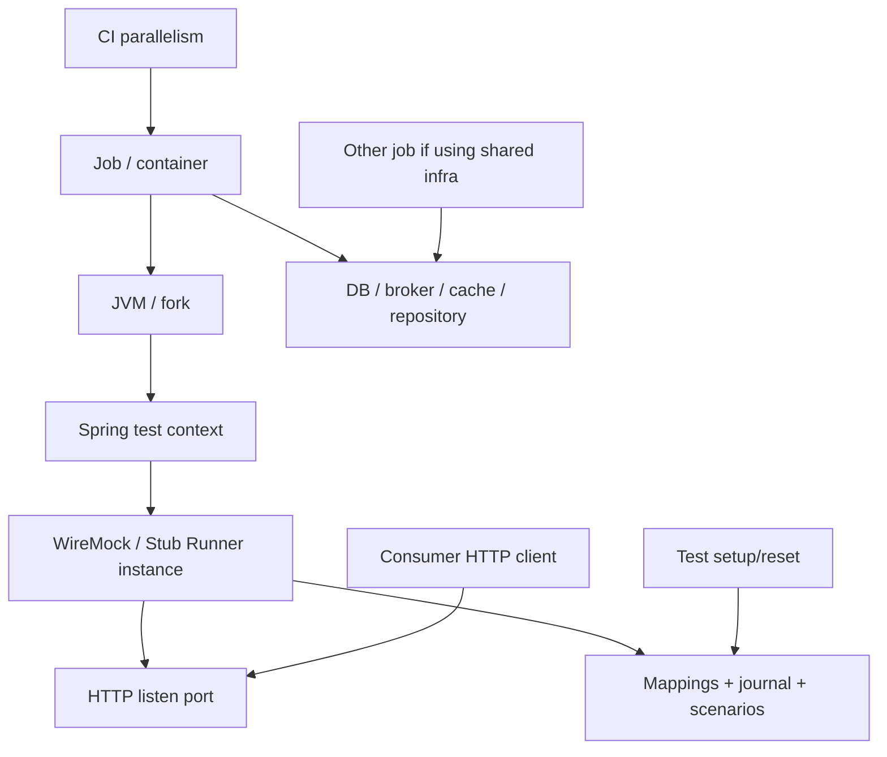
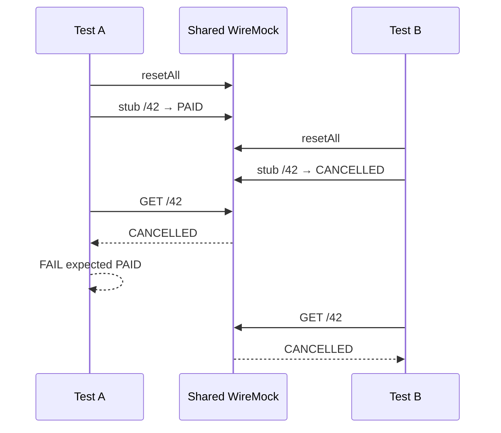
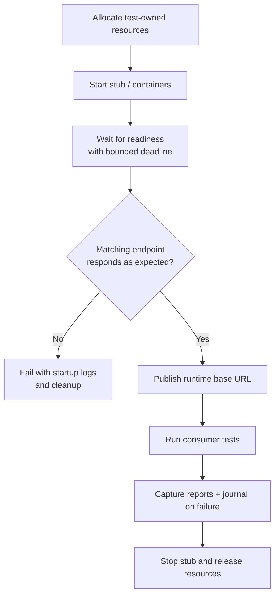

# Running in parallel and avoiding port or stub-state conflicts

## 1. Why does parallel CI/CD execution make contract tests flaky?

**Spring Cloud Contract** supports defining HTTP or messaging contracts with **Groovy/YAML DSL**, generating producer tests, packaging and publishing stubs, and letting consumers run **Stub Runner** against simulated interfaces. In CI/CD, those tests must run fast and often execute concurrently across multiple threads, JVMs, modules, or jobs.

Parallelism brings clear benefits: shorter pipeline feedback loops. Yet if concurrent tests manipulate a shared resource, reports surface hard-to-reproduce failures:

- Two WireMock servers both try to bind `localhost:8080`, causing `Address already in use`.
- Two tests share a WireMock server and `/api/orders/42`, yet register **two different responses**.
- Test A calls `resetAll()` while test B is sending a request, causing B to get an unmatched `404`.
- Test A advances **scenario state** from `Started` to `PaymentCompleted`, so test B no longer sees the initial response.
- Test A clears the request journal after test B sent its request, breaking B's `verify(1, ...)` assertion.
- Two jobs share a database, broker, or cache; one job wipes the other's data.
- A consumer resolves a different dynamic artifact version than the previous run, and everyone blames parallelism.

A common mistake is thinking switching to a **random port** solves everything. Random ports solve **port contention**, yet do **not** solve race conditions on mappings, scenarios, the request journal, Spring application contexts, or external resources.

**Lesson goal:** design a test topology that runs deterministically in parallel; allocate ports properly for WireMock/Stub Runner; manage stub lifecycle and state; decide when to isolate versus serialize; and implement CI quality gates separating contract failures from test-infrastructure failures.

## 2. Two independent axes: network ports and logical state

### 2.1. A port is a process/network-namespace resource

An HTTP server receiving requests must bind a `host:port` address. Two processes trying to bind the same interface and port within the **same network namespace** collide. Example:

```text
CI worker host
  Test suite A: WireMock → 127.0.0.1:8090
  Test suite B: WireMock → 127.0.0.1:8090  # conflict
```

If both request `port=0`, the OS assigns two distinct ports:

```text
CI worker host
  Test suite A: WireMock → 127.0.0.1:52731
  Test suite B: WireMock → 127.0.0.1:54102
```

These port numbers are **illustrative**; never assert that numbers differ across sequential runs. What matters is that **each live server gets an available socket**, and the consumer receives the **exact bound address**.

### 2.2. Stub state is a server-instance resource

In WireMock, state typically includes:

| State category | Data | Consequence when shared by concurrent tests |
|---|---|---|
| **Stub mappings** | Request → response rules | Adding/removing/overriding mappings causes wrong matches |
| **Request journal** | Log of received requests | `verify(...)` over-counts or under-counts requests |
| **Scenario state** | Current step of a stateful workflow | A test starts at a step left by another test |
| **Global settings** | Transformers, priority, file root, delays... | One test mutating config alters another test |
| **Fixture/body files** | Payload files or template data | Modifying shared files skews responses |
| **Client configuration** | Base URL latched inside the HTTP client | Client calls an old port or another server |

**Critical distinction:** using two different ports does **not automatically** mean two independent servers/states if test logic and harnesses reference the wrong instance. Conversely, two tests on the same WireMock server always share at least part of server state, even when hitting different endpoints.

### 2.3. Isolation scope diagram



Place isolation boundaries **around every resource that actually mutates**. If each job has its own container/server and state, concurrency is low-risk. If two methods share a context/instance and mutate mappings, random ports are not enough.

## 3. Reproducing the failure: sharing a fixed port

Suppose two test classes declare:

```java
@SpringBootTest
@AutoConfigureWireMock(port = 8090)
class CheckoutContractTestA {
    // ...
}

@SpringBootTest
@AutoConfigureWireMock(port = 8090)
class CheckoutContractTestB {
    // ...
}
```

If Spring Test context caching makes both classes share one context, they might **not** start two WireMock instances—which instead introduces **state-sharing risk**. If they start **two concurrent contexts/server instances** in the same namespace, the second server hits a bind error.

Typical message:

```text
java.net.BindException: Address already in use
Failed to start WireMock server on port 8090
```

Do not "fix" this by assigning `8091` to test A and `8092` to test B and hardcoding ports for every test in CI. That creates a growing **registry of static ports**, still risks colliding with other processes, and scales poorly as suites grow.

A better approach is: **let the server request port 0, obtain the actual port, and inject that URL into consumer test configuration**.

## 4. `@AutoConfigureWireMock(port = 0)` and dynamic base URLs

Spring Cloud Contract WireMock integrates with Spring Boot tests via `@AutoConfigureWireMock`. With `port = 0`, WireMock requests an available port and publishes the chosen value via Spring property `wiremock.server.port`.

### 4.1. Configuring the consumer to read the base URL

Suppose the consumer reads `clients.orders.base-url` instead of hardcoding `http://localhost:8090`:

```yaml
# Example application runtime configuration.
clients:
  orders:
    base-url: https://orders.example.internal
```

In tests, use a placeholder so the value is set before the HTTP client bean is created:

```java
import org.springframework.boot.test.context.SpringBootTest;
import org.springframework.cloud.contract.wiremock.AutoConfigureWireMock;
import org.springframework.test.context.TestPropertySource;

@SpringBootTest
@AutoConfigureWireMock(port = 0)
@TestPropertySource(properties = {
    "clients.orders.base-url=http://localhost:${wiremock.server.port}"
})
class CheckoutContractTest {
    // Spring creates the client with the actual stub base URL.
}
```

The snippet above is an **illustrative** configuration: running it requires the compatible `spring-cloud-contract-wiremock` dependency, a Spring Boot test context, and a real consumer client reading that property. It does **not** create assertions or an HTTP client by itself.

### 4.2. Testing through the consumer's real HTTP client

Example client using Spring `RestClient` (Spring Framework 6.1+):

```java
package com.example.checkout;

import org.springframework.beans.factory.annotation.Value;
import org.springframework.stereotype.Component;
import org.springframework.web.client.RestClient;

@Component
public class OrderClient {
    private final RestClient restClient;

    public OrderClient(RestClient.Builder builder,
            @Value("${clients.orders.base-url}") String baseUrl) {
        this.restClient = builder.baseUrl(baseUrl).build();
    }

    public OrderDto getById(long id) {
        return restClient.get()
            .uri("/api/orders/{id}", id)
            .retrieve()
            .body(OrderDto.class);
    }
}
```

```java
public record OrderDto(long id, String state, String currency) {}
```

Tests should register mappings and assert behavior:

```java
import com.github.tomakehurst.wiremock.WireMockServer;
import org.junit.jupiter.api.Test;
import org.springframework.beans.factory.annotation.Autowired;

import static com.github.tomakehurst.wiremock.client.WireMock.*;
import static org.assertj.core.api.Assertions.assertThat;

// Illustrative members inside CheckoutContractTest above.
@Autowired WireMockServer wireMockServer;
@Autowired OrderClient orderClient;

@Test
void paidOrderIsReadable() {
    wireMockServer.stubFor(get(urlEqualTo("/api/orders/42"))
        .willReturn(aResponse()
            .withStatus(200)
            .withHeader("Content-Type", "application/json")
            .withBody("{\"id\":42,\"state\":\"PAID\",\"currency\":\"VND\"}")));

    OrderDto order = orderClient.getById(42L);

    assertThat(order.id()).isEqualTo(42L);
    assertThat(order.state()).isEqualTo("PAID");
    wireMockServer.verify(1,
        getRequestedFor(urlEqualTo("/api/orders/42")));
}
```

**Reading the example accurately:** the fields and method in the last snippet are **excerpts inside the test class**, not top-level Java declarations. With `@AutoConfigureWireMock`, the integration normally provides a `WireMockServer` bean to the test, though you should check your exact version/annotation/configuration.

### 4.3. Port 0 is not an address to call

```text
Wrong: http://localhost:0/api/orders/42
Right: http://localhost:<actual WireMock port>/api/orders/42
```

Distinguish `server.port` of the **Spring Boot app under test** from `wiremock.server.port` of WireMock. `@SpringBootTest(webEnvironment=RANDOM_PORT)` only randomizes the app's port; it does **not** automatically alter the base URL the consumer uses to call producer stubs.

## 5. Stub Runner: dynamic ports for published artifacts

In Spring Cloud Contract, consumers do not have to write WireMock mappings themselves. The producer generates and publishes `-stubs.jar` from Groovy/YAML contracts, and the consumer uses **Stub Runner** to boot mappings for the exact artifact/version.

Example:

```java
import org.junit.jupiter.api.Test;
import org.springframework.boot.test.context.SpringBootTest;
import org.springframework.cloud.contract.stubrunner.StubRunnerProperties;
import org.springframework.cloud.contract.stubrunner.spring.AutoConfigureStubRunner;
import org.springframework.cloud.contract.stubrunner.spring.StubRunnerPort;

import static org.assertj.core.api.Assertions.assertThat;

@SpringBootTest
@AutoConfigureStubRunner(
    ids = "com.example:order-service:1.4.0:stubs",
    stubsMode = StubRunnerProperties.StubsMode.LOCAL
)
class CheckoutWithProducerStubsTest {

    @StubRunnerPort("com.example:order-service")
    int stubPort;

    @Test
    void consumerHandlesPaidOrder() {
        // OrderClient(String baseUrl) is an illustrative constructor
        // of the real client provided by the consumer application.
        OrderClient client = new OrderClient(
            "http://localhost:" + stubPort);
        OrderDto order = client.getById(42L);
        assertThat(order.state()).isEqualTo("PAID");
    }
}
```

**Note:** `OrderClient(String)` here assumes a constructor accepting a base URL; if your application injects `OrderClient` via DI, supply the runtime URL before bean creation or create a test factory wrapping the **exact same HTTP client code**. Never paste the two different `OrderClient` snippets from sections 4 and 5 into the same project without adapting them.

`@StubRunnerPort` retrieves the port of the **exact producer stub**. Never use `wiremock.server.port` from another WireMock server to guess the Stub Runner port.

When multiple stubs are needed:

```java
@AutoConfigureStubRunner(
    ids = {
        "com.example:order-service:1.4.0:stubs",
        "com.example:payment-service:2.1.0:stubs"
    },
    stubsMode = StubRunnerProperties.StubsMode.LOCAL
)
class CheckoutWithTwoStubsTest {
    @StubRunnerPort("com.example:order-service")
    int orderPort;

    @StubRunnerPort("com.example:payment-service")
    int paymentPort;
}
```

**Do not** assume the first server is always `order-service` or share one port across two clients. When Stub Runner starts multiple HTTP stub servers, each upstream must receive the **base URL of its exact artifact**.

### 5.1. LOCAL, REMOTE, and stub versions

`LOCAL` assumes `group:artifact:version:stubs` already sits in the local Maven repository on **the machine running tests**. `REMOTE` requires a repository URL and valid authentication to resolve remotely; a CI job on a different machine/container cannot automatically see the producer's local repository.

In parallel CI, you should:

- **Pin versions** like `1.4.0` for release gates; avoid drifting `+` when reproducibility matters.
- Log the **resolved artifact version**, classifier, and repository when tests fail.
- Publish stubs only after generated producer contract tests actually run and pass.
- Prevent two concurrent jobs from overwriting the same release artifact or mutating a shared local cache without locking.

Random ports protect sockets; pinning artifacts protects **the source of stub behavior**. Both complement each other.

## 6. At what level is isolation sufficient?

Isolation should match what tests mutate:

| Scope | Isolation level | Cost | When appropriate |
|---|---|---|---|
| **Per test method** | Each method gets its own server/fixture | Higher | Complex scenario state, tests overwriting mappings |
| **Per test class/context** | One server per class; methods sequential or state-partitioned | Moderate | Suites sharing config with controlled resets |
| **Per Maven/Gradle fork** | Each JVM has separate servers and globals | Higher CPU/RAM | Static state or frameworks hard to isolate per method |
| **Per CI job/container** | Job-scoped network namespace, stub server, DB/broker | Resource-heavy yet clean | Parallel pipeline matrices, multi-service integration tests |
| **Shared global stub** | Multiple suites share one server | Cheap startup | Safe only when read-only, with strict ownership and concurrency bounds |

A **dedicated server** is easiest to reason about when tests add/remove mappings or use scenarios. You do not need a fresh JVM for every method, though. For suites that **only read** static mappings and do not assert global request counts, sharing an instance can work once proven free of hidden coupling.

### 6.1. Not every "singleton" has global scope

- A Java `static` lives **inside a JVM/classloader**, not shared across processes.
- A `@Singleton` bean in a Spring context is shared among tests reusing **that same context**.
- WireMock's request journal belongs to the **server instance**.
- External databases/brokers/caches can be shared across **multiple JVMs and CI jobs** if pointed at the same endpoint.
- Docker containers have isolated network namespaces, yet hitting one shared managed database still corrupts each other's data.

Never set isolation boundaries based on class names; look at **where a resource is created, who owns it, and when it is cleaned up**.

## 7. Do resetting mappings, request journal, and scenarios differ?

Yes. "Resetting WireMock" is not a single unambiguous operation.

| State type | What to clear | What not to wipe accidentally |
|---|---|---|
| Request journal | HTTP request history | Static mappings needed for tests to work |
| Scenario state | Current step transitions of scenarios | Scenario mappings and body files |
| Dynamic mappings | Temporary mappings added by a method | Mappings from artifacts or other tests |
| All state | Mappings + journal + scenarios per API/version | Use only when the test exclusively owns the instance |

### 7.1. Resetting the request journal when mappings are shared

Tests checking request counts should clear history before running:

```java
import com.github.tomakehurst.wiremock.WireMockServer;
import org.junit.jupiter.api.BeforeEach;
import org.springframework.beans.factory.annotation.Autowired;

class RequestJournalExample {

    @Autowired WireMockServer wireMockServer;

    @BeforeEach
    void clearPreviousRequests() {
        wireMockServer.resetRequests();
        // Do not delete loaded mappings.
    }
}
```

**Condition:** no other method **is using the same server** during the reset. If two methods run concurrently, method A calling `resetRequests()` can wipe B's request right before B runs `verify(1, ...)`. Resetting the journal alone only prevents **leaks between sequential tests**; it does not make a shared server safe for concurrent tests.

### 7.2. `resetAll()` can destroy mappings loaded from an artifact

```java
@BeforeEach
void resetServerWhenThisTestOwnsIt() {
    wireMockServer.resetAll();
    // Then register all mappings needed specifically for this test.
}
```

If `resetAll()` wipes mappings loaded by Stub Runner from `-stubs.jar`, subsequent tests may get unmatched `404`s. **Never call `resetAll()` indiscriminately on a shared Stub Runner server**, unless the harness reloads or resets to a verified baseline.

With direct WireMock, if each test owns its server—or runs sequentially and registers all mappings itself—`resetAll()` can fit. If mappings are preloaded, reset only the request journal/scenarios or **recreate the instance** per test scope.

### 7.3. Scenario state must reset according to scenario semantics

A scenario transitions `Started` → `Paid` → `Refunded`. If method B starts after method A transitioned to `Paid`, B's response may no longer be the initial step's response.

Depending on the WireMock version, dedicated scenario-reset APIs exist. However, **resetting in `@AfterEach` is not enough** when methods run concurrently: A and B can touch the same state **before** either tears down.

**Preferred designs:**

1. Give each scenario test its **own instance**; or
2. Namespace scenario names per test invocation if mappings/fixtures allow; or
3. Run sequentially under a resource lock on the shared server with strict setup/teardown.

Never distinguish scenarios solely via a random variable in the body if request matchers still fail to tell them apart.

## 8. Parallel scheduling can mask bugs rather than eliminate them

Suppose:

```text
Test A:
  resetAll()
  stub GET /api/orders/42 -> PAID
  GET /api/orders/42
  assert PAID

Test B:
  resetAll()
  stub GET /api/orders/42 -> CANCELLED
  GET /api/orders/42
  assert CANCELLED
```

When run sequentially, both pass. When run concurrently:



Test A fails **not** because Spring Cloud Contract generated bad DSL, but because both tests are **racing on shared mutable state**. Never relax the contract to "accept both PAID and CANCELLED" just to make tests green. Fix it by isolating stub instances/fixtures or serializing tests that genuinely share state.

## 9. Golden rules before increasing parallelism

Increase concurrency only after answering:

1. **Who owns the server?** A test class, test suite, CI job, or shared environment?
2. **Are mappings dynamic?** If yes, who is allowed to reset or override them?
3. **Are there request-count assertions?** If yes, whose journal is being counted?
4. **Are scenarios used?** Is state partitioned per test ID?
5. **How does the consumer receive the base URL?** Could it accidentally read a previous server's port?
6. **Are external resources shared?** DB, broker, Redis, temp files, HTTP proxies?
7. **Is the artifact version pinned?** Can the exact same payload be reproduced?
8. **When a test fails, are logs sufficient to identify which server it called?**

An easy-to-apply design rule is: **"Every mutable resource must have a clear owner, scope, and cleanup rule."**

## 10. JUnit 5: controlled parallelism with `@Execution` and `@ResourceLock`

In a JUnit Jupiter project, test execution can be configured in parallel. Example test runtime properties file:

```properties
# Example: src/test/resources/junit-platform.properties
junit.jupiter.execution.parallel.enabled=true
junit.jupiter.execution.parallel.mode.default=concurrent
junit.jupiter.execution.parallel.mode.classes.default=concurrent
junit.jupiter.execution.parallel.config.strategy=fixed
junit.jupiter.execution.parallel.config.fixed.parallelism=4
```

**Warning:** this illustrative configuration affects the entire JUnit Platform test plan. It can cause classes/methods that previously ran sequentially to run concurrently. Before enabling it in CI, verify that tests touching WireMock, Spring contexts, databases, system properties, and message brokers all have isolation policies.

### 10.1. Use `@ResourceLock` when stub sharing is unavoidable

Suppose two test classes share **one WireMock instance** or one fixed port that cannot yet be separated:

```java
import org.junit.jupiter.api.Test;
import org.junit.jupiter.api.parallel.Execution;
import org.junit.jupiter.api.parallel.ExecutionMode;
import org.junit.jupiter.api.parallel.ResourceAccessMode;
import org.junit.jupiter.api.parallel.ResourceLock;

@Execution(ExecutionMode.CONCURRENT)
@ResourceLock(
    value = "shared-order-wiremock",
    mode = ResourceAccessMode.READ_WRITE
)
class PaidOrderStubTest {
    @Test
    void shouldReadPaidOrder() {
        // Setup mapping, invoke consumer, assert, cleanup.
    }
}
```

The other class sharing that server **must also declare the same resource lock key**:

```java
@Execution(ExecutionMode.CONCURRENT)
@ResourceLock(
    value = "shared-order-wiremock",
    mode = ResourceAccessMode.READ_WRITE
)
class CancelledOrderStubTest {
    @Test
    void shouldReadCancelledOrder() {
        // Must not run concurrently with PaidOrderStubTest.
    }
}
```

`@ResourceLock` lets JUnit coordinate scheduling **within the managed test engine/test plan**. It is **not a mutex across JVMs, Maven forks, Docker containers, or CI jobs**. If two independent processes modify a remote WireMock server, adding this annotation in each codebase is **not enough**.

**Prefer isolation over global locking** whenever possible: an independent server per mutating test class unlocks true parallelism; resource locks are an intentional fallback for shared resources that are hard to split.

### 10.2. `@Execution(SAME_THREAD)` does not lock other classes

Example:

```java
@Execution(ExecutionMode.SAME_THREAD)
class OrderScenarioTest {
    // Methods in this class are scheduled sequentially
    // per JUnit Jupiter policy.
}
```

This helps **methods within that class**, yet does not stop other classes in the same JVM from running concurrently and touching a shared server. Pair it with scoped isolation/resource locks or disable parallelism for the state-sharing test group.

### 10.3. Test instance lifecycle is not stub isolation

By default, many test frameworks instantiate one test class object per method, while the Spring context and WireMock server may still be shared. Switching from `@TestInstance(PER_CLASS)` to `PER_METHOD` **does not automatically give each test its own server**.

When reviewing a class, ask: do the test object, Spring context, `WireMockServer`, request journal, scenario state, and DB fixture **genuinely share the exact same scope?**

## 11. Spring Test context cache: a server can outlive a test

Spring Test **caches application contexts** across test classes with compatible configurations. This saves startup time, yet has major implications for stubs:

- Two classes can share one `WireMockServer` bean despite living in separate test files.
- A client bean can hold a **base URL read once** at context initialization.
- `@BeforeEach` runs only after the context is built; changing a Java field then **does not update** a base URL already latched into the client.
- Mappings/journals/scenarios may need resetting if a context keeps a server alive across multiple methods/classes.
- If one test manually calls `server.stop()` while the Spring context cache retains the client or bean, another class may call a **closed port**.

### 11.1. Should every test be marked `@DirtiesContext`?

`@DirtiesContext` tells Spring to mark the context dirty and recreate it when appropriate. This reduces cross-talk **from shared Spring contexts**, yet:

1. Significantly increases CI duration when many integration tests exist.
2. Does not clean external databases/brokers/Redis unless test infrastructure handles it separately.
3. Does not fix consumers pointing at a **shared remote WireMock server** outside the context.
4. Does not make concurrent mutations of an out-of-JVM resource safe across two simultaneous test contexts.

Prefer **proper isolation and lifecycle design**. Use `@DirtiesContext` deliberately only when configuration/beans truly cannot be shared, and monitor startup cost.

### 11.2. Rules for Spring-managed clients

If the consumer client is wired via:

```java
@Value("${clients.orders.base-url}")
String baseUrl;
```

that value must be registered **before the bean needs it**, e.g., via `@TestPropertySource` with `wiremock.server.port` or an appropriate dynamic property registrar. Calling `System.setProperty("clients.orders.base-url", ...)` once a test starts may be too late and **collides with global process state** of other tests.

In particular, never mutate JVM-wide system properties from concurrent test classes without effective in-JVM isolation or resource locks.

## 12. Maven: distinguish parallel modules, forks, and JUnit methods

Maven has multiple distinct levels of parallelism:

| Level | Example | What can run concurrently |
|---|---|---|
| **Reactor modules** | `mvn -T 2 clean verify` | Independent Maven modules built in parallel |
| **Surefire forked JVMs** | `<forkCount>2</forkCount>` | Multiple JVMs running tests |
| **JUnit Jupiter parallel** | `junit.jupiter.execution.parallel.enabled=true` | Methods/classes inside one JVM |
| **CI matrix** | Multiple jobs | Multiple build environments concurrently |

A project can enable **multiple levels at once**, multiplying active WireMock servers. For example, three modules × two forks × four test threads means far more than four tests running on the host simultaneously.

### 12.1. Surefire forks

Example POM snippet:

```xml
<plugin>
    <groupId>org.apache.maven.plugins</groupId>
    <artifactId>maven-surefire-plugin</artifactId>
    <version>REPLACE_WITH_COMPATIBLE_VERSION</version>
    <configuration>
        <forkCount>2</forkCount>
        <reuseForks>true</reuseForks>
    </configuration>
</plugin>
```

`REPLACE_WITH_COMPATIBLE_VERSION` is a placeholder, not a real version. Forks isolate **static Java state**, yet **do not isolate** fixed localhost ports, remote WireMock servers, databases, or brokers. If two forks both request `8090`, they still collide.

If runner RAM/CPU limits are tight, raising fork counts can cause Spring Test contexts, Netty, and Gradle daemons to thrash resources and time out; never assume more parallelism always equals faster builds.

### 12.2. Parallel Maven reactors with Spring Cloud Contract

```bash
# Example: build two modules concurrently when the dependency graph allows.
mvn -T 2 -B -ntp clean verify
```

Each producer module must own its **contract sources and base class**. Producer generated tests must **execute and pass**, not merely compile inside another module. If Maven modules write to a shared temporary directory or bind the same port, they can collide even when the Maven dependency graph is valid.

### 12.3. Never use skip flags to hide flakiness

```bash
# Do not use as a producer contract verification gate:
mvn clean package -DskipTests
```

The build can package a stub artifact without running generated producer tests. If increasing parallelism breaks tests, **fix isolation, readiness, or concurrency**—never skip tests and publish artifacts as if contracts were verified.

## 13. Gradle and test workers: the boundary is still the real resource

For Gradle projects, an illustrative test JVM worker config:

```kotlin
tasks.test {
    useJUnitPlatform()
    maxParallelForks = 2
}
```

This controls Gradle's **test process forks**, without replacing JUnit Jupiter's parallel method execution. If JUnit parallelism is also enabled, multiple tests can run concurrently inside each fork.

Operational notes:

- Each fork has isolated Java static state.
- Forks still share host ports within the same network namespace.
- When using Testcontainers, container IDs/ports and cleanup must be properly scoped.
- Tests sharing an external managed database/broker can still race on state.
- Different Gradle tasks can run in parallel; verify output directories and file roots are not shared.

This is a **configuration example**, not a requirement to run Gradle in this lesson. Maven and Gradle differ in scheduling, yet the rule **dynamic ports + state ownership + cleanup** remains identical.

## 14. Docker/Compose: host port vs. container port

In Docker, multiple containers can all listen on **port 8080 inside each container** because each container has its own network namespace. Conflicts arise when you publish both to the **same host port**:

```yaml
# Example prone to conflict when two stacks share a host/runner:
services:
  order-stub:
    image: wiremock/wiremock:REPLACE_WITH_PINNED_VERSION
    ports:
      - "127.0.0.1:8090:8080"
```

Two CI jobs running on a shared runner and both publishing `127.0.0.1:8090` will collide on that port.

### 14.1. Prefer internal networks when the consumer also runs in Compose

```yaml
# Example stack using service DNS without publishing a host port.
services:
  order-stub:
    image: wiremock/wiremock:REPLACE_WITH_PINNED_VERSION
    volumes:
      - ./wiremock-root:/home/wiremock:ro
  checkout-tests:
    image: checkout-test-runner:REPLACE_WITH_PINNED_VERSION
    depends_on:
      - order-stub
    environment:
      ORDERS_BASE_URL: http://order-stub:8080
```

`REPLACE_WITH_PINNED_VERSION` tags are placeholders to replace with verified versions/digests. The example illustrates topology only, not a pre-built runner image.

When both containers share a Compose network, `checkout-tests` calls **`http://order-stub:8080`**. Inside `checkout-tests`, `localhost` points to **`checkout-tests` itself**, not `order-stub`.

Do not publish a host port when **no consumer outside the network needs to call it**. That eliminates port collisions and avoids exposing WireMock/Admin APIs externally.

### 14.2. `depends_on` does not replace readiness

In a basic Compose file, `depends_on` orders service startup, yet **does not guarantee mappings are loaded and stub endpoints are ready**. Consumer CI needs a bounded readiness probe verifying a sample request returns the expected response, or an appropriate healthcheck condition.

Illustrative probe:

```bash
curl --fail --silent --show-error \
  -H "Accept: application/json" \
  http://order-stub:8080/api/orders/42
```

This command only works where **hostname `order-stub` resolves**, such as a container on the same network. It checks success status per curl rules; a strict readiness gate should inspect the **response body/schema**, not just an open socket.

### 14.3. Avoiding collisions across multiple Compose stacks

If multiple jobs share a Docker daemon, isolate **project names and resource scopes** so one job's containers/networks/volumes do not overwrite another's. With job-scoped project names:

- Never hardcode the same `container_name` across jobs.
- Never mount the same writable fixture directory if tests mutate it.
- Never accidentally share stateful named volumes.
- Tear down services/volumes **belonging to that exact job** afterward, even on failure.

A unique project name separates Compose resources, yet if jobs **all publish host port 8090**, collisions still occur. Coordinate both **network scope and port strategy**.

## 15. Databases, brokers, and caches: random ports do not cure side effects

Spring Cloud Contract producer verification and consumer integration tests can depend on external state beyond stubs:

| Resource | Race condition | Mitigation |
|---|---|---|
| **Database** | Two tests seed order `42`; one deletes the other's row | Separate DB/schema/container, resource lock, or unique test data |
| **Kafka/RabbitMQ** | Shared topic/queue; one consumer reads another test's message | Isolated consumer groups/queues/namespaces, correlation IDs, separate containers when appropriate |
| **Redis/cache** | Two tests write the same key `order:42` | Per-test/job key prefixes or isolated cache instances |
| **Filesystem** | Every test writes `./tmp/response.json` | Per-method or per-job temporary directories |
| **System properties** | One test mutates `user.timezone` while another parses dates | Avoid mutating globals in parallel tests; use scoped config/locks |
| **Mock singletons** | One test resets stubs/mocks while another invokes them | Isolated beans/contexts or serialize shared state |
| **WireMock server** | Contention on `resetAll` or scenario state | Separate instances or server-level synchronization |

### 15.1. Unique test data IDs fail if stub mappings are static

Generating a random `orderId` per test prevents database collisions, yet if WireMock only defines:

```json
{
  "request": {
    "method": "GET",
    "urlPath": "/api/orders/42"
  },
  "response": {
    "status": 200,
    "jsonBody": {"id": 42, "state": "PAID"}
  }
}
```

then `/api/orders/123` will not automatically match. If dynamic data is required, use **deliberate mappings/templating/matchers**, or spin up a dedicated stub server configured for that exact ID. Never loosen regexes blindly so every path returns `42`, or consumer tests lose the ability to detect wrong requests.

### 15.2. Messaging contracts and concurrency

Suppose contract `OrderPaid` publishes to `orders.paid`. If two tests share a consumer group or queue, one test can consume the other's message. You should:

1. Use unique correlation/event IDs to filter the right message.
2. Isolate queues/topics/consumer groups per job when the adapter permits.
3. Wait for expected messages with bounded timeouts.
4. Clean up **job-owned data** instead of purging an entire shared topic.
5. Assert message counts/correlation rather than merely "at least one message arrived".

**HTTP Stub Runner does not turn into a message broker by itself.** For messaging, use the appropriate test binder, message verifier, adapter, or test broker environment; the same state-isolation rules apply.

## 16. Readiness and cleanup: two commonly overlooked conditions

Parallel execution shifts **timing** during server startup and teardown; CI worker speed fluctuates. A test can fail not from a broken contract, but because the consumer sent a request **before Stub Runner/WireMock was ready**.

### 16.1. Wait on readiness conditions, not guessed durations

Avoid:

```text
start WireMock
Thread.sleep(2000)
run consumer tests
```

Two seconds wastes time on a fast machine and still fails on a heavily loaded CI worker. A reliable sequence:



**Readiness** is more than a live process: a Stub Runner server can open its port before finishing artifact resolution or loading mappings. Probe a **representative endpoint** and assert key status/body fields if designed for probing; avoid probes that mutate scenario state relied upon by subsequent tests.

### 16.2. HTTP tests must wait for calls to finish

For WebClient/reactive consumers:

```java
import java.time.Duration;
import reactor.test.StepVerifier;

StepVerifier.create(orderReactiveClient.getById(42L))
    .assertNext(order ->
        assertThat(order.state()).isEqualTo("PAID"))
    .expectComplete()
    .verify(Duration.ofSeconds(5));
```

This is an excerpt from a JUnit test with an existing client/stub. Creating a `Mono` without subscribing **does not send an HTTP request**, while calling `subscribe(...)` and exiting the method can run assertions after the test ends. `StepVerifier.verify(Duration)` subscribes and awaits completion/error signals within a bounded timeout.

For APIs with **retries**, a single subscription may emit multiple HTTP requests; request-count assertions must reflect the retry policy. For continuous SSE/streams, do not wait indefinitely for `onComplete`; specify an appropriate cancellation or event-count condition.

### 16.3. Cleanup must run even when tests fail

If a test creates a WireMock server manually, stop that exact instance when the test scope ends. When using a JUnit resource manager/extension, let the extension manage startup/shutdown; when managing manually, match the lifecycle and avoid stopping a server **while another class/test still uses it**.

Example using `try/finally` in a synchronous test harness:

```java
WireMockServer server = new WireMockServer(
    WireMockConfiguration.wireMockConfig().dynamicPort());

server.start();
try {
    String baseUrl = server.baseUrl();
    // Register mappings and run consumer tests with baseUrl.
} finally {
    server.stop();
}
```

This snippet assumes imports and an appropriate Java/JUnit harness; it is not a full test class. When using Spring Test context caching, **never manually stop a WireMock bean owned by Spring/extensions** if its lifecycle is shared with other classes.

In container-based CI, add job/orchestrator-level cleanup when tests fail or jobs are cancelled. Save startup logs, request journals, and test reports **before** deleting containers when investigation is needed.

## 17. A safe parallel execution strategy for CI

For a system with producer `order-service` and consumer `checkout-service`, a recommended workflow:

### 17.1. Producer-side pipeline

```text
Producer CI:
  1. Select exact Groovy/YAML contract sources for the commit version.
  2. Generate producer tests and stub mappings.
  3. Provision test-scoped fixtures, DB/broker if needed.
  4. Run contract tests at permitted parallelism:
       - random HTTP ports;
       - server/scenario isolation;
       - isolated test data namespaces.
  5. Confirm generated test classes actually executed > 0,
     none skipped, failures/errors = 0.
  6. Package exact -stubs.jar and inspect mappings/bodies.
  7. Publish new version only after verification.
```

### 17.2. Consumer-side pipeline

```text
Consumer CI:
  1. Pin com.example:order-service:1.4.0:stubs.
  2. Resolve from exact artifact source (LOCAL or REMOTE).
  3. Each job/fork gets its own stub instance,
     WireMock picks a dynamic port.
  4. Inject the bound base URL into the real HTTP client.
  5. Run tests for 200, 404, validation, and retries if applicable.
  6. Inspect scoped request journals/scenarios.
  7. Archive reports + resolved coordinates + failure logs.
  8. Clean up containers/servers per job ownership.
```

### 17.3. Parallel matrices require per-job ownership

Illustrative **CI workflow pseudocode**, independent of any specific CI vendor:

```yaml
producer:
  build_and_verify:
    contract_source: producer_commit
    tests: generated_producer_contract_tests
    require_executed_tests: true
    fail_on_skipped_contract_tests: true
    isolate_database_and_message_resources: true
    publish_stubs_only_after_success: true

consumer:
  compatibility_matrix:
    stub_coordinate: "com.example:order-service:1.4.0:stubs"
    parallel_jobs:
      - job: checkout-http
        own_wiremock_server: true
        use_dynamic_port: true
        assert: "HTTP client + checkout behavior"
      - job: notification-message
        own_message_test_environment: true
        assert: "listener + message schema"
    archive:
      - test_reports
      - resolved_stub_metadata
      - stub_logs_on_failure
```

This is a **design specification**, not YAML you can paste directly into GitHub Actions, GitLab CI, or Jenkins. When translating to your CI provider's syntax, configure runners/images, credentials, stub resolution steps, caches, build commands, and cleanup.

When each matrix job runs on an **isolated hosted runner**, host port contention between jobs drops, yet it **cannot eliminate** conflicts on shared remote DBs/brokers, artifact repositories, or shared stub servers. When jobs share a **self-hosted runner Docker daemon/host**, keep both port allocations and project/container names unique.

### 17.4. When is sequential execution the right choice?

Not every test suite should be forced to run concurrently. Temporarily run sequentially when:

- A legacy test suite shares a WireMock server with many mutating mappings/scenarios.
- A fake service holds a mutable singleton that cannot be isolated short-term.
- An external system grants only one test tenant, queue, or shared resource slice.

Crucially, **document why it runs sequentially**, assign an owner, and plan to reduce coupling. Running sequentially for correctness is reasonable; **accepting flaky tests as "normal in parallel"** is not.

## 18. Signals and reports to distinguish contract bugs from isolation bugs

When a test fails in CI yet passes locally, gather evidence:

| Information | Why it helps |
|---|---|
| Job ID/fork/test class/method | Identifies which tests ran simultaneously |
| Stub group/artifact/version/classifier | Confirms tests used the right contract |
| Stub runtime base URL/port | Catches clients calling the wrong server |
| Key request method/path/query/headers | Compares against WireMock matching |
| Stub mapping ID/scenario state | Shows which mapping returned the response |
| Bounded request journal | Distinguishes unsent, repeated, or wiped requests |
| Startup/teardown timestamps | Detects races before readiness or after shutdown |
| Test data namespace/tenant | Finds DB/broker/cache collisions |
| Maven/Gradle workers & JUnit parallel config | Shows how many tests actually ran concurrently |
| Generated producer test reports | Ensures producer code was verified |

**Never log secrets or sensitive data.** For request bodies containing tokens or customer info, use synthetic fixtures and redact per policy.

### 18.1. `404` errors must be classified

Two easily confused `404` types:

1. **Unmatched WireMock request**: no mapping matched the actual method/path/query/headers/body.
2. **Business response**: a mapping intentionally returned `404` with JSON such as `{"code":"ORDER_NOT_FOUND"}`.

If a test asserts only status `404`, a client mistakenly calling `/api/order/42` instead of `/api/orders/42` gets an unmatched 404 and passes falsely. Assert the **error schema and business code** promised by the contract.

### 18.2. Request counts must be verified at the right moment

Example:

```java
// After the HTTP exchange completes:
wireMockServer.verify(
    1,
    getRequestedFor(urlEqualTo("/api/orders/42")));
```

This is reliable when the request journal belongs **exclusively to the test**—or at least is untouched by other tests during verification. When the consumer retries, expected request counts can exceed 1; never assert count 1 if application policy intentionally retries.

For reactive tests, wait for the `Mono/Flux` terminal signal before checking the journal. For messaging, wait for an event carrying the expected correlation ID within a timeout and distinguish events across tests.

### 18.3. Never auto-retry tests without preserving failure records

CI can support rerunning failed tests. Retrying can help classify flakiness, yet:

- If the first attempt failed with `Address already in use` and the retry passed, **the race still exists**.
- If a retry passed because scenario state changed, the test is no longer self-contained.
- Never treat a passing rerun as equivalent release-gate evidence to a first-run pass if your organization targets zero flakiness.

Record the **first failure**, root cause, and blast radius; fix isolation instead of erasing the initial failure report.

## 19. Troubleshooting matrix for parallel execution

| Symptom | Likely cause | Preferred fix |
|---|---|---|
| `BindException: Address already in use` | Fixed port already bound | Dynamic ports, explicit port allocation, or isolated namespaces |
| Both tests receive test B's response | Two tests overwrote the same mapping | Dedicated WireMock instances or serialize resource |
| Test A `verify(1)` reports 0 after B runs | B reset the request journal | Avoid sharing journals in parallel |
| Scenario starts in the wrong state | Previous test's state lingered | Reset when sequential or use separate instances |
| Stub Runner returns unmatched `404` after another test | Another test called `resetAll()` | Never reset shared mappings; isolate servers |
| Spring client calls previous context's port | Context cache, URL latched early | Inject dynamic URL before bean creation, scope contexts |
| Port varies every run yet test still fails | Client did not pick up runtime port | Log/check actual base URL |
| Container cannot reach `localhost:8090` | Wrong network namespace / host mapping | Use service DNS and container internal port |
| Two Compose jobs create colliding containers | Shared project/container names | Project-scoped names and cleanup |
| One test consumes another test's message | Shared queue/topic/consumer group | Dedicated namespaces/correlation/consumer groups |
| Database fixture disappears mid-test | Another test truncated/deleted shared rows | Per-job DB/schema/test IDs |
| `@ResourceLock` fails to stop collisions | Two forks/jobs in separate JVMs | Process/job isolation or external lock |
| Suite slows down as forks increase | Memory/CPU contention, many Spring contexts | Reduce parallelism, profile bottlenecks |
| Stub returns different payload than yesterday | `+`, SNAPSHOT, cache, or overwritten artifact | Pin immutable version/checksum |
| Test passes only on rerun | Timing/state race | Preserve first-run failure, fix isolation |
| Build green with `0` generated tests | Filters/skip flags, generator did not run | CI gate inspecting generated test reports |

### 19.1. Eight-step diagnostic procedure

1. **Identify the failing stage:** bind, readiness, request match, assertion, teardown, or artifact resolution.
2. **Identify the test instance:** job ID, fork, thread/class/method.
3. **Identify the stub instance:** direct WireMock vs. Stub Runner, actual base URL and port.
4. **Identify state scope:** mappings, request journal, scenarios, and fixtures.
5. **Verify the real call:** was the request sent, were there retries or multiple subscriptions?
6. **Check timing:** did another test reset or stop the same server mid-request?
7. **Check contract sources:** right artifact version, producer generated tests ran and passed.
8. **Fix scope and retest:** isolate or serialize resources, run the suite repeatedly, and save evidence.

When logs say "WireMock returned `404`", do not rush to tweak regexes or expected statuses in contracts. First prove the **consumer called the right stub server, right artifact, and right time**.

## 20. Hands-on lab: two parallel consumer tests suffering state pollution

**Context:** the checkout team has two scenarios sharing one WireMock server:

```text
Test A: GET /api/orders/42 -> 200, state=PAID
Test B: GET /api/orders/42 -> 200, state=CANCELLED

Each test setup:
  resetAll()
  register mapping for /api/orders/42

JUnit Jupiter:
  parallel.enabled=true
  parallel.mode.default=concurrent
```

Running A and B individually passes. Running the suite concurrently causes A to occasionally receive `CANCELLED`; additionally, two Maven forks sometimes hit `Address already in use` on `8090`.

### 20.1. Tasks

1. **Explain both independent causes:** fixed-port contention across servers, and mutable mappings overwritten by another test within the same server.
2. Replace `@AutoConfigureWireMock(port=8090)` with dynamic ports or dedicated instances with proper port allocation; verify the consumer client receives `wiremock.server.port`.
3. Check whether A/B **actually share a Spring context/WireMock instance**; never assume they are isolated just because they sit in two classes.
4. Prefer **two independent servers** for A/B. If not yet possible, use `@ResourceLock` with the same key and run related tests sequentially **within the same JUnit engine**.
5. Do not let B call `resetAll()` while A is executing a request; replace with properly scoped setup/teardown.
6. If asserting request counts, use a dedicated request journal or serialize reset/verify operations.
7. Try enabling JUnit parallelism alongside Maven `forkCount=2`; verify why `@ResourceLock` does not prevent contention across two forks if they still hit a shared external server.
8. Move tests into two separate containers/jobs; configure the consumer container to use the service hostname instead of another container's `localhost`.
9. For the producer stub artifact, pin `com.example:order-service:1.4.0:stubs`. Never explain response discrepancies with an unversioned `+` artifact.
10. Add logs capturing job/fork, resolved stub artifact, base URL, request journal, and test result; run the full suite repeatedly to surface races.
11. Confirm producer generated tests execute and pass before consumer CI consumes new stubs; never skip verification to shorten pipeline runtime.

### 20.2. Experiment matrix

| Setup | Outcome to observe |
|---|---|
| Shared server + `resetAll` + parallel | Mapping races occur |
| Two separate servers on same fixed port | Bind failures occur |
| Two separate servers + dynamic ports | Eliminates both conflicts if state is truly separate |
| Shared server + `@ResourceLock` same engine | Serializes lock-holding tests |
| Shared server + two Maven forks | Single-JVM JUnit lock is insufficient |
| Separate Docker jobs + shared remote DB | Ports behave, database still races |
| Dynamic port yet client hardcoded `8090` | Client calls wrong server |
| Stub Runner with version `+` | Artifact drifts, hard to reproduce |

### 20.3. Self-assessment questions

| Question | Answer |
|---|---|
| Does `port=0` give each test method an independent request journal? | **No** |
| Can two concurrent tests on the same WireMock instance safely call `resetAll()`? | **No**, if relying on mappings |
| Does `@ResourceLock` synchronize CI jobs across two machines? | **No** |
| Can Spring context caching cause two classes to share WireMock? | **Yes**, depending on configuration |
| Does `@DirtiesContext` automatically clean a shared managed database? | **No** |
| Do two containers both listening on internal port 8080 necessarily collide? | **No**, if network namespaces are separate |
| Does `depends_on` prove mappings finished loading? | **Not automatically** |
| Does a reactive consumer merely creating a `Mono` send HTTP? | **No**, it must subscribe |
| Does a generated stub JAR prove producer tests passed? | **No** |
| Does a test passing on retry prove the race is gone? | **No** |

## 21. CI/CD checklist for parallel contract testing

- [ ] Concurrency identified across **CI jobs, Maven/Gradle forks, and JUnit methods/classes**.
- [ ] Every stub server has a clear **resource owner/scope** and cannot be stopped mid-flight by another test.
- [ ] No shared fixed ports across servers in one network namespace; dynamic ports or isolated networks used.
- [ ] Consumer clients receive the **exact runtime URL** of WireMock/Stub Runner before instantiation.
- [ ] Application `server.port` is clearly distinguished from `wiremock.server.port` and `@StubRunnerPort`.
- [ ] Dynamic mappings cannot be overwritten concurrently by two tests; servers are isolated or serialized.
- [ ] Request journals are reset within proper scope, without wiping requests from concurrent tests.
- [ ] Scenario states are namespaced or serialized when sharing an instance.
- [ ] Never call `resetAll()` on a shared Stub Runner without a verified mapping reload strategy.
- [ ] Spring context cache and stub/client lifecycles never retain stale URLs after a server stops.
- [ ] When using `@ResourceLock`, its scope is understood to stay within the appropriate JUnit engine.
- [ ] With Maven forks/Gradle workers, in-JVM globals are separated while out-of-JVM resources remain explicitly isolated.
- [ ] Docker/Compose uses per-job project/container/volume names; colliding fixed host ports avoided.
- [ ] Consumer containers use network hostnames and **container ports**, never another container's `localhost`.
- [ ] Readiness is checked with meaningful endpoints and bounded deadlines, not fixed sleeps.
- [ ] DBs/schemas, brokers, caches, temp files, and test data are partitioned or locked appropriately.
- [ ] Reactive/async tests genuinely await completion/messages within timeouts instead of exiting early.
- [ ] Stub artifacts have pinned versions/classifiers and log resolved coordinates for investigation.
- [ ] Generated producer tests **execute and pass** before publishing stubs, not merely generate/build green.
- [ ] Consumer tests exercise real clients/listeners and assert behavior plus response/error schemas.
- [ ] On failure, logs, request journals, and test reports are archived; flakiness is never masked by reruns or skips.
- [ ] Cleanup stops servers/containers within scope even on test failure or job cancellation.
- [ ] Parallelism is scaled up only after measuring CPU/RAM overhead and verifying test stability.

**Remember:** To run Spring Cloud Contract reliably in parallel CI/CD, you must solve **two separate problems**: **dynamic port allocation/wiring** for WireMock or Stub Runner, and **isolating mutable state** across mappings, request journals, scenarios, contexts, and databases/brokers. Each test must call the exact stub artifact/version and await meaningful results, while producer CI must execute generated contract tests before publishing. **Scaling parallelism only after ensuring isolation** speeds up pipelines without sacrificing detection of incompatible APIs.
