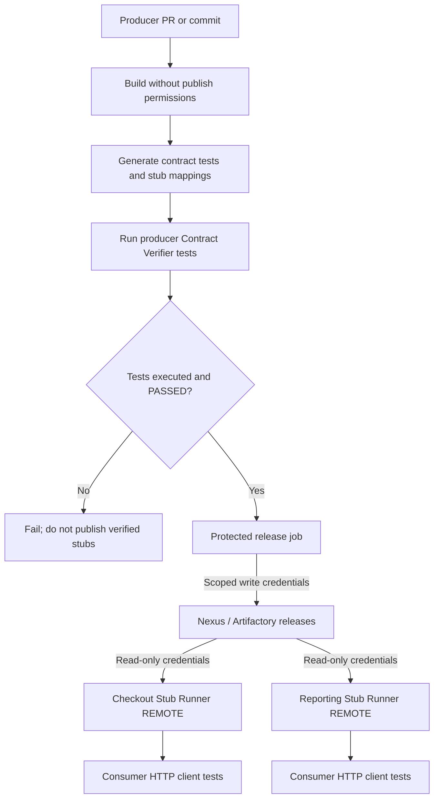

# Protecting artifact repository credentials and publish permissions

## 1. Why does artifact repository security matter for Spring Cloud Contract?

Suppose `Payment Service` is a **producer** publishing HTTP contracts using Groovy/YAML DSL. The producer build uses **Spring Cloud Contract Verifier** to generate and run tests against the real implementation, then packages the artifact:

```text
com.example:payment-service:1.2.0:stubs
```

`Checkout Service` and `Reporting Service` are **consumers**. Both teams fetch that stub artifact via **Stub Runner** from an internal Maven-compatible repository like Nexus or Artifactory, and test their HTTP clients without running a live Payment Service.

To do this, CI may require **read credentials** to download stubs and **write credentials** to publish artifacts. If misconfigured, dangerous scenarios can happen:

- An untrusted pull-request pipeline obtains a token with publish permissions.
- A consumer job holds write credentials and accidentally overwrites the producer's stub.
- An unverified `payment-service-1.2.0-stubs.jar` that never ran producer verification gets published as a verified artifact.
- Tokens leak into console logs, artifacts, Docker images, or a committed `settings.xml` file.
- Someone holds permission to overwrite release artifacts, causing identical versions to yield different JAR contents across two test runs.
- CI downloads stubs from the wrong repository or an untrusted endpoint.

This lesson belongs to the **CI/CD** chapter of the **Spring Cloud Contract** module, focusing on securing the chain **source contracts → producer verification → stub artifact → artifact repository → consumer test**.

After this lesson, you will be able to:

1. Distinguish **read**, **publish**, and **admin** permissions on an artifact repository.
2. Design service accounts and tokens following the **least privilege** principle.
3. Configure Maven `settings.xml`, `distributionManagement`, and Gradle `maven-publish` without putting credentials into source code.
4. Grant appropriate read-only permissions for Stub Runner `REMOTE`.
5. Protect secrets from untrusted pull requests, logs, forks, and Docker containers.
6. Enforce **CI gates** so stubs are published only after producer verification passes.
7. Mitigate artifact overwriting, dependency confusion, credential leakage, and erroneous version releases.
8. Troubleshoot `401`, `403`, and `404` errors and verify audit/rotation practices.

## 2. Trust boundaries in the stub release workflow



Key points:

- **Build/verification jobs** may only need dependency read permissions, never write tokens.
- **Release/publish jobs** run only from trusted sources, after verifying a specific commit or artifact.
- **Consumer CI** needs only permission to download `-stubs.jar` and required dependencies.
- **Repository admin privileges** must never be placed in any routine build job.

**You can split two jobs, provided you link the exact verified subject.** If the verify job builds commit A while the publish job checks out a mutable branch pointing to commit B, the gate becomes meaningless. Pin the commit SHA, pass an immutable artifact from the verify job, or re-run verification on that exact source before publishing.

## 3. Build a permission matrix before creating credentials

A minimal permission matrix:

| Identity | Read release stubs | Read snapshot stubs | Publish release | Publish snapshot | Repository admin |
| --- | --- | --- | --- | --- | --- |
| Local developer (typical) | Yes | As needed | No | Per policy | No |
| Consumer CI / Stub Runner | Yes | If permitted for pre-release testing | No | No | No |
| Producer PR verification | Only required repos/dependencies | As needed | No | No | No |
| Producer release bot | As needed | As needed | **Yes, designated repo/group** | Per policy | No |
| Producer snapshot bot | As needed | Yes | No | **Yes, designated snapshot repo** | No |
| Artifact repository administrator | Per admin role | Per admin role | Per admin role | Per admin role | Yes |

This is a **recommended model**. Exact permission configuration varies across Nexus, Artifactory, or your organization's Maven-compatible repository.

### 3.1. Scope permissions by path and action

If the repository supports namespace or path-based permissions, Payment Service's publish account should write only within:

```text
com/example/payment-service/**
```

Avoid granting `deploy`, `delete`, or `overwrite` across all of `com/example/**` when a producer only publishes one module. Consumers need only **read/download**; they never need `delete`, `create`, `redeploy`, or `promote`.

**Never reuse one account for both reading and writing:** a single token could run both consumer tests and releases, yet sharing it lets a compromised consumer CI tamper with artifacts consumed by other pipelines.

### 3.2. Prefer short-lived identities

Where supported by your platform, prefer **workload identity/OIDC or short-lived tokens** scoped exclusively to the release job. If static tokens must be used:

1. Create a **service account** rather than using a developer's personal password.
2. Restrict access strictly to required repositories and operations.
3. Store in CI's secret manager, never committed.
4. Set expiration dates, rotation schedules, and revocation procedures.
5. Record the token owner, pipelines using it, and recovery steps upon expiration.

OIDC works only when the **repository/identity broker actually supports exchanging identity tokens for repository permissions**. Do not add `id-token: write` to a workflow and assume Nexus/Artifactory automatically accepts any GitHub OIDC token.

## 4. GAV, classifier, and which artifact permissions apply to?

With Spring Cloud Contract, a producer typically publishes:

```text
groupId     = com.example
artifactId  = payment-service
version     = 1.2.0
classifier  = stubs
extension   = jar
```

A standard Maven repository layout may hold:

```text
com/example/payment-service/1.2.0/
  payment-service-1.2.0.pom
  payment-service-1.2.0.jar
  payment-service-1.2.0-stubs.jar
```

`payment-service-1.2.0.jar` is the application artifact; `payment-service-1.2.0-stubs.jar` contains stub mappings/contract resources packaged per build configuration.

**A pipeline's publish permissions should be no broader than required**: if a producer is allowed to publish only its own group/module, enforce that at the repository or credential scope; never treat `groupId` in the POM as a security boundary. `groupId` is a coordinate, not authentication.

A single build command may **upload the POM, application JAR, and `stubs` classifier** if configured in the publication. Understand exactly which artifacts get deployed to avoid accidentally overwriting another module or publishing an unverified stub JAR.

## 5. Maven: keep repository URLs in POM, secrets in separate settings

Maven typically separates:

- `pom.xml`: declares `distributionManagement` (**publish destination**) and plugin configuration.
- `settings.xml`: holds **authentication** keyed by `server.id`.
- CI secret store/environment: supplies username/token at runtime.

### 5.1. `distributionManagement` holds no passwords

In `Payment Service`'s POM:

```xml
<distributionManagement>
    <repository>
        <id>internal-releases</id>
        <url>https://repo.example.test/repository/maven-releases/</url>
    </repository>
    <snapshotRepository>
        <id>internal-snapshots</id>
        <url>https://repo.example.test/repository/maven-snapshots/</url>
    </snapshotRepository>
</distributionManagement>
```

This is a POM fragment, not a complete POM. The domain `repo.example.test` is illustrative only. When publishing a release like `1.2.0`, Maven uses the release repository; `1.3.0-SNAPSHOT` uses the snapshot repository.

**Never place `<username>`/`<password>` directly in the POM or URL.** The POM is a source file that gets copied and published alongside the artifact.

### 5.2. `settings.xml`: IDs must match

An **uncommitted** `settings.xml`, generated by CI into a temporary location or supplied via a secret file:

```xml
<settings xmlns="http://maven.apache.org/SETTINGS/1.2.0">
    <servers>
        <server>
            <id>internal-releases</id>
            <username>${env.MAVEN_REPO_USER}</username>
            <password>${env.MAVEN_REPO_TOKEN}</password>
        </server>
        <server>
            <id>internal-snapshots</id>
            <username>${env.MAVEN_REPO_USER}</username>
            <password>${env.MAVEN_REPO_TOKEN}</password>
        </server>
    </servers>
</settings>
```

In many setups, Maven interpolates environment variables `${env.MAVEN_REPO_USER}` and `${env.MAVEN_REPO_TOKEN}` at runtime. Verify interpolation behavior in your actual Maven/CI version; an alternative is a **CI secret file** containing pre-populated settings with restricted file permissions.

Notes:

1. `<id>internal-releases</id>` in settings must match `distributionManagement.repository.id`.
2. Never take publish credentials and reuse them in consumer tests or PR builds.
3. Separate service accounts/tokens for releases and snapshots when policy requires.
4. Keep settings files outside the repository; set restrictive file permissions and delete temp files after the job.
5. Maven password encryption/master passwords protect at rest on disk, **never replacing a secret manager and least privilege**; encrypted passwords can still be decrypted if the environment holds the master key.

### 5.3. A safe Maven execution path

Example on a producer with Spring Cloud Contract Maven plugin configured:

```bash
# Verify job: no WRITE credentials needed.
./mvnw -B -ntp clean verify

# Protected release job, running on the exact verified commit.
# Never pass -DskipTests to bypass producer verification.
./mvnw -B -ntp -s /path/to/ci-settings.xml deploy
```

These are illustrative commands to run **in a real project**, not commands executed while authoring this lesson. Maven `deploy` runs the standard lifecycle, yet flags/profiles and plugin configs can skip tests. CI must verify **generated contract tests actually executed**, not just an exit code 0 from publish.

**Never print the resolved `settings.xml` or environment variables containing tokens to logs.** Be cautious with `-X`/debug, `help:effective-settings`, CLI `-Dpassword=...`, and shell tracing.

## 6. Gradle: `maven-publish` with minimal, automated credentials

For a Gradle producer, the `maven-publish` plugin can publish both the application JAR and Spring Cloud Contract's `verifierStubsJar` if that task exists in your plugin version.

An example **Groovy DSL `build.gradle` fragment**:

```groovy
plugins {
    id 'java'
    id 'maven-publish'
    id 'org.springframework.cloud.contract' version '<compatible-scc-version>'
}

group = 'com.example'
version = '1.2.0'

publishing {
    publications {
        maven(MavenPublication) {
            from components.java
            artifact(tasks.named('verifierStubsJar'))
        }
    }
    repositories {
        maven {
            name = 'artifactRepository'
            url = uri('https://repo.example.test/repository/maven-releases/')
            credentials(PasswordCredentials)
        }
    }
}
```

In Gradle versions supporting this credential pattern, repository name `artifactRepository` makes Gradle look up project properties:

```text
artifactRepositoryUsername
artifactRepositoryPassword
```

In CI, supply them via **Gradle project property environment variables**:

```text
ORG_GRADLE_PROJECT_artifactRepositoryUsername=<CI_SECRET_USERNAME>
ORG_GRADLE_PROJECT_artifactRepositoryPassword=<CI_SECRET_TOKEN>
```

These are **variable names and placeholders**, not actual credential values. Inject them from the secret store strictly into protected **release jobs**. Never put real values in a committed `gradle.properties`, in `build.gradle`, or on the command line via `-P...=secret` where they leak into logs/process lists.

**Advantage of typed credentials:** Gradle requests credentials only when a task needing them executes per plugin mechanics; build/test tasks have no reason to possess publish credentials.

### 6.1. Supplying secrets with the Provider API when needed

Another option, handy when credentials do not use the default project property names:

```groovy
publishing {
    repositories {
        maven {
            name = 'internalReleases'
            url = uri('https://repo.example.test/repository/maven-releases/')
            credentials {
                username = providers.environmentVariable('MAVEN_REPO_USER').orNull
                password = providers.environmentVariable('MAVEN_REPO_TOKEN').orNull
            }
        }
    }
}
```

This reads from the environment when Gradle configures the publication; if your build environment requires configuration cache compatibility or forbids resolving secrets during configuration, pick the pattern best supported by your plugin/Gradle version. **Never `println` credentials, stringify properties, or write tokens into task outputs**.

### 6.2. Running and checking publications

```bash
# Verify against real producer.
./gradlew clean check

# Strictly in a protected release job after verification.
./gradlew publish
```

`publish` **does not depend on `check` by default**. When splitting jobs, ensure the publish job can run only after verification succeeds for the **same commit and same contracts**. When reusing artifacts from the verify job, never regenerate stubs from unpinned mutable sources.

Gradle publications must also verify the `stubs` classifier is actually attached. Changing repository credentials will not fix a build that forgot to package `-stubs.jar`.

## 7. Stub Runner `REMOTE`: read-only permissions only

On Checkout's side, downloading the published artifact:

```yaml
spring:
  cloud:
    contract:
      stubrunner:
        stubs-mode: REMOTE
        repository-root: "https://repo.example.test/repository/maven-releases/"
        ids:
          - "com.example:payment-service:1.2.0:stubs:8091"
        username: "${STUB_REPO_READ_USER}"
        password: "${STUB_REPO_READ_TOKEN}"
```

`STUB_REPO_READ_USER` and `STUB_REPO_READ_TOKEN` must be **read-only credentials**. If the repository allows anonymous reads within the test network, credentials may not be needed; do not attach tokens unnecessarily just for "consistency".

Distinguish:

| Setting | Meaning |
| --- | --- |
| `stubrunner.repository-root` | Location of the Maven-compatible artifact repository |
| `stubrunner.username/password` | Authenticates **with the repository** during download |
| `stubrunner.ids` | Producer group/artifact/version/classifier/port |
| `payment.client.base-url` | Where the consumer HTTP client calls the **WireMock stub server** |

In the example, the consumer HTTP client targets `http://localhost:8091` on the same host. **Credentials for downloading the JAR are not bearer tokens for `GET /api/payments/42`**, and Stub Runner does not verify the real Payment Service's JWT or mTLS by itself.

### 7.1. Runtime differences

If consumer tests run inside Docker/Kubernetes, know **which container's local repository, network, and secret store** they use. `localhost:8091` inside a consumer container does not automatically reach Stub Runner running in another container; use appropriate hostnames/networks.

Never mount an entire home directory containing `~/.m2/settings.xml`, SSH keys, and tokens into a shared container just to fetch one stub JAR. Prefer read-only secrets or narrowly scoped repository client credentials.

## 8. Untrusted pull-request CI: never supply publish tokens

A pull request branch can contain code edited by external contributors, including `pom.xml`, `build.gradle`, scripts, tests, or GitHub Actions workflow files. If a job executes that code alongside a `MAVEN_REPO_TOKEN` with publish privileges, malicious code can print/exfiltrate the token or tamper with artifacts.

**Principle: unapproved code must never execute inside the same trust boundary as publish credentials.**

Minimum rules:

- PR verification receives only necessary read access; never supply credentials with deploy/delete/overwrite privileges.
- Separate the **release workflow/job** under protected branches and explicit tag/release policies.
- Restrict who can create tags, edit release workflows, and modify environment protection rules.
- Use protected environments and **approvals** where organizational workflow requires.
- Never use `pull_request_target` to check out and execute untrusted PR code alongside secrets; that pattern demands special threat modeling.
- Never grant fork PRs write access to artifact repositories or shared caches that can influence trusted jobs.
- CI job permissions (`contents: read`, artifact upload, package write) must be scoped per task, never broad admin access.

### 8.1. Why isn't "masking secrets in logs" enough?

Masking mainly hides known literal strings in stdout/stderr; malicious code can still:

- Encode, split, or transform the token to bypass masking.
- Exfiltrate the token via outbound HTTP requests.
- Write secrets into build artifacts, test reports, or generated files.
- Use the token directly to publish forged artifacts without printing the string.

Therefore, **never giving tokens to untrusted jobs** matters far more than any log-masking trick.

## 9. GitHub Actions example: separate permissions for verify and publish

Illustrative workflow for a Maven producer. Assumes the repository already has Maven Wrapper, the Spring Cloud Contract Maven plugin, a base test class, `distributionManagement`, and configured secrets.

```yaml
name: payment-contract-release

on:
  pull_request:
  push:
    tags:
      - 'v*'

permissions:
  contents: read

jobs:
  verify:
    runs-on: ubuntu-latest
    steps:
      - uses: actions/checkout@v4
      - uses: actions/setup-java@v4
        with:
          distribution: temurin
          java-version: '21'
      - name: Verify producer contracts
        run: ./mvnw -B -ntp clean verify

  publish:
    needs: verify
    if: github.event_name == 'push' && startsWith(github.ref, 'refs/tags/v')
    runs-on: ubuntu-latest
    environment: artifact-release
    steps:
      - uses: actions/checkout@v4
      - uses: actions/setup-java@v4
        with:
          distribution: temurin
          java-version: '21'
      - name: Publish verified producer and stubs
        env:
          MAVEN_REPO_USER: ${{ secrets.MAVEN_DEPLOY_USER }}
          MAVEN_REPO_TOKEN: ${{ secrets.MAVEN_DEPLOY_TOKEN }}
        run: ./mvnw -B -ntp -s .ci/settings.xml deploy
```

**This is a reference template, not a drop-in production workflow.** `actions/checkout@v4`, `setup-java@v4`, Java 21, and `.ci/settings.xml` must fit your real repository; `.ci/settings.xml` in this example **must be a secret-free template** using environment interpolation or a CI-generated settings file. Never commit real credentials.

Meaning of these protective layers:

1. `permissions: contents: read` restricts the default GitHub token for this workflow.
2. `verify` never receives `MAVEN_DEPLOY_TOKEN`, including when running on PRs.
3. `publish` runs only on `push` events for `v*` tags, after `verify` passes.
4. `environment: artifact-release` can require **reviewers** and branch restrictions in GitHub Settings.
5. Username/token are injected **only in the publish step** from the secret store.
6. Maven `deploy` runs on the tag's code and executes the lifecycle; the pipeline must still verify generated contract tests were not skipped.

**Hardening still needed before production use:** protect tags and workflow-edit permissions; restrict outbound networking; pin actions to commit SHAs when supply-chain policy requires; lock down Maven dependencies/repositories; and guarantee identical commit/contract revisions across jobs. Protecting only branches while letting anyone create arbitrary tags leaves a hole in the release gate.

### 9.1. What if private dependencies require a read token in PRs?

You may grant PR jobs a separate **read-only token** scoped to specific repositories with short lifetimes, if your threat model allows. For untrusted fork PRs, avoid exposing private-repository tokens to arbitrary PR code. Use a read-scoped mirror/proxy, isolate the safe verification step, or require a trusted reviewer to trigger a protected workflow. **Never solve this by promoting the PR token to publisher.**

### 9.2. Closing the gap between verify and publish

If both jobs independently resolve dynamic `+` or `SNAPSHOT` versions or pull contracts from a mutable branch, results can diverge on the same commit. Pin versions/revisions, record resolved dependencies, and ensure publication binds to the **exact source that was verified**.

A tighter model has the verify job produce artifacts with checksums and provenance, while the publish job uploads **those exact immutable artifacts** without rebuilding. If using standard Maven/Gradle `deploy` in the release job, ensure it also executes verification and uses the exact same source/version.

## 10. Mandatory gates before publishing a stub artifact

CI should distinguish at least five gates:

| Gate | What to check | If failed |
| --- | --- | --- |
| **Source gate** | Commit/tag and contract sources are reviewed/accepted | Do not release |
| **Producer verification gate** | Generated tests ran on real implementation; valid test counts | Do not publish verified stubs |
| **Package gate** | `-stubs.jar` exists, right GAV, classifier, mappings/metadata | Do not publish |
| **Authorization gate** | Caller/job is authorized to write to target repo under release policy | Reject and audit permissions |
| **Consumer compatibility gate** | New stub version consumed and handled properly by consumer tests | Block/hold rollout per policy |

A "green" build with **skipped contract tests** does not qualify for publishing. Nor should a write-capable token ever be used to bypass contract verification.

### 10.1. An example verifying gate effectiveness

The producer renames field `paymentId` to `transactionId` without updating the contract agreed with Checkout. Generated producer tests must catch that the real response no longer has `paymentId`.

Expected pipeline behavior:

```text
Producer code changes
    -> generateContractTests / verify
    -> assertion fails
    -> build fails
    -> DO NOT publish payment-service-1.3.0-stubs.jar
```

If someone updates the contract to make tests pass without Checkout reviewing it, the failure becomes a **contract-approval governance violation**. Technical gates must pair with PR approval rules and version governance.

### 10.2. You do not have to publish from every PR

PR verification can produce a stub JAR as a **temporary build output** for internal testing without publishing to the release repository. If consumer previews are needed, use an isolated preview repository/namespace with unique artifact versions, short retention, and dedicated read/write permissions. Never place preview artifacts beside immutable releases under the same version.

## 11. Immutable releases and preventing artifact overwrites

A foundational requirement of contract testing is that:

```text
com.example:payment-service:1.2.0:stubs
```

must point to **the exact verified contents** if consumers and CI expect reproducibility.

If someone overwrites `payment-service-1.2.0-stubs.jar`, two teams running the same version can get different JSON responses. That breaks incident debugging and can conceal tampering.

Recommended policy:

- **Disable redeploy/overwrite on releases** in Nexus/Artifactory where supported.
- Separate releases from snapshots with distinct permissions and retention.
- One pipeline/tag creates one unique release version; avoid races between two jobs claiming the same version.
- Record producer commit, contract revision, artifact hash, and corresponding test reports.
- To fix a faulty released artifact, **create a new version** rather than overwriting the old version's bytes.

### 11.1. SNAPSHOTs do not carry release immutability

`1.3.0-SNAPSHOT` typically serves pre-release integration and can be published repeatedly. When debugging, log the resolved unique snapshot/timestamp or checksum, not just the base version string. **Do not let consumer release CI depend on mutable snapshots** when reproducibility is required.

### 11.2. Checksums, signatures, and provenance

Checksums detect corrupted or altered files in transit, yet **a forged artifact can still have a valid hash** if the publishing source was compromised. Strengthen trust using:

1. Repository TLS and trusted download sources.
2. Release approvals and restricted publish permissions.
3. Artifact signing/attestation where supported and verified.
4. Provenance binding commit, build workflow, contract revision, and verification results.
5. Audit logs on both repository and CI.

Never claim `SHA-256` alone replaces write-access control or provenance.

## 12. Preventing dependency confusion and downloading from wrong sources

Duplicate artifact names or loose resolver configs can cause CI to download packages from unintended sources, especially when mixing public and private repositories.

Countermeasures:

- Use a controlled **internal `groupId`** and clean repository routing/mirroring.
- For private artifacts, configure explicit internal repositories and avoid unintended public fallbacks.
- Pin versions; avoid `+`, dynamic ranges, or snapshots in release CI.
- Verify the repository URL in `stubrunner.repository-root` uses HTTPS with valid certificates.
- Never pass `--insecure`, `-k`, disable certificate verification, or trust all TLS certificates just to "make CI work".
- If using a corporate CA, configure the trust store properly instead of disabling TLS verification.
- Restrict plugin/dependency repositories per organizational policy.

In Spring Cloud Contract, **a spoofed stub JAR can make consumer tests pass green against wrong behavior**. Therefore, trust in the Maven artifact repository and trust in the contract source/release pipeline both matter.

## 13. Protecting logs, caches, artifacts, and temporary files

Secrets can leak outside source code:

| Channel | Risk | Countermeasure |
| --- | --- | --- |
| Console logs | `echo $TOKEN`, HTTP debug, verbose build flags | Never print secrets; masking is secondary defense only |
| Temp `settings.xml` | File uploaded as build artifact or left on runner | Restrict file permissions, delete after job |
| Gradle `gradle.properties` | File containing credentials gets committed | Secret store or injected environment variables |
| Docker image layers | Token baked via Dockerfile `ARG`/`ENV` | Use runtime secrets or proper BuildKit secret mounts |
| CI artifacts/test reports | Token captured in output, XML reports, crash dumps | Redact, restrict artifact uploads and retention |
| Maven/Gradle caches | May hold sensitive artifacts/mappings | Protect caches; never put real data in fixtures |
| Process list | Secret passed via CLI `-Dpassword=...` | Avoid secrets directly on command lines |
| Remote caches | Outputs read or poisoned by other jobs | Enforce permissions; forbid untrusted PRs writing shared cache |

### 13.1. Docker/Compose and secret injection

When running standalone Stub Runner Boot via Docker in CI, it needs only **read** credentials for private repositories. Never bake publisher tokens into the image, never mount a developer's entire home directory, and never expose Stub Runner Boot's control API to untrusted networks.

On platforms supporting secret files (Docker/Kubernetes/CI), mount a read-only config at runtime instead of embedding it in the image. Verify exact property names and secret-loading mechanics for your image version; never assume every image automatically reads `/run/secrets/*` without configuration.

### 13.2. Never put real data into contracts

Groovy/YAML contracts and stub mappings get packaged into JARs and downloaded by many consumers. Keep `request.body`/`response.body` strictly synthetic or anonymized; never include real access tokens, payment card data, or PII. Even when repositories require authentication, read access is often much broader than production data access.

## 14. Token rotation and credential compromise response

Static tokens eventually need rotation. A minimal rotation plan:

1. Identify the service account/token owner and all jobs consuming it.
2. Issue a new token with **equal or narrower scope**.
3. Update the CI secret manager; never edit tokens in POMs or Git.
4. Test verify/consumer download or controlled release using the new credential.
5. Revoke the old token and confirm no job still depends on it.
6. Monitor for `401`, `403`, audit logs, and publication anomalies.

If credential exposure is suspected:

- **Revoke/lock** the exposed token as fast as possible.
- Inspect audit logs across the artifact repository, CI, Git, and outbound network access.
- Check whether any release artifacts, POMs, plugin artifacts, or stub JARs were overwritten or published unauthorized.
- Issue new narrowly scoped tokens; audit and release a new version if any artifact was affected.
- Purge leaked data from logs/artifacts per organizational policy; adding a new commit alone never erases Git history leaks.

**Never test "whether a token leaked" by printing the token.** Use a controlled read/publish request and observe status/permissions only, without writing credentials to output.

## 15. Audit: who published which stub, and when?

Each released artifact should have a minimal audit record:

| Audit field | Example |
| --- | --- |
| Maven coordinates | `com.example:payment-service:1.2.0:stubs` |
| Producer commit | Commit SHA checked out by the release job |
| Contract revision | Commit/revision of Groovy/YAML DSL |
| Build workflow | Release pipeline run ID |
| Verification evidence | Test report + executed test count |
| Published by | Producer release service account |
| Repository | Internal release repository |
| Hash/provenance | SHA-256 / attestation if supported by organization |
| Consumers tested | Checkout/Reporting and corresponding stub version |

Never log plaintext credentials in audit records. Focus on **identity, action, artifact coordinates, timestamps, and outcomes**.

During an incident, you must be able to answer: "Who published `payment-service:1.2.0:stubs`, which build produced it, and which contract sources were verified beforehand?" If you cannot answer, producer–consumer discrepancy triage is weak even while CI looks green.

## 16. Distinguishing authentication errors from contract errors

| Symptom | Possible cause | Safe diagnostic direction |
| --- | --- | --- |
| Maven `deploy` returns `401` | Wrong username/token, expired token, or mismatched credential ID | Check `distributionManagement.id`, `settings.servers.id`, and token scope; never print tokens |
| Maven `deploy` returns `403` | Valid identity lacking write permission | Check publish role and target repository |
| Release deploy rejected on overwrite | Repository immutable release policy | Bump to a new version; never enable redeploy as a "quick fix" |
| Gradle publish missing credentials | Properties/env not provided to release job | Check `artifactRepositoryUsername/Password` names and secret bindings |
| Stub Runner `REMOTE` returns `401` | Consumer read token wrong/expired | Use read-only identity, check URL and auth |
| Stub Runner `REMOTE` returns `403` | Valid token lacking read permission for artifact/version | Check repository path permissions |
| Stub Runner `REMOTE` returns `404` | GAV/classifier/version missing, wrong URL, or repository hides existence | Check metadata, Maven layout URL, and artifact publication |
| Artifact downloaded yet WireMock returns `404` | Unmatched request or stub models a business error | Check actual request and mapping; do not edit credentials |
| PR job has publish permission | Wrong secret scope / workflow condition | Remove publish token from PRs; protect release triggers/environments |
| Identical version yields two different byte payloads | Overwritten release, mutable snapshot, or inconsistent mirror/cache | Check resolved source, checksum, and audit logs |
| Producer tests skipped yet publish still ran | Release gate does not enforce verification | Block publication and enforce test execution |
| Entire CI fails after rotation | New token lacks role or secret not updated everywhere | Check dependency map and permissions |

### 16.1. Three layers of `404` to separate

1. **Repository 404:** `payment-service-1.2.0-stubs.jar` does not exist at the Maven coordinates. Check publishing, version, and repository.
2. **WireMock unmatched 404:** artifact downloaded, yet the request matched no mapping (URL/method/headers/body). Inspect the request journal.
3. **Business 404:** contract intentionally defines `PAYMENT_NOT_FOUND`, and WireMock returns `404` with the business error body.

Fixing repository read credentials will not fix a wrong request URL; fixing mappings will not fix a `403` from Nexus.

### 16.2. Do not diagnose by turning on uncontrolled debug logging

Debug-level logs can expose Authorization headers, tokens, basic auth, or credential file paths. When debugging:

- Use an isolated test environment and a narrowly scoped account.
- Disable or redact logging of headers/authentication.
- Collect only status codes, repository paths, artifact coordinates, and non-sensitive failure reasons.
- Purge temporary logs and restrict read permissions and retention.

## 17. Hands-on exercise: designing permissions for Payment and Checkout

**Context:** `Payment Service` uses Spring Cloud Contract, publishing HTTP stubs from contracts:

```text
src/test/resources/contracts/
  checkout-service/payment_paid.groovy
  reporting-service/payment_report.yml
```

Artifact:

```text
com.example:payment-service:1.2.0:stubs
```

Internal artifact repository:

```text
https://repo.example.test/repository/maven-releases/
```

Actors needing access: producer PR job, producer release job, Checkout Stub Runner, Reporting Stub Runner, and repository administrator.

### 17.1. Requirements

1. Partition jobs/identities into **read**, **publish**, and **admin** permissions.
2. Explain why the release token must never be passed into PR verification.
3. Write the Maven `distributionManagement` fragment and name the `settings.xml` server ID that must match.
4. Write the `Stub Runner REMOTE` configuration for Checkout with read-only credentials and stub port `8091`.
5. Propose the CI sequence `verify → package → publish → consumer test`.
6. Explain how to prevent overwriting `payment-service:1.2.0:stubs`.
7. If Maven `deploy` gets `403` while the consumer downloads stubs fine, what is the most likely cause?
8. If the publisher token leaks into CI logs, what steps must be taken?

### 17.2. Suggested permission design

| Component | Appropriate permissions |
| --- | --- |
| Producer PR job | Read required dependencies/contracts, no publish |
| Producer release job | Write scoped strictly to Payment Service's group/repository |
| Checkout Stub Runner | Read stubs artifact, no write |
| Reporting Stub Runner | Read stubs artifact, no write |
| Repository administrator | Separate admin permissions, never injected into builds |

### 17.3. Suggested Checkout Stub Runner configuration

```yaml
spring:
  application:
    name: checkout-service
  cloud:
    contract:
      stubrunner:
        stubs-mode: REMOTE
        repository-root: "https://repo.example.test/repository/maven-releases/"
        ids:
          - "com.example:payment-service:1.2.0:stubs:8091"
        username: "${STUB_REPO_READ_USER}"
        password: "${STUB_REPO_READ_TOKEN}"
        stubs-per-consumer: true
```

This config only downloads/filters stubs per consumer and starts an HTTP server on the declared port; `CheckoutClient` must actually call `http://localhost:8091` (or the corresponding address in your CI network). Contract files must maintain per-consumer subdirectories for `stubs-per-consumer` to work. With `spring.application.name=checkout-service`, overriding `consumerName` is not strictly necessary.

### 17.4. Suggested answers for permission errors

If producer `deploy` gets `403` while the consumer downloads stubs fine, the **publisher identity likely lacks write permission or the target repository forbids writes**. Consumer read access does not prove the publisher is permitted to deploy. Never elevate consumer permissions to solve this error.

If a token leaks: revoke/rotate immediately, assess permission scope, audit logs and published versions, sanitize leaked logs/artifacts, then update the secret manager and verify affected jobs. Never just rename a secret variable and assume you are safe.

## 18. Checklist for protecting credentials and publish permissions

- Are **producer PR**, **producer release**, and **consumer Stub Runner** separated into clear trust boundaries?
- Do consumers hold strictly **read/download** access with no publish/overwrite/delete privileges?
- Can the publisher write only to its designated repository and producer namespace?
- Are admin credentials kept out of Maven/Gradle builds and Stub Runner?
- Are short-lived tokens/workload identities preferred where supported; if using static tokens, are rotation and expiration enforced?
- Does Maven `distributionManagement.repository.id` match `settings.servers.id` **without** hardcoded passwords?
- Does Gradle `maven-publish` retrieve credentials properly from the secret store / Gradle project properties?
- Are secrets absent from POMs, `build.gradle`, Git, Dockerfiles, test reports, logs, and stub mappings?
- Does the release workflow run only from protected sources/tags and required protected environments?
- Are untrusted PRs/forks prevented from executing code with publish credentials?
- Did producer verification **actually execute** on the exact commit/contract revision before publishing?
- Does the stub artifact carry the exact GAV/classifier, pass content inspection, and avoid overwriting prior release versions?
- Does the repository use proper HTTPS/TLS without disabling certificate verification just to connect?
- Is there a procedure to reconcile audit logs, checksums/provenance, and revoke tokens upon suspected leaks?
- Does consumer CI log the downloaded stub version and run tests via Stub Runner rather than assuming success because the JAR downloaded?

**Official documentation to verify per version:**

- [Spring Cloud Contract — Reference](https://docs.spring.io/spring-cloud-contract/reference/).
- [Spring Cloud Contract — Stub Runner](https://docs.spring.io/spring-cloud-contract/reference/project-features-stubrunner.html).
- [Spring Cloud Contract — Publishing Stubs as JARs](https://docs.spring.io/spring-cloud-contract/reference/project-features-stubrunner/stub-runner-publishing-stubs-as-jars.html).
- [Maven — Settings Reference](https://maven.apache.org/settings.html).
- [Maven — Deploy Plugin](https://maven.apache.org/plugins/maven-deploy-plugin/).
- [Gradle — Maven Publish Plugin](https://docs.gradle.org/current/userguide/publishing_maven.html).
- [Gradle — Handling Credentials](https://docs.gradle.org/current/userguide/declaring_repositories.html#sec:handling_credentials).
- [GitHub Actions — Using Secrets](https://docs.github.com/en/actions/security-for-github-actions/security-guides/using-secrets-in-github-actions).

**Remember:** In Spring Cloud Contract, **artifact repository credentials are not a minor configuration detail**—they are part of the chain of trust: producers may publish `-stubs.jar` only after running Contract Verifier on the real implementation, while consumers need only read access to the exact version for Stub Runner. Separate **read/publish/admin** roles, keep secrets out of sources and logs, shield releases from untrusted PRs, pin versions, and enforce immutable releases. An artifact that downloads cleanly or a green stub test does not prove current producer compatibility by itself; publish rights must be paired with verification, provenance, and auditing.
