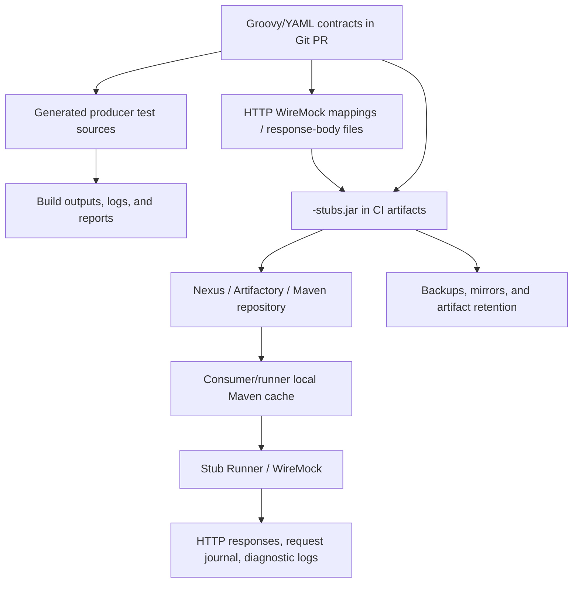
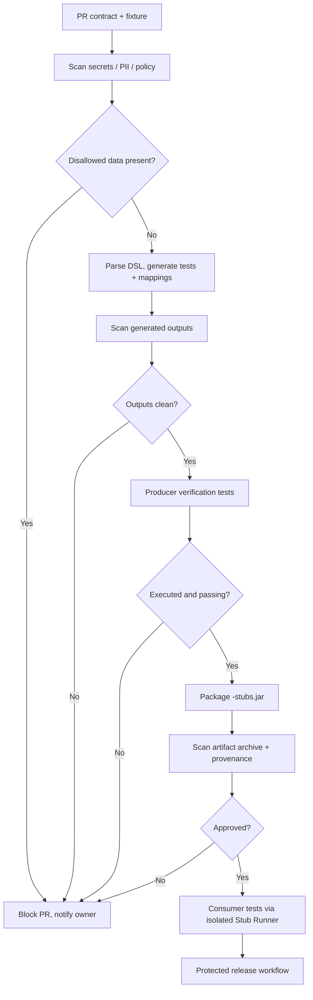
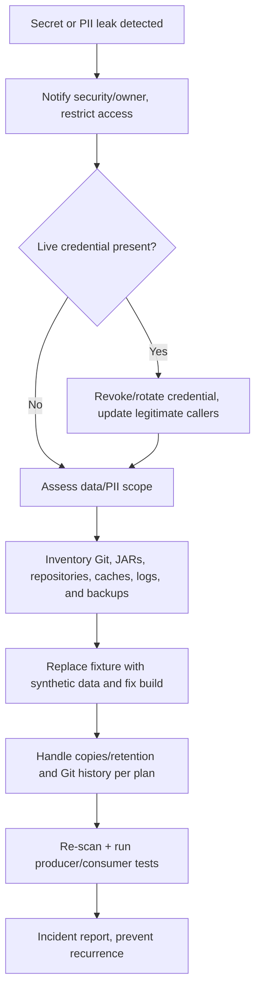

# Avoiding Secrets or Personal Data in Contracts

## 1. Why is data security in contracts a practical issue?

In the **SPRING_CLOUD_CONTRACT** module, Spring Cloud Contract helps **producers** and **consumers** agree on HTTP or message behavior using **Groovy/YAML DSL**, generates producer-side tests, publishes versioned stubs, and runs **Stub Runner** in CI to detect incompatible API changes.

A contract file does not exist solely in the source repository. It can be:

- Generated into producer **Java/JUnit tests** and resources.
- Converted into **WireMock JSON mappings** for HTTP simulation.
- Packaged into a **`stubs`-classifier JAR** along with sample data.
- Downloaded into the **Maven repository cache** across multiple projects, runners, and developer machines.
- Loaded into **Stub Runner** or **Standalone Stub Runner Boot**.
- Recorded in **logs, request journals, test reports, build artifacts**, and backups.

If a contract contains a **real API key**, access token, password, private key, or real customer information, protecting only the `.groovy` file is no longer sufficient. Sensitive values may already have spread to other outputs and storage locations, even after someone deletes the offending line in the latest commit.

**Core principle:** *A contract is a behavioral specification for testing and sharing; it is not a secret vault or customer database.* Use **synthetic fixtures that identify no real person**, describe **formats and rules with matchers**, and provide secrets needed for authentication tests through **safe runtime mechanisms** instead of writing them into the DSL.

### Lesson objectives

After this lesson, you will be able to:

1. Distinguish **secrets**, **personal data**, and **synthetic test data**.
2. Identify where data can be copied from contracts to generated tests, stub JARs, and CI.
3. Write Groovy/YAML HTTP and message contracts using safe yet meaningful fixtures.
4. Avoid confusing an `Authorization` header in a stub with real authentication checks.
5. Use matchers, sample data, and test configuration without accidentally packaging secrets into artifacts.
6. Design security checks for PRs, producer verification, stub packaging, and consumer CI.
7. Respond properly when a secret or personal data has appeared in Git, artifact repositories, or logs.

## 2. Classifying data before writing DSL

| Data category | Examples | Allowed verbatim in shared contracts? | How to handle |
| --- | --- | --- | --- |
| **Active secret** | API key, OAuth access/refresh token, real JWT, password, private key | **No** | Secret manager, short-lived credentials, revoke/rotate if exposed |
| **Session info** | Real session cookie, CSRF token, authorization code | **No** | Fake values or controlled test security contexts |
| **Direct personal data** | Real person's name, email, phone number, address | **Do not include real data** | Synthetic fixtures, clearly fake values |
| **Indirect personal data** | Customer ID linked to real system, device ID, personal IP | Not safe by default | Replace with fake IDs, assess re-identification risk |
| **Business-sensitive data** | Medical records, financial records, real transaction contents | Do not copy from production | Synthetic data matching schema/boundary values |
| **Sensitive internal info** | Internal hostnames, topology, repository credentials | Restrict by classification | Example endpoints `example.invalid`, no credentials |
| **Synthetic fixture** | `cust-test-1001`, `tester@example.test` | Usually usable after review | Stable values mapping to no real person |
| **Public schema/format** | `status=CREATED`, `quantity=2` type, JSON field names | Yes, when API permits disclosure | Maintain contract accuracy |

A string that looks "anonymous" is not automatically safe. For example, replacing a customer's name with a production ID can still allow linking back to a real person when cross-referenced with another table. Hashing an email without a salt or using a simple transformation also **does not mean the data is irreversibly anonymized**.

### 2.1. Rules for identifying secrets

Ask yourself:

- Can this value **authenticate** or **authorize** access to a real system?
- Can it be used to **decrypt**, **sign**, **send privileged requests**, or access real resources?
- Does it have an expiration date yet **is currently valid**?
- Even if labeled "test", is it accepted by staging/production environments or a shared broker?

If the answer could be "yes", **do not write the value into contracts, stub mappings, screenshots, or CI logs**. Putting "test" in a variable or key name does not turn a real credential into safe data.

### 2.2. Rules for identifying personal data

Data requires protection review whenever it can directly or indirectly identify an individual, including via combinations of fields—for example, emails, phone numbers, customer IDs, coordinates, dates of birth, addresses, and transaction sequences.

The purpose of a contract usually only needs to know:

- The `email` field **has a string type** and valid format.
- The `customerRef` field exists and follows the published format.
- The `amount` field is a number within business range.
- A required header is present, without carrying a live credential.

If a synthetic sample value demonstrates the case that needs protection, **there is no reason to use real people's data**.

## 3. Flow diagram of sensitive data paths



**The danger point:** sometimes only one contract file is edited, yet **multiple copies** of a secret are created across the entire chain.

| Layer | Typical leak path | Preventive measure |
| --- | --- | --- |
| Git and PR | Diffs, commit history, review comments, forks/clones | Never commit real data; secret scanning before merge |
| Generated tests | Java literals containing tokens/emails copied from DSL | Inspect `target/generated-test-sources` and build logs |
| WireMock mappings | Matchers/bodies containing sensitive headers or payloads | Use synthetic samples; inspect mappings before packaging |
| Stub JAR | Sensitive data packaged and widely shared | Scan **inside** the artifact, use repository ACLs |
| Artifact repository | Long retention, proxies/mirrors, broad download access | Least-privilege read access, retention, audit, and revocation |
| Stub Runner | Returns sample data or exposes mappings via admin API | Run only inside controlled test networks |
| Request journal/logs | Records raw `Authorization`, `Cookie`, request bodies | Mask/redact, disable or restrict journal where appropriate |
| CI artifacts | Reports, uploaded logs, debug archives | Use short artifact retention and access controls |
| Backups | Retains old versions containing secrets after Git fix | Post-incident copy/retention handling process |

**Do not scan only `src/test/resources/contracts`.** If generators or builders embed fixtures into generated sources/mappings, inspect the **outputs** before release.

## 4. Anti-pattern: pasting production requests into contracts

A common mistake: developers copy requests/responses from gateway logs and paste them verbatim into the DSL to be "realistic".

### 4.1. Example of WHAT NOT TO DO

The snippet below uses only **non-functional placeholders**, illustrating the error pattern:

```groovy
import org.springframework.cloud.contract.spec.Contract

Contract.make {
    name 'create_order_bad_example'
    request {
        method POST()
        url '/api/orders'
        headers {
            contentType(applicationJson())
            header 'Authorization': 'Bearer <REAL_PRODUCTION_ACCESS_TOKEN>'
            header 'Cookie': 'SESSION=<REAL_SESSION_COOKIE>'
        }
        body([
            customerId: '<ACTUAL_CUSTOMER_ID>',
            email     : '<ACTUAL_PERSON_EMAIL>',
            address   : '<ACTUAL_DELIVERY_ADDRESS>'
        ])
    }
    response {
        status 201
        body([orderId: '<REAL_ORDER_ID>'])
    }
}
```

**This is a counter-example, not a runnable contract**: the angle-bracket strings only describe types of data that must not be put in the file. If placeholders are replaced with real values:

1. Anyone with Git read access can see them.
2. The build can copy them into generated tests/mappings.
3. The Stub JAR can distribute them to consumers.
4. Request logging can copy them further.
5. Removing lines in a new commit **does not delete old commits, published artifacts, or caches**.

### 4.2. Why doesn't `.gitignore` save this case?

`.gitignore` prevents **untracked files** from being added accidentally; it does not remove already-committed content and does not protect secrets **placed directly inside tracked contract files**.

Similarly, making a repository private only limits who has access; it does not turn copying real customer data into contracts into a safe practice.

## 5. Safe HTTP contracts with synthetic fixtures

Suppose Orders Producer exposes an order creation API:

```http
POST /api/orders HTTP/1.1
Content-Type: application/json
Accept: application/json
```

The consumer needs to know the request body and response, **not a real person**.

### 5.1. Safe Groovy DSL

```groovy
import org.springframework.cloud.contract.spec.Contract

Contract.make {
    name 'create_order_with_synthetic_customer'
    description 'Create order with test customer and email'

    request {
        method POST()
        url '/api/orders'
        headers {
            contentType(applicationJson())
            header 'Accept': 'application/json'
            header 'X-Test-Scenario': 'contract-create-order'
        }
        body([
            customerRef: 'cust-test-1001',
            contactEmail: 'tester@example.test',
            productId   : 'SKU-001',
            quantity    : 2
        ])
    }

    response {
        status 201
        headers {
            contentType(applicationJson())
        }
        body([
            orderId: 'ord-test-1001',
            status : 'CREATED'
        ])
    }
}
```

Here:

- `cust-test-1001` is a **completely fake** ID, not copied from production.
- `tester@example.test` uses a **reserved example domain**; no real email should be sent there.
- `SKU-001` and `ord-test-1001` are stable fixtures unlinked to real customer data.
- The `X-Test-Scenario` header is only **illustrative metadata for the test scenario**, not an authentication mechanism.
- All request/response values still let tests protect field names, types, and HTTP status.

**Do not put `Authorization` or `Cookie` containing live credentials into this file.** If the endpoint needs security, separate real security verification from storing secrets in the DSL (see section 8).

### 5.2. Equivalent YAML DSL

```yaml
name: create_order_with_synthetic_customer
description: Create order with test customer and email
request:
  method: POST
  url: /api/orders
  headers:
    Content-Type: application/json
    Accept: application/json
    X-Test-Scenario: contract-create-order
  body:
    customerRef: cust-test-1001
    contactEmail: tester@example.test
    productId: SKU-001
    quantity: 2
response:
  status: 201
  headers:
    Content-Type: application/json
  body:
    orderId: ord-test-1001
    status: CREATED
```

This is an **alternative representation of the same contract**, not a requirement to register both Groovy and YAML with identical request conditions in the same build. Both aim to describe meaningful data **without containing real data**.

### 5.3. Keep tests valuable without trading off sensitive data

A contract with safe fixtures should still distinguish scenarios:

| Scenario | Safe sample data | What consumer/producer must check |
| --- | --- | --- |
| Valid order creation | `cust-test-1001`, `quantity=2` | `201 CREATED` |
| Invalid quantity | `quantity=0` | `400 INVALID_QUANTITY` |
| Out of stock | `SKU-NO-STOCK` | `409 OUT_OF_STOCK` |
| Order not found | `ord-test-missing` | `404 ORDER_NOT_FOUND` |
| Malformed email | `not-an-email` | Validation per agreed API |
| Unauthorized customer | Fake user in test security context | `403` per permission logic |

When writing error contracts, define the **business error body**. Asserting only `404` can pass because WireMock had no matching mapping, without proving the producer provides the `ORDER_NOT_FOUND` branch.

## 6. Do not confuse "fake data" with "masked production data"

A team wanting realistic tests might take a production dump and replace emails. That approach **is still dangerous**:

- Customer IDs may remain intact and link to real people.
- Amounts, truncated addresses, or timestamps can still identify a transaction.
- Free-text fields can contain names, phone numbers, card numbers, or sensitive notes.
- Simulated systems might send emails/webhooks to endpoints left inside the data.
- A "hashed" dataset can still be recovered via dictionary attacks or cross-referencing.

### 6.1. Data minimization for contracts

Keep only **the fields needed to represent the API boundary**:

```json
{
  "customerRef": "cust-test-1001",
  "shippingZone": "TEST-ZONE-A",
  "totalAmount": 125000,
  "currency": "VND"
}
```

Do not add dates of birth, emails, detailed addresses, or identification numbers just because the production object contains them. If the schema requires a field, use a properly formatted synthetic value and clarify why the consumer needs that field.

### 6.2. What qualities must good synthetic data have?

| Criterion | Practice |
| --- | --- |
| Unlinked to real people | Freshly created IDs/addresses/emails, never matching production |
| Right data types | `quantity` is a number, not a string |
| Right format to test | Example domain emails, fake ISO-8601 timestamps |
| Reproducible | Same fixture for the same branch/test, no unseeded randomness |
| Distinguishable | At least relevant success/error/edge cases |
| Triggers no external actions | No real emails, real webhooks, or real payment accounts |
| Clearly identifiable as test | `test` prefixes, reserved domains, and fixture documentation |

Avoid hardcoding a set of all `null` or `"dummy"` values that render assertions meaningless. Fake data **must be useful for testing behavior**, not merely satisfying a scanner.

### 6.3. Testing personal data formats

If the producer needs to verify an email has a valid format, you do not need a real personal email:

```text
Valid:     tester@example.test
Malformed: not-an-email
Missing:   null or omitted field (per contract)
```

If the API needs case-insensitive matching, Unicode, length limits, or special escaping, craft synthetic data hitting those exact boundaries. Never use verbatim real customer data just because it happens to contain a rare character.

## 7. Matchers and sample values: reducing data exposure without loosening contracts

Spring Cloud Contract provides **request/response matchers** and the ability to separate **client/consumer-side** values from **server/producer-side** values. These tools help describe variable data such as IDs and timestamps.

For example, do not copy a real `customerId` from production just to test an ID format. Instead:

1. Use a **synthetic example value** so fixtures and stubs are reproducible.
2. Use a matcher for the format or type the consumer actually depends on.
3. Verify that the generated producer test, WireMock mapping, and stub response all preserve the semantics.
4. Do not use overly broad regexes like `.*` for sensitive fields.

### 7.1. Purely illustrative WireMock matcher example

If an API request includes an `X-Correlation-Id` header with an agreed format, a WireMock mapping might describe:

```json
{
  "request": {
    "method": "GET",
    "url": "/api/orders/ord-test-1001",
    "headers": {
      "X-Correlation-Id": {
        "matches": "test-[A-Za-z0-9_-]+"
      }
    }
  },
  "response": {
    "status": 200,
    "headers": {
      "Content-Type": "application/json"
    },
    "jsonBody": {
      "id": "ord-test-1001",
      "status": "CREATED"
    }
  }
}
```

**This is WireMock JSON to explain matchers**, without claiming every Spring Cloud Contract generator version emits these exact keys or filenames. `X-Correlation-Id` is not an access token; the `test-...` format is test data.

### 7.2. Matchers are not a tool for hiding secrets

A contract with regex `Bearer .*` can still leak data if:

- The producer-side sample uses a real access token.
- The generated Java test writes the literal token into source code.
- HTTP request logs print the `Authorization` header.
- The WireMock request journal stores credentials sent by a real test client.

**Do not replace a real token with a matcher and then skip scanning all outputs.** Matchers describe technical constraints; **secret management is a separate responsibility**.

### 7.3. Do not loosen matchers to hide contract breaks

Suppose `quantityAvailable` must be an integer that the consumer uses to determine orderable quantity. A `.*` matcher accepting both `"12"` and `12` can hide a breaking type change.

Choose test oracles based on business semantics: type, range, format, response branches, and fields the consumer actually uses. **Data safety does not require sacrificing test strictness.**

## 8. Testing Authorization and Authentication without storing real tokens

Security is a real part of the API: a producer may require a Bearer token, session, or `orders:read` permission. Yet **contracts should not be credential stores**.

### 8.1. Three distinct testing goals

| Goal | Appropriate test approach | Real secret needed in DSL? |
| --- | --- | --- |
| Describe HTTP contract requiring header | Header presence/appropriate matcher, unprivileged test data | **No** |
| Producer verifies `401/403` and authorization | Spring Security test support, test principals, or isolated test identity provider | **Do not put secrets in DSL** |
| Verify signed OAuth/JWT or real IdP integration | Integration test with test IdP, short-lived credential issued at runtime | **No** |

**Warning:** a WireMock mapping can constrain the `Authorization` header, yet it **does not verify JWT signatures, expiration, issuer, audience, or access rights**. A string formatted as `Bearer ...` does not mean the token was authenticated.

### 8.2. HTTP contract simulating rejection when missing permissions

```groovy
import org.springframework.cloud.contract.spec.Contract

Contract.make {
    name 'get_order_forbidden'

    request {
        method GET()
        url '/api/orders/ord-test-denied'
    }

    response {
        status 403
        headers {
            contentType(applicationJson())
        }
        body([code: 'ACCESS_DENIED'])
    }
}
```

This contract illustrates an example **denied response** containing no live token. However, **the request above does not yet fully describe the reason for denial**: for producer verification to be meaningful, the fixture/base test or request setup must create the exact unauthorized condition. If the producer requires an auth token on the endpoint, define a test principal/credential per the appropriate setup; do not assume a `403` is proven merely because the DSL states status `403`.

### 8.3. Producer security tests in the test context

For a producer using Spring Security, you can use **Spring Security Test** to supply mock authentication in tests verifying authorization:

```java
import org.junit.jupiter.api.Test;
import org.springframework.beans.factory.annotation.Autowired;
import org.springframework.boot.test.autoconfigure.web.servlet.AutoConfigureMockMvc;
import org.springframework.boot.test.context.SpringBootTest;
import org.springframework.security.test.context.support.WithMockUser;
import org.springframework.test.web.servlet.MockMvc;

import static org.springframework.test.web.servlet.request.MockMvcRequestBuilders.get;
import static org.springframework.test.web.servlet.result.MockMvcResultMatchers.status;

@SpringBootTest
@AutoConfigureMockMvc
class OrdersAuthorizationTest {

    @Autowired
    private MockMvc mockMvc;

    @Test
    @WithMockUser(username = "contract-test-user", authorities = "orders:read")
    void authorizedUserCanReadOrder() throws Exception {
        mockMvc.perform(get("/api/orders/ord-test-1001"))
            .andExpect(status().isOk());
    }

    @Test
    @WithMockUser(username = "contract-test-user", authorities = "orders:other")
    void userWithoutPermissionCannotReadOrder() throws Exception {
        mockMvc.perform(get("/api/orders/ord-test-1001"))
            .andExpect(status().isForbidden());
    }
}
```

This snippet requires **`spring-security-test`** and compatible Spring Boot/Spring Security versions. It is a **separate security test example**, not an automatic replacement for generated contract tests. The real application must define the `orders:read` policy; the base test needs the `ord-test-1001` fixture. `WithMockUser` creates a **fake security context in tests**, without testing JWT verification against an IdP public key.

### 8.4. Do not "disable security for all tests" just to make contracts PASS

If the producer base test always disables all security filters, generated `200` tests may pass while failing to reflect real auth requirements. Conversely, always attaching `@WithMockUser` with full privileges may leave `401/403` branches untested.

Separate them into:

- **Contract behavior tests** with deterministic security contexts matching each scenario.
- **Authorization tests** for permission groups and `401/403` branches.
- **Integration tests** for JWT/OIDC/broker auth where needed.

Do not substitute a convenient test context for proof of production security.

### 8.5. When credentials are genuinely needed for integration tests

Use a **test identity provider or least-privilege test account**, provision secrets **at job runtime** via a CI secret store or appropriate OIDC/service identity, with short lifetimes and environment restrictions. Never commit secrets, never place them into DSL/bodies/mappings, and never let debug tests print headers.

In particular, replacing a string in a contract with `${TEST_TOKEN}` **is not automatically safe**. If the generator/runtime substitutes the variable and writes the real token into Java source, WireMock JSON, or build reports, the secret is still leaked. You must verify **processing boundaries and where variables are materialized**.

## 9. Messaging contracts can also leak data

A message contract can contain **user IDs**, emails, notification content, payment references, and message headers. When Stub Runner emits a sample message, that payload may enter a **test broker**, queue, dead-letter topic, or consumer logs.

### 9.1. Groovy example with synthetic message

```groovy
import org.springframework.cloud.contract.spec.Contract

Contract.make {
    name 'order_created_event'
    label 'order_created'
    description 'Order event with test data'

    input {
        triggeredBy('publishOrderCreated()')
    }

    outputMessage {
        sentTo('orders.test.events')
        body([
            eventType  : 'ORDER_CREATED',
            orderId    : 'ord-test-1001',
            customerRef: 'cust-test-1001',
            amount     : 125000,
            currency   : 'VND'
        ])
        headers {
            header('eventType', 'ORDER_CREATED')
            messagingContentType(applicationJson())
        }
    }
}
```

`publishOrderCreated()` is a **helper implemented by the producer test base**, not a built-in method. `orders.test.events` is an **illustrative test destination**; real destinations must match the agreed contract. Do not arbitrarily change production topic names in contracts when the test goal is protecting compatibility: separate **logical destinations** from **test binder routing** under controlled operational configuration.

### 9.2. Do not publish test messages into real systems

- Use a dedicated test broker/binder, or a tightly permissioned test namespace/topic.
- Never use production credentials for producer/consumer tests to publish/subscribe.
- Never allow a production consumer to read fake `order_created` messages.
- Never use real email addresses or phone numbers in payloads.
- Remember **dead-letter queues, retries, tracing, and logs** also hold event copies.
- Clean up state when the job finishes per retention policy.

**Important note:** event code `ORDER_CREATED` and ID `ord-test-1001` do not guarantee downstream systems recognize this as a fake event. Broker, binding, and identity boundaries are the primary protection layer.

### 9.3. Consumer messaging tests check effects, not only fixture payloads

```java
// Snippet in a consumer test that already has Stub Runner, Awaitility, and test binder.
readModel.deleteByOrderId("ord-test-1001");
assertThat(readModel.hasOrder("ord-test-1001")).isFalse();

assertThat(stubTrigger.trigger("order_created")).isTrue();

await().atMost(Duration.ofSeconds(5)).untilAsserted(() -> {
    var order = readModel.findByOrderId("ord-test-1001");
    assertThat(order).isPresent();
    assertThat(order.get().amount()).isEqualTo(125000);
});
```

`readModel` is a hypothetical consumer application API. The test proves the handler processes the message, not the production broker or real permissions. All data here is synthetic; the test must not pre-seed the final outcome so assertions pass even when the handler is broken.

## 10. Restricting access to stub artifacts and Stub Runner

Just because stubs contain synthetic data does not mean they should be exposed publicly to the Internet. Contracts can still disclose endpoint structures, business statuses, auth header names, or internal events.

| Resource | Risk | Mitigation |
| --- | --- | --- |
| Git contract repository | Data in commits/diffs or clones | Least privilege, review, and secret scanning |
| Maven artifact repository | Many consumers can download `-stubs.jar` | Read-only accounts, retention, and audit |
| Stub Runner Boot management API | `/stubs`, `/triggers` expose scenarios/trigger actions | Keep non-public, restrict network/test identity |
| WireMock HTTP stub port | Sample HTTP/simulated logic accessible | Bind to localhost or test network only |
| WireMock `/__admin` | Mappings, request journal, runtime administration | Restrict access like a control plane |
| CI logs/artifacts | Sources/mappings/reports containing sensitive payloads | Mask/redact, read permissions, and retention |

**Standalone Stub Runner Boot is not secured out of the box and is not intended for production.** Restrict **both the management port and all WireMock ports**, not just one of them.

### 10.1. Illustrative Docker: publish ports on loopback only

```bash
# How to bind Docker ports on the host; image/version/repo are placeholders.
docker run --rm --name contract-stub-test \
  -e SERVER_PORT=8750 \
  -e STUBRUNNER_IDS=com.example:orders-producer:1.4.2:stubs:9876 \
  -e STUBRUNNER_STUBS_MODE=LOCAL \
  -p 127.0.0.1:8750:8750 \
  -p 127.0.0.1:9876:9876 \
  springcloud/spring-cloud-contract-stub-runner:PINNED_VERSION
```

**This is an illustrative command and is not runnable as-is with every image.** The container must have the stub artifact in its configured local Maven repository, and `PINNED_VERSION` must be replaced with a real compatible tag; switching to `REMOTE` requires providing repository endpoints/credentials securely. Verify `docker port` and actual networking after startup. For container-to-container setups, prefer an internal Docker test network and avoid publishing ports when unnecessary.

### 10.2. Why not treat `Authorization` in contracts as protection for the stub?

Header matchers only decide **whether a request matches a mapping**. If a request matches another mapping, callers can still receive responses. If the admin API is open, outsiders can read mappings and the request journal. **Do not put Stub Runner behind a header regex and call it access control.**

## 11. Inspecting build outputs before publishing

A secure pipeline must monitor **sources + generated outputs + artifacts**. For example, a Maven producer creates:

```text
src/test/resources/contracts/
  orders/create_order_with_synthetic_customer.groovy

target/generated-test-sources/contracts/
  ... generated JUnit test sources ...

target/stubs/META-INF/com.example/orders-producer/1.4.2/
  contracts/
  mappings/

target/orders-producer-1.4.2-stubs.jar
```

Paths and filenames are **illustrative examples**, varying by Maven plugin version/configuration. For messaging, contracts may not generate each message as a WireMock HTTP mapping.

### 11.1. Inspecting `-stubs.jar`

```bash
jar tf target/orders-producer-1.4.2-stubs.jar
```

`jar tf` **only lists filenames inside the JAR**; it does not inspect sensitive contents. Use an artifact scanner that supports archives or extract into a **controlled temporary area** and scan contents before publishing. Never extract into a public directory or upload to a scanning service not authorized to process internal data.

### 11.2. Recommended security check order

1. Scan commit/PR diffs, including contract files and fixture helpers.
2. Parse the DSL; review data in requests, responses, headers, and messages.
3. Generate producer tests and HTTP mappings; inspect newly generated outputs.
4. Run generated producer tests against synthetic fixtures.
5. Package the stub JAR; scan archive contents, filenames, and metadata.
6. Publish the artifact only if no unhandled sensitive data is found.
7. Run consumer tests and Stub Runner in isolated environments; keep redacted logs.

**Do not rely solely on "source scan is clean".** A plugin can copy another resource/body file into the JAR, and a test runner can write request bodies/headers into reports.

### 11.3. Secret scanners and PII scanners are not the same

| Tool/measure | What does it detect? | Limitations |
| --- | --- | --- |
| Secret scanner | Known token/key/certificate patterns | Does not always recognize new tokens or custom secrets |
| PII/data classifier | Emails, phones, IDs, addresses, business-sensitive fields | False positives; needs policy and context |
| Schema/contract review | Unnecessary fields, leaking business semantics | Requires someone who understands the API |
| Archive scanner | Contents inside `-stubs.jar` and generated resources | Requires safe extraction/scanning |
| Runtime log redaction | Limits exposing headers/bodies during test runs | Must configure every logger/journal/exporter |
| Repository ACL/retention | Reduces who can download and retention duration | Does not make already-published data non-sensitive |

A passing scanner **does not prove no PII remains**. A value like `tester@example.test` may be flagged like a real email; configure **narrow, reviewed allowlist rules** for synthetic fixtures rather than disabling the entire email rule.

## 12. Example CI gate focused on contract security

CI should run security checks **before publish permissions** and keep temporary artifacts under control. A conceptual workflow:



### 12.1. Example pseudo-CI pipeline with blocking gates

```yaml
# PSEUDOCODE: SCAN_* steps must be implemented with approved tools.
jobs:
  contract-security-and-verification:
    steps:
      - name: Scan Git changes and contracts
        run: SCAN_SECRETS_AND_PII --redact-report src/test/resources/contracts

      - name: Generate and verify producer contracts
        run: ./mvnw -B -ntp clean verify

      - name: Scan generated tests and stub files
        run: SCAN_GENERATED_OUTPUTS --redact-report target

      - name: Verify stub artifact content
        run: VERIFY_STUB_ARCHIVE_AND_PROVENANCE

      - name: Publish
        if: ONLY_IN_PROTECTED_RELEASE_WORKFLOW
        run: PUBLISH_AFTER_APPROVAL
```

**This is YAML pseudocode**, **not a runnable GitHub Actions workflow**. Command names `SCAN_*`, `VERIFY_*`, and condition `ONLY_IN_PROTECTED_RELEASE_WORKFLOW` are placeholders. Do not create a false sense of security by copying this block without implementing scanners, artifact path validation, least privilege, and fail-on-findings.

### 12.2. Specific gates that must block

| Condition | Decision |
| --- | --- |
| PR contains a live credential | **BLOCK**; treat as incident |
| Contract contains unauthorized real person data | **BLOCK**; replace with synthetic data and assess exposure |
| Generated mapping contains token even after source fix | **BLOCK**; investigate output/cache/build chain |
| `-stubs.jar` artifact contains sensitive data | **BLOCK PUBLISH** |
| Producer tests skipped or not generated | **BLOCK** due to missing contract evidence |
| Consumer test sends production token to WireMock | **BLOCK** and review CI secret scope |
| CI uploads full request logs containing Authorization | **BLOCK/REDACT** per policy |
| Scanner flags only synthetic `tester@example.test` | Review accurately; narrow allowlist if justified |

### 12.3. CI job permissions

- Jobs running on **untrusted PRs** should only have read access to needed sources/dependencies.
- **Never grant publish credentials, signing keys, or production privileges** to code running from a PR.
- Release workflows with publish rights must reside on protected branches/workflows.
- Repository tokens for consumer Stub Runner should be **read-only**, scoped to artifacts/namespaces.
- Use a secret store or appropriate identity federation; **never print secrets** in command lines, test reports, or debugging output.
- Jobs creating temporary stubs need cleanup/TTL and artifact read access controls.

Do not treat CI automatic masking as the sole protection layer: secrets can appear as **base64, substrings, URL-encoded, or reformatted**, not necessarily matching the raw value for automatic masking.

## 13. Logging, request journals, and CI evidence

To diagnose contract tests, developers often enable HTTP request/response logging. This is an easy leak point for secrets and PII.

### 13.1. Data that should not be logged verbatim

| Data | Recommended log handling |
| --- | --- |
| `Authorization`, `Proxy-Authorization` | Strip or replace with `[REDACTED]` |
| `Cookie`, `Set-Cookie` | Mask/omit session values |
| Passwords, client secrets, refresh tokens | Do not log |
| Real email/phone/address | Redact, use synthetic fixture, or omit body |
| Request body with financial/medical data | Do not log raw; log valid metadata |
| Correlation ID | Log only if it is a test ID unlinked to real people |
| Stub coordinates and test status | Usually useful for debugging, still follow policy |

A **safer** log example:

```text
contract=orders.create
stub=com.example:orders-producer:1.4.2:stubs
method=POST path=/api/orders status=201
customerRef=[REDACTED]
authorization=[REDACTED]
scenario=contract-create-order
result=PASS
```

Do not use an approach of `log full JSON then replace a few fields` if content can carry sensitive data in new fields, arrays, or free text. It is better to **allowlist diagnostic fields permitted for logging** and omit bodies by default.

### 13.2. WireMock request journal

WireMock can store received request details for verification, near misses, or debugging. If a consumer sends a real token to the stub, even when the contract file records no token, **the journal and diagnostics may still contain that token**.

Therefore:

1. Never pass production credentials into an HTTP client used with stubs.
2. Restrict `/__admin` and WireMock ports within the test network.
3. Disable or bound the journal when unneeded, per your WireMock version/features.
4. Before saving logs/test reports, mask/omit sensitive headers and bodies.
5. Set appropriate retention and access controls for CI artifacts.

**Disabling the journal does not automatically remove secrets from generated mappings or JARs.** Each layer must be controlled separately.

## 14. Protecting artifact repositories and Maven caches

A producer published:

```text
com.example:orders-producer:1.4.2:stubs
```

The JAR can be downloaded by many consumers via `StubRunnerProperties.StubsMode.REMOTE`, and cached in `~/.m2/repository`. If a secret sits inside `-stubs.jar`, the incident blast radius extends beyond the producer repository.

### 14.1. Inspect artifacts before trusting them

```bash
# List entries in the JAR; does not mean contents were scanned.
jar tf target/orders-producer-1.4.2-stubs.jar
```

A proper process also requires:

- Scanning **file contents inside the JAR**, not just names.
- Inspecting response-body files referenced from JSON mappings.
- Ensuring the artifact matches the exact commit/version verified by the producer.
- Recording digests/checksums to prevent build confusion.
- Restricting read access to repositories holding internal contracts/stubs.
- Avoiding public repositories merely because non-JVM consumers need to run stubs.

### 14.2. Local Maven cache is not a secure vault

Even after an artifact is deleted from Nexus/Artifactory, copies may remain in:

- Developer Maven caches.
- Persistent CI runners, container layers, or build caches.
- Repository proxies/mirrors.
- CI artifact uploads.
- Storage backups/snapshots.

Do not treat "deleted from the main repository" as resolving the entire incident. For leaked secrets, **revoke/rotate first** to reduce impact immediately, then coordinate cleanup of copies as appropriate.

### 14.3. Do not arbitrarily overwrite release artifacts

If a stub containing sensitive data must be replaced, do not silently overwrite `1.4.2` with another JAR at the same coordinates when release policy requires immutability. Caches may hold the old version, leaving different consumers with different contents.

Depending on incident severity, withdraw the exposed artifact, release a clean version under a new version number, update consumer IDs and retention, and preserve evidence per policy. **Never leave a live secret active just to preserve compatibility tests.**

## 15. When a secret has leaked: respond in the right order

If a real access token is discovered in a Groovy commit, a JSON mapping, or a stub JAR, **do not simply edit the file and consider it done**.

### 15.1. Incident response flow



**Security priority:** for a leaked token, the first step is to **revoke/rotate the token per playbook**, not trying to hide Git history with a new commit. Removing data from Git may also be necessary, yet it **does not invalidate credentials already copied**.

### 15.2. Secrets and PII require different handling

| Situation | Immediate action | Follow-up action |
| --- | --- | --- |
| Leaked API key/password | Revoke/rotate, audit usage, isolate permissions | Handle history, artifacts/logs/caches, and prevention |
| Leaked private key | Replace key/certificate, revoke old trust per playbook | Assess dependent systems and signature scope |
| Leaked OAuth token | Revoke token, evaluate scopes/sessions | Investigate logs and token issuance flow |
| Real person email/phone in stub | Restrict access, notify privacy/security owner | Assess scope, notification obligations, purge/retention |
| Sensitive data in request journal | Stop raw collection, isolate logs | Mask/purge per policy and preserve required evidence |

**Do not unilaterally delete evidence needed for investigation or under legal hold.** Sanitization and copy deletion must be coordinated with security/legal teams per applicable policies and regulations.

### 15.3. Why isn't `git revert` or deleting lines enough?

Git preserves history; anyone with read access to old commits can still see the value. In addition, pull request diffs, forks, clones, CI artifacts, and binary JARs may retain earlier contents.

If **rewriting Git history** is required to purge sensitive data, execute a coordinated plan: change commit IDs, handle forks/clones, block re-pushing old content, update tags/CI references, and work with the hosting provider if needed. This is a high-risk operation and **not a step to run automatically from a scanner alert alone**.

### 15.4. What NOT to do after an incident

- Do not paste the secret value again in an issue/PR comment to "show evidence".
- Do not send a sensitive JAR to an unapproved public scanning service.
- Do not consider replacing a real token with `***` in new source as finished.
- Do not ask every developer to wipe caches without a scoped plan.
- Do not overwrite release artifacts and ignore provenance.
- Do not disable secret scanning to avoid CI failures.
- Do not keep using the leaked token to run tests "to meet the release deadline".

## 16. Case study: an API key slips into an HTTP contract

### 16.1. Scenario

A developer copies a `curl` command from staging into an `orders-producer` PR. The `Authorization` header contains a token **accepted by both staging and production**. Contract Verifier generated tests, converted WireMock mappings, and packaged `orders-producer-1.4.2-stubs.jar`. The stub was published to the internal repository.

A few days later, a security scanner flags a token string in the old contract.

### 16.2. Scope analysis

| Where the token may remain | What to verify? |
| --- | --- |
| Git commit/PR | Which refs/branches/tags and who had access |
| Generated Java test | Did the token become a literal in source/reports? |
| WireMock mapping | Does the header matcher hold the real value? |
| `-stubs.jar` | Which artifact/version packaged it |
| Nexus/Artifactory | Who had download permission, download/audit records |
| Consumer Maven cache | Which runners/machines downloaded the artifact |
| Stub Runner logs | Is the token in request journals/diagnostics |
| CI artifacts and backups | Do reports/archives retain the data |

### 16.3. Prioritized decisions

1. Security owner revokes the token and issues new credentials per policy.
2. Assess anomalous activity and the token's permission scope.
3. Producer fixes the contract with a **synthetic fixture** and re-runs tests.
4. Verify the new JAR **no longer contains the token** via scanners and proper review.
5. Repository administrators handle old artifacts, caches, and backups per playbook.
6. Consumers update to the new stub version if needed and re-run compatibility tests.
7. CI adds scanning of generated mappings and artifacts, not only source files.

**What not to do:** simply delete the header in a PR and republish under the same coordinates without revoking the token or reviewing JARs already downloaded by consumers.

## 17. Practice exercise: reviewing a contract proposal

### 17.1. Prompt

Checkout Consumer wants to add endpoint `POST /api/payments/authorize`. The proposed contract currently has dangerous placeholders:

```yaml
name: authorize_payment_bad_proposal
request:
  method: POST
  url: /api/payments/authorize
  headers:
    Authorization: "Bearer <PASTED_REAL_ACCESS_TOKEN>"
    Cookie: "SESSION=<PASTED_REAL_SESSION>"
    Content-Type: application/json
  body:
    customerEmail: "<REAL_PERSON_EMAIL>"
    paymentCard: "<REAL_PAYMENT_CARD_DATA>"
    amount: 125000
response:
  status: 201
  body:
    status: AUTHORIZED
    paymentId: "<ACTUAL_PAYMENT_ID>"
```

Values in angle brackets are only **risk-illustrating markers**, not real information. Do not run this example as a valid contract.

### 17.2. Tasks

1. Identify all fields at risk of containing secrets or personal data.
2. Replace real data with **customerRef**, **payment method test reference**, and examples incapable of triggering real payments.
3. Decide which fields **do not belong in the contract**.
4. Design producer verification for success and `401/403` branches **without hardcoding real tokens**.
5. Explain how to generate test credentials at runtime if integrating with a test IdP.
6. Propose how to scan source, generated tests, mappings, and the stub JAR before publishing.
7. Write a consumer test calling the real Payment client with Stub Runner, not merely asserting fixtures.
8. If a token was committed, outline the incident response order.
9. Propose a retention policy for affected logs and artifact versions.
10. Explain why a WireMock header matcher does not replace real auth.

### 17.3. Safer contract: YAML

Suppose the producer agrees the API only accepts a test payment method reference:

```yaml
name: authorize_payment_synthetic
request:
  method: POST
  url: /api/payments/authorize
  headers:
    Content-Type: application/json
  body:
    customerRef: cust-test-1001
    paymentMethodRef: pm-test-1001
    amount: 125000
    currency: VND
response:
  status: 201
  headers:
    Content-Type: application/json
  body:
    status: AUTHORIZED
    paymentId: pay-test-1001
```

`pm-test-1001` is a **lesson-invented sample string**, not a payment system token or active payment method ID. This contract contains no Authorization header; omitting the header **does not mean the real producer API requires no authentication**. Producer and consumer must still verify auth at the appropriate layers using test identities and API policies.

### 17.4. Tests protecting data without "false greens"

In a consumer test with the real client and Stub Runner:

```java
// Illustrative consumer application API, not a Spring Cloud Contract class.
PaymentAuthorization result =
    paymentsClient.authorize("cust-test-1001", "pm-test-1001", 125000L, "VND");

assertThat(result.paymentId()).isEqualTo("pay-test-1001");
assertThat(result.status()).isEqualTo("AUTHORIZED");
```

The test must execute consumer code, deserialize the response, and react per contract. If the consumer only checks `expectedJson.equals(expectedJson)`, it does not prove integration. All values in the example remain synthetic data.

### 17.5. Guided answer key

| Question | Answer |
| --- | --- |
| Which headers must not be copied? | Live `Authorization` and session `Cookie` |
| Which body fields hold PII? | Real person email; real card/payment data |
| What to use instead? | `cust-test-1001`, `pm-test-1001`, sample amounts |
| Where to obtain runtime tokens? | Least-privilege test IdP/secret store, not in DSL |
| What to scan besides contracts? | Generated Java, mappings, stub JAR, logs, and CI artifacts |
| If a token leaked? | Revoke/rotate, investigate scope, handle copies/history |
| Does a stub matching `Authorization` verify JWTs? | **No** |
| Is a passing scan enough to prove PII is clean? | **No**; review and data classification are required |

## 18. Common mistakes and how to prevent them

| Mistake | Consequence | Fix |
| --- | --- | --- |
| Copying production requests verbatim into Groovy/YAML | Leaks tokens and PII via source/mappings | Use only synthetic fixtures |
| Naming a real token `testToken` | Token remains valid | Check permissions and systems accepting the token |
| Removing secret only in a new commit | Git history/JAR/caches keep copies | Revoke/rotate + incident response |
| Hashing real emails into contracts | Still linkable/recoverable | Synthetic emails `example.test` |
| Using `Authorization: Bearer .*` as security | Stub only matches, does not authenticate | Separate auth tests + network isolation |
| Using `.*` matcher for the entire response | Hides breaking schema/type changes | Match based on real behavior |
| Always using full-privilege `@WithMockUser` in tests | `401/403` branches go unverified | Test insufficient/sufficient permissions separately |
| Scanning only repository source | Misses generated mappings/JARs | Scan the entire data path |
| Uploading raw WireMock request journals | Can leak headers/bodies | Bound journal, redact, and set retention |
| Publishing stubs to a public repository | Exposes schemas/data and widens incidents | Repository ACLs and artifact governance |
| PR CI holding deploy credentials | Untrusted code can read/exfiltrate secrets | Separate release workflows, least privilege |
| Using the production broker for message stubs | Fake events may be processed for real | Dedicated test binder/broker/identity |
| Deleting artifact and calling incident closed | Caches, backups, logs, and live tokens remain | Inventory copies and revoke/rotate |
| Using identical dummy data for every branch | Fails to catch logic bugs | Distinct fixtures for success/error/edge cases |

## 19. Security checklist before merging or publishing contracts

### Input data

- [ ] Groovy/YAML contains no real tokens, passwords, private keys, or session cookies.
- [ ] Production payloads are not copied verbatim into `request`, `response`, or `outputMessage`.
- [ ] Customer/email/phone/address/transaction IDs are **synthetic** and unlinked to real people.
- [ ] Keep only fields genuinely needed to protect API boundaries.
- [ ] Test samples match schema/type/format and distinguish business branches.
- [ ] No embedded production URLs/webhooks/broker destinations conflicting with test isolation.

### Verification and artifacts

- [ ] Producer generated tests run against real code and are not skipped.
- [ ] Header/body matchers and client/server sample values have been reviewed.
- [ ] Generated Java tests, WireMock JSON mappings, and response-body resources have been scanned.
- [ ] Contents of `-stubs.jar` have been scanned, not just entry names listed.
- [ ] Artifact/version/checksum ties to the tested commit.
- [ ] Repositories, Maven caches, and CI artifacts have proper access controls and retention.

### Runtime and CI

- [ ] Stub Runner/WireMock run in an isolated test network, never public.
- [ ] `/stubs`, `/triggers`, and WireMock `/__admin` are not exposed to untrusted networks.
- [ ] HTTP clients never send production credentials to stubs.
- [ ] Messaging tests never publish fake messages to production brokers.
- [ ] Integration test secrets are provisioned **at runtime** via secret management.
- [ ] Logs, request journals, and CI reports never print sensitive values verbatim.
- [ ] PR jobs hold no release-publish rights or production credentials.
- [ ] Consumer tests execute real client/handler code and business assertions.

### When a leak is discovered

- [ ] Security/privacy owners notified and access restricted.
- [ ] Exposed credentials revoked/rotated per playbook.
- [ ] Scope determined across Git history, mappings, JARs, repositories, logs, caches, and backups.
- [ ] Real data removed from future fixtures, re-scanned, and re-tested.
- [ ] Copy/history remediation planned while honoring legal/audit holds.
- [ ] Incident evidence recorded **without repeating secret values**.
- [ ] CI gates and review guidelines updated to prevent recurrence.

### References

- [Spring Cloud Contract — HTTP Contracts](https://docs.spring.io/spring-cloud-contract/reference/project-features-contract/http.html): contract request/response, headers, body, and matchers.
- [Spring Cloud Contract — Stub Runner Core](https://docs.spring.io/spring-cloud-contract/reference/project-features-stubrunner/stub-runner-core.html): downloading and running stub artifacts on the consumer.
- [Spring Cloud Contract — Stub Runner Boot](https://docs.spring.io/spring-cloud-contract/reference/project-features-stubrunner/stub-runner-boot.html): management API and warnings against using Stub Runner Boot as a production application.
- [OWASP — Secrets Management Cheat Sheet](https://cheatsheetseries.owasp.org/cheatsheets/Secrets_Management_Cheat_Sheet.html): managing, least-privilege scoping, rotation, and revocation of secrets.
- [OWASP — Logging Cheat Sheet](https://cheatsheetseries.owasp.org/cheatsheets/Logging_Cheat_Sheet.html): data to omit, mask, or restrict when logging.
- [GitHub Docs — Removing sensitive data from a repository](https://docs.github.com/en/authentication/keeping-your-account-and-data-secure/removing-sensitive-data-from-a-repository): limitations and impacts when scrubbing sensitive data from Git history.
- [GitHub Docs — Remediating a leaked secret](https://docs.github.com/en/code-security/tutorials/remediate-leaked-secrets/remediating-a-leaked-secret): prioritizing secret revocation, investigation, and preventing recurrence.

**Remember:** one contract generates **multiple copies**, so putting real tokens or personal data into the DSL expands risk to generated tests, WireMock mappings, stub JARs, repositories, runners, and logs. Use **synthetic data that still verifies real behavior**, manage credentials at runtime with least privilege, scan both sources and outputs, and never mistake a stub matcher for real authentication. If a leak occurs, prioritize **revoking/rotating and scoping the blast radius**, then remediate copies following security processes before continuing releases.
