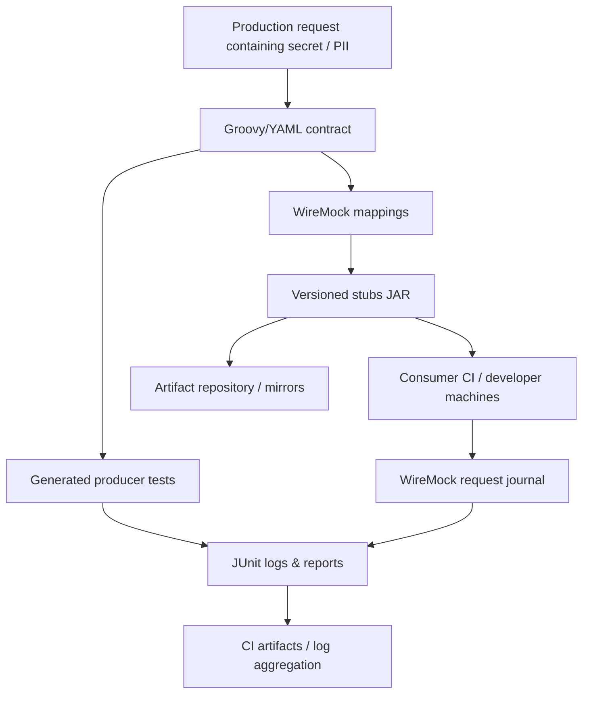
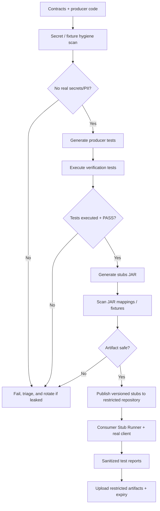
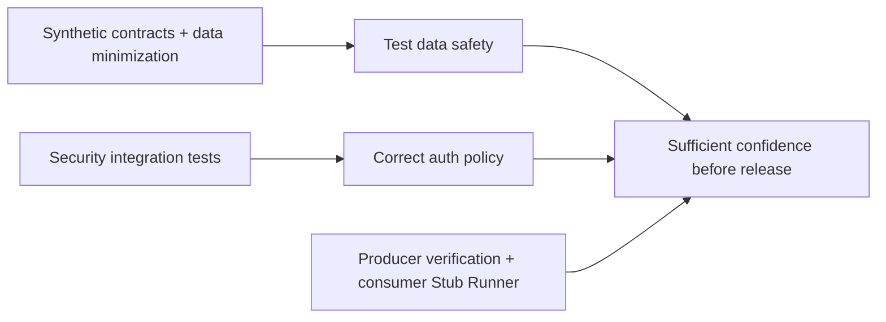

# Redacting Sensitive Information in Stubs and Test Reports

> **Chapter:** Contract Security  
> **Module:** `SPRING_CLOUD_CONTRACT` — learn contract testing between producer and consumer using Groovy/YAML DSL for HTTP or messaging, generating producer-side tests, publishing stubs, using Stub Runner, and integrating CI to detect incompatible API changes.

## Learning objectives

After this lesson, you will be able to:

1. Identify sensitive data likely to be recorded in **contract DSLs**, generated tests, WireMock mappings, stub JARs, request journals, logs, JUnit XML/HTML reports, and CI artifacts.
2. Classify tokens, API keys, cookies, passwords, personally identifiable information (PII), payment data, message broker secrets, and seemingly harmless values that can infer identity.
3. Design **fake, non-production fixtures** so contracts still verify method/path/header/body/status without containing real secrets.
4. Use Spring Cloud Contract matchers to verify **required formats/behaviors** without forcing real secret values into contracts.
5. Distinguish **redacting sensitive information** from **disabling security checks**; understand what contract tests alone prove versus what requires separate Spring Security/integration tests.
6. Configure **allowlist-based** logging, control the WireMock request journal/admin API, and prevent a failing request from leaking tokens or PII via output.
7. Trace how stdout/stderr and stack traces flow into Maven Surefire/Failsafe, Gradle test reports, CI logs, and stored artifacts.
8. Organize quality gates scanning for sample secrets/PII, artifact download permissions, retention limits, provenance evidence, and incident response when data leaks.
9. Apply the same principles to **message contracts**, broker records, DLQs, event logs, and Stub Runner reports.
10. Design a producer → verified stubs → consumer tests pipeline with **complete test evidence without exposing sensitive data**.

## 1. Why can a test contract leak data?

Suppose `checkout-service` needs to call `inventory-service`:

```http
GET /api/stock/SKU-001 HTTP/1.1
Accept: application/json
Authorization: Bearer <test-only-token>
X-Correlation-Id: trace-demo-001
```

Producer returns:

```json
{
  "sku": "SKU-001",
  "available": true,
  "quantity": 4,
  "warehouse": "DEMO-WAREHOUSE"
}
```

If a developer copies a request from production into a contract, `<test-only-token>` can easily be replaced with a **real bearer token**. From there, that same secret can spread:

1. Committed into Git as YAML/Groovy.
2. Read by the Spring Cloud Contract plugin to generate producer tests.
3. Appearing inside WireMock JSON mappings.
4. Packaged into `*-stubs.jar` and published to a Maven repository.
5. Downloaded by consumers to local machines or CI runners.
6. Recorded by WireMock into the request journal when tests call the stub.
7. Printed to console, stack traces, XML/HTML reports, or test artifacts when an assertion fails.

Thus, **a secret copied into a contract is no longer solely the producer team's secret**. It can be distributed to every consumer with permission to download stubs, CI log viewers, artifact indexing systems, or third parties with whom files are shared.



**Foundational principle:** *Do not put real sensitive information into test fixtures; do not rely solely on log redaction at the end of the pipeline.* Prevention at the source is far more reliable than scrubbing already-distributed copies.

## 2. What data needs protection?

| Category | Example in contract/test | Risk | Safe representation |
| --- | --- | --- | --- |
| Bearer/OAuth access token | `Authorization: Bearer ...` | Can call APIs under hijacked identity | **Test-only** token, fake signature, or header matcher per goal |
| Refresh token, session cookie | `Cookie: SESSION=...` | Session hijacking/token re-issuance | Fake value unable to access real systems |
| API key / client secret | `X-Api-Key`, `client_secret` | Service access, quota abuse | Dummy value/synthetic credential with no real privilege |
| Password, OTP, recovery code | Request body/login form | Account/identity takeover | Isolated test user/account and fake data |
| PII | Name, email, phone, address, identifier | Personal data leak | Synthetic persona, unlike real customers |
| Payment data | Card number, account, transaction, CVV | Financial and compliance risk | Provider-published sandbox/test fixture data |
| Broker/service credentials | Kafka SASL password, RabbitMQ secret | Topic/queue access | Secret manager; not in contracts |
| Sensitive links | Signed URL, `token` query param | Access exposure when copying URL | Never put real signed URLs; avoid logging queries |
| Traceable IDs | Real order/customer ID | Re-identification across other systems | Synthetic IDs not mapped to real customers |
| Message contents | Email, order details, DLQ payload | Spread to logs/replays | Test event with minimal synthetic data |

Not every "token-looking" value is actually a secret. For example, `test-token-001` is only a **fake string for learning**, with no access to any real API. However, **a JWT used in a real environment** remains a secret even if valid for only a few minutes.

### 2.1. Illustrative three-tier policy

A team can classify:

- **Public synthetic:** `SKU-001`, `CUST-DEMO-001`, `test-token-001`, created with no link to real data.
- **Internal non-secret:** internal route names, consumer names, environment identifiers; not credentials, yet not necessarily public.
- **Confidential/secret:** real bearer tokens, passwords, real customer data, signed URLs, key files, private customer identifiers.

Do not conflate "not a credential" with "safe to make public". A stub artifact can reveal **business logic or internal system structure** requiring restricted access even without passwords.

### 2.2. Simulating differs from masking a few characters

**Unsafe** examples:

```text
Real email:       alice@real-customer.example
Partially masked: a***e@real-customer.example
Real card number: 4111-....-1234 (copied from production)
Access token:     eyJ...<last 12 characters kept>
```

A partially masked record can still re-identify someone or provide enough information to match another system. If real data is not needed to test, replace it with a completely synthetic persona such as `customer-001@example.invalid` and `PAY-DEMO-001`.

**Do not reuse real secrets after truncating, Base64-encoding, or simple hashing and call them fake data.** Such transformations can retain enough structure to infer the original data.

## 3. Threat model by data storage location

| Storage/display location | What can it contain? | Who can access it? | Primary control |
| --- | --- | --- | --- |
| Source contract `.yml/.groovy` | Tokens, PII, request/response samples | Git readers, code search, forks | Synthetic fixtures, PR review, secret scans |
| Generated tests | Literal values from DSL | CI logs, build outputs, test artifacts | Keep secrets out of DSL, do not print raw requests |
| WireMock JSON mappings | Header matchers, response bodies, metadata | Stub Runner consumers, artifact readers | Dummy values, narrow matching, inspect JAR |
| `*-stubs.jar` | Mappings, contracts, `__files` | Maven repo mirrors, local caches | Immutable versions, ACLs, retention, scan before publish |
| WireMock request journal | URLs, headers, bodies/cookies of received requests | Test code, WireMock admin, debug tooling | Test-owned server, bound journal, protect admin |
| Maven Surefire/Failsafe reports | Test names, stdout/stderr, exception messages | CI, uploaded reports | Do not log secrets, sanitize before storing, access control |
| Gradle test XML/HTML | Failed assertions, captured output, stack traces | CI, report viewers | Test logging policy, non-secret assertion messages |
| CI console/log aggregator | Commands, env dumps, HTTP debug traces | Job viewers, log platforms | Do not echo secrets, defensive masking, restrict debug |
| Test broker/DLQ | Event payloads, headers, trace IDs | Ops/consumer teams | Synthetic payloads, dedicated test topics, TTL/ACLs |
| Screenshots/traces | URLs with tokens, displayed form data | Artifact viewers | Fake test data, sanitize, limit storage |

### 3.1. A single request can be saved multiple times

Suppose a consumer test sends:

```http
POST /api/orders HTTP/1.1
Authorization: Bearer test-token-001
Content-Type: application/json

{"customerRef":"CUST-DEMO-001","sku":"SKU-001"}
```

Although the token is fake, this request illustrates four places capturing the same content:

- HTTP client debug output.
- WireMock request journal.
- Failed assertions printing actual request/response.
- Artifact logs saved by CI after tests.

In tests **containing no real sensitive data**, seeing `test-token-001` is not an incident. But if the header is swapped for a production token at any step, all four copies become dangerous.

## 4. Rule number one: test data must be generated independently

**Ideally:** fixtures are **never** taken from real production requests/responses. Create synthetic data with explicit identifiers:

```json
{
  "customerRef": "CUST-DEMO-001",
  "email": "customer-001@example.invalid",
  "sku": "SKU-001",
  "quantity": 2,
  "deliveryCity": "DEMO-CITY"
}
```

`example.invalid` is a reserved example domain not used for sending real email. If a test needs email delivery, use a **mail catcher/sandbox**, never send to real customer addresses.

### 4.1. Creating realistic fixtures without carrying identity

A good fixture must test:

- Presence of required fields.
- Email/ID format matching the schema.
- Quantities, currencies, and JSON types.
- Optional/null fields.
- Edge cases: long strings, Unicode characters, empty arrays.
- Important business interactions.

A fixture **does not need**:

- A real customer's phone number.
- A token that works on staging/production.
- A partially masked customer address.
- A full JSON capture from a production incident.
- A username/email field identifying a real person.

### 4.2. Deterministic synthetic data

If generated producer tests need fixed values, use `CUST-DEMO-001`, `trace-demo-001`, and fake fixed timestamps. If dynamic values are needed, use controlled matchers rather than writing a production UUID or token into the contract.

**Caution:** a "realistic" format is not enough. Synthetic data must be generated independently, not taken from a real user with the name swapped out.

### 4.3. Cases truly needing near-production data

If an organization must test against real data to reproduce a hard bug:

1. Ensure it is permitted under applicable policies and laws.
2. Build an **appropriately de-identified** dataset in a controlled test environment.
3. Never export that data into **contract sources or public/consumer stub JARs**.
4. Apply retention/access controls and auditing.
5. Separate data-heavy integration tests from shareable contract tests.
6. Never treat a regex masking emails as a complete anonymization process.

## 5. Designing HTTP contracts without real credentials

Suppose a consumer needs to access `POST /api/orders/quote`. Production requires a bearer token, but the contract sample uses a **fake token with no access rights**.

File `quote_success.yml`:

```yaml
name: quote_success
description: "HTTP quote success with test-only identity"

request:
  method: POST
  url: /api/orders/quote
  headers:
    Accept: application/json
    Content-Type: application/json
    Authorization: Bearer test-token-001
  body:
    customerRef: CUST-DEMO-001
    sku: SKU-001
    quantity: 2

response:
  status: 200
  headers:
    Content-Type: application/json
  body:
    quoteRef: QUOTE-DEMO-001
    amount: 240000
    currency: VND
```

This is Spring Cloud Contract YAML DSL: every sample value is **fake and controlled**. The contract can generate producer tests and WireMock mappings.

**Important:** because `Authorization: Bearer test-token-001` is a fake token, producer verification with real Spring Security enabled **will not naturally accept this token**. The base test must configure **test authentication/controlled decoder** or an appropriate test scope; never quietly remove security filters and claim authorization was verified.

### 5.1. What this contract actually checks

- The consumer sends `POST` to the right URL.
- The consumer sends valid `Accept` and `Content-Type` headers.
- The request has the agreed body structure.
- The producer returns `200` and response amount/currency per fixture.
- The consumer can parse responses from stubs.

This contract **does not** by itself prove:

- Token signature/expiration validity.
- Correct `SCOPE_orders.quote` or `ROLE_USER` permissions.
- OAuth issuer, audience, or JWKS rotation works.
- Gateway/TLS performs authentication properly.
- Real customer data access permissions are enforced.

Those properties require corresponding security integration tests.

### 5.2. Why not use real environment variables in the DSL?

A common anti-pattern:

```yaml
# DO NOT put this value from a real environment into artifacts:
request:
  headers:
    Authorization: "Bearer <real-prod-token>"
```

Substituting `<real-prod-token>` in documentation is not an automatic technique for "hiding" secrets at build time. In real contract files, use a **synthetic test token** or a matcher whose generated tests use a fake fixture. If the DSL interpolates from the environment, inspect **post-generation outputs** to ensure secrets are never written into generated code or mappings.

## 6. Using matchers so you don't store a real value

Spring Cloud Contract supports request/response matchers. In YAML DSL, request header matchers can live under `request.matchers.headers`.

Example **allowing test token strings of a specific format** without matching a real token:

```yaml
name: quote_with_test_identity
request:
  method: POST
  url: /api/orders/quote
  headers:
    Authorization: Bearer test-token-001
    Content-Type: application/json
  body:
    customerRef: CUST-DEMO-001
    quantity: 2
  matchers:
    headers:
      - key: Authorization
        regex: 'Bearer test-[A-Za-z0-9-]{3,32}'

response:
  status: 200
  headers:
    Content-Type: application/json
  body:
    quoteRef: QUOTE-DEMO-001
    amount: 240000
```

**Line-by-line explanation:**

- `Authorization` in `request.headers` has a fake sample value so generated producer tests have a request fixture.
- `request.matchers.headers` lets the stub accept multiple test tokens with the same format, depending on generator/version.
- The regex is **restricted to the `test-` prefix** to avoid accidentally treating arbitrary live bearer tokens as suitable for tests.
- If the client omits the header completely, the mapping must not match when `Authorization` is required.
- Never write `regex: '.*'` just so every request matches; doing so discards header verification.

**A regex matching header does not verify a real token.** It only checks the request string. WireMock does not validate JWT signatures or access rights with a regex.

### 6.1. When HTTP client tests must use an arbitrary token

A consumer-side test sometimes needs to ensure the adapter **attaches an Authorization header** regardless of the token value. It can check:

- The header exists and has the `Bearer ` prefix.
- It is non-empty, not the literal word `null`, and contains no newlines.
- The client uses the proper token configuration mechanism in tests.
- The full header is not logged after a test failure.

If the goal is testing JWT signature, expiry, issuer, audience, or roles, use a security integration test with **test keys / controlled issuer**. Do not broaden WireMock matchers until they merely look secure while being just a pattern.

### 6.2. When the response contains dynamic data

An API may return a freshly generated `quoteRef` per request. You can use a fake sample and matcher:

```yaml
response:
  status: 200
  body:
    quoteRef: 84fe2261-2afb-4d3c-8f3a-79f820805ac2
    amount: 240000
  matchers:
    body:
      - path: $.quoteRef
        type: by_regex
        predefined: uuid
```

This snippet is an **alternative response block** for an API returning a UUID-style quoteRef; do not place both `response` blocks into a single YAML file. The sample UUID is fake data referencing no real customer.

Matchers let the producer generate valid dynamic formats while preserving `amount` invariants. **Never relax `amount` to any string just to avoid assertion failures.**

### 6.3. Equivalent Groovy DSL

A Groovy contract using entirely fake data:

```groovy
org.springframework.cloud.contract.spec.Contract.make {
    name 'quote_success'

    request {
        method 'POST'
        url '/api/orders/quote'
        headers {
            contentType(applicationJson())
            header 'Authorization': 'Bearer test-token-001'
        }
        body(
            customerRef: 'CUST-DEMO-001',
            sku: 'SKU-001',
            quantity: 2
        )
    }

    response {
        status 200
        headers {
            contentType(applicationJson())
        }
        body(
            quoteRef: 'QUOTE-DEMO-001',
            amount: 240000,
            currency: 'VND'
        )
    }
}
```

Do not keep **both Groovy and YAML for the same interaction** in a single build unless you intend to generate two contract tests or two duplicate mappings.

In Groovy DSL, `consumer(...)`/`producer(...)` can separate values suited for stubs versus producer tests when needed. However, **both branches can ultimately appear in generated artifacts**, so never put a real token in one branch assuming the other branch hides it.

## 7. From DSL to WireMock JSON: always inspect the final output

A WireMock mapping generated from a contract might resemble:

```json
{
  "name": "quote_with_test_identity",
  "request": {
    "method": "POST",
    "url": "/api/orders/quote",
    "headers": {
      "Authorization": {
        "matches": "Bearer test-[A-Za-z0-9-]{3,32}"
      }
    }
  },
  "response": {
    "status": 200,
    "headers": {
      "Content-Type": "application/json"
    },
    "jsonBody": {
      "quoteRef": "QUOTE-DEMO-001",
      "amount": 240000
    }
  }
}
```

This is an **illustrative WireMock-format mapping**, without claiming every generator version outputs byte-for-byte identical keys. When using Spring Cloud Contract in practice, inspect the **generated JSON mappings**.

### 7.1. Sensitive fields in matchers can leak too

If a mapping states:

```json
{
  "request": {
    "headers": {
      "Authorization": {
        "equalTo": "Bearer REAL-LIVE-TOKEN"
      }
    }
  }
}
```

then the secret is already inside the JAR, even if all console logs are masked. **Do not think "it's just a stub" so it needs no protection.** Mappings are data that can be uploaded, downloaded, and unpacked by artifact readers.

### 7.2. Stub responses must contain no real data either

Never put real account numbers, addresses, or phone numbers/emails into `response.body` just because "it's a fake response". If consumer tests need to verify an email, use a synthetic address. If financial data must be tested, use official sandbox test card/account identifiers per policy.

### 7.3. Inspect artifacts before publishing

A Stub JAR usually contains `mappings`, `contracts`, and sometimes `__files` or other fixtures depending on configuration. In a **real project**:

```bash
# Example: list entries in a JAR inside a test workspace.
jar tf build/libs/inventory-service-1.0.0-stubs.jar

# Maven builds may write artifacts under target/.
jar tf target/inventory-service-1.0.0-stubs.jar
```

Paths are illustrative; do not assume every project uses `build/libs` or `target`. After opening a test-owned artifact, inspect contents of mappings, response files, header/URL matchers, and contract definitions.

**Do not rely solely on Git secret scanners:** a secret can be injected into generated files during the build or copied from fixtures outside the repository.

## 8. Do not use production tokens to make contract tests "pass Security"

A typical problem:

1. Producer uses Spring Security Resource Server.
2. Generated producer test sends `Authorization: Bearer test-token-001`.
3. Security returns 401 because the fake string has no valid signature.
4. A developer suggests putting a real token in YAML.

**Never take step 4.** Decide the test goal and use **appropriate test authentication**.

### 8.1. Separate the two kinds of verification

| Test | Goal | Credential |
| --- | --- | --- |
| Producer HTTP contract verification | Method/path/status/body when a valid request passes | Test-only identity or controlled security fixture |
| Consumer Stub Runner HTTP contract | Client sends header and handles schema/response | Fake test token, controlled stub matcher |
| Spring Security authorization test | Right role/scope/tenant, 401/403 returned | Mock JWT/test identity with test-created claims |
| Security integration with issuer/JWKS | Signature, expiration, audience, issuer, keys | Isolated test keypair/issuer, not prod keys |
| E2E smoke security | Gateway/identity provider setup in controlled environment | Narrowly scoped test account/token via secret store |

### 8.2. Separate Security MockMvc test example

A Java test using `spring-security-test` to simulate JWT claims **without copying live tokens**:

```java
import static org.springframework.security.test.web.servlet
    .request.SecurityMockMvcRequestPostProcessors.jwt;
import static org.springframework.test.web.servlet.request
    .MockMvcRequestBuilders.get;
import static org.springframework.test.web.servlet.result
    .MockMvcResultMatchers.status;

import org.junit.jupiter.api.Test;
import org.springframework.beans.factory.annotation.Autowired;
import org.springframework.boot.test.autoconfigure.web.servlet.AutoConfigureMockMvc;
import org.springframework.boot.test.context.SpringBootTest;
import org.springframework.security.core.authority.SimpleGrantedAuthority;
import org.springframework.test.web.servlet.MockMvc;

@SpringBootTest
@AutoConfigureMockMvc
class InventoryAuthorizationIT {

    @Autowired
    MockMvc mvc;

    @Test
    void readScopeCanReadStock() throws Exception {
        mvc.perform(get("/api/stock/SKU-001")
                .with(jwt().authorities(
                    new SimpleGrantedAuthority("SCOPE_inventory.read")
                )))
            .andExpect(status().isOk());
    }

    @Test
    void withoutAuthenticationIsUnauthorized() throws Exception {
        mvc.perform(get("/api/stock/SKU-001"))
            .andExpect(status().isUnauthorized());
    }
}
```

**This is an MVC-layer security integration example**, requiring a controller, `SecurityFilterChain`, and a rule requiring auth with the right scope. If security filters are not enabled as expected, the 401 assertion may fail; that signals the test configuration does not represent real security.

`jwt()` from `spring-security-test` **does not verify JWT signatures**: it supplies test authentication for filter/authorization behavior. Separate tests are required if real token validation (issuer, audience, signature, key rotation) is a key risk.

### 8.3. Test tokens must also have least privilege

If an integration test **must** obtain a token from a sandbox identity provider:

- Use a test-environment-only service account/test identity.
- Grant the minimal scope needed for the scenario.
- Use short TTLs, rotatable, with no production permissions.
- Fetch tokens via a secret manager or secure test protocol.
- Never print tokens/refresh tokens to console, JUnit XML, or file attachments.
- Never distribute tokens through artifact repositories alongside stub JARs.

If a test works with a production token, that is a sign the isolation design needs review.

## 9. Verify 401, 403, and data leaks in responses

An API protecting order information typically has three scenarios:

1. **Unauthenticated:** 401.
2. **Authenticated without permission:** 403.
3. **Authorized:** 200 with data belonging to the allowed tenant/user.

Contract DSL can describe 401/403 responses under requests with suitable fixtures, yet mocking a header token with WireMock **is insufficient to verify real authorization policies**.

### 9.1. Unauthenticated contract

```yaml
name: stock_requires_authentication
request:
  method: GET
  url: /api/stock/SKU-001
  headers:
    Accept: application/json

response:
  status: 401
  headers:
    Content-Type: application/json
  body:
    code: UNAUTHENTICATED
```

This is a **different scenario** from the authenticated 200 contract. For producer tests to PASS, the real server must return that exact error body/header, which may require configured Spring Security exception handling. Do not assume the framework returns this sample JSON by default.

### 9.2. 403 with an under-privileged test identity

For 403, you may need to create a test identity with claims lacking a scope using the Spring Security test harness and verify the response. If generated tests have no way to construct the appropriate principal/authorization, run a **dedicated security-specific test** instead of writing a real token into a contract to force a 403.

### 9.3. Keep other tenants' data out of logs and stubs

If a test response contains:

```json
{
  "orderRef": "ORDER-DEMO-001",
  "tenantRef": "TENANT-DEMO-A",
  "status": "CREATED"
}
```

that is a synthetic fixture. To test cross-tenant access, you need a test with two **fake** yet distinct principals/tenants, asserting the response does not return tenant B's resource to A. **Never use real customer records** as evidence.

## 10. WireMock request journal: an often overlooked leak source

WireMock maintains a **request journal** recording received HTTP requests for verification. Each logged request can contain:

- Method/URL and query parameters.
- Headers, including `Authorization`, `Cookie`, or custom API keys.
- Request body, including customerRef, email, or signed URLs.
- Timestamps and other metadata.

WireMock exposes Admin APIs like `GET /__admin/requests` to inspect logged requests and `DELETE /__admin/requests` to clear them. Thus, when a test sends a **real secret**, the journal can retain a copy even if the application never calls `logger.info`.

### 10.1. Journal is needed for verification

Per WireMock documentation, the request journal powers request verification features. It can be disabled via configuration:

```java
WireMockServer server = new WireMockServer(
    wireMockConfig()
        .dynamicPort()
        .disableRequestJournal()
);
```

**Trade-off:** when the journal is disabled, request verification features relying on the journal stop working or throw errors. Therefore, if a consumer contract test needs `verify(1, getRequestedFor(...))`, do not simply disable the journal and drop the assertion.

A better approach is usually **never sending real credentials**, keeping the journal test-owned, and clearing it after tests.

### 10.2. Limiting journal size does not make it harmless

WireMock also supports bounding the number of request entries (exact API depends on version). Bounding helps manage memory/retention, yet **does not strip `Authorization` values from each entry**. A single request carrying a real token is still a risky copy.

### 10.3. Keep WireMock admin in a closed environment

- Bind/expose mock servers only inside the test network or local container.
- Never publish `/__admin` to the Internet or untrusted environments.
- Do not share WireMock servers across teams containing sensitive test data.
- Never dump raw `/__admin/requests` responses into CI logs.
- Reset the request journal after tests when tests own dedicated instances.
- When debugging, print only method, path template, status, scenario name, and request count.

**Command to clear the journal** for an instance you own:

```bash
curl -X DELETE http://localhost:8089/__admin/requests
```

Target the exact test WireMock instance and run only after assertions needing the journal have completed. **Never** reset a shared server, as other tests may lose verification data.

### 10.4. Journal is not the only log

Even when the journal is disabled:

- HTTP clients may log raw requests.
- WireMock notifiers/debug modes may print details.
- Framework exceptions may include URLs/queries/bodies.
- APM/tracing may record headers under unsafe configurations.
- CI artifacts may retain response snapshots.

Hence, **disabling the journal does not equate to solving data leaks**.

## 11. Safe logging: log categories rather than raw payloads

The best defense at the logging layer is to **allowlist fields needed for diagnostics**.

### 11.1. Do not log like this

```java
// DO NOT DO THIS:
log.info("Inventory request headers={}", request.getHeaders());
log.error("Failed body={}", responseBody);
log.debug("Authentication details: {}", authorizationHeader);
log.info("Customer payload: {}", orderRequest);
```

Those statements can expose `Authorization`, `Cookie`, emails, addresses, phone numbers, or payment data. A DTO's `toString()` may also print every field even when the log call looks short.

### 11.2. Minimal structured logging

```java
log.info(
    "inventory_call traceId={} method={} endpoint={} status={}",
    safeTraceId,
    "GET",
    "/api/stock/{sku}",
    httpStatus
);
```

**What is safer here:**

- Use the **endpoint template** instead of an actual URL carrying query tokens/PII.
- Never print `Authorization`, `Cookie`, or raw request bodies.
- Print only a test-generated traceId that cannot be traced back to a customerRef.
- HTTP status and operation name suffice for most contract errors.

**Note:** `traceId` can also be internal data requiring appropriate access controls. Do not treat an ID linkable to a real customer as "public" merely because it is not a password.

### 11.3. If you truly need to inspect headers

Output only approved headers:

```java
Map<String, Object> safeHeaders = Map.of(
    "Accept", "application/json",
    "Content-Type", "application/json",
    "Authorization", "[REDACTED]",
    "Cookie", "[REDACTED]"
);
```

This is an **example of an already-redacted data structure**, not a generic sanitization utility. In real implementations, read headers case-insensitively and redact `authorization`, `AUTHORIZATION`, custom `X-Api-Key`, `Proxy-Authorization`, `Set-Cookie`, and sensitive business fields.

**Allowlists beat denylists** when data can appear under newly added field names no one anticipated.

### 11.4. Minimal redaction policy table

| Field | Logging strategy | Reason |
| --- | --- | --- |
| `Authorization`, `Proxy-Authorization` | Do not log value; only `present=true/false` | Token/credential |
| `Cookie`, `Set-Cookie` | Do not log value | Session |
| `X-Api-Key` and custom secret headers | Do not log value | API key |
| `password`, `refresh_token`, `client_secret` | Strip from logged payloads | Credential |
| `email`, `phone`, `address` | Omit or use synthetic values in tests | PII |
| `paymentAccount`, `card` | Do not log | Financial data |
| `method`, `route template`, `status` | Safe to log when permitted | Diagnostics |
| `testCaseId`, `contractName`, `artifactVersion` | Generally safe to log | Test traceability |
| `traceId` | Only when needed; restrict viewer access | Internal correlation |

No fixed list of field names covers every domain. Teams must update the policy whenever an API adds new sensitive fields.

## 12. JUnit reports and test runners may retain more than you think

### 12.1. Maven Surefire/Failsafe

With Maven, test results usually live in:

```text
target/surefire-reports/
  TEST-<test-class>.xml
  <test-class>.txt

target/failsafe-reports/
  TEST-<integration-class>.xml
  ...
```

An XML report can contain:

```xml
<testsuite name="CheckoutContractTest" tests="1">
  <testcase name="shouldReadStock" classname="CheckoutContractTest">
    <failure message="Expected status 200 but was 403">
      Assertion failed in request processing
    </failure>
  </testcase>
</testsuite>
```

**This is illustrative XML**, not a real report. In practice, `failure message`, stack traces, `system-out`, and `system-err` can hold anything the test printed. If an assertion prints an entire HTTP response or headers, the test report may carry secrets.

A Surefire option like `enableOutErrElements` controls emitting stdout/stderr into XML in supported versions. However, **omitting stdout from XML does not erase stdout from consoles, log aggregators, or other files**.

### 12.2. Gradle test task

With Gradle, reports usually live in:

```text
build/test-results/test/
build/reports/tests/test/

# Spring Cloud Contract Gradle plugin: dedicated source set
build/test-results/contractTest/
build/reports/tests/contractTest/
```

Gradle `Test.testLogging.showStandardStreams` controls displaying test stdout/stderr on the console. A configuration to reduce console noise:

```groovy
tasks.withType(Test).configureEach {
    testLogging {
        events 'passed', 'skipped', 'failed'
        showStandardStreams = false
    }
}
```

**Do not misunderstand:** `showStandardStreams = false` only governs console presentation in test logging; **it does not guarantee stdout/stderr are stripped from XML/HTML reports or other log sources**. The safest strategy remains ensuring tests **never print secrets in the first place**.

### 12.3. Do not carelessly enable --debug in CI

Gradle documentation warns that the `DEBUG` log level can expose environment variables, private repository credentials, build cache credentials, or publishing credentials.

Similarly, Maven `-X`/`--debug` can dramatically expand configuration/log details. If debugging is needed, run in a **controlled environment**, restrict viewers, inspect output before uploading, and never post full logs in public issues.

### 12.4. Test/parameter names can also leak PII

A parameterized test setting a display name:

```text
quote for alice@customer.example with bearer abc...
```

can appear in XML, HTML dashboards, and CI summaries **even when the test logs no body**.

Use test names containing no personal data:

```text
quote_for_synthetic_customer_001
requires_scope_orders_quote
returns_401_without_authentication
```

For JUnit parameterized tests, control `@ParameterizedTest(name=...)` so sensitive arguments are not automatically embedded into display names.

## 13. Do not sacrifice test evidence just to hide logs

Both extremes are wrong:

- **Printing all requests/responses for easy debugging**, leaking data.
- **Disabling all assertions, reports, and request verifications**, leaving CI green with no proof contract tests actually ran.

The right strategy:

1. Contracts contain only fake data.
2. Log by allowlist without printing raw payloads.
3. Keep JUnit XML/HTML reports for case counts, status, failures, and duration.
4. On test failure, emit only **diffs of non-sensitive fields** and test identifiers.
5. For secret-related failures, print `Authorization=[REDACTED]` and `authHeaderPresent=true` instead of values.
6. Restrict report and artifact access and retention.
7. When forensics are needed, use a **secure, approved, audited channel** separate from shared reports.

### 13.1. Structural assertion suggestion

Instead of:

```java
// DO NOT DO THIS if response has PII/secrets:
assertEquals(expectedWholeBody, actualWholeBody);
```

you can write:

```java
JsonNode body = mapper.readTree(response.body());

assertEquals(
    "QUOTE-DEMO-001",
    body.path("quoteRef").asText()
);

assertTrue(body.path("amount").isIntegralNumber());
assertEquals(240000, body.path("amount").intValue());
```

This is an example JSON parser test. If an assertion failure prints field values automatically, ensure asserted fields are synthetic. For responses containing real secrets, **never** log or assert whole bodies using frameworks whose failure messages print actual values.

### 13.2. Verify auth failures without printing tokens

A good test can assert:

- The request has a structurally valid `Authorization` header (in consumer contracts).
- When auth is missing, the endpoint returns 401.
- When the principal lacks permission, the endpoint returns 403.
- When authorized, the endpoint returns 200 with the expected resource.

No token needs to appear in any failure message. A message like `"Expected 401 for unauthenticated request"` suffices to diagnose intent.

## 14. Artifact repositories, access controls, and retention

Once published, a Stub JAR is a **data copy**. Even if you never log tokens, anyone permitted to download the artifact can unpack it and read mappings.

### 14.1. Access control

- Only producer CI/release jobs have publish rights.
- Only consumer CI and authorized teams have read access.
- Do not use a public repository for private API artifacts unless policy permits.
- Separate snapshots/candidates/releases with explicit rules and ACLs.
- Use HTTPS and secret managers for credentials; never commit Maven `settings.xml` containing real passwords.
- Audit downloads/publications where supported.
- Restrict mirrors and do not publish stub JARs to unintended external plugins/repositories.

### 14.2. Retention

Classify artifacts:

| Artifact | Suggested retention | Reason |
| --- | --- | --- |
| PR test logs | Short, per team policy | May hold failure context |
| Snapshot stubs | Per development cadence, prune old candidates | Reduce data copies and storage cost |
| Verified release stubs | Per API/release support lifecycle | Needed to reproduce consumer tests |
| Sanitized manifest | Can be retained longer than raw logs | Provenance, auditing |
| Debug request dumps | Do not store by default; only when approved | Risk of carrying headers/bodies |

There is no universal default number of days for every organization. Retention policies must balance reproducibility, legal obligations, data classification, and internal governance.

### 14.3. Encryption does not replace redaction

Encrypting repositories or artifact storage protects data **at rest**, yet anyone authorized to download the JAR can still read its mappings. **Do not use encryption as an excuse to put production tokens into stubs.**

## 15. A secure and verifiable CI pipeline

A producer–consumer pipeline can be divided into steps:



### 15.1. Why scan both before *and* after the build?

- **Before build:** catch values that should not appear in DSL/fixture sources.
- **After build:** generated tests, WireMock JSON, and `*-stubs.jar` may contain copies or interpolated values.
- **Before upload:** logs/reports may contain failure details emitted by tests.
- **After release:** audit checksums/versions and download permissions.

Secret scanning is not guaranteed to find every PII item or encoded variant. **It is one control layer**, not proof that the system is guaranteed leak-free.

### 15.2. Example pipeline rules in pseudocode

```yaml
stages:
  - source_hygiene
  - producer_verification
  - artifact_hygiene
  - publish_candidate
  - consumer_contract_test
  - report_hygiene

source_hygiene:
  checks:
    - "secret scanning enabled"
    - "synthetic fixture review passed"
    - "no raw production traces in contracts"

producer_verification:
  required:
    generated_contract_tests_executed: "> 0"
    failed_required_tests: 0
    skipped_required_tests: 0

artifact_hygiene:
  required:
    - "inspect generated mappings and contracts"
    - "scan stubs JAR content"
    - "no secrets or real PII"

publish_candidate:
  requires: [source_hygiene, producer_verification, artifact_hygiene]
  access: restricted

consumer_contract_test:
  requires: [publish_candidate]
  checks:
    - "Stub Runner loaded exact candidate version"
    - "real consumer client/handler executed"
    - "required contract tests passed"

report_hygiene:
  checks:
    - "reports contain only approved fields"
    - "artifact access scoped"
    - "retention policy applied"
```

**This is YAML pseudocode to communicate policy**, not an immediately runnable GitHub Actions/GitLab/Jenkins file. Those `checks` strings must be implemented as real commands/tools in an actual repository. **Never hardcode `PASS`** in a job without real test reports.

### 15.3. Selective report uploading

If using GitHub Actions, an illustrative step might upload a **previously sanitized and verified** directory:

```yaml
permissions:
  contents: read

# Assumes an earlier step produced a reviewed report:
- name: Upload sanitized test summary
  uses: actions/upload-artifact@v4
  if: always()
  with:
    name: sanitized-contract-summary
    path: build/safe-report/
    retention-days: 7
```

This is an **illustrative fragment, not a complete workflow YAML**. The `build/safe-report/` folder is not automatically created by Gradle; CI must include a step to **generate/verify the safe report**. `retention-days: 7` is only an example; real retention follows company policy.

**Do not blindly upload raw `target/surefire-reports` or `build/test-results`** if current tests might print secrets. Fix log/fixture sources first and confirm reports are safe before deciding what debugging artifacts to upload.

## 16. Building safety checks for reports

### 16.1. Allowlist approach

A minimal test report might look like:

```json
{
  "service": "inventory-service",
  "contractArtifact": "com.example:inventory-service:1.0.0:stubs",
  "contractRevision": "demo-commit-id",
  "testsExecuted": 12,
  "testsFailed": 0,
  "testsSkipped": 0,
  "durationMs": 3420,
  "sanitized": true
}
```

Values are illustrative. In real CI, test counts and commit IDs must come from real reports/build metadata. `"sanitized": true` is only meaningful if the pipeline actually executed **sanitization and verification steps**; never add that flag manually and treat it as safe.

### 16.2. Testing the redaction mechanism itself

You can create a **fake sentinel** such as `test-only-sentinel-123`, pass it into a test request for the logging system, and assert that reports/console do not contain the sentinel while `[REDACTED]` appears in the proper place.

**Note:** this must be a **completely fake string**, never a real token. Redaction tests should never inject production secrets into pipelines to "test masking".

### 16.3. Checks based on sensitive keys

A static scan layer can detect strings such as:

```text
Authorization: Bearer <real-looking value>
Cookie: <non-demo session>
client_secret: ...
refresh_token: ...
password: ...
X-Api-Key: ...
email: <non-synthetic domain>
```

However, pattern scans have false positives and false negatives. When a valid synthetic fixture triggers a false positive, handle it with a **justified, narrowly scoped allowlist** rather than disabling the scanner for the whole repository.

### 16.4. Do not turn the scanner into a secret leak vector

Some scanners print snippets containing the secret to illustrate a match. Configure them to **mask values in alerts**, restrict output viewers, and never post full matching lines onto public pull requests.

## 17. Messaging contracts share similar leak paths

Example `OrderAccepted` event using synthetic data:

```yaml
name: order_accepted
label: order_accepted
input:
  triggeredBy: publishAcceptedOrder()
outputMessage:
  sentTo: orders.test.events
  headers:
    contentType: application/json
    eventType: OrderAccepted
  body:
    eventType: OrderAccepted
    orderRef: ORDER-DEMO-001
    customerRef: CUST-DEMO-001
    amount: 240000
    currency: VND
```

This contract contains no real emails, addresses, tokens, or payment data. The destination `orders.test.events` is just an example name; the real producer must be tested with the properly configured binder/adapter.

### 17.1. Places where messages can be copied

- Generated producer messaging tests.
- Stub/contract JARs.
- Spring Cloud Contract Stub Runner `StubTrigger` events.
- Test Kafka topics/RabbitMQ queues/JMS destinations.
- Consumer listener logs.
- Dead-letter queues holding failed payloads.
- Message tracing, replays, dump files, and CI screenshots.

### 17.2. Do not use production events as fixtures

Do not take a production event, trim the email, and put the remaining fields verbatim into a contract. `orderRef`, `customerRef`, IP, timestamp, amount combinations, or addresses can still re-identify people when joined with another system.

Use fake data, and ensure test messages cannot accidentally be published to production topics via separate configurations/test profiles, IAM, and isolated namespaces.

### 17.3. Do not skip business testing just because payloads are synthetic

If a notification consumer needs to verify `amount` is numeric and `currency` is `VND`, keep assertions for them on **fake fixtures**. You do not need real bodies to verify types, formats, and critical rules.

For real brokers, add integration tests covering serialization, routing, ACK/retry, partitions/offsets, and DLQs; Stub Runner does not create a Kafka cluster with production security.

## 18. Distinguishing data minimization from authorization correctness

There are two separate goals:

**Goal A — Confidentiality:** No real tokens/real PII in contracts, stubs, request journals, or reports.

**Goal B — Security behavior:** Consumers and producers handle authentication/authorization properly.

A system can **achieve A while failing B**: contracts use very safe fake tokens, yet the producer accidentally returns 200 to every request. Conversely, a system can achieve B in production yet **violate A** when test logs print real access tokens.

Both are needed:



A quality gate might require:

- Contract sources contain no secrets.
- Generated artifact scan is clean.
- Reports/logs are sanitized.
- Producer contract tests PASS.
- Consumer tests use the exact stub version and PASS.
- Security-specific 401/403/scope/tenant tests PASS.
- An integration smoke path when verifying a real identity provider/gateway is required.

## 19. When a secret has already leaked into Git/JAR/reports

**Deleting lines from a file does not make copies vanish.** Copies may already live in Git history, Maven mirrors, CI archives, caches, and log aggregators.

### 19.1. Incident response flow

1. **Stop publishing and restrict access** to artifacts/reports containing the secret.
2. **Notify security/on-call/owners** per the organization's incident process.
3. **Revoke or rotate exposed credentials**; do not wait until every JAR is cleaned before rotating.
4. Identify where copies proliferated: Git commits/forks, CI logs, JUnit reports, artifact repositories, caches, backups.
5. Execute purge/revoke/retention actions per each system's permissions and policies.
6. Fix test fixtures to use synthetic values; scan sources, generated tests, and artifacts.
7. Publish a **new** artifact version after producer verification and security scans.
8. Investigate root cause: copied production trace, debug logging, missed PR review, or misconfigured scanner.
9. Record the incident, blast radius, and preventive actions.

Never re-post secret values into tickets/chats to ask for help searching. Share only **location, data type, and sanitized incident identifiers**.

### 19.2. Why rotate first?

An access token or API key can still be used to access systems even after you have:

- Deleted the YAML file from the current branch.
- Deleted the artifact from one Maven repository.
- Blocked uploading new reports.

Old copies may still remain in caches or have already been downloaded. **Credential revocation/rotation** is essential to neutralize abuse risk.

### 19.3. Do not automatically rewrite Git history or delete shared data

Rewriting Git history, purging artifact repositories, deleting CI archives, or rotating credentials are high-impact actions. They must be carried out by authorized owners following incident procedures, with backups/audits and notifications to affected teams. **Never unilaterally delete another team's files or history just to make tests pass.**

## 20. Common mistakes and fixes

| Symptom | Common cause | Fix |
| --- | --- | --- |
| Secret appears in generated test | DSL has real literal token | Fix fixture at source, rotate token, rebuild and scan |
| Stub JAR contains PII | `response.body` or `__files` uses production sample | Synthetic fixture, artifact scan, publish new version |
| CI logs show `Authorization` | HTTP client or logging interceptor dumps headers | Log allowlist, suppress raw requests |
| XML report contains real body | Assertion failure prints full request/response | Assert non-sensitive fields, sanitize error output |
| `showStandardStreams=false` yet data remains in XML | Only turned off console streaming | Stop logging at source; inspect report content |
| Scanner raises false positive on `test-token-001` | Rule too broad | Reviewed synthetic prefix allowlist; do not disable scanner |
| WireMock admin exposes auth requests | Journal stores requests and admin is exposed | Fake token, restrict server/admin, reset journal |
| 401 test fails when using fake token | Producer security genuinely rejects invalid token | Controlled test auth/decoder, never prod token |
| 403 test always passes with WireMock | Stub returns canned 403 without checking real policy | Spring Security integration tests |
| Secret in URL query | URLs are logged in many places | Move auth to standard mechanism, avoid logging sensitive URLs |
| Unauthorized users can download internal stubs | Repository ACL too broad | Restrict read access, check mirrors |
| Forgot to scan generated files | Scanner checks only sources | Scan build output artifacts |
| Messaging DLQ contains PII | Consumer message test used real event | Synthetic events, DLQ ACL/TTL |
| CI debug with Gradle `--debug` | Prints env/credentials to logs | Lower log level, run in isolated environment |
| Token removed from HEAD but still in Git | History keeps old versions | Rotate, incident response, handle history per policy |
| CI skips uploading test reports for fear of leaks | Quality gate lacks evidence | Produce sanitized summary, store reports safely under ACLs |

## 21. Practice exercises

**Exercise 1 — Build synthetic data.** Given a checkout request containing a production email, address, token, and orderId, rewrite it as an independent synthetic fixture while preserving formats needed for testing.

**Exercise 2 — Classify.** Categorize each item as public synthetic, internal non-secret, or confidential: `SKU-001`, `trace-demo-001`, internal hostname, real JWT, privileged sandbox API key, `CUST-DEMO-001`, real customer email.

**Exercise 3 — YAML contract.** Write `POST /api/orders/quote` with `Authorization: Bearer test-token-001` and body `customerRef: CUST-DEMO-001`. Use a request header matcher for test tokens while keeping amount/currency equality.

**Exercise 4 — Groovy DSL.** Convert Exercise 3's contract to Groovy DSL. Why cannot `consumer(...)`/`producer(...)` be used to safely "hide" a real token if generated tests/stubs still contain that value?

**Exercise 5 — WireMock mapping.** Inspect a generated mapping. Find fields in `request.headers`, `response.jsonBody`, and `__files` at risk of holding secrets. Propose fixes starting from source DSL.

**Exercise 6 — Journal.** Explain what `GET /__admin/requests` can expose. If you disable the request journal, does `verify(1, ...)` still work? Propose an alternative isolation approach.

**Exercise 7 — Maven/Gradle reports.** Locate test reports for Surefire or `contractTest`. Check whether `failure message` and `system-out`/`system-err` contain raw payloads. Why is `showStandardStreams=false` insufficient?

**Exercise 8 — Authorization.** Separate a consumer stub test checking the header from a Spring Security integration test checking 401/403/scope. State clearly what evidence each test protects.

**Exercise 9 — CI gate.** Design source scan → producer verification → JAR scan → publish → Stub Runner → report scan. At which steps must the pipeline fail if a production token is detected?

**Exercise 10 — Messaging.** Create `OrderAccepted` with synthetic `orderRef`/`customerRef`. List where the event could be retained and how to prevent it from reaching production topics.

**Exercise 11 — Redaction regression.** Using fake sentinel `test-only-sentinel-123`, test that the logger outputs `[REDACTED]` instead of the sentinel. Why not use a production token as regression data?

**Exercise 12 — Incident response.** A real secret appeared in `inventory-service-1.0.0-stubs.jar` and CI reports. Write the proper response sequence including revoke/rotate, restricting access, locating copies, fixing fixtures, publishing a new version, and notifying affected teams.

### Answer hints

1. Replace with `customer-001@example.invalid`, `CUST-DEMO-001`, `ORDER-DEMO-001`, and an unprivileged fake token; do not merely mask parts of real data.
2. Live JWTs/API keys and real emails are confidential; internal hostnames are typically internal; demo identifiers unlinked to real data are synthetic.
3. YAML `request.headers` holds the fake token, `request.matchers.headers` holds the test token regex, and response amount/currency keep strict matchers.
4. Both DSL branches can appear in generated outputs; never place real secrets in either branch.
5. Fix values at the source and inspect both generated mappings and the JAR; do not rely only on logs.
6. The journal stores URL/headers/body; disabling it can break verification; use fake tokens and test-owned servers.
7. XML/HTML can retain stdout/stack traces; reducing console output does not sanitize captured content.
8. Contract tests check client API calls; security tests check real policy with test identities, plus separate signature tests when risk requires.
9. Fail immediately at source/artifact/report gates upon secret detection; halt publishing and run incident response if a credential was exposed.
10. Synthetic event, dedicated test destination, restricted broker/DLQ access, ensure no routing to production.
11. Use only fake sentinels with zero security value; verify scanners/redactors without creating a new incident.
12. Rotate/revoke first, restrict distribution, audit all copies, rebuild with synthetic fixtures, and report through incident channels.

## 22. Security checklist for contracts/stubs and reports

**Before committing:**

- [ ] Contracts contain only fake data, no production request dumps?
- [ ] `Authorization`, `Cookie`, `X-Api-Key`, and passwords contain no real values?
- [ ] Emails/phones/addresses/IDs are synthetic and cannot link to customers?
- [ ] Matcher regexes are not overly broad such that missing critical headers/bodies pass?
- [ ] `401/403` contracts have proper test authentication setups?
- [ ] No environment variables/secrets interpolated as literals into DSL?

**After generating code/stubs:**

- [ ] Generated tests inspected/scanned?
- [ ] WireMock mappings and `__files` contain no real secrets/PII?
- [ ] Stub JAR scanned before publishing?
- [ ] Mappings contain no exact-match real tokens?
- [ ] No secrets in fixtures embedded into resource files?

**During test execution:**

- [ ] HTTP client/log interceptors do not dump raw `Authorization`/`Cookie`/body?
- [ ] WireMock request journal is isolated and Admin API is not exposed?
- [ ] JUnit/Gradle test names and exception messages carry no secrets?
- [ ] Security tests verify 401/403/scope rather than only canned stub responses?
- [ ] Tests actually run, not skipped or executing 0 cases?

**When publishing and storing reports:**

- [ ] Artifact repository has ACLs, HTTPS, and explicit versions?
- [ ] CI logs and XML/HTML reports checked safe before upload?
- [ ] Artifacts have appropriate retention and access policies?
- [ ] CI scanners do not themselves print secret values?
- [ ] Producer verification provenance and artifact checksums recorded?
- [ ] Incident response/rotation plan exists if credential exposure is detected?

## 23. Summary

**Contract security is not just masking tokens in the console.** With Spring Cloud Contract, a value from Groovy/YAML DSL can propagate through generated producer tests, WireMock mappings, stub JARs, Stub Runner consumers, request journals, JUnit reports, and CI artifacts. Therefore, the strongest safeguard is **synthetic data with zero real access privileges right at the source**, reinforced by allowlist logging, scanners, repository ACLs, retention, and reviewed reports.

When a contract must check the `Authorization` header, use a **test-only token or format-restricted matcher** instead of a production secret. Yet verifying header presence **does not prove** valid JWTs or proper permissions; combine with Spring Security/integration tests for 401, 403, scopes, issuers, and signatures according to real needs.

A trustworthy quality gate comprises: **source hygiene → producer verification PASS → artifact scan → publish restricted verified stubs → consumer Stub Runner tests → report hygiene and appropriate access controls**. Never drop assertions and test reports just to avoid leaks; protect data at the source, keep sanitized evidence, and maintain a revoke/rotate procedure if a secret ever enters the system.

## References

- [Spring Cloud Contract — Contract DSL](https://docs.spring.io/spring-cloud-contract/reference/project-features-contract.html) — HTTP/message DSL and `request.matchers.headers`.
- [Spring Cloud Contract — Dynamic Properties](https://docs.spring.io/spring-cloud-contract/reference/project-features-contract/dsl-dynamic-properties.html) — matchers, YAML/Groovy DSL, and producer/consumer values.
- [Spring Cloud Contract — Stub Runner Core](https://docs.spring.io/spring-cloud-contract/reference/project-features-stubrunner/stub-runner-core.html) — distributing stub artifacts and running WireMock.
- [Spring Cloud Contract — Messaging](https://docs.spring.io/spring-cloud-contract/reference/project-features-messaging.html) — message contracts, producer verifier, and consumer stubs.
- [WireMock — Configuration: Request Journal](https://wiremock.org/docs/configuration/) — `disableRequestJournal` and journal configuration.
- [WireMock — Verifying Requests](https://wiremock.org/docs/verifying/) — logged requests, request journal, and reset.
- [WireMock — Admin API](https://wiremock.org/docs/standalone/admin-api-reference/) — `/__admin/requests` and administrative operations.
- [Spring Security — MockMvc OAuth2 Tests](https://docs.spring.io/spring-security/reference/servlet/test/mockmvc/oauth2.html) — `jwt()` for security testing.
- [Maven Surefire — Introduction](https://maven.apache.org/surefire/maven-surefire-plugin/) — XML/text reports.
- [Maven Surefire — Test Mojo](https://maven.apache.org/surefire/maven-surefire-plugin/test-mojo.html) — `enableOutErrElements` and report configuration.
- [Gradle — TestLogging](https://docs.gradle.org/current/dsl/org.gradle.api.tasks.testing.logging.TestLogging.html) — `showStandardStreams` and test logging options.
- [Gradle — Logging and Output](https://docs.gradle.org/current/userguide/logging.html) — warnings on sensitive data in debug output.
- [Spring Boot — Actuator Endpoints](https://docs.spring.io/spring-boot/reference/actuator/endpoints.html) — `/env`, `/configprops` sanitization, and view permissions.
