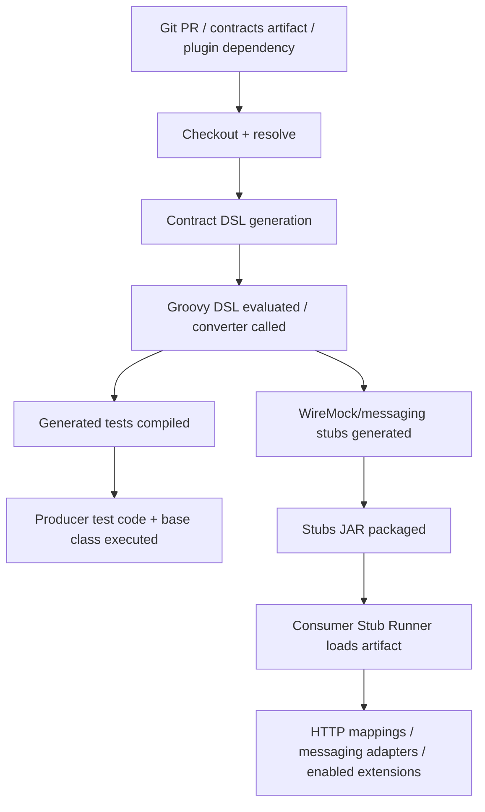
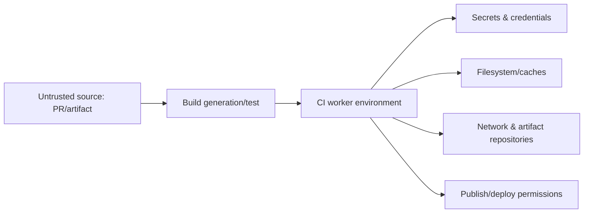
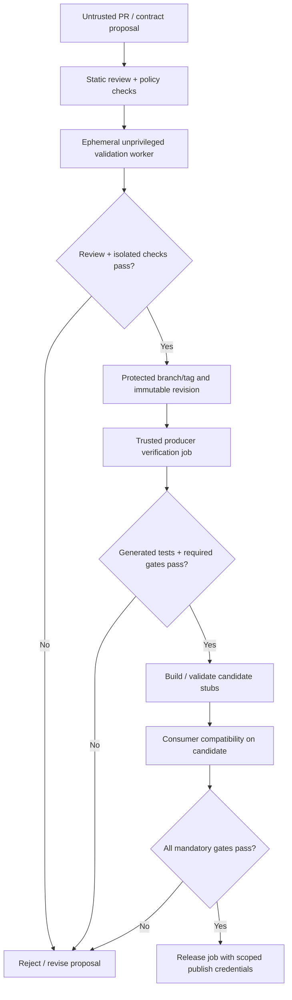
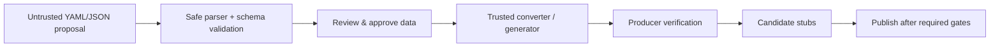
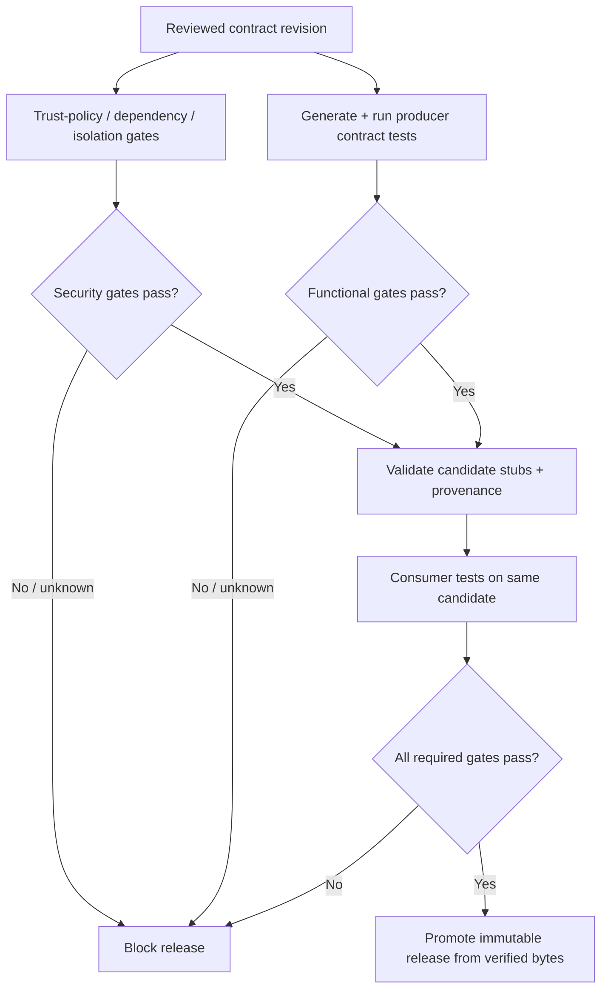

# Risks When Loading Groovy or Extension Code from Untrusted Sources

A contract in **Spring Cloud Contract** can look like an API specification document: request, response, matchers, status, and a few lines of Groovy DSL. However, **Groovy is an executable programming language**, not merely a data format. When a tool loads and evaluates a Groovy script from an untrusted source, the process of **generating producer tests or stubs** can become a code execution point running with the build process's permissions.

This risk is especially critical when teams use a **common contracts repository**, accept Pull Requests from multiple consumers, download contract artifacts from a Maven repository, or use **custom converters, extensions, base classes, and test helpers**. A CI build typically has permissions to read source code, caches, environment variables, Maven/Gradle configurations, and sometimes publishing credentials. Treating an unknown-origin Groovy contract as "just data" can unintentionally grant these privileges to the contract's author.

This lesson belongs to the **Contract Security** chapter of the **SPRING_CLOUD_CONTRACT** module, where we learn how to define HTTP/messaging contracts using **Groovy/YAML DSL**, generate producer tests, publish stubs, use **Stub Runner**, and check compatibility in CI. The focus of this lesson is the **trust boundary when loading contracts or extension code**, how to reduce unintended code execution risk, and how to build a safe pipeline while preserving producer–consumer collaboration.

After this lesson, you will be able to:

- Explain why **reading/evaluating Groovy DSL** differs from parsing YAML/JSON.
- Distinguish when **contract generation**, **producer test execution**, and **consumer stub runtime** can execute code.
- Identify untrusted sources: Git PRs, contracts JARs, build plugins, converters, extensions, test fixtures, and dependencies.
- Build a realistic threat model for producer and consumer CI.
- Choose how to organize contract sources, reviews, build isolation, and **least-privilege** permissions.
- Understand the role and limits of validation, version pinning, checksums, signatures, provenance, and "data-only" policies.
- Avoid relying on a homegrown "Groovy sandbox" as the sole defense.
- Design a stub release process using only reviewed and verified artifacts.
- Respond when a suspicious contract or extension is detected without running it on a machine holding secrets.

## 1. Where does the trust boundary lie?

Suppose `OrderService` is a consumer and `InventoryService` is a producer. The Order team opens a PR proposing a contract in a shared repository:

```text
shared-contracts/
└── inventory-service/
    └── order-service/
        └── create-reservation.groovy
```

An automated producer pipeline runs:

```text
1. Fetch contract from PR or artifact repository
2. Feed .groovy file into Spring Cloud Contract Verifier
3. Generate producer tests and WireMock mappings
4. Run tests
5. Package and publish *-stubs.jar
```

If step 2 **evaluates Groovy code**, the script's execution privileges may inherit those of the Gradle/Maven/CI worker. Therefore, first ask:

1. **Who can modify** the file or artifact being loaded?
2. **Who reviewed** its contents and dependencies?
3. **What are the permissions of the executing process**?
4. **Which secrets, networks, filesystems, and artifact repositories** are reachable?
5. **Does the publishing path** allow an unapproved PR to use credentials?

A file named `create-reservation.groovy` is not inherently safer than `build.gradle` simply because it resides in a `contracts` directory.

### Four participating components

| Component | Common source | Risk when provenance is unchecked |
| --- | --- | --- |
| **Groovy contract** | Producer repo, common repo, contracts JAR | Script is evaluated with build permissions |
| **Extension code** | Custom contract converter, generator, WireMock extension, message verifier | Plugin/JAR can execute code when loaded or invoked |
| **Base class / fixture** | `src/test`, `src/contractTest`, shared test library | Test code runs during producer verification |
| **Stub artifact** | Maven repository, Git SCM, local cache | Wrong mock mapping/messaging data, or tampered/wrong-origin artifact/extension |

Data sources and execution privileges must be evaluated **separately for each component**; not every `.yml` or `.json` file can execute directly like Groovy, yet they can still influence test/runtime behavior.

## 2. Groovy DSL is not a pure data format

A valid Groovy contract:

```groovy
import org.springframework.cloud.contract.spec.Contract

Contract.make {
    name 'create_reservation_success'

    request {
        method 'POST'
        url '/api/v1/reservations'
        headers {
            contentType(applicationJson())
        }
        body([
            sku     : 'SKU-001',
            quantity: 2
        ])
    }

    response {
        status 201
        headers {
            contentType(applicationJson())
        }
        body([
            reservationId: 'RES-701',
            status       : 'HELD'
        ])
    }
}
```

This is Groovy syntax constructing a `Contract` object. In the standard Groovy DSL pipeline, the tool must **evaluate the script** to produce the contract definition. The script itself can contain declarations, expressions, and method calls beyond the expected DSL. That is a property of Groovy, not a license for contract authors to use all of those capabilities.

### Harmless illustration showing execution occurs

The following example **only computes an expression in memory** before building the contract; it reads no files, makes no network calls, and runs no OS commands:

```groovy
import org.springframework.cloud.contract.spec.Contract

def valueComputedByGroovy = 2 + 2
assert valueComputedByGroovy == 4

Contract.make {
    name 'example_only'
    request {
        method 'GET'
        url '/api/v1/health/example'
    }
    response {
        status 200
        body([ok: true])
    }
}
```

Notice that `valueComputedByGroovy` and `assert` **are not request/response data**. They are Groovy code evaluated when the script runs. Exactly how plugins load files can vary across versions or customizations, but **you must never treat Groovy script processing as a security sandbox**.

**Do not use a machine holding secrets to test a suspicious Groovy contract.** Only read/review it as plain text in a non-executing viewer, or transfer it to an isolated environment approved by your security team.

## 3. Groovy, YAML, JSON, and Java extensions: different risk levels

| Format/component | Role in Spring Cloud Contract | Security note |
| --- | --- | --- |
| **Groovy DSL `.groovy`** | Script expressing `Contract.make` | Capable of executing code when evaluated |
| **YAML DSL `.yml/.yaml`** | Structured request/response/matcher data | Does not execute Groovy by default; still needs safe parser, schema, and loading rules |
| **WireMock mapping JSON** | HTTP stub data used on consumer | Normally data config, but can trigger enabled features/extensions |
| **Java/Groovy test base class** | Prepares fixtures and boots test context | Compiled/executed code in producer tests |
| **Custom converter / plugin JAR** | Extends contract reading/generation | Can execute code at plugin initialization/invocation |
| **WireMock extension/transformer** | Extends stub runtime behavior | Can run code in server/test runtime if loaded |
| **Maven/Gradle plugins and build scripts** | Orchestrates generation, tests, packaging | Code running in the build with worker privileges |

### Is YAML always safe?

**No.** YAML in standard DSL form is data, yet that only eliminates one class of risks from Groovy execution. You must still check:

- Whether the parser supports **custom tags** or instantiates arbitrary object types.
- Whether **custom converters/validators** run on the parsed data.
- Whether fixture file/body references reach outside permitted roots.
- Whether regex matchers contain overly expensive expressions.
- Whether huge inputs, overly deep nesting, or alias expansion exhaust resources.
- Whether fields are passed into shell commands, templates, URLs, or paths by custom software.

For a genuinely **data-only** pipeline, use only safe YAML/JSON parsers, schema validation, size/depth limits, and trusted converters. Do not rely on the `.yml` extension as an automatic safety certificate.

### "No Groovy visible" can still hide untrusted code

For example, a YAML contract might contain only harmless requests/responses while the build pulls a new plugin or converter from an untrusted repository. **The dangerous code then lives in the dependency**, not in YAML. Thus, checking contract sources and checking **toolchain** sources are parallel responsibilities.

## 4. When can code execution happen?



Different stages carry different risks:

1. **Checkout/resolve:** files and dependencies are not necessarily executed immediately, yet content can be swapped, sources spoofed, or artifacts named like trusted ones.
2. **Generation:** Groovy contracts can be evaluated; custom converters invoked; Maven/Gradle plugins and build scripts run.
3. **Producer verification:** generated tests, base classes, fixtures, Spring context, and custom helpers run inside the test process.
4. **Packaging:** Gradle/Maven tasks, transform/copy tasks, and publish plugins can run code.
5. **Consumer runtime:** WireMock reads HTTP mappings; some messaging stub handling or custom extensions require separate Java/Groovy/framework logic. **Never claim every JAR entry is purely data or every Groovy file inside a JAR automatically executes.** Inspect the actual adapter, features, and version in use.

**Core boundary:** a tool **reading contract sources to generate** is not the same as Stub Runner **serving a generated HTTP mapping JSON**. Both flows have different loading paths and execution privileges, yet both require checking artifact provenance and extensions.

## 5. Threat model: if an untrusted author controls a contract

Suppose someone can open a PR modifying:

```text
contracts/order-service/create-reservation.groovy
```

but must not access producer CI credentials. If a workflow uses a publish-capable token while processing unreviewed PRs, a trust boundary has been crossed:



In a threat model, identify:

| Asset to protect | Example | Consequence if pipeline is abused |
| --- | --- | --- |
| **Secrets** | Repository tokens, cloud credentials, private signing keys | Exposure of access to other systems |
| **Sources & artifacts** | Private code, dependency caches, release JARs | Reading/writing beyond PR author's privileges |
| **Test integrity** | JUnit reports, stub mappings, test settings | "False green tests", bypassing regressions |
| **Release integrity** | Stubs JAR, version metadata | Publishing wrong or forged artifacts |
| **CI availability** | CPU, RAM, disk, build minutes | Resource exhaustion or pipeline outage |
| **Info from request journal** | Test tokens, HTTP headers/bodies | Data leaks through logs/artifact reports |

Not every malicious PR can cause every impact above: **actual severity depends on process privileges, how tools process inputs, and active isolation controls**. A threat model prevents both extremes: assuming every DSL is harmless or claiming a guaranteed RCE vulnerability in a specific plugin/version without evidence.

## 6. Common risk scenarios

### Scenario A — PR contract runs in a job holding credentials

A workflow checks out code from an external PR author, then runs `mvn verify` or `gradlew check` in a job provisioned with an artifact upload token. If the tool evaluates PR-controlled Groovy, the test run can execute code with the job's privileges.

**Mitigation:** run untrusted PRs in jobs without secrets or publish rights; only release jobs from reviewed revisions receive credentials. Never grant high privileges just for "convenience" to avoid configuring two pipelines.

### Scenario B — Contracts JAR content gets replaced

Producer pins `com.example.contracts:inventory-contracts:2.3.0`, yet the repository permits overwriting the same version. Today's build and tomorrow's build receive different bytes. If the JAR contains Groovy DSL that gets evaluated, both **contract integrity** and **wrong-origin code execution** are at risk.

**Mitigation:** immutable versions, SHA-256/identity checks, restricted repository write access, provenance, and signature/attestation verification when policy requires.

### Scenario C — Extension JAR added as "matcher support"

A build change adds a `custom-contract-converter` dependency from an unclear publisher. Even if all contracts are YAML, the extension can run Java code when the plugin loads or converts.

**Mitigation:** review dependency diffs, allowlist trusted sources, pin versions, check transitive dependencies, use SBOMs/signatures/provenance where available; never enable dynamic plugin loading from contract inputs.

### Scenario D — Test base class reads unauthorized data

The contract is syntactically clean, yet a new test base class references out-of-scope files, environment variables, or services. Generated producer tests can run base class code under CI privileges.

**Mitigation:** govern `ContractVerifierBase` and test helpers like production code in reviews; use fake data in test fixtures, proper test container/file permissions, and restricted egress.

### Scenario E — Artifact contains forged mappings/extensions

Stub Runner downloads `inventory-service:1.4.2:stubs` from an unexpected repository or a tampered local cache. Consumer tests may run against mappings that did not originate from a verified producer; if the runtime also loads unreviewed executable extensions, the risk escalates.

**Mitigation:** pin coordinates, repository allowlists, digests/provenance, isolated runtime instances, restrict custom extensions, and verify active loaded mappings.

## 7. Risks go beyond "leaking secrets"

An untrusted Groovy/extension source can also:

- **Corrupt test outcomes:** alter fixtures, overwrite test resources, cause tests to be skipped.
- **Alter stub behavior:** emit mappings returning statuses/bodies that make consumer tests falsely pass.
- **Tamper with builds:** modify output files or metadata used during packaging.
- **Exhaust resources:** CPU-heavy loops, huge memory allocations, giant files, or catastrophic regexes.
- **Leak data via logs:** print environment variables, request journals, or error details.
- **Cross-contaminate jobs:** poison shared dependency caches or temporary artifacts if writable shared storage exists.

Therefore, `mvn verify` or `gradlew check` succeeding **is not proof that the pipeline is secure**. A secure workflow protects **confidentiality, integrity, and availability**, not merely test assertions.

## 8. Things not to assume about sandboxing

**A Groovy sandbox is not a default security feature of Spring Cloud Contract.** A DSL that looks like configuration can still be executed by the Groovy runtime during generation.

Do not rely on:

- **Extension checks:** accepting only properly named `*.groovy` files without reviewing contents.
- **Regex blacklists:** searching for words like `System`, `Runtime`, or `File` and declaring a script safe.
- **Running code first, then scanning logs:** if it already ran on a secret-bearing machine, scanning afterward is too late.
- **Assuming the plugin "only generates tests":** generation can evaluate scripts prior to test execution.
- **Building a makeshift ClassLoader/GroovyShell sandbox:** it is hard to prove all reflection, classpath tricks, compiler transforms, and side-effect APIs are blocked.
- **Relying on Java SecurityManager** as a universal security barrier; its status and suitability have changed/deprecated in modern JDKs.

An **AST allowlist** or static validation can serve as an extra layer when rigorously designed and verified, yet **does not replace** OS/container-level isolation, least privilege, trusted code review, and trustworthy artifact sources.

## 9. Designing a two-trust-zone contract lifecycle

A clean structure separates the **unapproved proposal zone** from the **approved verification/release zone**.



**The untrusted zone** can validate syntax and even run Groovy inside an isolated environment, yet must have no access to read secrets or publish releases. **The trusted zone** accepts only revisions reviewed through protected workflows and still verifies code/tests rather than assuming "merged means completely safe".

### Reference execution policy

| Stage | Contract source | Required privileges | Actions |
| --- | --- | --- | --- |
| PR static checks | Unapproved proposal | Read-only source, zero secrets | Check file paths, YAML/schema, review diffs |
| PR executable verification | Unapproved proposal | Short-lived worker, no sensitive tokens, restricted egress | Run generator/tests inside policy-compliant sandbox |
| Merge/protected revision | Reviewed | Source write rights per branch policy | Pin commit/contract revision |
| Producer CI | Reviewed revision | Only rights needed for verification | Generate/run tests, build candidate |
| Consumer CI | Candidate identified by digest | Read rights for required artifacts | Test consumer code against matching stub |
| Release publication | Verified candidate | Repository-scoped publish credential | Promote verified bytes, do not arbitrarily rebuild |

When supporting PRs from forks, never grant identical credentials to PR and release jobs merely because they share a workflow file or the name `verify`.

## 10. Isolating the Groovy evaluation process

When unreviewed code must run to give feedback to a PR author, treat PR Groovy contracts, build scripts, and dependencies as **untrusted code execution**. Specific tooling depends on your infrastructure, while the principles are:

1. **Ephemeral workers:** use a fresh runner/container/VM per job without shared sensitive state.
2. **Unprivileged user:** never run as root/admin unnecessarily; grant no elevated capabilities.
3. **No production secrets:** never mount `~/.m2/settings.xml` containing credentials, cloud keys, SSH keys, signing keys, or publish tokens.
4. **Mount only the needed workspace:** never mount the user/host home directory or volumes holding private data outside the project.
5. **Restrict network egress:** block the Internet or allow only trusted dependency mirrors per policy.
6. **Limit resources:** CPU, memory, disk, execution timeout, and process count.
7. **Block container/host admin privileges:** never mount the Docker socket, run privileged containers, or allow arbitrary hostPaths.
8. **Isolate dependency caches:** never let untrusted jobs write to a shared cache trusted by release jobs.
9. **Isolate outputs:** move only vetted logs/reports/artifacts into permitted areas; never auto-promote untrusted outputs.
10. **Destroy the environment after the job:** reduce persistence and cross-contamination risks across builds.

### Why a container alone is not enough?

A default container can still:

- Reach internal networks if egress is unconfigured.
- Read mounted secrets.
- Write to shared volumes or dependency caches.
- Hold overly broad privileges if running privileged or with a host Docker socket.

Thus, "ran in Docker" does not mean **Groovy was safely sandboxed**. Inspect the actual **host permissions, mounts, network, seccomp/AppArmor/SELinux, or isolation policies** in force.

### Provisioning dependencies while restricting network access

Maven/Gradle usually need to fetch dependencies. Blocking all network access from the start can fail jobs simply due to missing libraries. A practical flow:

1. Pre-fetch or cache **source-vetted dependencies** in a trusted step.
2. Use a read-only repository mirror/allowlist for untrusted jobs.
3. Provide an isolated cache or read-only copy to the execution environment.
4. Block unnecessary network access during the Groovy evaluation step.
5. Reject unreviewed dynamic dependency versions introduced in PR contents.

Do not turn dependency downloads into an excuse to leave unrestricted network access open from a runner executing untrusted contracts.

## 11. PRs from forks and privileged CI configuration risks

In GitHub Actions, events and permissions carry security implications. A key rule: **never check out untrusted code and execute it inside a high-privilege workflow**.

### Example read-only PR workflow

```yaml
name: Contract proposal validation

on:
  pull_request:

permissions:
  contents: read

jobs:
  validate-proposal:
    runs-on: ubuntu-latest
    steps:
      - uses: actions/checkout@v4
        with:
          persist-credentials: false

      - name: Validate changes without release secrets
        run: ./ci/check-contract-proposal.sh

      # If policy requires running Groovy from a PR:
      # Use a stronger isolated sandbox without publish credentials,
      # with explicit dependency/network/filesystem policies.
```

This is an **illustrative workflow**; `ci/check-contract-proposal.sh` is a script the team writes/reviews. It should only validate inputs per policy and never read secrets. Checking out the repository also places PR scripts into the workspace: if a PR can modify `ci/check-contract-proposal.sh` itself, the command above **can execute PR code**. Therefore:

- Keep policy-checking scripts in a **trusted code source** (e.g., pinned reusable action/workflow or separate immutable checkout revision).
- Use runners without sensitive credentials for all unreviewed code execution.
- Review changes to workflows/scripts as security-sensitive code changes.
- If contract generation must run on PRs, treat it as **sandbox execution**, not "static validation".

**Warning about `pull_request_target`:** this event runs in the context of the base repository and can receive higher-privilege tokens/secrets depending on configuration. If a workflow checks out the untrusted PR HEAD and runs Groovy or scripts from it, the risk of crossing the trust boundary spikes sharply. Never use `pull_request_target` for such flows; if required for a special reason, use a separately reviewed secure design.

### Release workflow conditions

A release workflow can run on a protected tag/branch and depend on verification jobs:

```yaml
name: Release verified stubs

on:
  push:
    tags:
      - "v*"

permissions:
  contents: read

jobs:
  verify:
    runs-on: ubuntu-latest
    steps:
      - uses: actions/checkout@v4
        with:
          persist-credentials: false
      - name: Verify producer from reviewed revision
        run: ./ci/verify-producer-and-candidate.sh

  publish:
    needs: [verify]
    runs-on: ubuntu-latest
    environment: approved-artifact-release
    steps:
      - name: Promote verified candidate only
        run: ./ci/promote-verified-stubs.sh
```

This is also a **sketch**, omitting artifact handoffs, checksum verification, trusted checkouts for publish scripts, and credentials. In real deployments:

- Publish only **the candidate from the same commit's verify job** or an artifact attested by digest.
- `promote-verified-stubs.sh` must come from a trusted source, never arbitrarily overridden by an unreviewed file.
- Publish credentials exist only in the protected release environment, never granted to PR jobs.
- Protected tags/branches, required reviews, artifact immutability, and status checks are mandatory per policy.
- If verification/consumer gates are mandatory, `publish` must depend on **all of them**, not just a single `verify` job.

## 12. Reviewing Groovy DSL: treat it like source code review

A PR modifying Groovy DSL requires inspecting **content outside `Contract.make { ... }`** as well as references to other code.

Examples of changes that warrant questions:

| Change type | Review question |
| --- | --- |
| Added `import` | Does it reference packages outside the DSL or vetted helpers? |
| Added method/function/class | Is it a pure data helper or code with side effects? |
| Added static initializer | Could it execute at load/evaluation time? |
| File/network reference | Is it needed for the DSL? Does it violate data-only policy? |
| Custom matcher/converter call | Who owns this component and with what privileges does it run? |
| Changed fixture path | Could it read files outside root or secrets? |
| Complex regex added | Could it exhaust CPU or match overly broadly? |
| Changed request/response schema | Could it make consumer tests falsely pass or break compatibility? |
| Added dependency/build plugin | Are artifact source and transitive dependencies trustworthy? |

### Practical review criteria

- When a contract only needs to describe HTTP/messages, prefer **explicit, minimal, readable** DSL.
- Reusable helpers should come from reviewed internal libraries with **pinned versions** and independent change control.
- Restrict dynamic logic with side effects in scripts, especially reading environment variables or networks.
- Require consumer PR owners and producer reviewers when committed behaviors change.
- Contracts must contain no tokens/passwords/private data, not even "temporary test" values.
- Any change expanding code execution capability requires stricter review than changing response data.

**Static review is essential, not an absolute proof of safety.** For untrusted code, sandboxing and least privilege remain necessary if execution is chosen.

## 13. Extension code is a separate trust boundary

Spring Cloud Contract and its ecosystem may use extensions such as:

- **Custom contract DSL converters** reading custom formats to produce contract models.
- **Groovy/Java helper libraries** for value generators or test fixtures.
- **Base classes** and test configurations for producer verification.
- **Custom message verifiers/adapters** connecting Spring Integration, Stream, Kafka, or RabbitMQ.
- **WireMock extensions/response transformers** for stub behavior.
- **Gradle/Maven plugins** adding generate/package/publish tasks.

These components are not "data files" just because they appear in a contract testing workflow. A plugin JAR can include initializers, reflection, ServiceLoader registrations, or executable logic when invoked.

### Never load extensions by class name supplied in a contract

An architectural anti-pattern:

```text
YAML contract:
  extensionClass: "some.package.DynamicExtension"

Pipeline:
  Read class name from YAML
  -> load JAR without allowlist
  -> instantiate class by name
  -> run on CI worker holding secrets
```

This is a **counter-example pattern**, not default Spring Cloud Contract behavior. It illustrates the design flaw of turning untrusted data into **control over which code executes**. If a plugin architecture is needed, use a governed registry/allowlist, pinned versions, and restricted runtime permissions.

### Reviewing dependency and plugin versions

Maven example:

```xml
<!-- A pinned dependency version, not a guarantee of safety. -->
<dependency>
    <groupId>com.example.build</groupId>
    <artifactId>trusted-contract-test-support</artifactId>
    <version>1.4.0</version>
    <scope>test</scope>
</dependency>
```

Gradle example:

```groovy
dependencies {
    contractTestImplementation(
        'com.example.build:trusted-contract-test-support:1.4.0'
    )
}
```

These coordinates are **illustrative only**, not real artifacts. `scope=test` or `contractTestImplementation` does not prevent code inside the dependency from executing during producer tests/generation; it only scopes the classpath or dependency lifecycle.

Prefer trusted repository mirrors, dependency locking/verification, reviewing plugin changes, and signatures/provenance where supported. Treat **changes to Maven/Gradle scripts or plugin versions** as security changes potentially more critical than a small DSL diff.

## 14. If you want a data-only policy, design a dedicated pipeline flow

Some organizations have many consumers with differing trust levels. Instead of letting every consumer write arbitrary Groovy, you can define:

1. Consumers propose only a **constrained schema** in YAML/JSON.
2. Untrusted CI performs only **safe parsing + schema validation** and static review.
3. A **reviewed, version-pinned** converter transforms the data into contract models.
4. Producer CI runs generated tests only on approved revisions.
5. If Groovy DSL is needed, Groovy is generated strictly by a trusted internal generator or separately reviewed before execution.



### Data must be bounded

A data-only policy should specify:

- Permitted fields: method, path, headers, body, response status, and supported matchers.
- Permitted data types: scalars/lists/objects in the schema, disallowing arbitrary object instantiation.
- Limits on path length, JSON body size, contract count, nesting depth, and regex complexity.
- Fixture paths restricted strictly **within safe roots**.
- Disallowing content that selects classes, scripts, commands, template extensions, or dependency download URLs.
- Parsing files with a safe loader and validating against schema before handing off to generators.

**Sandboxing is still needed** for the remaining executable pieces: converters, Gradle/Maven plugins, and generated tests. "Data-only" **reduces the attack surface from contract proposers**, without making the entire toolchain infallible.

## 15. File paths, archives, and indirectly loaded data

Contract DSLs often reference JSON payloads, fixture files, or repository resources. A source file may contain no executable code yet still influence **which files tools read**.

Illustrative layout:

```text
inventory-service/
└── src/contractTest/
    └── resources/
        ├── contracts/
        │   └── order-service/
        │       └── reserve-success.yml
        └── fixtures/
            ├── reserve-request.json
            └── reserve-response.json
```

When enforcing path policies:

1. Allow only explicitly defined resource roots.
2. Canonicalize paths and verify they remain inside the root after resolution.
3. Account for symlinks/junctions and case-insensitive paths across Windows/Linux.
4. Do not assume merely blocking `../` eliminates every root-escape technique.
5. Limit fixture sizes and file counts.
6. Avoid reading secret paths or user-supplied absolute paths directly.

### When receiving contracts from external JAR/ZIP archives

A contracts artifact may be an archive containing nested paths. In any **custom code written to extract/copy** entries, validate entry names and target destinations to prevent writing files outside the destination directory. This is the classic **archive path traversal** risk when handling untrusted archives.

**Do not claim Spring Cloud Contract has a specific vulnerability merely because it handles JARs.** The lesson is: if your pipeline adds custom scripts/copy tasks to unpack externally supplied archives, that handling code itself must validate safety and confine roots.

### Relationship to WireMock's `bodyFileName`

When JSON mappings use `bodyFileName`, the runtime resolves response bodies relative to WireMock's file source/root, usually under `__files`. If a custom loader permits paths outside the root or unpacks body files without checks, the flaw lies in the **loader layer**, not necessarily in DSL syntax.

Therefore:

- Package body files from trusted sources into the proper root.
- Verify the final JAR contains expected mappings and body files.
- Never use custom resolvers accepting arbitrary paths from untrusted sources.
- Test stubs in an isolated runtime before consumers use them.

## 16. Verifying artifacts: checksums, signatures, and provenance are not the same

These mechanisms answer different questions:

| Mechanism | What does it tell you? | What it does NOT prove alone |
| --- | --- | --- |
| **Version string** | Logical release name | Bytes were not overwritten |
| **SHA-256 checksum** | Two copies have identical bytes at hash level | Who created the original or whether it is trustworthy |
| **Artifact signature** | Artifact was signed by a matching key if verification passes | Signer was not compromised or source lacks malicious code |
| **Provenance/attestation** | Build/source/materials attested by a workflow | Every input was safe or tests were thorough |
| **Dependency lock/verification** | Resolved dependencies are reproducible/integrity-checked | Dependency code contains no dangerous logic |
| **Immutable repository** | Cannot easily overwrite a published release | Initial release was valid or uncompromised beforehand |

A trustworthy system combines **source review**, **version pinning**, **integrity checks**, **signing/attestation where appropriate**, **repository permissions**, and **CI isolation**.

### Example traceability record

```yaml
contractSource:
  repository: example-shared-contracts
  revision: REPLACE_WITH_APPROVED_COMMIT
  path: inventory-service/order-service
producer:
  artifact: com.example:inventory-service:1.4.2
  revision: REPLACE_WITH_VERIFIED_COMMIT
generation:
  tool: spring-cloud-contract
  version: REPLACE_WITH_PINNED_VERSION
  buildRun: REPLACE_WITH_CI_RUN_ID
verification:
  generatedTests: 12
  executedTests: 12
  failedTests: 0
  skippedTests: 0
stub:
  coordinates: com.example:inventory-service:1.4.2:stubs
  sha256: REPLACE_WITH_ACTUAL_SHA256
  publication: APPROVED_RELEASE_ONLY
```

This is an **organization-managed illustrative manifest**, not Contract Verifier's default schema. The numbers `12` only illustrate meaning. In real releases, CI must collect actual values from jobs running the exact source revisions.

### Why can the same version still be unsafe?

If an artifact repository allows overwrites, `inventory-service:1.4.2:stubs` can have different bytes at two points in time. One consumer running `StubsMode.REMOTE` and another using a Maven local cache can load **two artifacts with different contents under the same name**.

Therefore:

- Lock release versions and block overwrites.
- Record resolved repository, artifact coordinates, and SHA-256.
- For SNAPSHOTs, record the exact resolved timestamp/build metadata.
- When bumping versions, run consumer compatibility against the **exact candidate bytes** intended for promotion.
- When using artifact signatures/attestations, verify them against governed key/identity policies.

## 17. Sensitive data that can accidentally slip into logs and stubs

Risks do not stem only from intentionally malicious contract scripts. A test framework or custom logger can print:

- HTTP request/response bodies, including test bearer tokens or customer data.
- `Authorization`, cookies, and session headers.
- Environment variables in CI.
- Maven repository credentials and Gradle publishing properties.
- File paths and stack traces revealing internal structure.
- JWT samples accidentally using real keys or claims.

### Rules for contract data

| Data | Do | Do NOT |
| --- | --- | --- |
| `reservationId` | Use structurally valid fake IDs | Use real transaction IDs |
| `Authorization` | Formatted fake token or scoped test credential | Commit production tokens |
| User details | Synthetic/anonymous data | Use real emails, phones, or addresses |
| Payment fields | Non-transactional test identifiers | Real PAN/CVV or customer payment info |
| Secrets | Pass from secret store to trusted jobs if needed | Write into Groovy/YAML/JSON or stdout |
| Stub responses | Valid schema with fake data | Copy unsanitized production responses |

When testing security headers, assert **presence/format** or use fake values; never create contracts holding real credentials for equality matching.

### WireMock request journal

The request journal is helpful to confirm the real consumer called the expected stub, yet it can store headers and bodies. Never expose the WireMock Admin API or request journal publicly; isolate test ports, restrict logs/retention, and use fake data.

A mapping can also contain an oversized response or unexpected content; consumer tests should bound input sizes/timeouts and avoid rendering unvetted responses into HTML/log viewers without encoding.

## 18. Risks from WireMock and extensions in consumer tests

An HTTP stub JAR usually contains JSON mappings generated by Spring Cloud Contract from the DSL. During consumer tests, Stub Runner unpacks the artifact and starts WireMock to serve requests.

Distinguish clearly:

- **Mapping JSON** describes requests/responses and is normally not Java/Groovy bytecode.
- **Response templating/transformers** can turn a mapping into dynamic behavior when extensions are enabled.
- **Custom extension JARs** run code inside the WireMock/test process.
- **Messaging adapters** have different lifecycles and execution mechanisms than HTTP mappings.
- **Consumer test code** itself is executable code, not just configuration.

Recommended policy:

1. Fetch stubs only from allowlisted repositories with pinned versions and provenance.
2. Never auto-load executable extensions bundled with an unreviewed artifact.
3. Enable only necessary WireMock transformers managed by the team.
4. Do not let hand-written mappings override generated mappings without conflict tests.
5. Never expose `/__admin/mappings` to external networks; that endpoint can alter stub behavior.
6. Run consumer tests in least-privilege environments with fake data.
7. Verify which mappings are actually active/loaded at runtime, not merely that the JAR file exists.

**Caveat:** simply having a class or `.groovy` file inside an artifact does not mean Stub Runner automatically loads or executes it. Risk materializes only when an **actual loading and execution path** brings that code into runtime. Always check the documentation and configuration of the Spring Cloud Contract/WireMock versions your project uses.

## 19. Git sources and dedicated repositories for contracts

Many teams use:

```text
Consumer PR
  -> shared-contracts Git repository
  -> contracts JAR
  -> producer Contract Verifier
  -> verified stubs JAR
  -> consumer Stub Runner
```

Every arrow is a **trust boundary**:

| Boundary | Questions to verify |
| --- | --- |
| PR → Git repo | What permissions does the proposer hold? Is review complete? |
| Git repo → contracts artifact | Was the artifact built from the exact approved commit? |
| Contracts artifact → producer CI | Does the plugin pin the exact version/digest? |
| Producer tests → stubs artifact | Did generated tests actually run and pass? |
| Stubs artifact → consumer CI | Did Stub Runner fetch the exact artifact from a trusted repo? |
| Consumer CI → release | Could a false-green test or manual mapping shadow generated ones? |

### Never use a moving branch for release builds

If producer CI pulls "main HEAD" from an external contracts Git repo while a pipeline runs, contracts can change between verification and packaging or between two builds of the same producer commit.

Use instead:

- Immutable tags/commits for contract revisions.
- Immutable artifact versions when using Maven repositories.
- SHA/checksums for verified stub candidates.
- Release workflows pinning both the producer commit and contract source revision.

For Spring Cloud Contract's Git-based contract/stub storage, revision selection, protocols, and credentials depend on the adapter/version; do not assume an ordinary Git URL shares identical semantics with Maven `repositoryRoot`.

## 20. Difference between security scanning and contract execution

Static scanners can detect suspicious imports or patterns, dependencies with CVEs, and dangerous CI configurations. However:

- No scanner guarantees detecting every side-effecting logic path in Groovy.
- Dependency CVE scans do not prove a dependency was not tampered with.
- YAML schema validation does not prove converters execute safely.
- Passing unit/contract tests does not prove a plugin did not leak secrets.
- Clean dynamic scans in a sandbox do not prove safety in higher-privilege environments.

Therefore, **defense in depth** must combine trusted-source policies, review, sandboxing, dependency security, permissions, provenance, monitoring, and incident response.

### Suggested acceptance criteria for an external contract

```text
REQUIRE:
  - source identity is known
  - changes are reviewed by producer + consumer owners
  - dynamic Groovy is not executed with production secrets
  - custom code/extensions come from approved, pinned dependencies
  - file paths and parsed data pass policy validation
  - producer generated tests execute on intended implementation
  - stub artifact matches reviewed contract revision
  - consumer compatibility tests use the matching stub candidate
  - release publishing is gated and access-controlled

ELSE:
  - quarantine or reject input
  - do not publish official stubs
```

This is a **descriptive policy**, not an automated configuration file. In real systems, each requirement must map to a verifiable job, rule, approval, or infrastructure control.

## 21. Green CI results can mask security risks

Suppose producer CI reports:

```text
Generated contracts: 12
Executed producer tests: 12
Failures: 0
Skipped: 0
Stubs artifact: inventory-service-1.4.2-stubs.jar
Result: BUILD SUCCESS
```

That is good evidence for **the assertions that ran**, yet **does not prove** the Groovy source or custom plugins are safe. A script with side effects can still produce a valid contract, pass tests, and generate properly formatted stubs.

### Two independent gate groups

| Gate group | Question | Example evidence |
| --- | --- | --- |
| **Functional compatibility** | Does the producer satisfy agreed requests/responses/messages? | Generated tests pass |
| **Trust & security** | Are inputs reviewed, untrusted code isolated, and secrets/artifact integrity protected? | Approved revision, credential-free sandbox, verified provenance |

Releases should be permitted only when **both mandatory gate groups pass**.



For an unreviewed Pull Request, a candidate can be built for testing inside a **restricted zone**, yet must never be auto-promoted to a stable release or given access to publish credentials.

## 22. When a suspicious contract or extension is detected

Suppose a reviewer spots a new Groovy contract with calls outside the DSL or an unfamiliar extension dependency. The top priority is **not executing that content in a privileged environment**.

### Initial response procedure

1. **Do not merge** the PR and do not re-run privileged pipelines with the same input.
2. **Quarantine the artifact/PR revision**: preserve hash, source, commit, author, timestamp, and diff for investigation.
3. **Stop or disable high-privilege jobs** if they might automatically process the suspicious source.
4. **Determine whether it executed**: inspect CI runs, logs, job permissions, dependency resolvers, host/network policies, and artifact publications.
5. If secret exposure is possible, **activate security incident response**: revoke/rotate credentials per affected scope, audit access, and handle issued tokens.
6. **Verify output integrity**: JAR artifacts, reports, repository releases, caches, and deployment metadata from related runs.
7. **Notify producer/consumer/platform teams** and temporarily pin a safe artifact if needed.
8. Fix the policy or workflow that allowed the boundary crossing and add gate regression tests.
9. Re-run verification only on an approved revision in an audited, isolated environment.

### Preserving evidence and limiting spread

- Never copy potentially sensitive files into public issues or broad team chats.
- Store logs per organizational security procedures; verify secret masking before sharing.
- Never "test whether it is dangerous" by running the Groovy script on a personal laptop.
- Never overwrite a stable artifact under the same version to cover tracks; publish a new release after verification.

Effective incident response separates **suspicion**, **potential code execution**, and **evidence of actual data access**. Do not assume compromise just from seeing `.groovy`, yet do not downplay the risk if an untrusted script ran with publish credentials.

## 23. Diagnostic table of common mistakes

| Symptom | Risk/misconception | How to check and fix |
| --- | --- | --- |
| "It's just a Groovy contract" | Failing to recognize scripts can evaluate code | Review like code, sandbox untrusted sources |
| Fork PR runs `mvn verify` in job with secrets | PR code can inherit unnecessary privileges | Separate untrusted PR jobs from protected release jobs |
| `pull_request_target` checks out PR HEAD and builds | Crosses base-repo/untrusted-code boundary | Change event/design; never execute untrusted HEAD with high privileges |
| Checking only `.yml` extension as safe | Parsers/extensions and custom tags unchecked | Safe parser, schema, allowlisted converters |
| Static grep misses `Runtime` so run allowed | Keyword blacklists easily miss cases | Defense in depth and execution isolation |
| Installing new plugin from unknown artifact repo | Unreviewed executable extension | Pin approved publishers/versions, dependency verification |
| Contract JAR version gets overwritten | Producer build can fetch different bytes | Immutability, checksums, provenance |
| Build green despite unrelated side effects | Functional tests do not verify security | Separate security/trust gates |
| Stub Runner pulls from wrong repository | Mappings/versions differ from producer-verified origin | Repository allowlists, digests, log resolved coordinates |
| WireMock Admin API exposed externally | Outsiders can add/edit stubs, view journal | Bind/isolate port and restrict access |
| Test logs contain tokens | Secret/data leakage through report artifacts | Fake data, masking, retention policy |
| Contract accesses files outside root | Risk of reading wrong paths/secrets | Canonical path checks, fixture roots |
| Custom JAR unzip skips entry validation | Risk of writing files outside output folder | Safe archive extraction |
| Homegrown Groovy sandbox | Easily misses code execution paths | Never rely on it as the sole defense |
| CI cache shared between PR and release | Untrusted output can affect trusted builds | Cache partitioning, read-only/verified inputs |
| SHA-256 present so artifact deemed trustworthy | Checksums do not prove origin | Combine review, identity, signatures/provenance |
| Release job rebuilds after verify | May use different inputs/dependencies | Promote exact same digest or re-verify exact revision |
| Consumer test green yet client skips stub | Test only hits WireMock directly | Invoke real consumer code, check request journal |

## 24. Security checklist before loading Groovy or extensions

- [ ] Identified who controls contract sources and artifact repositories.
- [ ] Groovy DSL is treated as **executable code**, not merely documentation.
- [ ] Distinguished Groovy, YAML/JSON, test base classes, and executable extensions.
- [ ] Unreviewed PRs/contracts never run on workers holding sensitive credentials.
- [ ] `pull_request_target` is never used to check out/execute untrusted PR code in a privileged context.
- [ ] CI uses ephemeral unprivileged runners with restricted OS/network/filesystem rights.
- [ ] Docker sockets, host secrets, and shared writable caches are not mounted into untrusted jobs.
- [ ] CPU, RAM, disk, timeout, and network egress limits are enforced.
- [ ] Build scripts, plugin versions, custom converters, and test helpers are reviewed.
- [ ] Dependencies come from trusted sources with pinned versions and policy-based integrity/provenance checks.
- [ ] Executable extensions/class names are never loaded dynamically from contract fields.
- [ ] For data-only YAML/JSON, safe parsers and bounded schema validation are used.
- [ ] Paths/resource references are verified inside permitted roots, accounting for symlinks.
- [ ] Custom archive/copy logic cannot write outside output directories.
- [ ] Test data contains no real credentials or real user information.
- [ ] WireMock/Admin API and request journals are not publicly accessible.
- [ ] Consumer Stub Runner fetches artifacts only from permitted repositories with pinned versions.
- [ ] Producer generated tests actually execute and pass against the intended release implementation.
- [ ] Stub JAR contains expected mappings/contracts/body files and checksum is recorded.
- [ ] Consumer tests use the exact candidate stub and invoke real consumer code.
- [ ] Release jobs have dedicated protected credentials; untrusted PR jobs have no publish rights.
- [ ] Release artifacts are immutable with Git SHA, contract revision, and build provenance.
- [ ] Passing functional tests are **never** used in place of security/trust review.
- [ ] Quarantine/investigation procedures exist when suspicious scripts or extensions are detected.

### Hands-on exercise

Suppose the `InventoryService` team allows `OrderService` and `CheckoutService` to submit Pull Requests adding Groovy/YAML contracts to `shared-contracts`. The producer pipeline has permission to read the private Maven repository and publish `inventory-service:1.4.2:stubs`. The teams must ensure contract verification works without creating opportunities to run untrusted code on secret-bearing workers.

**Tasks:**

1. Diagram the chain `consumer PR → common contracts repo → producer generator → generated tests → stub JAR → consumer Stub Runner` and mark every **trust boundary**.
2. List the privileges a PR job needs and those it **must not receive**, especially publish tokens, signing keys, and cloud credentials.
3. Explain why Groovy `Contract.make { ... }` carries different risks from YAML/JSON parsed as data.
4. Write a Groovy contract for `POST /api/v1/reservations` returning `201 HELD` with **no unnecessary non-DSL code**.
5. Write an equivalent literal YAML contract and list the fields needing schema/size validation.
6. Review a hypothetical PR adding an unknown-origin Java helper and converter extension: identify which code requires separate review.
7. Design an ephemeral runner restricting secrets, network egress, mounts, privileges, and caches when PR DSL must execute.
8. Compare a read-only `pull_request` workflow against a `pull_request_target` workflow checking out PR code and explain the dangerous boundary.
9. Design a **data-only contract proposal schema** allowing only method, path, headers, body, and response while blocking arbitrary class/command fields.
10. Simulate a Maven contracts artifact with the same version but a different checksum and state the producer pipeline's decision.
11. Build a check list for the stub JAR: coordinates, contracts, mappings, body files, provenance, and repository allowlist.
12. Using a WireMock JSON mapping with a body file, explain why the loader must validate paths and why the Admin API must be isolated.
13. Design producer CI so only **approved** contract revisions use release privileges and publish only if generated tests execute.
14. Design consumer CI using Stub Runner with a **pinned candidate digest**, checking the request journal and real consumer code.
15. Create a test scenario where functional producer tests all pass yet the trust/security gate fails; explain why release must be blocked.
16. Draft a release manifest linking producer commit, contract revision, plugin version, test results, stub checksum, and publisher identity.
17. Describe incident response steps upon discovering untrusted Groovy ran on a worker with credential read access, **without executing the suspicious code**.
18. Write a short policy distinguishing "accepted contract proposal", "producer verified", and "stub release approved for publication".

**Completion criteria:** the learner can explain **which code can run at which stage**, **which sources are trusted**, **which permissions can be abused**, and **how to prove published stubs come from reviewed contracts and verified producers**. If an untrusted Groovy/extension source can run with publish credentials, the workflow does not meet security requirements.

## References

- [Spring Cloud Contract — Reference](https://docs.spring.io/spring-cloud-contract/reference/): Contract DSL, producer test generation, stubs, and extensions.
- [Spring Cloud Contract — HTTP Contracts](https://docs.spring.io/spring-cloud-contract/reference/project-features-contract/http.html): Groovy/YAML request–response DSL and matchers.
- [Spring Cloud Contract — External Contracts Repository](https://docs.spring.io/spring-cloud-contract/reference/using/cdc-external-repo.html): producer–consumer collaboration with external contract sources.
- [Spring Cloud Contract — Stub Runner](https://docs.spring.io/spring-cloud-contract/reference/project-features-stubrunner.html): loading stubs and repository modes.
- [Spring Cloud Contract — Gradle Project](https://docs.spring.io/spring-cloud-contract/reference/gradle-project.html): generate/test tasks and plugin configuration.
- [Spring Cloud Contract — Maven Project](https://docs.spring.io/spring-cloud-contract/reference/maven-project.html): Maven plugin and contract artifact resolution.
- [Apache Groovy — Documentation](https://groovy-lang.org/documentation.html): Groovy as a programming language and runtime.
- [GitHub Actions — Security Hardening](https://docs.github.com/en/actions/security-for-github-actions/security-guides/security-hardening-for-github-actions): workflow permissions, secrets, untrusted PRs.
- [GitHub Actions — Events that Trigger Workflows](https://docs.github.com/en/actions/reference/events-that-trigger-workflows): differences between `pull_request` and `pull_request_target`.
- [OWASP — CI/CD Security Cheat Sheet](https://cheatsheetseries.owasp.org/cheatsheets/CI_CD_Security_Cheat_Sheet.html): pipeline governance, permissions, and supply chain.
- [OWASP — Deserialization Cheat Sheet](https://cheatsheetseries.owasp.org/cheatsheets/Deserialization_Cheat_Sheet.html): risks when converting untrusted data into objects/code.
- [WireMock — Stubbing](https://wiremock.org/docs/stubbing/): HTTP mappings, response files, and related extensions.
