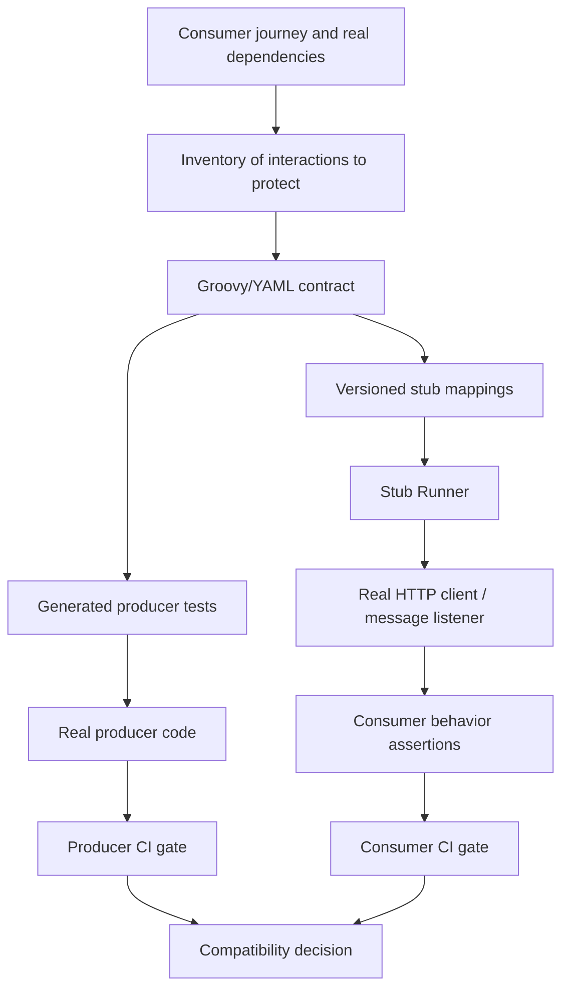
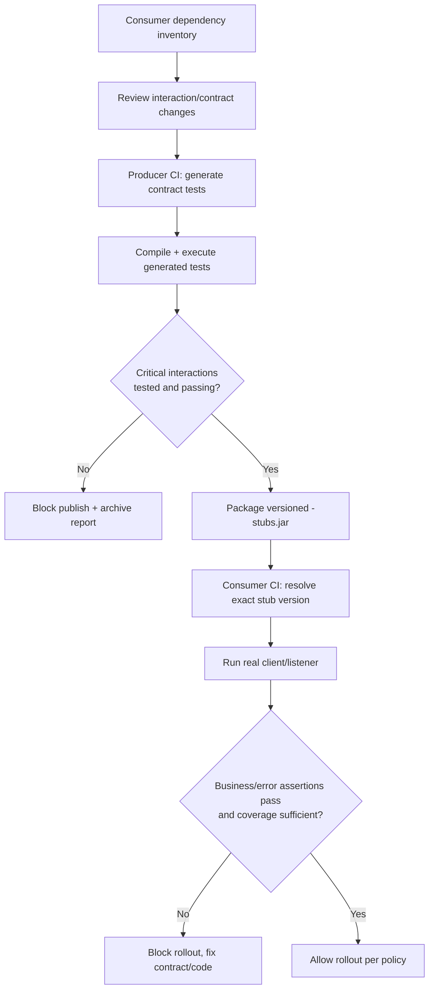

# Covering Interactions That Consumers Truly Depend On

## 1. Contract quality is not measured by the number of DSL files

In **Spring Cloud Contract**, producers and consumers agree on HTTP or messaging behavior using **Groovy/YAML DSL**. Spring Cloud Contract Verifier can generate tests that run against the real producer, package stubs so **Stub Runner** can serve consumer tests, and integrate with CI to detect incompatible API changes.

However, a contract suite with many files does not necessarily protect consumers well. For example, a team has ten contracts for `GET /api/orders/42` returning `200` with different values, yet the consumer strongly depends on `404 ORDER_NOT_FOUND` and `409 ORDER_ALREADY_PAID` that no contract describes. **High quantity does not compensate for a critical missed interaction.**

Conversely, an overly detailed contract that locks every response field and whitespace even though the consumer only uses `id`, `state`, and `currency` can cause producer tests to fail over harmless changes. Quality therefore has **two sides**:

1. **Do not miss** the behaviors that the consumer actually depends on to function correctly.
2. **Do not over-constrain** details that the consumer does not need and the API does not promise to keep stable.

**Central question of this lesson:** *If the producer changes something that breaks the consumer, will the current contract suite and tests detect it before deployment?*

After this lesson, you will be able to build an interaction inventory from consumer code/business flows, select scenarios worth protecting, write Groovy/YAML contracts with focused assertions, connect producer verification to consumer tests with Stub Runner, and build a quality gate based on **behavioral coverage**, rather than file or line counts.

## 2. An interaction is a contract with conditions and outcomes

An **interaction** is not just an endpoint name. It consists of:

```text
Consumer sends a request/message with defined conditions
    + required producer state
    → Producer returns the promised response/message/side effect
    → Consumer makes a decision based on that outcome
```

Example of two interactions on the same `GET /api/orders/{id}`:

| Context | Request | Producer response | Consumer dependency |
|---|---|---|---|
| Order exists, paid | `GET /api/orders/42` | `200`, `state=PAID`, `currency=VND` | Checkout allows issuing a receipt |
| Order does not exist | `GET /api/orders/9999` | `404`, `code=ORDER_NOT_FOUND` | Checkout displays an appropriate error and does not attempt to issue a receipt |

Both rows belong to the **same endpoint**, yet they are **two different behavioral commitments**. Coverage that merely records “GET orders was tested” does not clarify whether the second branch is protected.

### 2.1. Components to identify

| Component | Example | Consumer question |
|---|---|---|
| Request method/path | `GET /api/orders/42` | Does the client call the right route? |
| Required query/header | `Accept: application/json` | Does the consumer send conditions that alter the response? |
| Request body/data types | `quantity: 2` | What data does the producer require? |
| Producer state | Order 42 in `PAID` | Does the test have a reproducible state? |
| HTTP status | `200`/`404`/`409` | Which status codes does the consumer branch on? |
| Response body/header | `state`/`code`/`Content-Type` | What does the client parse and decide on? |
| Message destination/key | `orders.paid`/`eventId` | Does the listener receive the right event? |
| Business semantics | `PAID` means payment is complete | Can the consumer act safely? |

Not every interaction needs to assert every component in the table. You must identify **which parts are commitments the consumer depends on** and treat the remaining parts as incidental data/implementation details.

### 2.2. Two layers of evidence that must not be conflated

- **Generated producer contract tests** answer: *does the producer code implement the described behavior?*
- **Consumer tests with stubs** answer: *do the consumer client and logic use that behavior correctly?*

If producer tests do not run, a stub may reflect an idealized JSON that does not match the real producer. If consumer tests only verify that WireMock returns `200` without running the real client, they can miss deserialization errors and broken business behavior.



## 3. Derive coverage requirements from consumer flows, not by guessing from API docs

Suppose `checkout-service` calls `order-service` to decide whether to display the issue-receipt button; `notification-service` consumes `OrderPaid` to send notifications.

A consumer journey:

```text
User opens the checkout page
  └─ checkout-service GET /api/orders/{id}
       ├─ 200, state=PAID
       │    └─ Enable "Issue Receipt" button
       ├─ 200, state=PENDING
       │    └─ Show "Awaiting Payment"
       ├─ 404, code=ORDER_NOT_FOUND
       │    └─ Show "Order not found"
       └─ 503 or network error
            └─ Show temporary notice / retry per policy

Producer publishes OrderPaid event
  └─ notification-service receives message
       ├─ new eventId, state=PAID → send notification
       └─ duplicate eventId → avoid duplicate processing
```

For this flow, **a single contract for HTTP 200 PAID is not enough**. Even the HTTP `200` branch has two `state` values that cause the consumer to choose different behaviors.

### 3.1. Interaction inventory

| ID | Consumer | Action | Key input/state | Producer outcome | Consumer decision |
|---|---|---|---|---|---|
| ORD-01 | Checkout | View PAID order | `GET /42`, order PAID | `200` + `state=PAID` | Allow issuing receipt |
| ORD-02 | Checkout | View PENDING order | `GET /43`, order PENDING | `200` + `state=PENDING` | Do not issue receipt |
| ORD-03 | Checkout | Order does not exist | `GET /9999` | `404` + `ORDER_NOT_FOUND` | Show business error |
| ORD-04 | Checkout | Temporary producer error | `GET /42` in error state | `503` | Do not treat as missing order; retry/fallback |
| ORD-05 | Checkout | Create order | `POST /api/orders` with valid body | `201` + ID/location | Navigate to order page |
| ORD-06 | Checkout | Invalid order creation data | `POST` with `quantity=0` | `400` + error code | Show form validation error |
| ORD-07 | Checkout | Duplicate payment | `POST /42/pay` when already PAID | `409` + error code | Do not retry indefinitely |
| EVT-01 | Notification | Receive `OrderPaid` | Message to `orders.paid` | `eventId/orderId/state` | Send notification once |

**This table is an illustrative inventory**, not a claim that every API must have `503` or `409`. If no consumer actually calls `POST /42/pay`, there is no need to create that contract just because the endpoint exists. Conversely, if another consumer depends on `409`, that requirement must go into the inventory.

### 3.2. Evidence for identifying dependencies

Prefer combining the following sources rather than relying on a single one:

1. **Actual client code:** routes/methods, headers, DTOs, parsers, error mapping, retries, and business branches.
2. **Running consumer tests:** assertions expressing decisions based on status/body/message.
3. **API documentation and agreements:** public commitments, error schemas, event schemas, and deprecation policies.
4. **Discussions with consumer teams:** which behavioral changes would cause data loss, duplicate payments, or broken user experiences?
5. **Controlled telemetry:** status/path frequencies, non-sensitive headers, client versions, signs that real users still depend on an endpoint.
6. **Historical incidents:** deserialization errors, breaking changes, retry storms, missing events, and their root causes.

Telemetry only shows that an interaction **occurred** during the observation window; it does not prove that a rare but critical scenario will not occur. Never log tokens, PII, or raw payment bodies just to measure coverage.

## 4. Coverage must be measured by decisions, not just endpoints

A metric like “7/8 endpoints have contracts” can mask missing critical error branches. A more meaningful model is:

```text
Business decision
    ↔ Consumer request/message
    ↔ Producer outcome / state
    ↔ Contract scenario
    ↔ Generated producer test
    ↔ Consumer stub test
```

For the ORD-01 example:

```text
Decision: Allow issuing receipt when order is PAID
  Request: GET /api/orders/42 + Accept application/json
  Producer outcome: 200 JSON id=42, state=PAID, currency=VND
  Contract: http/orders/get-paid-order.groovy
  Producer verification: generated contract test executed + passed
  Stub artifact: com.example:order-service:1.4.0:stubs
  Consumer test: checkout client -> receiptEnabled = true
```

When a link in this chain is missing, it may represent a **coverage gap**:

- Contract exists, but no producer test executes: does not prove producer code complies.
- Stub and consumer test exist, but only assert HTTP status: does not protect the business decision.
- Consumer test exists, but uses an old stub version: does not check recent changes.
- Producer `200` test exists, but consumer relies on `404` branch: error handling is unprotected.

### 4.1. Coverage matrix per consumer

| Interaction | Checkout | Notification | Producer test | Consumer test | Notes |
|---|---|---|---|---|---|
| ORD-01 `200 PAID` | Depends | No | Yes | Yes | Protected |
| ORD-02 `200 PENDING` | Depends | No | Yes | **Missing** | Missing pending branch assertion |
| ORD-03 `404` | Depends | No | **Missing** | Yes | Hand-written stub risks drifting from producer |
| ORD-06 `400` | Depends | No | Yes | Yes | Protected |
| EVT-01 `OrderPaid` | No | Depends | Yes | **Missing** | Real listener not verified |

**“No” in a consumer column is not a coverage gap** if that consumer does not use the interaction. However, **“Missing”** in a test column for an interaction that a consumer depends on is a gap that needs to be addressed.

### 4.2. Risk-weighted coverage

A team can categorize scenarios instead of enforcing a rigid percentage:

| Level | Characteristics | Examples | Suggested CI policy |
|---|---|---|---|
| **Critical** | Could cause incorrect payment, data loss, or authorization bypass | ORD-01 state PAID, duplicate payment, consumer event idempotency | Must have producer + consumer evidence before release |
| **High** | Breaks user flow or misinterprets business errors | ORD-03 404 error code, validation 400 | Must have tests following the real path |
| **Medium** | Affects display formatting or optional fields | Adding delivery notes | Test if consumer uses it or uses a strict parser |
| **Low** | Details that are not part of the promised interface | JSON object key order | Avoid unnecessary locking |

This is an **illustrative decision framework**, not a mandatory scoring standard. A rare interaction such as a refund can still be critical; prioritizing by frequency alone will miss rare scenarios with severe consequences.

## 5. How do “sufficient coverage” and “over-coverage” differ?

### 5.1. Under-constrained test: checking only `200`

```java
// This assertion is too weak if checkout depends on state and currency.
assertThat(response.getStatusCode().value()).isEqualTo(200);
```

If the producer returns:

```json
{
  "id": 42,
  "state": "CANCELLED",
  "currency": "VND"
}
```

the test above still passes even though checkout might wrongly allow issuing a receipt.

### 5.2. Test constrained precisely to what the consumer uses

```java
OrderDto order = orderClient.findById(42L);

assertThat(order.id()).isEqualTo(42L);
assertThat(order.state()).isEqualTo("PAID");
assertThat(order.currency()).isEqualTo("VND");
assertThat(receiptPolicy.canIssueReceipt(order)).isTrue();
```

This is an illustrative snippet assuming the consumer's `OrderClient` and `ReceiptPolicy` already exist. It protects both the **DTO contract** and the **business decision**.

### 5.3. Over-constrained test on unused details

For example, a consumer does not read `internalTraceId` yet compares the entire JSON string:

```java
assertThat(rawJson).isEqualTo(
    "{\"id\":42,\"state\":\"PAID\",\"currency\":\"VND\"}");
```

As soon as the producer adds an optional field or changes JSON object key order, string comparison can fail even though the consumer still works in practice. If the schema is agreed to be **extensible**, assert the meaningful subset and real client behavior; do not equate byte-level equality with compatibility.

Conversely, if the response must be signed using a canonical representation or the consumer intentionally has a closed schema, strict comparison may be necessary. Document clearly **why strictness is a real dependency**, rather than accidentally turning implementation details into long-term commitments.

### 5.4. Constraint checklist

| Element | Assert strictly when... | Can be flexible when... |
|---|---|---|
| HTTP status | Consumer branches on `200`, `404`, `409` | No semantic difference per contract |
| Content-Type | Client chooses decoder based on media type | API allows multiple media types and client handles them |
| `state` field | Used to make a business decision | Not applicable if consumer does not use it |
| Optional field | Consumer must parse its format or depends on it when present | Consumer is allowed to ignore it |
| JSON key order | Signing/byte-exact protocol requires it | Standard JSON object semantics |
| Array element order | API guarantees sorting and consumer relies on order | List has no guaranteed ordering |
| Error `code` | Consumer maps business errors by code | Not used in logic/documentation |
| Correlation header | Consumer relies on it for tracing/idempotency | Debug-only, not an API guarantee |

## 6. Selecting contracts by tracing application branches

Suppose checkout has this method:

```java
public ReceiptDecision evaluateOrder(long orderId) {
    try {
        OrderDto order = orderClient.findById(orderId);
        if ("PAID".equals(order.state())) {
            return ReceiptDecision.ENABLED;
        }
        return ReceiptDecision.WAITING_FOR_PAYMENT;
    } catch (OrderNotFoundException exception) {
        return ReceiptDecision.NOT_FOUND;
    } catch (TemporaryOrderServiceException exception) {
        return ReceiptDecision.TEMPORARILY_UNAVAILABLE;
    }
}
```

The code above has **four branches** that producer responses/errors can trigger. If they matter to users, you should have:

1. `200 + PAID` → `ENABLED`.
2. `200 + PENDING` (or a valid unpaid state) → `WAITING_FOR_PAYMENT`.
3. `404 + ORDER_NOT_FOUND` → `NOT_FOUND`.
4. `503` or a temporary error per API policy → `TEMPORARILY_UNAVAILABLE`.

It is not necessary to test every `state` value if several values lead to the **same decision and same handling**; choose representative cases and boundary cases as required. However, if `REFUNDED` requires different handling from `PENDING`, do not lump both into “not PAID” in contract coverage.

### 6.1. A good unit of coverage

```text
interaction_id: ORD-03
consumer_decision: NOT_FOUND
producer_request:
  GET /api/orders/9999
producer_response:
  status: 404
  body.code: ORDER_NOT_FOUND
consumer_assertion:
  evaluateOrder(9999) == NOT_FOUND
```

This is a **design template**, not a standard Spring Cloud Contract schema. What matters is that you can trace from business decision to request/response, contract file, and test report.

## 7. Groovy DSL: `200 PAID` and `404` scenarios

The following two contracts are **two distinct interactions**, using different request conditions to avoid overlapping stub mappings.

### 7.1. HTTP `200` when the order exists

```groovy
import org.springframework.cloud.contract.spec.Contract

Contract.make {
    description 'Checkout reads a paid order'

    request {
        method GET()
        url '/api/orders/42'
        headers {
            header 'Accept', 'application/json'
        }
    }

    response {
        status OK()
        headers {
            contentType(applicationJson())
        }
        body(
            id: 42,
            state: 'PAID',
            currency: 'VND'
        )
    }
}
```

The example uses a fixed ID so both producer fixtures and consumer stub tests are reproducible. In real systems, matchers can be used if IDs are dynamic, while still keeping assertions that verify the **types and semantics** the consumer depends on.

### 7.2. HTTP `404` with a business error code

```groovy
import org.springframework.cloud.contract.spec.Contract

Contract.make {
    description 'Checkout receives ORDER_NOT_FOUND when order is absent'

    request {
        method GET()
        url '/api/orders/9999'
        headers {
            header 'Accept', 'application/json'
        }
    }

    response {
        status NOT_FOUND()
        headers {
            contentType(applicationJson())
        }
        body(
            code: 'ORDER_NOT_FOUND',
            message: 'Order does not exist'
        )
    }
}
```

**Do not** replace this with a mapping that “returns `404` for every request” just to make the consumer test pass. If the client mistakenly calls `/api/order/42` (missing the `s`) and WireMock returns an unmatched `404`, a consumer test that only asserts status can **pass falsely**. Verify `code=ORDER_NOT_FOUND` in the body and, when appropriate, check the request journal to confirm the **exact method/path**.

### 7.3. YAML DSL for `404`

If a team uses YAML DSL, the interaction above can be expressed as:

```yaml
description: Checkout receives ORDER_NOT_FOUND when order is absent
request:
  method: GET
  url: /api/orders/9999
  headers:
    Accept: application/json
response:
  status: 404
  headers:
    Content-Type: application/json
  body:
    code: ORDER_NOT_FOUND
    message: Order does not exist
```

The YAML snippet is an **alternative** to the Groovy `404` contract; do not keep both as competing mappings with the same conditions in one contract suite. Pick a single source of truth per interaction/version and inspect the generated test and actual stub.

## 8. Sufficient request coverage: query, headers, and body that drive behavior

An endpoint may vary its outcome based on **query parameters**, **request headers**, or **request body**. If the consumer depends on that difference, the contract must express the corresponding request.

For example, `GET /api/orders` supports:

```text
GET /api/orders?state=PAID&limit=20
GET /api/orders?state=PENDING&limit=20
GET /api/orders?state=PAID&limit=0
```

These cases may return: a list of PAID orders, a list of PENDING orders, or `400 INVALID_LIMIT`. Having only one contract for `GET /api/orders` without query params does not protect how checkout paginates or filters data.

### 8.1. Selecting variations the consumer actually uses

| Request variation | Consumer dependency | Should have a contract? |
|---|---|---|
| `state=PAID` | Checkout displays paid orders only | **Yes** |
| `limit=20` | Real consumer always passes a valid limit | Can be combined with the success scenario |
| `limit=0` | UI may send 0, consumer shows validation error | **Yes if this error is a branch handled by the consumer** |
| `sort=createdAt,desc` | Consumer relies on result ordering | **Yes** when sorting is a commitment |
| `debug=true` | Consumer never sends this | Do not prioritize just because the API supports it |
| `X-Tenant-Id` header | Routing/authorization depends on tenant | **Yes** if it is a required interface element |
| Random trace header | Observability only, does not change semantics | Avoid locking to a single value |

Do not write a contract for **every Cartesian combination** of query parameters if most carry no distinct behavioral meaning. Group by **equivalence classes**, boundary values, and interactions driven by real consumer branches.

### 8.2. Request/response contract with filters

YAML example for an interaction actually used by the consumer:

```yaml
description: Checkout filters paid orders
request:
  method: GET
  urlPath: /api/orders
  queryParameters:
    state: PAID
    limit: "20"
  headers:
    Accept: application/json
response:
  status: 200
  headers:
    Content-Type: application/json
  body:
    - id: 42
      state: PAID
      currency: VND
```

Note that plugin/DSL versions can affect query parameter syntax and values. When parameter count, order, or type matters, **inspect the generated test and WireMock mapping** to confirm the request condition actually matches as intended. Query parameters over HTTP are inherently strings; do not infer the client's Java `int` type from YAML formatting.

If the consumer requires multiple values for the same query parameter name, write a dedicated contract reflecting how the real client encodes lists, rather than assuming `state=PAID,PENDING` and `state=PAID&state=PENDING` are equivalent.

### 8.3. A contract should set clear boundaries

An overly broad mapping:

```text
GET /api/orders*  → always 200 with state PAID
```

can allow a client to call the wrong path, omit filters, or pass invalid params while the test still passes. An overly narrow mapping:

```text
GET /api/orders?state=PAID&limit=20&traceId=abc-123
```

can break tests simply because a non-business trace ID changed. **Match strictly what the consumer must send, and stay flexible on parts outside the agreement.**

## 9. Error branches: validation, business conflict, and temporary failures

Consumers typically handle different errors differently:

- `400`: invalid request, display input error; **do not** retry the same request indefinitely.
- `404`: entity not found; handle as a business state, distinct from connection errors.
- `409`: state conflict, may prompt reload, do not create duplicate transactions.
- `503`: service temporarily unavailable; may retry/backoff per policy.
- Network error without HTTP response: differs from `503` because the request may or may not have reached the server.

Do not add every error code to contracts as a formality. Choose the branches that the **consumer actually distinguishes or must protect against severe consequences**. A contractually stable error code can be more important than human-readable message text.

### 9.1. YAML contract for input validation

Example of checkout creating an order with quantity 0:

```yaml
description: Reject invalid order quantity
request:
  method: POST
  url: /api/orders
  headers:
    Content-Type: application/json
    Accept: application/json
  body:
    sku: BOOK-1
    quantity: 0
response:
  status: 400
  headers:
    Content-Type: application/json
  body:
    code: INVALID_QUANTITY
    field: quantity
```

If the UI branches on `code=INVALID_QUANTITY` or `field=quantity`, those values are **real constraints**. If the UI only displays a generic message, do not lock stack traces, timestamps, validation error ordering, or internal message text unless they are promised.

### 9.2. Why an unmatched `404` is not a business error

WireMock can return `404` when a request matches no mapping. When a consumer test only asserts status, it risks passing falsely if the client calls the wrong path or omits a header.

Therefore, error-branch tests should:

1. Assert **status** and **business error code** in the response body when specified by the API.
2. Verify the **request method/path/query/header** sent by the real client when needed.
3. Use stubs generated from **producer-verified contracts**, instead of hand-crafted error mappings that easily drift.
4. Run generated producer tests for error scenarios, including real validation and exception handlers.

### 9.3. Coverage for authentication and authorization

If a consumer depends on `401` or `403`, the contract must make the **security boundary** explicit, and the test harness must actually execute the appropriate security filters/adapters. With Spring MVC `MOCKMVC`, a test configuration that mocks or bypasses Spring Security can prevent generated tests from exercising production auth branches.

Never embed real tokens or credentials in Groovy/YAML contracts. Use dummy tokens or appropriate test authentication; verify that request headers, status/error schemas, and security filter boundaries are executed during producer verification. A contract expecting `401` backed by a mock controller hardcoded to return `401` does not prove the security policy works.

## 10. Messaging: covering events needed by real listeners and workflows

Message consumers may depend on:

- **Destination/topic/queue** and routing key.
- Headers such as `eventType`, `contentType`, correlation ID.
- Body fields such as `orderId`, `state`, `eventId`.
- Event ordering, duplicate delivery, idempotency, retry/dead-letter handling.
- Schema evolution of the fields in use.

Testing merely that “a message was emitted” is insufficient if the consumer needs `eventId` to prevent sending duplicate notifications.

### 10.1. Groovy message contract

Example where the producer emits an event after an order is paid:

```groovy
import org.springframework.cloud.contract.spec.Contract

Contract.make {
    description 'Notification receives OrderPaid event'
    label 'order_paid'

    input {
        triggeredBy('publishPaidOrderForContract()')
    }

    outputMessage {
        sentTo('orders.paid')
        headers {
            header('eventType', 'OrderPaid')
        }
        body(
            eventId: 'EVT-42',
            orderId: 42,
            state: 'PAID'
        )
    }
}
```

The producer base test must provide `publishPaidOrderForContract()` to trigger the business flow that **actually publishes the message**, along with a suitable message verifier/test binder or broker adapter to observe the output. Simply calling a method in the base test that manually emits a fake message bypassing producer logic creates **false producer verification**.

### 10.2. Does a message contract protect against duplicate delivery?

**Not by default.** The contract above proves that an event has the promised shape and routing. It does not by itself prove that the listener handles duplicates properly or that the message broker guarantees exactly-once delivery. If the Notification Team truly depends on idempotency, add a consumer behavior test:

```text
Given listener receives EVT-42 for the first time
  → send one notification

When listener receives the same eventId EVT-42 again
  → do not send a duplicate notification
```

The test can use a messaging stub adapter, test binder, or an appropriate test broker environment. **Stub Runner for HTTP does not automatically act as a Kafka/RabbitMQ broker**; choose the adapter for your stack. Do not reduce consumer retry/idempotency requirements to a single assertion that “body contains eventId” and treat it as sufficient.

### 10.3. Separating producer output from consumer behavior

| What must be proved | Appropriate place to verify |
|---|---|
| Producer emits `OrderPaid` with promised destination/schema | Generated producer contract test + message verifier |
| Notification listener parses the sample event | Consumer test with contract-aligned message stub/fixture |
| Duplicate `eventId` does not send two notifications | Consumer workflow/integration test |
| Real broker transport/ACLs work | Integration environment with real adapter/broker when needed |
| Schema change does not break older listeners | Compatibility test with events from the new producer version |

## 11. Choosing contract data: stable yet sensitive enough to catch discrepancies

A quality contract needs samples that are **easy to understand, reproducible, and able to distinguish valid from invalid behavior**. Common mistakes:

1. Using `"test"` for every field without distinguishing semantics.
2. Using only one valid value and never testing boundaries the consumer relies on.
3. Generating a random UUID in an expected body while locking an unrelated fixed value.
4. Using `.*` regex for business fields, allowing every change to pass.
5. Using fixtures without resetting state, making tests order-dependent.
6. Running consumer tests against a stub version different from the proposed producer version.

### 11.1. Guide for choosing meaningful data

| Field/situation | Recommended data | Why |
|---|---|---|
| `state` | `PAID`, `PENDING`, `CANCELLED` if separate branches exist | Distinguish business decisions |
| `quantity` | `1`, `0`, or policy boundary values | Verify validation |
| `currency` | `VND` and another code if consumer formats differently | Detect unit-handling bugs |
| `orderId` | `42` for existing, `9999` for non-existent | Reproducible fixtures |
| `eventId` | `EVT-42` in idempotency tests | Verify duplicate handling |
| Timestamp | Valid ISO-8601 format; matcher if runtime-generated | Avoid coupling to test clock |
| Correlation header | Type/format matcher when needed | Avoid locking meaningless trace values |

### 11.2. Matchers must catch bugs the consumer cares about

For instance, `state` should not be validated with regex `.*` if the consumer specifically depends on `PAID`. For a dynamic `orderId`, a matcher can verify it is a positive number or conforms to a promised format, while consumer tests still need concrete sample data to verify behavior.

Spring Cloud Contract provides Groovy/YAML matchers for both requests and responses depending on the version. When using matchers, **inspect the generated producer assertions and generated WireMock mappings**, because constraint strictness can differ between the producer side and the stub side. Do not infer from a helper name that the consumer automatically accepts every change.

### 11.3. Empty, missing, null, and empty array

If the consumer distinguishes:

```json
{"items":[]}
```

from:

```json
{"items":null}
```

or:

```json
{}
```

then these are **different response semantics** and require corresponding contracts or tests. If the consumer calls `items.size()` without handling `null`, changing from an empty list to `null` can cause a runtime error. Do not ignore it just because “there are still no items.”

## 12. Producer contract tests: covering the behavior of real code

Even a well-written contract provides no protection if the generated producer tests do not run, fail to load the right state, or mock away the routes, serialization, or handlers under test.

### 12.1. Example HTTP `MOCKMVC` base test

```java
package com.example.orders.contract;

import io.restassured.module.mockmvc.RestAssuredMockMvc;
import org.junit.jupiter.api.BeforeEach;
import org.junit.jupiter.api.AfterEach;
import org.springframework.beans.factory.annotation.Autowired;
import org.springframework.boot.test.autoconfigure.web.servlet.AutoConfigureMockMvc;
import org.springframework.boot.test.context.SpringBootTest;
import org.springframework.web.context.WebApplicationContext;

@SpringBootTest(webEnvironment = SpringBootTest.WebEnvironment.MOCK)
@AutoConfigureMockMvc
public abstract class OrderContractBase {

    @Autowired
    WebApplicationContext context;

    @BeforeEach
    protected void setUp() {
        RestAssuredMockMvc.webAppContextSetup(context);
        // Seed order 42=PAID and order 43=PENDING.
        // Ensure order 9999 does not exist in test fixtures.
    }

    @AfterEach
    protected void tearDown() {
        RestAssuredMockMvc.reset();
        // Clean up modified records, caches, or mock state.
    }
}
```

This is a **base test sketch**; real fixtures and compatible Spring Boot Test / Rest Assured MockMvc dependencies must be added. If generated JUnit tests live in a subclass in a different package, lifecycle methods can be inherited according to JUnit Jupiter rules; verify this in your actual project.

Do not mock the controller itself to return canned responses from test code if your goal is to test the **producer's HTTP boundary**. Mocking external dependencies can be appropriate, but the route, controller, JSON converter, validation, and exception advice protected by the contract must genuinely participate.

### 12.2. Producer state is part of coverage

If you use the same route `GET /api/orders/{id}` for PAID/PENDING/NOT_FOUND, the base test must establish **all three states**. This is especially important when tests run in parallel or share a DB:

```text
BeforeEach:
  order 42   -> PAID, currency VND
  order 43   -> PENDING, currency VND
  order 9999 -> absent

Generated tests:
  GET /42   -> 200 PAID
  GET /43   -> 200 PENDING
  GET /9999 -> 404 ORDER_NOT_FOUND
```

State can be created via mock services, in-memory repositories, database fixtures, or testcontainers depending on the boundary being verified. Choose a **reproducible** state setup that does not depend on leftover data from previous runs.

### 12.3. Generated tests *existing* differs from *having run*

| Situation | Can `BUILD SUCCESS` appear? | Is the producer verified? |
|---|---|---|
| Sources generated, tests skipped | Yes | **No** |
| Tests compile, Surefire does not match class | Yes | **No** |
| 100 unit tests pass, 0 generated contract tests | Yes | **No** |
| Generated tests run, but 5 tests skipped | Possible depending on policy | **Insufficient** |
| Generated tests run for contracts and assertions pass | Yes | **Evidence exists that producer matches that contract suite** |

CI should reconcile the **set of generated test classes/methods** against the critical scenario inventory, not just total test executions. When compiler or Surefire filters change, contract file counts can stay the same while all generated tests vanish from the report.

## 13. Consumer contract tests: running the real client with the right stub version

On the consumer side, verify **what the consumer does after receiving the response**, not merely whether WireMock returns the expected sample.

### 13.1. Illustrative HTTP client

Example using Spring `RestClient` (Spring Framework 6.1+):

```java
package com.example.checkout.client;

import org.springframework.http.MediaType;
import org.springframework.web.client.RestClient;

public final class OrderClient {
    private final RestClient http;

    public OrderClient(RestClient.Builder builder, String baseUrl) {
        this.http = builder.baseUrl(baseUrl).build();
    }

    public OrderDto findById(long id) {
        return http.get()
            .uri("/api/orders/{id}", id)
            .accept(MediaType.APPLICATION_JSON)
            .retrieve()
            .body(OrderDto.class);
    }
}
```

```java
package com.example.checkout.client;

public record OrderDto(long id, String state, String currency) {}
```

On `404`, `retrieve()` normally throws an HTTP exception unless `onStatus(...)` is configured. A consumer may have an adapter layer mapping HTTP `404` + JSON `code=ORDER_NOT_FOUND` to `OrderNotFoundException` and `503` to `TemporaryOrderServiceException`. **These exception classes belong to the consumer project**, not Spring Cloud Contract's default API.

### 13.2. Using Stub Runner to load a verified contract artifact

```java
package com.example.checkout.contract;

import com.example.checkout.client.OrderClient;
import com.example.checkout.client.OrderDto;
import org.junit.jupiter.api.Test;
import org.springframework.beans.factory.annotation.Autowired;
import org.springframework.boot.test.context.SpringBootTest;
import org.springframework.cloud.contract.stubrunner.StubRunnerProperties;
import org.springframework.cloud.contract.stubrunner.spring.AutoConfigureStubRunner;
import org.springframework.cloud.contract.stubrunner.spring.StubRunnerPort;
import org.springframework.web.client.RestClient;

import static org.assertj.core.api.Assertions.assertThat;

@SpringBootTest
@AutoConfigureStubRunner(
    ids = "com.example:order-service:1.4.0:stubs",
    stubsMode = StubRunnerProperties.StubsMode.LOCAL
)
class CheckoutContractTest {

    @Autowired
    RestClient.Builder restClientBuilder;

    @StubRunnerPort("com.example:order-service")
    int orderStubPort;

    @Test
    void paidOrderEnablesReceipt() {
        OrderClient client = new OrderClient(
            restClientBuilder,
            "http://localhost:" + orderStubPort
        );
        OrderDto order = client.findById(42L);

        assertThat(order.id()).isEqualTo(42L);
        assertThat(order.state()).isEqualTo("PAID");
        assertThat(order.currency()).isEqualTo("VND");

        // In a real project, invoke ReceiptPolicy/workflow
        // and assert the receipt-issuing decision.
    }
}
```

**Limitations of this sample:**

- The stub artifact `com.example:order-service:1.4.0:stubs` must exist in the **Maven local repository** for `LOCAL`; `REMOTE` requires the corresponding repository URL and credentials.
- `OrderClient` in the test must match the HTTP client code/config checkout uses in production; do not substitute a simplified test client that skips error mapping.
- `@StubRunnerPort` is resolved **after the stub starts**, instead of hardcoding port `8080`.
- The snippet above only verifies the DTO; to protect the **business decision**, wire up `ReceiptPolicy` or the real checkout service per your application design.
- This consumer test **does not replace generated producer tests**. Both reports are required to trust compatibility.

### 13.3. When the consumer is reactive

If `WebClient` returns `Mono<OrderDto>`, merely constructing the publisher is not enough to trigger an HTTP call. You must subscribe and await the proper signals:

```java
StepVerifier.create(orderReactiveClient.findById(42L))
    .assertNext(order ->
        assertThat(order.state()).isEqualTo("PAID"))
    .expectComplete()
    .verify(Duration.ofSeconds(5));
```

`StepVerifier` belongs to `reactor-test`; the snippet assumes a reactive client and appropriate imports. For streams that do not auto-complete such as SSE, use cancellation or expected-event-count conditions instead of waiting forever for completion. Without waiting for the HTTP call or message to complete, a test can pass while **covering no interaction at all**.

## 14. Quality cannot be judged by coverage percentages alone

Figures like “80% endpoint coverage”, “95% contract file coverage”, or “100% line coverage” are only useful when **the denominator and assertion quality are well-defined**.

For example:

```text
Endpoints with contracts:       8/8   = 100%
Critical business decisions:    6/10  = 60%
Producer tests executed:        5/10  = 50%
Consumer tests using stubs:     4/10  = 40%
```

If a dashboard only displays **100% endpoint coverage**, the team may overlook missing-order, duplicate-payment, or duplicate-message branches.

### 14.1. Proposed auditable coverage definitions

Let:

- **I**: the set of interaction scenarios agreed upon by producer and consumer teams as needing protection.
- **P**: the set of scenarios in I whose generated producer tests **actually ran and passed**.
- **C**: the set of scenarios in I that have a consumer test using the **real client/listener** running and passing against the stub version under test.

Then we can express:

\[
\text{Producer coverage} = \frac{|P|}{|I|}
\]

\[
\text{End-to-end contract confidence} = \frac{|P \cap C|}{|I|}
\]

**Limitations of interpretation:**

1. These formulas are meaningful only when I is built from **real dependencies**, not an easy checklist padded to hit targets.
2. One unprotected critical interaction cannot be “compensated” by many trivial interactions.
3. `P ∩ C` does not guarantee performance, security, networking, or all runtime data; it is evidence only for the described scenarios.
4. Do not force a 1-to-1 mapping between each interaction and a DSL file or generated method; use **scenario IDs** mapped to the appropriate test reports.
5. If a scenario is deprecated and has no remaining consumers, changing the denominator must undergo **ownership review**, never silent deletion to boost percentages.

### 14.2. Risk-based evaluation

A scorecard may include:

| Metric | Question | Example gate condition |
|---|---|---|
| **Critical interaction coverage** | Are any data/money-loss branches missing? | Zero missing agreed critical scenarios |
| **Producer execution** | Do generated tests actually run? | Zero `0-run` or skipped critical contracts |
| **Consumer behavior** | Does the client parse and decide correctly? | Required for critical interactions |
| **Change sensitivity** | Do intentional breaking changes fail tests? | Controlled mutation checks |
| **Stability** | Do tests depend on random state? | No flakiness from ports, fixtures, or shared state |
| **Version traceability** | Is it clear which stub was used? | Pin and record resolved artifact |
| **Review ownership** | Who confirms this is the behavior the consumer needs? | Designated owner and consumer contact |

**Do not enforce a universal default threshold like 90% across every organization.** Choose coverage gates based on risk, published interfaces, and real regression-detection capability.

## 15. Testing sensitivity with an intentional breaking change

A very effective way to evaluate quality is to ask:

> If the producer changes exactly what the consumer depends on, which test must fail?

Perform this experiment **on a test branch or isolated environment**, never deploy faults to production.

| Intentional mutation | Affected consumer | Test that must catch it |
|---|---|---|
| `state=PAID` → `state=PENDING` on order 42 | Checkout receipt decision | Generated producer test and consumer behavior assertion |
| `id` number → string | DTO/numeric validation | Contract type assertion / deserialization test |
| `404 ORDER_NOT_FOUND` → `200 null` | Client error mapping | Negative-path contract and consumer test |
| Remove `currency` | Checkout currency display | Producer body assertion and client DTO/use-case |
| `quantity=0` accepted successfully | Checkout validation | `400 INVALID_QUANTITY` contract |
| Change `orders.paid` → `orders.completed` | Notification listener | Producer message contract and consumer listener test |
| Remove `eventId` | Notification deduplication | Event body contract + consumer idempotency test |
| Add an optional response field | Consumer strict parser | Run old consumer against new stub |

### 15.1. How to read the results

- Mutation immediately fails the **generated producer test**: the producer contract protects the documented commitment.
- Mutation passes the producer test but fails the consumer test: the producer contract **does not fully capture the dependency**, or that aspect is only guarded on the consumer side.
- Both pass while user behavior breaks: **high-priority coverage gap**; add the missing interaction/assertion.
- Tests fail due to unstable fixtures/ports/mappings unrelated to the mutation: test infrastructure is unreliable; contract quality is not yet proven.

Never alter expected contract values to match the mutation just to turn the build green. Fault injection is meant to prove **tests fail for the right reason**, not to accept bugs.

### 15.2. Distinguish producer mutations from consumer mutations

**Producer mutation** (changing HTTP status/field/body/destination) checks whether generated producer tests detect interface deviations.

**Consumer mutation** (changing the `PAID` branch to always return `ENABLED`, removing error mapping) checks whether consumer behavior assertions protect the workflow. One side may pass if the assertion belongs on the other side; understand **each test's objective** before drawing conclusions.

## 16. Avoiding over-specification and duplicate tests

Signs of a hard-to-maintain contract suite include:

- The same request predicate unintentionally has multiple mappings returning different responses.
- Every test locks the entire raw JSON string instead of the fields the consumer needs.
- Multiple success contracts differ only by fixture ID without exercising an additional business branch.
- Overly broad `.*` regex on critical business fields.
- Snapshot tests breaking whenever the producer adds a field that does not affect the consumer.
- Random timestamps in static contracts, making generated tests non-reproducible.
- Only happy-path scenarios written; no error or schema-compatibility tests.

### 16.1. A principled deduplication rule

When considering deleting or merging two contracts, ask:

1. Do they share the **same request/state predicate**?
2. Do they protect the **same business decision** and the same fields/status?
3. Does another consumer rely on a branch the other contract omits?
4. Does either have a distinct boundary or error condition?
5. Would merging weaken generated producer assertions?

If two contracts differ only by IDs `42` and `43`, both are `PAID`, and neither introduces distinct semantics, they can be merged or reduced to a representative case. If one ID is `PAID` and the other is `PENDING`, **do not** merge them if the consumer decides differently.

### 16.2. Watch out for fields a consumer ignores that remain API promises

Not every field unused by **one** consumer can be dropped from contracts:

- Another consumer may use it.
- The public API schema may promise it to uncatalogued consumers.
- The field may relate to compliance, security, or auditing.
- A protocol may require it even if business code does not read it directly.

Therefore, with **consumer-driven contracts**, manage the **union of consumer dependencies** alongside overall API commitments. Do not let Checkout Team's minimal requirements erase commitments needed by Billing Team.

## 17. Versioning: covering interactions between old consumers and new producers

A contract suite for a new producer version does not automatically prove **running consumers** are compatible with it. Suppose the producer adds:

```json
{
  "id": 42,
  "state": "PAID",
  "currency": "VND",
  "estimatedDeliveryDate": "2026-12-01"
}
```

A lenient consumer can usually ignore the new field, whereas a strict parser, exact JSON assertion, or JSON Schema with `additionalProperties: false` can reject that response.

### 17.1. Compatibility matrix

| Consumer version | Stub P1: three fields | Stub P2: added field | What must be protected |
|---|---|---|---|
| C1 lenient | Baseline | Likely compatible | Real client still works and old behavior stays right |
| C1 strict | Baseline | May fail | Detect unknown-field breaking change |
| C2 requiring new field | May fail | Works if field is valid | Rollout ordering / compatibility |
| C2 with optional fallback | May work | May work | Missing/null/format handling and proper fallback |

A **release gate** should pin the stub version, e.g., `com.example:order-service:1.5.0:stubs`. If using `+` or `SNAPSHOT` for canary checks, record the **resolved version and provenance** so you know exactly which payload was tested.

### 17.2. Do not drop old error branches when adding features

When P2 adds `estimatedDeliveryDate`, `404 ORDER_NOT_FOUND` may still be a critical dependency of C1. A small change on the `200` path is no reason to delete published error contracts. When evaluating P2 release coverage, use the **full set of interactions needing protection**, including negative paths and messages, not just recently modified files.

## 18. Organizing ownership and traceability for coverage

An interaction inventory is only useful if someone updates it when producer or consumer changes.

| Artifact | Typical owner | What must be maintained |
|---|---|---|
| API semantics and contract source | Producer API owner, with consumer review | Accurate behavior and compatibility policy |
| Consumer dependencies | Each consumer team | Real fields/statuses/routes/messages and business decisions |
| Producer fixtures/base tests | Producer | Reproducible state, generated tests exercising true boundaries |
| Stub artifacts/versions | Producer/release pipeline | Published after verification, right classifier |
| Consumer stub tests | Consumer | Real client, response/error handling, and business behavior |
| Coverage register/CI gate | Process owner with producer/consumers | No missed critical scenarios, gap reporting |

### 18.1. Traceability entry template

```text
ID: ORD-03
Consumer: checkout-service
Business outcome: NOT_FOUND (do not issue receipt)
Request/state: GET /api/orders/9999, order absent
Expected: HTTP 404 + body.code=ORDER_NOT_FOUND
Contract path: http/orders/get-order-not-found.yml
Producer owner: Order Team
Producer generated test: [actual class/method name from build]
Stub artifact: com.example:order-service:1.4.0:stubs
Consumer test: [checkout test class/method name]
Evidence: [actual CI run link/report]
Criticality: High
```

Bracketed placeholders are **slots for real values**, not Spring Cloud Contract DSL syntax. This register can live in an issue tracker, catalog, or repo documentation depending on the organization. Do not embed credentials or personal data in metadata.

### 18.2. When a consumer stops using an interaction

If Checkout Team removes the distinction between `PENDING` and `CANCELLED`, do not delete the contract immediately. Verify first:

- Does any other consumer use that field or branch?
- Is the contract a public API promise or compliance requirement?
- Is there a deprecation/versioning policy to honor?
- Have tests been replaced by an equivalent scenario?

Inventory changes must be reviewed; never delete hard-to-test cases just to raise coverage metrics.

## 19. CI quality gate across contract → producer → consumer

A pipeline can follow this sequence:



### 19.1. Producer gate

A producer CI gate should:

1. Verify `contractsDirectory` (Maven) or equivalent source location points to the right Groovy/YAML files.
2. Generate producer tests and confirm the scenarios requiring protection were discovered.
3. Compile and execute **generated tests**, without letting Surefire/Failsafe filters or skip flags omit them.
4. Reconcile test reports against critical interactions: executed > 0, none skipped, failures/errors = 0.
5. Attach/publish the stub artifact with the right version/classifier **only after verification passes**.

Do not treat `BUILD SUCCESS` as sufficient when generated test classes do not appear in the report. A build with 100 passing unit tests can still have 0% producer contract coverage.

### 19.2. Consumer gate

A consumer CI gate should:

1. Resolve the exact `group:artifact:version:stubs` and record the actual version used.
2. Start Stub Runner on a dynamic port or isolated network environment, then provide the URL to the client.
3. Run **production client/listener code** with corresponding requests/messages.
4. Verify deserialized data, business branches, error mapping, and retry/idempotency when genuinely depended upon.
5. Disallow a “pass” if the test never sends the request/message or a reactive publisher never subscribes.
6. Retain logs/CI reports and mapping provenance on failure, without exposing secrets.

### 19.3. Avoiding flaky tests that distort coverage results

Coverage is trustworthy only when tests are repeatable. When contract tests run in parallel:

- Use a **random port** for WireMock/Stub Runner, never hardcode `8090` across all jobs.
- Do not let two tests overwrite mappings, request journals, or scenario state on the same server.
- Seed/reset producer state at the right test scope to avoid wiping another test's data.
- For messaging, partition queues/topics/test consumer groups or correlation IDs per job.
- Use readiness checks with timeouts instead of fixed `sleep` calls.
- Do not infinitely retry tests to mask race conditions.

A test failing because the server had not started yet is not evidence of a broken API. A test passing because of an overly broad stub mapping is not evidence of a correct consumer. CI must distinguish **infrastructure failures** from **contract/behavior failures**.

## 20. Hands-on exercise: finding and closing gaps in an existing contract suite

**Context:** `checkout-service` reads orders from `order-service`. Currently the team has three Groovy contracts that all check `GET /api/orders/42` returning `200 PAID`; consumer CI only checks HTTP status 200. Several times when users could not find an order, the UI displayed an unclear generic error. Additionally, Notification Team reported that a change to `orders.paid` once stopped their listener from receiving events while producer CI remained green.

### 20.1. Step 1 — Build an inventory from consumer code

Read checkout's HTTP paths and notification's listener, and record:

```text
ORD-01  GET /42   -> 200 PAID       -> RECEIPT_ENABLED
ORD-02  GET /43   -> 200 PENDING    -> WAITING_PAYMENT
ORD-03  GET /9999 -> 404 NOT_FOUND  -> SHOW_NOT_FOUND
ORD-04  GET /42   -> 503           -> TEMP_UNAVAILABLE
EVT-01  OrderPaid -> orders.paid    -> SEND_NOTIFICATION
```

Compare these interactions against the actual contract sources and generated test reports. Do not mark them “covered” just because three `GET /42` files exist for the same happy path.

### 20.2. Step 2 — Fix contracts purposefully

1. Keep one `200 PAID` success contract with a clear request predicate and assertions on `id/state/currency`.
2. Add a `200 PENDING` contract if the consumer truly has an awaiting-payment branch.
3. Add `404 ORDER_NOT_FOUND` with the error schema the consumer handles.
4. Add `503` if the producer has a temporary-error policy the consumer must distinguish.
5. Add the `OrderPaid` messaging contract with the right destination, headers, and meaningful body.
6. Do not copy exact JSON with timestamps or debug fields just to “increase coverage.”

### 20.3. Step 3 — Verify the producer

- Prepare fixtures `42=PAID`, `43=PENDING`, and `9999` absent.
- Ensure generated tests execute against the real **controller/service/exception handler**.
- For messages, trigger the real business flow and capture output at the right destination.
- Check the report to ensure all generated contract scenarios ran; do not skip any.
- If a `404` contract fails, do not change expected status to `200` just to make the build pass.

### 20.4. Step 4 — Verify the consumer

- Use Stub Runner to load the exact artifact version verified by the producer.
- Run the real HTTP client and assert the `RECEIPT_ENABLED`/`WAITING_PAYMENT`/`SHOW_NOT_FOUND` decisions.
- For `503`, verify the client does not confuse it with `404` and does not retry forever.
- For events, run the listener and verify notification behavior; test duplicate `eventId` if it is a real dependency.
- With WebClient, wait for the publisher to complete before declaring a pass.

### 20.5. Step 5 — Run mutation checks and review the scorecard

Intentionally change the producer from `PAID` to `CANCELLED`, or change event destination `orders.paid` to `orders.other` in a test environment. Verify at least one relevant test **fails for the right reason**, then revert the code.

An expected scorecard:

| ID | Producer test | Consumer test | Observation |
|---|---|---|---|
| ORD-01 | Executed and passed | Executed and passed | State mutation detected |
| ORD-02 | Executed and passed | Executed and passed | Pending branch protected |
| ORD-03 | Executed and passed | Executed and passed | Not confused with unmatched 404 |
| ORD-04 | Executed and passed if part of producer contract | Executed and passed | Error policy accurate |
| EVT-01 | Executed and passed | Listener test passed | Destination change detected |

This is the **target outcome of the exercise**, not results observed on a real codebase.

### 20.6. Self-check questions

| Question | Answer |
|---|---|
| If there are 10 contracts for `GET` success, is `404` definitely covered? | **No** |
| Can one endpoint require multiple contract scenarios? | **Yes**, when consumers depend on different outcomes |
| If a consumer ignores a debug field, must its value be locked? | **Usually no**, unless the API promises otherwise |
| If consumer C1 only asserts status 200, is `state=PAID` protected? | **No** |
| Is adding a response field always non-breaking? | **No**, strict parsers can fail |
| Can an unmatched WireMock `404` produce a false pass? | **Yes**, if only status is asserted |
| Does the existence of generated source prove producer tests ran? | **No** |
| Does a passing Stub Runner test prove the real producer complies? | **No**, producer verification is required |
| Is a message with the right body but wrong destination breaking? | **Yes**, the consumer may never receive it |
| Does 100% endpoint coverage mean sufficient business decision coverage? | **No** |

## 21. Quality review checklist for contract coverage

- [ ] Listed consumers and **business decisions** that truly depend on the producer API/messages.
- [ ] Inventory distinguishes method/path/query/header/body, state, response/status/error, and destination/message semantics.
- [ ] Scenario suite covers critical happy paths, error paths, and boundaries, not just a single endpoint success.
- [ ] Scenario IDs/names exist for interactions needing protection, with clear consumer owners and criticality.
- [ ] Contracts constrain only promised fields/statuses/headers/semantics; unnecessary details are not locked.
- [ ] Overly broad matchers are not used for business fields like `state` or `code` that the consumer relies on.
- [ ] Query/body/header predicates are strict enough that a client sending the wrong request cannot pass falsely.
- [ ] For `404` or `409`, consumer tests assert business error codes/schemas, avoiding confusion with unmatched stub responses.
- [ ] Considered `400` validation, `401/403` auth, and temporary errors if the real consumer branches on them.
- [ ] For collections, defined null/missing/empty/ordering behavior when the consumer depends on it.
- [ ] For messaging, destination, headers, payload, and duplicate/idempotency policies are addressed.
- [ ] Producer state/fixtures are explicit, reproducible, and independent of test execution order.
- [ ] Generated producer tests are generated, compiled, **executed, and passing**—not merely present or showing build success.
- [ ] Stub artifact contains the right mappings/body files, with group/artifact/version/classifier for traceability.
- [ ] Consumer CI runs the real HTTP client/message listener against the right stub version, not just self-created assertions on mappings.
- [ ] Reactive/async consumer tests wait properly for outcomes or events, with appropriate timeouts and cleanup.
- [ ] Tests verify **business decisions** after deserialization, not only HTTP status codes.
- [ ] A compatibility matrix exists when producers/consumers can deploy at different versions.
- [ ] Verified that a breaking mutation to a critical field/status/destination will be detected.
- [ ] Total file, endpoint, or line coverage is not used as the sole proof of contract quality.
- [ ] CI alerts when critical interaction coverage drops or generated tests disappear due to filters/skips.
- [ ] Ownership exists to approve adding/removing scenarios and protect other dependent consumers.
- [ ] Test isolation/readiness is reliable enough that flakiness is not mistaken for compatibility failure.

**Remember:** **Good coverage is not testing every API detail, but purposefully protecting every interaction a consumer needs to act correctly.** Start from the business branches and dependencies of real clients/listeners, express requests/responses/messages using Groovy or YAML DSL, run generated producer tests against real code, and verify consumer behavior with Stub Runner and the right stub version. Only when every critical interaction has two-sided evidence and CI catches breaking changes is a contract suite truly high quality.
