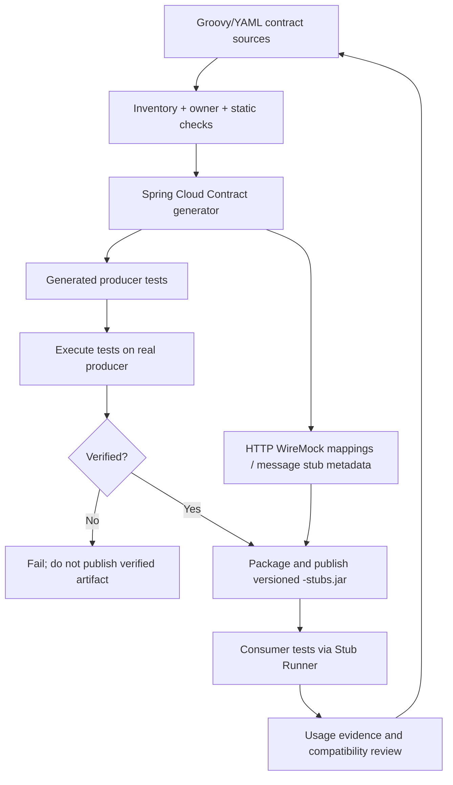
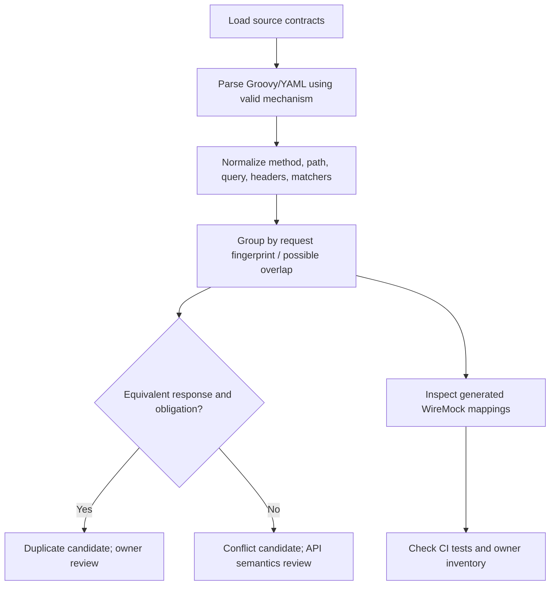
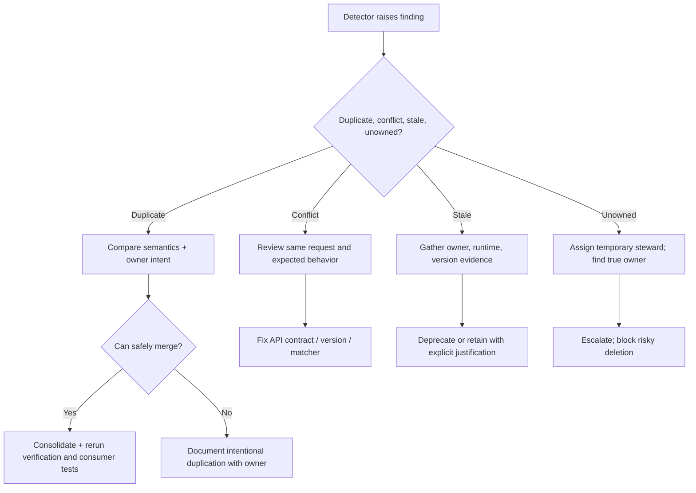
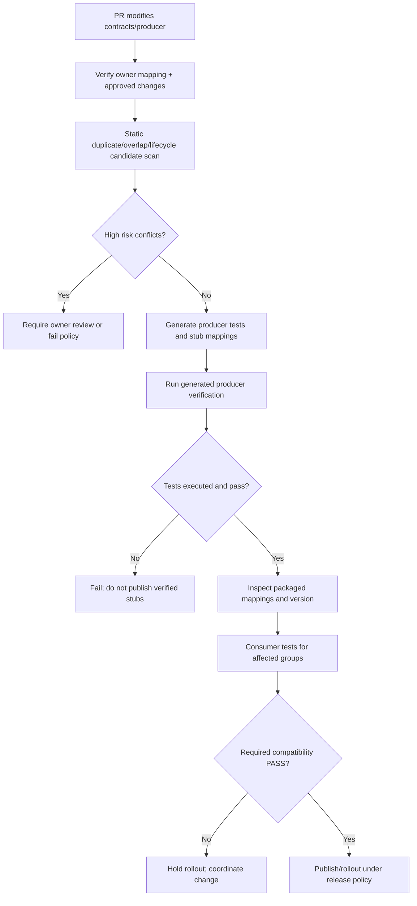

# Detecting Duplicate, Stale, or Unowned Contracts

## 1. As the contract suite grows, “green tests” are not enough

A team starts using **Spring Cloud Contract** with a few Groovy/YAML contracts for `Order Service` (producer). A year later, `Checkout Service`, `Reporting Service`, `Mobile API`, and `Notification Service` have contributed hundreds of contracts. The plugin generates **producer verification tests**, packages the **stub artifact**, and consumers use **Stub Runner** to test HTTP clients or message handlers.

A growing number of contracts can introduce three types of quality debt:

- **Duplicate/overlapping:** two contracts describe the same request yet generate two identical or conflicting stub mappings. WireMock may pick an unintended mapping, while generated producer tests become repetitive or hard to satisfy.
- **Stale/obsolete:** contracts still reference retired URLs, fields, events, consumers, or versions. Pointless tests slow down builds, or worse, old stubs keep consumer tests green against an interface that no longer exists.
- **Unowned:** nobody knows who has authority to accept changes, when a contract can be retired, who needs to update the consumer, or who verifies migration. A PR can delete a vital obligation without proper review.

**Contract quality is not about maximizing file count or test count.** A healthy contract suite must have **accurate obligations, clear ownership, no contradictions, real execution, and a lifecycle plan**.

After this lesson in the **Contract Quality** chapter, you will be able to:

1. Distinguish byte-level duplicates, semantic duplicates, overlapping matchers, and conflicting contracts.
2. Design detection across the DSL, generated tests, WireMock mappings, and consumer tests.
3. Identify contracts showing signs of staleness **without accidentally breaking active consumers**.
4. Establish ownership, review, deprecation, and test-evidence mechanisms.
5. Structure CI to catch new defects without disrupting API/schema transitions.
6. Practice analyzing HTTP and messaging cases using Groovy/YAML DSL.

## 2. Where does a contract sit in the producer–consumer lifecycle?



Each layer detects different failures:

| Layer | Can detect | Does not prove on its own |
| --- | --- | --- |
| Groovy/YAML source | Duplicate files, identical request patterns, missing external owner metadata | How WireMock selects a mapping at runtime |
| Generated producer tests | Producer fails declared assertions | Which contracts still have users, business coverage |
| Generated WireMock mappings | Duplicate/overlapping mappings, paths, and priority | Real producer responds accurately in production |
| Stub Runner consumer tests | Consumer calls and handles sample responses | Consumers without tests are safe |
| Telemetry and owner review | Whether legacy interfaces are still used | Every offline client has upgraded |

Never conclude “contracts are clean” just because `./gradlew test` or `mvn verify` exits with code 0. If an obligation was deleted from the DSL, producer verification can no longer check it.

## 3. Classify duplicates before removing them automatically

“Duplicate contract” has no single definition:

| Type | Symptoms | Severity |
| --- | --- | --- |
| **Exact duplicate** | Two files have identical content or differ only in description/name | Merge candidate; verify owners and grouping |
| **Semantic duplicate** | Groovy and YAML express the same request/response despite different text | Can cause duplicate tests/mappings |
| **Overlapping matchers** | Two request patterns share at least one matching HTTP request | Risk of non-deterministic mapping / hard debugging |
| **Contradictory** | Same request and business state, yet require different responses | Critical; API alignment required |
| **Intentional duplicate** | Same obligation, but two consumers need separate ownership evidence | May keep after review |
| **Shared sample data** | Same JSON fixture, different endpoints or scenarios | Not a contract duplicate |

**Duplicate requests do not always mean contradiction**: two contracts might assert different fields in the same response. However, if both generate WireMock stub mappings for indistinguishable requests, inspect the actual mappings to confirm client tests receive the response they need.

### 3.1. Example of source-level duplication

In `checkout-service/get_order.groovy`:

```groovy
import org.springframework.cloud.contract.spec.Contract

Contract.make {
    description 'Checkout gets order 42'
    request {
        method GET()
        url '/api/orders/42'
    }
    response {
        status OK()
        headers {
            contentType(applicationJson())
        }
        body(orderId: 42, status: 'CONFIRMED')
    }
}
```

In `reporting-service/get_order.yml`:

```yaml
description: Reporting gets order 42
request:
  method: GET
  url: /api/orders/42
response:
  status: 200
  headers:
    Content-Type: application/json
  body:
    orderId: 42
    status: CONFIRMED
```

In terms of illustrated HTTP behavior, both contracts are identical even though they use **two different DSLs**. However, the two directories may represent **two consumer owners**, and deleting one contract could erase evidence that the consumer is supported.

How to handle:

1. Confirm the request/response are truly equivalent in the current generator version.
2. Ask Checkout and Reporting whether a single canonical contract satisfies both teams' review and CI responsibilities.
3. If merging, update the catalog and the mapping between the canonical contract and both consumers; never silently remove an owner.
4. Verify the generated stub and consumer tests after merging.

## 4. Overlapping matchers: a subtler bug than duplicate URLs

One contract may declare an exact URL, while another uses regex, JSONPath, or broad header matchers. Two files with **different text** can still match the same request.

Example of **two native WireMock mappings illustrating generated stub output**, not Spring Cloud Contract YAML content:

**Mapping A — exact request:**

```json
{
  "request": {
    "method": "GET",
    "url": "/api/orders/42"
  },
  "response": {
    "status": 200,
    "jsonBody": {
      "orderId": 42,
      "status": "CONFIRMED"
    }
  }
}
```

**Mapping B — broad pattern:**

```json
{
  "request": {
    "method": "GET",
    "urlPathPattern": "/api/orders/[0-9]+"
  },
  "response": {
    "status": 404,
    "jsonBody": {
      "code": "ORDER_NOT_FOUND"
    }
  }
}
```

Request `GET /api/orders/42` matches both A and B. Without distinguishing conditions or an intentional priority, the response the consumer gets may not match the intended contract.

**Key takeaway:** WireMock provides mapping priority, but priority only governs what the stub returns; it **does not prove** the real producer can return both `200` and `404` for the same request and state. For business `404` cases, use a distinct request—such as a non-existent ID `999`—or explicit business preconditions in tests.

### 4.1. Dimensions to check when detecting overlaps

Do not compare only URL strings:

- **HTTP method:** `GET` and `POST` differ.
- **URL path and query:** `/api/orders/42?view=summary` differs from `?view=detail` if mappings distinguish query params.
- **Headers:** `Accept`, `Content-Type`, API version, authorization within the request contract scope.
- **Body matchers:** `equalToJson`, JSONPath, regex, multipart, or binary.
- **Path regex:** broad patterns can subsume exact paths.
- **State/priority:** WireMock scenarios and mapping priorities can cause requests to match based on state or ordering.
- **Consumer filtering:** two mappings may reside in the artifact, yet a consumer might load only one subset via `stubsPerConsumer`.

A naive scanner matching only `method + rawUrl` will miss overlaps between exact URLs and regexes. Conversely, ignoring headers or query params can trigger false conflict alerts for two API versions distinguished by `Accept`.

## 5. Conflicting contracts are worse than ordinary duplicates

Two files in separate consumer folders might declare:

```text
Contract 1:
  GET /api/orders/42
  Accept: application/json
  -> 200 {"orderId":42,"status":"CONFIRMED"}

Contract 2:
  GET /api/orders/42
  Accept: application/json
  -> 200 {"orderId":42,"status":"CANCELLED"}
```

Under the same business conditions and with no distinguishing version or state, the producer cannot satisfy **two conflicting status values** simultaneously. Never fix this by:

- Setting `priority` on the `CONFIRMED` mapping to shadow the `CANCELLED` mapping.
- Enabling `stubsPerConsumer` and concluding Checkout and Reporting are both compatible.
- Loosening the `status` matcher to broad regex `.*` just to get producer tests passing.
- Deleting one contract without notifying its owner.

How to resolve:

1. Clarify **business semantics**: is `status` the order status or the payment status?
2. If they are two distinct concepts, rename the field or endpoint clearly, e.g., `settlementStatus`.
3. If they are two API versions, distinguish them by route or media type **actually implemented by the producer**.
4. If a transition period is needed, follow **expand → migrate → contract**, protecting the older consumer until retirement.
5. Producer verification must run across every still-accepted obligation.

## 6. Designing a “semantic fingerprint” to find duplicate candidates

A static checker can build a **contract fingerprint** from normalized attributes. Rather than hashing raw text, it represents **the dimensions that govern the interaction**:

```text
requestFingerprint:
  transport: HTTP
  method: GET
  path: /api/orders/42
  queryMatchers: normalized
  headerMatchers: normalized
  bodyMatchers: normalized
  state/scenario: optional

responseFingerprint:
  status: 200
  headers: Content-Type=application/json
  body/responseMatchers: normalized
```

Conceptual flow:



### 6.1. What can be normalized safely

| Attribute | Proper approach | Pitfalls |
| --- | --- | --- |
| Method | Uppercase (`GET`, `POST`) | Do not automatically merge `GET` and `HEAD` |
| Header names | HTTP header names are case-insensitive | Header values may need specific matching |
| JSON object | Compare structure instead of pretty-printing | Do not drop types or required fields |
| Query params | Compare matchers per key | Repeated keys, order/multi-values depend on API |
| URL pattern | Distinguish exact, regex, and template | Regex overlap cannot always be decided statically |
| Matchers | Preserve kind and constraint (`byRegex`, `byType`, `byEquality`) | Widening/narrowing a matcher alters the obligation |
| Consumer group | Track separate owner/folder | Different owners do not imply different HTTP behavior |
| Messaging | Destination, event type, headers, payload schema | Do not merge two distinct events just because bodies match |

Note: `{"a":1,"b":2}` and `{"b":2,"a":1}` are equivalent JSON objects, whereas `{"a":1}` differs from `{"a":"1"}`; and when array order carries business meaning, `[1,2]` differs from `[2,1]`. **Never strip all whitespace or sort arrays and declare two contracts identical.**

### 6.2. Groovy DSL is not plain JSON

Groovy contracts can use DSL closures, dynamic properties, method calls, and distinct producer/consumer matchers. Therefore, you **should not** parse them with crude regexes and interpret them as JSON. When building a real scanner:

- Use Spring Cloud Contract's own parser/model matching your active version whenever possible.
- Distinguish consumer-side values from producer-side values.
- Or inspect **generated WireMock mappings** as supplementary evidence, remembering mappings represent only the stub side.
- Mark unparseable fields as **needs review** rather than assuming “no duplicate.”

### 6.3. Pseudocode for a candidate detector

The following is an **illustrative algorithm**, not a built-in Spring Cloud Contract command or an existing script in this repository:

```text
contracts = parse_all_supported_contracts()

for each contract in contracts:
    validate_required_owner_reference(contract)
    normalized = normalize_without_losing_matcher_semantics(contract)
    index_by_transport_and_request_dimensions(normalized)

for each candidate_pair from_index:
    if equivalent_request_and_equivalent_response(candidate_pair):
        report("POSSIBLE_DUPLICATE", candidate_pair)
    else if requests_may_overlap(candidate_pair):
        report("POSSIBLE_CONFLICT", candidate_pair)

for each contract in contracts:
    if no_active_owner_or_no_supported_consumer_evidence(contract):
        report("NEEDS_LIFECYCLE_REVIEW", contract)

never_auto_delete_without_owner_approval()
```

“`requests_may_overlap`” is a **possibility** check: with complex regexes, dynamic body matching, or scenario state, static analysis alone may be inconclusive. In those cases, inspect generated mappings and execute experimental requests.

## 7. Inspecting the stub artifact to catch duplicate mappings

Spring Cloud Contract generates HTTP stub mappings for WireMock; a stub artifact can contain multiple similar mappings. Checking sources alone is insufficient when:

- The generator produces a mapping with broader conditions than expected.
- A contract was copied from an external source, creating an extra mapping.
- Native WireMock mappings are packaged alongside generated ones.
- `stubsPerConsumer` causes each consumer to load a different subset.
- Stale generated output was not cleaned when a source contract was deleted.

In a hands-on environment with a **built artifact**, you can inspect it using a command like:

```bash
# Replace coordinates with the actual built/resolved artifact.
jar tf build/libs/order-service-1.4.0-stubs.jar
```

This path follows Gradle conventions for illustration; Maven or publication settings may place the artifact elsewhere. Locate the actual mapping JSON files and check whether their **request patterns** intersect.

### 7.1. A key evaluation principle

If two mappings are completely identical and return identical responses, they may merely add artifact size or debugging noise. If they match the same requests yet return different responses, this can be a **critical defect affecting consumer behavior**.

However, two mappings can be intentionally designed as **stateful scenarios** or intentional priorities. A sound detector must not strip `scenarioName`, `requiredScenarioState`, `priority`, or distinguishing headers before comparing.

**Do not automatically assume every mapping collision is a Spring Cloud Contract bug.** Trace which two source contracts or native mapping produced the overlap, then determine whether it was intentional.

## 8. Detecting stale contracts: requires evidence, not just file age

A contract created three years ago might still protect a critical API for an older mobile app. Conversely, a contract created last week can already be stale if the endpoint was dropped in another release.

Instead of a rule like “file untouched for N days,” combine signals:

| Signal | Question to verify | Reliability on its own |
| --- | --- | --- |
| `/api/v1` endpoint deprecated | Are any supported consumers still using v1? | Medium |
| Zero requests seen in logs | Did the observation window cover monthly/rare jobs? | Low |
| Owner/consumer service decommissioned | Do replacement clients, partners, or replay depend on it? | Medium |
| Generated producer test is `NO-SOURCE`/`SKIPPED` | Is it a wiring bug rather than staleness? | Low |
| Contract references route absent from code | Is there a dynamic/gateway route? | Medium |
| Stub artifact lacks expected mapping | Is packaging/filtering misconfigured? | Low |
| Message event stopped being published | Is there event replay or an infrequent subscriber? | Medium |
| Missing owner in service catalog | Was metadata lost or did the team rename? | Low |
| Deprecation deadline passed | Is migration complete and approval recorded? | Medium |

**A single signal only flags a review candidate.** Removal decisions must combine owner confirmation, supported versions, consumer tests, telemetry, and retention policy.

### 8.1. Types of staleness to distinguish

1. **Obsolete contract:** API/event requirement officially retired.
2. **Obsolete fixture:** sample data is wrong or no longer represents the active obligation.
3. **Obsolete matcher:** overly broad regex or legacy type spec hiding bugs.
4. **Orphan consumer:** consumer has no owner or is decommissioned.
5. **Stale generated artifact:** source deleted, yet old JSON mappings or test classes are still packaged.
6. **Stale version:** consumer CI downloads an older producer stub than the version that needs verification.

Each issue requires a different fix: update fixtures, tighten matchers, bump versions, clean outputs, reassign ownership, or execute controlled deprecation.

## 9. Stale contracts carry different risks in HTTP vs. messaging

### 9.1. HTTP: a retired endpoint

For example, `GET /api/v1/orders/42` was replaced by `GET /api/v2/orders/42`. If the v1 contract source remains:

- It may be protecting partner clients needing upgrade lead time.
- It may be a deprecated contract past its sunset date.
- The source may no longer be read by the build, creating **false confidence**.

Cross-check the **API support policy**, owner, and traffic/consumer matrix. Do not delete it solely because a v2 contract appeared.

### 9.2. Messaging: events can be replayed

```groovy
import org.springframework.cloud.contract.spec.Contract

Contract.make {
    label 'order_confirmed_v1'
    input {
        triggeredBy('confirmOrderAndPublish()')
    }
    outputMessage {
        sentTo('orders.confirmed')
        body(
            eventType: 'OrderConfirmed',
            schemaVersion: 1,
            eventId: 'evt-42',
            orderId: 42
        )
    }
}
```

A team wants to delete the v1 contract because the producer now emits v2. Yet the Kafka topic may still retain v1 events for consumer **replay**, or a consumer in another environment may still consume v1.

When evaluating message staleness:

1. Check whether the producer still publishes v1.
2. Check broker retention, replay, and dead-letter/reprocessing needs.
3. Check schema registry compatibility and active subscriber versions.
4. Check whether consumer tests against legacy events are still required.
5. Decide whether to keep a **consumer v1 deserialization fixture** even if the producer no longer **emits v1**.

**A producer contract to emit v1 events** and **a consumer test reading a v1 fixture** are two different obligations. You do not have to keep a deprecated producer contract just to test replay; historical fixtures can move into the consumer's test suite under its own owner and policy.

## 10. Unowned contracts: how to detect and govern them

A contract is **unowned** when no one is clearly accountable for:

- Accepting or rejecting changes proposed by the producer.
- Maintaining assertions/fixtures when business rules evolve.
- Confirming whether a consumer still depends on the interface.
- Deciding on deprecation or retirement.
- Resolving CI failures when the contract breaks.

A folder name like `checkout-service/` is not enough if that application was renamed, the team disbanded, or no reviewer is assigned.

### 10.1. Two layers of ownership

| Role | Authority / Responsibility |
| --- | --- |
| **Producer API owner** | Ensures implementation and accepted obligations are verified |
| **Consumer expectation owner** | Explains why the consumer needs the behavior and reviews breaking changes |
| **Contract repository maintainer** | Protects merge workflow, conventions, linting, and CI |
| **Release/CI owner** | Blocks publishing unverified stubs, manages artifacts/versions |
| **Fallback/escalation owner** | Steps in when a consumer team no longer exists or owners are unresponsive |

Permission to delete an accepted obligation should never rest solely with whoever edits the file. The workflow must protect both the producer and affected consumers.

### 10.2. Directory structure is a hint, not an ownership registry

```text
src/test/resources/contracts/
  checkout-service/
    get_order.groovy
  reporting-service/
    get_order_report.yml
  notification-service/
    order_confirmed.groovy
```

From this layout you can infer **candidate consumer IDs**, but not owner emails/teams, operational status, or deprecation deadlines. You need a governed, reviewed **service catalog or ownership registry**.

## 11. Ownership registry and lifecycle states

An example metadata structure **outside Spring Cloud Contract DSL**, purely illustrating governance:

```yaml
contracts:
  - id: order-get-checkout-v1
    path: checkout-service/get_order.groovy
    producer: order-service
    consumer: checkout-service
    producerOwner: order-platform-team
    consumerOwner: checkout-team
    state: active
    supportedSince: '2026-01-10'
    lastConfirmedByConsumer: '2026-10-15'
  - id: order-confirmed-v1
    path: notification-service/order_confirmed.groovy
    producer: order-service
    consumer: notification-service
    producerOwner: order-platform-team
    consumerOwner: notification-team
    state: deprecated
    replacement: order-confirmed-v2
    retirementRequires: owner-approval-and-replay-review
```

**This is not a YAML contract read by the Spring Cloud Contract plugin.** Keys such as `producerOwner`, `lastConfirmedByConsumer`, and `retirementRequires` are example governance metadata and **must not be added to the lesson's three-field YAML or into contract DSL assuming the plugin understands them**.

The dates and team names are hypothetical. In a real system, the registry can reside in a service catalog, Git-tracked metadata, or IT service management system; what matters is a **clear source of truth, owner sign-off, and review history**.

### 11.1. Explicit lifecycle states

| State | Meaning | Action |
| --- | --- | --- |
| `proposed` | Consumer proposed, producer has not accepted | Review and negotiate |
| `active` | Accepted, actively protected by producer | Run verification regularly |
| `deprecated` | Still supported during transition window | Warn, track migration plan |
| `retirement-review` | Verifying whether safe to remove | Owner sign-off and evidence |
| `retired` | No longer a producer obligation | Archive per policy and remove from active set |
| `orphaned` | Owner cannot be identified | **Hold**, escalate, never auto-delete |

Not every organization needs all six states. The essential distinction is between **“deprecated but still protected”** and **“retired and cleared for removal.”**

### 11.2. CODEOWNERS supports review, but does not replace consumer inventory

Illustrative **GitHub/GitLab CODEOWNERS snippet**:

```text
/src/test/resources/contracts/checkout-service/ @checkout-team
/src/test/resources/contracts/reporting-service/ @reporting-team
/src/test/resources/contracts/notification-service/ @notification-team
```

These handles are hypothetical. Depending on the platform, enable **required code owner reviews** in branch protection/rulesets; having a CODEOWNERS file without enforcing the rule may not block merges. Also note:

- CODEOWNERS maps **reviewers by path**, not proof that a service is running.
- When a file moves directories, review permissions can change; inspect diffs and the registry.
- When a team is deleted or renamed, CODEOWNERS must be updated.
- Some producer code changes break contracts even without editing contract files; the producer owner must still verify compatibility.

## 12. Triage workflow when a scanner reports findings



### 12.1. Priority levels

| Severity | Example | Appropriate response |
| --- | --- | --- |
| **Critical** | Two active contracts require `200` and `403` for the same request/security context | Block release until reviewed |
| **High** | Two WireMock mappings match identically with different bodies; critical contract lacks owner | Block risky change or require approval |
| **Medium** | Identical response duplicated between two known consumers | Propose consolidation, verify impact |
| **Low** | Deprecation metadata missing review date, rarely used legacy fixture | Update catalog, schedule review |

These levels are a **recommended policy**, to be tuned to business risk. For financial or security APIs, a `403` shadowed by a `200` mapping is far more severe than a benign duplicate contract.

### 12.2. Controlled allowlisting

Occasionally an intentional duplicate must be accepted, such as two consumers maintaining separate ownership obligations or an intentionally designed stateful scenario.

If the detector supports suppressions/allowlists, each entry should record:

- **Finding ID/fingerprint** and affected contract list.
- Business or technical justification.
- Approving producer/consumer owners.
- Expiration or next review date.
- Narrow scope matching the exact finding; never disable the entire scanner.

Never use “ignore all duplicate contracts” just to turn CI green. Allowlists must not hide new findings that share a pattern but differ in semantics.

## 13. Contract cleanup: right steps vs. wrong steps

### 13.1. The wrong way

1. Scanner flags two duplicate contracts.
2. Developer deletes the older file from `checkout-service/`.
3. Fewer generated tests run; builds get faster.
4. No one checks the stub JAR, notifies the Checkout owner, or runs consumer CI.
5. Weeks later Checkout discovers a response is no longer protected.

**Reducing file count is not proof you can reduce obligations.**

### 13.2. The right way

1. Identify the duplicate/stale type, producer ID, consumer IDs, and affected versions.
2. Inspect generated mappings and producer test coverage to know the exact obligation being protected.
3. Confirm with owners: is duplication intentional, or are two separate consumer approvals required?
4. If merging, keep the canonical contract and update the registry/CI mapping for affected consumers.
5. If retiring a legacy API, create a deprecation / expand–migrate–contract plan and verify client versions.
6. Re-run generated producer verification, ensuring no essential assertions are lost.
7. Verify the stub artifact contains no unintended stale mappings.
8. Run consumer tests for affected teams and record the review outcome.

### 13.3. Checking generated outputs after deleting a file

If `old_order.groovy` was deleted yet its JSON mapping still appears in the artifact, possible causes include:

- Another contract generates a similar mapping.
- The generated output directory was not cleaned when the input was removed.
- Packaging pulls mappings from a different source directory.
- The CI artifact was built prior to deletion or an older cached version was resolved.

**Never hand-edit generated mappings and consider the bug fixed.** Investigate the DSL sources, task inputs/outputs, and packaging steps; run a clean build in a verification environment when needed to compare against incremental builds. This lesson does not require running Gradle or editing build logic.

## 14. Detecting under-specified contracts even when owned

A contract suite can have **no duplicates, no staleness, and clear owners**, yet still be low quality if conditions are overly permissive:

```groovy
response {
    status OK()
    bodyMatchers {
        jsonPath('$.status', byRegex('.*'))
    }
}
```

This is a **discussion fragment**, not a complete `Contract.make`. The `.*` matcher offers almost no protection for the `status` domain; if the producer returns `CANCELLED` instead of `CONFIRMED`, the test can still accept the string.

A high-quality contract should prioritize:

- Semantically required values when the consumer relies on them, e.g., `status: 'CONFIRMED'`.
- Exact numeric/boolean/string types, avoiding turning every field into `byType` when value domains matter.
- Critical error paths like `400`, `401`, `403`, and `404` per policy.
- `Content-Type`, version, or correlation ID headers when part of the contract.
- Request matchers strict enough that distinct interactions cannot match the same stub.

**Duplicate detection should be paired with matcher quality review.** Merging two contracts into one overly broad contract lowers file count while increasing compatibility risk.

## 15. Producer verification, Stub Runner, and limits of quality assessment

A valid workflow must prove:

```text
Source contract is accepted
  -> generated producer tests are generated and ACTUALLY run
  -> current producer satisfies assertions
  -> stub artifact is packaged/published with the right version
  -> consumer tests use the right stub and real client
```

### 15.1. Is running producer tests alone enough?

No. Producer tests can pass when two contracts duplicate each other, when an assertion was removed, or when contracts only cover happy paths. They do not automatically detect:

- A contract with no remaining consumer owner.
- Two consumers with differing expectations where the contract captures only one.
- A consumer using an older stub version than the one just verified.
- A fake test fixture diverging from real business data in other environments.

### 15.2. Is running consumer tests alone enough?

No. Stub Runner serves responses from the downloaded artifact; a passing consumer test only proves the client handles the sample response. If the artifact is stale or producer verification was skipped, green tests do not protect the latest producer behavior.

### 15.3. Does `stubsPerConsumer` solve duplicates?

Not completely. `stubsPerConsumer` helps **filter mappings** loaded for a given consumer, which is useful when Checkout and Reporting have distinct contract sets. However:

- It does not know whether two contracts share the same semantics.
- It does not fix a real producer API that returns conflicting responses.
- If a consumer mapping is missing due to a wrong folder or `consumerName`, tests may report an unmatched request.
- Producer verification must still protect every active, accepted contract.

Do not use filtering as a substitute for source quality and compatibility evaluation.

## 16. CI: building a multi-layered quality gate



Depending on the system, stub publishing may happen before consumer CI pulls the artifact from a staging repository; however, **production release** still requires policies enforcing producer verification and compatibility gates. The diagram shows logical order, not a mandate that every organization share the same CI topology.

### 16.1. Rules suitable for automation

| Rule | How to implement | On failure |
| --- | --- | --- |
| Groovy/YAML files parse cleanly | Use version-matched parser/generator | Block because tests/stubs cannot generate |
| No byte-duplicate content within same group | Hash by content/path | Flag candidate, consider blocking if same owner |
| No dangerous overlapping mappings | Compare generated request patterns + test cases | Block once confirmed as conflict |
| Every active contract has producer/consumer owners | Cross-check ownership registry | Block new files lacking owners |
| Breaking changes require owner approval | Contract diff + review policy | Do not merge/publish without approval |
| Deprecated contracts have migration ticket/review date | Registry and deadline checks | Warn/escalate, never auto-delete |
| Generated tests actually execute | Test report/counts, failure checks | Block publish if skipped or failed |
| Stub JAR has expected classifiers and mappings | Artifact inspection | Block if missing/stale |
| Consumer tests run for affected groups | Stub Runner and client tests | Block rollout per compatibility policy |

**Spring Cloud Contract does not provide a single built-in command enforcing every rule in this table.** Static linting, ownership registries, policy checks, and artifact inspection must be built or integrated by the organization using appropriate tooling. Never present an example script as a built-in Spring Cloud Contract command.

### 16.2. Reference producer verification commands

In a project properly configured with Maven or Gradle:

```bash
# Maven producer: ensure generated contract tests are bound to the lifecycle.
./mvnw -B -ntp verify

# Or Gradle producer: inspect task graph and run verification.
./gradlew tasks --all --console=plain
./gradlew check --info
```

These are **practical reference commands**, not commands executed while authoring this guide. Contract generation task names, wiring into `test`/`check`, and verifier configuration depend on plugin versions. **Never rely solely on exit codes:** inspect generated test counts, critical test classes, and build reports.

### 16.3. A high-value artifact check

After producer verification:

```text
Expected:
  checkout-service/get_order mapping
  reporting-service/get_order_report mapping
  notification-service/order_confirmed message contract

Actual:
  which mappings were actually packaged into -stubs.jar?
```

Do not hardcode JSON filenames that generators may name differently across plugin versions. Instead, use source contract metadata, mapping request/response shapes, and consumer groups to confirm obligations exist in the right artifact version.

## 17. Scheduled maintenance: moving from “one-off scans” to a feedback loop

An appropriate quality review cadence may include:

- **Every PR:** parsing, owner mapping, new conflicts, test counts, and producer/consumer verification.
- **Every release:** diff contract versions, verify stub artifacts, audit intentional duplicate suppressions.
- **On a team-chosen cadence:** audit owners, deprecated contracts, orphan consumers, telemetry, and API support policies.
- **Post-incident:** add a contract or negative test for the failure mode rather than adding a duplicate mapping to paper over symptoms.

No single “90 days untouched equals stale” threshold fits every system. For public/mobile APIs or message replay, the window must exceed consumer usage cycles; for synchronously deployed internal APIs, it can be shorter once owners confirm.

### 17.1. Quality metrics to track

| Metric | Meaning | Pitfalls |
| --- | --- | --- |
| `unowned_active_contracts` | Active contracts with unknown owners | Ownership registry may simply be out of date |
| `duplicate_candidates` | Pairs suspected of duplication | Not every pair is an error |
| `conflicting_request_patterns` | Mappings capable of returning differing responses for the same request | Requires state/header/priority review |
| `deprecated_past_review` | Contracts past their deprecation review date | Does not grant permission to auto-delete |
| `unexecuted_generated_tests` | Tests expected to run that were skipped or `NO-SOURCE` | May indicate build wiring issues |
| `unverified_stub_releases` | Artifacts lacking links to verification evidence | High-priority remediation |
| `consumer_version_coverage` | Tested producer/consumer version pairs | Does not measure all production traffic alone |

Never set a KPI like “reduce contract count” because teams may delete necessary obligations just to improve the metric. Useful metrics drive **less ambiguity, higher traceability, and stronger breaking-change detection**.

## 18. Troubleshooting: distinguishing duplicates, staleness, and misconfiguration

| Symptom | Likely cause | Proper investigation |
| --- | --- | --- |
| Consumer receives `404` from WireMock | No match, or a business `404` contract matched | Inspect error body, request journal, and mappings |
| Same request returns `200` sometimes, `404` other times | Overlapping mappings or stateful scenario | Check patterns, priority, scenario state |
| Two equivalent generated tests exist | Duplicate DSL or copied source contracts | Compare canonical request/response and source paths |
| Deleted contract but old stub persists | Stale generated output or cached artifact | Check task outputs, packaging, and resolved version |
| A consumer cannot find its stub | Mismatched `consumerName`/folder | Check `stubsPerConsumer` and JAR layout |
| Tests pass even though API was removed | Generated contract tests skipped or old version used | Inspect test execution and artifact provenance |
| Nobody agrees to delete a contract | Missing ownership or renamed team | Assign interim steward, escalate, retain obligation |
| Scanner flags `Accept` v1/v2 as duplicate | Scanner ignores headers in fingerprint | Add header/content-negotiation conditions |
| Scanner flags a v1 event as stale | Overlooked replay or legacy subscriber | Check broker retention and consumer tests |
| Excessive warnings cause alert fatigue | Overly broad rules, no severity/allowlist | Tier findings and enforce suppression expiry |
| Two contracts share JSON sample for different APIs | Scanner hashed body instead of request | Check method/URL, event type, and semantics |

### 18.1. Investigating a real conflict

Follow these steps in order:

1. Locate the Groovy/YAML sources and owners of each contract.
2. Record the **actual failing request**: method, URL, query, headers, body.
3. Inspect the generated WireMock mappings actually loaded for that consumer.
4. Check for overlooked `priority`, scenario state, or matchers.
5. Verify producer behavior under the same conditions via generated producer tests.
6. If semantics conflict, engage producer/consumer owners and agree on the revised API or transition.
7. After fixing, re-run consumer tests and verify the newly published artifact version.

Never fix a conflict by globally loosening regexes or deleting an important assertion without owner sign-off.

## 19. Hands-on exercise: auditing Order Service's contract suite

Suppose the repository contains:

```text
src/test/resources/contracts/
  checkout-service/
    get_order.groovy
    get_order_copy.yml
    order_not_found.yml
  reporting-service/
    get_order_report.yml
    get_order_legacy.yml
  notification-service/
    order_confirmed.groovy
    order_confirmed_v1.groovy
```

Context from the team:

- `get_order.groovy` and `get_order_copy.yml` both match `GET /api/orders/42`, returning `200` and identical JSON.
- `order_not_found.yml` uses regex `/api/orders/[0-9]+` and returns `404`.
- `get_order_report.yml` uses `GET /api/orders/42/report`, returning amount and currency.
- `get_order_legacy.yml` uses `GET /api/v1/orders/42`; the previous owner changed teams, and it is unclear if partners still call it.
- `order_confirmed.groovy` emits schema v2; `order_confirmed_v1.groovy` emits schema v1, while the broker retains messages and one subscriber uses replay.

### 19.1. Tasks

1. Classify `get_order_copy.yml`: byte duplicate or semantic duplicate? What must you check before deleting it?
2. Explain why `order_not_found.yml` can overlap the `GET /api/orders/42` mapping.
3. Propose a fix so the `404` stub does not shadow the happy path.
4. Does `get_order_report.yml` duplicate `get_order.groovy` merely because both use `orderId=42`?
5. Should `get_order_legacy.yml` be deleted immediately since its owner is unknown?
6. Why might the v1 event still be needed in consumer replay tests even when the producer only emits v2?
7. Design owner metadata for these contracts and a CI review gate.
8. Propose the verification sequence after merging or removing any contract.

### 19.2. Suggested classification and actions

| File or pair | Classification | Recommended action |
| --- | --- | --- |
| `get_order.groovy` / `get_order_copy.yml` | Semantic duplicate candidate | Check owner and generated output; merge with verification |
| `order_not_found.yml` and happy path | Overlapping request matchers | Narrow `404` condition, use ID `999` or valid state/precondition |
| `get_order_report.yml` | Distinct endpoint interaction | Retain if accepted contract |
| `get_order_legacy.yml` | Suspected stale and unowned | Find owner, check partner/deprecation status, hold |
| `order_confirmed_v1.groovy` | Suspected producer-obsolete, active replay consumer | Separate producer publish contract from historical consumer fixture |

### 19.3. YAML example for a non-overlapping `404` case

```yaml
description: Order 999 does not exist
request:
  method: GET
  url: /api/orders/999
  headers:
    Accept: application/json
response:
  status: 404
  headers:
    Content-Type: application/json
  body:
    code: ORDER_NOT_FOUND
```

This is a contract example **after redesigning the input** to distinguish the not-found case. Producer tests must prepare fixtures so ID `999` genuinely does not exist. If the API can return `404` for the same ID depending on authentication, tenant, or state, describe and test those real preconditions instead of arbitrarily swapping IDs.

### 19.4. Negative verification exercises

Once baseline tests exist, try:

- Creating a new contract with the same request but response `status: CANCELLED`, and verify whether the conflict detector alerts.
- Intentionally changing `consumerName` so Stub Runner stops loading Checkout's mapping, and verify the consumer test fails accurately.
- Deleting a source contract on a test branch and verifying the old generated test/mapping actually disappears from the stub artifact.
- Removing owner approval on an active contract and verifying PR policy routes it to review/escalation.

These steps are **suggested exercises in a test environment**, not actions performed on this repository.

## 20. Pre-merge quality review checklist

- Does the new contract have a request/response distinct enough from other active contracts?
- Have you checked for **exact duplicates**, **semantic duplicates**, **possible matcher overlaps**, and **contradictory responses**?
- If two consumers need different fields, does a shared producer response satisfy both?
- Do any `404`, `401`, or `403` mappings match too broadly and shadow happy paths?
- Did you check URL, query, headers, body, and scenario/priority rather than just `method+URL`?
- Did you distinguish DSL sources from generated WireMock mappings and messaging metadata?
- Does every active contract have an active producer owner and consumer expectation owner?
- Are CODEOWNERS and the ownership registry updated when adding, moving, or deleting contracts?
- Do suspected stale contracts have owner, consumer usage, version support, deprecation, and replay evidence?
- Are orphaned contracts protected against deletion until a fallback/escalation owner signs off?
- Are matchers strict enough to protect business behavior rather than merely turning tests green?
- Do generated producer tests actually execute against the current implementation with sufficient assertions and test counts?
- Does the stub JAR contain the right mappings after changes, free of stale outputs or old versions?
- Does consumer CI run Stub Runner with the right artifact and affected consumer groups?
- Do suppressions include a justification, owner, expiry/review date, and narrow scope?
- Do breaking changes have a migration plan and approvals before retiring old commitments?

**Reference documentation by tool version:**

- [Spring Cloud Contract — Reference](https://docs.spring.io/spring-cloud-contract/reference/).
- [Spring Cloud Contract — Contract DSL](https://docs.spring.io/spring-cloud-contract/reference/project-features-contract.html).
- [Spring Cloud Contract — Stub Runner](https://docs.spring.io/spring-cloud-contract/reference/project-features-stubrunner.html).
- [Spring Cloud Contract — Stubs Per Consumer](https://docs.spring.io/spring-cloud-contract/reference/project-features-stubrunner/stub-runner-stubs-per-consumer.html).
- [WireMock — Request Matching](https://wiremock.org/docs/request-matching/).
- [WireMock — Stubbing](https://wiremock.org/docs/stubbing/).
- [GitHub — About code owners](https://docs.github.com/en/repositories/managing-your-repositorys-settings-and-features/customizing-your-repository/about-code-owners).

**Remember:** A quality contract suite does not just **pass**—it must be **non-contradictory, clearly owned, reflective of supported interfaces, and traceable**. Use static checks to surface candidates, inspect generated mappings and producer verification to confirm impact, rely on consumer tests and telemetry to assess compatibility, and require owner sign-off before merging or deleting. **Never delete a contract solely because it looks duplicated, untouched, or unowned.** That discipline ensures Spring Cloud Contract truly protects producer–consumer relationships instead of merely generating extra YAML files and stubs.
