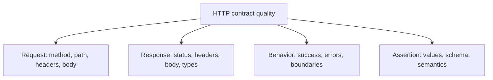
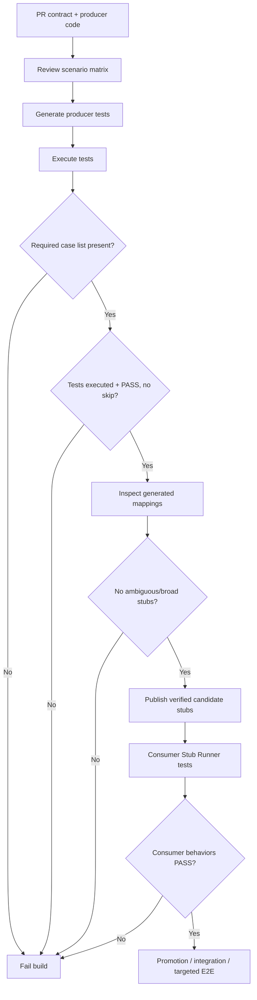

# Testing Sufficient Success, Error, and Boundary Branches

> **Chapter:** Contract Quality  
> **Module:** Spring Cloud Contract (`SPRING_CLOUD_CONTRACT`) — learning contract testing between producer and consumer using Groovy/YAML DSL for HTTP or messaging; practicing generating producer tests, publishing stubs, using Stub Runner, and integrating CI to detect incompatible API changes.

## Learning objectives

After this lesson, you will be able to:

1. Explain why **having many contract files** does not guarantee covering the behaviors consumers actually depend on.
2. Build a **scenario matrix** for success paths, valid boundary inputs, invalid inputs, business errors, system errors, and security errors when relevant.
3. Use **equivalence partitioning, boundary value analysis, and decision tables** to select a small yet meaningful set of contracts.
4. Write **YAML/Groovy** HTTP contracts that distinguish requests, response statuses, headers, bodies, and error codes, avoiding duplicate or overly broad stub mappings.
5. Understand the differences among `400`, `401`, `403`, `404`, `409`, `422`, `429`, and `503`; avoid picking HTTP statuses merely because they “look reasonable.”
6. Use **matchers** only for dynamic fields while preserving types, invariants, and business values that must be verified.
7. Verify the **producer with generated tests** and the **consumer with the real client + Stub Runner**, recognizing where additional unit, security, component, or integration tests are needed.
8. Evaluate messaging states such as event emitted, event not emitted, processing errors, duplicate events, and backlog without mistaking stubs for a real broker.
9. Run **mutation/negative tests** to verify whether each contract turns the build red when the producer breaks behavior.
10. Design a **CI quality gate** that ensures critical scenarios exist and execute while avoiding pushing heavy combinatorial boundary testing into E2E.

## 1. Contract quality is not measured by lines of YAML

Suppose `checkout-service` is a consumer of `inventory-service`. Checkout needs to reserve stock before processing payment:

```http
POST /api/reservations HTTP/1.1
Content-Type: application/json
Accept: application/json

{
  "sku": "SKU-001",
  "units": 2
}
```

A single contract checking only that `units: 2` is accepted:

```http
HTTP/1.1 201 Created
Content-Type: application/json

{
  "reservationId": "RSV-DEMO-002",
  "sku": "SKU-001",
  "units": 2,
  "status": "RESERVED"
}
```

This is useful evidence, yet insufficient. The system can still fail on branches such as:

- `units = 0` or negative numbers are still accepted.
- `units = 4` (exact available stock) is rejected due to `<` instead of `<=`.
- `units = 5` (exceeding stock) still succeeds due to a missing check.
- `sku` is missing or non-existent yet the service returns `201`.
- Producer returns `201` yet omits `reservationId`.
- Producer uses JSON string `"2"` instead of number `2`.
- Consumer fails to handle `409 INSUFFICIENT_STOCK` and proceeds to charge payment.
- Retrying a request creates two reservations when idempotency was never agreed upon.
- Temporary upstream `503` causes the consumer to retry indefinitely.

A high-quality contract suite must protect **the promises agreed upon with consumers**, especially around branch transitions, boundary values, and error handling.

**Key distinction:** Spring Cloud Contract does not automatically guarantee “100% test coverage.” It verifies **described interactions**, rather than automatically discovering every state and branch in code.

### 1.1. What counts as “enough”?

“Enough” depends on **risk and consumer needs**, not a flat number like 10 or 100 contracts per API. A solid suite should answer:

1. Do all **success paths used by consumers** have contracts?
2. Are all **error cases consumers must understand to make decisions** described?
3. Do **boundary values that alter business outcomes** have concrete examples?
4. Do contracts accurately assert **status, headers, body, data types, and field semantics**?
5. Did producer tests **actually execute** against relevant code?
6. Did consumer tests invoke the **real adapter/handler** with producer stubs?
7. Are risks outside contract scope covered by unit, integration, or security tests at the right layer?

Do not write one contract for every integer from 1 to 1,000,000. Pick **boundary points and equivalence classes**, and let unit/property-based tests cover the broader input space.

## 2. Distinguishing different types of coverage

| Concept | What does it measure? | What can it protect? | What it does not protect on its own |
| --- | --- | --- | --- |
| **Code coverage** | Lines/branches executed in code | Which implementation paths ran | Correct API contract or strong assertions |
| **Contract count** | Number of contract definitions | Breadth of declared interactions | Whether critical branches are missing |
| **Scenario coverage** | Groups of behaviors covered by tests | Success, error, boundary, access paths | Every possible input value |
| **Consumer dependency coverage** | Fields/statuses/headers consumers actually use | Compatibility for supported consumers | Undeclared or unknown consumers |
| **Mutation sensitivity** | Whether tests turn red when a promise breaks | Strength of assertions and gates | All production failures |
| **Deployment coverage** | Real system paths exercised by E2E/integration | Routing, DB, broker, security | Every error/schema case having contracts |

**Never equate line coverage with contract quality.** A generated test can pass through a controller and boost coverage while still skipping the `status` or `quantity` fields checkout depends on.

### 2.1. Four dimensions of an HTTP contract



For instance, a contract saying “returns 201” without asserting the response body is **insufficient** if the consumer needs `reservationId` to proceed to payment. Conversely, asserting detailed body fields while ignoring `Content-Type` can miss content-negotiation changes.

## 3. Define business rules before selecting boundary cases

In this lesson, we define **illustrative application rules**—do not treat them as Spring Cloud Contract defaults:

- `SKU-001` has **4 available units** in the test fixture.
- Request `POST /api/reservations` contains `sku` and `units`.
- `units` must be a **positive integer**, at least 1.
- When `1 <= units <= availableUnits`, producer returns `201 Created` with a valid reservation.
- When `units <= 0` or required fields are missing, producer returns `400 Bad Request` with `code: INVALID_REQUEST`.
- When `units > availableUnits`, producer returns `409 Conflict` with `code: INSUFFICIENT_STOCK`.
- When `sku` does not exist, producer returns `404 Not Found` with `code: SKU_NOT_FOUND`.
- JSON responses carry `Content-Type: application/json`; `units` is a number, not a string.
- The contract does **not yet** promise retry/idempotency or timeout behavior. When needed, negotiate, design, and test those at the proper layer.

With these rules explicit, we can select boundary examples without guessing “what 4 means.”

### 3.1. Boundary points derived from conditions

If the rule is:

```java
boolean validQuantity(int units, int available) {
    return units >= 1 && units <= available;
}
```

with `available = 4`, the critical values are:

| `units` value | Reason selected | Expected contract outcome |
| --- | --- | --- |
| `-1` | Below valid domain near 0 | 400 |
| `0` | Just below lower bound 1 | 400 |
| `1` | Exact lower bound | 201 |
| `2` | Normal interior value | 201 |
| `4` | Exact upper bound | 201 |
| `5` | Just above upper bound | 409 |
| Very large | Overflow, type limits, or validation | Test at appropriate layer and define behavior |

This illustrates **boundary value analysis**: pay attention to `b - 1`, `b`, and `b + 1` around every threshold. For other types and constraints, boundary choices may be empty strings, `null`, missing fields, month-end dates, length limits, or collection sizes.

### 3.2. Equivalence partitioning

Inputs can be partitioned into classes:

1. **Valid, below stock:** `units` in `[1,3]`.
2. **Valid, exact stock:** `units = 4`.
3. **Invalid quantity:** `units <= 0`.
4. **Stock conflict:** `units >= 5` when SKU has 4 available.
5. **Invalid schema:** missing `sku`, missing `units`, wrong type.
6. **Unknown resource:** non-existent `sku`.
7. **Not authorized:** if API requires auth and consumers depend on the response.
8. **Transient failure:** if error semantics are agreed upon with consumers.

In the **contract suite**, choose one or two representative cases per critical class. In **unit/property tests**, run many more inputs to catch formula bugs and type limits.

### 3.3. Do not force one giant matrix onto every endpoint

A read-only catalog GET may need `200`, `404`, and pagination. A reservation POST needs validation, conflict, and idempotency. An OAuth endpoint needs 401/403/scopes. Your matrix must reflect **each endpoint's real behavior**, not mechanically copy every 4xx/5xx HTTP status.

## 4. Success–error–boundary matrix for an API

| ID | Scenario | Representative request | Status | Invariant to assert | Priority layer |
| --- | --- | --- | --- | --- | --- |
| `RSV-01` | Normal | `SKU-001, units=2` | 201 | `reservationId`, `units=2`, `status=RESERVED` | Contract |
| `RSV-02` | Lower bound | `units=1` | 201 | Minimum value not rejected | Contract + unit |
| `RSV-03` | Upper bound | `units=4` | 201 | No off-by-one bug | Contract + unit |
| `RSV-04` | Below lower bound | `units=0` | 400 | `code=INVALID_REQUEST` | Contract if consumer relies on it; unit |
| `RSV-05` | Negative | `units=-1` | 400 | No reservation created | Unit; selective contract |
| `RSV-06` | Above upper bound | `units=5` | 409 | `code=INSUFFICIENT_STOCK` | Contract + unit |
| `RSV-07` | Missing SKU | JSON with `units` only | 400 | Validation response per agreement | Selective contract |
| `RSV-08` | Unknown SKU | `sku=SKU-MISSING` | 404 | `code=SKU_NOT_FOUND` | Contract |
| `RSV-09` | Wrong media type | `Content-Type: text/plain` | 415 if API commits to it | Reject unsupported payload | Web/security integration |
| `RSV-10` | Unauthenticated | Missing token | 401 if API is protected | Do not leak data | Security integration |
| `RSV-11` | Missing scope | Test identity lacks permission | 403 | Not allowed to reserve stock | Security integration |
| `RSV-12` | Upstream temporarily unavailable | Controlled failure fixture | 503 if promised | Consumer distinguishes temporary error | Adapter/contract per policy |
| `RSV-13` | Duplicate request | Same idempotency key | Per agreement | No duplicate side effect | Component/integration |
| `RSV-14` | Dynamic response field | Fresh reservation ID per call | 201 | Valid UUID/format, non-empty | Contract matcher |

**This is a design matrix**, not a claim that `inventory-service` already implements every row. Do not create 415, 401, 403, or 503 contracts before the producer commits to them; define error contracts and implementations first.

### 4.1. Risk-based prioritization

When time is limited, ask:

- Does the consumer need this value/status to decide whether to **charge payment or reject**?
- If wrong, could it cause money loss, data exposure, overselling, or duplicates?
- Has this branch caused past incidents or does it carry high traffic?
- Could changing this break another consumer?
- Is a cheap unit/component test sufficient, or is a shared contract needed?

High risk + cross-service dependency → explicit contract; complex internal algorithm not exposed across the wire → strong unit/property-based tests.

## 5. Rules of a good contract suite

Each contract should describe **one observable interaction**, with a meaningful name and clearly distinguishable request.

Practical guidelines:

1. **Each scenario has a stable name**, e.g., `reserve_exact_stock`, not `test1`.
2. **Requests are distinguishable** by method/path/query/headers/body (as needed).
3. **Response status matches business semantics** and is agreed upon by both teams.
4. **Fields used by consumers** are asserted concretely, not just “returns JSON.”
5. **Body types** are accurate; `units: 4`, not `units: "4"`.
6. **Dynamic fields** use constrained matchers without weakening invariants.
7. **Real errors are specified** with stable status and error codes, not fragile random exception messages.
8. **Fixtures can be reset/isolated**, independent of test execution order.
9. **Generated producer tests must execute**, and consumer tests must use verified artifacts.
10. **No duplicate mappings** matching the same request while promising different responses.

### 5.1. Why contract names matter

Clear names simplify coverage reviews and JUnit reports:

```text
reserve_two_units
reserve_minimum_unit
reserve_exact_available_stock
reserve_zero_units_invalid
reserve_more_than_stock
reserve_unknown_sku
```

Spring Cloud Contract can use `name` when generating test method and mapping names. Avoid duplicate names or characters that break generated identifiers; every scenario should have an identifier traceable back to requirements.

### 5.2. Same path does not mean same request

All these cases POST to `/api/reservations`. They still differ by body:

```json
{"sku":"SKU-001","units":1}
```

```json
{"sku":"SKU-001","units":4}
```

```json
{"sku":"SKU-001","units":5}
```

However, if one mapping's matcher accepts any `units` or skips body comparison, it can **swallow requests** meant for another mapping. Always inspect WireMock JSON mappings after generation.

## 6. YAML contracts: success and boundary cases

The following examples belong in **separate YAML files** inside the producer's contracts directory—typically `src/test/resources/contracts` for Maven, or `src/contractTest/resources/contracts` for the modern Gradle plugin.

### 6.1. Normal case — `reserve_two_units.yml`

```yaml
name: reserve_two_units
description: "Stock available, reserve two units"

request:
  method: POST
  url: /api/reservations
  headers:
    Content-Type: application/json
    Accept: application/json
  body:
    sku: SKU-001
    units: 2

response:
  status: 201
  headers:
    Content-Type: application/json
  body:
    reservationId: RSV-DEMO-002
    sku: SKU-001
    units: 2
    status: RESERVED
```

This contract promises `201`, JSON content type, reservation ID, SKU, units, and status. It does **not** claim every real request always produces the exact same ID: this is a fixed test fixture, suitable when the producer base test controls output. When the system generates dynamic IDs, see the matchers section.

### 6.2. Lower bound — `reserve_minimum_unit.yml`

```yaml
name: reserve_minimum_unit
description: "One unit is an allowed quantity"

request:
  method: POST
  url: /api/reservations
  headers:
    Content-Type: application/json
    Accept: application/json
  body:
    sku: SKU-001
    units: 1

response:
  status: 201
  headers:
    Content-Type: application/json
  body:
    reservationId: RSV-DEMO-001
    sku: SKU-001
    units: 1
    status: RESERVED
```

This case guards **lower bound = 1**. If the producer accidentally changes the check to `units > 1`, the generated test must FAIL.

### 6.3. Upper bound — `reserve_exact_stock.yml`

```yaml
name: reserve_exact_stock
description: "Reserving exact available stock succeeds"

request:
  method: POST
  url: /api/reservations
  headers:
    Content-Type: application/json
    Accept: application/json
  body:
    sku: SKU-001
    units: 4

response:
  status: 201
  headers:
    Content-Type: application/json
  body:
    reservationId: RSV-DEMO-004
    sku: SKU-001
    units: 4
    status: RESERVED
```

This is a vital **off-by-one guard**: with `available=4`, `4` must succeed—not only `1, 2, 3`.

**Fixture warning:** if producer tests persist reservations into a stateful DB, every generated case must start with `SKU-001` having 4 units available. Never let the `units=4` case exhaust stock and make subsequent tests fail due to ordering; see the data isolation section.

## 7. YAML contracts: invalid requests and business errors

### 7.1. Below lower bound — `reserve_zero_units.yml`

```yaml
name: reserve_zero_units
description: "Quantity of 0 is invalid"

request:
  method: POST
  url: /api/reservations
  headers:
    Content-Type: application/json
    Accept: application/json
  body:
    sku: SKU-001
    units: 0

response:
  status: 400
  headers:
    Content-Type: application/json
  body:
    code: INVALID_REQUEST
    message: units must be positive
```

This is the **example's API policy**, not Spring MVC's default error body. For producer verification to PASS, validation and exception handling must return the **exact JSON** `code` and `message`.

If the consumer only relies on `code`, asserting exact English message bytes can make contracts brittle. Discuss between teams: is a fixed message truly required? You may focus on `code` and omit `message` from the contract, or use an appropriate matcher.

### 7.2. Exceeding stock — `reserve_more_than_stock.yml`

```yaml
name: reserve_more_than_stock
description: "Stock is 4, requesting 5 is a conflict"

request:
  method: POST
  url: /api/reservations
  headers:
    Content-Type: application/json
    Accept: application/json
  body:
    sku: SKU-001
    units: 5

response:
  status: 409
  headers:
    Content-Type: application/json
  body:
    code: INSUFFICIENT_STOCK
    message: Not enough stock to reserve
```

This error **differs from 400**:

- `400`: invalid request (zero or negative quantity).
- `409`: syntactically valid request that **conflicts with current stock state**.

If the producer chooses `422` or another status for insufficient stock, both teams must **agree and define it consistently**. Spring Cloud Contract does not dictate which HTTP status a business error uses.

### 7.3. Non-existent SKU — `reserve_unknown_sku.yml`

```yaml
name: reserve_unknown_sku
description: "SKU does not exist"

request:
  method: POST
  url: /api/reservations
  headers:
    Content-Type: application/json
    Accept: application/json
  body:
    sku: SKU-MISSING
    units: 2

response:
  status: 404
  headers:
    Content-Type: application/json
  body:
    code: SKU_NOT_FOUND
    message: SKU does not exist
```

Do not confuse **SKU does not exist** with **SKU exists but out of stock**. Consumers may display different messages and should not collapse both into a generic `available=false` case.

### 7.4. Missing required field — `reserve_missing_sku.yml`

```yaml
name: reserve_missing_sku
description: "Missing sku in request"

request:
  method: POST
  url: /api/reservations
  headers:
    Content-Type: application/json
    Accept: application/json
  body:
    units: 2

response:
  status: 400
  headers:
    Content-Type: application/json
  body:
    code: INVALID_REQUEST
    message: sku is required
```

For a JSON request omitting `sku`, generated tests must send a body **without that field**, rather than inserting an empty string. `null`, absent fields, and `""` may be validated differently by frameworks; decide which cases consumers rely on and which belong in unit/controller integration tests.

### 7.5. Do we also need contracts for negative numbers and null?

Optionally, yes—but do not create dozens of contracts if they merely exercise the same validation rule and consumers do not distinguish them. For example:

- Unit/controller integration tests: `-1`, `Integer.MIN_VALUE`, `null`, missing, string instead of number, array instead of number, decimal `1.5`.
- Shared consumer contracts: one `units=0` representing `INVALID_REQUEST` and one `units=5` representing `INSUFFICIENT_STOCK`.
- Additional contracts: if consumers **distinguish** error codes for invalid types, or suffered past regressions there.

**Keep the contract suite small and meaningful**, while broader input exploration fits parameterized or property-based tests better.

## 8. Expressing the same interaction in Groovy DSL

To compare both DSLs, here is the **Groovy alternative** for `reserve_more_than_stock`:

```groovy
org.springframework.cloud.contract.spec.Contract.make {
    name 'reserve_more_than_stock'

    request {
        method 'POST'
        url '/api/reservations'
        headers {
            contentType(applicationJson())
            header 'Accept': 'application/json'
        }
        body(
            sku: 'SKU-001',
            units: 5
        )
    }

    response {
        status 409
        headers {
            contentType(applicationJson())
        }
        body(
            code: 'INSUFFICIENT_STOCK',
            message: 'Not enough stock to reserve'
        )
    }
}
```

Groovy DSL can define multiple contracts in one file by returning a list, though this guide uses **one contract per file** for simpler counting and review.

**Do not place equivalent YAML and Groovy versions in the same plugin scan** expecting only one scenario; they can generate duplicate tests/mappings and skew coverage reports.

### 8.1. Avoid overly minimal, meaningless contracts

A contract like:

```groovy
Contract.make {
    request {
        method 'POST'
        url '/api/reservations'
    }
    response {
        status 200
    }
}
```

protects almost nothing, because:

- Request body is unconstrained.
- Media types are unchecked.
- Error codes/bodies are unchecked.
- Status 200 may contradict the API's promised 201.
- Data consumers actually use is unprotected.

A “passing test” backed by such a contract never justifies concluding “the reservation branch has sufficient quality.”

## 9. Matchers: neither too strict nor too broad

The real producer may generate a fresh `reservationId` per request. If the contract pins `RSV-DEMO-002` while tests do not control sequence generation, generated tests become flaky.

A common design uses a **sample placeholder UUID** with a matcher strictly for the dynamic field:

```yaml
name: reserve_two_units_dynamic_id
request:
  method: POST
  url: /api/reservations
  headers:
    Content-Type: application/json
    Accept: application/json
  body:
    sku: SKU-001
    units: 2

response:
  status: 201
  headers:
    Content-Type: application/json
  body:
    reservationId: 84fe2261-2afb-4d3c-8f3a-79f820805ac2
    sku: SKU-001
    units: 2
    status: RESERVED
  matchers:
    body:
      - path: $.reservationId
        type: by_regex
        predefined: uuid
```

**This is an alternative** to `reserve_two_units.yml` when real IDs are UUIDs. Do not run two contracts simultaneously with the **same request** and conflicting ID/response mappings: pick one consistent promise and remove the duplicate.

### 9.1. Relax only genuinely dynamic fields

In this example:

- `reservationId`: fresh UUID, matched via `uuid`.
- `sku`: still must equal `SKU-001`.
- `units`: still must equal `2`.
- `status`: still must equal `RESERVED`.
- HTTP `201` and `Content-Type`: unchanged.

If every assertion were replaced with `by_type`, the producer could return `units=999` and generated tests would still fail to catch the logic violation.

### 9.2. Each matcher type has a distinct meaning

| Matcher | Purpose | Risk if abused |
| --- | --- | --- |
| `by_equality` | Asserts critical exact values | Too strict for dynamic timestamps/IDs |
| `by_regex` | UUID, timestamp, or code formats | `.*` strips nearly all validation |
| `by_type` | JSON types, collection sizes when configured properly | Does not validate business values |
| `by_null` | Asserts field is null | Does not replace absence checks |
| `by_command` | Delegates custom assertion to a test method | Depends on custom code; inspect the method itself |
| `minOccurrence/maxOccurrence` | Bounds collection size | Does not automatically validate item contents |

In YAML, `response.matchers.body` controls how generated producer tests verify responses. `request.matchers.body` controls how WireMock stubs accept requests. **Request matchers and response matchers do not perform the same job.**

### 9.3. Example checking type vs. value

If a response contains a dynamic boolean `available` whose type must stay consistent:

```yaml
response:
  status: 200
  body:
    sku: SKU-001
    available: true
    quantity: 4
  matchers:
    body:
      - path: $.available
        type: by_type
```

This snippet is a **fragment** for an API exposing `available`—do not merge it into another reservation file. `by_type` alone does not prove `available=true` for a given SKU. If Checkout needs to know `SKU-001` is **definitely in stock** in this fixture, equality `true` is stronger and should be kept.

### 9.4. Checking JSON array element counts

If an API returns a list of reservations, `by_type` with `minOccurrence`/`maxOccurrence` can be used in the DSL. However, Spring Cloud Contract docs also note experimental caveats/limitations around **asserting JSON array sizes** in certain versions. Always inspect generated tests rather than assuming configuring the matcher accurately enforces array length.

When array order carries business semantics, a type/size matcher is insufficient: add ordering/ID assertions in contracts or integration tests.

## 10. HTTP errors: do not try to cover every status code

A reference classification list:

| Status | Common semantics | When to include a contract |
| --- | --- | --- |
| `200 OK` | Data returned successfully | GET/query or POST returning results per API |
| `201 Created` | Resource created successfully | POST creating a new reservation; check body/Location if promised |
| `202 Accepted` | Accepted for async processing | Consumer must poll status or await an event |
| `204 No Content` | Succeeded with no body | DELETE/update per policy; never assert a JSON body |
| `400 Bad Request` | Invalid request | Consumer must display/fix input |
| `401 Unauthorized` | Unauthenticated | Consumer triggers login/refresh per policy |
| `403 Forbidden` | Authenticated, lacks permission | Consumer denies action |
| `404 Not Found` | Resource does not exist | Consumer reports missing SKU |
| `409 Conflict` | Conflicts with current state | Insufficient stock, optimistic locking |
| `422 Unprocessable Content` | Semantically unprocessable per API design | Only when producer explicitly promises this status |
| `429 Too Many Requests` | Rate limit | Consumer performs backoff per policy |
| `500 Internal Server Error` | Server error | Do not rely on stack trace details |
| `503 Service Unavailable` | Temporarily unavailable | Retry/fallback when agreed |

**Do not add `401/403` contracts solely because an endpoint uses Spring Security if generated test setups disable security filters.** Contracts can document the response, but real security integration tests are needed to prove **real policy enforcement**.

### 10.1. `200` and `201` are not freely interchangeable

If the consumer expects `201` to read `reservationId`, switching the producer to `200` can break clients performing exact status checks. Keep contracts aligned to the accepted status.

### 10.2. `204` has no body

If the API chooses `204`, do not put JSON in the response contract just to “have fields”—that creates a promise violating HTTP semantics. When consumers need response data, agree on a proper status and body.

### 10.3. `400` vs. `422` is a design decision

Some APIs use 422 for validation or business errors. Spring MVC with Bean Validation defaults to 400 for invalid requests, while **response format** depends on controller advice. Teams should adopt **one consistent convention**; contract tests verify the agreed convention rather than silently deciding it.

## 11. Validation, missing, null, and data types

These requests are distinct:

```json
{"sku":"SKU-001","units":0}
```

```json
{"sku":"SKU-001","units":null}
```

```json
{"sku":"SKU-001"}
```

```json
{"sku":"SKU-001","units":"2"}
```

```json
{"sku":"SKU-001","units":2.5}
```

| Case | Risk | Appropriate test layer |
| --- | --- | --- |
| `0` | Wrong lower bound | Unit + representative contract |
| `null` | Maps differently to primitives vs. objects | Validation integration; contract if consumer depends on it |
| Missing | Defaults to 0/null, bypassing validation | Controller integration / selective contract |
| String instead of number | JSON mapper may silently coerce | Strict DTO/schema integration + producer tests |
| Decimal instead of integer | May be truncated/rounded or rejected | Unit/serialization integration |
| Very large integer | Overflow or `400` | Property-based / integration tests |
| Empty string `sku=""` | `@NotBlank` vs. `@NotNull` | Validation integration |
| Unicode, newlines in SKU | Security/encoding/validation | Unit/web/security integration |

### 11.1. Avoid over-inferring from Java DTOs

If code defines:

```java
public record ReservationRequest(
    String sku,
    int units
) {}
```

`int` cannot be null in Java, yet JSON missing `units` can deserialize to a default `0` depending on Jackson configuration, blurring `missing` vs. `0`.

To detect missing fields cleanly, use `Integer` with `@NotNull` + `@Min(1)`, or configure strict deserialization. Verify with integration tests using the application's real `ObjectMapper`.

### 11.2. A boundary value must tie to a rule

Not every API caps `units` at `4`. Here `4` is the upper bound because the fixture sets `availableUnits=4`; in production, inventory changes continuously. **Never hardcode `availableUnits=4` as a system-wide invariant**—it is simply fixture data exercising the condition.

## 12. Sufficient producer implementation for meaningful verification

An instructional controller implementing the core flow using Java 17+ and Spring MVC. Errors need a consistent error body.

```java
package com.example.inventory;

import jakarta.validation.Valid;
import jakarta.validation.constraints.Min;
import jakarta.validation.constraints.NotBlank;
import jakarta.validation.constraints.NotNull;
import org.springframework.http.HttpStatus;
import org.springframework.http.MediaType;
import org.springframework.http.ResponseEntity;
import org.springframework.web.bind.annotation.*;

@RestController
@RequestMapping("/api/reservations")
public class ReservationController {

    @PostMapping(
        consumes = MediaType.APPLICATION_JSON_VALUE,
        produces = MediaType.APPLICATION_JSON_VALUE
    )
    public ResponseEntity<ReservationResponse> reserve(
            @Valid @RequestBody ReservationRequest request) {

        if (!"SKU-001".equals(request.sku())) {
            throw new SkuNotFoundException();
        }

        if (request.units() > 4) {
            throw new InsufficientStockException();
        }

        ReservationResponse response = new ReservationResponse(
            "RSV-DEMO-" + String.format("%03d", request.units()),
            request.sku(),
            request.units(),
            "RESERVED"
        );

        return ResponseEntity
            .status(HttpStatus.CREATED)
            .body(response);
    }

    public record ReservationRequest(
        @NotBlank String sku,
        @NotNull @Min(1) Integer units
    ) {}

    public record ReservationResponse(
        String reservationId,
        String sku,
        int units,
        String status
    ) {}
}
```

To compile this snippet, define `SkuNotFoundException` and `InsufficientStockException` (e.g., simple `RuntimeException` subclasses) and include `spring-boot-starter-validation`. Using `Integer` separates `null/missing` from `0` at validation time.

**This is instructional fixture code**, not a production inventory implementation: it does not lock DB rows, manage concurrency, or actually deduct stock. Stateful behaviors require dedicated component/integration tests.

### 12.1. Contract-aligned error handler

```java
package com.example.inventory;

import org.springframework.http.HttpStatus;
import org.springframework.http.ResponseEntity;
import org.springframework.web.bind.MethodArgumentNotValidException;
import org.springframework.web.bind.annotation.ExceptionHandler;
import org.springframework.web.bind.annotation.RestControllerAdvice;

@RestControllerAdvice
public class ReservationErrorAdvice {

    @ExceptionHandler(InsufficientStockException.class)
    ResponseEntity<ApiError> notEnoughStock() {
        return ResponseEntity.status(HttpStatus.CONFLICT)
            .body(new ApiError(
                "INSUFFICIENT_STOCK",
                "Not enough stock to reserve"
            ));
    }

    @ExceptionHandler(SkuNotFoundException.class)
    ResponseEntity<ApiError> skuMissing() {
        return ResponseEntity.status(HttpStatus.NOT_FOUND)
            .body(new ApiError(
                "SKU_NOT_FOUND",
                "SKU does not exist"
            ));
    }

    @ExceptionHandler(MethodArgumentNotValidException.class)
    ResponseEntity<ApiError> invalid(
            MethodArgumentNotValidException ex) {
        String message = ex.getBindingResult().getFieldErrors()
            .stream()
            .anyMatch(e -> "sku".equals(e.getField()))
            ? "sku is required"
            : "units must be positive";

        return ResponseEntity.badRequest()
            .body(new ApiError("INVALID_REQUEST", message));
    }

    public record ApiError(String code, String message) {}
}
```

Both `SkuNotFoundException` and `InsufficientStockException` must be defined by your project. This handler illustrates a **stable response shape**, not full production error classification: real systems must also handle malformed JSON, JSON decode exceptions, and validation type mismatches.

For missing `sku` or `units=0`, `@Valid` plus the handler above produces the example bodies. For invalid JSON syntax or unparseable types, Spring may throw `HttpMessageNotReadableException`; if the API must also return `INVALID_REQUEST` there, add an explicit handler and contract if consumers rely on it.

### 12.2. Base test: using the real controller and advice

A producer base test via Spring MVC context:

```java
package com.example.inventory;

import io.restassured.module.mockmvc.RestAssuredMockMvc;
import org.junit.jupiter.api.BeforeEach;
import org.springframework.beans.factory.annotation.Autowired;
import org.springframework.boot.test.autoconfigure.web.servlet.AutoConfigureMockMvc;
import org.springframework.boot.test.context.SpringBootTest;
import org.springframework.web.context.WebApplicationContext;

@SpringBootTest
@AutoConfigureMockMvc
public abstract class ContractTestBase {

    @Autowired
    WebApplicationContext context;

    @BeforeEach
    public void setup() {
        RestAssuredMockMvc.webAppContextSetup(context);
    }
}
```

This variant targets a producer using Spring MVC. Configure the Maven/Gradle plugin with `testMode=MOCKMVC`, `baseClassForTests`, Verifier dependencies, JUnit 5, and a valid application context. Across Spring Boot versions, test import packages may differ; select compatible Spring Boot / Spring Cloud Contract versions.

**Never mock `ReservationController` or `ReservationErrorAdvice` itself in producer contract verification.** Doing so makes generated tests verify test-written stubs rather than protecting the real implementation.

## 13. Consumer Stub Runner must test handling of every needed branch

A consumer contract test does not merely call a stub URL and assert it returns 201. It must exercise the **real HTTP adapter** or consumer service processing the response.

Suppose the consumer has `InventoryReservationClient` calling `POST /api/reservations` and mapping `409` to `StockConflictException`:

```java
package com.example.checkout;

import org.springframework.beans.factory.annotation.Value;
import org.springframework.http.MediaType;
import org.springframework.stereotype.Component;
import org.springframework.web.client.RestClient;
import org.springframework.web.client.RestClientResponseException;

@Component
public class InventoryReservationClient {

    private final RestClient http;

    public InventoryReservationClient(
            RestClient.Builder builder,
            @Value("${inventory.base-url}") String baseUrl) {
        http = builder.baseUrl(baseUrl).build();
    }

    public Reservation reserve(String sku, int units) {
        try {
            Reservation result = http.post()
                .uri("/api/reservations")
                .contentType(MediaType.APPLICATION_JSON)
                .accept(MediaType.APPLICATION_JSON)
                .body(new ReservationRequest(sku, units))
                .retrieve()
                .body(Reservation.class);

            if (result == null) {
                throw new IllegalStateException("Empty reservation body");
            }
            return result;
        } catch (RestClientResponseException e) {
            if (e.getStatusCode().value() == 409) {
                throw new StockConflictException(e);
            }
            throw e;
        }
    }

    public record ReservationRequest(String sku, int units) {}
    public record Reservation(
        String reservationId,
        String sku,
        int units,
        String status
    ) {}

    public static class StockConflictException
            extends RuntimeException {
        public StockConflictException(Throwable cause) {
            super("Inventory has insufficient stock", cause);
        }
    }
}
```

This is a **sample client** using Spring Framework `RestClient` (Spring Framework 6.1+). It maps status `409` without yet parsing `code: INSUFFICIENT_STOCK`; in applications with multiple conflict types, parse the error body and inspect `code` so distinct 409 errors are not conflated.

### 13.1. Consumer test with verified stubs

Suppose the producer verified and published `com.example:inventory-service:1.0.0:stubs` to the runner's Maven local repo:

```java
package com.example.checkout;

import org.junit.jupiter.api.Test;
import org.springframework.beans.factory.annotation.Autowired;
import org.springframework.boot.test.context.SpringBootTest;
import org.springframework.cloud.contract.stubrunner.spring.AutoConfigureStubRunner;
import org.springframework.cloud.contract.stubrunner.spring.StubRunnerProperties;

import static org.junit.jupiter.api.Assertions.*;

@SpringBootTest(
    properties = "inventory.base-url=http://localhost:8090"
)
@AutoConfigureStubRunner(
    ids = "com.example:inventory-service:1.0.0:stubs:8090",
    stubsMode = StubRunnerProperties.StubsMode.LOCAL
)
class ReservationConsumerContractTest {

    @Autowired
    InventoryReservationClient client;

    @Test
    void acceptsLowerAndUpperValidBoundaries() {
        assertEquals(1, client.reserve("SKU-001", 1).units());
        assertEquals(4, client.reserve("SKU-001", 4).units());
    }

    @Test
    void mapsInsufficientStockIntoDomainException() {
        assertThrows(
            InventoryReservationClient.StockConflictException.class,
            () -> client.reserve("SKU-001", 5)
        );
    }
}
```

Prerequisites: the right producer stubs JAR version is installed, the consumer has Spring Boot/Stub Runner test dependencies, port 8090 is free, and the application context does not call real production collaborators. For parallel CI, prefer dynamic ports with `StubFinder.findStubUrl(...)` or corresponding injection.

For `units=0`, the application client may **reject locally before calling upstream**, making consumer unit/validation tests a better fit; not every validation contract must be hit from a consumer stub test. The producer still verifies its error API independently if it is a promised interface.

### 13.2. Why assert behavior, not just HTTP status?

If `CheckoutService` catches 409 yet still charges payment, the API contract might pass while the business flow fails. Consumer integration tests should assert **payment/order completion does not occur** when the domain exception is thrown.

Contracts protect the wire interface; consumer component/unit tests protect actions taken after receiving responses.

## 14. Inspect both request matching and mapping ambiguity

If three mappings share `POST /api/reservations` yet one matches only method and path, WireMock can pick the generic mapping instead of body-specific mappings.

Dangerous example:

```json
{
  "request": {
    "method": "POST",
    "url": "/api/reservations"
  },
  "response": {
    "status": 201,
    "body": "{\"status\":\"RESERVED\"}"
  }
}
```

This mapping can return `201` for `units=0` or `units=5`, breaking consumer error tests or hiding bugs depending on setup. Never treat `priority` as a blanket solution for genuinely contradictory responses.

### 14.1. Mapping inspection checklist

After running the generator in a real project, open the mappings inside `*-stubs.jar` and ask:

- Does `reserve_zero_units` have a request body matcher distinguishing `units=0`?
- Does `reserve_more_than_stock` distinguish `units=5`?
- Are `Content-Type` and `Accept` matched per policy?
- Does another mapping with an overly broad request matcher subsume both cases?
- Does `priority` accidentally make one mapping win every case?
- Do contract names collide, causing mappings to overwrite each other?
- When responses have dynamic values, do matchers relax only the intended fields?

### 14.2. Priority does not fix contradictory promises

Spring Cloud Contract supports `priority` on contracts to influence mapping precedence (lower numbers usually mean higher priority). It can help for **a specific exception to a general rule**, but cannot make two different responses for the **exact same full request** business-valid.

If v1 and v2 need different responses, distinguish requests by path, header, media type, or an agreed versioning scheme.

## 15. Producer verification: must generate and execute all critical cases

### 15.1. Maven

With a Maven producer configured for the Spring Cloud Contract plugin, `testFramework=JUNIT5`, `testMode=MOCKMVC`, and `baseClassForTests`:

```bash
mvn clean verify
```

Verify:

1. The plugin locates the right contracts directory.
2. Generated test methods exist for `reserve_two_units`, `reserve_minimum_unit`, `reserve_exact_stock`, `reserve_zero_units`, `reserve_more_than_stock`, `reserve_unknown_sku`, and `reserve_missing_sku`.
3. Generated tests compile and actually execute via JUnit.
4. Response status, headers, and body assertions PASS.
5. No critical test is `ignored`, `inProgress`, or `skipped`.

**Do not naively count 1 YAML file = 1 Java class.** Spring Cloud Contract can group multiple contracts into one generated class; compare scenario names and test counts/reports instead.

### 15.2. Gradle

With a modern Gradle producer plugin, contracts usually reside in `src/contractTest/resources/contracts`, and generated tests run via a dedicated `contractTest` task:

```bash
./gradlew clean build --console=plain
./gradlew contractTest --console=plain
```

In CI, inspect test reports in `build/test-results/contractTest`, not just `build/test-results/test`. If `contractTest` reports `NO-SOURCE` or is skipped, never treat the API as “verified” simply because `build` passed.

### 15.3. Case-count gates cannot replace named-case gates

A gate checking “at least 7 tests” fails silently when:

- One mandatory scenario is deleted.
- Another scenario generates extra tests that make up the total.
- One test is ignored while remaining tests still meet the threshold.
- Tests are generated without necessary body assertions.

Combine a **mandatory scenario ID list** (RSV-01, RSV-03, RSV-04, RSV-06, RSV-08, etc.) with executed case names in reports and mutation checks.

## 16. Mutation checks to measure branch sensitivity

A contract suite only has value when it turns **red** on corresponding breaking changes.

| Producer mutation tested | Contract that must fail | Why |
| --- | --- | --- |
| Return `200` instead of `201` on successful reserve | `reserve_two_units` or `reserve_exact_stock` | Wrong status |
| Use `units < available` instead of `<=` | `reserve_exact_stock` | Upper-bound off-by-one |
| Accept `units=0` | `reserve_zero_units` | Missing validation |
| Accept `units=5` | `reserve_more_than_stock` | Missing conflict check |
| Omit `reservationId` | Success cases | Consumer loses identifier |
| Change `units` from number to string | Success cases if type assertions are strong | Wrong JSON wire type |
| Return `400` for unknown SKU | `reserve_unknown_sku` | Wrong 404 |
| Change `INSUFFICIENT_STOCK` to `FAILED` | `reserve_more_than_stock` | Breaks error code |
| Drop response `Content-Type` | Contracts requiring JSON | Breaks content negotiation |
| Enable overly broad stub mapping | Consumer error/boundary tests must fail | Stub returns wrong scenario |

### 16.1. Test one fault at a time

On a test branch, change:

```java
if (request.units() >= 4) {
    throw new InsufficientStockException();
}
```

instead of the valid `request.units() > 4`. Contract `reserve_exact_stock` must **FAIL** for `units=4`. Revert the code, then try the next mutation.

Never commit intentional fault mutations to release branches. The goal is to verify **test pipeline signal**, not break production.

### 16.2. If the build stays green after a mutation

Inspect in order:

1. Did the plugin discover the contract source?
2. Was a test generated for this scenario?
3. Did the test execute, or was it `ignored`/`inProgress`/`disabled`?
4. Does the base class wire up the **real producer controller/service**?
5. Does the fixture genuinely set `availableUnits=4`?
6. Do assertions verify the required status/body, or were matchers loosened too much?
7. Did executed case counts genuinely increase above 0?
8. Did Gradle caching or Maven lifecycle reuse stale outputs?

Never alter contracts to match buggy output just to turn builds green. If business requirements truly changed, go through consumer review and versioning rather than deleting assertions.

## 17. Error handling must be verified on the consumer side

The producer returning `409` and `code=INSUFFICIENT_STOCK` is **half the contract**. The consumer may need to:

- Report “insufficient stock” and keep checkout state intact.
- Suggest lowering the quantity.
- Avoid calling the payment gateway.
- Avoid infinite retries.
- Avoid treating `409` as success.
- Log diagnostics without leaking sensitive data.

A consumer test should assert **behavior beyond HTTP decoding**, such as verifying the service does not invoke the payment collaborator when `InventoryReservationClient` throws `StockConflictException`.

Checking only that WireMock returns 409 mostly tests **the producer's stub**, not consumer error-handling code.

### 17.1. Do not conflate 404, 409, and 503

| Response | Agreed meaning | What the consumer should do |
| --- | --- | --- |
| `404 SKU_NOT_FOUND` | SKU does not exist | Report missing product, do not retry endlessly |
| `409 INSUFFICIENT_STOCK` | SKU exists, insufficient stock | Do not charge; show available quantity if provided |
| `400 INVALID_REQUEST` | Invalid request | Fix validation/input, do not retry same payload |
| `503 SERVICE_UNAVAILABLE` | Temporary error if contracted | Bounded retry/backoff, avoid creating duplicates |
| `401/403` | Authentication/authorization | Follow auth policy, avoid leaking details |

A catch-all:

```java
catch (Exception error) {
    return canCheckoutAnyway();
}
```

is a **dangerous anti-pattern**: distinct errors can trigger business decisions violating requirements. Domain-specific error mapping and branch-explicit tests protect the consumer.

## 18. Security and rate limits: separate test boundaries clearly

If the reservation API requires OAuth2:

- `401` when token is missing.
- `403` when token has identity but lacks scope.
- `201` when scope is valid.

A Stub Runner mapping accepting `Authorization: Bearer test-token` **does not validate JWT signatures or scopes**. Therefore:

- **Contracts:** agreed HTTP status/error bodies and client header behavior.
- **Spring Security integration:** real 401/403/role/scope/tenant enforcement.
- **Gateway smoke tests:** real deployment/auth integration routing when needed.
- **Resilience integration:** 429/503, `Retry-After`, timeouts, circuit breakers, idempotency.

If the team has not committed to `429` in v1, do not invent a contract just to “pad status coverage.” Put rate-limit policies in API documentation/reviews first, then pick meaningful scenarios.

### 18.1. Avoid testing transient errors with random timing

Do not make producer tests depend on an external server “happening to return 503.” To verify transient-error contracts, create a **controlled fixture/trigger** reset between tests. Consumer resilience tests can use WireMock faults/delays, though those are not automatically producer promises.

## 19. Messaging: what do success, failure, and boundaries mean?

Spring Cloud Contract supports messaging DSL: `input.triggeredBy`, `outputMessage.sentTo`, `headers`, `body`, and `label`. However, messaging **has no built-in HTTP 200/409 statuses**; branches are defined by events and states.

Suppose `order-service` emits `OrderAccepted` for valid orders:

```yaml
name: order_accepted
label: order_accepted
input:
  triggeredBy: publishOrderAccepted()
outputMessage:
  sentTo: orders.events
  headers:
    contentType: application/json
    eventType: OrderAccepted
  body:
    eventType: OrderAccepted
    orderRef: ORDER-DEMO-001
    amount: 240000
    currency: VND
```

This is a **success event contract**. The producer needs a message verifier adapter/binder and fixtures; the consumer needs a properly configured handler/binder or `StubTrigger`. Stub Runner does not run production Kafka or RabbitMQ.

### 19.1. Messaging matrix

| Scenario | Meaningful expectation | Priority layer |
| --- | --- | --- |
| Valid order | Emit `OrderAccepted` with promised schema | Message contract |
| `amount = 0` | Reflect exact event behavior per allow/reject rules | Unit + selective contract |
| Negative amount | Do not emit `OrderAccepted` or emit rejection event **if promised** | Unit/component |
| Missing required field | Consumer handler rejects/quarantines per policy | Consumer integration/schema |
| Duplicate event | Idempotent handler, no duplicate side effects | Consumer component/broker integration |
| Unknown schema version | Handler applies version policy | Consumer contract/integration |
| Broker timeout | Retry/DLQ per policy | Broker integration |
| Out-of-order events | Consumer avoids corrupting state or rejects appropriately | Stateful/broker integration |
| No event emitted | Assert event count is 0 within a controlled observation window | Producer integration/negative test |

### 19.2. You cannot prove “no event emitted” using `outputMessage` alone

An `outputMessage` contract describes **an event that must appear**. If the business rule is “invalid orders must not emit `OrderAccepted`,” write a separate test asserting a publisher fake or probe **recorded zero events** after invoking the action.

Illustrative idea:

```java
@Test
void invalidOrderMustNotPublishAcceptedEvent() {
    // Test-owned publisher probe: never touch production topics.
    service.accept(new OrderInput("ORDER-DEMO-002", -1));

    assertEquals(
        0,
        publisherProbe.count("OrderAccepted")
    );
}
```

This is **domain-style Java pseudocode**: `OrderInput`, the service, and the probe must be defined by your project. In asynchronous flows, absence checks need a bounded observation window and reliable setup so you do not infer absence merely because the listener has not run yet.

### 19.3. Error events also need contracts if consumers depend on them

If the producer promises to emit `OrderRejected` when stock is insufficient:

```yaml
name: order_rejected_insufficient_stock
label: order_rejected_insufficient_stock
input:
  triggeredBy: publishRejectedOrder()
outputMessage:
  sentTo: orders.events
  headers:
    contentType: application/json
    eventType: OrderRejected
  body:
    eventType: OrderRejected
    orderRef: ORDER-DEMO-003
    code: INSUFFICIENT_STOCK
```

This is an **independent contract** requiring the producer to genuinely have that trigger and emit that event. Do not add it just to “have an error case”; review semantics and ensure the event does not conflict with the workflow.

### 19.4. Messaging schema boundaries

Boundary values may include:

- `amount = 0` vs. negative amounts.
- Empty list vs. single item vs. multiple items.
- Absent/null optional fields.
- Precision/digits of money or quantities.
- Timestamps with vs. without timezone offsets.
- New enum values.
- Legacy versions still sitting in backlogs.
- Payloads near broker size limits.

Verifying valid message schemas differs from verifying **broker durability, partitioning, ordering, redelivery, and ACKs**. The latter require integration tests with a representative broker.

## 20. Inspecting the risk matrix instead of endlessly adding files

One reviewable way to measure **scenario coverage** is listing scenario IDs and tracking which test types protect them:

| Scenario ID | Contract source | Producer verifier | Consumer test | Supplementary |
| --- | --- | --- | --- | --- |
| RSV-01 normal success | `reserve_two_units.yml` | Yes | Yes | Unit logic |
| RSV-02 lower bound | `reserve_minimum_unit.yml` | Yes | Yes | Unit boundary |
| RSV-03 upper bound | `reserve_exact_stock.yml` | Yes | Yes | Unit boundary |
| RSV-04 invalid zero | `reserve_zero_units.yml` | Yes | Consumer-dependent | Controller integration |
| RSV-06 insufficient | `reserve_more_than_stock.yml` | Yes | Yes | Business unit |
| RSV-08 unknown SKU | `reserve_unknown_sku.yml` | Yes | Yes | Repository integration |
| RSV-07 missing field | `reserve_missing_sku.yml` | Yes | Consumer-dependent | Validation tests |
| Auth scope | Per contract policy | Setup-dependent | Client-dependent | **Security integration** |
| Duplicate reservation | Not contracted yet | No | No | **Component/DB integration** |
| `OrderAccepted` event | `order_accepted.yml` | Yes | Yes | Broker integration |

**Never mark “Yes” automatically based on filename.** Confirm the plugin generated tests, the runner executed them, assertions match, and the report lists the scenario.

### 20.1. Choosing useful coverage metrics

Track metrics such as:

- **Required scenario coverage:** executed scenario IDs / total mandatory scenario IDs.
- **Required behavior coverage:** proportion of required status/header/field/semantic conditions asserted.
- **Error branch coverage:** whether errors consumers distinguish have both contracts and consumer assertions.
- **Boundary coverage:** whether cases exist right at business decision thresholds.
- **Mutation detection rate:** fraction of trial mutations caught by tests.
- **Consumer compatibility:** which supported consumer versions ran against which candidate stubs.

Metrics are **decision tools**, not targets to game by adding duplicate contracts just to inflate totals.

### 20.2. Classifying must-have vs. optional

A team might classify:

- **P0:** interfaces whose failure loses money, breaks auth, or corrupts data; mandatory in PR/merge gates.
- **P1:** common business errors and boundaries; mandatory before release.
- **P2:** rare cases/robustness; prioritize unit/property tests and nightly runs.
- **Exploratory:** unusual inputs, fuzzing, load testing; not necessarily shared contracts.

This classification is **team-defined**, not a built-in Spring Cloud Contract priority level. Do not confuse it with WireMock mapping `priority`.

## 21. CI quality gates: sufficient cases and real test execution

A pipeline may follow this flow:



### 21.1. Producer gate

- Contract sources live in the right Maven/Gradle location and are non-empty.
- Mandatory matrix IDs have definitions.
- Generated test runner executes all critical cases; zero runs with `0 generated tests`.
- `ignored`, `inProgress`, or `skipped` tests are governed by explicit policy, never silently skipped.
- Failure count is 0; body/status/header assertions genuinely exist.
- Sample mutations turn the build red when boundary logic breaks.
- Never publish `*-stubs.jar` prior to verification.

### 21.2. Consumer gate

- Resolve the **exact versioned verified stubs** for the release/candidate.
- Real HTTP client or message handler runs through Stub Runner.
- Success path receives the response and reads every field the consumer uses.
- Error paths translate into corresponding domain behavior.
- No duplicate or unmatched WireMock mappings causing confusing 404s.
- Test reports show executed counts with no skipped critical cases.

### 21.3. A quality policy manifest

```yaml
producer: inventory-service
requiredScenarios:
  - reserve_two_units
  - reserve_minimum_unit
  - reserve_exact_stock
  - reserve_zero_units
  - reserve_more_than_stock
  - reserve_unknown_sku
  - reserve_missing_sku

qualityGate:
  requireGeneratedTests: true
  requireExecutedScenarios: true
  requiredSkipped: 0
  requiredFailures: 0
  requireCandidateStubVersion: true
```

This is an **illustrative team-defined manifest**, not a file Spring Cloud Contract reads natively. CI needs scripts or plugins to compare the manifest against source/generated test names and actual JUnit reports.

### 21.4. Why checking only test count is weak

If a mandatory contract is deleted while someone adds an unrelated contract, total test count stays unchanged. Quality gates must therefore combine **required scenario IDs + executed test reports**, not raw counts alone.

Note that mapping contract names to generated test method names can vary across versions. When building a real checker, target the generated code/report conventions of **your exact plugin version** and test the checker itself.

## 22. Test isolation: multiple branches without order dependency

Reservation tests can mutate inventory. If one test consumes all 4 units and the next asks for 2, outcomes depend on **execution order**.

### 22.1. Isolation techniques

- In producer base tests, reset DB/fixtures to `availableUnits=4` before each case.
- In business/service tests, give each test an independent fake repository.
- With Testcontainers, seed data per test and clean up under clear ownership.
- With stateful WireMock scenarios, reset state before workflows and avoid sharing instances across parallel tests.
- With message brokers, use test-owned queues/topics/consumer groups and bounded async waits.
- For time-based edge cases, inject a controllable `Clock` instead of depending on wall-clock time.

### 22.2. Tests must not pass from leftover data

If an earlier test created `RSV-DEMO-001` and a later test reads that ID and passes even though the current producer failed to create a reservation, that is a **false green**. For stateful side effects, check before/after state explicitly in component tests; contract tests should reset fixtures or mock outer ports so outputs still come from the code under test.

### 22.3. Never mock the behavior you intend to verify

- Mocking a payment gateway is fine when the reservation contract does not involve payment.
- Faking a repository with 4 units is fine when testing controller/service behavior.
- Never mock `ReservationController` to return hardcoded 201/409 bypassing all business decisions.
- When DB locking and concurrent reservations must be verified, add integration tests; never treat a single HTTP contract response as proof of concurrency correctness.

## 23. Common anti-patterns

| Anti-pattern | Why it is weak | How to improve |
| --- | --- | --- |
| Happy path only | Misses errors and boundaries | Risk-based scenario matrix |
| One contract per input value | Slow, repetitive, hard to maintain | Equivalence partitions + unit/property tests |
| Status-only assertions | Misses schemas and consumer-used fields | Assert body, headers, and invariants |
| JSON type-only assertions | Allows wrong business values | Keep equality for critical fields |
| `.*` matchers everywhere | Nearly zero test oracle | Constrain regexes to dynamic fields only |
| Same request for two responses | Stub ambiguity | Differentiate body, path, headers, or version |
| Skipping error contracts because “producer always succeeds” | Consumer lacks fallback coverage | Cover error cases consumers actually need |
| Writing 401/403 contracts with Security disabled | Overstates protection | Separate security integration tests |
| Generated tests skipped while CI stays green | Zero verification | Executed test count gate |
| Stub Runner test mocks the HTTP adapter | Real client untested | Real client/handler + stubs |
| E2E tests for every value `-1,0,1,4,5` | Expensive and flaky | Selective boundary contracts, broad unit tests |
| Unreset stateful fixtures | Order-dependent tests | Isolation, seeding, and reset |
| Contract verifies message sent without testing handler | Consumer may fail to parse | Consumer listener / `StubTrigger` tests |
| No mutation checks | False passes from mocks or loose matchers | Inject targeted faults and observe failures |
| Counting YAML files as test methods | Generator may group or skip | Inspect generated test reports |
| Changing contracts to match buggy code | Hides breaking changes | Review with consumers, version/migrate |

## 24. Practice exercises

**Exercise 1 — Build a matrix.** With 4 units in stock, tabulate cases for `units=-1,0,1,2,4,5` and missing `sku`. Pick statuses per Section 3 rules and explain each boundary.

**Exercise 2 — Equivalence partitioning.** In an API limiting `1 <= units <= 100`, pick at least three equivalence classes and boundary points. Which belong in shared contracts? Which belong in unit/property tests?

**Exercise 3 — YAML success.** Write contract `reserve_two_units` for POST `/api/reservations` returning 201 with `reservationId`, `sku`, `units`, `status`. Ensure `units` is a JSON number.

**Exercise 4 — YAML errors.** Write one contract for `units=0` returning 400 and one for `units=5` returning 409 with distinct error codes. Why not collapse both into a single `400` response?

**Exercise 5 — Upper bound.** Producer code uses `units < availableUnits` instead of `<=`. Which contract must fail? If the build stays green, list possible causes.

**Exercise 6 — Mappings.** A WireMock mapping matches only `POST /api/reservations` and always returns 201. Identify which scenarios get shadowed and how to fix request matching.

**Exercise 7 — Matchers.** Reservation ID becomes a fresh UUID on every call. Write a `predefined: uuid` response matcher while keeping `units=2` and `status=RESERVED`. Why is `by_type` on every field weak?

**Exercise 8 — Consumer test.** Use Stub Runner and the real HTTP adapter to test success and 409. Beyond throwing an exception, what behavior must `CheckoutService` verify so it does not charge payment when stock is insufficient?

**Exercise 9 — Producer fixtures.** Generated tests hit the real Spring MVC controller/service with fixture `availableUnits=4`. Propose a state-reset strategy between tests so `reserve_exact_stock` never affects `reserve_two_units`.

**Exercise 10 — HTTP vs. Security.** In a JWT-protected reservation API, identify which branches belong in HTTP contracts and which require Spring Security integration tests to protect 401/403/scopes.

**Exercise 11 — Messaging.** Design contracts for `OrderAccepted` and `OrderRejected` when promised. How do you verify an invalid order does **not** emit `OrderAccepted` without merely assuming absence because a test saw nothing?

**Exercise 12 — CI gate.** Define a mandatory scenario ID list, verify generated producer tests and consumer compatibility tests against candidate stubs. Explain how to prevent false greens when total test counts look fine yet a critical case disappeared.

### Answer hints

1. `-1/0` invalid 400, `1/2/4` success 201, `5` conflict 409, missing SKU 400 per the chosen API policy.
2. Below 1, inside `[1,100]`, above 100; test boundaries `0,1,100,101`, select representative contracts, and use unit tests for the wider range.
3. YAML includes method/path/body/headers/status/body; `units: 2` unquoted.
4. 400 is an invalid request; 409 is a valid request with insufficient stock, handled differently by consumers.
5. `reserve_exact_stock` must FAIL; check contract discovery, task execution, fixtures, assertions/matchers, and mock scope.
6. The generic mapping shadows 0/5; add concrete request body matching and avoid conflicts.
7. Relax only `reservationId`; quantity and status are invariants.
8. Do not call payment or mark the order successful; verify domain error mapping.
9. Seed/reset before each generated case or use independent fake repositories; avoid order dependency.
10. Contracts guard schema/status; Security integration tests verify real tokens/claims/policies using test identities.
11. Event contracts for promised messages; absence requires a publisher probe or broker test with a bounded observation window.
12. Mandatory case-name list + executed test reports + mutation checks; never rely on total count alone.

## 25. Quality checklist before approving a contract PR

**Needs and risks:**

- [ ] Which consumers depend on the described behavior?
- [ ] Which success, error, and boundary branches truly matter?
- [ ] Is there a matrix with scenario IDs and business rationale?
- [ ] Were inputs partitioned to avoid hundreds of redundant contracts?
- [ ] Do errors use status and error codes matching agreed API policy?

**Contract contents:**

- [ ] Are request method/path/headers/body sufficiently distinguishable?
- [ ] Are response status, content type, and body fields accurate?
- [ ] Do required fields have sufficiently strong type and value assertions?
- [ ] Do dynamic fields use constrained matchers instead of `.*`?
- [ ] Are there zero conflicting mappings for the same request?
- [ ] Are fixtures free of real sensitive data?
- [ ] Are mandatory cases free of unexpected `ignored`/`inProgress` flags?

**Producer verification:**

- [ ] Were generated tests produced from the right contract sources?
- [ ] Does the base test invoke the real producer implementation within the chosen scope?
- [ ] Do test reports prove required cases actually executed?
- [ ] Are zero required tests skipped?
- [ ] Do off-by-one/status/body mutations turn the right generated test red?
- [ ] Do DB/broker/security behaviors outside contracts have supplementary integration tests?

**Consumer and CI:**

- [ ] Does consumer Stub Runner load the right verified candidate version?
- [ ] Do consumer tests invoke the real HTTP client or message handler?
- [ ] Are both success and error behaviors needed by the consumer asserted?
- [ ] Are WireMock mappings free of overly broad request matchers?
- [ ] Are critical scenario IDs preserved even when total test counts look sufficient?
- [ ] Is test data isolated and independent of execution order?
- [ ] Are stub artifacts published only after producer verification PASSES?

## 26. Summary

**Contract quality is not determined by file counts or green builds.** With Spring Cloud Contract, producers and consumers must agree on the **success, error, and boundary** branches real clients depend on, then encode them in Groovy/YAML DSL with strong request matching and assertions.

Start from **business rules**, apply **equivalence partitioning and boundary value analysis** to pick cases like `units=0,1,4,5` when stock is 4; distinguish validation `400`, missing resource `404`, and insufficient stock `409`; keep critical fields under equality/type assertions and relax matchers only for truly dynamic values. Producer Contract Verifier proves code honors its promises, while consumer Stub Runner verifies real clients and handlers work with verified stubs.

Finally, use **scenario manifests, executed test reports, mutation tests, mapping inspection, and isolated test data** as quality gates. High-volume boundary spaces or transactional, security, broker, and concurrency guarantees belong in unit/component/integration tests. The goal is not testing every value at every layer; the goal is **never missing a branch that could break contracts when a service changes**.

## References

- [Spring Cloud Contract — Contract DSL](https://docs.spring.io/spring-cloud-contract/reference/project-features-contract.html) — YAML/Groovy DSL, request/response, priority, ignored, and multiple contracts.
- [Spring Cloud Contract — Dynamic Properties](https://docs.spring.io/spring-cloud-contract/reference/project-features-contract/dsl-dynamic-properties.html) — request/response matchers, `by_regex`, `by_type`, `by_null`, and values.
- [Spring Cloud Contract — YAML Schema](https://docs.spring.io/spring-cloud-contract/reference/yml-schema.html) — YAML contract structure.
- [Spring Cloud Contract — Stub Runner Core](https://docs.spring.io/spring-cloud-contract/reference/project-features-stubrunner/stub-runner-core.html) — WireMock stubs and consumer tests.
- [Spring Cloud Contract — Messaging](https://docs.spring.io/spring-cloud-contract/reference/project-features-messaging.html) — `input`/`outputMessage`, message verifiers, and event stubs.
- [Spring Cloud Contract — Maven Project](https://docs.spring.io/spring-cloud-contract/reference/maven-project.html) — generated producer tests and stub packaging.
- [Spring Cloud Contract — Gradle Project](https://docs.spring.io/spring-cloud-contract/reference/gradle-project.html) — `contractTest` source set and test reports.
- [Spring Boot — Testing Spring Boot Applications](https://docs.spring.io/spring-boot/reference/testing/spring-boot-applications.html) — controller/component/security tests.
- [WireMock — Stubbing](https://wiremock.org/docs/stubbing/) — request matchers, priority, and response mappings.
- [JUnit 5 — User Guide](https://junit.org/junit5/docs/current/user-guide/) — parameterized tests, assertions, and lifecycle isolation.
