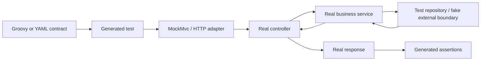
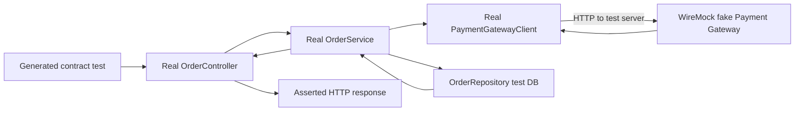
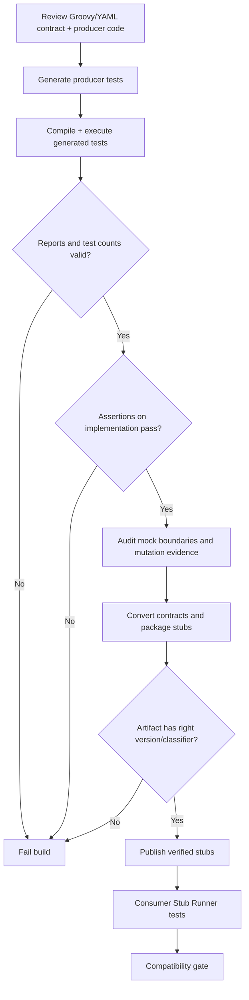

# Evaluating Whether Producer Tests Actually Verify Real Implementation Code

A suite of **producer contract tests** can pass while still failing to protect the system against incompatible API changes. The cause does not lie in Spring Cloud Contract DSL, but in the **execution path under test**: if generated tests hit a fake controller, or if the business service was mocked to always return the exact contract data, the test only confirms **mocked data matches mocked data**. When the real producer implementation breaks, tests can still pass.

In the **SPRING_CLOUD_CONTRACT** track, Spring Cloud Contract uses **Groovy/YAML DSL** to specify HTTP or messaging behavior; **Contract Verifier** generates producer tests, the plugin packages stubs, **Stub Runner** serves consumer tests, and CI detects breaking changes. This lesson belongs to the **Contract Quality** chapter, directly addressing: **Evaluating Whether Producer Tests Actually Verify Real Implementation Code**.

The central question is not “How many generated tests exist?” but:

> When I break the behavior of the **real producer implementation**, do the executing generated tests **fail on the right contract violation**?

This lesson presents criteria for inspecting generated code, request paths, mock boundaries, test fixtures, messaging hooks, Surefire/Failsafe reports, mutation tests, Stub Runner, and CI gates. Examples use **Order Service** as the producer, **Checkout Service** as the HTTP consumer, and **Billing Service** as the message consumer.

## 1. What makes producer verification meaningful?

Suppose Order Service exposes:

```http
GET /api/orders/ORDER-42
Accept: application/json
```

When compliant with the contract:

```http
HTTP/1.1 200 OK
Content-Type: application/json

{"id":"ORDER-42","status":"PAID","totalAmount":125000}
```

A good test must verify:

1. The request genuinely enters **Order Service's HTTP ingestion layer**, within the chosen scope.
2. The router, controller, and response-producing logic **that the contract is meant to protect** actually execute.
3. Test fixtures control only **inputs and external dependencies**, without unconditionally replacing the output under verification.
4. Response `200`, `Content-Type`, and body originate from the implementation under test.
5. Generated assertions compare the actual response against the Groovy/YAML contract.
6. If the controller or service flips `status=PAID` to `status=CANCELLED`, the test no longer passes.
7. Tests actually appear in runner reports, not merely as generated sources under `target/`.

**Running full production infrastructure is not always required.** In `MOCKMVC` test mode, Spring MVC and the real controller can be tested **without opening a real HTTP port**. What determines quality is **which production code actually executes and what was mocked**, not whether tests open a socket.

### 1.1. Desired execution path



A boundary test double such as a payment gateway or test data store is **valid if it keeps the logic under test running**. Conversely, mocking `OrderQueryService` itself to return a canned `PAID` object stops testing that service.

### 1.2. Distinguishing “real code” from “real infrastructure”

| Component | Usually needs to run for real in producer contract tests? | When can it be replaced? |
|---|---|---|
| HTTP request mapping/controller | Yes, if the contract guards an HTTP API | Controller-only slice if explicitly scoped and service is tested separately |
| Service defining response/status | Usually yes | Mock only if contract scope is intentionally limited to controller mapping |
| DTO mapper/serializer | Yes if consumers depend on JSON shape | Very rarely, since mocking mappers hides schema changes |
| Spring Security filters | Yes if contracts include `401/403` | Never swap with `permitAll` when protecting auth |
| Repository/query | Depends on goal: test DB or deterministic fake | Only when data-access logic is not under verification |
| External payment provider | Does not need live calls | Use fake/MockWebServer/WireMock with controlled responses |
| Message publisher adapter | Usually run real publishing path | Use test binder/broker instead of production broker |
| Producer method `publishOrderPaid()` | Must trigger the business path under test | Never manually send a sample message via test verifier alone |
| Production Kafka/RabbitMQ | Not required for every contract test | Use test broker/binder, plus a dedicated integration suite |

**A test can be narrow in scope and still valuable.** Be honest about whether it only tests the controller, or genuinely exercises controller + service + mapping + authorization.

## 2. Three kinds of “green” to distinguish

A pipeline can return `BUILD SUCCESS` in three completely different situations:

| Case | What happened | Does it prove producer meets contract? |
|---|---|---|
| **Green from zero tests** | Plugin discovered no contracts or test runner ran 0 tests | **No** |
| **Green from mocking the answer** | Tests hit a fake controller/service returning canned sample JSON | **No** for the replaced implementation |
| **Meaningfully green** | Generated tests executed against real code within defined scope, asserting real responses/messages | **Yes**, within the scope of assertions and test environment |

Quality evaluation therefore requires **three layers of evidence**:

- **Generation:** were contracts converted into tests?
- **Execution:** did tests actually execute and assert?
- **Behavioral sensitivity:** does breaking the implementation cause tests to fail?

If any layer is missing, you cannot conclude “the producer is verified.”

## 3. Start with a Groovy contract with clear assertions

Example `src/test/resources/contracts/checkout/get_paid_order_200.groovy`:

```groovy
import org.springframework.cloud.contract.spec.Contract

Contract.make {
    name 'checkout_get_paid_order_200'
    description 'Checkout reads a paid order'

    request {
        method GET()
        url '/api/orders/ORDER-42'
        headers {
            header 'Accept', 'application/json'
        }
    }

    response {
        status OK()
        headers {
            contentType(applicationJson())
        }
        body(
            id: 'ORDER-42',
            status: 'PAID',
            totalAmount: 125000
        )
    }
}
```

Expectations that must be preserved:

- `GET` request to exact path `/api/orders/ORDER-42`.
- Response status `200`.
- Response `Content-Type: application/json`.
- Accurate `id` field.
- `status` equals `PAID`.
- `totalAmount` is numeric `125000`.

If only status `200` is checked, a producer returning `{"status":"CANCELLED"}` can still pass. If `status` has an overly broad matcher, a business change can likewise slip through.

### 3.1. YAML DSL for an independent error case

Example `src/test/resources/contracts/checkout/get_missing_order_404.yml`:

```yaml
name: checkout_get_missing_order_404
description: Producer returns business error when order does not exist
request:
  method: GET
  url: /api/orders/ORDER-MISSING
  headers:
    Accept: application/json
response:
  status: 404
  headers:
    Content-Type: application/json
  body:
    code: ORDER_NOT_FOUND
```

This is a **different scenario** from the Groovy `200` contract, not the same contract written twice. In fixtures, seed `ORDER-42` and ensure `ORDER-MISSING` does not exist.

**Note:** a `404` from WireMock due to **no matching mapping** is not equivalent to a business `404` with `code=ORDER_NOT_FOUND`. In producer verification, the response must come from the implementation under test; in consumer Stub Runner tests, distinguish those two sources of `404`.

## 4. Which part of the implementation is being tested?

A minimal producer has this architecture:

```text
GET /api/orders/{id}
        |
        v
OrderController.getOrder(id)
        |
        v
OrderQueryService.findById(id)
        |
        v
OrderRepository.findById(id)
        |
        v
OrderMapper.toResponse(entity)
        |
        v
HTTP 200 + JSON
```

Controller example:

```java
package com.example.order.api;

import org.springframework.web.bind.annotation.GetMapping;
import org.springframework.web.bind.annotation.PathVariable;
import org.springframework.web.bind.annotation.RequestMapping;
import org.springframework.web.bind.annotation.RestController;

@RestController
@RequestMapping("/api/orders")
public class OrderController {

    private final OrderQueryService orderQueryService;

    public OrderController(OrderQueryService orderQueryService) {
        this.orderQueryService = orderQueryService;
    }

    @GetMapping("/{id}")
    public OrderResponse findOrder(@PathVariable String id) {
        return orderQueryService.findOrder(id);
    }
}
```

Service example:

```java
package com.example.order.api;

import org.springframework.stereotype.Service;

@Service
public class OrderQueryService {

    private final OrderRepository repository;

    public OrderQueryService(OrderRepository repository) {
        this.repository = repository;
    }

    public OrderResponse findOrder(String id) {
        OrderEntity order = repository.findById(id)
            .orElseThrow(() -> new OrderNotFoundException(id));

        return new OrderResponse(
            order.getId(),
            order.getStatus(),
            order.getTotalAmount()
        );
    }
}
```

Here, `OrderResponse`, `OrderEntity`, `OrderRepository`, and `OrderNotFoundException` are **illustrative project classes that must be implemented**. An exception handler must map `OrderNotFoundException` to `404` and the contract error body. The snippets above are **not an independently buildable module**.

### 4.1. Questions about the generated request path

After reading the base class, answer:

1. Does the request hit the real `OrderController` or a fake/mock controller?
2. Does the controller receive the real `OrderQueryService` bean or a service mock?
3. Does the service call a real repository or gateway within the chosen scope?
4. Is `OrderResponse` produced by application logic or pre-built in test setup?
5. Are controller advice, security filters, and Jackson mappers active?
6. Is the asserted response genuinely from **the current call**?
7. Do tests run the implementation from **the exact commit being verified**?

If you cannot answer these, a test named “ContractVerificationTest” proves nothing on its own.

## 5. Three base test styles: different scopes

Spring Cloud Contract Verifier generates classes extending the **base test class** configured in the plugin. For HTTP, execution scope depends on that base class and `testMode`.

### 5.1. Level A — MockMvc standalone with real controller

A common documentation style:

```java
@BeforeEach
void setup() {
    OrderRepository fakeRepository = new InMemoryOrderRepository();
    fakeRepository.save(
        new OrderEntity("ORDER-42", "PAID", 125000)
    );

    OrderQueryService service =
        new OrderQueryService(fakeRepository);

    OrderController controller =
        new OrderController(service);

    RestAssuredMockMvc.standaloneSetup(controller);
}
```

This illustrative snippet requires the project to supply `InMemoryOrderRepository` and matching models. It is **not a worthless test**: requests run through the **real** controller and service, while the repository uses an in-memory test double.

However, `standaloneSetup` usually **does not load the full Spring Boot application context, filters, security, method interceptors, or custom beans**. If contracts require checking filters or authentication, this setup may be too narrow.

### 5.2. Level B — MockMvc standalone with mocked business service

Example:

```java
@BeforeEach
void setup() {
    OrderQueryService service = Mockito.mock(
        OrderQueryService.class
    );

    Mockito.when(service.findOrder("ORDER-42"))
        .thenReturn(
            new OrderResponse("ORDER-42", "PAID", 125000)
        );

    RestAssuredMockMvc.standaloneSetup(
        new OrderController(service)
    );
}
```

When generated tests send GET:

- The real controller receives the request.
- The controller calls `service.findOrder(...)`.
- **Mockito immediately returns the canned response matching the contract.**
- Real `OrderQueryService` logic **never runs**.

This test can verify controller routing, mapping, and serialization, yet **does not verify business implementation**. If the real service flips `PAID` to `CANCELLED`, tests stay green because they hit the mock.

This does not mean removing all mocks. Clearly state the **scope**: “controller contract slice” vs. “producer behavior verification through the service.”

### 5.3. Level C — Spring Boot context with configured MockMvc

Closer to real application behavior:

```java
package com.example.order.contract;

import io.restassured.module.mockmvc.RestAssuredMockMvc;
import org.junit.jupiter.api.BeforeEach;
import org.springframework.beans.factory.annotation.Autowired;
import org.springframework.boot.test.autoconfigure.web.servlet.AutoConfigureMockMvc;
import org.springframework.boot.test.context.SpringBootTest;
import org.springframework.test.web.servlet.MockMvc;

@SpringBootTest
@AutoConfigureMockMvc(addFilters = true)
public abstract class OrderContractTestBase {

    @Autowired
    MockMvc mockMvc;

    @Autowired
    OrderContractFixture fixtures;

    @BeforeEach
    protected void setUpContractTest() {
        fixtures.resetOrders();
        fixtures.insertPaidOrder(
            "ORDER-42", "PAID", 125000
        );
        fixtures.ensureAbsent("ORDER-MISSING");

        RestAssuredMockMvc.mockMvc(mockMvc);
    }
}
```

`OrderContractFixture` must be implemented and injected by the project; this snippet does not compile standalone without the application, fixture, repository, and dependencies.

Benefits:

- Controller comes from the Spring context.
- Service and mapper can be real beans.
- HTTP routing, argument binding, validation, exception handlers, and security filters can all be exercised.
- Tests can use a test database or fakes strictly at **external boundaries**.
- Generated assertions evaluate output returned via MockMvc.

**Never assume `@SpringBootTest` guarantees every bean is real.** Test profiles may contain `@MockitoBean`/`@MockBean`, `@Primary` fakes, or config overrides. Inspect the **bean graph**, runtime test context, and which exact beans were replaced.

## 6. Scope comparison table across test setups

| Setup | Controller | Business service | Infrastructure | Evidence |
|---|---|---|---|---|
| Mock controller returning fixed JSON | Fake | Does not run | Fake | Mostly tests assertion wiring |
| `standaloneSetup` + mocked service | Real | Fake | Minimal | Tests routing/controller/serialization |
| `standaloneSetup` + real service + fake repository | Real | Real | Fake repository | Tests service logic in narrow scope |
| `@WebMvcTest` + mocked service | Real within MVC slice | Fake | Spring MVC slice | Tests web layer, not service |
| `@SpringBootTest` + MockMvc + real service + test DB | Real | Real | Test DB and app context | Deeper verification of producer behavior |
| `@SpringBootTest` + `EXPLICIT` + random port | Real over socket | Real if unmocked | HTTP server + app context | Tests network HTTP layer and app behavior |
| Full E2E staging | Real | Real | Many real components | Broader coverage, higher cost and flakiness |

**Confidence does not scale linearly with the number of real components.** Tests coupled to unstable data can miss other bugs; clean fixtures and mutation sensitivity matter more than spinning up as many containers as possible.

### 6.1. When is a controller-only contract test reasonable?

If a contract solely guards **HTTP mapping and DTO adapters**, service behavior is verified by a dedicated suite, and the team states that scope transparently, a controller slice test has value. However, never present it as **full** business verification of the producer when the core service was stubbed.

The criterion is **the level of commitment**. If consumers rely on `status=PAID` produced by business rules, run tests executing those rules rather than mocking a `PAID` DTO.

## 7. Maven plugin: which class do generated tests extend?

A Maven producer typically configures:

```xml
<plugin>
    <groupId>org.springframework.cloud</groupId>
    <artifactId>spring-cloud-contract-maven-plugin</artifactId>
    <version>APPROPRIATE_CONTRACT_PLUGIN_VERSION</version>
    <extensions>true</extensions>
    <configuration>
        <baseClassForTests>
            com.example.order.contract.OrderContractTestBase
        </baseClassForTests>
        <testMode>MOCKMVC</testMode>
        <testFramework>JUNIT5</testFramework>
    </configuration>
</plugin>
```

This is a **POM fragment**, not sufficient to build standalone. You also need compatible BOM/dependencies, test starters, the Spring Cloud Contract Verifier test dependency, POM coordinates, security/test infrastructure, and contract sources.

Verify:

1. The plugin actually exists in `build/plugins` of the **producer module**, or is activated in the lifecycle via verified config.
2. `baseClassForTests` is a valid FQN on the test classpath.
3. Generated tests extend that exact class.
4. `testMode` matches the HTTP stack and base class setup.
5. JUnit/TestNG/Spock test runners actually pick up generated tests.
6. The plugin reads the right contracts directory.

In multi-module builds, declaring the plugin only in the parent's `pluginManagement` without enabling it on the producer can result in no tests being generated.

### 7.1. When multiple base classes exist

If a module contains both HTTP and messaging contracts, or two controller groups need distinct fixtures, use `baseClassMappings` or `packageWithBaseClasses` as supported by your version. Example:

```xml
<configuration>
    <baseClassForTests>
        com.example.order.contract.DefaultContractBase
    </baseClassForTests>
    <baseClassMappings>
        <baseClassMapping>
            <contractPackageRegex>.*http.*</contractPackageRegex>
            <baseClassFQN>
                com.example.order.contract.HttpContractBase
            </baseClassFQN>
        </baseClassMapping>
        <baseClassMapping>
            <contractPackageRegex>.*messaging.*</contractPackageRegex>
            <baseClassFQN>
                com.example.order.contract.MessagingContractBase
            </baseClassFQN>
        </baseClassMapping>
    </baseClassMappings>
</configuration>
```

Cross-check regexes, package paths, and test FQNs against actual generated classes. **Never assume every test uses the right base class** just because the POM names a base class.

## 8. Test modes: `MOCKMVC` does not mean controllers are fake

In Spring Cloud Contract Maven docs, `testMode` includes options like `MOCKMVC`, `EXPLICIT`, and others depending on version/stack. Distinguish:

- **MOCKMVC:** dispatches simulated HTTP requests through Spring MVC test infrastructure; can run real controllers and services.
- **EXPLICIT:** sends requests over a real listening HTTP test port; requires the app to start a server and configure base URI/port.
- **WEBTESTCLIENT:** uses `WebTestClient` when supported by plugin version and reactive test setup; inspect generated code.
- **JAXRSCLIENT:** for JAX-RS mode where supported.

**MockMvc** simulates **HTTP transport**—it does not mean business layers are mocked. Likewise, using `EXPLICIT` over a real server socket **does not guarantee** business services are unmocked.

### 8.1. Example `EXPLICIT` mode

In supported projects/versions:

```java
import io.restassured.RestAssured;
import org.junit.jupiter.api.BeforeEach;
import org.springframework.boot.test.context.SpringBootTest;
import org.springframework.boot.test.web.server.LocalServerPort;

@SpringBootTest(
    webEnvironment = SpringBootTest.WebEnvironment.RANDOM_PORT
)
public abstract class HttpContractBase {

    @LocalServerPort
    int port;

    @BeforeEach
    void configureClient() {
        RestAssured.baseURI = "http://localhost";
        RestAssured.port = port;
    }
}
```

**Note:** the `LocalServerPort` import here matches modern Spring Boot releases using `org.springframework.boot.test.web.server`. Older Spring Boot versions may use another package. When applying this, match imports and RestAssured APIs to your pinned release train, confirm the server starts, and confirm generated tests issue real HTTP calls.

The core questions remain: does the real service run, do generated assertions validate real responses, and do mutations fail tests?

### 8.2. With WebFlux

If the producer uses Spring WebFlux only, do not blindly copy a `MockMvc` base class. Depending on version, the plugin can generate tests using `WebTestClient` or `EXPLICIT` mode against a live HTTP server. Pick a supported mode and verify:

- Reactive controllers/handlers initialize properly.
- `Mono`/`Flux` publishers are subscribed to so real logic executes.
- Bodies, HTTP headers, and response statuses match contracts.
- Streaming responses are not mistaken for single JSON payloads.
- Asynchronous timeouts or virtual time are controlled.
- Real handlers are not replaced by test-only controllers returning sample data.

## 9. Generated sources: inspect what tests actually call

After Maven runs test generation, generated sources in many versions appear under a path like:

```text
target/generated-test-sources/contracts/
```

That is **plugin-generated output**, not a place for developers to hand-edit permanently. File names, paths, and test frameworks vary by version.

A **structural simulation** of a generated test:

```java
// ILLUSTRATION ONLY of assertion structure.
// Not guaranteed to match exact output of every plugin version.

class CheckoutGetPaidOrderTest extends OrderContractTestBase {

    @Test
    void checkout_get_paid_order_200() {
        given()
            .header("Accept", "application/json")
        .when()
            .get("/api/orders/ORDER-42")
        .then()
            .statusCode(200)
            .header("Content-Type", containsString("application/json"))
            .body("id", equalTo("ORDER-42"))
            .body("status", equalTo("PAID"))
            .body("totalAmount", equalTo(125000));
    }
}
```

In real tests, `given()` helpers, imports/matchers, and adapters are chosen by the generator. The key point is that **generated tests send requests and compare actual outcomes**, rather than building DTOs from the contract and comparing two copies.

### 9.1. Warning signs when reading generated sources

- Tests lack `@Test`/Spock methods recognized by the runner.
- Tests extend the wrong base class.
- Generated tests never call the producer and instead compare two constants.
- Assertions omit `status`, headers, or body fields consumers actually use.
- Overly broad `.*` JSONPath matchers miss type/value changes.
- Tests are disabled, ignored, excluded, or run under the wrong test runner.
- Test mode emits a REST client while the base class only sets up MockMvc.
- Tests verify only HTTP `200`, skipping critical `404`/security/messaging scenarios.
- Tests generate into a source set omitted from the test task.

Never hand-edit generated code. Fix the **contract DSL, generator options, base class, or implementation**, then regenerate.

## 10. Proving business code layers actually executed

Reading source and annotations is a starting point, **not a substitute for runtime observation**.

Techniques that increase confidence:

| Technique | What it proves | Limitation |
|---|---|---|
| Reading Spring context / test config | Which beans are created or replaced | Does not prove methods were called |
| Inspecting generated test requests | Where requests are sent | May still hit a fake adapter |
| Mockito `verify` on a spy at an appropriate boundary | Method was invoked during test | Invocation alone does not guarantee right logic |
| Test-only metrics/traces | Code path executed | Avoid logging sensitive data |
| DB state assertions | Business side effects occurred | Requires fixtures and isolation |
| Controlled external fakes | Producer calls gateway with right request | Does not prove real production gateway |
| Mutation testing | Breaking changes fail tests | Covers only mutations tested |
| Coverage reports | Which lines/branches ran | High coverage does not mean sufficient assertions |
| Test reports | Tests ran and their status | Does not reveal whether business logic was mocked away |

**100% coverage does not mean contracts are sound.** If tests hit a fake service with identical method names, real business coverage can be 0; if real code executes without assertions protecting outputs, tests still pass when behavior breaks.

### 10.1. Inspecting the bean graph before running tests

An audit checklist:

1. Locate where the **base test class** calls `RestAssuredMockMvc.mockMvc(...)` or `standaloneSetup(...)`.
2. Check whether `OrderController` is a real Spring bean or created via `new`/Mockito.
3. Check which `OrderQueryService` bean is injected into the controller.
4. Check for test-only overrides like `@Primary`, `@TestConfiguration`, `@MockitoBean`, or `@MockBean`.
5. Review which external clients are mocked and why.
6. Keep fakes strictly at boundaries **outside the contract target**.
7. Confirm fixtures reset cleanly before every test.
8. Check whether security configuration was replaced with `permitAll` or disabled filters.

A bean name or `@Service` annotation proves nothing about real implementation execution if the test context replaced that bean.

## 11. Which mock boundaries are reasonable?

A producer may call an external Payment Gateway during order creation. When contracts test **Order Service REST responses** based on payment results, stubbing the gateway's HTTP response instead of calling the live gateway is appropriate.

Example:



In this design:

- Order Service's controller, service, gateway client adapter, and mapper all execute.
- The external Payment Gateway is replaced by a deterministic fake.
- Tests can also verify outbound requests sent to the gateway if relevant.
- `Spring Cloud Contract` stubs do not replace producer implementation verification.

### 11.1. Test doubles in the right place

**Reasonable:**

```text
Real OrderService
    -> Real PaymentGatewayClient
        -> External WireMock HTTP server
```

**Risk of hiding bugs:**

```text
Real OrderController
    -> Mockito.mock(OrderService.class)
        -> thenReturn(OrderResponse matching contract)
```

**Very little value for verifying the producer:**

```text
Generated test
    -> Mockito.mock(OrderController.class)
        -> thenReturn(OrderResponse matching contract)
```

The closer a test double sits to the **contract output**, the higher the risk of circular verification.

### 11.2. When mocking a service can still be acceptable

A team may intentionally build **controller-slice contract verification** to protect serialization and path/query/header binding, paired with a separate **business/service integration suite**. This works if:

- The scope is explicitly documented.
- The business suite genuinely runs in the same release gate.
- Together, both suites protect the data and semantics consumers depend on.
- The controller slice is never claimed as proof that service logic is verified.
- A service-level mutation fails **at least one release gate step**.

If the business suite does not exist or is skipped, that setup has an obvious gap.

## 12. Mutation testing: the most reliable test for the central question

**Manual mutation testing** means intentionally breaking one implementation behavior on a temporary branch and re-running the producer contract suite. It directly verifies whether tests respond to breaking changes.

### 12.1. Mutation 1 — change response status

Contract expects `200`. Temporarily modify the controller:

```java
@GetMapping("/{id}")
public ResponseEntity<OrderResponse> getOrder(@PathVariable String id) {
    OrderResponse response = service.findOrder(id);
    return ResponseEntity.status(202).body(response);
}
```

This is illustrative code; real projects need imports for `@GetMapping`, `@PathVariable`, `ResponseEntity`, and the service.

**Expected:** generated test `checkout_get_paid_order_200` fails on the `200` status assertion. If it stays green:

- Did generated tests fail to run?
- Does the contract actually assert `200`?
- Did requests hit a fake controller?
- Did the test class target the wrong module or port?
- Did another layer override the status?

Never change the DSL to `202` if the producer still promises `200` to active consumers.

### 12.2. Mutation 2 — change a business field

In `OrderQueryService`, temporarily change:

```java
return new OrderResponse(
    order.getId(),
    "CANCELLED",           // Intentionally wrong
    order.getTotalAmount()
);
```

The contract requires `"status":"PAID"`.

**Expected:** producer test fails at the JSONPath/body assertion. If it still passes despite this edit, possible causes include:

- The real service was never invoked;
- Responses come from a pre-built mock;
- The test hit a different fixture or endpoint;
- Assertions do not guard `status`;
- The mutation was not compiled into the running artifact.

### 12.3. Mutation 3 — drop a JSON field

Temporarily alter the DTO/mapper to omit `totalAmount`.

**Expected:** generated tests asserting this field fail. Tests asserting only `statusCode(200)` miss this. That signals **contract quality** or generator coverage needs improvement.

### 12.4. Mutation 4 — break the 404 case

Temporarily make the service return an empty object / `200` when the order is missing instead of throwing `OrderNotFoundException`.

**Expected:** YAML contract `checkout_get_missing_order_404` fails on wrong status/body. If the test's `404` came from an unmatched route instead of business logic, check URLs and exception handlers.

### 12.5. Mutation 5 — remove authorization

If contracts include `401/403`, temporarily set the endpoint to `permitAll()` or drop scope checks on a test branch.

**Expected:** negative contracts fail. If not, security filters may be disabled or the test profile fails to load real rules.

### 12.6. Mutation 6 — change message type or destination

If Order Service emits `ORDER_PAID` to `orders.events`, temporarily switch to `ORDER_CANCELLED` or `wrong.events`.

**Expected:** producer message contract test fails. If it stays green, the hook may be sending a canned sample message directly instead of calling real implementation code.

### 12.7. How should mutation checks be controlled?

1. Create a temporary branch or uncommitted local edit.
2. Ensure generated tests and implementation belong to the **same commit/worktree**.
3. Run the baseline before mutating and confirm it passes.
4. Alter **one** contract-relevant behavior.
5. Re-run the exact suite and record the failing test and assertion.
6. Revert the implementation change.
7. Re-run and confirm it passes again.
8. Never merge intentional mutations to main branches.
9. If tests fail to turn red, investigate layer by layer rather than blaming the framework immediately.
10. Record findings in a test-quality report.

A quality test **does not need to catch every conceivable mutation**, but must catch mutations violating the commitments it claims to protect.

## 13. Mutation matrix and expected evidence

| Intentional fault | Which test must fail? | Which code must be running? |
|---|---|---|
| `200` → `202` | Contract status assertion | Controller/response layer |
| `PAID` → `CANCELLED` | Contract body assertion | Service/DTO mapper |
| `125000` → `"125000"` | Typed JSON assertion | Serializer/response mapper |
| Drop `Content-Type` | Header assertion | HTTP response configuration |
| Missing `ORDER-42` fixture | `200` test fails with clear environment cause | Repository/test data setup |
| `404` → `200` | Contract not-found case | Service/exception handler |
| Open protected endpoint publicly | `401/403` contract | Spring Security filter/authorization |
| Drop tenant ownership check | Cross-tenant negative contract | Business access policy |
| `ORDER_PAID` → `ORDER_CANCELLED` | Message body/header assertion | Publisher/mapper |
| `orders.events` → `wrong.events` | Message destination assertion | Producer binding/routing |
| Change producer version while testing old stub | Consumer may still pass falsely | Artifact resolution/test targeting |

**Note:** a mutation that breaks fixture presence proves the test depends on data, yet **does not prove business logic is accurate**. Target mutations at the implementation or mapping under protection to answer the central question.

## 14. Messaging: does the `triggeredBy` hook go through the real producer?

Spring Cloud Contract supports message contracts. For example, Order Service emits an event when an order is paid:

```groovy
import org.springframework.cloud.contract.spec.Contract

Contract.make {
    name 'billing_order_paid_v1'
    label 'billing_order_paid_event_v1'

    input {
        triggeredBy('publishOrderPaid()')
    }

    outputMessage {
        sentTo('orders.events')
        headers {
            header('contentType', 'application/json')
            header('eventType', 'ORDER_PAID')
        }
        body(
            eventId: 'EVENT-42',
            eventType: 'ORDER_PAID',
            orderId: 'ORDER-42',
            totalAmount: 125000
        )
    }
}
```

Generated producer tests invoke `publishOrderPaid()` provided by the base class/hook. **This is a classic place for a “false green.”**

### 14.1. Bad hook: sending sample data directly

An ineffective setup:

```java
// ANTI-PATTERN: hook bypasses real OrderService.
public void publishOrderPaid() {
    messageVerifier.send(
        "{\"eventType\":\"ORDER_PAID\"," +
        "\"orderId\":\"ORDER-42\"}",
        "orders.events"
    );
}
```

If `messageVerifier.send(...)` simply pushes the contract payload onto the test transport, generated tests receive it and pass even though production `OrderPaymentService` never ran.

**Such a test verifies a sample message**, not that the producer implementation actually emits the real event.

### 14.2. Better hook: invoking real business logic

```java
@Autowired
OrderPaymentService orderPaymentService;

public void publishOrderPaid() {
    orderPaymentService.markPaid("ORDER-42");
}
```

Here, `markPaid(...)` must execute the real workflow within test scope and use the real publisher adapter to emit output. Messaging test infrastructure (test binder, Spring Integration channel, test broker, etc.) observes what the publisher actually sends.

**It is not automatically valid just because the method is named `markPaid`.** If `OrderPaymentService` is mocked or a test-only method constructs a canned payload, the gap remains.

### 14.3. Configuring messaging verification at the right level

A base class might need:

```java
@SpringBootTest
@AutoConfigureMessageVerifier
public abstract class MessagingContractBase {

    @Autowired
    OrderPaymentService orderPaymentService;

    @BeforeEach
    void resetFixture() {
        // Seed order in test DB and clear message state.
    }

    public void publishOrderPaid() {
        orderPaymentService.markPaid("ORDER-42");
    }
}
```

This is an **illustrative skeleton** needing version-matched Spring Cloud Contract messaging integration imports and dependencies, a test binder/broker, and real fixtures. In Spring Cloud Contract docs, `@AutoConfigureMessageVerifier` configures messaging verification; the app needs a supported Spring Cloud Stream/Integration/JMS/Camel adapter for its version.

### 14.4. Two distinct messaging failures

- **No event emitted:** hook failed to trigger business code, listener/transport not ready, or publisher failed to send.
- **Event emitted, contract violated:** wrong destination, headers, or body.

If a test helper manually sends a contract-compliant message directly, it masks both failures. Producer message tests must observe **output from the real producer**, not output emitted by the test itself.

## 15. Producer message tests vs. Stub Runner message triggers

| Activity | Where it runs | Runs real producer implementation? |
|---|---|---|
| Generated producer test calls `publishOrderPaid()` | Producer test context | **Yes**, if the hook goes through real business code |
| Consumer Stub Runner triggers label | Consumer test context | **No**, uses message stub |
| Consumer listener processes stub message | Consumer test context | Runs **real consumer handler**, not producer |
| Broker integration test with real producer | Integration/test environment | Yes, within the configured integration scope |

If Billing successfully processes a Stub Runner-emitted message, that only proves **Billing is compatible with the sample message**. The producer must still be verified to **actually emit** an equivalent message.

A great check: intentionally change `eventType` in **OrderService's publisher implementation**. Producer contract tests must fail; consumer stub tests may keep passing because they run against the unchanged sample artifact.

## 16. Verifying real side effects, not just return values

A producer endpoint may produce side effects: DB writes, emitted events, gateway calls, or state transitions. HTTP contracts sometimes observe only responses; if the system promises side effects, add integration tests.

API example:

```http
POST /api/orders/ORDER-42/confirm
Content-Type: application/json

{}
```

Response:

```http
HTTP/1.1 202 Accepted
Location: /api/order-operations/OP-42
```

A mock controller can always return `202` without creating an operation record. If the contract specifies only `202`, generated tests are accurate **within HTTP observation scope** yet insufficient to confirm the real workflow.

Add tests asserting:

1. Operation record is created in the test database.
2. Order state transitions at the right time.
3. Events are emitted if required by architecture contracts.
4. No side effects occur on `401/403` requests.
5. Retries/idempotency do not create duplicate payments or orders.
6. Transaction rollbacks or failure behaviors follow policy.

**Distinguish contract violations from implementation invariants:** do not force every internal detail into the DSL. Many invariants fit service integration tests better. Yet release gates need a **combined evidence set**, not just mocked responses.

### 16.1. When responses match yet a side-effect mutation escapes

Suppose the producer always returns `202` per contract, and you edit code to skip saving the operation. If the contract guards only the response, green tests are **within scope**—the mistake is treating that test as overly broad proof. Add a workflow integration test rather than concluding contract verification is useless.

## 17. Fixture data: test inputs, not hardcoded answers

A good fixture:

- Seeds `ORDER-42` in a **test database** before the request.
- Initializes `status=PAID` per the business case under test.
- Ensures `ORDER-MISSING` does not exist.
- Isolates data for parallel runs.
- Never uses a production DB.
- Documents initial states explicitly to prevent false positives.
- Clears caches, queues, file state, or external fakes before tests.
- Keeps time and random IDs deterministic or validates them with proper matchers.
- Avoids depending on an earlier test to seed data for a later test.

**Crucial difference:**

```text
Fixture supplies input:
    DB holds OrderEntity(status=PAID)
    -> Real service queries, maps DTO, controller returns JSON
    -> Test asserts response

Mock supplies the answer:
    when(service.findOrder(...)).thenReturn(OrderResponse(status=PAID))
    -> Controller bypasses service implementation
    -> Test asserts pre-built JSON
```

In the first case, bugs in queries, mappers, or services get caught. In the second case, they stay hidden.

### 17.1. Dynamic data

If a response contains:

```json
{
  "orderId": "ORDER-42",
  "createdAt": "2026-01-15T08:30:00Z",
  "correlationId": "CORR-42"
}
```

choose among:

- **Fixed clock/test IDs** so expected values are reproducible;
- Or **semantically tight matchers** for timestamps/UUIDs;
- Or additional assertions on relationships between request and response fields.

Overly broad matchers like `.*` can allow empty timestamps or invalid correlations, missing discrepancies. In Spring Cloud Contract, detailed matcher capabilities depend on DSL/plugin version; inspect generated assertions after editing.

## 18. Security: a frequent source of false greens

If contracts require:

- With `orders.read` → `200`.
- Without token → `401`.
- Valid token lacking scope → `403`.

Producer base tests must never do:

```java
@AutoConfigureMockMvc(addFilters = false)
```

when the goal is verifying security filters. Similarly, never apply a `permitAll` test profile across the entire API and claim producer contract tests protect auth.

A setup may use a **test-only `JwtDecoder`** to avoid an external Identity Provider while keeping:

```text
HTTP request
 -> Real Spring Security filter chain
 -> Test-only token decoder
 -> Real authorization rules
 -> Real controller/service
 -> Response
```

Distinguish “mocking identity” from “mocking authorization.” If a test decoder or `@WithMockUser` grants reader authority to every request, negative `401/403` tests lose their value.

### 18.1. Security mutation

Intentionally change `hasAuthority("SCOPE_orders.read")` to `permitAll()` on a test branch.

- If generated `401/403` contracts fail, tests protect that policy.
- If they still pass, inspect which route requests hit, which filter chain ran, test principals, and mock setup.
- If contracts only include `200`, they do not prove auth policies are tested. Add negative contracts or a security integration suite.

## 19. Verify the right build module and commit

In a monorepo:

```text
commerce-platform/
├── pom.xml
├── order-service/
│   ├── pom.xml
│   └── src/test/resources/contracts/
├── checkout-service/
│   └── pom.xml
└── common-model/
    └── pom.xml
```

If CI runs:

```bash
./mvnw -pl checkout-service clean test
```

Checkout's `BUILD SUCCESS` says nothing about whether Order Service's generated producer tests ran. To verify the producer module in the reactor:

```bash
./mvnw -B -ntp -pl order-service -am clean verify
```

This illustrates a **reactor with a module named `order-service`**. Inspect generated sources and test reports under `order-service/target/`, not only at the root.

### 19.1. Dangerous provenance mismatches

- Tests generated from commit A while implementation builds from commit B.
- Plugin executes on another module that does not own the contracts.
- Cached stubs artifacts from a prior build are reused by mistake.
- Snapshot versions get overwritten while CI fails to record the resolved build.
- Producer tests pass in one job, while a release job rebuilds and publishes an artifact from modified source.
- Test fixtures diverge from production behavior without documentation.

A strong release gate records **commit SHA, contract revision, artifact version, plugin version, test counts, and artifact checksum**.

## 20. Maven: verifying generated tests actually executed

In a configured Maven producer:

```bash
./mvnw -version
./mvnw -B -ntp clean verify
```

Depending on plugin version, generated tests may reside at:

```text
target/generated-test-sources/contracts/
```

And execution reports typically appear at:

```text
target/surefire-reports/
target/failsafe-reports/
```

Paths can differ with custom POM configurations or other test engines.

### 20.1. Indicators to confirm

1. Did `spring-cloud-contract-maven-plugin` execute in build logs?
2. Did the plugin scan the right `contractsDirectory`?
3. Does generated test source count match expected scenarios?
4. Did classes compile and did the test runner discover them?
5. Do Surefire/Failsafe reports clearly show executed, failed, error, and skipped counts?
6. Did `@Disabled`, includes/excludes, or profiles skip those tests?
7. Were `-DskipTests` or `-Dmaven.test.skip=true` passed?
8. Does `failOnNoContracts` (if supported by your version) fail when contracts are unexpectedly missing?
9. Did both HTTP and messaging generated tests execute?
10. Did mutation tests prove output depends on real implementation?

### 20.2. Why “test count > 0” is not enough

A module might run 100 **unit tests** and 0 **generated contract tests**. Seeing `Tests run: 100` and marking contract verification PASS is wrong.

Instead:

- Verify the generated source root is non-empty.
- Verify specific test classes generated for mandatory contracts.
- Confirm those class names appear in test reports.
- Confirm none were skipped.
- Cross-check test names against the contract inventory or version-controlled expectations.
- Run periodic mutation checks to guard test quality.

**Do not couple rigidly to a single generated class naming format** if plugin versions can change naming rules. CI checks should rely on verified inventories, metadata, or patterns observed in real output.

### 20.3. Generated tests can fail to run due to naming patterns

Maven Surefire normally matches `*Test`, `*Tests`, and configured patterns. If the generator names classes differently or project excludes are overly broad, tests compile yet never execute.

If reports show 0 tests, check:

- `maven-surefire-plugin` and `maven-failsafe-plugin` versions;
- JUnit Jupiter Engine / Spock dependencies;
- Generator `testFramework` setting;
- Plugin executions;
- Generated source directories;
- Includes/excludes;
- Generated class names and packages;
- Maven profiles or skip flags.

Never write a script that forces success when zero tests ran just to unblock releases.

## 21. Inspecting the stubs artifact after producer verification

The producer may output:

```text
target/
├── order-service-1.4.0.jar
└── order-service-1.4.0-stubs.jar
```

- Main JAR holds the implementation.
- Stubs JAR holds mappings/contracts for consumers.
- The `stubs` classifier usually shares the same groupId/artifactId/version.
- The stubs artifact must come from the **exact verified producer build**.

Example:

```bash
jar tf target/order-service-1.4.0-stubs.jar
```

Verify HTTP mappings and contracts/message labels match your artifact type and plugin version. **Message-only contracts may not produce WireMock HTTP JSON mappings**, so archive checks must distinguish HTTP from messaging.

### 21.1. Presence of a stubs JAR does not prove the implementation works

The plugin can convert DSL into mappings without running real controllers or services. If producer tests were skipped, the artifact may still get packaged depending on build config.

The pipeline must prove all four:

```text
Producer contract test sources generated
              +
Producer contract tests executed and passed
              +
Stubs JAR packaged from the exact contracts
              +
Artifact identity/version recorded
```

**Never call an artifact “verified stubs” solely because the filename ends with `-stubs.jar`.**

## 22. CI gates: distinguishing “ran” from “genuinely verified”

A helpful gate matrix:

| Gate | Condition | On failure |
|---|---|---|
| Contract discovery | Correct source paths and inventory | Stop build / inspect config |
| Generation | Sufficient producer test scenarios generated | Block on 0 tests |
| Test compilation | Base class, fixtures, and imports valid | Fix plugin / test setup |
| Test execution | Generated tests appear in reports, none skipped | Block release |
| Behavioral assertions | Accurate status/header/body/message checks | Fix producer or contract after review |
| Implementation path | Core code under verification not mocked away | Audit mock graph and test scope |
| Mutation sensitivity | Contract-relevant mutations fail the suite | Improve coverage / fix wiring |
| Stub packaging | Accurate mappings/contracts, classifier/version | Do not publish |
| Provenance | Artifact matches exact verified commit | Block artifact swap |
| Consumer compatibility | Consumer tests use exact version | Block rollout per policy |

### 22.1. A conceptual CI workflow



**Mutation evidence does not need every permutation on every PR.** A focused suite can run on a schedule or for critical changes. However, release gates must always check real test execution, rather than treating stale mutation reports as proof for new source code.

### 22.2. GitHub Actions skeleton for a Maven producer

```yaml
name: Verify producer contracts

on:
  pull_request:
  push:
    branches: [main]

permissions:
  contents: read

jobs:
  producer-contracts:
    runs-on: ubuntu-latest
    steps:
      - uses: actions/checkout@v4
      - uses: actions/setup-java@v4
        with:
          distribution: temurin
          java-version: '17'
          cache: maven

      - name: Verify producer
        run: ./mvnw -B -ntp clean verify

      - name: Check generated contract test sources
        shell: bash
        run: |
          test -d target/generated-test-sources/contracts
          find target/generated-test-sources/contracts \
            -type f \( -name '*.java' -o -name '*.groovy' \) \
            -print -quit | grep -q .

      - name: Upload test reports
        if: always()
        uses: actions/upload-artifact@v4
        with:
          name: producer-test-reports
          path: |
            target/surefire-reports/
            target/failsafe-reports/
          if-no-files-found: warn
```

This is an **incomplete CI template**: it assumes the producer sits at repository root, uses JDK 17, has a Maven Wrapper, and configures the contracts plugin. It checks only that generated files exist and uploads reports—it **does not yet parse XML to verify the exact generated test cases executed**; add that gate with tooling or scripts managed by your project. Pin GitHub Action versions per your current policy.

**Do not publish artifacts from pull requests** just because this job passes. Publication belongs in an appropriate release job after verification and provenance, version, and secret-permission checks.

## 23. Gradle: same criteria, different tooling

With the Spring Cloud Contract Gradle plugin, tasks may include:

- `generateContractTests`: generates producer test sources.
- `contractTest`: runs producer contract tests per supported source set/task version.
- `generateClientStubs`: generates stubs/mappings.
- `verifierStubsJar`: packages the stubs artifact.
- `check`: verification lifecycle task that projects can wire to depend on `contractTest`.

Exact names and task graphs depend on plugin version.

Reference commands in a configured project:

```bash
./gradlew --version
./gradlew clean check
./gradlew contractTest
./gradlew verifierStubsJar
```

**Never assume `check` automatically runs `contractTest` in every project**, or that `verifierStubsJar` runs producer verification. Inspect task graphs, test reports, and actual artifacts. Never run Gradle only to claim tests are verified without inspecting test execution.

## 24. Diagnosis: why can producer tests show a “false green”?

| Symptom | Possible cause | Verification step |
|---|---|---|
| Service implementation changed yet tests still pass | Service is mocked | Inspect base class / bean replacements |
| Controller route changed yet tests do not fail | Requests hit fake controller or other test | Check generated URL, MockMvc setup |
| JSON field dropped yet tests still pass | DSL/assertions fail to guard field | Read contract and generated assertions |
| Status changed `200` → `202` yet tests stay green | Tests did not run or responses are stubbed | Reports, controller wiring |
| `401` tests pass even with endpoint open | Filters disabled or false-positive route | `addFilters`, `permitAll`, test principal |
| Business `404` passes despite broken service | WireMock unmatched response or fake routing | Inspect response body and path |
| Generated test sources exist, absent from reports | Broken test discovery/engine/exclusions | Surefire/Failsafe configuration |
| Reports show unit tests but lack contract tests | Looking only at total test count | Check matching class/method names |
| `@WebMvcTest` passes while production service fails | Service replaced by `@MockitoBean` | Run service integration suite |
| Message contract passes despite publisher omitting event | Hook sends sample message directly | Inspect `triggeredBy` implementation |
| Message contract receives no event | Broker/test binder not ready | Adapter, channel, destination, timeout |
| Passes locally, fails on CI | Different fixtures/caches/ports/JDK | Toolchain and state isolation |
| Stubs JAR built despite skipped producer tests | Packaging does not depend on test gate | Block publish, audit skip flags |
| Consumer tests pass on stub v1 while producer v2 fails | Consumer tests wrong stubs version | Check resolved artifact |
| Controller slice test assumes method security is active | Missing proxy/method interceptor | Full context test or method-security suite |
| Mutation fails to turn tests red | Mutation path unexecuted or unasserted | Trace call graph, read reports, verify commit |

### 24.1. Layer-by-layer debugging workflow

1. **Metadata:** right producer module and contract sources?
2. **Generation:** did generated tests include all cases?
3. **Base:** do tests extend the right base class?
4. **Adapter:** is MockMvc/HTTP server/WebTestClient configured properly?
5. **Bean graph:** are controller/service/mapper/security real or mocked?
6. **Fixtures:** is data stable and matched to requests?
7. **Execution:** did JUnit/Spock tests run without skipping?
8. **Assertions:** are status/headers/body/messages sufficiently asserted?
9. **Mutation:** does breaking the implementation make tests fail?
10. **Artifact:** does the stubs JAR have the right GAV/classifier/version from the verified commit?
11. **Consumer:** do Stub Runner tests use the target artifact?
12. **CI:** do release gates block if any condition above fails?

Step through layer by layer to avoid wrong fixes. A failing generated test is not necessarily a framework bug; a passing generated test is not proof of quality if the scope is wrong.

## 25. Hands-on exercise: evaluating Order Service's producer tests

**Goal:** distinguish a contract suite testing only a mocked controller from one executing real code with mutation-sensitivity evidence.

### Part A — prepare contracts and implementation

1. Create Groovy contract `checkout_get_paid_order_200`.
2. Create YAML contract `checkout_get_missing_order_404`.
3. Implement `OrderController`, `OrderQueryService`, and repository/mapper.
4. Seed `ORDER-42` with `status=PAID`, `totalAmount=125000`.
5. Ensure `ORDER-MISSING` does not exist.
6. Use a test database or deterministic fake repository.

### Part B — experiment with overly narrow tests

1. Use MockMvc standalone with the real controller and a **mocked service**.
2. Stub `service.findOrder("ORDER-42")` to always return a `PAID` DTO.
3. Generate and run producer tests; observe pass.
4. Modify the real `OrderQueryService` to return `CANCELLED`.
5. Re-run; if it still passes, explain why.
6. Document explicitly that this test covers only the **controller slice**.

### Part C — widen verification scope

1. Switch the base test to `@SpringBootTest + @AutoConfigureMockMvc`.
2. Wire the real service and test repository/DB.
3. Do not mock `OrderQueryService` or the DTO mapper.
4. Run generated tests and inspect reports.
5. Change the service to `CANCELLED` again.
6. Generated tests must fail against the `PAID` contract.
7. Restore the implementation, re-run, and confirm pass.

### Part D — verify test execution

1. Open generated sources under `target/generated-test-sources/contracts` or your plugin version's path.
2. Locate generated methods for `200` and `404`.
3. Open `target/surefire-reports` or `failsafe-reports`.
4. Confirm exact generated classes executed without skipping.
5. Do not rely solely on `BUILD SUCCESS` or total unit test count.
6. Verify test base FQN and `testMode`.

### Part E — add messaging

1. Write message contract `billing_order_paid_v1`.
2. Implement `publishOrderPaid()` calling the real service.
3. Use a compatible messaging verifier/test binder.
4. Verify baseline passes when Order Service emits `ORDER_PAID`.
5. Mutate `eventType`/destination and verify tests fail.
6. Never send a sample message directly via test helper and call it producer verification.

### Part F — release/CI

1. Bind the producer contract suite into Maven/Gradle test lifecycles.
2. Block releases when generated tests are missing or skipped.
3. Archive test reports and provenance.
4. Package the `stubs`-classifier artifact after verification.
5. Configure consumers to run Stub Runner against the exact version.
6. Retain mutation-test evidence for contract-critical changes.

**Completion criteria:** learners can explain which implementation code actually runs, recognize when a fake repository is reasonable vs. when mocking a service hides bugs, prove generated assertions are mutation-sensitive, and distinguish producer verification from consumer Stub Runner tests.

## 26. Producer test quality rubric

Spring Cloud Contract does not emit an automatic score for “how real” tests are. The table below is a **self-assessment scale** for reviews, not a mandatory framework standard.

| Level | Description | What can you claim? |
|---|---|---|
| **0 — Not executed** | Contracts exist; generator/runner did not execute | No producer verification |
| **1 — Tests generated** | Generated sources exist, no proof of execution | Only that DSL translated to code |
| **2 — Executed on fake core** | Tests pass while core service/controller is mocked | Protects only adapters/remaining layers |
| **3 — Runs real code in scope** | Requests hit real controller/service, fixtures at boundaries | Producer meets contracts within defined scope |
| **4 — Mutation evidence** | Breaking mutations fail the exact assertions | Stronger confidence in sensitivity |
| **5 — CI with provenance and integration coverage** | Tests run/gate/publish at exact revision with complementary suites | Higher release confidence, still not absolute proof |

### 26.1. Sample audit record

```yaml
lesson: producer-contract-quality
producer: order-service
contractCases:
  - checkout_get_paid_order_200
  - checkout_get_missing_order_404
testMode: MOCKMVC
baseClass: com.example.order.contract.OrderContractTestBase
scope:
  controllerReal: true
  serviceReal: true
  mapperReal: true
  repository: test-database
  securityFilters: true
evidence:
  generatedTestsPresent: true
  generatedTestsExecuted: true
  skippedContractTests: 0
  statusMutationDetected: true
  businessFieldMutationDetected: true
  messageMutationDetected: not-applicable
  stubsArtifactVersion: 1.4.0
```

This is a **team-defined report template**, not a schema generated by Spring Cloud Contract. Record `true` only after actually verifying the corresponding check; never pre-fill defaults just to make a dashboard look green.

## 27. Self-check questions

1. **Does generating a test mean the test ran?** No; runner execution and reports are required.
2. **Does `MOCKMVC` mean the business service is mocked?** No; it simulates HTTP transport, while bean setup determines which code is real.
3. **Is `standaloneSetup` with a real controller worthless?** No, though its scope is usually narrower than a full Spring context.
4. **If `OrderQueryService` is mocked to return `PAID`, will a mutation in the real service fail tests?** Usually no, because the real service is never called.
5. **Are fake repositories always wrong?** No; they can be reasonable boundaries when real service/mapper logic is tested.
6. **Why read the base class?** It determines the HTTP adapter, fixtures, and which implementation code executes.
7. **Does `@SpringBootTest` guarantee all beans are real?** No; test configurations can override or mock beans.
8. **Why inspect generated assertions?** To see which fields, statuses, and headers are actually guarded.
9. **What does changing `PAID` to `CANCELLED` with tests still passing indicate?** Code path did not run, assertions are missing, or tests did not execute.
10. **What does a mutation test prove?** Whether tests catch a specific deviation in the implementation.
11. **Does 100% coverage prove correctness?** No; strong assertions and mutation sensitivity are still required.
12. **Why must fixtures be independent?** To prevent false positives, flakiness, and test-order coupling.
13. **Is an unmatched WireMock `404` the same as `ORDER_NOT_FOUND`?** No.
14. **Why is `@WebMvcTest` with a mocked service limited?** It does not test service implementation.
15. **When is `EXPLICIT` test mode useful?** When you need testing over a real HTTP server socket as supported by plugin/version.
16. **Does `EXPLICIT` automatically guarantee a real service?** No; the test server can still wire mocked business beans.
17. **What is `triggeredBy` used for in message contracts?** Specifies the producer test hook called to trigger message emission.
18. **Is a hook that sends a sample message directly enough to prove the producer emits real messages?** No.
19. **Do Stub Runner consumer tests run the real Order Service?** No; they serve stubs.
20. **Why is “Tests run > 0” insufficient?** Those could be unit tests while generated contract tests were skipped.
21. **Why does an existing stubs JAR not prove verification?** The plugin can package mappings even when producer tests are skipped.
22. **What provenance should CI record?** Commit/build ID, contract revision, artifact version, and test reports.
23. **When security filters are disabled, does a `200` contract protect `401/403`?** No; negative tests and real filters are required.
24. **If the HTTP response matches yet a DB side effect breaks, will contract tests necessarily fail?** Not if the side effect is unasserted; add integration tests.
25. **What does the best quality assessment require?** Knowing real scope, reports, assertions, mutation evidence, and release gates.

## 28. References and version notes

Cross-check official **Spring Cloud Contract** documentation, as package names, plugin options, test modes, source directories, and support matrices vary across release lines:

- [Spring Cloud Contract — Reference](https://docs.spring.io/spring-cloud-contract/reference/)
- [Spring Cloud Contract — Maven Project](https://docs.spring.io/spring-cloud-contract/reference/maven-project.html)
- [Spring Cloud Contract — Gradle Project](https://docs.spring.io/spring-cloud-contract/reference/gradle-project.html)
- [Spring Cloud Contract — Messaging](https://docs.spring.io/spring-cloud-contract/reference/project-features-messaging.html)
- [Spring Cloud Contract — Getting Started](https://docs.spring.io/spring-cloud-contract/reference/getting-started/first-application.html)
- [Spring Cloud Contract — Stub Runner Core](https://docs.spring.io/spring-cloud-contract/reference/project-features-stubrunner/stub-runner-core.html)
- [Spring Framework — MockMvc](https://docs.spring.io/spring-framework/reference/testing/mockmvc.html)
- [Spring Boot — Testing](https://docs.spring.io/spring-boot/reference/testing/index.html)
- [Spring Security — Testing](https://docs.spring.io/spring-security/reference/servlet/test/index.html)

**Note:** `RestAssuredMockMvc`, `@AutoConfigureMockMvc`, `@AutoConfigureMessageVerifier`, `LocalServerPort`, and plugin properties must be checked against your pinned Spring Boot / Spring Cloud Contract / JDK stack. Code snippets in this lesson illustrate verification methodology, not a complete pre-built project. In particular, `LocalServerPort` imports, JUnit 4/5, WebFlux test adapters, and Gradle tasks can differ across versions.

## Conclusion

**The value of a producer contract test lies not in passing green, but in whether it breaks when real producer code fails.** A test that reads DSL, generates JUnit, and receives exact JSON from a mocked service proves only the adapter and fixture; it leaves the replaced service logic unprotected. Conversely, when generated requests exercise the controller, service, serializer, security, and promised business rules, tests can catch consumer-breaking regressions.

The most reliable evaluation combines **inspecting base classes and bean graphs**, **reading generated assertions**, **auditing Surefire/Failsafe reports**, **running mutations on real implementations**, **checking that messaging hooks hit business paths**, and **enforcing CI gates before publishing stubs artifacts**. Report results strictly by **actual verified scope**, without exaggerating MockMvc or test binders into full production verification. That foundation lets Spring Cloud Contract genuinely catch breaking changes instead of producing worthless green tests.
