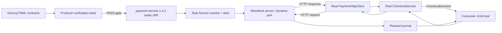
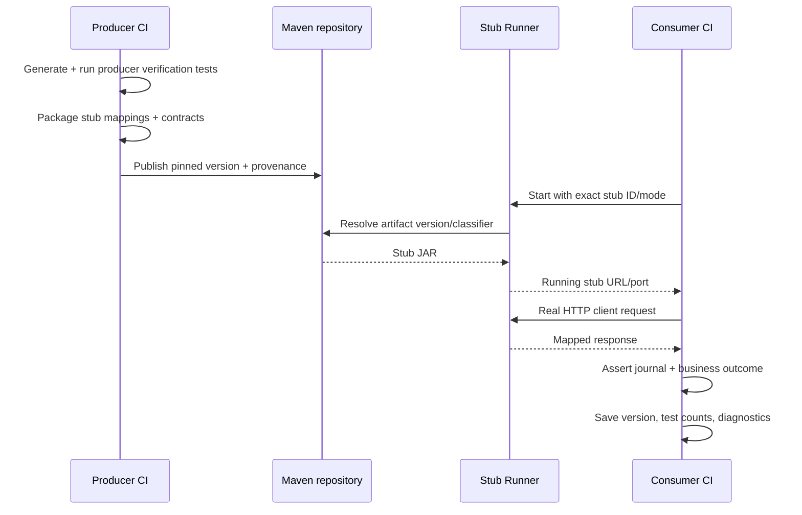

# Evaluating Whether Consumer Tests Call the Right Stub and Version

## 1. The problem: green tests, but did they actually test the right interface?

**Spring Cloud Contract (SCC)** helps producers and consumers agree on HTTP or messaging behavior using **Groovy/YAML DSL**. The producer generates **verification tests** to check its implementation, packages a stub artifact, and publishes it for consumers. Consumers use **Stub Runner** to fetch stubs, start a simulated HTTP server (typically WireMock) or wire into a messaging test environment, and verify real client code. CI uses this evidence to catch incompatible API changes.

However, “consumer contract test PASS” **is not enough**. A test can stay green because:

- `PaymentHttpClient` was mocked with Mockito, so no HTTP request was ever sent.
- The real HTTP client actually called **producer staging** or a different mock, not the configured Stub Runner.
- Stub Runner pulled an **old version from the local Maven cache** even though the release candidate changed.
- The test declared stub version `+`, and the resolver picked a latest version **different from the intended version**.
- The stub server ran with no matching mapping for the request; WireMock returned its default `404`, and the client treated it as “payment not found.”
- The consumer test created a `curl`/`RestClient` **inline inside the test**, bypassing the application's real client code.
- Returned data came from a cache or internal fixture without crossing the collaborator boundary.
- An artifact exists with the right GAV, yet with the wrong classifier or mappings modified after publication.

**Topic of this Contract Quality lesson:** how to evaluate with **auditable technical evidence** that consumer tests actually call the **right stub**, use the **right artifact version**, and verify the **right behavior** the consumer depends on.

### 1.1. Learning outcomes

After this lesson, you will be able to:

1. Build an **evidence chain** from contract → verified producer build → artifact → Stub Runner server → request → assertion.
2. Distinguish `groupId:artifactId:version:classifier:port` from the HTTP stub URL and the production endpoint.
3. Configure Stub Runner `CLASSPATH`, `LOCAL`, and `REMOTE` modes to match the artifact source.
4. Verify that the application's **real HTTP client** builds requests with the right method/path/headers and reaches the stub server.
5. Use `@StubRunnerPort`, `StubFinder`, and WireMock's **request journal** as verification tools.
6. Detect fake `404`s, mocked clients, stale caches, duplicate mappings, and version mismatches.
7. Build **negative controls**: intentionally break paths/versions in a test environment to confirm tests turn red.
8. Design release CI that records resolved versions, artifact sources, checksums, test counts, and failure diagnostics.

> **Scope:** Stub Runner verifies the consumer **against simulated behavior from an artifact**. Generated producer verification tests are what prove the producer implementation of the corresponding build **honors the contract**. Both layers are required.

## 2. Four independent proofs: right artifact, right server, right request, right outcome

A minimum bar for a quality consumer test:

| Layer | Question | Required evidence | If missing |
|---|---|---|---|
| **A. Artifact** | Did the stub come from the right producer, version, and classifier? | GAV, repository/mode, resolved version, checksum when needed | May test an old version or wrong producer |
| **B. Runtime stub** | Did Stub Runner start the right server and load mappings? | Port/URL from `@StubRunnerPort` or `StubFinder`; loaded mappings | Tests may lack real dependencies |
| **C. Traffic** | Did consumer code **send requests to that server**? | Request journal / HTTP client instrumentation, method/path/header and matched mapping | May be calling a fake client or wrong route |
| **D. Consumer behavior** | Did the consumer translate the response into the right outcome? | Assertions on consumer API/service; success and error paths | Only proves the stub responded |

These four layers complement one another: knowing the right JAR version **does not** prove `PaymentHttpClient`'s URL points to it; seeing a request in WireMock **does not** prove `CheckoutService` parsed the body properly; seeing `CheckoutService` return `READY` **does not** prove it made an HTTP call.

### 2.1. Reliable call-path diagram



**Distinguish two control paths:** `Stub Runner` manages **artifacts and servers**; the consumer's `PaymentHttpClient` controls **where network calls go**. If client configuration is never wired to the Stub Runner URL, starting stubs is just a side show.

## 3. Running example: checkout calling payment

Producer `payment-service` publishes:

```text
groupId      com.acme.billing
artifactId   payment-service
version      1.4.2
classifier   stubs
stub ID      com.acme.billing:payment-service:1.4.2:stubs
JAR          payment-service-1.4.2-stubs.jar
```

Consumer `checkout-service` calls:

```http
GET /api/payments/PAY-42 HTTP/1.1
Accept: application/json
```

Expected API response:

```json
{
  "paymentId": "PAY-42",
  "state": "CAPTURED",
  "amount": 150000,
  "currency": "VND"
}
```

Checkout must return `READY` **only when** the payment has matching ID and `state = CAPTURED`. When `state = PENDING`, return `PAYMENT_PENDING`. On `404` with error code `PAYMENT_NOT_FOUND`, return `PAYMENT_NOT_FOUND`.

This is a **hypothetical API for illustration**, not a built-in SCC endpoint.

### 3.1. Success HTTP contract (`200`)

```yaml
name: payment_captured
description: "Payment PAY-42 has been captured"
request:
  method: GET
  url: /api/payments/PAY-42
  headers:
    Accept: application/json
response:
  status: 200
  headers:
    Content-Type: application/json
  body:
    paymentId: "PAY-42"
    state: "CAPTURED"
    amount: 150000
    currency: "VND"
```

### 3.2. Pending HTTP contract (`200`)

```yaml
name: payment_pending
description: "Payment PAY-17 is still pending"
request:
  method: GET
  url: /api/payments/PAY-17
response:
  status: 200
  headers:
    Content-Type: application/json
  body:
    paymentId: "PAY-17"
    state: "PENDING"
    amount: 150000
    currency: "VND"
```

### 3.3. Not-found HTTP contract (`404`)

```yaml
name: payment_not_found
description: "Payment PAY-404 does not exist"
request:
  method: GET
  url: /api/payments/PAY-404
response:
  status: 404
  headers:
    Content-Type: application/json
  body:
    code: "PAYMENT_NOT_FOUND"
    message: "Payment not found"
```

The producer must package these contracts into **stub artifact version 1.4.2**. Merely having YAML in this lesson does **not** put mappings into a published artifact. After contract changes, the producer must generate/run verification and publish a **new version/build** per policy.

### 3.4. Why are all three scenarios needed?

If you test only `200 CAPTURED`, the client can break on `404` or misinterpret `PENDING` as `READY` while staying green. To confirm the right mapping fires, requests `PAY-42`, `PAY-17`, and `PAY-404` differ, preventing collisions between stub mappings sharing the same URL/method.

A `404` test asserting only HTTP status risks a false pass: WireMock **also returns `404` when a request matches no mapping**. Quality checks must assert the **business error code or request journal matched status**.

## 4. Stub version: artifact identity is not HTTP server identity

Stub Runner uses the ID pattern:

```text
groupId:artifactId:version:classifier:port
```

`version`, `classifier`, and `port` are optional; default classifier is typically `stubs`, omitted port is allocated dynamically, and omitted version can act like `+` (the latest version found by the resolver).

Examples:

```text
# Pinned artifact, port chosen by Stub Runner
com.acme.billing:payment-service:1.4.2:stubs

# Pinned artifact requesting server on port 18081
com.acme.billing:payment-service:1.4.2:stubs:18081

# Auto-pick latest version: unsuitable for a reproducible release gate
com.acme.billing:payment-service:+:stubs
```

**Maven artifact coordinates:** `com.acme.billing:payment-service:1.4.2:stubs`.

**Stub HTTP URL:** e.g., `http://localhost:18081` or `http://localhost:12345`.

**Real producer URL:** e.g., `https://payments.example.internal`.

These are **three distinct identities**. A test calling `http://localhost:18081` does not automatically prove the server on that port is Stub Runner serving artifact `1.4.2`: another process could occupy that port.

### 4.1. `CLASSPATH`, `LOCAL`, and `REMOTE`

| `stubsMode` | Where artifacts are fetched | Common version mismatch risks |
|---|---|---|
| `CLASSPATH` | Stub JAR on test classpath | Different dependency version/classifier; multiple JARs causing confusion |
| `LOCAL` | Maven local repo (e.g., `~/.m2`) | Stale stub in cache; producer forgot to `install` current build |
| `REMOTE` | Maven-compatible repository | Wrong repository, credentials, mirror, snapshot metadata, using `+` |

The mode must match **where the artifact actually lives**. Consumer tests should not “self-rescue” by switching from `REMOTE` to `LOCAL` when the remote repo lacks the artifact; doing so can silently pull a stale cached build.

### 4.2. Set an explicit version policy

- **Release compatibility gate:** pin the exact version, log the resolved artifact and source.
- **Forward compatibility job:** may test `+` or a version range, but must record the **actually resolved version**.
- **SNAPSHOT:** watch out for timestamped snapshots and mutable metadata; audits need checksums and build provenance.
- **Multi-version support:** run a **matrix of consumer builds × producer stub versions**, rather than inferring from one job.
- **Classifier:** `payment-service:1.4.2:stubs` differs from main JAR `payment-service:1.4.2` or custom classifiers.

### 4.3. “Right stub filename” differs from “right mappings inside”

A stub JAR can contain fewer mappings than expected—for example, the producer accidentally deleted `payment_not_found`, or `stubsPerConsumer` excluded it for the current consumer. Verify **the required scenario count and identities**, not merely that artifact download succeeded.

## 5. HTTP client code must be the consumer's production code

Example using **Spring Boot 3.2+ / Spring Framework 6.1+** with `RestClient`. These are illustrative classes placed in the real consumer project with appropriate imports and packages.

### 5.1. DTO

```java
public record PaymentDto(
    String paymentId,
    String state,
    long amount,
    String currency
) {}
```

`long amount` assumes the API returns integer minor units. An API using decimals may need `BigDecimal` and a contract specifying units explicitly.

### 5.2. Real HTTP client with configurable base URL

```java
@Component
public class PaymentHttpClient {
    private final RestClient http;

    public PaymentHttpClient(
            RestClient.Builder builder,
            @Value("${payment.api.base-url}") String baseUrl) {
        this.http = builder.baseUrl(baseUrl).build();
    }

    public PaymentDto loadPayment(String id) {
        return http.get()
            .uri("/api/payments/{paymentId}", id)
            .header("Accept", "application/json")
            .retrieve()
            .body(PaymentDto.class);
    }
}
```

`@Value("${payment.api.base-url}")` reads the URL from the Spring Environment. In production, the property points to the real producer; **in consumer contract tests**, it must point to the stub URL.

Never hardcode production hosts in the client, never fall back to production when the property is absent, and never instantiate an ad-hoc HTTP client in tests to bypass `PaymentHttpClient`.

### 5.3. Real consumer use case

```java
@Service
public class CheckoutService {
    private final PaymentHttpClient payments;

    public CheckoutService(PaymentHttpClient payments) {
        this.payments = payments;
    }

    public CheckoutDecision evaluate(String paymentId) {
        try {
            PaymentDto payment = payments.loadPayment(paymentId);
            if (payment != null
                    && paymentId.equals(payment.paymentId())
                    && "CAPTURED".equals(payment.state())) {
                return new CheckoutDecision(true, "READY");
            }
            return new CheckoutDecision(false, "PAYMENT_PENDING");
        } catch (HttpClientErrorException.NotFound ex) {
            return new CheckoutDecision(false, "PAYMENT_NOT_FOUND");
        }
    }

    public record CheckoutDecision(boolean accepted, String reason) {}
}
```

Catching every `404` and returning `PAYMENT_NOT_FOUND` is only a **minimal model**. In quality tests, verify `404` actually came from the business mapping rather than an unmatched default `404`. Real systems may need `PaymentNotFoundException` and a decoder checking the error `code`.

### 5.4. Anti-pattern: mocking the exact class under test

```java
@MockBean
PaymentHttpClient paymentClient;

@Test
void falseSenseOfCoverage() {
    when(paymentClient.loadPayment("PAY-42"))
        .thenReturn(new PaymentDto("PAY-42", "CAPTURED", 150000, "VND"));

    assertTrue(checkoutService.evaluate("PAY-42").accepted());
}
```

This test may be useful as a **unit test of `CheckoutService`**, but it is **not** evidence that the HTTP client sends the right request or that Stub Runner serves the right mapping. Classify tests accurately; never label a test “consumer contract test” when the HTTP boundary is completely mocked.

## 6. Running consumer tests with Stub Runner and a fixed port

To trace the call path clearly, this first example uses a fixed **port 18081**, assuming isolated test execution with no port conflict.

Prerequisites: producer built/`installed` `payment-service-1.4.2-stubs.jar` in local Maven storage containing the three mappings from Section 3, and consumer has compatible Spring Boot / SCC test dependencies.

```java
@SpringBootTest(
    webEnvironment = SpringBootTest.WebEnvironment.NONE,
    properties = {
        "payment.api.base-url=http://localhost:18081"
    }
)
@AutoConfigureStubRunner(
    ids = "com.acme.billing:payment-service:1.4.2:stubs:18081",
    stubsMode = StubRunnerProperties.StubsMode.LOCAL,
    failOnNoStubs = true
)
class CheckoutContractQualityTest {

    @Autowired
    CheckoutService checkoutService;

    @Test
    void capturedPaymentGoesThroughRealClient() {
        CheckoutService.CheckoutDecision result =
            checkoutService.evaluate("PAY-42");

        assertTrue(result.accepted());
        assertEquals("READY", result.reason());
    }

    @Test
    void pendingPaymentIsNotAccepted() {
        var result = checkoutService.evaluate("PAY-17");

        assertFalse(result.accepted());
        assertEquals("PAYMENT_PENDING", result.reason());
    }

    @Test
    void absentPaymentHasOwnBusinessOutcome() {
        var result = checkoutService.evaluate("PAY-404");

        assertFalse(result.accepted());
        assertEquals("PAYMENT_NOT_FOUND", result.reason());
    }
}
```

This uses JUnit 5 and Spring Boot test support, needing appropriate imports and your project's `@SpringBootApplication`/`RestClient.Builder` config. **It tests the network only when `PaymentHttpClient` and `CheckoutService` are genuinely production beans without mocks or overrides.**

### 6.1. Strengths and weaknesses of this example

**Strengths:** Spring constructs the real client with the stub URL. Calls hit the real `CheckoutService`; every request passes through the real `RestClient` unless caching or hooks intercept it.

**Weaknesses:** Fixed ports risk collisions, especially in parallel CI. Asserting outcomes alone **is not enough to prove the port and traffic were right**, because another stub could occupy the port or caching could skip network calls. Pair this with **Stub Runner port verification** and the **request journal** in the sections below.

### 6.2. Never fall back to producer or staging

To ensure tests fail closed when stubs are absent:

- Never default `payment.api.base-url` to staging in the test profile.
- Never catch `Connection refused` and return a passing fixture.
- Never switch `LOCAL` to `REMOTE` silently while intending to test a locally installed artifact.
- Never run consumer tests on hosts with proxies/forwarding silently redirecting `localhost` elsewhere.

The goal is **failing when evidence is missing**, rather than silently switching to an uncontrolled response source.

## 7. Using dynamic ports: lifecycle vs. client URL timing

Omitting `:18081` from the Stub ID lets Stub Runner pick a dynamic port from its configured range. For parallel runs, dynamic ports greatly reduce conflicts.

```java
@StubRunnerPort("com.acme.billing:payment-service")
int paymentStubPort;
```

Or look up the URL:

```java
@Autowired
StubFinder stubFinder;

URL paymentStubUrl =
    stubFinder.findStubUrl("com.acme.billing", "payment-service");
```

Distinguish **when Stub Runner starts the server** from **when Spring instantiates `PaymentHttpClient`**. If the client bean is constructed before the port is known, you cannot simply read `@StubRunnerPort` on the test instance and expect the property to exist during bean creation.

### 7.1. A dynamic-port test using production classes

To avoid Spring context lifecycle ordering issues, instantiate **both production classes** after Stub Runner has started:

```java
@SpringBootTest(webEnvironment = SpringBootTest.WebEnvironment.NONE)
@AutoConfigureStubRunner(
    ids = "com.acme.billing:payment-service:1.4.2:stubs",
    stubsMode = StubRunnerProperties.StubsMode.LOCAL,
    failOnNoStubs = true
)
class CheckoutDynamicPortTest {
    @StubRunnerPort("com.acme.billing:payment-service")
    int paymentPort;

    @Autowired
    RestClient.Builder restClientBuilder;

    @Test
    void realClientCallsRunnerAssignedPort() {
        assertTrue(paymentPort > 0);

        String baseUrl = "http://localhost:" + paymentPort;
        PaymentHttpClient realClient =
            new PaymentHttpClient(restClientBuilder, baseUrl);
        CheckoutService realCheckout =
            new CheckoutService(realClient);

        var result = realCheckout.evaluate("PAY-42");

        assertTrue(result.accepted());
        assertEquals("READY", result.reason());
    }
}
```

This test verifies **production class logic and HTTP transport**, yet **does not verify Spring autowiring of `payment.api.base-url`** because it constructs them manually. If Spring wiring is a risk you need to protect, add a controlled fixed-port profile test or design a test configuration/factory whose lifecycle guarantees the Stub Runner URL is injected at the right time.

### 7.2. Do not misuse `@DynamicPropertySource` across lifecycle phases

`@DynamicPropertySource` is typically a **static** method invoked while building the Spring application context. `@StubRunnerPort` is injected into the **test instance** per Stub Runner's lifecycle. Reading that field too early can yield `0` or an uninitialized value.

Use dynamic property binding only when you know Stub Runner/server startup completes before Spring creates the HTTP client. When unsure, use the explicit constructor/factory pattern in Section 7.1 or Stub Runner's Spring Cloud discovery integration supported by your current version.

### 7.3. Multiple stubs and service IDs

If one test runs both `payment-service` and `inventory-service`:

```java
@AutoConfigureStubRunner(
    ids = {
        "com.acme.billing:payment-service:1.4.2:stubs",
        "com.acme.catalog:inventory-service:3.0.0:stubs"
    },
    stubsMode = StubRunnerProperties.StubsMode.LOCAL
)
```

each collaborator gets its own HTTP server and port. Use **`groupId:artifactId`** when looking up ports to avoid mixing up producers that share an `artifactId`:

```java
@StubRunnerPort("com.acme.billing:payment-service")
int paymentPort;

@StubRunnerPort("com.acme.catalog:inventory-service")
int inventoryPort;
```

Never pass `inventoryPort` to the payment client, and do not assume `@AutoConfigureStubRunner` automatically overrides hardcoded endpoint URLs in the application.

## 8. Confirming real HTTP traffic: WireMock request journal

WireMock's **request journal** records requests received by the server. It lets you inspect method, URL, headers, and whether the request **matched** a stub mapping. This is a strong safeguard against false positives from mocks, caches, or wrong paths.

WireMock exposes HTTP admin endpoints such as:

```text
GET    /__admin/requests
GET    /__admin/requests/unmatched
DELETE /__admin/requests
POST   /__admin/requests/count
```

These endpoints apply to the **WireMock server managed by Stub Runner** in the test environment, not the real producer's API. Never enable WireMock admin endpoints in production applications just to debug contract tests.

### 8.1. Counting requests after calling `CheckoutService`

Once `paymentPort` is known from Stub Runner, the test can use a separate `RestClient` **solely to query the admin request journal**, while **business requests still flow through the real `CheckoutService`**.

Illustrative pseudocode:

```text
paymentStubUrl = StubFinder.findStubUrl(payment producer)

clearRequestJournal(paymentStubUrl)   # test setup, does not delete mappings
result = checkoutService.evaluate("PAY-42")
assert result == READY

events = GET paymentStubUrl + "/__admin/requests"
assert at least one event exists:
  method = GET
  url = "/api/payments/PAY-42"
  wasMatched = true
```

This is **pseudocode**, not a built-in Java API. Write an HTTP admin client/JSON parser or use WireMock's Java verification API pointed at the configured base URL.

### 8.2. Why reset the journal before each test case?

If an entire test class shares one Stub Runner instance, the journal can hold requests from earlier tests. A test that sends no new request could still see old events and pass falsely. Therefore:

- Clear the **request journal**, never delete mappings.
- Invoke the consumer **after** resetting.
- Read the journal immediately afterward and assert on test ID, URL, and headers.
- For tests running in parallel against the same stub server, never reset globally between tests; use isolated servers or correlation IDs.

**Important:** WireMock's request journal can be disabled for performance; if disabled, request verification fails. Ensure it remains enabled in contract-quality test environments.

### 8.3. Request received does not guarantee the right mapping matched

An event with the right method/path proves the request reached the stub server. Still, it can **fail to match** due to:

- Wrong `Accept` or `Authorization` headers.
- Missing or wrong-type query parameters.
- JSON body failing matchers.
- Mapping filtered out by `stubsPerConsumer`.
- Another mapping catching requests more broadly.

With WireMock's `/__admin/requests`, inspect `wasMatched` as needed; with `/__admin/requests/unmatched`, confirm no relevant requests appear as unmatched. If overly broad mappings exist, a request can still match the wrong mapping: inspect mapping identities/response semantics and design tight request matchers.

### 8.4. Never rely on HTTP `404` status alone

```text
GET /api/payments/PAY-404  → 404 PAYMENT_NOT_FOUND (contract)
GET /api/payments/PAY-404?unexpected=1 → 404 (may be no matching stub)
```

Both responses share status `404` yet come from **different sources**. For error contracts, assert the **body code** such as `PAYMENT_NOT_FOUND` and request-journal matched info, not merely `HttpClientErrorException.NotFound`.


## 9. A test proving an HTTP request matched a stub mapping

This example combines **three layers of evidence**: consumer production classes send HTTP, WireMock logs a `matched` request, and checkout logic returns the right outcome. Because it uses a dynamic port, the test builds production classes via constructor **after Stub Runner starts**. This still exercises real client code, though it does not test Spring bean injection of the base URL.

```java
import com.fasterxml.jackson.databind.JsonNode;
import java.util.stream.StreamSupport;
import org.junit.jupiter.api.Test;
import org.springframework.beans.factory.annotation.Autowired;
import org.springframework.boot.test.context.SpringBootTest;
import org.springframework.cloud.contract.stubrunner.spring.AutoConfigureStubRunner;
import org.springframework.cloud.contract.stubrunner.spring.StubRunnerProperties;
import org.springframework.cloud.contract.stubrunner.spring.StubRunnerPort;
import org.springframework.web.client.RestClient;
import static org.junit.jupiter.api.Assertions.*;

@SpringBootTest(webEnvironment = SpringBootTest.WebEnvironment.NONE)
@AutoConfigureStubRunner(
    ids = "com.acme.billing:payment-service:1.4.2:stubs",
    stubsMode = StubRunnerProperties.StubsMode.LOCAL,
    failOnNoStubs = true
)
class CheckoutTrafficEvidenceTest {

    @StubRunnerPort("com.acme.billing:payment-service")
    int paymentPort;

    @Autowired
    RestClient.Builder restClientBuilder;

    @Test
    void actualClientMustCallMatchingStub() {
        assertTrue(paymentPort > 0);

        String stubUrl = "http://localhost:" + paymentPort;
        RestClient admin = RestClient.create(stubUrl);

        // Clear only the request journal, not mappings.
        admin.delete().uri("/__admin/requests")
            .retrieve().toBodilessEntity();

        PaymentHttpClient realClient =
            new PaymentHttpClient(restClientBuilder, stubUrl);
        CheckoutService realCheckout =
            new CheckoutService(realClient);

        var result = realCheckout.evaluate("PAY-42");
        assertTrue(result.accepted());
        assertEquals("READY", result.reason());

        JsonNode journal = admin.get()
            .uri("/__admin/requests")
            .retrieve()
            .body(JsonNode.class);

        assertNotNull(journal);
        boolean matched = StreamSupport.stream(
                journal.path("requests").spliterator(), false)
            .anyMatch(event ->
                event.path("wasMatched").asBoolean(false)
                && "GET".equals(
                    event.path("request").path("method").asText())
                && "/api/payments/PAY-42".equals(
                    event.path("request").path("url").asText()));

        assertTrue(matched, "The client must reach a matching stub");
    }
}
```

**Prerequisites:** this test requires JUnit 5, Spring Boot, SCC Stub Runner, Jackson, `RestClient`, the two production classes from Section 5, and the artifact containing the `payment_captured` mapping. Adjust imports/packages of consumer classes to your real project. Never copy the test alone while skipping producer stub setup.

### 9.1. What does this test prove?

- `paymentPort` was assigned by Stub Runner, not guessed or hardcoded.
- The request journal was cleared **before** invoking the use case, reducing the risk of reading stale traffic.
- Request `GET /api/payments/PAY-42` recorded `wasMatched = true`.
- Business outcome `READY` followed an HTTP call from the **production client**.

### 9.2. What does this test not prove yet?

- Does not prove producer `1.4.2` **ran verification tests**; that is producer CI's responsibility.
- Does not test Spring autowiring of `payment.api.base-url` since the test instantiates the client via constructor; add the test from Section 6 or appropriate test configuration.
- Does not prove the resolved artifact came from the **right source/checksum**; CI artifact provenance is required.
- If WireMock has duplicate mappings or overly broad regexes, `wasMatched=true` could come from a **different mapping** than intended.
- If multiple tests reset the journal on one stub server concurrently, tests can flake. Use isolation or correlation IDs.

### 9.3. Verify the right mapping, not just any mapping

When overlapping mappings exist, also inspect **response semantics**, request headers, and the serve event's **mapping ID** (when relevant). A 200 response served by an overly broad `GET /api/payments/.*` mapping does not prove the `payment_captured` contract was loaded properly.

Never inject a manual WireMock mapping in consumer tests and treat it as a mapping from the producer artifact. If you need custom fault injection, keep it separate from consumer-driven contract tests.

## 10. Distinguishing business `404` from WireMock unmatched

Two scenarios share the same HTTP status yet have opposite meanings:

```text
A. Request matches contract payment_not_found
   GET /api/payments/PAY-404
   → HTTP 404 {"code":"PAYMENT_NOT_FOUND"}

B. Request matches no stub
   GET /api/payment/PAY-404
   → WireMock default HTTP 404
```

If the consumer catches every `HttpClientErrorException.NotFound` and returns `PAYMENT_NOT_FOUND`, a test asserting only `reason` will PASS even for Case B.

### 10.1. Verifying the error body

With the production `PaymentHttpClient` pointed at the right stub server, add:

```java
@Test
void notFoundMustHaveContractErrorCode() throws Exception {
    var error = assertThrows(
        HttpClientErrorException.NotFound.class,
        () -> paymentHttpClient.loadPayment("PAY-404")
    );

    JsonNode body = objectMapper.readTree(
        error.getResponseBodyAsString());

    assertEquals("PAYMENT_NOT_FOUND",
        body.path("code").asText());
}
```

This is a **test snippet**; `paymentHttpClient` and `objectMapper` must be injected from the appropriate context/test setup. If WireMock returns a default 404 lacking the contracted body, the assertion turns red.

### 10.2. Checking matched and unmatched journals

After calling `PAY-404`:

- Confirm the server received `GET /api/payments/PAY-404`.
- Confirm the event has `wasMatched = true` (when the request journal is enabled).
- Check `/__admin/requests/unmatched` whenever a mapping mismatch is suspected.
- Confirm the response body has `code = PAYMENT_NOT_FOUND`.
- Assert `CheckoutService` maps the error to the right business outcome.

**Note:** HTTP `404` from a **Maven repository** failing to find the artifact is a completely different error. When the stub JAR is missing, tests never reach the stage of sending HTTP to `/api/payments`.

## 11. Verify the **loaded** artifact version, not just the annotation string

Declaring `ids = "com.acme.billing:payment-service:1.4.2:stubs"` states the **desired version**, not proof that the downloaded bytes match what the producer published.

To confirm:

1. **GAV/classifier:** check `groupId`, `artifactId`, `version`, `classifier`, and mode.
2. **Source:** verify actual dependency classpath, local Maven repository, or remote repository.
3. **Artifact contents:** inspect the stub JAR for expected `META-INF` layout and mappings.
4. **Provenance:** record producer commit, contract revision, generated producer test report, and published checksum.
5. **Runtime:** verify Stub Runner URL/port, registered mappings, and request journal.
6. **Consumer:** test business outcomes and errors using production client code.

### 11.1. Evidence table by mode

| Mode | What CI must record | Risk |
|---|---|---|
| `CLASSPATH` | Resolved dependency tree, test classpath, version/classifier | Dependency conflict picks another version |
| `LOCAL` | Artifact file path/version, provenance of the `install` build | Maven cache holds a stale build |
| `REMOTE` | Repository root, resolved coordinates, checksum | Mirror/snapshot/credentials pull wrong build |

Never infer version from a `CAPTURED` response: two artifacts P1 and P2 can return **identical** JSON. Nor does the WireMock port identify version.

### 11.2. Inspecting stub JAR layout

A common layout:

```text
META-INF/
  com.acme.billing/
    payment-service/
      1.4.2/
        contracts/
          payments/payment-captured.yml
        mappings/
          ...payment-captured.json
```

In an environment with a JDK, inspect the **downloaded JAR from the exact source**:

```bash
jar tf payment-service-1.4.2-stubs.jar
```

Verify expected mappings, artifact version, and classifier. Never hand-edit the JAR; if a mapping is missing, fix the Groovy/YAML DSL or SCC generator config, then rebuild and republish through the proper workflow.

### 11.3. Minimum provenance chain

```text
Producer commit: a1b2c3d
Contract revision: d4e5f6a
Producer verification: PASS, generated tests executed
Artifact: com.acme.billing:payment-service:1.4.2:stubs
Repository: approved release repository
SHA-256: digest of the published JAR
Consumer commit: c8d9e0f
Stub Runner mode: REMOTE
Resolved artifact: same GAV/digest as release record
Consumer HTTP + request journal tests: PASS
```

These commit hashes are **illustrative**, not real records. A checksum guarantees integrity only when verified against a **trusted source**; if an actor can overwrite both JAR and checksum in the same repository, a checksum alone does not prove publisher identity.

### 11.4. `+` and `SNAPSHOT` are not immutable release proofs

```text
com.acme.billing:payment-service:+:stubs
com.acme.billing:payment-service:1.5.0-SNAPSHOT:stubs
```

Version `+` is useful for testing forward compatibility with the latest build. Yet as repositories update, the same consumer commit can pull different artifacts across CI runs. `SNAPSHOT` contents can change too. **Release gates should pin versions**, or ensure resolved timestamps, checksums, and provenance are fully recorded.

### 11.5. Producer verification is an independent gate

Stub Runner downloads the stub JAR and serves mappings, without running generated producer tests against the producer implementation. Passing consumer tests only validate against **the consumed stub package**, not that the newest producer code complies.

Producer pipelines should generate and run tests **before publishing**, or clearly mark artifacts as `in-progress/unverified` if the organization permits early publication for parallel consumer development.

## 12. Inspecting registered mappings and consumer filtering

Stub Runner supports exporting mappings via `mappingsOutputFolder` (depending on doc version) or `spring.cloud.contract.stubrunner.mappings-output-folder` for debugging.

Example:

```java
@AutoConfigureStubRunner(
    ids = "com.acme.billing:payment-service:1.4.2:stubs",
    stubsMode = StubRunnerProperties.StubsMode.REMOTE,
    repositoryRoot =
        "https://repo.example.org/repository/maven-releases/",
    mappingsOutputFolder = "target/registered-mappings"
)
```

`target` fits Maven projects; Gradle projects can use another path. This output reveals **which mappings the server registered**, though it **does not verify** artifact checksums or which mapping the real consumer actually called.

### 12.1. Duplicate mappings, broad regexes, and request matching

Example:

```text
Mapping A:
  GET /api/payments/PAY-42 → 200 CAPTURED

Mapping B:
  GET /api/payments/.* → 200 PENDING
```

These two mappings can overlap. If a request hits Mapping B when the test expected Mapping A, `wasMatched = true` is insufficient. Inspect the matched stub mapping ID, request conditions/priority, and response semantics; design tight matchers to protect the contract.

### 12.2. `stubsPerConsumer` alters the active mapping set

If contracts are organized by consumer directory, e.g.:

```text
contracts/
  checkout-service/payment-captured.yml
  reporting-service/payment-summary.yml
```

and the test configures:

```java
@AutoConfigureStubRunner(
    ids = "com.acme.billing:payment-service:1.4.2:stubs",
    stubsPerConsumer = true,
    consumerName = "checkout-service"
)
```

Stub Runner may register only `checkout-service` mappings by folder convention. A mapping present in the JAR yet **unregistered** due to a mismatched `consumerName` still yields unmatched requests.

Diagnostic reports should therefore record **`consumerName`, `stubsPerConsumer`, active Spring profiles, and the list of registered mappings**. This feature **filters by consumer name**; it does not automatically select binary versions C1/C2.


## 13. When clients use Feign, service discovery, or caching

Not every consumer injects URLs directly via `@Value`. Some applications use `OpenFeign`, `@LoadBalanced RestClient` or `WebClient`, API gateways, and service discovery. SCC Stub Runner integrates with **Spring Cloud discovery/load balancers**, yet you cannot assume every client automatically routes properly.

### 13.1. Common misrouting paths

| Architecture | Risk | Evidence to collect |
|---|---|---|
| Feign with hardcoded `url` config | Bypasses stubbed service discovery | Outgoing URL and request journal at stub |
| Feign using `name`/service ID | Artifact ID differs from real service ID | Check `ids-to-service-ids` and resolved instance |
| Load-balanced `WebClient` | Stale instance cache / discovery state | Traces or journal on the exact Stub Runner server |
| HTTP proxy/gateway | Routing or rewrites alter path/headers | Actual request received by WireMock |
| Consumer with cache | Makes no outbound request in tests | Clear/disable cache scope, verify fresh journal entry |
| Resilience fallback | Stub fails yet service returns default success | Negative control for connection failure |
| Multiple stubs running | Payment client hits inventory server | Cross-check server URL and group/artifact ID |

### 13.2. Do not trust annotations alone

`@AutoConfigureStubRunner` proves the test **requested** Stub Runner to run a list of stubs. It **does not prove** the real Feign/WebClient/RestClient actually used them.

A proper verification flow:

1. Identify the production client bean invoked by the use case.
2. Determine the resolved base URL/service ID after Spring profiles, config precedence, and discovery apply.
3. Obtain the Stub Runner server URL/port assigned by the framework.
4. Invoke the real use case with a traceable input.
5. Check the request journal of **that exact stub server**.
6. Assert response decoding and business outcomes.
7. Confirm zero test requests hit staging or production hosts.

### 13.3. Testing Spring wiring vs. testing client code are two distinct goals

If a test directly instantiates `new PaymentHttpClient(builder, stubUrl)`, it verifies the **production class + HTTP transport**, **not** whether `payment.api.base-url` gets injected by Spring at startup.

If wiring must also be covered:

- Use a test profile with a **controlled fixed port** (as in Section 6) so Spring constructs the real bean from properties.
- Or use a test configuration/client factory ensuring the stub URL is available in the right lifecycle phase.
- Or use Stub Runner's Spring Cloud discovery integration supported by your version.

Every test should state **the exact objective it protects** rather than naming a mocked-DTO unit test `EndToEndContractTest`.

## 14. Negative controls: intentionally break things to prove sensitivity

A strong evaluation technique is verifying that tests **fail when any protected assumption breaks**. Call this a **sensitivity check** or negative control in an isolated test environment.

| Intentional change | Expected outcome | Catches which false green |
|---|---|---|
| Point client URL to a port with no stub | Connection failure / empty journal | Mocked client, fallback, or cache |
| Change `GET` to `POST` | Request unmatched, test fails | Method not actually checked |
| Change `/api/payments/PAY-42` to wrong path | Mapping or behavior failure | Overly broad regex / test ignores URL |
| Omit `Accept` when required by contract | Mapping mismatch | Header not verified |
| Remove `payment_not_found` mapping in isolated fixture | Error-body test fails | Default 404 mistaken for business 404 |
| Use non-existent stub ID version | Stub Runner fails resolution | Fallback to nearby/local version |
| Point payment client to inventory port | Request journal / semantics fail | Wrong collaborator |
| Change `state` to `PENDING` | Checkout no longer returns `READY` | Assertions ignore payload |
| Remove required field in test response | DTO/validation/business assertion fails | Decoder mocked or logic skips field |
| Clear cache before test, forcing network call | Journal shows fresh request | Result served from cache |
| Intentionally omit starting Stub Runner | Fails instead of “skipping” test | Test lacks real dependency |
| Run P1 instead of P2 in compatibility job | Report shows version P1 | Missing artifact identity verification |

### 14.1. Never corrupt published artifacts

Perform these negative controls via **test profiles, isolated branches, separate stub fixtures, or dedicated CI jobs**. Never overwrite `payment-service-1.4.2-stubs.jar` in a release repository or edit production config for an experiment.

A subset can run periodically in CI. What matters is that real tests **can fail when protected behavior breaks**, not running every mutation on every commit.

### 14.2. Test still PASSES when stubs are disabled: investigate immediately

If Stub Runner fails to load an artifact yet tests still PASS, check in order:

- Did `@Disabled`, test discovery/runner, or Maven/Gradle skip the test?
- Did `@MockBean`/Mockito replace the HTTP client?
- Did the test actually invoke the right `CheckoutService`?
- Did a cache or fallback return success?
- Was `failOnNoStubs` set to `false`?
- Was another artifact resolved from local classpath or a repository mirror?
- Is the right Spring profile active?
- Did another WireMock server respond?
- Are assertions checking constant values instead of real results?

**Never fix this by altering tests to PASS**; restore a provable call path and clear failure signal.

## 15. A test quality rubric for reviews

To avoid judging intuitively (“looks like it uses Stub Runner”), use this **evidence rubric**. Scores are a **team review convention**, not an official Spring Cloud Contract scale.

| Pillar | Failing | Passing |
|---|---|---|
| **Stub source** | Uses `+` or unclear cached artifact | Pinned version/classifier and recorded resolved source |
| **Runtime identity** | Annotation only | Stub Runner runs exact group/artifact with confirmed URL/port |
| **Real client** | Mocked `PaymentHttpClient` or ad-hoc client | Use case runs production HTTP client |
| **Request evidence** | Asserts response/status only | Request journal or trace proves HTTP hit the right stub |
| **Mapping evidence** | Any `404` treated as pass | Matched mapping confirmed and error body/semantics checked |
| **Business assertions** | Assertions independent of outcome | DTO/outcome asserted for success and error paths |
| **Release provenance** | Unknown which producer build published it | Producer verification report and artifact checksum recorded |
| **Sensitivity** | Tests stay green when stub is absent | Negative controls fail tests for the right reason |

### 15.1. Release-blocking criteria

A release gate may require **all** essential conditions:

1. Stub version is pinned and matches the exact artifact in logs/release records.
2. Test classes actually execute; zero accidental `0 tests` or disabled suites.
3. Stub Runner loads required mappings with no silent fallbacks.
4. Real consumer code calls the right stub server with supporting evidence.
5. Assertions cover every field and error case the consumer depends on.
6. Producer verification passed for the consumed artifact, or unverified artifacts are clearly flagged `unverified` and disallowed as release proof.
7. Zero accidental production/staging network calls from tests.

Coverage can be quantified as **critical interactions tested / mandatory interactions**, without gaming numbers by dropping contracts or adding meaningless assertions.

### 15.2. Quality tiers for different goals

| Tier | Description | What it can claim |
|---|---|---|
| **Unit logic** | Mockito mocks HTTP client | Consumer logic against fake DTOs |
| **HTTP client integration** | Real client calls test-configured WireMock | HTTP client behavior with test fixtures |
| **SCC consumer contract test** | Real client + producer Stub Runner artifact + matched requests | Consumer compatible with published stub behavior |
| **Traceable release compatibility** | Adds pinned/resolved versions, producer verification, artifact integrity, CI matrix | Build/contract-traceable compatibility evidence |
| **Integration/E2E** | Real client and producer implementations running together | Real integration in tested environment |

**Never conflate labels**: a consumer contract test does not by itself prove TLS gateways, database schema migrations, or that production currently runs the matching producer build.

## 16. CI gates: record enough data to reproduce tests

A sound pipeline follows this flow:



### 16.1. Example `REMOTE` configuration for a release gate

```yaml
spring:
  cloud:
    contract:
      stubrunner:
        stubs-mode: REMOTE
        repository-root: "https://repo.example.org/repository/maven-releases/"
        ids:
          - "com.acme.billing:payment-service:1.4.2:stubs"
        fail-on-no-stubs: true
        mappings-output-folder: "target/stub-mappings"
```

SCC documentation confirms these properties (using Spring's relaxed kebab-case binding). Test profile files must never store real credentials; supply read-only identities via CI secrets for private repositories.

**Remember:** `mappings-output-folder` is diagnostic output, not proof requests reached the server. `fail-on-no-stubs` prevents silently ignoring missing stubs entirely, yet does **not** guarantee every mandatory mapping exists inside the artifact.

### 16.2. Fields to record in reports

```text
consumer service + commit/version
producer service + expected version
resolved stub artifact coordinates + classifier
repository source/mode
artifact digest/provenance reference
SCC/Stub Runner version
consumerName/stubsPerConsumer if enabled
running stub server URL/port (non-sensitive)
registered mapping names/count (as applicable)
consumer test names/count/status
request journal matched/unmatched summary
producer verification test report reference
CI job/run/build identifiers
```

Never log tokens, cookies, PII, or sensitive payloads in reports. If saving request journals for debugging, redact sensitive data before publishing CI artifacts.

### 16.3. Producer and consumer versions can deploy independently

With producer `P1 = 1.4.2`, `P2 = 1.5.0` and consumer `C1 = 2.8.0`, `C2 = 3.0.0`:

| Consumer build | Producer stub version | Goal |
|---|---|---|
| C1 | P1 | Baseline |
| C1 | P2 | New producer does not break old consumer |
| C2 | P1 | New consumer tolerates old producer during rollback/rollout |
| C2 | P2 | New pair compatible |

Cells represent a **test plan**, not executed results. Each CI job must use the **exact artifact version for that cell** and record PASS/FAIL/NOT TESTED explicitly. If `C2/P1` is declared unsupported, routing or deployment controls must ensure that pair cannot occur.

### 16.4. Never allow green builds with `0 tests`

Inspect JUnit test reports, executed counts, `@Disabled` cases, and Maven Surefire / Gradle Test configuration. A job can download stubs cleanly while running zero consumer tests if test discovery breaks.

In release CI, a mandatory suite executing `0 tests` must be treated as **insufficient evidence**, never automatically counted as PASS.

## 17. For messaging contracts, “loaded stub” does not mean the message handler ran

SCC goes beyond HTTP. In messaging, contracts specify **destination, headers, body, `triggeredBy`, and `label`**. Consumers use Stub Runner messaging integration to receive simulated messages over a compatible adapter, binder, or test broker.

Here there is **no HTTP WireMock request journal** to prove the consumer received a Kafka/RabbitMQ message. Collect channel-appropriate evidence:

| Layer | Messaging evidence |
|---|---|
| Artifact | Exact stubs/contract version |
| Stub registration | Label/message definition loaded by Stub Runner |
| Routing | Destination/topic/queue/binding matches test setup |
| Receipt | Real consumer handler or test listener receives message |
| Decode | Payload schema and headers deserialize cleanly |
| Business effect | Handler produces assertable state or outcomes |
| Broker semantics | Dedicated integration tests for ack/retry/DLQ/partitions/backpressure when needed |

### 17.1. Sample message contract

```yaml
description: "Payment has been captured"
label: payment_captured
input:
  triggeredBy: emitPaymentCaptured()
outputMessage:
  sentTo: payments.events
  headers:
    eventType: PAYMENT_CAPTURED
    contentType: application/json
  body:
    paymentId: "PAY-42"
    amount: 150000
    currency: "VND"
```

This is an **illustrative contract**. `emitPaymentCaptured()` is a producer method needing real implementation/fixtures; SCC does not define payment logic.

### 17.2. Tests must prove the real message handler received data

A handler test can capture output via a suitable test sink or in-memory channel, without mocking the handler under test itself. Drive the message source via Stub Runner according to the contract and assert domain effects.

If the system depends on Kafka partition keys, DLQs, exactly-once-like semantics, a schema registry, or reprocessing, write dedicated **broker integration tests**. Stub Runner does not prove production broker semantics on its own.

## 18. Diagnose step by step instead of fixing the wrong layer

| Symptom | Suspected layer | How to verify |
|---|---|---|
| Stub Runner fails to download JAR | Artifact/repository | GAV, version, classifier, mode, credentials |
| `LOCAL` test passes while `REMOTE` fails | Different source/version | Compare `~/.m2` vs. remote artifact provenance |
| Stub server starts, expected mapping missing | Registration | `mappingsOutputFolder`, folder filters, `stubsPerConsumer` |
| `@StubRunnerPort` differs from client URL | Client wiring | Inspect resolved client config; avoid hardcoding |
| Test returns `READY` with empty journal | Mock/cache/fallback | Invoke production client, clear caches |
| Journal shows GET to wrong URL | Client request construction | Path/query encoding, base URL |
| Journal shows `wasMatched=false` | Contract matching | Method, path, headers, query, body |
| Journal matched a different mapping | Mapping conflict | Priorities, matcher width, mapping IDs |
| `404` test passes when mapping removed | Fake default 404 | Assert error body and matched event |
| Consumer HTTP client fails to decode | Schema/DTO | Content-Type, types, nullability, field names |
| Passes with `+` yet fails when pinning P2 | Artifact drift | Resolved version and repository state |
| Test stays green when stub absent | Test quality | `failOnNoStubs`, mocks, caching, test discovery |
| CI reports `0 tests` | Runner configuration | JUnit engines, test includes, skip flags |
| New producer code breaks while consumer stays green | Producer verification | Run generated producer tests for exact build |
| Parallel CI flakes | Test isolation | Dynamic ports, request journal resets, shared caches |
| Feign still hits staging | Discovery/config | Service ID, URL properties, traffic journal |
| Stub JAR has right name yet wrong digest | Artifact immutability | Source provenance, publish/cache policy |

### 18.1. Five-step investigation workflow

**A — Resolve:** Does the stub artifact have the right GAV/classifier and come from the intended source?

**B — Register:** Did Stub Runner actually start the server and load the required mappings?

**C — Route:** Did the consumer's production HTTP client call the exact stub URL and port?

**D — Match:** Did the request match the right contract mapping and return the expected status, body, and headers?

**E — Assert:** Did the consumer decode and handle the response per business expectations?

If the fault is in A, do not touch DTOs; if in C, do not touch producer contracts; if in D, distinguish request mismatches from producer implementation bugs using producer verification tests.

## 19. Exercise: spotting false greens in an inventory client

### 19.1. Context

Producer `inventory-service` has stub artifacts:

```text
P1: com.acme.catalog:inventory-service:2.1.0:stubs
P2: com.acme.catalog:inventory-service:2.2.0:stubs
```

Consumer `order-orchestrator` needs to test:

- `GET /api/stock/SKU-100` → `200` with `available: true`, `quantity: 8`.
- `GET /api/stock/SKU-200` → `200` with `available: false`, `quantity: 0`.
- `GET /api/stock/SKU-404` → `404` with `code: SKU_NOT_FOUND`.

Three suspicious situations exist:

1. A test uses `@MockBean InventoryHttpClient` yet is named `InventoryContractTest`.
2. Another test uses Stub Runner `REMOTE` with `ids = "...:+:stubs"` without recording resolved versions.
3. A `404` test asserts status only, without checking error body or `wasMatched`.

### 19.2. Tasks

1. Identify the **four proofs** needed to confirm the consumer calls the right stub and version.
2. Write `@AutoConfigureStubRunner` pinning P2 `2.2.0` and selecting `REMOTE` with an illustrative repository.
3. Write real `InventoryDto` and `InventoryHttpClient` classes with a configurable base URL.
4. Write `OrderOrchestrator` calling the real client and asserting `ACCEPTED/OUT_OF_STOCK/UNKNOWN_SKU`.
5. Use `@StubRunnerPort` or `StubFinder` to obtain the running server URL.
6. Reset the request journal, run the real use case, and confirm `GET /api/stock/SKU-100` has `wasMatched=true`.
7. Add a `404` test checking `SKU_NOT_FOUND` to avoid fake default `404`s.
8. Design a negative control changing the path to `/api/stocks/SKU-100`; the test must fail.
9. Explain why `2.1.0` and `2.2.0` might return identical JSON without proving the versions are the same.
10. Propose CI artifact provenance and release gates from producer verification to consumer results.
11. If `stubsPerConsumer=true`, list what must be logged to debug missing mappings.
12. If tests run in parallel, how should request journal and port isolation be handled?

### 19.3. Suggested `SKU-100` contract

```yaml
name: stock_available
request:
  method: GET
  url: /api/stock/SKU-100
response:
  status: 200
  headers:
    Content-Type: application/json
  body:
    sku: "SKU-100"
    available: true
    quantity: 8
```

### 19.4. Suggested annotation

```java
@AutoConfigureStubRunner(
    ids = "com.acme.catalog:inventory-service:2.2.0:stubs",
    stubsMode = StubRunnerProperties.StubsMode.REMOTE,
    repositoryRoot =
        "https://repo.example.org/repository/maven-releases/",
    failOnNoStubs = true
)
```

This is a **configuration skeleton**. In real tests, wire the URL into the production `InventoryHttpClient` class and assert `OrderOrchestrator` outcomes; creating an ad-hoc `RestClient` inside the test to call the stub URL is insufficient.

### 19.5. Grading criteria

- Exact version `2.2.0`, classifier `stubs`, mode, and repository.
- Stub Runner launches the right inventory server with clear port/URL.
- Tests invoke the real **`InventoryHttpClient`/`OrderOrchestrator`**, without mocking the class under test.
- Request-journal evidence confirms the corresponding matched request.
- `404` test distinguishes domain errors from unmatched requests.
- Negative control turns the test red.
- CI records resolved artifact/version and producer verification results.
- Zero accidental calls to producer production or staging.

## 20. Pre-acceptance checklist for consumer contract tests

- [ ] Tests use the consumer's **real production HTTP/message client**.
- [ ] Real consumer use cases/services run across at least all critical interactions.
- [ ] No `@MockBean`/Mockito replaces the exact client under verification.
- [ ] `@AutoConfigureStubRunner` or test extension actually starts real stubs.
- [ ] Stub ID matches the producer's `groupId:artifactId:version:classifier`.
- [ ] `CLASSPATH`/`LOCAL`/`REMOTE` mode matches the actual artifact source.
- [ ] Release gates pin versions instead of relying on `+` as sole proof.
- [ ] Resolved artifact, classifier, repository, and checksum/provenance are recorded as needed.
- [ ] Producer verification tests passed on the matching build.
- [ ] Stub Runner resolves to a verified URL/port rather than merely loading the Spring context.
- [ ] Real client URL points to Stub Runner, never production or staging.
- [ ] When using dynamic ports, Spring/client injection lifecycle is verified.
- [ ] With multiple producers, ports and service discovery IDs are never mixed up.
- [ ] Request journal or trace proves HTTP traffic hit the right server with the right method/path.
- [ ] Requests matched the right mapping rather than receiving a default `404`.
- [ ] Error-body codes/headers are verified when consumers depend on them.
- [ ] DTO parsing and required fields are tested using real stub HTTP responses.
- [ ] Business outcomes are asserted for both success and error cases.
- [ ] No cache or fallback keeps tests green when the server is absent.
- [ ] Request journals are reset or isolated appropriately for parallel runs.
- [ ] `failOnNoStubs` is not accidentally disabled for mandatory dependencies.
- [ ] If `stubsPerConsumer` is enabled, filters, names, and layouts match.
- [ ] Sensitivity checks verify wrong path, port, or version fails tests.
- [ ] CI reports executed tests, with zero abnormal `0 tests` results.
- [ ] Every compatibility matrix cell pairs a consumer build with a resolved producer stub version.
- [ ] Logs contain no credentials, PII, or sensitive production data.

## 21. Takeaways and references

**Evaluating whether consumer tests call the right stub and version** requires an **evidence chain**, not just a green CI indicator:

1. **Artifact:** exact producer GAV/version/classifier and traceable source.
2. **Server:** Stub Runner actually starts the HTTP/message stub and loads required mappings.
3. **Traffic:** consumer production client actually sends requests / receives messages from that stub.
4. **Matching:** requests match the intended mapping, not a default `404` or another mock.
5. **Outcome:** consumer decodes and handles data per business semantics.
6. **Sensitivity:** wrong version, mapping, or URL causes tests to fail.
7. **Release proof:** producer verification and consumer tests tie to the exact artifact and revision.

Never claim Stub Runner verified the producer implementation. **Producer verification tests** and **consumer tests with stubs** are two complementary forms of evidence.

### Official documentation

- [Spring Cloud Contract — Stub Runner Core: modes, classpath, and artifact resolution](https://docs.spring.io/spring-cloud-contract/reference/project-features-stubrunner/stub-runner-core.html).
- [Spring Cloud Contract — Stub Runner JUnit/Spring: StubFinder, @StubRunnerPort, and running ports](https://docs.spring.io/spring-cloud-contract/reference/project-features-stubrunner/stub-runner-junit.html).
- [Spring Cloud Contract — Stub Runner Common Properties and ID syntax](https://docs.spring.io/spring-cloud-contract/reference/project-features-stubrunner/stub-runner-common.html).
- [Spring Cloud Contract — Fail On No Stubs](https://docs.spring.io/spring-cloud-contract/reference/project-features-stubrunner/stub-runner-fail-on-no-stubs.html).
- [Spring Cloud Contract — Stubs Per Consumer](https://docs.spring.io/spring-cloud-contract/reference/project-features-stubrunner/stub-runner-stubs-per-consumer.html).
- [Spring Cloud Contract — Stub Runner Configuration Properties](https://docs.spring.io/spring-cloud-contract/reference/configprops.html).
- [Spring Cloud Contract — Stub Runner Spring Cloud discovery](https://docs.spring.io/spring-cloud-contract/reference/project-features-stubrunner/stub-runner-cloud.html).
- [WireMock — Verifying Requests / Request Journal](https://wiremock.org/docs/verifying/).
- [WireMock — Request Matching](https://wiremock.org/docs/request-matching/).
- [WireMock — Configuration / Request Journal](https://wiremock.org/docs/configuration/).
- [Spring Framework — RestClient](https://docs.spring.io/spring-framework/reference/integration/rest-clients.html).

These tools enable **observing and verifying the test path**, while deciding which artifacts may ship, which versions remain supported, acceptance criteria, and CI gates are **organizational processes** that must be documented and enforced consistently.


