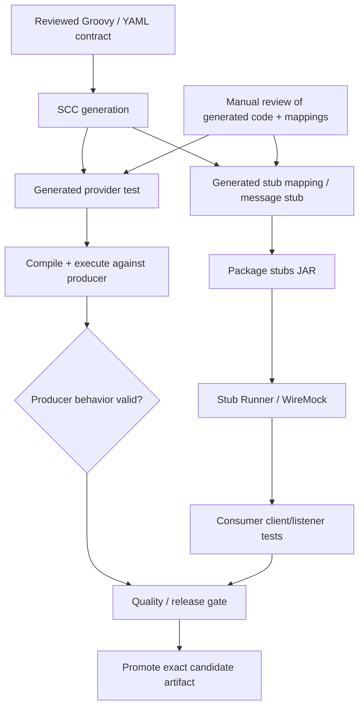
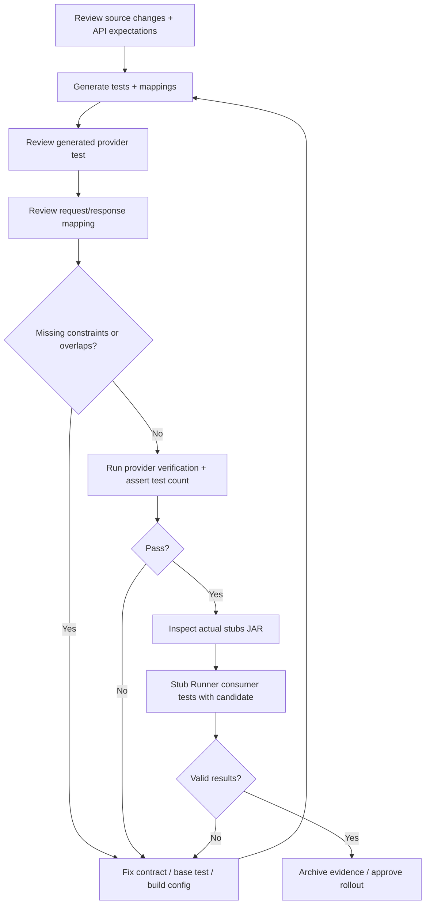

# Manually Inspecting Generated Tests and Mappings for Complex Changes in Spring Cloud Contract

**Spring Cloud Contract (SCC)** helps producers and consumers test HTTP or messaging interfaces against a shared agreement. Teams author contracts in **Groovy/YAML DSL**; the tool generates **provider verification tests** to check the producer implementation, as well as **stub mappings** and resources distributed to consumers via a **stubs JAR** and **Stub Runner**.

For simple API changes, generating tests, running provider verification, and testing consumers with Stub Runner are usually straightforward to follow. However, when a single change touches **method, path, query, headers, body, matchers, status, error handling, security, versions, or message destinations** simultaneously, teams must not look solely at `BUILD SUCCESSFUL` or `BUILD SUCCESS` and conclude everything is right. **Generated tests** and **WireMock mappings** can reflect different facets of the same DSL; a mapping missing a condition can accept invalid requests, while an overly tight mapping can cause valid consumers to hit default 404s.

This lesson belongs to the **Contract Quality** chapter and focuses on **manually inspecting generated tests and mappings for complex changes**. The goal is not for developers to edit generated files, but to learn how to **read them, cross-check against the agreement, and spot dropped constraints** before publishing stubs. The running example uses `order-producer` creating orders for `checkout-consumer`, featuring `POST /api/orders` and an `OrderCreated` event.

## 1. Why do complex changes need manual inspection of generated output?

A single PR might simultaneously change:

- Requests adding `Idempotency-Key`.
- Header `X-Tenant-Id` becoming mandatory for certain clients.
- `customerId` requiring format `CUS-0001`.
- `items[].quantity` required to be a positive integer, not a string.
- Success responses returning `201 Created` and `Location`.
- Error responses adding `400`, `409`, or `403`.
- A producer message adding `schemaVersion` or changing destinations.
- Enabling a Spring Security filter or routing through a gateway.
- Publishing candidate stubs under a new version.

Checking only that contracts parse cleanly does not tell you **whether generated provider tests assert every required constraint**. Checking only that provider tests pass does not tell you **whether WireMock mappings model requests/responses accurately for consumer interaction tests**. Checking only that consumer tests pass does not tell you whether consumers hit the **new candidate stubs or a previously cached artifact**.

### 1.1. Three common discrepancies

| Discrepancy | Example | Consequence |
| --- | --- | --- |
| Contract → generated test | Response body omits assertion for a key field | Producer changes the field wrongly yet provider tests stay green |
| Contract → stub mapping | Critical header missing from request matcher | Consumer forgets the header yet still receives 201 from stub |
| Stub artifact → consumer execution | Stub Runner downloads an old version | Consumer tests pass despite incompatible new candidate API |

**Manual inspection** audits these boundaries. Once a defect is found, fix the **contract DSL, base test, build configuration, or test setup**, then regenerate outputs; never treat direct edits inside generated folders as the source of truth.

## 2. Mental model: one contract, two generated outputs



**Generated provider tests** run against the producer implementation or a configured test context to verify the scenarios described by contracts.

**Stub mappings** define how a test server selects responses or emits sample messages when consumers interact with it. For HTTP, these are typically WireMock mappings; for messaging, they also involve labels, triggers, and corresponding message resources.

Both outputs derive from the same contract yet are **not the same executable program**. One branch may use `RestAssuredMockMvc`, REST Assured, `WebTestClient`, or another test mode; the other uses JSON mappings with request matchers. Therefore:

- Generated tests can send a valid **sample request** to verify the producer.
- Mappings must select responses whenever consumers send **matching requests**.
- Dynamic matchers, optional fields, regexes, and request headers must translate accurately into both branches.
- Security and operational guarantees outside contract scope still need dedicated testing.

**Never infer from “provider tests pass” that every request combination matches the stub properly.**

## 3. Distinguishing four kinds of evidence during review

| Evidence | What it shows | Limitation |
| --- | --- | --- |
| Contract source | What parties describe/commit to | Does not prove implementation complies |
| Generated test source | What the tool intends to send and assert | Does not prove tests executed |
| Test execution report | Which tests were discovered and actual outcomes | Does not guarantee consumer mappings are right |
| Generated mapping + stubs JAR | What WireMock/Stub Runner will serve | Does not prove real producer complies |
| Consumer test report | Client/listener handles stub scenarios | Does not fully prove real security/gateway/broker |

A thorough review cross-checks **at least contract sources, generated provider tests, generated stub mappings, and test reports**. For candidate releases, include the **exact JAR coordinates and resolved version/digest** consumed by tests.

### 3.1. Why never edit generated files directly

Files under `target/` or `build/` are routinely deleted and regenerated during `clean` and generation tasks. If someone edits a generated Java test to add an assertion without updating Groovy/YAML sources, the next build loses that assertion.

Similarly, editing a generated JSON mapping to add `Authorization` without updating the contract causes the next build's stubs JAR to drop that header matcher again.

**Rule:** generated output is an *inspection target*, not a *maintenance source*. The only exception is a formally managed custom code-generation pipeline, where you still edit the generator/config source instead.

## 4. Manual inspection workflow for an API change

A review can follow eight steps:

1. **Confirm sources:** contract revision, PR change summary, API/schema decisions, and affected consumers.
2. **Generate fresh outputs:** run generation using the pinned SCC plugin/build version.
3. **Read generated provider tests:** check method, path, headers, sample body, response status, header/body assertions, and matchers.
4. **Read generated WireMock mappings:** check request matching, response body/headers, priority, scenarios, and collisions.
5. **Run real provider verification:** reject zero tests, skipped tests, or generation-only runs.
6. **Package and inspect the stubs JAR:** verify the packaged archive contains the **just-reviewed mappings**, not stale output.
7. **Run consumer tests against the candidate:** Stub Runner resolves the exact version/classifier/repository, calls the real client, and verifies both success and error cases.
8. **Record evidence and decision:** what passed, what needs follow-up, who reviewed, and which artifact is cleared for release.

Diagram:



**Manual review does not replace automated CI.** It surfaces discrepancies that the existing suite lacks enough negative cases to catch automatically.

## 5. Complex change example: creating orders with idempotency and tenant

Suppose both parties agree on the request:

```http
POST /api/orders HTTP/1.1
Content-Type: application/json
Idempotency-Key: idem-1001
X-Tenant-Id: TENANT-01

{
  "customerId": "CUS-0042",
  "items": [{"sku": "BOOK-01", "quantity": 2}],
  "currency": "VND"
}
```

Success response:

```http
HTTP/1.1 201 Created
Content-Type: application/json
Location: /api/orders/1001

{"id":1001,"status":"CREATED","amountMinor":210000}
```

Beyond the happy path, clarify:

- Is `Idempotency-Key` mandatory and who generates it?
- Does `X-Tenant-Id` come from a trusted gateway or a user-controlled header?
- Is `customerId` a literal fixture or must it follow a regex?
- Is `quantity` a positive JSON integer; is 0 allowed?
- Can a second item be included? Does item ordering carry meaning?
- Which currency units does `amountMinor` represent?
- Should missing headers return `400`, `401`, or `403` per policy?
- Does repeating a POST with the same idempotency key create a duplicate resource?

**A single request/response contract cannot answer all these questions.** Some belong to the wire interface and need extra contracts; others like duplicate-order prevention need stateful integration tests against real implementations.

## 6. Groovy DSL: describing a success path with matchers

Illustrative contract on the producer:

```groovy
import org.springframework.cloud.contract.spec.Contract

Contract.make {
    description 'Create order with idempotency key and tenant header'

    request {
        method POST()
        url '/api/orders'

        headers {
            contentType(applicationJson())
            header('Idempotency-Key', 'idem-1001')
            header('X-Tenant-Id', 'TENANT-01')
        }

        body(
            customerId: 'CUS-0042',
            items: [
                [sku: 'BOOK-01', quantity: 2]
            ],
            currency: 'VND'
        )

        bodyMatchers {
            jsonPath('$.customerId',
                byRegex('^CUS-[0-9]{4}$'))
            jsonPath('$.items[0].quantity',
                byEquality())
        }
    }

    response {
        status CREATED()

        headers {
            contentType(applicationJson())
            header('Location', '/api/orders/1001')
        }

        body(
            id: 1001,
            status: 'CREATED',
            amountMinor: 210000
        )
    }
}
```

This is a **contract example for a concrete fixture**. `byRegex` expresses the `customerId` format rule; `byEquality` locks `quantity` for the described scenario. Verify how matchers translate into assertions/provider requests and WireMock JSON **on your active SCC version**.

### 6.1. What to check in the generated test

Do not merely check that the test sends a POST:

- Is the method `POST`, not `GET`?
- Is the URL `/api/orders` without an accidental context path?
- Is `Content-Type` sent properly and does the producer read JSON?
- Are both `Idempotency-Key` and `X-Tenant-Id` headers present?
- Does the body contain string `customerId`, array `items`, and numeric `quantity`?
- Does it assert response status `201` and `Location`?
- Do body assertions verify `id`, `status`, and `amountMinor`?
- Does the base test set up fixtures so POST runs deterministically without cross-test side effects?

**Important:** generated provider tests may use **sample value `CUS-0042`**, while other valid regex-matching inputs are exercised via stub mappings/consumer tests or extra cases. Never interpret one sample request as proving the entire value domain.

### 6.2. What to check in the mapping

- Does a rule match `POST /api/orders`?
- Are both headers checked if they are part of the promised interface?
- Is `customerId` matched by regex or locked to a literal?
- Is `items[0].quantity` still checked rather than shadowed by a looser matcher?
- Are response `201`, `Location`, and body set as intended?
- Does a catch-all mapping match the same request and return something else?
- Is this exact mapping inside **the JAR the consumer runs**?

If the mapping omits `Idempotency-Key`, a consumer forgetting that header can still get 201 from WireMock. If the mapping locks the entire body byte-for-byte including whitespace, an equivalent JSON request with reordered fields can get rejected.

## 7. Equivalent YAML DSL for comparison—never load both simultaneously

A YAML version expressing the same scenario:

```yaml
description: "Create order with idempotency key and tenant header"
request:
  method: POST
  url: /api/orders
  headers:
    Content-Type: application/json
    Idempotency-Key: idem-1001
    X-Tenant-Id: TENANT-01
  body:
    customerId: CUS-0042
    items:
      - sku: BOOK-01
        quantity: 2
    currency: VND
  matchers:
    body:
      - path: $.customerId
        type: by_regex
        value: '^CUS-[0-9]{4}$'
      - path: $.items[0].quantity
        type: by_equality
response:
  status: 201
  headers:
    Content-Type: application/json
    Location: /api/orders/1001
  body:
    id: 1001
    status: CREATED
    amountMinor: 210000
```

**Pick either Groovy or YAML in real builds for a given scenario**, unless the project intentionally defines two independent contracts with distinct request conditions. Two files matching the same request produce overlapping generated tests or WireMock mappings.

### 7.1. When comparing DSLs, verify nothing gets dropped

| Aspect to compare | Groovy | YAML |
| --- | --- | --- |
| Method/path | `method POST()` and `url` | `method: POST` and `url` |
| Headers | `header('Idempotency-Key', ...)` | `headers.Idempotency-Key` |
| Body | Groovy Map/List | YAML mapping/list |
| JSONPath | `jsonPath(...)` | `matchers.body[].path` |
| Matchers | `byRegex/byEquality` | `type: by_regex/by_equality` |
| Response status | `CREATED()` | `status: 201` |
| Response headers | `contentType`, `Location` | `Content-Type`, `Location` |
| Response body | Map with numbers/strings | YAML values with right types |

Check that the YAML parser interprets `quantity: 2` as a number and `customerId` as a string as intended. For values with leading zeros, dates/times, or special characters, quote them intentionally so parsers do not alter types.

## 8. Reading generated provider tests: inspect logic, not just filenames

SCC generates Java/Groovy tests using the configured test framework and mode. **Exact class names, output paths, and generated syntax are not fixed across all plugin versions.**

Logically, a generated provider test for this scenario must perform:

```text
Given:
  test base/context sets up producer instance, database/mock fixture,
  security, and required dependencies.

When:
  POST /api/orders
  Content-Type: application/json
  Idempotency-Key: idem-1001
  X-Tenant-Id: TENANT-01
  body.customerId = "CUS-0042"
  body.items[0].quantity = 2

Then:
  HTTP status = 201
  Content-Type is JSON
  Location = /api/orders/1001
  response body.id = 1001
  response body.status = CREATED
  response body.amountMinor = 210000
```

This is **pseudocode**, not exact generated code. Open the file generated by your SCC version and verify every critical condition.

### 8.1. Signs a generated test is missing assertions

An error to catch during review:

```java
// Illustrative pseudocode, NOT real SCC-generated code:
assertThat(response.statusCode()).isEqualTo(201);
// Missing checks on Location or amountMinor.
```

If the contract promised `Location` and `amountMinor` yet generated sources fail to check them, investigate:

- Was the contract DSL placed in the wrong block?
- Did the plugin ignore part of the configuration?
- Is a response matcher overly broad?
- Were generated sources stale due to caching?
- Does the test mode have limitations relative to expectations?
- Are you inspecting the generated test for the updated contract?

**Never patch assertions into generated Java and close the review.** Fix the source contract, base class, or generator configuration and regenerate.

### 8.2. Verify tests actually executed

Seeing `ContractVerifierTest.java` on disk does not prove tests ran. Check Maven goals/Gradle tasks, JUnit/Surefire/Gradle XML reports, executed count, skipped count, and failures. If a test file is generated yet skipped by a test engine or filter, builds can report false greens.

## 9. Base classes and HTTP test modes: right output, wrong test context

Generated tests extend a base class preparing the producer—for example, using MockMvc:

```java
package com.example.order.contract;

import io.restassured.module.mockmvc.RestAssuredMockMvc;
import org.junit.jupiter.api.BeforeEach;
import org.springframework.beans.factory.annotation.Autowired;
import org.springframework.boot.test.autoconfigure.web.servlet.AutoConfigureMockMvc;
import org.springframework.boot.test.context.SpringBootTest;
import org.springframework.test.web.servlet.MockMvc;

@SpringBootTest
@AutoConfigureMockMvc(addFilters = true)
public abstract class OrderContractBase {

    @Autowired
    MockMvc mockMvc;

    @BeforeEach
    void setUp() {
        RestAssuredMockMvc.mockMvc(mockMvc);
    }
}
```

This example assumes generated tests use compatible `RestAssuredMockMvc`, Spring Boot context, and JUnit Jupiter. Projects using embedded HTTP servers or other web frameworks need matching base classes and test modes.

**Manual checks:**

- Does the generated class actually extend `OrderContractBase`?
- Are the real controller/handler loaded?
- Are Bean Validation, Jackson serializers, `ControllerAdvice`, and the filter chain active?
- Does test setup reset database or mock state between requests?
- Does the handler receive `X-Tenant-Id`/`Idempotency-Key` properly?
- If requests traverse a gateway, does internal MockMvc testing skip rewrites or forwarding?

### 9.1. Disabling filters can create false contract greens

`@AutoConfigureMockMvc(addFilters = false)` can let a POST 201 provider test pass even if production routes require a JWT scope or tenant header in a filter. When security is part of the interface, test the filter chain at the right level and add integration tests with a real server/gateway as needed.

**A WireMock mapping matching a header is not proof that real JWT signatures or tenant authorization were checked.**

## 10. Reading JSON mappings: check both request matching and response serving

WireMock uses JSON elements like `request`, `response`, `bodyPatterns`, `headers`, `queryParameters`, `priority`, and `scenarioName`.

A **hand-written illustrative mapping** to understand the structure:

```json
{
  "name": "create-order-accepted-example",
  "priority": 5,
  "request": {
    "method": "POST",
    "urlPath": "/api/orders",
    "headers": {
      "Idempotency-Key": {
        "equalTo": "idem-1001"
      },
      "X-Tenant-Id": {
        "equalTo": "TENANT-01"
      }
    },
    "bodyPatterns": [
      {
        "matchesJsonPath": "$.customerId"
      },
      {
        "matchesJsonPath": "$.items[0].quantity"
      }
    ]
  },
  "response": {
    "status": 201,
    "headers": {
      "Content-Type": "application/json",
      "Location": "/api/orders/1001"
    },
    "jsonBody": {
      "id": 1001,
      "status": "CREATED",
      "amountMinor": 210000
    }
  }
}
```

**Important:** the JSON above is a **minimal mapping illustrating how to read mappings**, **not** output claimed to be generated from the Groovy/YAML examples. Notice it **only checks JSONPath existence**, enforcing neither the `customerId` regex nor `quantity` equality. A reviewer must catch that omission before declaring the mapping faithful to the contract.

From this intentionally incomplete example, you can see why manual review matters: seeing `bodyPatterns` exist is not enough; inspect the **exact matcher inside each condition and its strictness**.

### 10.1. Spotting overly broad request matchers

Suppose a mapping contains only:

```json
{
  "request": {
    "method": "POST",
    "urlPath": "/api/orders"
  },
  "response": {
    "status": 201
  }
}
```

It will answer POSTs with bad bodies, missing tenant, or missing idempotency key. If security or format rules were agreed upon yet absent from the mapping, consumer tests can pass falsely.

### 10.2. Spotting overly narrow request matchers

A mapping using `equalToJson` or exact string matching across the entire body can reject valid variations intentionally permitted by the contract, such as:

- Reordered JSON object fields with equivalent values.
- Omitted optional fields.
- A different `customerId` sample still matching the regex.
- A `Content-Type` header carrying a valid `charset`.
- Extra `Cookie` pairs.
- Query parameters in a different order when order carries no meaning.

**Never loosen matchers blindly** so every request matches. Relax only where the contract explicitly allows variation, and verify with negative tests that invalid requests remain rejected.

## 11. Auditing request matchers with a cross-reference table

| Condition | Source contract | Generated provider test | WireMock mapping | Extra test if needed |
| --- | --- | --- | --- | --- |
| Method | POST | Sends POST | Matches POST | GET does not return 201 |
| Path | `/api/orders` | Sends exact path | Exact `urlPath`/URL match | Near-miss path does not match |
| `Content-Type` | JSON | Sends JSON | Matcher if promised | Rejects wrong media type per policy |
| `Idempotency-Key` | Required by fixture | Header present | Exact/regex matcher | Missing header does not match success |
| `X-Tenant-Id` | Tenant fixture | Header present | Exact/regex matcher | Other tenant handled per policy |
| `customerId` | Format regex | Valid sample body | Exact JSONPath regex | Another valid ID accepted |
| `quantity` | JSON number / specific rule | Body number `2` | Matching matcher | String `"2"` rejected as non-number if required |
| `currency` | `VND` or allowed set | Body sends `VND` | Sufficiently constrained matcher? | Invalid currency handled properly |
| Response status | 201 | Asserts 201 | Serves 201 | Consumer parses success |
| `Location` | `/api/orders/1001` | Asserts response header | Serves header | Consumer reads location if dependent |
| `amountMinor` | JSON number | Asserts type/value | Serves type/value | Consumer does not treat as string |

**No automatic rule forces every mapping to match every field in a request body.** Fields that do have explicit conditions must match the contract's intent consistently. If intent is unclear, revisit the API review rather than guessing from one fixture.

### 11.1. Paths and queries can get conflated into a single URL string

Compare:

```text
GET /api/orders?status=CREATED&page=0
GET /api/orders?page=0&status=CREATED
```

Both requests can be semantically identical when query parameter order is insignificant. Yet a mapping comparing an exact URL string matches one ordering and rejects the other.

For requests with dynamic queries, check whether the mapping uses `urlPathEqualTo`/`urlPathMatching` with `queryParameters` or a whole-URL matcher. Never loosen query matching unconditionally when required parameters exist.

### 11.2. Header nuances

- HTTP header names are case-insensitive per protocol semantics.
- `Content-Type` values may carry media type parameters; know which forms the contract allows.
- Consumer `Accept` and producer `Content-Type` apply to opposite directions.
- `Authorization` fixtures must never use production tokens.
- `X-Correlation-Id` may be dynamic: match format or presence per agreement.
- Some headers are injected by gateways rather than managed directly by controllers.

When generated outputs emit overly narrow or overly broad literals, document it and fix the source contract.

## 12. Auditing body matchers: JSONPath, regex, types, and strictness

**Body matchers** hide the subtlest mismatches. For instance, `customerId` specified by regex:

```text
^CUS-[0-9]{4}$
```

Probe values:

| Value | Valid format? | Why? |
| --- | --- | --- |
| `CUS-0042` | Yes | Prefix and four digits |
| `CUS-9999` | Yes | Different literal, follows rule |
| `CUS-42` | No | Missing two digits |
| `CUS-00420` | No | Extra digit |
| `ORD-0042` | No | Wrong prefix |
| `fooCUS-0042bar` | No | Regex has start/end anchors |
| `null` | No if string required | Not a valid customer ID |

### 12.1. Regex does not replace JSON schema validation

If a regex mapping checks `quantity` as `[0-9]+`, it can accidentally allow JSON string `"2"` when the API requires JSON number `2`. When needed, verify both **type** and **value/domain**.

Some matchers only check presence or string representation at a JSONPath without enforcing JSON type. Reviewers must know **which matcher type the SCC converter emitted** in real output, and add tests if consumers depend on distinguishing numbers from strings.

### 12.2. Optional, nullable, and absent are not synonymous

Suppose the producer adds `promotionCode`:

```json
{
  "promotionCode": null
}
```

which differs from:

```json
{}
```

Many deserializers treat missing vs. explicit null differently. When a contract says optional:

- Can it be completely absent?
- Can it be present with `null`?
- Must it be present as a string in certain cases?
- Do older consumers reject unknown fields?
- Can numeric or temporal types change?

A generated test asserting a single fixture containing `promotionCode` does not cover every combination. Add contracts or integration tests for promised branches.

### 12.3. Arrays add ordering and cardinality risks

For `items`:

- Does `items[0].sku` mean specifically the first element or any matching item?
- Can the array be empty?
- Can multiple items be sent?
- Is ordering part of API semantics?
- Must quantity be strictly positive?
- Can extra fields appear on each item?

If a matcher checks only `$.items[0].quantity`, a request with a valid first item and an invalid second item can still match. Never infer from one passing JSONPath that every element in the array is constrained. Write contracts/tests matching the real scope.

## 13. Auditing response assertions: status, headers, body, and semantics

In generated provider tests, audit responses with the same rigor as requests.

A resource-creating POST contract may require:

- `201 Created` rather than any 2xx.
- `Content-Type: application/json`.
- `Location` pointing to the created resource per agreed rules.
- JSON `id` as number or string per contract.
- `status` within the valid domain.
- `amountMinor` as integer minor units, not a decimal string.
- Zero secrets, internal tokens, or private fields returned.
- Error responses carrying stable codes/headers on failures.

If generated tests assert only status while skipping key headers or body fields, inspect the DSL response block and matcher conversion.

### 13.1. Dynamic responses and consumer/producer-side values

Values like `id`, `createdAt`, and `requestId` vary across runs. In supported versions, SCC Groovy DSL lets you define separate values or matchers for producer vs. consumer perspectives.

**What to review:**

- Provider verification should accept real producer values matching the promised format and semantics.
- Stub mappings should return deterministic sample values so consumer tests stay stable.
- Never force the producer to always return literal `1001` if IDs are generated dynamically, unless test fixtures fix them.
- Never let stubs return strings when the API promises numbers.
- Never use `.*` for fields whose format must be protected.

With `consumer(...)`/`producer(...)` or `value(...)` syntax, **inspect real outputs** to confirm data directions and matchers translated properly; online snippets may target different API or DSL versions.

### 13.2. Dates, timezones, and precision

Response:

```json
{
  "createdAt": "2026-11-24T03:15:30.123Z",
  "amountMinor": 210000
}
```

raises questions: must `createdAt` be UTC? Is millisecond precision fixed? Are other offsets representing the same instant allowed? Which currency does integer `amountMinor` use?

If contracts use only a literal timestamp, provider tests may be too rigid or too loose relative to real semantics. For date/time and monetary changes, review matchers, parsers, and assertions with boundary examples—not just one happy path.

## 14. Auditing error mappings: never let unmatched 404 hide real errors

Complex changes often add error responses:

| Scenario | Illustrative status | What must be agreed |
| --- | --- | --- |
| Malformed JSON body | 400 | Field/path and error code |
| Missing or invalid bearer credential | 401 | Auth challenge/body if promised |
| No tenant/resource permission | 403 or 404 policy | Security/domain semantics |
| Idempotency key payload conflict | 409 | Error code / retryability |
| Quota exceeded | 429 | `Retry-After`, client policy |
| Dependency temporarily unavailable | 503 | `Retry-After` or error schema if defined |

These statuses are **examples to confirm per project API**, not automatic SCC error responses on invalid requests.

### 14.1. A request missing a success header can get a WireMock 404

Suppose the success mapping requires `Idempotency-Key`. A consumer forgets the header; WireMock finds no matching mapping and returns its default 404. That **does not prove the producer returns 404**; the producer's validation logic might return 400.

To verify the consumer handles 400 per contract, you need:

1. An explicit error contract/fixture agreed by the producer.
2. Provider tests proving the real producer returns 400.
3. A dedicated stub mapping for the error case with distinct request conditions.
4. Consumer tests asserting the validation error branch.

**Unmatched responses and intentional error mappings are two different kinds of evidence.**

### 14.2. Watch out for overlapping error mappings

A generic mapping:

```json
{
  "priority": 1,
  "request": {
    "method": "POST",
    "urlPath": "/api/orders"
  },
  "response": {
    "status": 400
  }
}
```

can beat a more specific mapping with a higher priority number even on valid requests, because WireMock resolves matching stubs by priority where **lower numbers have higher priority**. An overly broad fallback shadows happy paths.

Inspect **all mappings that could match a given request**, not just the single JSON file under review.

## 15. Mapping priority, overlap, and scenario state

WireMock has two easily confused mechanisms:

- **Priority:** when multiple mappings match, precedence resolves ties; lower priority numbers win.
- **Scenarios:** a mapping matches only when the scenario is in a specific state, optionally transitioning afterward.

**A high-priority mapping does not automatically create a `503 → 200` sequence.** To simulate responses changing across calls, use scenarios or appropriate stateful test mechanisms.

### 15.1. Review overlap matrix

| Mapping A | Mapping B | Question |
| --- | --- | --- |
| Exact `POST /api/orders` | Generic `POST /api/.*` | Which mapping wins? |
| Header tenant = A | Ignores tenant | Could wrong data return for another tenant? |
| Body JSONPath existence only | Exact JSON body | Do invalid requests still match? |
| 400 catch-all | 201 success | Does priority shadow the happy path? |
| 503 scenario STARTED | 200 scenario RECOVERED | Does state reset between tests? |
| Old generated mapping | New generated mapping for same request | Does the artifact hold duplicate mappings? |

### 15.2. Probing mappings with valid and counter-example requests

Do not test only valid requests. Against the same mapping set:

```text
Case 1: Valid POST with right headers/body
  => must match the agreed 201

Case 2: POST missing Idempotency-Key
  => must NOT match the success mapping
  => error response has contract value only if an explicit error mapping exists

Case 3: POST with wrong Content-Type per contract
  => must NOT accidentally match success

Case 4: POST with customerId="CUS-42"
  => must fail the 4-digit CUS regex

Case 5: POST with quantity="2" (string)
  => must be rejected by matcher if API promises a number

Case 6: POST same path for a different tenant
  => must NOT match tenant A when API isolates tenants
```

A probe verifying a bad request **does not match** may receive a WireMock 404; never relabel that 404 as “producer returns validation error.” Only conclude **the success mapping did not match**.

### 15.3. Reset state between tests

When using WireMock scenarios, reset scenario states, request journals, and mappings, or spin up fresh servers. An earlier case can advance state and cause a later case to receive a different response, creating flaky tests even when contracts did not change.

## 16. Reading request journals and verifying the right mapping fired

When consumer tests fail, WireMock's request journal reveals:

- Which exact request the consumer sent.
- Whether method/path/query matched the contract.
- Whether headers like `Content-Type`, `Accept`, and `Idempotency-Key` were sent properly.
- Whether the JSON body had the right types and nesting.
- Which mapping matched—or whether none matched.
- Whether unintended duplicate requests occurred.
- Whether responses came from the candidate stub or another server.

Example WireMock Admin API endpoints in test environments:

```text
GET /__admin/mappings
GET /__admin/requests
```

These are common WireMock admin endpoints; exact paths and payload shapes vary by version. Enable and access the Admin API only in **controlled test environments**, never publicly. Request journals may contain `Authorization`, `Cookie`, or sensitive bodies, so redact before storing in CI.

### 16.1. Verifying with WireMock's Java DSL

A consumer test can verify requests:

```java
import static com.github.tomakehurst.wiremock.client.WireMock.*;

wireMockServer.verify(
    1,
    postRequestedFor(urlPathEqualTo("/api/orders"))
        .withHeader(
            "Idempotency-Key",
            equalTo("idem-1001")
        )
        .withHeader(
            "X-Tenant-Id",
            equalTo("TENANT-01")
        )
);
```

This is meaningful only when **the real consumer called** that WireMock server. It does not replace provider verification and does not prove the producer actually handles idempotency or tenant authorization.

### 16.2. Never use request journals to store real tokens

If tests use bearer tokens, cookies, or API keys, avoid logging raw values. In contract tests, use synthetic token fixtures; in integration/security tests, redact secrets from logs and reports.

## 17. Inspecting generated messaging tests and message stubs

SCC supports more than HTTP; event schema and destination changes also need manual review.

Example Groovy message contract:

```groovy
import org.springframework.cloud.contract.spec.Contract

Contract.make {
    description 'Producer emits OrderCreated v1'
    label 'order_created_v1'

    input {
        triggeredBy('publishOrderCreated()')
    }

    outputMessage {
        sentTo('orders.created')
        headers {
            messagingContentType(applicationJson())
        }
        body(
            eventId: 'EVT-1001',
            eventType: 'OrderCreated',
            schemaVersion: 1,
            orderId: 'ORD-1001'
        )
    }
}
```

### 17.1. Inspecting generated provider message tests

- Does it call the exact trigger method `publishOrderCreated()`?
- Does the test context provide the right bean, message verifier, or binder?
- Does it assert logical destination `orders.created`?
- Does it assert `Content-Type`/headers and JSON body?
- Is `schemaVersion` asserted as a number?
- Is `eventId` matched by rule rather than literal if dynamic?
- Does it verify the message is genuinely published by the producer component?

### 17.2. Inspecting consumer message stubs

- Does the stubs JAR contain message resources and label `order_created_v1`?
- Does `StubTrigger` fire the exact label from the **candidate version**?
- Does the consumer listener receive and parse the body cleanly?
- Does the consumer assert side effects instead of merely calling `trigger(...)`?
- If the destination changed, are any consumers still subscribed to the old channel?

**Message stubs do not test broker delivery semantics** such as Kafka offsets, RabbitMQ ack/nack, DLQs, partition ordering, or transactional outboxes. Those require dedicated integration tests.

### 17.3. Never assume HTTP mappings and message stubs share the same format

HTTP Stub Runner relies on WireMock mappings; messaging relies on Stub Runner triggers, message contracts, and corresponding integration adapters. Reviews must inspect **the output artifact type matching the transport under change**. Never assume a message contract is missing simply because no new HTTP JSON mapping appeared.

## 18. Locating generated outputs in Maven and Gradle

Generated file paths and task names vary across SCC plugin versions, test modes, build configs, and custom source sets.

### 18.1. Maven projects

With a compatible SCC Maven plugin setup, the workflow typically uses:

```bash
./mvnw -B -ntp clean verify
```

Then inspect:

- Logs from `spring-cloud-contract-maven-plugin` goals.
- Generated provider tests in actual build output.
- `target/surefire-reports/` and/or `target/failsafe-reports/` per test setup.
- The stubs JAR packaged/attached with classifier `stubs`.
- JAR contents via `jar tf`.

Do not assume every contract test runs under Surefire; some projects use Failsafe or other test plugins. **Verify test counts and class names from actual reports.**

### 18.2. Gradle projects

Some plugin versions expose tasks such as:

```bash
./gradlew tasks --all
./gradlew generateContractTests
./gradlew contractTest
./gradlew check --dry-run
./gradlew verifierStubsJar
```

**Verify exact task names against your plugin version.** `generateContractTests` generates code without running provider assertions. `contractTest` (or the corresponding `Test` task) executes tests if registered. `--dry-run` inspects the task graph without running assertions.

Read generated test outputs and reports in the directories configured by the task/source set. Never edit files under `build/` to persist fixes.

### 18.3. Task graph dependencies worth verifying

- Are contract sources wired as inputs to the generation task?
- Does generation run before compilation and execution of generated tests?
- Does `check`/`verify` execute provider verification?
- Does the build produce a fresh artifact after verification?
- Could packaging jobs accidentally reuse cached mappings from an earlier build?
- Does CI forbid `-DskipTests` or `-x contractTest` on release gates?
- Does a test-count gate reject `0 tests` runs?

Any gap here can mean you manually reviewed a valid generated file that the pipeline never actually used.

## 19. Packaging mappings into the stubs JAR: check beyond build files

In Maven artifact repositories, stubs normally carry classifier `stubs`:

```text
groupId    = com.example
artifactId = order-producer
version    = 2.5.0-rc.1
type       = jar
classifier = stubs
```

Illustrative filename:

```text
order-producer-2.5.0-rc.1-stubs.jar
```

Inspect:

```bash
jar tf target/order-producer-2.5.0-rc.1-stubs.jar
```

This JAR path reflects **default Maven naming**, which depends on project/packaging configuration. For Gradle or custom `finalName`, inspect the actual output path.

**Do not stop at file existence.** Inspect inside to verify the mappings and contracts/message resources match the reviewed change.

**Candidate checksum:** once the JAR's contents are verified, record its SHA-256 in a build manifest; consumer CI should compare the downloaded artifact's checksum against the trusted manifest. Checking only filename or version without verifying bytes still leaves room for stale caches or overwritten artifacts.

### 19.1. The stale artifact trap

Suppose a producer PR updates mappings to require `X-Tenant-Id`, yet consumer tests still resolve:

```text
com.example:order-producer:2.4.0:stubs
```

while the new candidate is:

```text
com.example:order-producer:2.5.0-rc.1:stubs
```

Green consumer tests against `2.4.0` prove nothing about `2.5.0-rc.1` compatibility. Record the **resolved GAV/type/classifier, repository, and digest** of the exact JAR the consumer ran.

### 19.2. Manual review may require diffing mappings between versions

For complex changes, compare:

- Old vs. new mappings for the same endpoint.
- Added or removed headers/query/body constraints.
- Changed response status/headers/body.
- Priority shifts.
- Whether error mappings can shadow success mappings.
- Duplicate mappings caused by Groovy/YAML duplication.
- Message label/destination changes that could break consumer triggers.

Do not diff generated JSON mechanically: tools can alter property ordering, IDs, or whitespace. **Focus on matcher and response semantics.**

## 20. Verifying the consumer uses the right Stub Runner candidate

Spring Boot consumer test example:

```java
import org.springframework.boot.test.context.SpringBootTest;
import org.springframework.cloud.contract.stubrunner.spring.AutoConfigureStubRunner;
import org.springframework.cloud.contract.stubrunner.spring.StubRunnerProperties;

@SpringBootTest(properties = {
    "order.api.base-url=http://localhost:8085"
})
@AutoConfigureStubRunner(
    ids = "com.example:order-producer:2.5.0-rc.1:stubs:8085",
    stubsMode = StubRunnerProperties.StubsMode.LOCAL
)
class CheckoutConsumerContractTest {
    // Call real OrderClient from the consumer application.
    // Assert response DTO and error-handling branches as needed.
}
```

This example uses `LOCAL` with a stubs JAR installed in the test runner's Maven local repo. For `REMOTE`, configure the proper repository and pin an immutable candidate version.

**A consumer test that starts Stub Runner without calling the real `OrderClient` does not protect the product's communication path.**

### 20.1. Real consumer requests can differ from fixtures

Suppose the contract POST fixture specifies:

```json
{
  "customerId": "CUS-0042",
  "items": [{"sku": "BOOK-01", "quantity": 2}],
  "currency": "VND"
}
```

yet the consumer client serializes:

```json
{
  "customer_id": "CUS-0042",
  "items": [{"sku": "BOOK-01", "quantity": "2"}],
  "currency": "VND"
}
```

An accurate mapping must **catch meaningful differences** between snake_case and camelCase or number vs. string if promised. If the mapping only checks method and path, the consumer receives 201 and passes despite an invalid request schema.

### 20.2. Distinguish “stub matched” from “producer accepts”

A WireMock mapping may be too broad or too strict. When a consumer request fails to match, do not immediately edit the producer contract; check:

- Is the consumer request valid under the agreement?
- Does the mapping faithfully represent the agreement?
- Is the candidate artifact the right version?
- Does the API have undocumented optional/dynamic fields?
- Is another mapping intercepting the request?
- Should we fix the consumer, contract, or generation/configuration?

Only after pinpointing the root cause should you make a reviewable change.

## 21. Manual inspection checklist for complex pull requests

| Inspection item | When does it PASS? | Evidence |
| --- | --- | --- |
| Change agreed | Scope and affected consumers are clear | PR/ADR/API decision |
| Source DSL accurate | Groovy/YAML contracts updated cleanly with no duplicates | Contract source diff |
| Generated tests accurate | Method/URL/body/headers and response assertions complete | Generated test sources |
| Tests executed | Tests ran and passed, zero skipped/zero-count runs | JUnit/Surefire/Gradle XML |
| Base test accurate | No critical filters or validation bypassed | Test configuration |
| Request mapping accurate | Matches all contracted constraints | Generated JSON mappings |
| Mapping not too broad | Invalid requests do not match success | Negative stub tests |
| Mapping not too strict | Permitted non-fixture variants still match | Positive variant tests |
| No mapping overlap | Priority/scenarios do not serve wrong responses | Full mappings + request journal |
| Response accurate | Status, headers, JSON types, error schema | Provider asserts + stub response |
| Messaging accurate | Labels, destinations, schema headers | Message tests + `StubTrigger` |
| Artifact accurate | JAR contains updated mappings with right classifier/version | `jar tf`, manifest/digest |
| Consumer accurate | Real client/listener runs candidate and passes | Consumer test report |
| CI gates enforced | No publish when required producer/consumer checks fail | Pipeline dependency/report |
| Data security | No real tokens/cookies/PII leaked in artifacts | Secret/redaction review |

**Not every PR needs all 15 items at identical depth.** Small changes can use a fast check; changes touching security, money, idempotency, or multiple consumers need deeper evidence.

### 21.1. Short review record template

```text
Change: POST /api/orders adds tenant/idempotency rules
Producer commit: <full source SHA>
Contract(s): <path and review revision>
SCC plugin/toolchain: <versions>
Generated provider test: <class/path>
Verification: <test count, report link>
Generated mapping: <file/JAR entry>
Observed matching: <positive & negative request cases>
Overlap check: <priority/scenario result>
Stubs artifact: <GAV:jar:stubs + SHA-256>
Consumer CI: <commit, Stub Runner mode, test report>
Open risks: <security, data/state, broker, etc.>
Decision: APPROVED / NEEDS_CHANGES
```

This is an **internal documentation template**, not a default SCC schema. Record actual observed results—never replace evidence with pre-filled `PASS` markers.

## 22. CI: automate the checks discovered during manual review

Manual reviews should yield **regression tests** so the system catches the same classes of bugs automatically next time.

A pipeline can verify:

1. Contract DSLs parse and generate cleanly.
2. Generated provider tests exist for expected contracts.
3. Provider verification runs and passes.
4. Test reports contain zero `0-test` runs or policy-violating skips.
5. Stubs JAR contains mappings for new endpoints/messages.
6. Candidate GAV/classifier/digest are recorded.
7. Consumer Stub Runner tests resolve the exact candidate.
8. Positive/negative request-matching tests execute against WireMock.
9. Critical priority/collision scenarios have explicit assertions.
10. Consumer DTO and error handling pass.
11. Zero real secrets or PII appear in test fixtures or logs.
12. Release gates block if required consumers fail or evidence is missing.

### 22.1. Verifying with intentional mutations

| Trial mutation | Test/gate that should fail |
| --- | --- |
| Drop `Location` from producer response | Generated provider contract test |
| Change `amountMinor` from number to string | Provider/consumer schema assertion |
| Remove `Idempotency-Key` matcher from mapping source/config | Negative stub test missing header |
| Change `customerId` regex to `.*` | Invalid `customerId` test |
| Add high-priority 400 catch-all | Consumer/stub success selection test |
| Set `addFilters=false` when auth is contracted | Security integration gate |
| Change message label | `StubTrigger` consumer test |
| Remove contract directory input | Contract/test count gate |
| Use old stubs version | Candidate version/digest assertion |
| Skip `contractTest` | Provider verification gate |
| Remove WireMock scenario reset | Test isolation / order-independent suite |

This is an **expectation table for well-designed CI**, not a claim that every SCC release includes all these gates out of the box.

### 22.2. Never use generated file diffs as the sole gate

Generated JSON/Java diffs can contain noise from plugin versions or formatting; conversely, a severe semantic regression might differ by one tiny matcher. Combine:

- Semantic review of request/response mappings.
- Executed provider tests.
- Positive/negative request-matching tests.
- Candidate artifact integrity checks.
- Consumer tests with real clients/listeners.

## 23. Troubleshooting: symptoms and what to inspect in generated output

| Symptom | What to inspect |
| --- | --- |
| Provider tests pass yet consumer gets 404 | WireMock matchers, unmatched 404, stub version, base URL |
| Generated tests do not appear | Contract directory, plugin config, YAML/Groovy parsing |
| Generated tests fail to compile | Base class, imports, test dependencies, `byCommand` helpers |
| Generated tests pass even when required header is dropped | Contract request, test base/filters, request assertions |
| Consumer missing header still gets 201 | Overly broad mapping or catch-all success |
| Valid consumer gets 404 | Overly narrow mapping, regex, header/JSONPath types, priority |
| JSON number/string mismatch | YAML types, serializer, matcher semantics |
| Right status yet wrong response schema | Missing response assertions or stale stub body |
| Expected 401 yet got 404 | Unmatched stub instead of intentional 401 mapping |
| `503 → 200` transition fails | Scenario state not advancing/resetting, shadowed priority |
| `StubTrigger` emits no event | Label, destination, messaging setup, artifact |
| Tests pass with old artifact | Stub Runner `ids`/repo/cache/version |
| CI reports only `NO-SOURCE` | Generation, task graph, test discovery |
| Fails only after plugin upgrade | Different DSL converter/matcher semantics across versions |
| Order-dependent flakiness | Shared state, unreset scenario or request journal |
| Token leaked in CI report | Real credentials in fixtures, unredacted logs |

### 23.1. Runbook for “provider green, consumer red”

```text
1. Identify producer commit, SCC plugin version, and contract revision.
2. Confirm provider tests actually executed and passed (not just generated).
3. Open generated tests to inspect request and response assertions.
4. Open generated WireMock mappings to inspect request matchers.
5. Inspect all mappings that could match the same method/path.
6. Identify exact artifact version/classifier/digest resolved by consumer.
7. Inspect actual consumer requests in WireMock's request journal.
8. Separate request mismatches, response mismatches, and app logic bugs.
9. Check whether negative/positive variants are missing from tests.
10. Fix the right source: contract, base test, consumer adapter, or CI config.
11. Regenerate and run both provider and consumer tests on the same candidate.
12. Archive results/evidence; never hotfix generated outputs.
```

### 23.2. When outputs contradict business expectations

If generated tests and mappings both “match the DSL” yet API behavior violates what a consumer team expects, **the DSL is likely missing or misstating the agreement**. Reconvene producer/consumer owners, API docs, and design decisions; tooling cannot decide which business semantics are right.

## 24. Comprehensive lab: reviewing a PR with intentional defects

Set up a Spring Boot producer with a compatible SCC Gradle or Maven plugin, a consumer using Stub Runner, and a real `OrderClient`.

**Context:** the PR updates `POST /api/orders` to require `Idempotency-Key` and `X-Tenant-Id`, widen the `customerId` regex, return `201` with `Location`, and emit an `OrderCreated` message.

Steps:

1. **Author source contracts:** write the Groovy example from Section 6 and its YAML equivalent on a separate branch.
2. **Generate tests:** run the task/goal for your plugin version; locate generated Java files and the base class.
3. **Audit provider assertions:** tabulate method, URL, headers, request body, and response status/headers/body actually asserted.
4. **Read the mapping:** locate the WireMock JSON for `POST /api/orders` and record its request matchers and response.
5. **Audit headers:** ensure `Idempotency-Key` and `X-Tenant-Id` are not omitted from success stub conditions.
6. **Test `customerId` regex:** probe `CUS-0042`, `CUS-9999`, `CUS-42`, and `ORD-0042`.
7. **Test data types:** probe `quantity: 2` and `quantity: "2"`; explain which matcher guards the type.
8. **Test arrays:** probe multiple items if allowed by the API; list constraints lacking assertions.
9. **Audit response headers:** remove `Location` in the producer; generated tests must fail if contracted.
10. **Audit response body:** change `amountMinor` to a string and observe which gate catches it.
11. **Add negative contracts:** create agreed `400/409` scenarios instead of treating unmatched WireMock 404 as an error contract.
12. **Create intentional overlap:** add a priority-1 catch-all POST mapping and confirm it shadows success; fix priority/matchers properly.
13. **Add optional scenario:** simulate 503 then 200 for consumer retries, resetting state between tests.
14. **Audit security:** verify the base test enables essential filters; separate JWT/mTLS integration tests if relevant.
15. **Audit messaging:** create the `OrderCreated` contract and inspect label, destination, and payload in generated outputs.
16. **Real provider tests:** execute verification and check report counts; reject `NO-SOURCE`/skipped runs.
17. **Stubs JAR:** build the `stubs`-classifier artifact, inspect `jar tf`, and record version/digest.
18. **Stub Runner:** configure consumer tests to resolve the exact new candidate and call real `OrderClient`.
19. **Request journal:** cross-check sent HTTP requests against matched mappings.
20. **CI gates:** intentionally use an old artifact or skip `contractTest`; pipeline must reject invalid evidence.
21. **Review checklist:** fill out Section 21's table with report links and traceable decisions.
22. **Restore:** revert code and contracts to valid states, re-run the suite, and confirm all mandatory gates pass.

### 24.1. Self-assessment table

| Competency | Evidence of mastery |
| --- | --- |
| Reading generated code | Accurately identifies request and response assertions |
| Reading stub mappings | Understands request matchers, responses, and priorities |
| Comparing DSL to outputs | Catches unintended dropped or added constraints |
| Dynamic matchers | Distinguishes literal fixtures, regexes, and equality |
| JSON types | Catches string/number mismatches |
| Optional/null/arrays | Identifies cases uncovered by a single fixture |
| Error paths | Distinguishes intentional 400/404 from unmatched 404 |
| Mapping collisions | Audits overlaps, priorities, and scenario state |
| Security | Never mistakes filter-disabled tests for production behavior |
| Messaging | Audits labels, destinations, and listener assertions |
| Artifacts | Verifies stubs JAR, classifier, version, and digest |
| CI | Enforces real producer/consumer tests, zero `0-test`/skipped |
| Maintenance discipline | Fixes DSL/config sources, never patches generated files |

## 25. Conclusion: inspect generated outputs to verify contract intent

In **Spring Cloud Contract**, generated provider tests and stub mappings are the two artifacts enabling producers and consumers to evolve APIs safely. Yet **a green build does not prove mappings are accurately constrained**, and **a stub returning the right status does not prove the real producer or real client satisfies every condition**.

For complex API changes, perform four cross-checks:

1. **Agreement → DSL:** does it accurately express method/path/headers/body, matchers, errors, and message semantics?
2. **DSL → generated provider tests:** are sample requests, response assertions, base class, test mode, and execution evidence all present?
3. **DSL → mappings/stubs JAR:** are request matchers neither too broad nor too narrow, free of collisions, right status/headers/body, and free of stale artifacts?
4. **Artifact → consumer CI:** does Stub Runner use the exact candidate version and do real clients/listeners execute assertions?

**Manual inspection does not mean trusting code generation less; it is how you verify the tool interpreted the contract according to the teams' intent.** Fix every discovered discrepancy in the **contract source, configuration, or proper tests**, then turn it into a regression test and CI evidence.

By keeping the chain **Groovy/YAML contract → generated test → provider verification → stub mapping/JAR → Stub Runner consumer tests** intact, teams catch both incompatible API changes and false-green tests caused by faulty matchers or stale artifacts early.
