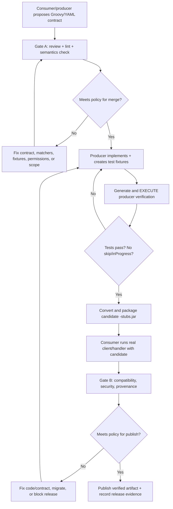
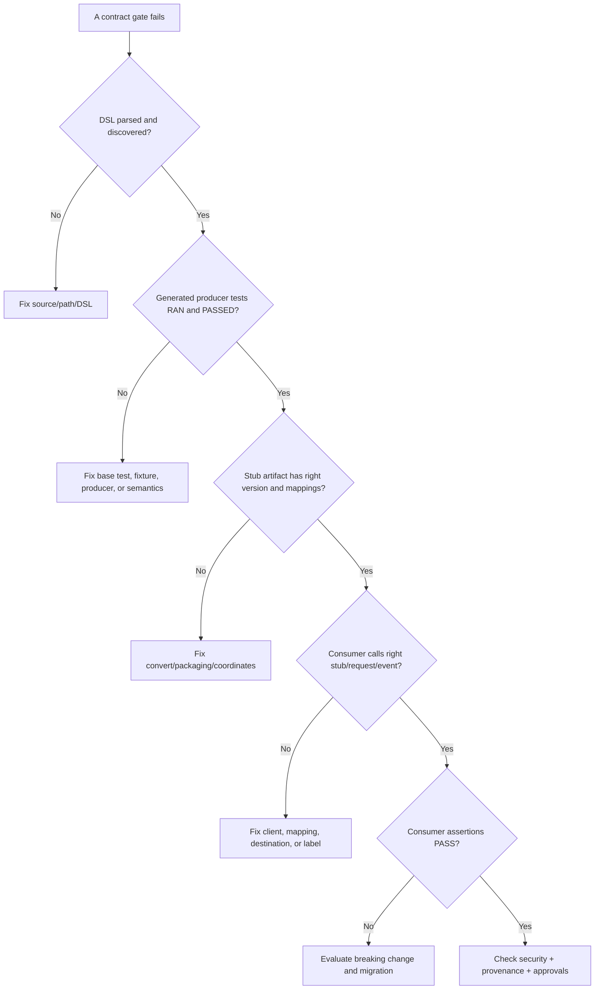

# Pre-Merge and Pre-Publish Contract Checklists

## 1. Why are two quality checkpoints needed?

In the **SPRING_CLOUD_CONTRACT** module, Spring Cloud Contract lets producers and consumers agree on **HTTP** or **messaging** behavior via **Groovy/YAML DSL**. Contract Verifier generates producer tests; contracts can be converted into stubs, version-packaged, and consumed via **Stub Runner**. CI helps detect incompatible API changes before deployment.

However, a syntactically valid contract is **not necessarily a good contract**. It may misstate business rules, be too broad to catch bugs, or lock internal details the consumer never uses. A successfully built stub also **does not prove the producer actually implements it**. Even when producer verification passes, older consumers can still break from schema changes or deserialization errors.

Therefore, distinguish two checkpoints:

1. **Before merging (merge):** are the contract semantics accurate, is ownership clear, are examples and matchers high quality, can it be verified, and does it avoid conflicts with other contracts?
2. **Before publishing (publish/release):** does the producer build **genuinely satisfy** the contract, did generated tests execute, is the stub JAR accurate, do supported consumers remain compatible, and is the artifact released safely?

Some organizations combine both gates into one PR requiring producer CI to pass before merge. Others allow **unimplemented proposals** to merge onto a development branch while blocking publication. What matters is **never treating “contract reviewed” as equivalent to “producer verified.”**

### Learning outcomes

After this lesson, you will be able to:

- Use checklists to evaluate **clarity, consistency, coverage, and maintainability** of contracts.
- Audit HTTP methods, URLs, queries, headers, bodies, statuses, and error codes.
- Evaluate request/response matchers: **neither too strict nor too loose**.
- Audit message `label`, `sentTo`, bodies, headers, content types, and asynchronous states.
- Inspect fixture data, generated producer tests, mappings, and Stub Runner setups.
- Distinguish evidence required for the **merge gate** vs. the **publish gate**.
- Verify compatibility across supported consumers and branches.
- Establish CI blocking criteria, waiver handling, and safeguards against “false-green builds.”

## 2. Defining a “high-quality contract”

A good contract must answer **who needs which behavior, what the producer commits to, and which test catches a broken commitment**.

| Criterion | Review question | Failure indicator |
| --- | --- | --- |
| **Matches real need** | Which consumer actually uses this field/state? | Copying an entire response with no use case |
| **Clear semantics** | Are data types and business meanings agreed? | `available` unclear whether “in stock” or “reserved” |
| **Deterministic** | Which request leads to which response? | Two mappings matching the same request with conflicting results |
| **Verifiable** | Can the producer seed fixtures and run real tests? | Response occurs only in an uncontrolled external system |
| **Catches right bugs** | Do consumer-breaking changes fail tests? | `.*` matchers on every field |
| **Does not lock internals** | Do assertions depend on unpublished producer details? | Asserting database row IDs or JSON key ordering |
| **Covers key branches** | Are happy paths and consumer-relied errors included? | Testing only `200`, skipping `404/409` |
| **Data safety** | Are real tokens or PII placed into fixtures? | Copying production requests into DSL |
| **Traceable provenance** | Who approved and which revision built which artifact? | JAR untraceable to a commit |
| **Compatible** | Do supported consumers continue working? | Running only producer tests |

**A checklist is not a tally to score points.** One severe defect—such as real credentials in a contract or a `404` branch colliding with another mapping—is enough to **block merge or publish** even if every other box is checked.

## 3. Gate separation: pre-merge vs. pre-publish



### 3.1. Evidence matrix

| Evidence | Before PR merge | Before publish/release |
| --- | --- | --- |
| Consumer use case and owner | **Required** | Retain evidence |
| DSL parses and contracts discovered | **Required** | **Required** |
| Semantics and breaking-change review | **Required** | Zero unreviewed changes |
| Meaningful fixture/mock-up | Plan or implementation required | **Implemented and verified** |
| Generated producer tests | Run if implementation exists | **Must generate and execute** |
| `inProgress`/`ignored` contracts | Must declare reason/status | **Must not mask missing verification** |
| Stub JAR | May be an experimental build | **Exact version, contents, and checksum** |
| Consumer tests against stub | May use proposed stub, marked *unverified* | **Must use verified candidate** |
| Compatibility matrix | Identify consumers to test | **Approved results or valid waiver** |
| Release permissions, artifact provenance | Clear plan | **Required prior to publication** |

If a PR only proposes a design before producer implementation exists, an organization may allow merging into a **proposal branch**. However, stable artifacts may ship only after **Gate B** passes.

## 4. Pre-review checklist: audience and scope

Before reading a single line of Groovy, reviewers must know whom the contract serves.

### 4.1. Questions that belong on the pull request

- Which **producer** owns the endpoint or event?
- Which **consumers** actually call the API or consume the message, and who owns them?
- What is the use case? Which fields, statuses, headers, or event types drive consumer decisions?
- Does the contract describe **existing behavior**, **new behavior**, or a **breaking change**?
- Which producer/consumer versions are active? Are there LTS/hotfix branches to support?
- Are authentication, authorization, personal data, or sensitive transactions involved?
- Which scenarios must be verified to declare readiness?
- Can a reviewer **point to a concrete bug** this contract would catch?

Example PR summary table:

| Attribute | Illustrative value |
| --- | --- |
| Producer | Orders Service |
| Consumer | Checkout Service and Mobile Gateway |
| Need | Read order status to allow or disallow payment |
| Endpoint | `GET /api/orders/{orderId}` |
| Key branches | `CREATED`, `PAID`, `ORDER_NOT_FOUND` |
| API owner | Orders Team |
| Consumer owners | Checkout/Mobile Teams |
| Compatibility scope | `main` and supported `release/lts` |
| Required outputs | Producer verification report + versioned stub + consumer compatibility report |

This is **hypothetical learning data**, not real project metadata.

### 4.2. Team responsibilities

| Role | Accountable for |
| --- | --- |
| Consumer author | Proposing minimal required behavior and consumer tests |
| Producer/API owner | Approving semantics, implementability, fixtures, error model |
| Contract reviewer | Auditing DSL/matchers/overlaps and consistency with existing contracts |
| Security reviewer (when needed) | Ensuring no secrets/PII and reviewing auth models |
| CI/release owner | Ensuring tests run, artifact versioning/provenance, and publish gates |

Consumers **do not unilaterally decide** a producer supports a behavior merely by generating a stub from a PR. Producers must **verify the real application**; consumers must **verify real client/handler code**.

## 5. File layout and DSL checklist

Spring Cloud Contract reads contracts from the plugin-configured directory, typically `src/test/resources/contracts` for Maven.

Example:

```text
orders-producer/
  pom.xml
  src/
    test/
      java/com/example/orders/contract/OrdersContractBase.java
      resources/contracts/
        orders/
          get_order_created.groovy
          get_order_paid.groovy
          get_order_not_found.yml
        messaging/
          order_created_event.groovy
```

### 5.1. Checklist items

- [ ] File sits under the producer module's **real contracts root**, not an assumed folder name.
- [ ] File extension and DSL syntax are valid and supported by the active plugin version.
- [ ] `name` is distinct, stable, and does not collide with another contract.
- [ ] Each contract describes a single scenario with a clear goal.
- [ ] Every HTTP request/response specifies required elements, especially method, URL, and response status.
- [ ] For messaging, `input`/`outputMessage`, `label`, and `sentTo` are consistently designed.
- [ ] Equivalent **Groovy and YAML** files are not both copied into the same build causing duplicates.
- [ ] No leftover temporary experiments, overly broad `.*` matchers, unresolved TODOs, or unjustified `ignored` flags.
- [ ] If `baseClassMappings` is used, generated tests extend the intended base test.

**Note:** contracts can use `url` or `urlPath` per API, but never both on the same request. When flexible query parameters are needed, `urlPath` with `queryParameters` usually expresses conditions more cleanly.

### 5.2. Contract names are part of maintainability

Names like `order_1` or `test_new` do not indicate which branch failed. Prefer:

```text
get_order_created
get_order_paid
get_order_not_found
create_order_invalid_quantity
create_order_out_of_stock
```

Duplicate names can cause generated test/mapping collisions; vague names make it hard for reviewers to trace failures back to use cases. Choose distinct, business-meaningful names consistently without forcing one rigid naming format across every organization.

## 6. Running example: three HTTP contracts for the Orders API

Checkout must decide which orders can be paid. We pick three scenarios with **distinct inputs** so stubs never pick the wrong response.

| Request | Response | Consumer rule |
| --- | --- | --- |
| `GET /api/orders/ord-1001` | `200 CREATED` | `canPay = true` |
| `GET /api/orders/ord-2002` | `200 PAID` | `canPay = false` |
| `GET /api/orders/ord-missing` | `404 ORDER_NOT_FOUND` | Report order not found |

### 6.1. Groovy contract for `CREATED`

File `get_order_created.groovy`:

```groovy
import org.springframework.cloud.contract.spec.Contract

Contract.make {
    name 'get_order_created'
    description 'Read an order eligible for payment'

    request {
        method GET()
        urlPath '/api/orders/ord-1001'
        headers {
            header 'Accept': 'application/json'
        }
    }

    response {
        status 200
        headers {
            contentType(applicationJson())
        }
        body([
            id         : 'ord-1001',
            status     : 'CREATED',
            totalAmount: 125000,
            currency   : 'VND'
        ])
    }
}
```

Review checkpoints:

- **Method/URL:** does the consumer really call `GET /api/orders/{id}`?
- **Header:** is `Accept` genuinely required by the API or added unnecessarily?
- **Types:** `totalAmount` is a number, not a string; `currency` is a string.
- **Semantics:** does `CREATED` mean payment is permitted under the agreed policy?
- **Fixture:** can producer tests seed `ord-1001` in that exact state?
- **Strictness:** did the test lock any response field the consumer does not depend on?

### 6.2. Groovy contract for `PAID`

```groovy
import org.springframework.cloud.contract.spec.Contract

Contract.make {
    name 'get_order_paid'

    request {
        method GET()
        urlPath '/api/orders/ord-2002'
        headers {
            header 'Accept': 'application/json'
        }
    }

    response {
        status 200
        headers {
            contentType(applicationJson())
        }
        body([
            id         : 'ord-2002',
            status     : 'PAID',
            totalAmount: 89000,
            currency   : 'VND'
        ])
    }
}
```

This counter-example branch catches a consumer bug where `canPay` always returns `true`. Distinct IDs and amounts also catch hardcoded URLs or mappers returning constant values.

### 6.3. YAML contract for the not-found branch

```yaml
name: get_order_not_found
description: Order does not exist
request:
  method: GET
  urlPath: /api/orders/ord-missing
  headers:
    Accept: application/json
response:
  status: 404
  headers:
    Content-Type: application/json
  body:
    code: ORDER_NOT_FOUND
```

Reviewers must distinguish **business-contract `404`** from **WireMock unmatched `404`**. Asserting only HTTP status `404` allows a request to the wrong path to pass. Verify error code `ORDER_NOT_FOUND` and confirm this branch's mapping exists.

### 6.4. Conflicting conditions to block

Wrong:

```text
Contract A: GET /api/orders/ord-1001 -> 200 CREATED
Contract B: GET /api/orders/ord-1001 -> 200 PAID
```

Two contracts share the **same request matcher** with **contradictory responses**. Never rely on separate filenames or directories to tell them apart. Add a **meaningful request condition**, or use distinct fixtures/requests so each branch is independent. If behavior truly depends on server state indistinguishable by request alone, review the fixture/test-flow design separately.

## 7. HTTP checklist: what must align with the published interface

| Element | Minimum check | Typical red flag |
| --- | --- | --- |
| Method | Right `GET/POST/PUT/PATCH/DELETE`? | `GET` contract for a resource-creating action |
| URL/path | Exact route, casing, path vars, encoding | Test hits wrong route yet matches broad mapping |
| Query | Names, types, required values, empty/optional | Ignoring `limit`/`offset` used by consumer |
| Headers | `Accept`, `Content-Type`, correlation/auth when obligated | Hardcoding real tokens or extraneous headers |
| Cookies/session | Truly part of the public contract? | Copied production session cookies |
| Request body | Field names/types/nullability, objects/arrays | String `quantity` instead of number |
| Response status | Success and errors matching semantics | `200` for both errors and success ambiguously |
| Response headers | `Content-Type`, `Location`, cache headers if relied upon | Declaring JSON body while returning `text/plain` |
| Response body | Consumer-used fields, types, schema | Asserting internal fields or skipping key fields |
| Error model | Error body code and domain classification | Asserting only `404`, omitting `ORDER_NOT_FOUND` |

### 7.1. Key semantic questions

**Are `404` and `200` with an empty list equivalent?** Not necessarily. A collection query API may return `200 []` on zero results, whereas a lookup-by-ID API returns `404`. Ask how consumers handle it rather than changing statuses casually for test convenience.

**Are `201` and `200` interchangeable?** Not by default. For resource creation, consumers may rely on `201` and `Location` or a body ID. Include those in the contract if they are part of the interface.

**Must every header match exactly?** Usually enforce only headers consumers actually use or the API mandates; operational headers can legitimately vary.

**Does JSON field order matter?** Normally JSON objects carry no field-order obligation. Never lock responses byte-for-byte over serialization order unless your protocol explicitly defines that constraint.

## 8. Matchers: the boundary between “too strict” and “too loose”

Spring Cloud Contract supports matchers and distinguishes **consumer/stub values** from **producer/test values** in the DSL. When reviewing, know **which side** each assertion applies to.

### 8.1. Matcher review rules

- **Request:** stubs must match requests consumers are allowed to send; producer tests must send one concrete sample request.
- **Response:** stubs must return one valid sample for consumers; producer tests must assert response constraints accurately.
- Matchers must protect the **formats, types, and rules** consumers depend on—not accept everything.
- Sample values in fixtures must satisfy their matchers, not be random strings violating the format.
- Regexes and JSONPaths must target the **exact field location** without accidentally matching another branch.
- Array sizes, required fields, and nullability must be reviewed whenever consumers depend on them.
- Never use an overly generic matcher to “patch over” a broken mapping.

### 8.2. Sensitivity review examples

Suppose the producer returns:

```json
{
  "orderId": "ord-1001",
  "status": "CREATED",
  "totalAmount": 125000
}
```

| Assertion/matcher | Problem | Remedy |
| --- | --- | --- |
| `totalAmount` matches any string | Fails to catch number → string | Assert numeric type |
| `status` matches `.*` | Fails to catch invalid enum values | Restrict to published values |
| Byte-for-byte raw JSON text comparison | Breaks on field order or whitespace | Assert structure and key fields |
| `orderId` hardcoded to `ord-1001` | Too strict for dynamic IDs | Use format matcher + sample when needed |
| Query/request body matches anything | Stub returns success for bad requests | Match schema and business rules |

### 8.3. Data type change example

The consumer reads `totalAmount` to compute fees. If the producer changes from:

```json
{"totalAmount":125000}
```

to:

```json
{"totalAmount":"125000"}
```

a strict deserializer can fail, or a dynamically typed language can miscalculate. Contract reviews must treat **JSON types as part of compatibility**, never accepting “same displayed digits” when the interface specifies a number.

### 8.4. Never turn a fixture into its own oracle

A consumer test like:

```java
OrderDto expected = OrderFixtures.createdOrder();
OrderDto actual = expected;
assertThat(actual).isEqualTo(expected);
```

never exercises consumer code. That is a **tautological assertion**, verifying neither HTTP client, mapper, nor business logic. Proper tests invoke real consumer code via Stub Runner and assert meaningful outcomes.

## 9. Auditing fixture data and producer base tests

A contract can be right while generated tests fail randomly if input data is unstable.

### 9.1. Fixture principles

- Every test has **clear preconditions**: existing IDs, states, stock, user/role, time.
- Fixtures do not depend on **test execution order**.
- Never share mutable DB data across jobs or test cases without isolation.
- Dynamic values like timestamps and UUIDs are controlled via clocks, test data, or proper matchers.
- For `404`, sample IDs must genuinely **not exist**, not merely be “usually absent.”
- For `409`, set up the exact conflict state cleanly; never rely on a previous run.
- Never use production data, customers, or tokens to make fixtures “realistic.”
- Producer tests execute controllers/services at the chosen scope without mocking the entire response.

### 9.2. JUnit 5 base test with MockMvc

A hypothetical Spring MVC producer might define:

```java
package com.example.orders.contract;

import io.restassured.module.mockmvc.RestAssuredMockMvc;
import org.junit.jupiter.api.BeforeEach;
import org.springframework.beans.factory.annotation.Autowired;
import org.springframework.boot.test.autoconfigure.web.servlet.AutoConfigureMockMvc;
import org.springframework.boot.test.context.SpringBootTest;
import org.springframework.test.web.servlet.MockMvc;

@SpringBootTest
@AutoConfigureMockMvc
public abstract class OrdersContractBase {

    @Autowired
    private MockMvc mockMvc;

    @Autowired
    private OrdersContractFixtures fixtures;

    @BeforeEach
    protected void prepareContractState() {
        fixtures.reset();
        fixtures.createOrder("ord-1001", "CREATED", 125000L, "VND");
        fixtures.createOrder("ord-2002", "PAID", 89000L, "VND");
        fixtures.ensureMissing("ord-missing");
        RestAssuredMockMvc.mockMvc(mockMvc);
    }
}
```

`OrdersContractFixtures` and `reset`, `createOrder`, and `ensureMissing` are **project-defined illustrative helpers**, not built-in APIs. They must seed the test DB or repository used by the real controller. This snippet requires compatible JUnit 5, MockMvc, Rest Assured MockMvc, and Spring Boot dependencies.

### 9.3. Wrong base classes create false confidence

A base test might write:

```java
// Anti-pattern: never rely solely on a mock returning the exact contract.
when(ordersService.getOrder("ord-1001"))
    .thenReturn(new OrderDto("ord-1001", "CREATED", 125000L, "VND"));
```

If the goal is testing **controller serialization / HTTP responses**, mocking at the service boundary can be an intentional choice—yet **never claim** it verified full state-reading logic. For contracts meant to prove business services and persistence work, seed fixtures at the lower layer and execute real code.

Scope must be documented explicitly: do generated tests verify a **controller contract boundary** or full **producer application integration**? Never overstate evidence.

## 10. Dedicated checklist for messaging contracts

Message contracts describe events emitted by a producer for consumers to process. Review criteria differ from HTTP since there is no synchronous request/response.

| Element | What to check | Consequence if wrong |
| --- | --- | --- |
| `name` | Unique, traceable name | Colliding generated tests or mapping artifacts |
| `label` | Stub trigger label used by consumers | `StubTrigger.trigger(label)` fails to find it |
| `input.triggeredBy` | Method exists in producer base/test setup | Generated producer test cannot invoke it |
| `outputMessage.sentTo` | Right logical destination/topic/queue | Consumer never receives the event |
| Body | Field names/types, event semantics, schema version | Deserialization or handler failure |
| Headers | Event type, correlation, tenant if contracted | Consumer fails to route |
| Content type | JSON/XML/text and matching converter | Serialization/decoding errors |
| Fixture | Was the message published by the real producer? | Test passes from hand-sent message at wrong layer |
| Async | Did the handler process and update state? | Trigger succeeds while handler does nothing |
| Transport | Are extra broker tests needed? | Stubs do not prove ordering, retries, or delivery |

### 10.1. Groovy messaging contract example

```groovy
import org.springframework.cloud.contract.spec.Contract

Contract.make {
    name 'order_created_event'
    label 'order_created'

    input {
        triggeredBy('publishOrderCreated()')
    }

    outputMessage {
        sentTo('orders.events')
        body([
            eventType: 'ORDER_CREATED',
            orderId  : 'ord-1001',
            quantity : 2
        ])
        headers {
            header('eventType', 'ORDER_CREATED')
            messagingContentType(applicationJson())
        }
    }
}
```

`publishOrderCreated()` is **a method implemented by the producer test base**. The Groovy file alone does not emit events if the producer lacks a configured message publisher/binder. Reviewers must confirm the real publisher executes and output is observed on the right transport.

### 10.2. Equivalent YAML DSL

```yaml
name: order_created_event
label: order_created
input:
  triggeredBy: publishOrderCreated()
outputMessage:
  sentTo: orders.events
  body:
    eventType: ORDER_CREATED
    orderId: ord-1001
    quantity: 2
  headers:
    eventType: ORDER_CREATED
    contentType: application/json
```

**Include only one representation** for the same scenario in a build; Groovy and YAML are shown here to compare syntax. If a producer uses messaging DSL without configuring a matching test binder/verifier, tests fail to provide valid evidence.

### 10.3. Never confuse messaging contracts with broker guarantees

Contracts verify **body, headers, and destination** of emitted producer events and supply stubs to consumers. They **do not automatically prove** exactly-once delivery, ordering, retries, dead-letter routing, ACLs, or production broker availability.

Those properties require dedicated integration/resilience tests. Checklists should mark them “out of scope” when contracts do not cover them, never silently mark PASS.

## 11. Consumer tests: verify real code, not just stubs

Once the producer has verified stubs, consumers must run their **own client, service, and handler code**.

### 11.1. Consumer HTTP test with Stub Runner

```java
import org.junit.jupiter.api.Test;
import org.springframework.beans.factory.annotation.Autowired;
import org.springframework.boot.test.context.SpringBootTest;
import org.springframework.cloud.contract.stubrunner.StubRunnerProperties;
import org.springframework.cloud.contract.stubrunner.spring.AutoConfigureStubRunner;

import static org.assertj.core.api.Assertions.assertThat;
import static org.assertj.core.api.Assertions.assertThatThrownBy;

@SpringBootTest(properties = {
    "clients.orders.base-url=http://localhost:8090"
})
@AutoConfigureStubRunner(
    ids = "com.example:orders-producer:1.4.2:stubs:8090",
    stubsMode = StubRunnerProperties.StubsMode.LOCAL
)
class CheckoutConsumerContractTest {

    @Autowired
    private CheckoutService checkoutService;

    @Test
    void createdOrderCanBePaid() {
        CheckoutView result = checkoutService.load("ord-1001");
        assertThat(result.orderId()).isEqualTo("ord-1001");
        assertThat(result.canPay()).isTrue();
    }

    @Test
    void paidOrderCannotBePaid() {
        CheckoutView result = checkoutService.load("ord-2002");
        assertThat(result.canPay()).isFalse();
    }

    @Test
    void missingOrderBecomesDomainError() {
        assertThatThrownBy(() -> checkoutService.load("ord-missing"))
            .isInstanceOf(OrderNotFoundException.class);
    }
}
```

`CheckoutService`, `CheckoutView`, and `OrderNotFoundException` are **illustrative consumer APIs**, not Spring Cloud Contract classes. This test is meaningful when `CheckoutService` invokes the real HTTP client pointed at the stub and executes business logic. Using **fixed port `8090`** suits isolated environments only; parallel CI should use dynamic ports and `StubFinder`.

### 11.2. What consumer tests must prove

| Scenario | Meaningful assertion | Easy “false green” |
| --- | --- | --- |
| `CREATED` | `canPay == true` after calling service | Asserting JSON fixture contains `CREATED` |
| `PAID` | `canPay == false` | Testing only `CREATED` |
| `404 ORDER_NOT_FOUND` | Domain error mapped properly | Asserting only HTTP `404` from WireMock |
| `ORDER_CREATED` message | Handler creates read model after trigger | Pre-seeding read model then asserting it exists |

A test that merely `curl`s WireMock can be a **useful smoke test**, yet cannot replace consumer contract tests exercising real consumer code.

## 12. Pre-merge Gate A: auditing `inProgress` and `ignored`

Spring Cloud Contract allows marking a contract as still in development:

```groovy
import org.springframework.cloud.contract.spec.Contract

Contract.make {
    inProgress()
    name 'proposed_order_endpoint'
    request {
        method GET()
        url '/api/orders/ord-proposed'
    }
    response {
        status 200
        body([id: 'ord-proposed'])
    }
}
```

YAML equivalent:

```yaml
name: proposed_order_endpoint
inProgress: true
request:
  method: GET
  url: /api/orders/ord-proposed
response:
  status: 200
  body:
    id: ord-proposed
```

**Critical consequence:** an `inProgress` contract can **generate a stub for early consumer testing** while **generating no producer verification test**. Therefore “consumer PASSES against proposed stub” does not prove the producer finished implementing it.

### 12.1. Is `ignored` any different?

The DSL also supports `ignored()` or `ignored: true` to skip a contract. If a contract is ignored in a mandatory gate, it **provides none of the evidence reviewers expect**. Never use `ignored` to hide a failing generated test and publish the version as verified.

### 12.2. Maven release-gate configuration

```xml
<plugin>
  <groupId>org.springframework.cloud</groupId>
  <artifactId>spring-cloud-contract-maven-plugin</artifactId>
  <version>REPLACE_WITH_COMPATIBLE_VERSION</version>
  <extensions>true</extensions>
  <configuration>
    <testFramework>JUNIT5</testFramework>
    <testMode>MOCKMVC</testMode>
    <baseClassForTests>com.example.orders.contract.OrdersContractBase</baseClassForTests>
    <failOnNoContracts>true</failOnNoContracts>
    <failOnInProgress>true</failOnInProgress>
  </configuration>
</plugin>
```

This is a **plugin fragment**, not a complete `pom.xml`. Replace `REPLACE_WITH_COMPATIBLE_VERSION` with a Spring Cloud Contract version compatible with your Spring Boot/Cloud, Maven, and JDK versions. Plugin docs describe `failOnNoContracts` and `failOnInProgress` to prevent green pipelines when contracts fail to scan or remain unfinished. **They do not replace** checking that generated tests actually executed.

You do not need to forbid `inProgress` proposals on discussion branches if your workflow allows them; **strictly block releases** until contracts are finalized and producer verification genuinely passes.

## 13. Producer verification: count executed tests, not just generated ones

### 13.1. Suggested Maven lifecycle

```text
Groovy/YAML contracts
     |
     v
spring-cloud-contract:generateTests (generate-test-sources)
     |
     v
Generated JUnit producer tests
     |
     v
spring-cloud-contract:convert (process-test-resources)
     |
     v
HTTP WireMock mappings
     |
     v
test-compile + Surefire test: EXECUTE assertions
     |
     v
spring-cloud-contract:generateStubs (package)
     |
     v
verify gates -> install / deploy per policy
```

**Phase explanation:** this shows the **order of key milestones in Maven's default lifecycle** when the plugin is bound to its phases. `convert` runs in `process-test-resources`, i.e., **before** Surefire `test`; `generateStubs` runs in `package`, i.e., **after** Surefire. Never confuse `convert` creating mappings with generated producer tests verifying real implementations. More complete phase ordering:

```text
generate-test-sources (generateTests)
  -> process-test-resources (convert)
  -> test-compile
  -> test (Surefire)
  -> package (generateStubs)
  -> integration-test / verify (if configured)
  -> install
  -> deploy
```

### 13.2. Checking in CI

```bash
# Guide for a producer pipeline with configured plugin, JUnit, and fixtures.
./mvnw -B -ntp clean verify

# Inspect the stub artifact after the build passes.
jar tf target/orders-producer-1.4.2-stubs.jar
```

Do not run these commands merely to “check status” mechanically. In real operations, you must:

- Count generated contract test classes and test cases.
- Inspect Surefire/Failsafe reports: **run, pass, fail, skip**.
- Reconcile test counts against mandatory contract branches.
- Confirm fixtures and test setups do not mock the wrong boundary.
- Inspect HTTP mappings in `target/stubs/.../mappings`.
- Verify `-stubs.jar` contains the right version's contracts and mappings.

`jar tf` **only lists entries**; it does not prove JSON contents are safe or behaviors are valid. Inspect actual mappings and scan contents when required by policy.

### 13.3. Distinguish `BUILD SUCCESS` from producer verification

| Situation | Can `BUILD SUCCESS` occur? | Considered verified? |
| --- | --- | --- |
| `generateTests` emits Java that never runs | Yes | **No** |
| `clean verify -DskipTests` | Yes | **No** |
| Surefire runs 20 unit tests and 0 generated tests | Yes | **No** |
| Generated tests run and pass with valid fixtures | Yes | **Yes**, within those contract tests |
| Producer tests pass yet JAR lacks mappings | Possible | **Insufficient to publish stub** |
| Producer tests pass, Failsafe integration gate fails | `verify` fails when configured properly | **Do not publish** |

Surefire's `failIfNoTests=true` catches **0 tests across the whole module**, yet misses cases where unit tests run while generated contract tests are skipped. Release gates must **verify the generated test cases themselves**.

## 14. Before publishing, verify exact artifact coordinates and contents

Example producer artifacts:

```text
groupId    = com.example
artifactId = orders-producer
version    = 1.4.2
classifier = stubs
type       = jar
```

Stub Runner can be configured as:

```text
com.example:orders-producer:1.4.2:stubs:8090
```

`8090` is the **WireMock runtime port**, not part of the Maven artifact. With Maven Dependency Plugin `dependency:get`, the coordinate syntax differs:

```bash
./mvnw -B dependency:get \
  -Dartifact=com.example:orders-producer:1.4.2:jar:stubs
```

**Note:** this command may populate the local Maven cache; never treat a pre-cached artifact as proof the remote repository still hosts it. Verify in the appropriate environment.

### 14.1. Stub JAR checklist

- [ ] Artifact has the **exact `groupId`, `artifactId`, `version`, `type`, and `classifier`**.
- [ ] Contains `META-INF/.../contracts` for all reviewed branches.
- [ ] HTTP contracts produced **WireMock mappings**, not omitted by the `convert` goal.
- [ ] Required messaging contracts are packaged and usable by the matching transport.
- [ ] Contains no stale resources from prior builds; use `clean` during verification.
- [ ] Contains no **secrets, real PII**, credentials, or production data.
- [ ] Artifact has a **checksum/digest** tied to the verified commit.
- [ ] Releases cannot be overwritten with different contents under the same version.
- [ ] Publish workflow runs only after producer, consumer, and security gates pass.

### 14.2. Contents inside the JAR

Illustrative layout:

```text
orders-producer-1.4.2-stubs.jar
  META-INF/
    com.example/
      orders-producer/
        1.4.2/
          contracts/
            orders/get_order_created.groovy
            orders/get_order_not_found.yml
          mappings/
            orders/<generated-mapping>.json
```

`<generated-mapping>` is a placeholder; exact filenames are chosen by the plugin. Messaging contracts do not necessarily generate WireMock HTTP mappings, so never compare total JSON mapping count against total **HTTP + messaging** contracts.

## 15. Compatibility matrix: one producer with multiple consumers

Producer verification checks the producer against contracts; it **does not prove every consumer still works**.

Suppose Orders Producer plans to rename `status` from `CREATED` to `DRAFT`.

| Consumer | Supported branch/version | Candidate stub `1.5.0` | Conclusion |
| --- | --- | --- | --- |
| Checkout `main` | Yes | PASS | Safe to proceed |
| Checkout `release/lts` | Yes | FAIL: rejects `DRAFT` | **BLOCK or migrate** |
| Mobile Gateway `main` | Yes | Not run yet | **NOT_TESTED**, never assume PASS |
| Analytics `main` | Yes | PASS | Safe to proceed |

This is a **hypothetical table for learning**. If Checkout LTS remains within its support window, the producer cannot ignore it simply because `main` upgraded.

### 15.1. Reviewing breaking changes

| Change type | Risk | What to verify |
| --- | --- | --- |
| Remove/rename field | DTO or UI cannot read it | Consumer contract/integration tests |
| Change JSON type | Deserialization or math failure | Type assertions and consumer parsing |
| Add optional field | Strict unknown-field clients fail | Real consumer tests |
| Change HTTP status | Altered error handling | Negative tests |
| Change URL/header | Routing/auth/serialization mismatch | Client request matching |
| Change event destination | Message consumer misses events | Broker binding / consumer handler |
| Change message label | `StubTrigger.trigger` cannot find it | Stub Runner message tests |
| Change content type | Converter parses payload differently | Schema/serializer tests |

**Never equate “additive change” with “always non-breaking.”** Compatibility depends on real consumers, schema policies, and deserializers.

### 15.2. When the full matrix cannot run

Record `NOT_TESTED`, reason, and owner explicitly. If organizational policy allows waivers, record:

- Specific exempted consumer/version.
- Expected risk and impact.
- Authorized approver.
- Expiration date and remediation test plan.
- Rollback/stop-release triggers if defects emerge.

Never mark tests skipped and report overall compatibility as PASS.

## 16. Security checklists before merge and before publish

This is an independent gate: valid contracts and passing producer tests **do not mean shared data is safe**.

### 16.1. Before merge

- Zero real access tokens, API keys, passwords, private keys, JWTs, or session cookies.
- Zero real customer names, emails, phone numbers, or addresses in fixtures.
- Customer IDs are synthetic, never copied from production.
- No hardcoded endpoints, webhooks, or live brokers that could impact non-test environments.
- An `Authorization` matcher only describes a header and **is not authentication enforcement**.
- PR reviewers know which fields are public vs. internal/sensitive.

### 16.2. Before publish

- Scan **generated Java tests**, WireMock mappings, response-body files, and JARs—not just DSL sources.
- Inspect Git diff/history if a secret alert triggers.
- Restrict read permissions on artifact repositories and CI reports.
- Stub-downloading accounts hold least-privilege permissions, never production credentials.
- Stub Runner Boot and WireMock `/__admin` are reachable only inside test networks.
- Messaging stubs never publish fake events into production brokers.
- Logs and request journals never persist `Authorization` headers or PII-containing bodies.

Any token leaked into Git or a JAR must be **revoked/rotated** per incident playbooks; deleting it in a newer commit **does not purge copies** from artifact repositories, Maven caches, or logs.

## 17. CI gates: turning checklists into automated evidence

Manual checklists should be backed by automated checks, though not everything can be mechanized.

### 17.1. Responsibility matrix

| Gate | Automatable? | Needs human review? |
| --- | --- | --- |
| YAML/Groovy parsing | Yes | Valid syntax does not prove semantics |
| Discovered contracts / test counts | Yes | Is behavioral coverage sufficient? |
| Duplicate `name` or mapping overlap | Partially automatable | Audit preconditions and business rules |
| Generated producer verification | Yes | Do fixtures truly reflect production behavior? |
| Stub packaging / checksums | Yes | Does the artifact match release intent? |
| Secret scanning | Yes, across multiple layers | False positives, PII, and incident handling |
| Consumer compatibility matrix | Test execution automatable | List of supported consumers and waivers |
| Backward-compatibility semantics | Partial | API/domain owners must decide |
| Release permissions | Yes | Rollout/rollback approvals |

### 17.2. Pipeline gating pseudocode

```text
PR:
  parse contracts
  validate naming and contract root
  scan DSL and synthetic fixtures
  review API semantics and ownership
  check matcher overlap and breaking changes
  optionally test against proposal stub (mark UNVERIFIED)

Producer candidate:
  run clean verify with NO skip flags
  assert generated producer contract tests were executed
  assert failOnNoContracts and failOnInProgress enforced
  inspect mappings and -stubs.jar
  scan generated source, mappings and archive
  capture commit + artifact digest + test report

Consumer compatibility:
  resolve EXACT candidate artifact version
  run real consumer client/handler tests
  include supported branches and important error cases
  record PASS / FAIL / NOT_TESTED per consumer

Publish:
  require producer + consumer + security gates PASS
  require approvals and rollout/rollback plan
  publish immutable release artifact
  retain verification and provenance evidence
```

**This is a conceptual pipeline**, not ready-to-run commands. Counting generated cases, scanning JARs, and checking matrices must be implemented with your organization's tooling.

### 17.3. Simple GitHub Actions example for a producer PR

```yaml
name: Contract producer PR gate

on:
  pull_request:
    branches: [main]

permissions:
  contents: read

jobs:
  verify-contracts:
    runs-on: ubuntu-latest
    steps:
      - uses: actions/checkout@v4

      - uses: actions/setup-java@v4
        with:
          distribution: temurin
          java-version: '17'
          cache: maven

      - name: Verify producer contract tests and build stub
        run: ./mvnw -B -ntp clean verify

      - name: Upload producer test reports
        if: always()
        uses: actions/upload-artifact@v4
        with:
          name: producer-test-reports
          path: target/surefire-reports/
          if-no-files-found: error
```

**This example is not a complete release pipeline.** It assumes a single-module project, Maven plugin bound to lifecycle phases, Surefire discovering generated tests, and a compatible JDK. Add **secret scanning, contract counts, artifact scanning, consumer tests, Failsafe reports, and provenance checks** before promoting it to a release gate. In production CI, pin action versions by commit SHA per supply-chain policy; never grant deploy credentials to untrusted PRs.

### 17.4. Never publish releases from PR builds

PR code may be untrusted. Never expose signing keys, repository deploy tokens, or production credentials to jobs running unreviewed PR sources. Only a **protected release workflow** may publish after all quality gates pass.

## 18. Reviewing work status and classifying failures

| Symptom | Classification | Action |
| --- | --- | --- |
| Contract file not discovered | Discovery/config | Check contracts root/filter; block merge or release |
| Groovy/YAML parse error | DSL syntax | Fix DSL, re-run generator |
| Generated test fails to compile | Test framework/base class/deps | Check JUnit/MockMvc, FQCN, BOM |
| Producer `200` test returns `404` | Implementation/fixture | Check fixture data and real endpoint |
| Stub returns wrong branch | Mapping overlap/matcher | Inspect WireMock mappings and unmatched requests |
| Producer tests PASS yet consumer DTO fails | Compatibility/type | Negotiate schema or migrate |
| Contract marked `inProgress` | Not verified by producer | Do not publish |
| Artifact has right GAV, missing `stubs` classifier | Packaging | Check plugin and `-stubs.jar` |
| CI reports 0 generated contract cases | False-green build | Block publish, fix discovery/runner |
| Consumer calls old stub version | Provenance | Update exact Stub Runner IDs |
| Stub JAR contains a real access token | Security incident | Block publish, revoke/rotate, purge copies |
| LTS consumer cannot be tested | Coverage/gate | Mark `NOT_TESTED`; handle formal waiver if any |

### 18.1. Layer-accurate diagnostic workflow



Never alter expected data “to turn it green” before determining whether the contract or implementation is wrong. Every failure is evidence identifying whether **producer, consumer, contract, or test infrastructure** needs fixing.

## 19. Common review anti-patterns

### 19.1. Looking at test count instead of which cases ran

A job reports `Tests run: 120`, yet all 120 are unit tests unrelated to Spring Cloud Contract. If generated contract tests were not discovered, that job **proves nothing** about producer compliance. Check exact generated class/method names or corresponding metadata.

### 19.2. Loosening matchers to silence failures

After the producer alters `status`, someone replaces the enum assertion with `.*`. CI stays green while older consumers crash reading the enum. **Fix the root cause rather than deleting key constraints.**

### 19.3. Testing HTTP `404` without an error contract

WireMock returns `404` when no mapping matches. If a test only asserts status, a request to a misspelled URL still passes. Good contracts define a distinguishing error body, and tests assert the exact error code.

### 19.4. Testing only the fixture itself

A consumer test calls WireMock directly and asserts the JSON matches the contract sample. That is a smoke test, not protection for consumer logic. Call the real client/service and assert business decisions like `canPay`.

### 19.5. Merging a proposed `inProgress` contract into a release

An `inProgress` contract generates stubs without generating producer tests. If a release checks only that the JAR exists, it can ship a promise the producer never implemented. Enforce `failOnInProgress` on releases and inspect generated test reports.

### 19.6. Testing only the `main` branch

A new producer may PASS against Checkout `main` while breaking Checkout LTS. Protect all **supported** consumer versions per policy.

### 19.7. Deleting old stub versions right after release

LTS consumers or hotfix pipelines may still need older stubs to rebuild. Publishing a new version does not automatically make older versions obsolete. Manage retention by **usage inventory, support windows, rollback needs, and compliance**.

## 20. Sample review scenario: catching a substandard contract

Poor proposal:

```groovy
import org.springframework.cloud.contract.spec.Contract

Contract.make {
    name 'get_orders_generic'

    request {
        method GET()
        urlPath('/api/orders/.*')
    }

    response {
        status 200
        body([
            id    : 'ord-1001',
            status: 'CREATED'
        ])
    }
}
```

**Problems:** `urlPath('/api/orders/.*')` here is a **literal path string**, not automatically treated as an intended regex matcher. Even if rewritten with valid regex syntax, returning `CREATED` for “every orderId” is wrong semantically. The author tried to stub all IDs and wiped out `PAID` and `404` branches.

### 20.1. Review findings

| Item | Assessment | Action |
| --- | --- | --- |
| Use case | Unclear what the consumer needs | Add `canPay` and error handling |
| Request matching | Broken regex intent | Use a proper matcher or meaningful fixed paths |
| Response cases | Only `CREATED` | Add `PAID` and `ORDER_NOT_FOUND` |
| Headers | Missing `Content-Type` | Add JSON response header |
| Fixtures | Missing preconditions | Define three distinct IDs/states |
| Producer evidence | No tests | Run generated JUnit |
| Consumer evidence | None | Run Checkout code with Stub Runner |

After revision, the team adopts the three contracts from Section 6, with clear request paths, right response types, and distinct fixtures. **Never use `.*` to mask two distinct states.**

### 20.2. A constructive review comment

> This contract currently returns `CREATED` for an inaccurate request condition. Checkout also handles `PAID` and `ORDER_NOT_FOUND`. Please add those two scenarios, specify the response content type, and run producer verification; afterward we will run consumer tests against the exact candidate stub version.

This comment states **the reason, required changes, and verification criteria**—far better than writing only “wrong matcher.”

## 21. Case study: changing the error model and release criteria

Orders Producer wants to change:

```json
{"code":"ORDER_NOT_FOUND"}
```

to:

```json
{
  "error": {
    "type": "NOT_FOUND",
    "resource": "ORDER"
  }
}
```

Internally, the producer prefers the new model. Yet older Checkout maps `code = ORDER_NOT_FOUND` to a domain error. The proposal is not safe merely because new producer tests PASS.

### 21.1. Review matrix

| Question | Outcome |
| --- | --- |
| Does the producer have generated tests for the new error format? | Required |
| Does producer code return the right response? | Producer verification |
| Can `main` consumer read the new error? | Consumer test |
| Can LTS consumer read it? | Mandatory compatibility gate |
| Are dual formats or a new API version needed? | API owners decide |
| Must old stubs remain for rollback? | Retention policy |

### 21.2. Migration options

The team may **retain `code`** during a transition window alongside the new `error` object, or version the API if schemas cannot coexist. Every option must be tested against older consumers' deserializers; even adding a field can fail strict-schema clients.

Release checklists ask not only “did the producer pass?”, but also **which consumers still depend on the old error model**.

## 22. Hands-on exercise: reviewing Payments Producer contracts

### 22.1. Context

Payments Producer plans to update its API:

```text
POST /api/payments
Content-Type: application/json

201 {"paymentId":"pay-test-1001","status":"AUTHORIZED","currency":"VND"}
400 {"code":"INVALID_AMOUNT"}
409 {"code":"DUPLICATE_PAYMENT"}
```

Checkout Consumer uses `status` to update cart state; Settlement Consumer receives a `PAYMENT_AUTHORIZED` event.

### 22.2. Proposed Groovy for the success branch

```groovy
import org.springframework.cloud.contract.spec.Contract

Contract.make {
    name 'authorize_payment_success'

    request {
        method POST()
        url '/api/payments'
        headers {
            contentType(applicationJson())
            header 'Idempotency-Key': 'req-test-1001'
        }
        body([
            orderId : 'ord-test-1001',
            amount  : 125000,
            currency: 'VND'
        ])
    }

    response {
        status 201
        headers {
            contentType(applicationJson())
        }
        body([
            paymentId: 'pay-test-1001',
            status   : 'AUTHORIZED',
            currency : 'VND'
        ])
    }
}
```

### 22.3. Proposed YAML for duplicate requests

```yaml
name: authorize_payment_duplicate
request:
  method: POST
  url: /api/payments
  headers:
    Content-Type: application/json
    Idempotency-Key: req-test-duplicate
  body:
    orderId: ord-test-2002
    amount: 125000
    currency: VND
response:
  status: 409
  headers:
    Content-Type: application/json
  body:
    code: DUPLICATE_PAYMENT
```

`req-test-duplicate` is a synthetic test string, **not a secret**. Producer fixtures must establish the state where this idempotency key was already used or the API's conflict condition applies. Because the two requests have distinct keys and `orderId`s, HTTP stubs can distinguish branches; whether the real producer actually returns `409` must be proved by generated tests.

### 22.4. Learner tasks

1. Identify producer/consumer owners and which contracts each needs.
2. Check whether `201`, `400`, and `409` carry right semantics; are `401/403` missing?
3. Add a `400 INVALID_AMOUNT` contract with `amount=0`.
4. Define producer fixtures for all three branches without order dependency.
5. Spot over-constrained or under-constrained fields among `paymentId`, `status`, `currency`, and `Idempotency-Key`.
6. Design the `PAYMENT_AUTHORIZED` message contract with label, destination, body, and content type.
7. Configure the producer plugin and base class so generated tests execute.
8. Describe how to verify the `-stubs.jar` artifact, classifier, and GAV.
9. Build a compatibility matrix for Checkout `main`/LTS and Settlement against the candidate version.
10. Explain why passing producer tests with failing LTS consumer tests still blocks publication.
11. Give an example of secret/PII that must never enter payment contracts.
12. Write a **release gate decision** when a critical branch remains `NOT_TESTED`.

### 22.5. Suggested answers

| Question | Expected outcome |
| --- | --- |
| Duplicate precondition | Precondition seeds an already-processed key; not just repeating a key without state |
| `400` branch | `amount=0` → `INVALID_AMOUNT` per agreed API |
| `201` response | Accurate JSON types; consumer understands `AUTHORIZED` |
| Messaging branch | Producer genuinely publishes event; consumer handler processes it |
| Data security | Zero real payment tokens or card numbers; use synthetic test identifiers |
| Generated tests | Concrete executed counts in reports, not just generated sources |
| Artifact | Exact version + `stubs` classifier, complete mappings, checksum recorded |
| Consumer LTS FAIL | **BLOCK, or migrate/waive per policy** |
| Required consumer `NOT_TESTED` | Must never be reported as PASS |

**Follow-up question:** if `PAYMENT_AUTHORIZED` is emitted via a test broker yet the consumer test only asserts `StubTrigger.trigger(label) == true`, is that enough? **No.** Assert that the real handler updates the read model or domain state after receiving the event.

## 23. Ready-to-use PR checklist

### A. Before merging contracts

- [ ] **Owners:** producer and consumers identified, with accountable reviewers.
- [ ] **Use case:** behavior serves a concrete consumer need.
- [ ] **Semantics:** fields, statuses, and error codes are mutually understood.
- [ ] **Scope:** does not constrain internal details unused by consumers.
- [ ] **DSL:** Groovy/YAML parses cleanly and is discovered by the generator in the right folder.
- [ ] **Identity:** unique `name`, no test or mapping collisions.
- [ ] **HTTP:** method, path, query, headers, body, and response status/content type are explicit.
- [ ] **Messaging:** `label`, `triggeredBy`/`messageFrom`, `sentTo`, body, and headers valid where applicable.
- [ ] **Matchers:** neither too broad nor too strict; sample values match types/formats.
- [ ] **Mapping overlap:** no two indistinguishable requests produce conflicting responses.
- [ ] **Branches:** includes success, error, and counterexample cases consumers rely on.
- [ ] **Fixtures:** reproducible preconditions independent of test order.
- [ ] **Security:** zero real secrets/PII, zero routes to production.
- [ ] **Compatibility:** impact assessed across supported consumers and LTS branches.
- [ ] **Review status:** explicitly marked `PROPOSED`, `IN_PROGRESS`, or `READY_FOR_VERIFICATION`.
- [ ] **Test plan:** clear plan for producer verification and consumer compatibility.

### B. Before publishing contracts/stub artifacts

- [ ] Generated producer tests **actually executed** and passed.
- [ ] No `inProgress` or `ignored` flags hiding contracts that must be verified.
- [ ] No `-DskipTests` or broken test discovery producing false-green builds.
- [ ] Base tests and fixtures exercise the exact published producer boundary.
- [ ] HTTP mappings converted cleanly with no missing or broken matchers.
- [ ] Messaging contract definitions packaged with compatible test binders.
- [ ] Stub artifact has **exact classifier, version, contents**, and digest.
- [ ] Generated outputs and JAR passed secret/PII scans.
- [ ] Consumer tests invoke **real code** against the exact stub candidate, not just fixture assertions.
- [ ] Error branches like `404/409` are handled properly by consumers.
- [ ] Supported consumers/branches matrix has PASS results or valid waivers.
- [ ] Artifact ties to the **exact commit/contract revision tested**.
- [ ] Release artifacts are immutable; never overwrite existing versions arbitrarily.
- [ ] Approvals, migration/rollout/rollback, and retention plans are in place.
- [ ] Publish workflow is protected; untrusted PRs lack deploy permissions.
- [ ] Logs/reports record test counts, source revision, GAV/classifier, and artifact checksum.

### C. After publishing

- [ ] New artifact resolves cleanly from the repository by exact coordinates.
- [ ] Supported consumers pull the right version and re-run CI as needed.
- [ ] Older stubs still needed by LTS consumers or rollbacks remain retained.
- [ ] Incidents/breaking issues are logged and contracts updated on feedback.
- [ ] Verification results are reproducible for that exact release revision.

### 23.1. Sample final decision table

| Gate | Illustrative status | Approver |
| --- | --- | --- |
| Contract design review | PASS | API owner |
| Producer generated tests | PASS, 3/3 | Producer CI |
| Stub artifact/provenance | PASS | Release CI |
| Consumer Checkout main | PASS | Checkout owner |
| Consumer Checkout LTS | NOT_TESTED | Checkout LTS owner |
| Security scan | PASS | Security automation/reviewer |
| Release decision | **BLOCKED** | Release owner |

In this example, **one mandatory consumer still at `NOT_TESTED`** is enough to block release under a policy protecting supported consumers. Never substitute “5/6 gates green” for per-risk sign-off.

## 24. Self-check questions

**Q1.** Why is a Groovy contract that parses cleanly insufficient to merge?

**A:** Valid syntax does not prove semantics, compatibility, testability, matcher quality, or absence of secrets/PII.

**Q2.** Why is `generateTests` succeeding insufficient to publish?

**A:** It only emits source files. Generated tests must compile and **execute** against the real producer with proper fixtures.

**Q3.** `inProgress` can generate stubs without generating producer tests—can it be published as a release?

**A:** It cannot count as producer-verified; release gates must block or require completing the contract/tests first.

**Q4.** How can a consumer test asserting `404` produce a false pass?

**A:** WireMock also returns `404` when no mapping matches, so verify the business error body and that the error mapping exists.

**Q5.** Do passing producer tests prove every consumer is compatible?

**A:** No. Run all supported consumers and branches against the candidate stub artifact.

**Q6.** Is adding a new field to a JSON response guaranteed to be compatible?

**A:** No. Strict consumer deserializers or schema validators can reject unknown fields.

**Q7.** Why store artifact digests in addition to test reports?

**A:** To prove the published file is the exact candidate tied to the tested source revision and avoid mistaken rebuilds.

**Q8.** If a messaging test calls `trigger` successfully, does that prove the consumer processed the event?

**A:** No. Assert domain/state changes through the real handler, starting from preconditions without that data present.

## 25. References

- [Spring Cloud Contract — HTTP Contracts](https://docs.spring.io/spring-cloud-contract/reference/project-features-contract/http.html): requests, responses, matchers, headers, content types.
- [Spring Cloud Contract — Messaging](https://docs.spring.io/spring-cloud-contract/reference/project-features-messaging.html): `label`, `triggeredBy`, `sentTo`, headers, and verification.
- [Spring Cloud Contract — Common Top-Level Elements](https://docs.spring.io/spring-cloud-contract/reference/project-features-contract/common-top-elements.html): `name`, `ignored`, `inProgress`, and limitations.
- [Spring Cloud Contract — Maven Project](https://docs.spring.io/spring-cloud-contract/reference/maven-project.html): plugin, `baseClassForTests`, `failOnNoContracts`, `failOnInProgress`.
- [Spring Cloud Contract — Stub Runner Core](https://docs.spring.io/spring-cloud-contract/reference/project-features-stubrunner/stub-runner-core.html): artifact coordinates, running stubs for consumers.
- [Spring Cloud Contract Maven Plugin — Goals](https://docs.spring.io/spring-cloud-contract/docs/current/spring-cloud-contract-maven-plugin/plugin-info.html): `generateTests`, `convert`, `generateStubs`.
- [Apache Maven — Build Lifecycle](https://maven.apache.org/guides/introduction/introduction-to-the-lifecycle.html): phase order of `test`, `package`, `verify`, `install`, and `deploy`.
- [OWASP — Secrets Management Cheat Sheet](https://cheatsheetseries.owasp.org/cheatsheets/Secrets_Management_Cheat_Sheet.html): keeping real credentials out of sources and artifacts.

**Remember:** contract quality is more than **a valid DSL file** or **a stub returning sample data**. Before merging, align on consumer needs, semantics, branches, matchers, fixtures, ownership, and security. Before publishing, enforce **actually executed generated producer tests**, accurate artifact contents/versions, and **passing consumer compatibility tests** across supported versions, backed by provenance and protected release gates. These two checklists turn Spring Cloud Contract into **trustworthy compatibility evidence**, rather than another source of false-green builds.
