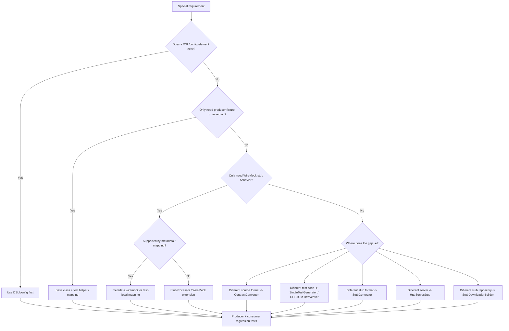
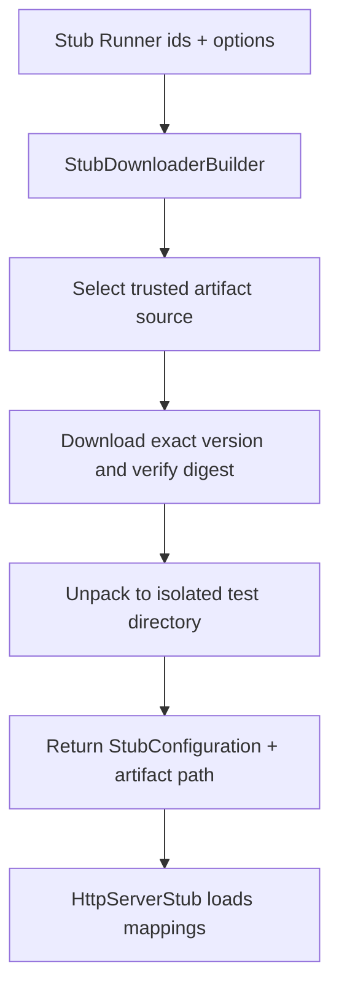
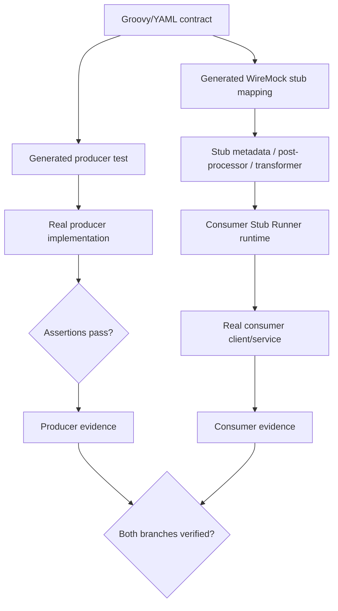
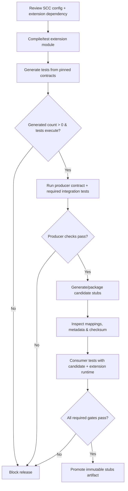

# When to Use Built-in Configuration and When You Need an Extension

**Spring Cloud Contract (SCC)** helps producers and consumers agree on HTTP or messaging interface behavior via a **Groovy/YAML DSL**. From a contract, the producer can generate tests to verify its implementation; the consumer uses stubs via **Stub Runner** to test integration code without running a real producer. When special requirements arise, the key question is not “how do I write an extension?” but rather: **does the built-in configuration already express the need sufficiently, and what specific limitation forces us to extend the tool?**

For example, `InventoryService` returns a dynamic `reservationId`. A newcomer might want to write a custom test generator just to check the ID string. However, the DSL’s **response matcher** already handles that. If you only need to prepare data for different tests, **a base class and `baseClassMappings`** are usually enough. If you want to add latency to a WireMock stub, **`wiremock` metadata** can satisfy that without a Java extension. Conversely, if contracts are stored in a proprietary format with no converter, or the consumer must use an HTTP stub server completely different from WireMock, an extension may genuinely be necessary.

This lesson belongs to the **Customization and Extension** chapter of the **SPRING_CLOUD_CONTRACT** module. The content aligns with the module’s objectives: writing HTTP/message contracts, generating producer tests, publishing stubs, using Stub Runner, and integrating with CI to detect breaking changes. We will build a **configuration-first decision framework**, then walk through the officially documented extension points, their effective scope, costs, and safe verification approaches.

In the examples, `InventoryService` is the producer, `OrderService` is the consumer, and `FulfillmentService` receives events. Artifact coordinates, URLs, and source code are **learning examples** and do not assume an existing repository. Plugin/API syntax may vary by Spring Cloud Contract, Spring Boot, WireMock, and Gradle/Maven versions; always pin a compatible combination and consult the reference documentation for the exact release.

After this lesson, you will be able to:

- Distinguish between **configuration**, **base/fixture test code**, **contract metadata**, and **a true extension**.
- Explain why “customization” does not automatically mean “writing a plugin”.
- Use Groovy/YAML DSL, matchers, producer/consumer values, test mode, and base classes before writing an extension.
- Choose Stub Runner/HTTP mappings configurations suited to the consumer and environment.
- Know when WireMock metadata is sufficient, and when `StubProcessor` or a runtime extension is needed.
- Recognize SPIs such as `ContractConverter`, `SingleTestGenerator`, `StubGenerator`, `HttpServerStub`, and `StubDownloaderBuilder`.
- Avoid extensions that alter stubs without altering producer tests, which causes **false compatibility**.
- Design testing, security, release, and version upgrade strategies for extension code.
- Make a justified decision using a comparison table and negative-control checks.

## 1. Defining the Levels of Change

Distinguish four tiers, from lowest to highest cost:

| Tier | Example | Scope of Impact | Priority |
| --- | --- | --- | --- |
| **A. Contract DSL and built-in configuration** | `byRegex`, `bodyMatchers`, test mode, Stub Runner properties | Test/stub behavior already supported by the framework | **Try first** |
| **B. Supporting test code in the project** | `ContractVerifierBase`, fixtures, deterministic clock, base class mappings | Producer-side test setup/assertions | When DSL configuration cannot adequately express the setup |
| **C. Controlled WireMock metadata or mappings** | `metadata.wiremock`, `fixedDelayMilliseconds`, test-local mappings | Usually **stub side** | When built-in WireMock features are needed |
| **D. Plugin/extension SPI** | `ContractConverter`, `StubProcessor`, `HttpVerifier`, custom server/downloader | Toolchain, runtime, or both | Only when there is a demonstrable limitation |

**Configuration** declares the use of behavior the framework already has; an **extension** introduces a new implementation into the system via an SPI/registration point. A self-written `ContractVerifierBase` class is code, but not necessarily a plugin extension: it simply prepares the environment for generated tests and is already anticipated by the framework.

### The Word “Custom” Can Sometimes Mislead

- **Custom matcher/fixture:** custom test verification logic; no need to replace the test generator.
- **Custom response payload:** use Groovy/YAML body or fixture files; no need for a WireMock transformer.
- **Custom WireMock metadata:** alters some properties of the generated mapping, not creating a different server.
- **Custom converter:** changes how contract formats are read/written, affecting generation.
- **Custom Stub Runner backend:** replaces the HTTP stub server type or artifact lookup mechanism, with high integration cost.

## 2. Decision Tree: First Ask What Is Missing



This is a **decision heuristic**, not an automated workflow enforced by SCC. When a requirement touches multiple layers, keep the extension scope **as small as possible**. For example, merely adding a stub delay is no reason to replace the entire DSL converter; changing the artifact repository is no reason to write a new HTTP server.

### Six Mandatory Questions Before Approving an Extension

1. **What is the limitation of the built-in capabilities?** Is there a reproducible example?
2. **Where does the extension run?** Producer generation, producer test, stub packaging, consumer runtime, or downloader?
3. **Who must install the extension JAR?** Producer, consumer, plugin classpath, test runtime, or multiple parties?
4. **Which semantics must be preserved?** Method, URL, request/response body, errors, headers, message destination?
5. **Is there a risk of bypassing producer verification?** Could the stub return fake data that the producer never returns?
6. **Who maintains it when upgrading SCC/WireMock?** API/SPI changes, test matrix, versions, rollback, and code execution permissions?

If you cannot answer these, stick with a configuration solution or an isolated test for now instead of creating a system-wide extension dependency.

## 3. Quick Selection Table by Scenario

| Requirement | Usually Sufficient with Configuration or Test Code | Consider an Extension Only When |
| --- | --- | --- |
| Dynamic response ID/timestamp | `consumer/producer` values, regex/type matcher | Semantics cannot be expressed via DSL/test helpers |
| HTTP status, headers, cookies, JSON | HTTP DSL, request/body matchers | Protocol/format truly differs from the existing model |
| Test controller with Spring context | `testMode`, `@SpringBootTest` base class | Need a transport client not supported by existing modes |
| Different fixtures per contract group | `baseClassMappings`, `packageWithBaseClasses` | Setup exceeds standard test extension points |
| Slow stub response to test timeouts | `metadata.wiremock` or WireMock test mapping | Dynamic transformation not supported by metadata |
| Stateful consumer stub | WireMock Scenarios/mappings if suitable | State model differs too much or requires a dedicated stub backend |
| Select stub version | `stubsMode`, `ids`, repository root, `StubFinder` | Stubs live in a repository/protocol without a downloader |
| Load contracts for only one consumer | `stubsPerConsumer`, `consumerName` | Complex custom filtering is required, limitations verified |
| Generate tests from internal `.xyz` format | Pre-convert data to Groovy/YAML | Must integrate native format directly into generation |
| Generate tests in another language | Built-in modes/frameworks if sufficient | New output language/test framework is strictly required |
| Run stubs without WireMock | Not needed if HTTP mappings suffice | A specialized server is a genuine requirement |
| Also generate Pact files from same contract | Separate export/conversion tool if sufficient | Need `StubGenerator` to automatically export artifacts |
| Verify messages on Integration/Stream/JMS | `@AutoConfigureMessageVerifier` and supported adapters | Transport/custom broker lacks a suitable integration |

Treat this table as a **starting point**. You must verify your specific version, as a feature may appear in newer releases or SPIs may change across release lines.

## 4. Sample Problem: Reservation Creation API

Suppose OrderService sends:

```http
POST /api/v1/reservations HTTP/1.1
Content-Type: application/json

{"sku":"SKU-001","quantity":2}
```

InventoryService returns:

```http
HTTP/1.1 201 Created
Content-Type: application/json

{"reservationId":"RES-701","status":"HELD"}
```

A standard Groovy contract is sufficient:

```groovy
import org.springframework.cloud.contract.spec.Contract

Contract.make {
    name 'create_reservation_success'
    description 'OrderService needs reservation ID and HELD status'

    request {
        method 'POST'
        url '/api/v1/reservations'
        headers {
            contentType(applicationJson())
        }
        body([
            sku: 'SKU-001',
            quantity: 2
        ])
    }

    response {
        status 201
        headers {
            contentType(applicationJson())
        }
        body([
            reservationId: $(consumer('RES-701'),
                             producer(regex('RES-[0-9]+'))),
            status: 'HELD'
        ])
    }
}
```

**Understand both sides clearly:**

- Producer verification runs the generated test against producer code, verifying the returned ID matches `RES-[0-9]+` and status is `HELD`.
- The stub for the consumer returns `RES-701` as a deterministic sample response.
- There is no need to create a `CustomReservationIdTestGenerator` just to check a regex.
- A regex only verifies **format**; it does not prove the ID is unique or committed to the database.

The contract can be written in YAML DSL at a literal level:

```yaml
name: create_reservation_success
description: OrderService needs reservation ID
request:
  method: POST
  url: /api/v1/reservations
  headers:
    Content-Type: application/json
  body:
    sku: SKU-001
    quantity: 2
response:
  status: 201
  headers:
    Content-Type: application/json
  body:
    reservationId: RES-701
    status: HELD
```

This sample YAML is **not yet equivalent in regex matching** to the Groovy contract above; to make it equivalent, you must add response `matchers` following the YAML syntax of your SCC version. Do not place both files describing the same scenario in the source folder unless you intentionally want two contracts.

## 5. Matchers and Producer/Consumer Values: The Cheapest Customization Layer

DSL capabilities solve most needs when values vary:

| Requirement | Built-in Option |
| --- | --- |
| Formatted ID | Regex matcher or typed matcher |
| JSON quantity is a number | `byType`/JSONPath check or typed equality |
| Properly formatted timestamp | Corresponding date/time/timestamp matcher |
| Array with properly typed elements | Array JSONPath/matcher and configurable size rules |
| Always-fixed field | Literal/equality assertion |
| Nullable/optional field | Appropriate matchers and separate scenarios |
| Dynamic request differs from dynamic response | `consumer`/`producer` values on the appropriate side |
| Header requiring regex | Header matcher or suitable DSL predicate |

Exact helpers/DSL details differ between Groovy and YAML as well as across versions. Do not copy `$(consumer(...), producer(...))` directly into YAML; and do not use `.*` regex to “solve” every difference because it renders tests meaningless.

### When Business Rules Go Beyond Matchers

For example, `reservationId` must be saved to the database and belong solely to the passed `orderId`. A regex cannot prove that relationship. However, the first sensible solution is a **producer integration test/domain assertion**, not replacing `SingleTestGenerator`.

A useful rule of thumb:

> Missing business assertion → add a test at the right layer. Only missing framework expression/test-generation capability → evaluate an extension.

## 6. Base Classes Extend *Test Setup*, Not the DSL Parser

Spring Cloud Contract generates producer tests that inherit from a project-specified base class. The base class typically prepares the Spring context, MockMvc, data fixtures, or methods invoked by generated tests.

Example for Spring MVC:

```java
package com.example.inventory;

import io.restassured.module.mockmvc.RestAssuredMockMvc;
import org.junit.jupiter.api.BeforeEach;
import org.springframework.beans.factory.annotation.Autowired;
import org.springframework.boot.test.context.SpringBootTest;
import org.springframework.web.context.WebApplicationContext;

@SpringBootTest
public abstract class ContractVerifierBase {

    @Autowired
    WebApplicationContext context;

    @BeforeEach
    void setUp() {
        RestAssuredMockMvc.webAppContextSetup(context);
        // Create deterministic test data for SKU-001, clean database if needed.
    }
}
```

If `InventoryService` has both HTTP and messaging endpoints, you may need two base classes with different setups—for example, Spring MVC HTTP and a message verifier. That is where `baseClassMappings` or the `packageWithBaseClasses` convention becomes useful.

### Maven — Selecting the Default Base Class

```xml
<plugin>
  <groupId>org.springframework.cloud</groupId>
  <artifactId>spring-cloud-contract-maven-plugin</artifactId>
  <version>VERSION_COMPATIBLE_WITH_PROJECT</version>
  <extensions>true</extensions>
  <configuration>
    <testFramework>JUNIT5</testFramework>
    <testMode>MOCKMVC</testMode>
    <baseClassForTests>
      com.example.inventory.ContractVerifierBase
    </baseClassForTests>
  </configuration>
</plugin>
```

**This is a POM snippet**; you must manage Spring Cloud Contract, Spring Test/JUnit/RestAssured dependencies, and specific versions. `VERSION_COMPATIBLE_WITH_PROJECT` is a placeholder, not a literal version you can use as-is.

### Gradle — Same Goal

```groovy
contracts {
    testFramework = 'JUNIT5'
    testMode = 'MockMvc'
    baseClassForTests = 'com.example.inventory.ContractVerifierBase'
}
```

This is a Groovy DSL snippet in a build with the SCC Gradle plugin already applied, not a complete `build.gradle`. When choosing JUnit 5, the task running generated tests must use JUnit Platform. Many SCC Gradle plugin versions use a separate `contractTest` source set/task: do not assume the `test` task always runs them.

### When a Base Class Is Sufficient

| Problem | Handled by Base Class/Fixture |
| --- | --- |
| Test needs SKU in stock | Database/in-memory fixture setup |
| Time-dependent test | Inject a fixed test `Clock` |
| Test uses security context | Configure role/test token in setup |
| HTTP controller setup | Web application context/MockMvc |
| Message contract needs trigger | Implement trigger method and `@AutoConfigureMessageVerifier` |
| Contract groups use different setups | Package-based base class mapping |

Avoid creating one giant base class with `if` statements for every contract filename; group contracts by capability and split base classes with clear responsibilities. Never mock the exact producer behavior that the contract is supposed to verify, as that yields false-positive passes.

## 7. Base Class Mappings Instead of Writing a New Generator

Suppose there are two contract groups:

```text
src/contractTest/resources/contracts/
├── http/reservations/create-success.groovy
└── messaging/reservations/reservation-confirmed.groovy
```

HTTP needs `InventoryHttpContractBase`, and messaging needs `InventoryMessageContractBase`. One option supported by SCC is mapping contract package patterns to fully-qualified base classes via `baseClassMappings`. Another option is `packageWithBaseClasses` by naming convention.

Mapping model:

```text
contracts under /http/...      -> com.example.inventory.InventoryHttpContractBase
contracts under /messaging/... -> com.example.inventory.InventoryMessageContractBase
```

**Note:** `baseClassMappings` is plugin-specific configuration in Maven/Gradle; syntax differs, and package regex and precedence order must be verified against the actual generated source. Do not write regex mapping logic inside Groovy contracts just to switch base classes. If your plugin version uses a different mapping form, prefer the reference for that exact version.

Verify after generation:

1. Generated HTTP tests extend the correct HTTP base class.
2. Generated messaging tests extend the correct message base class.
3. All classes and dependencies are on the proper test classpath.
4. Both groups of generated tests **are actually executed**, not just compiled.
5. Stub artifacts are generated from the same set of contracts.

## 8. Change Test Mode Before Thinking About a Custom HTTP Client

Spring Cloud Contract provides multiple **test modes** so generated producer tests invoke the implementation appropriately.

| Need | Configuration Direction |
| --- | --- |
| Spring MVC controller | `MockMvc` |
| Spring WebFlux/reactive HTTP | `WebTestClient` per supported version |
| Real HTTP server and context path | `EXPLICIT` or appropriate HTTP mode |
| JAX-RS endpoint | `JAXRSCLIENT` when supported |
| Specialized transport/protocol | Consider `CUSTOM` and `HttpVerifier` |
| Producer message events | Messaging verifier/adapter, not necessarily changing HTTP test mode |

`testMode` determines **how generated tests send requests**, without changing the request/response contract. If you just need real HTTP instead of MockMvc, selecting `EXPLICIT` and configuring the port in the base class may suffice—do not write a new `HttpVerifier` just to call `localhost`.

### Verify the Right Scope When Changing Modes

- MockMvc can test the controller/filter chain per setup, but does not by itself prove production proxies/load balancers.
- HTTP server mode tests real transport in the test environment, though it may lack production gateway/certificates/runtime settings.
- WebTestClient can be used with reactive controllers or servers, depending on setup.
- Custom mode has a broad API surface and carries breaking-change risks across SCC release lines.

In an active project, inspect the **generated test source** and test reports after changing modes, not just the value in the POM.

## 9. Stub Runner Has Extensive Configuration Without Extensions

Consumers use stubs from the producer artifact via Stub Runner. Typical options include:

- `stubsMode=CLASSPATH`: load stubs from the classpath.
- `stubsMode=LOCAL`: use the local artifact repository, typically Maven `.m2`.
- `stubsMode=REMOTE`: resolve from a configured repository.
- `ids`: select producer group, artifact, version, classifier, and port.
- `repositoryRoot`: where to look for artifacts when using an appropriate remote resolver.
- `stubsPerConsumer`/`consumerName`: filter HTTP mappings per consumer if artifact paths match.
- `minPort`/`maxPort` or injected port: avoid fixed-port collisions.
- `mappingsOutputFolder`: inspect registered mappings.
- `httpServerStubConfigurer`: **built-in extension point** when you truly need to customize the HTTP server.

Example on the consumer side:

```java
import org.springframework.boot.test.context.SpringBootTest;
import org.springframework.cloud.contract.stubrunner.spring.AutoConfigureStubRunner;
import org.springframework.cloud.contract.stubrunner.spring.StubRunnerProperties;

@SpringBootTest(properties = {
    "spring.application.name=order-service",
    "inventory.base-url=http://localhost:8090"
})
@AutoConfigureStubRunner(
    ids = "com.example:inventory-service:1.4.2:stubs:8090",
    stubsMode = StubRunnerProperties.StubsMode.LOCAL,
    stubsPerConsumer = true
)
class OrderServiceInventoryContractTest {
    // Calls real OrderCheckoutService/InventoryClient.
}
```

This example assumes the `1.4.2:stubs` artifact is installed in Maven local and mappings are grouped under the corresponding consumer folder. With `stubsPerConsumer=true`, if there is no folder matching `order-service`, the test may load zero mappings.

If you want a dynamic port, **obtain the actual port from Stub Runner and pass it to the consumer client before calling**, using configuration/injection mechanisms aligned with your project's Spring test lifecycle. Do not change the Stub Runner port and still hardcode `8090`.

### Important Distinction

Changing `repositoryRoot` only changes the **artifact download source**, not how WireMock matches HTTP requests. Changing `stubsPerConsumer` only changes the **set of registered mappings**, not the producer's actual behavior. Writing a custom downloader just to change ports or filter by consumer is an unnecessarily heavy choice.

## 10. WireMock Metadata: A Built-in Feature Before Writing a Transformer

Suppose OrderService needs to verify that requests time out when InventoryService responds slowly. One way to test the consumer is to have WireMock return `201` after a fixed delay.

Spring Cloud Contract supports `metadata` with the `wiremock` key to add certain properties to the **generated stub mapping**. Groovy declaration example:

```groovy
import org.springframework.cloud.contract.spec.Contract

Contract.make {
    name 'create_reservation_slow_response'

    request {
        method 'POST'
        url '/api/v1/reservations'
        headers { contentType(applicationJson()) }
        body([sku: 'SKU-SLOW', quantity: 2])
    }

    response {
        status 201
        headers { contentType(applicationJson()) }
        body([reservationId: 'RES-702', status: 'HELD'])
    }

    metadata([
        wiremock: [
            stubMapping: '{"response":{"fixedDelayMilliseconds":1200}}'
        ]
    ])
}
```

**Metadata syntax and merge behavior depend on the SCC version**; this illustration is based on the `wiremock/stubMapping` mechanism described in official documentation. After generation, inspect the final mapping to confirm `fixedDelayMilliseconds` appears.

Expected response snippet in JSON mapping:

```json
{
  "response": {
    "status": 201,
    "headers": {
      "Content-Type": "application/json"
    },
    "jsonBody": {
      "reservationId": "RES-702",
      "status": "HELD"
    },
    "fixedDelayMilliseconds": 1200
  }
}
```

This is an **illustrative response snippet**, not a complete WireMock `StubMapping`. Keep the `request` section produced by the generator and inspect the actual JSON.

### Crucial Limitation of Metadata

In the WireMock metadata customization mechanism documented by SCC:

- Customization applies to the **stub side**.
- **Generated producer tests do not automatically change** just because metadata adds a delay.
- Not every field of `StubMapping` is permitted/merged; the documentation restricts replacing the entire request and response body/headers.
- If you want to change how producer tests verify timing or load, write dedicated tests or configure the required test setup—do not assume metadata handles it.

A 1,200 ms delay simulates a slow stub response; **it does not prove the real producer has that latency**. It serves to test consumer timeout/circuit breaker behavior, which is a different goal from producer contract verification.

## 11. When to Use Hand-Written WireMock Mappings?

If you only need a specialized test-local scenario, you can register a mapping directly with WireMock without altering the official generated artifacts.

Example stub for testing a transient error:

```json
{
  "name": "test-only-inventory-unavailable",
  "priority": 1,
  "request": {
    "method": "POST",
    "url": "/api/v1/reservations",
    "bodyPatterns": [
      {
        "matchesJsonPath": "$[?(@.sku == 'SKU-FAIL')]"
      }
    ]
  },
  "response": {
    "status": 503,
    "headers": { "Content-Type": "application/json" },
    "jsonBody": { "code": "INVENTORY_TEMPORARILY_UNAVAILABLE" }
  }
}
```

Choose a **manual mapping** when:

- The scenario is solely for testing consumer resilience, not an official producer contract.
- The mapping can be registered in isolated test setup and cleared/reset after the test.
- There is no need to alter the generator for all services.
- Overlap with generated mappings and `priority` have been checked.

**Do not choose this** when you are trying to cover up a producer that does not satisfy the DSL: fix the producer code/source contract and re-verify. A hand-written mapping returning success does not replace producer verification.

### Why Are `priority` and Isolation Needed?

If a generated mapping `POST /reservations` matches `SKU-001`, but an overly broad manual mapping also returns `201`, consumer tests might pass via the manual mapping without noticing the generated mapping was wrong or never loaded. WireMock prioritizes lower `priority` numbers when multiple mappings match. Use tight request matchers, an isolated server instance, and inspect `/__admin/mappings` or the request journal when needed.

## 12. Real WireMock Extensions: When Metadata/Mappings Are Not Enough

A requirement may demand dynamic behavior: for instance, generating a response using complex request-dependent rules or transforming a response via an API beyond WireMock's default behavior. Before writing an extension, check whether WireMock **response templating**, **Scenarios**, **fault/delay settings**, and metadata can solve it.

If not, SCC supports an extension registration point via `WireMockExtensions`. Official documentation describes:

```text
META-INF/spring.factories

org.springframework.cloud.contract.verifier.dsl.wiremock.WireMockExtensions=\
com.example.contractsupport.InventoryWireMockExtensions
```

Inside the extension JAR, the implementation supplies the list of WireMock `Extension` instances to register. This is a **Java/Groovy extension point capable of executing code**, not merely a JSON property.

**Scope and responsibilities:**

1. The extension must exist on the appropriate classpath when SCC or WireMock loads it.
2. Consumer Stub Runner may require a dedicated `HttpServerStubConfigurer` to register the extension at **runtime**.
3. Mappings must reference the right transformer if the extension is not applied globally.
4. The extension must avoid leaking shared state across tests/ports and handle unexpected inputs gracefully.
5. Producer verification must still test the real implementation; a response synthesized by a transformer does not guarantee the producer returns the same thing.

### A Common Pitfall

“I added the JAR containing `CustomExtension` to the test classpath, yet WireMock logs say the transformer was not found.” The cause may be **failing to register the extension with the WireMock instance that Stub Runner starts**, not a wrong contract body. With Stub Runner, you must pass an appropriate `HttpServerStubConfigurer` and inspect runtime mappings/extension registration.

Because the WireMock API changes across major versions, a transformer implementation copied from a WireMock 2.x project may fail to compile on 3.x; write against the **actual WireMock dependency version used by SCC**.

## 13. `StubProcessor`: Post-Processing Mappings Instead of Replacing the Entire Generator

When `metadata.wiremock` is insufficient, yet the output remains a **WireMock StubMapping**, SCC provides a **post-processing** mechanism:

- `org.springframework.cloud.contract.verifier.converter.StubProcessor` is an extension registration key.
- `org.springframework.cloud.contract.verifier.wiremock.WireMockStubPostProcessor` is a convenient interface specifically for processing WireMock mappings.
- The implementation decides when to apply and how to transform the mapping.

Registration descriptor:

```properties
# resources/META-INF/spring.factories in the plugin/test support JAR
org.springframework.cloud.contract.verifier.converter.StubProcessor=\
com.example.contractsupport.InventoryWireMockPostProcessor
```

The class name above is **illustrative**. The implementation must adhere to the interfaces/signatures of your exact SCC release; official documentation is the API reference source.

### When Is a Post-Processor Appropriate?

| Requirement | Choice |
| --- | --- |
| Only adding delay/supported mapping properties | `metadata.wiremock` first |
| Applying the same patching rule across many WireMock mappings with specific metadata | `StubProcessor` with clear filtering |
| Wanting to alter the whole request/response because the contract doesn't match | **Do not** patch with a processor; fix the contract and producer tests |
| Wanting to generate JSON stubs for a non-WireMock server | `StubGenerator`, not a WireMock post-processor |
| Wanting to alter runtime server behavior | WireMock extension/`HttpServerStubConfigurer` |

Post-processors generally act during **generation/packaging**; runtime transformers act when the consumer **sends a request**. These are two distinct phases. Do not solve a runtime issue by writing a generation processor if what you need is enabling an extension in Stub Runner.

## 14. Customizing HTTP Stub Runner Without Replacing `HttpServerStub`

SCC provides `HttpServerStubConfigurer` to fine-tune the HTTP stub server instance. For WireMock, `WireMockHttpServerStubConfigurer` can be subclassed to customize `WireMockConfiguration`: e.g., HTTPS, extension registration, or specialized server settings.

Model:

```text
Custom Stub Runner Configurer
  -> receives artifact info / HttpServerStubConfiguration
  -> adjusts WireMockConfiguration
  -> WireMock server runs with that configuration
```

You can select the configurer via `@AutoConfigureStubRunner`:

```java
@AutoConfigureStubRunner(
    ids = "com.example:inventory-service:1.4.2:stubs:8090",
    httpServerStubConfigurer = InventoryWireMockConfigurer.class
)
```

`InventoryWireMockConfigurer` is a class **the project must implement itself**, and this annotation snippet only illustrates the configuration slot. Check imports, constructors, and the `configure(...)` method for your running SCC/WireMock version.

### When Is Configuration Alone Enough?

If the goal is:

- Choosing port, repo, artifact version → `@AutoConfigureStubRunner`/properties.
- Running a standalone HTTP server in tests → SCC Stub Runner / WireMock defaults.
- Enabling HTTPS with producer-specific WireMock configuration → consider `WireMockHttpServerStubConfigurer`.
- Replacing the entire HTTP server framework → only then evaluate `HttpServerStub`.

Do not create a custom server SPI just to enable response templating. That is an example of a **solution broader than the problem**.

## 15. Messaging: Start with Built-in Adapters

Spring Cloud Contract includes messaging support with adapters/integrations for environments such as Spring Integration, Spring Cloud Stream, Spring JMS, and Apache Camel, depending on the version. Generated producer tests need a way to send/receive messages through a **message verifier**.

Groovy contract example:

```groovy
import org.springframework.cloud.contract.spec.Contract

Contract.make {
    name 'reservation_confirmed'
    label 'reservation_confirmed'
    input {
        triggeredBy('publishReservationConfirmed()')
    }
    outputMessage {
        sentTo('reservationEvents')
        body([
            reservationId: 'RES-701',
            status: 'CONFIRMED'
        ])
        headers {
            messagingContentType(applicationJson())
            header('eventType', 'reservation.confirmed')
        }
    }
}
```

`publishReservationConfirmed()` is a method the producer test base must provide; `reservationEvents` is the destination resolved by the adapter. For a typical Spring Integration/Stream application, you can configure:

- Appropriate dependencies/adapters.
- `@AutoConfigureMessageVerifier` on the producer test base.
- Proper fixture/trigger methods.
- Consumer tests with `StubTrigger` and assertions on listeners/side effects.

**Do not write a custom messaging verifier** just because a test needs to receive an event or wait for async processing. Check the framework adapters and test completion mechanisms first.

### When Is a Custom Adapter Needed?

When a producer uses a message transport or binding semantics that existing adapters cannot handle, you may need to implement the contract of `MessageVerifierSender` / `MessageVerifierReceiver` or the corresponding integration interfaces in your release. You must then test sending, receiving, headers, destination mapping, serialization, and consumer/producer isolation.

Crucially, generated messaging tests passing with an in-memory adapter **do not automatically prove** production Kafka/RabbitMQ brokers, routing, acknowledgments, retries, or outbox transactions. If those are business risks, add **broker integration tests** rather than trying to cram everything into a plugin.

## 16. Reusing Groovy DSL Helpers: Lighter Than a Custom Converter

Organizations with many Groovy contracts sometimes repeat regexes and sample values. SCC documents **DSL customization** using classes/helpers in a **common JAR**:

```java
package com.example.contractsupport;

import java.util.regex.Pattern;

public final class ReservationPatterns {
    private ReservationPatterns() {}

    public static Pattern reservationId() {
        return Pattern.compile("RES-[0-9]+");
    }
}
```

Once the dependency is added to the classpath used by the **Groovy DSL evaluator**, contracts can reference the helper in a DSL-compatible way:

```groovy
import org.springframework.cloud.contract.spec.Contract
import com.example.contractsupport.ReservationPatterns

Contract.make {
    request {
        method 'GET'
        url '/api/v1/reservations/RES-701'
    }
    response {
        status 200
        body([
            reservationId: $(consumer('RES-701'),
                             producer(regex(ReservationPatterns.reservationId().pattern()))),
            status: 'HELD'
        ])
    }
}
```

**Technical note:** the code above extracts the regex string via `Pattern.pattern()` to avoid depending on a specific overload taking `Pattern`. Still verify Groovy DSL generation and compilation on your project's SCC version. You can substitute `regex('RES-[0-9]+')` if a helper is unnecessary.

### Why Do Helpers Carry a Cost?

- The common JAR must be present on the exact **plugin execution classpath**, not merely the application runtime classpath.
- Generated producer tests may require the corresponding helper on their classpath.
- Consumers may not need the Groovy helper if artifacts are converted/packaged into standard YAML or JSON mappings.
- Groovy scripts execute code: the helper JAR must come from a trusted source, undergo code review, and have pinned versions.
- Changing a helper regex can alter hundreds of contracts; regression tests for both the generator and consumer stubs are required.

For a regex used twice, keeping an explicit literal is sometimes better than creating a helper library and increasing dependency overhead.

## 17. `ContractConverter`: When the Source Format Is Truly Different

Imagine an organization has pre-existing `.contractspec` contracts used by multiple teams. They are neither standard SCC Groovy nor YAML. Instead of asking every team to rewrite thousands of files or creating a Groovy file that arbitrarily invokes a parser, the organization may need a **custom contract converter**.

SCC describes the `org.springframework.cloud.contract.spec.ContractConverter<T>` SPI with this role:

```java
// Simplified shape of the SPI in SCC documentation;
// this is not a standalone compilable program.
public interface ContractConverter<T>
        extends ContractStorer<T>, ContractReader<T> {

    boolean isAccepted(File file);

    Collection<Contract> convertFrom(File file);

    T convertTo(Collection<Contract> contracts);
}
```

Exact imports/generics and method signatures must be checked against the dependency version in use. What matters are **bidirectional conversion** and the **file selection condition**.

### Concrete Flow

```text
Input .contractspec
  -> ContractConverter.isAccepted
  -> ContractConverter.convertFrom
  -> SCC Contract model
  -> Generated producer tests
  -> WireMock/messaging stubs
```

For example, if the source format looks like:

```yaml
# Hypothetical reservation.contractspec file,
# used only to explain mapping, not SCC YAML DSL.
api:
  verb: POST
  route: /api/v1/reservations
  expectedStatus: 201
  responseFields:
    reservationId: string
    status: HELD
```

The converter must map full semantics: HTTP method, URL, headers, body, status, matchers, consumer/producer values, and required metadata. If mapping loses information, generated tests/stubs may become **broader or weaker than the source contract**.

### Documented Registration

```properties
# META-INF/spring.factories of the JAR containing the implementation
org.springframework.cloud.contract.spec.ContractConverter=\
com.example.contractsupport.LegacyContractConverter
```

`LegacyContractConverter` must be implemented and provided on the appropriate **plugin classpath**. This property does not generate an implementation automatically.

### When **Not** to Write a Converter

- Only wanting to rename the `contracts` directory: use plugin configuration.
- Only needing YAML instead of Groovy: SCC has a standard YAML DSL.
- A few tests needing body files: use DSL/file fixtures.
- Needing a one-time contract migration: an **out-of-pipeline** migration tool may be simpler and safer than a permanent custom SPI.

### Mandatory Test Suite for a Converter

| Test | Why |
| --- | --- |
| Files with matching extension are accepted | `isAccepted` does not accidentally hijack other formats |
| Invalid/malformed files are rejected with a clear message | Prevents generating zero contracts while the build stays green |
| Method/path/status/headers/body remain accurate | Preserves promises |
| Regex/typed matchers/optional fields are accurate | No lost assertions |
| A single file containing multiple scenarios | No dropped or duplicated contracts |
| Round-trip `convertFrom`/`convertTo` if supported | Detects information loss during serialization |
| Safe fixture and reference paths | Prevents accessing paths outside the source root |
| Generated producer tests pass/fail accurately | Verifies compatibility at the most critical output |

If a custom converter causes the contract count to drop from 20 to 0 while CI stays green, the extension has broken the assurance mechanism. Enforce a fail gate on unintended missing contracts.

## 18. `SingleTestGenerator`: When You Must Change How Producer Test Code Is Generated

This is one of the **most expensive** extensions because it directly participates in how SCC builds assertions. SCC documents `SingleTestGenerator` for customizing test class content from `ContractMetadata` and plugin configuration.

Valid example needs:

- The organization strictly requires generating tests for a language/framework unsupported by the standard generator.
- There is a specialized transport that existing test modes cannot represent.
- Architectural requirements on generated test structure cannot be met via base classes or test framework configuration.

SPI registration:

```properties
org.springframework.cloud.contract.verifier.builder.SingleTestGenerator=\
com.example.contractsupport.InventorySingleTestGenerator
```

**This is only a service provider declaration**. The `InventorySingleTestGenerator` class must implement the exact interface of your SCC version and be built/tested separately.

### Why Should You Not Replace the Generator Just to Add One Assertion?

If you only need to verify `quantity > 0`, you can:

- Put request matchers/fixtures into the contract.
- Write a producer integration/domain test.
- Write a helper assertion in the base class if generated tests have a suitable hook.

A custom generator must handle everything the standard generator does, such as HTTP body encoding, header matching, JSONPath, matcher conversion, messaging semantics, naming, test frameworks, and resource paths. An SCC update may change internal models that a custom plugin must keep up with.

### Acceptance Criteria

1. A **reproducible limitation** exists with the standard generator.
2. Golden tests compare generated output against standard scenarios.
3. Contracts verify status, headers, JSON, matchers, optional/null fields, and error cases.
4. Producer tests **must fail** when the implementation intentionally violates the contract.
5. Classpath, source sets, test discovery, and a 0-tests gate have been verified.
6. A compatibility matrix exists for the SCC versions supported by the organization.

**Never let a custom generator produce always-passing tests or tests with no assertions.** Doing so disables the entire producer verification chain while stubs still get published.

## 19. `StubGenerator`: When Output Is No Longer a WireMock Mapping

If an organization wants to generate an additional stub format (e.g., files for a non-WireMock stub server or a separate artifact), SCC provides `org.springframework.cloud.contract.verifier.converter.StubGenerator<T>`.

According to the documentation, this SPI works with `Contract` and `ContractMetadata` to build stub representations, with mechanisms for file extension distinction and post-processing.

Registration via `spring.factories`:

```properties
org.springframework.cloud.contract.verifier.converter.StubGenerator=\
com.example.contractsupport.AdditionalStubGenerator
```

### Output Semantics You Must Decide

| Question | Example Choice |
| --- | --- |
| Generate one or multiple mappings per contract? | One success + one error mapping |
| Which response matchers become literal stub values? | `RES-701` |
| Which request matchers are preserved in the stub? | Method/path/body matchers |
| Which metadata remains meaningful? | Delay/fault/headers |
| Output path and extension? | `.json`, `.yaml`, or backend-required format |
| Which Stub Runner can read that output? | Default WireMock or custom `HttpServerStub` |

A custom stub generator can produce a complete artifact, yet **the default consumer Stub Runner does not automatically learn how to run a new format**. If the format is not WireMock JSON, you may also have to build a runtime backend. That is a double cost.

### Can Multiple Generators Coexist?

SCC documentation describes providing multiple `StubGenerator` implementations to generate additional formats such as WireMock and Pact from the same contract. Ensure there are no filename/path conflicts and that generated artifacts are packaged properly.

**Lighter alternative:** if you only want to export a report/snapshot for CI, a post-processing Gradle/Maven task outside the SCC SPI may be more suitable, provided it does not alter source contracts or bypass producer verification.

## 20. `HttpServerStub`: Only When Truly Changing the Stub Server Backend

`Stub Runner` has the `org.springframework.cloud.contract.stubrunner.HttpServerStub` abstraction to run an HTTP stub server. By default, SCC typically uses WireMock. If an organization has another stub server with capabilities WireMock cannot support, a custom backend can be implemented.

Responsibilities described by the interface/runtime include:

```text
start(configuration)
registerMappings(stubFiles)
port()
isRunning()
registeredMappings()
stop()
isAccepted(file)
```

This is a **model of methods/capabilities**, not a complete Java interface with exact signatures. Register the backend via:

```properties
org.springframework.cloud.contract.stubrunner.HttpServerStub=\
com.example.contractsupport.InventoryAlternativeHttpServer
```

### Why Is the Cost High?

- Dynamic port management, start/stop, test isolation.
- Selecting and parsing mappings accurately; handling malformed files.
- Loading body files and metadata.
- Exposing the stub address to consumer tests.
- Providing diagnostic APIs, error mappings, and request verification.
- Ensuring the same contract yields equivalent results between producer verification and stub runtime.
- Cleaning up resources when tests fail or CI is aborted.

If a custom server returns `201` for every request, consumer tests may stay green even with wrong paths or bodies. A new backend must have **conformance tests** against contract semantics, not just a smoke test checking that the port is open.

**Do not write an `HttpServerStub` if you only need HTTPS, a custom WireMock transformer, or a port change.** Use `HttpServerStubConfigurer`/WireMock settings first.

## 21. `StubDownloaderBuilder`: When the Artifact Source Is Incompatible with Built-in Resolvers

Stub Runner supports fetching stubs from **classpath**, **Maven local**, and **remote artifact repositories**, and also has documented SCM protocol options. If the source is genuinely different (for example, an internal store with custom auth/distribution APIs), `StubDownloaderBuilder` may be required.

Logical flow:



An illustrative service provider configuration:

```properties
org.springframework.cloud.contract.stubrunner.StubDownloaderBuilder=\
com.example.contractsupport.CorporateStubDownloaderBuilder
```

**Boundaries of a downloader:**

- It **fetches/locates artifacts**, not necessarily altering HTTP matching logic.
- Do not use the downloader to “fix” statuses/responses inside stubs.
- It must preserve exact coordinates/version/classifier and protect integrity.
- Never log credentials or disable TLS verification.
- Never unpack untrusted file paths arbitrarily outside the root directory.
- Needs clear caching policy, timeouts/retries, and cleanup.

### Cases Where No Extension Is Needed Yet

| Requirement | Use First |
| --- | --- |
| Download from Maven-compatible Nexus/Artifactory | `StubsMode.REMOTE`, repository configuration |
| Use freshly built local dev artifact | `StubsMode.LOCAL` |
| Use JAR added to test classpath | `StubsMode.CLASSPATH` |
| Pin exact version without `latest` | `ids` with specific version |
| Load only a specific consumer | `stubsPerConsumer`/`consumerName` |
| Git/SCM repo following supported conventions | Built-in SCM downloader/config of the release |

When the environment simply needs credentials or a repository URL change, writing a brand-new downloader is unnecessary cost and security risk.

## 22. `CUSTOM` Test Mode and `HttpVerifier`: A Specialized Option

SCC documentation includes **CUSTOM test mode** via `org.springframework.cloud.contract.verifier.http.HttpVerifier`, intended for cases requiring an HTTP client/transport not satisfied by built-in test modes. This mode has been marked **experimental** in several release lines.

Idea:

```text
Generated test
  -> HttpVerifier.exchange(Request)
  -> Custom transport client
  -> Producer HTTP/protocol endpoint
  <- Response
  -> Generated assertions
```

Producer configuration can use:

```groovy
// Gradle Groovy DSL snippet.
contracts {
    testMode = 'CUSTOM'
    baseClassForTests = 'com.example.inventory.CustomHttpVerifierBase'
}
```

The producer base class must supply or inject an `HttpVerifier` that executes requests/responses with the exact semantics used by generated tests. Before implementing:

1. Try `MockMvc`/`WebTestClient`/`EXPLICIT` if applicable.
2. Confirm a custom transport is truly needed, not just fixing a wrong client URL.
3. Verify URL, headers, protocol, binary bodies, charset, and error mapping.
4. Verify generated tests still catch contract violations.
5. Check API/signatures across SCC versions; CUSTOM mode is subject to change.

**Do not treat `CUSTOM` as a way to automatically “unlock any backend”.** The stub side may still use WireMock or need its own extension if the protocol cannot be represented via default HTTP stubs.

## 23. Extension Comparison Table by Phase

| Extension Point | Primarily Runs When? | Who Must Know About It? | Risk if Missing |
| --- | --- | --- | --- |
| `baseClassForTests` / `baseClassMappings` | Producer test runtime | Producer | Generated tests fail to compile/run or have wrong setup |
| Groovy DSL helper JAR | DSL evaluation/generation | Plugin/proposer; may need test classpath | Contract fails to parse or helper not found |
| `ContractConverter` | Reading/writing contract model | Producer/toolchain | Contracts/matchers lost |
| `SingleTestGenerator` | Generating test source | Producer/toolchain | Wrong/unexecuted tests |
| `StubGenerator` | Generating stub output | Producer/toolchain | Wrong stub format/mapping |
| `metadata.wiremock` | Generation of WireMock mapping | Producer/build; consumer loads resulting artifact | Stub lacks expected delay/properties |
| `StubProcessor` | Post-processing generated mappings | Producer/build | Mapping is not patched |
| `WireMockExtensions` | Plugin/runtime WireMock configuration | Producer generation and/or consumer runtime depending on setup | Transformer is not registered |
| `HttpServerStubConfigurer` | Stub server startup | Consumer Stub Runner | TLS/extension config does not work |
| `HttpServerStub` | Stub server runtime | Consumer | New format/backend cannot run |
| `StubDownloaderBuilder` | Artifact resolution | Consumer/runner, possibly build | Wrong or failed artifact download |
| `HttpVerifier` in `CUSTOM` | Producer test HTTP execution | Producer | Generated tests fail to call right transport |

**Do not install every extension into every service.** Clearly identify classpaths and execution phases; add dependencies only to components that need them to reduce version conflicts and attack surface.

## 24. Controlled Extension Development Process

An extension should be a **justified architectural decision with clear verification**, not a quick patch for a failing test.

### Step 1 — Record a Case Unsolvable by Built-in Features

Example:

```text
Problem:
  Consumer test requires simulation of an HTTP response with transformations
  based on a custom binary structure unsupported by default WireMock mappings.

Available features evaluated:
  - Groovy/YAML body/headers matchers
  - Body file + __files
  - WireMock response templating
  - WireMock metadata
  - Manual test-local mapping

Evidence:
  - Minimal failing contract / mapping
  - Expected vs actual output
  - SCC / WireMock version

Decision:
  Explore a narrowly scoped runtime transformer.
```

This is a **documentation template**, not a mandatory formula. If `bodyFileName` already simulates the binary response adequately, no extension is needed. If the behavior is only needed for one integration test, a test-specific fake server may work instead of putting an extension into the shared stubs JAR.

### Step 2 — Choose the Smallest Extension Point

- Need to fix **input parsing** → converter, not downloader.
- Need to fix **producer test output** → test mode/base class first, generator only when truly needed.
- Need to fix **generated WireMock mappings** → metadata/post-processor.
- Need to fix **runtime response behavior** → WireMock extension + server configurer.
- Need to replace **stub server** → `HttpServerStub`.
- Need to change **artifact source** → `StubDownloaderBuilder`.

If a single extension must simultaneously download artifacts, parse contracts, generate tests, and run a server, revisit responsibility boundaries; it is likely an external tool outside SCC that should be designed and tested independently.

### Step 3 — Package as a Dedicated Dependency with Ownership

Example source module organized under `contract-test-support`:

```text
contract-test-support/
├── build.gradle                      # Or pom.xml
└── src/
    ├── main/java/com/example/contractsupport/
    │   ├── ReservationPatterns.java
    │   └── InventoryWireMockPostProcessor.java
    ├── main/resources/META-INF/
    │   └── spring.factories
    └── test/java/com/example/contractsupport/
        └── ...
```

This is an **illustrative directory tree**; create only the files/classes actually needed. For a pure helper not using an SPI, **`spring.factories` is not required**. A JAR registering multiple SPIs must be reviewed carefully because each registration can affect the entire generator classpath.

### Step 4 — Verify Two-Sided Impact

Suppose a post-processor adds a response transformer. Check:

1. Generated producer tests **do not unexpectedly lose assertions**.
2. Generated stub mappings include the transformation only when the right metadata is present.
3. Consumer Stub Runner loads the runtime extension properly.
4. Real consumer code receives the response and handles it correctly.
5. For contracts not requiring the extension, output remains unaffected.
6. When the extension is absent, failure is diagnostic—not silently returning an incorrect success.

### Step 5 — Standardize Operations

Only publish the extension JAR and stub artifact when:

- The extension’s test suite passes.
- Producer verification passes.
- Consumer integration tests with the **packaged artifact** pass.
- Dependency versions and checksums are clear.
- An owner, documentation, upgrade plan, and rollback strategy exist.

## 25. Testing Extensions at Three Levels

| Level | Input | Key Assertions |
| --- | --- | --- |
| **Unit** | Sample contract model/metadata/mapping | Extension modifies only the intended parts |
| **Golden generation** | Representative set of Groovy/YAML contracts | Generated Java/Groovy tests and stub JSON preserve semantics |
| **Integration/conformance** | Producer implementation + Stub Runner runtime | Producer tests catch regressions; consumer receives correct mappings |

### Unit Test for a Post-Processor

In the extension’s own test, supply a `StubMapping` with:

```json
{
  "request": {
    "method": "POST",
    "url": "/api/v1/reservations"
  },
  "response": {
    "status": 201,
    "jsonBody": {
      "reservationId": "RES-701",
      "status": "HELD"
    }
  }
}
```

Apply metadata requesting a delay and assert:

- `response.fixedDelayMilliseconds` is added accurately.
- `request.method` and `request.url` remain unchanged.
- `response.status`, `jsonBody`, and `Content-Type` do not disappear.
- Mappings without the metadata remain unmodified.
- Running the processor twice does not duplicate or corrupt configuration if **idempotence** is required.

For `ContractConverter`, substitute the corresponding inputs and check round-trip/contract counts. For `StubDownloaderBuilder`, use a controlled fake artifact repository and assert resolved coordinates/checksums and cleanup.

### Golden Tests Are Useful but Should Not Be Overly Brittle

Golden files help detect generation shifts across versions. However, some generated mapping fields have unstable UUIDs/key order/formatting; plain-text file comparisons can produce false negatives. **Parse the structure** and compare key semantic fields, or normalize insignificant fields before comparing.

Example:

```text
Assert mapping semantics:
  request.method = POST
  request.url = /api/v1/reservations
  request.bodyPatterns match expected SKU + quantity
  response.status = 201
  response.body.status = HELD
  response.delay = 1200 ms

Ignore for semantic comparison:
  generated UUID
  JSON key order
  incidental whitespace
```

### Negative Control Tests

A good extension must **never mask contract violations**:

1. Change the producer to return `200` instead of `201`. Generated producer tests must still fail.
2. Have the consumer send an invalid JSON body. The stub must not falsely return success via a broad fallback.
3. Omit loading the required runtime extension. Consumer tests must fail with a useful error, not silently pass.
4. Alter the artifact version/digest. Consumer tests must detect the exact stub source.
5. Add an unrelated contract. The extension must not modify that mapping.
6. Delete a contract file; a contract inventory/test-count check must catch `0 tests PASS`.

Run negative controls on a branch or isolated test fixture; do not introduce intentionally broken code into releases.

## 26. Separating Producer Verification from Stub Effects

A very common design mistake:

> “I modified the generated WireMock mapping so it returns the exact JSON the consumer expects, so the producer definitely satisfies the contract.”

This is **false**. Diagram both branches:



### Three Scenarios to Distinguish

| What Changed | Affects Generated Producer Tests? | Affects Consumer Stubs? |
| --- | --- | --- |
| DSL request/response/matcher changes | Usually **yes** | Usually **yes** |
| `metadata.wiremock` adds delay | Does not automatically change assertions/test timing | **Yes** if generated mapping supports it |
| Base class fixture changes | **Yes** at runtime setup | Does not automatically change mappings |
| Custom WireMock runtime transformer | Not automatically | **Yes** if registered/called |
| Custom `ContractConverter` | Can affect both via the model | Can affect both |
| Custom `StubGenerator` | Not necessarily | **Yes** in generated stubs |

If one side changes while the other does not, **write additional tests and document the limitation**. Above all, never use an extension to make producer tests pass falsely by altering contract output after test sources are generated.

## 27. Security: Both Groovy DSL and Extensions Are Executable Code

In a shared contracts repository, not every PR author has the same trust level as producer CI. Groovy DSL is an evaluable script; custom converters/transformers/downloaders are Java/Groovy code loaded into the build process or runtime.

**Four safeguard groups:**

1. **Trusted sources:** review contracts, dependency changes, and `META-INF/spring.factories` registrations; pin artifact versions and checksums.
2. **Isolated execution:** untrusted PR jobs hold no publish credentials, run on unprivileged runners, and restrict network/volumes/caches.
3. **Data and paths:** limit input sizes, parsers/schemas, fixture paths, and archive extraction; never place secrets in contracts/stubs.
4. **Gated releases:** both generated producer tests and consumer candidate tests execute, and released artifacts are immutable with provenance.

### An Error-Prone Design

```text
Fork PR edits contract and adds custom converter dependency
     |
     v
CI job holds repository publish token
     |
     v
Gradle/Maven evaluates Groovy + loads extension
     |
     v
Upload verified?  (actually lacks a trust boundary)
```

**Never run unreviewed code with secrets just to “check contracts early”.** Separate untrusted validation jobs from protected release jobs; if you must execute Groovy from PRs, use a sandbox designed for untrusted code. A regex blacklist on Groovy source is **not enough** to guarantee safety.

### Extensions Also Carry Supply Chain Risks

- `ContractConverter` can read unexpected files if source paths are unrestricted.
- `StubDownloaderBuilder` can fetch artifacts from the wrong repo or skip TLS/digest verification.
- `SingleTestGenerator` can drop critical assertions.
- `StubGenerator` can produce overly permissive mappings.
- `HttpServerStub`/WireMock extensions can expose the Admin API or share state across tests.
- Helper JARs can be overwritten with the same version or pull in unchecked transitive dependencies.

For releases, treat extension changes with **the same review rigor as build/plugin code**, not routine contract data edits.

## 28. Versioning and Classpath: Extensions Must Upgrade Alongside the Toolchain

A custom implementation typically depends on SCC/WireMock APIs. When upgrading Spring Boot/Spring Cloud Contract:

- SPI packages or method signatures may change.
- WireMock major versions may change extension/transformer interfaces.
- Spring test framework/JUnit discovery may change.
- Generated test names, output layouts, and metadata merging may differ.
- Build plugins may change how service providers are resolved.
- A helper artifact working on the producer does not mean the consumer runtime has it.

### Extension Compatibility Matrix to Maintain

| Component | Example Version | What to Check? |
| --- | --- | --- |
| Spring Boot | Pinned version in producer | Context/test engine |
| Spring Cloud Contract | Release-train compatible version | DSL, SPI, generation |
| WireMock | Transitively resolved version | Transformer/configurer API |
| Maven/Gradle | Wrapper/plugin versions | Service loading and task graph |
| Extension JAR | `com.example:contract-support:1.2.0` | Compile/runtime/test results |
| Stub artifact | `inventory-service:1.4.2:stubs` | Runtime mapping + extension dependency |

The versions above are **examples**, not a verified compatibility matrix. In CI, verify the actual resolved dependencies; avoid overriding WireMock to a different version while expecting all SCC APIs to keep working.

### Low-Risk Upgrade Plan

1. Record baseline tests and outputs on the old toolchain.
2. Upgrade **one controlled dependency group**.
3. Run extension compilation/unit tests.
4. Regenerate producer tests and stubs from the same contract revision.
5. Verify generated semantics after normalization.
6. Run producer verification and consumer stub integration tests.
7. Run failure/negative-control scenarios.
8. Publish new extension/stub versions without overwriting old artifacts.

If an extension previously served a need that now has official configuration in the newer SCC release, take the opportunity to **remove the extension** and lower maintenance costs.

## 29. CI/CD: Release Only After Both Contracts and Extensions Are Verified Together

A producer pipeline with extensions should enforce minimum gates:



### Typical Maven/Gradle Verification Commands

```bash
# Producer Maven configured with Contract Verifier and test runner:
mvn -B -ntp clean verify

# Or producer Gradle with plugin/contractTest task:
./gradlew clean contractTest check verifierStubsJar
```

These are **two build-tool alternatives**; you do not run both on the same project. These commands alone do not prove the generated test count is non-zero or that the WireMock runtime loaded the extension. CI must enforce dedicated assertions/reports accordingly.

### What Evidence Should Be Retained?

| Evidence | Answers the Question |
| --- | --- |
| Producer Git SHA | Which producer code was verified? |
| Contract source revision | Which set of contracts was used? |
| SCC + WireMock resolved versions | Which toolchain generated/tested? |
| Extension artifact coordinates/digest | Which extension code ran? |
| Generated test count/executed count | Were tests actually executed? |
| Producer test report | Did producer behavior pass? |
| Stub JAR mapping inventory/checksum | Which stub output was generated? |
| Consumer Stub Runner results | Did the client truly use the right stub/extension? |
| Published artifact digest | Does the published artifact match the verified candidate? |

**Never publish when required integration tests report `UNKNOWN`/`SKIPPED`.** You may store candidates in a CI artifact store for debugging, but never publish them as verified releases.

## 30. Diagnostics: Is the Bug in Configuration or the Extension?

Interpret symptoms by **phase**, rather than immediately adding code to a plugin.

| Symptom | Common Cause | Try First | When to Consider an Extension |
| --- | --- | --- | --- |
| No tests generated from `.groovy` | Wrong contracts directory, invalid DSL, plugin not applied | Check `contractsDslDir`/`contractsDirectory` and generator logs | Only if source format is truly unsupported |
| Dynamic ID test fails | Comparing against static ID equality | Use producer regex + consumer sample | Not needed in typical cases |
| HTTP test needs DB fixture | Base class not setting up data | `ContractVerifierBase`, test containers/fixtures | No new generator needed |
| Generated class extends wrong base | Wrong `baseClassForTests`/mapping | `baseClassMappings`, review packages | No extension needed |
| Extra field in JSON response breaks client | Strict consumer deserializer | Fix schema/consumer test & compatibility | No new stub generator needed |
| Message test sees no events | Missing adapter, `@AutoConfigureMessageVerifier`, or trigger | Configure messaging/test base | Custom verifier only if adapters lack support |
| Stub lacks delay | Wrong metadata key, unsupported plugin version | Check generated JSON, `wiremock` metadata | `StubProcessor` if patching must exceed limits |
| Stub response transformer doesn't run | Runtime extension not registered | `HttpServerStubConfigurer` + check logs | Implement extension if behavior is unavailable |
| WireMock has mapping but unexpected response | Mapping overlap/priority, body mismatch | Inspect Admin API, request journal, reset isolation | Extension only when backend behavior differs |
| Stub Runner fails to download JAR | Wrong `ids`/repo mode/credentials | CLASSPATH/LOCAL/REMOTE, repositoryRoot | Custom downloader when store/protocol truly differs |
| Need HTTPS stub | WireMock server not configured for HTTPS | `WireMockHttpServerStubConfigurer` | No need to replace `HttpServerStub` |
| Custom stub format fails to run | WireMock doesn't understand custom files | Consider exporting WireMock JSON | `StubGenerator` + `HttpServerStub` if custom backend is required |
| Consumer test passes without calling HTTP | Mock/cache/hardcoded response | Call real service; verify journal | Not a generator issue |
| Producer test passes but production breaks contract | Test base mocks behavior/skips integration | Fix test setup and add integration tests | Never patch stub responses to hide it |
| Build reports 0 contract tests | Generation/discovery/task graph bug | Fail-on-no-contracts, report counts, JUnit Platform | Do not write an extension just to inject fake tests |
| Tests pass locally but fail in CI | Version/toolchain/classpath mismatch | Check resolved deps, Java, Gradle/Maven tasks | Update SPI only on real API changes |

### 8-Step Debugging Procedure

1. **Identify the failing stage:** DSL parsing, test generation, test compilation, producer execution, stub generation, packaging, download, or stub runtime.
2. **Pin the source revision** and exact SCC/WireMock versions in use; avoid changing multiple variables at once.
3. **Disable the new extension** in an isolated test environment to confirm whether the regression truly comes from the extension.
4. **Try built-in configuration** for the same requirement; document why it falls short.
5. **Inspect generated outputs:** generated Java/Groovy tests, WireMock mappings, JAR layout.
6. **Check test reports:** how many generated tests executed, and whether any were skipped.
7. **Check the real consumer:** ensure the client hits the right stub version/port, and the WireMock journal records expected requests.
8. **Write a regression test** for the issue before fixing the extension or upgrading dependencies.

Stop at the configuration step if you have already reproduced the right result. Do not treat every warning from a legacy converter as proof that you must immediately write a new converter.

## 31. Anti-Patterns in Spring Cloud Contract Customization

### Anti-Pattern A — Writing an Extension for Something Covered by a DSL Matcher

**Misguided:** creating `CustomIdGenerator` just because the producer generates dynamic IDs.

**Do instead:** use `consumer`/`producer` values, `regex`, or appropriate body matchers; test database invariants separately.

### Anti-Pattern B — Using `StubProcessor` to Mask a Wrong Producer Response

**Wrong:** the producer returns `200`, yet the processor forces the WireMock stub to `201` and declares “contract pass”.

**Do instead:** fix the producer implementation or renegotiate the contract; producer verification must fail when HTTP status is wrong.

### Anti-Pattern C — Reusing a Custom Converter to Run Business Logic

**Wrong:** the converter calls a live InventoryService to decide contract status and generates different responses per environment.

**Do instead:** converters deterministically translate **schema/semantics** without depending on network or production data. Business logic belongs in producer code/tests.

### Anti-Pattern D — Letting a Downloader Grab “Whatever Is Latest”

**Wrong:** a custom downloader always picks the newest artifact without verifying version/digest, causing the same consumer commit to test two different stubs.

**Do instead:** pin coordinates, verify checksums, record resolved revisions, and use immutable releases.

### Anti-Pattern E — Adding an Extension JAR to the Producer but Forgetting the Consumer

**Wrong:** the generated mapping references a custom transformer name, yet consumer Stub Runner does not register the extension.

**Do instead:** explicitly verify the consumer's classpath/runtime configurer, or switch to built-in metadata/mappings needing no runtime plugin.

### Anti-Pattern F — Abusing a Custom Server to Solve Test Isolation

**Wrong:** replacing all of WireMock with a custom HTTP server just because parallel tests collide on ports.

**Do instead:** use dynamic ports, isolated instances, and proper test-lifecycle client configuration.

### Anti-Pattern G — Editing Generated Java or JSON Directly

**Wrong:** editing files under `build/generated-test-sources` or `build/stubs` without fixing the source.

**Do instead:** fix the contract DSL, configuration, metadata, or tested extension; rebuild. Generated outputs are routinely regenerated, so manual edits do not persist.

### Anti-Pattern H — Believing “Having an Extension Means More Thorough Tests”

**Wrong:** measuring code/plugin volume instead of test evidence.

**Do instead:** compare generated assertions, requirement coverage, and ability to fail against an intentional regression.

## 32. Decision Checklist Before Writing an Extension

- [ ] Described the problem with a concrete HTTP/message scenario.
- [ ] Identified the constrained phase: DSL parsing, generation, producer test, stub output, or consumer runtime.
- [ ] Tried DSL matchers, sample values, and built-in data types.
- [ ] Tried `baseClassForTests`/fixtures and `baseClassMappings` if only setup differs.
- [ ] Evaluated an appropriate `testMode` before writing a new `HttpVerifier`.
- [ ] Tried Stub Runner `CLASSPATH/LOCAL/REMOTE`, `ids`, and `repositoryRoot` settings.
- [ ] Checked `stubsPerConsumer`/`consumerName` when filtering mappings.
- [ ] For WireMock, evaluated metadata, fault/delay, Scenarios, response templating, and manual test-local mappings.
- [ ] Documented why metadata/post-processing is insufficient before writing a runtime transformer.
- [ ] If changing contract format, specified preserved semantics and converter tests.
- [ ] If changing generator, created golden tests and negative controls detecting lost assertions.
- [ ] If replacing stub server, created conformance tests for method/path/body/status/port/lifecycle.
- [ ] If replacing downloader, verified source, credentials, checksum, and extraction paths.
- [ ] Identified which producer, consumer, and plugin classpaths need the extension JAR.
- [ ] All `META-INF/spring.factories` registrations are code-reviewed and tested.
- [ ] Pinned supported SCC/WireMock/Spring Boot/JDK/extension versions.
- [ ] Groovy/helpers/extensions from untrusted sources never run with CI secrets.
- [ ] Tested an unrelated contract not using the extension to catch unintended side effects.
- [ ] Producer generated tests actually execute and fail when the implementation violates the contract.
- [ ] Final stub JAR contains the right mappings/contract resources with artifact version and checksum.
- [ ] Consumer tests use real consumer code, the right candidate Stub Runner, and verify request/message evidence.
- [ ] Logs/diagnostics exist for missing or incompatible extension scenarios.
- [ ] Assigned an owner and a plan for version upgrades, rollback, and retiring the extension when no longer needed.

## 33. Hands-on Exercises and Evaluation Criteria

You are designing Spring Cloud Contract for `InventoryService` with consumer `OrderService`. The producer handles these contracts:

```text
POST /api/v1/reservations
  body {"sku":"SKU-001","quantity":2}
  -> 201 {"reservationId":"RES-701","status":"HELD"}

POST /api/v1/reservations
  body {"sku":"SKU-EMPTY","quantity":2}
  -> 409 {"code":"INSUFFICIENT_STOCK"}

Event: reservation.confirmed
  -> {"reservationId":"RES-701","status":"CONFIRMED"}
```

**Part A — Choosing Configuration vs. Extension**

1. Write the success Groovy contract with producer regex and consumer sample ID. Explain why no custom generator is needed.
2. Write the YAML contract for `409`; contrast Groovy `$(...)` with YAML matchers.
3. Prepare `ContractVerifierBase` so `SKU-001` is in stock and `SKU-EMPTY` is out of stock. Choose an appropriate MockMvc/WebTestClient/EXPLICIT mode.
4. Split HTTP and message contracts into two groups. Use base class mappings or conventions instead of writing a new generator.
5. Configure OrderService to use Stub Runner with a fixed artifact version and matching consumer name. Identify when to choose CLASSPATH, LOCAL, or REMOTE.
6. Simulate a slow response via WireMock `fixedDelayMilliseconds` metadata and inspect the final JSON mapping; explain why generated producer tests do not automatically assert latency.
7. Create a test-local mapping returning `503` for `SKU-FAIL`. Explain when runtime-only mappings should be cleared.

**Part B — When a Real Extension Requirement Exists**

8. The organization has proprietary `.contractspec` files. Design a `ContractConverter` preserving method/path/headers/body/matchers/status and test conformance against the original DSL.
9. A team wants to export an additional stub format for a non-WireMock server. Select `StubGenerator` and state when `HttpServerStub` is also needed.
10. Stub JARs reside in an internal store incompatible with Maven/SCM. Design `StubDownloaderBuilder` responsibilities, including cache, timeouts, integrity, and credentials.
11. An HTTP/2 transport requires specialized behavior when generated tests run against the producer. Compare using `CUSTOM HttpVerifier` against built-in HTTP modes.
12. A dynamic response transformer beyond WireMock templates is needed. Describe `WireMockExtensions`, `spring.factories`, and the role of `HttpServerStubConfigurer`.
13. Evaluate a case where metadata suffices yet a team plans to write a `StubProcessor`. List added costs and propose removal.

**Part C — Proving Compatibility Is Preserved**

14. Write unit/golden/integration tests for the planned extension; for golden JSON, ignore meaningless UUIDs/formatting while preserving method/path/body/status.
15. Intentionally make the producer return `200` instead of `201`. Generated producer tests must fail even if a stub transformer still returns `201`.
16. Intentionally have the consumer send quantity as a JSON string instead of a number; verify the stub does not return success via a broad fallback mapping.
17. Remove the runtime transformer JAR in an isolated test; record the diagnostic error and verify the proper configuration.
18. Verify CI does not report pass when generated tests equal 0 or are skipped; publish stubs only after required gates pass.
19. Create a plugin/SCC/WireMock version compatibility matrix and a phased upgrade plan with rollback.
20. Define how to run contract proposals from untrusted PRs without granting publish permissions or secrets.
21. Write a short ADR choosing the final approach with four sections: **configuration limits**, **chosen SPI**, **test evidence**, and **owner/maintenance plan**.

**Completion criteria:** the learner can explain **why built-in configuration is or is not sufficient for each need**, **which phase and side an extension runs on**, **whether producer tests and consumer stubs remain semantically aligned**, and **how to catch regressions and control execution privileges**. An extension is only considered good when it solves a specific limitation at lower cost and risk than the alternatives.

## References

- [Spring Cloud Contract — Reference](https://docs.spring.io/spring-cloud-contract/reference/): overview of contracts, producer verification, Stub Runner, and extension points.
- [Spring Cloud Contract — DSL Customization](https://docs.spring.io/spring-cloud-contract/reference/customization/dsl-customization.html): common JAR/helper classes, Groovy DSL, and test/plugin classpath.
- [Spring Cloud Contract — WireMock Customization](https://docs.spring.io/spring-cloud-contract/reference/customization/wiremock-customization.html): `wiremock` metadata, `StubProcessor`, `WireMockExtensions`, and runtime configurer.
- [Spring Cloud Contract — Pluggable Architecture](https://docs.spring.io/spring-cloud-contract/reference/customization/pluggable-architecture.html): `ContractConverter`, `SingleTestGenerator`, `StubGenerator`, `HttpServerStub`, and `StubDownloaderBuilder`.
- [Spring Cloud Contract — Stub Runner Core](https://docs.spring.io/spring-cloud-contract/reference/project-features-stubrunner/stub-runner-core.html): CLASSPATH/LOCAL/REMOTE, HTTP stub configurer, and mappings.
- [Spring Cloud Contract — HTTP Contracts](https://docs.spring.io/spring-cloud-contract/reference/project-features-contract/http.html): DSL, matchers, request/response behavior.
- [Spring Cloud Contract — Messaging](https://docs.spring.io/spring-cloud-contract/reference/project-features-messaging.html): messaging contracts and verifier adapters.
- [Spring Cloud Contract — Maven Project](https://docs.spring.io/spring-cloud-contract/reference/maven-project.html): plugin configuration, generated tests, lifecycle, and artifacts.
- [Spring Cloud Contract — Gradle Project](https://docs.spring.io/spring-cloud-contract/reference/gradle-project.html): `contractTest` source set, extension configuration, and test tasks.
- [WireMock — Stubbing](https://wiremock.org/docs/stubbing/): request/response mappings, priorities, body files, and fault behavior.
- [WireMock — Extending WireMock](https://wiremock.org/docs/extending-wiremock/): extension model and response transformers.
- [GitHub Actions — Security Hardening](https://docs.github.com/en/actions/security-for-github-actions/security-guides/security-hardening-for-github-actions): untrusted workflows, CI permissions, and artifacts.
