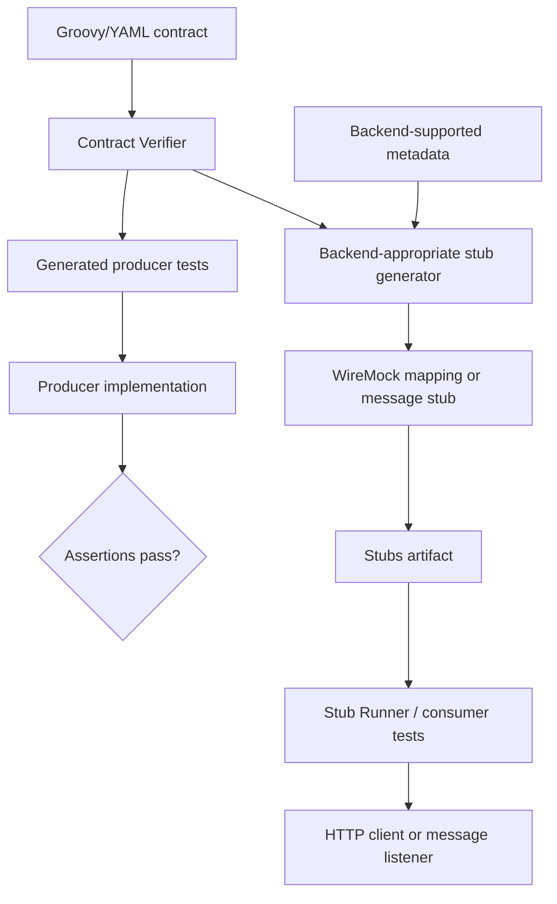
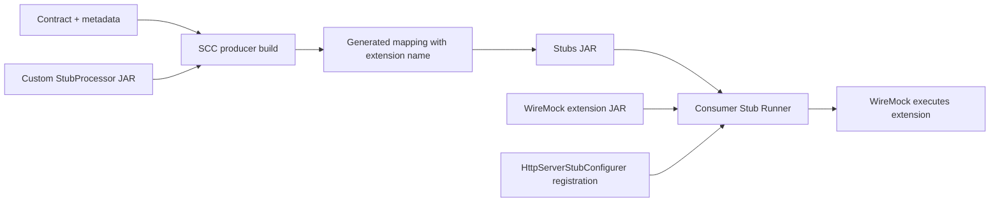
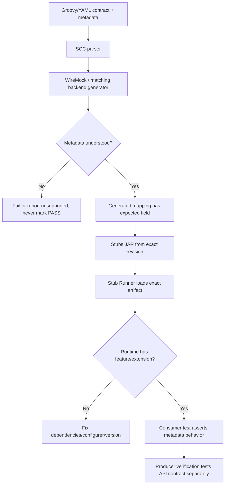

# Metadata for Capability-Based Stub Generation

## 1. What Problem Does Metadata Solve in Spring Cloud Contract?

In **Spring Cloud Contract (SCC)**, producers and consumers agree on HTTP or message behavior through **Groovy/YAML DSL** contracts. From a contract, SCC can **generate producer verification tests** to verify the real implementation, **generate stubs** for consumers to use with **Stub Runner**, and combine both results in CI to detect breaking API changes.

For common cases, the `request` and `response` sections of a contract are enough to produce a WireMock mapping. Occasionally, however, a consumer needs to simulate a specialized capability of the stub server, such as:

- Slowing down a response to test **timeouts**, loading states, or fallbacks.
- Triggering an installed and registered **WireMock response transformer**.
- Adding a custom `StubMapping` setting understood only by the WireMock backend.
- Providing specific configuration details for a **message transport** or custom stub generator, if supported by the integration.

SCC provides the contract-level **`metadata`** field to pass such configuration to extensions/generators. However, **metadata is not a magic mechanism that turns arbitrary keys into features**. A key only takes effect when **your SCC version, converter/generator, and stub runtime actually contain code that reads and handles that exact key**.

> **Core Principle:** The contract describes the *API promise*; metadata describes *how a specific tool extends stub generation or execution*. Metadata is effective only **according to supported capabilities**, and must never be used to bypass producer verification.

### Learning Outcomes

After this lesson, you will be able to:

1. Distinguish `request`/`response` DSL from `metadata` and WireMock `StubMapping`.
2. Write `wiremock.stubMapping` metadata in Groovy/YAML to request a **fixed delay** on a stub.
3. Understand clearly **which parts of a generated mapping are patched** and which **are not patched**.
4. Know when a custom `StubProcessor`, WireMock extension, or `HttpServerStubConfigurer` is needed.
5. Evaluate different metadata for WireMock, Kafka/AMQP, and integrations genuinely supported by your version.
6. Design output, consumer-behavior, and CI checks to avoid assuming metadata worked when it was actually ignored.

## 2. One Contract Has Two Distinct Paths



| Component | Function | Can Metadata Affect It? |
| --- | --- | --- |
| `request` DSL | Method, URL, query, headers, body the producer must accept | Never alter the request promise via metadata patches |
| `response` DSL | Status, headers, body the producer must return | Never alter producer assertions via WireMock metadata |
| Generated producer tests | Call producer implementation, assert behavior | **WireMock stub metadata does not automatically modify** these tests |
| Generated WireMock mapping | Match requests and return simulated responses | **Yes**, for supported patch regions |
| WireMock runtime | Read mapping, process delay/transformer/extension | Only when the feature and extension are supported by the runtime |
| Consumer Stub Runner tests | Verify HTTP client/consumer handling of stubs | Observes only loaded stub behavior; does not run real producer |

This separation matters in a common scenario: the real producer responds in 50 ms, yet the consumer needs to test a 2-second timeout. You can **add a delay to the stub** without turning 2 seconds into a producer latency requirement. If a real response-time SLA exists, verify that SLA with appropriate performance/monitoring tests rather than inferring it from WireMock delay config.

## 3. How Does Contract-Level Metadata Differ from Standard Contract Fields?

A basic HTTP contract DSL:

```groovy
import org.springframework.cloud.contract.spec.Contract

Contract.make {
    description 'Look up a confirmed order'

    request {
        method GET()
        url '/api/orders/42'
        headers {
            accept(applicationJson())
        }
    }

    response {
        status OK()
        headers {
            contentType(applicationJson())
        }
        body([
            orderId: 'ord-42',
            status : 'CONFIRMED'
        ])
    }
}
```

This is a **functional promise**: a GET to that endpoint must return an HTTP response compatible with the described status/headers/body, within the assertions generated. Adding `metadata` does not intend to change that requirement.

| Data | Where Should It Be Declared? | Why? |
| --- | --- | --- |
| HTTP method `GET` | `request.method` | Part of the API |
| URL `/api/orders/42` | `request.url` | Part of the API |
| Response status `200` | `response.status` | Producer must satisfy this |
| Response field `status = CONFIRMED` | `response.body` | Consumer relies on this data |
| Response content type | `response.headers` | API interface |
| Fixed 2-second delay **only for consumer testing** | `metadata.wiremock.stubMapping` if supported | Simulated stub behavior |
| Transformer named `my-transformer` | WireMock metadata + registered extension | Not pure contract logic |
| Contract owner or ticket ID | Custom governance metadata/convention if processed | Not an automatic stub-generation feature |
| Test framework/base class | SCC Maven/Gradle configuration | Not WireMock stub metadata |

**Do not confuse `metadata` with DSL top-level fields `description`, `name`, `label`, `priority`, `ignored`, or `inProgress`**. Those fields have dedicated meanings defined by SCC per version; do not stuff them into `metadata.wiremock` to use built-in features.

## 4. Capability Support Is the Deciding Factor

Starting from Spring Cloud Contract **3.0.0**, SCC documentation describes a metadata mechanism for extending WireMock stubs. A configuration containing `wiremock` and `stubMapping` keys can use JSON, a map, or an appropriate `StubMapping` object to **patch generated WireMock mappings**.

Yet there are at least **four support layers**:

| Layer | Question to Verify |
| --- | --- |
| **Contract DSL parser** | Does your SCC version parse `metadata` in Groovy/YAML properly? |
| **Generator/processor** | Does the chosen generator understand `wiremock.stubMapping` or other metadata keys? |
| **WireMock version** | Are the requested JSON properties valid for that version's `StubMapping`? |
| **Consumer runtime** | Does Stub Runner load any associated extension/transformer and handle the response as expected? |

Unrecognized metadata may be ignored by the chosen generator or cause a build error depending on the integration type and version. **Never treat “YAML parsed successfully” as proof that metadata took effect.**

### Design Questions Before Adding Metadata

1. Are we using a **WireMock HTTP stub**, a **messaging stub**, or a custom stub server?
2. Does this feature belong in the **standard `request`/`response` DSL** or is it purely a runtime characteristic?
3. Are the metadata key and data type **documented** in the active SCC/transport version?
4. Does it affect **generated producer tests**, **generated stubs**, or only the **Stub Runner runtime**?
5. Can we verify both the **generated mapping** and **consumer behavior** with deterministic tests?

If questions 3 or 4 lack clear answers, keep a standard contract and add separate test/resilience fixtures instead of inventing custom metadata.

## 5. Groovy Example: Metadata Requesting a WireMock Fixed Delay

The example below illustrates configuration supported by SCC versions with **WireMock metadata customization**:

```groovy
import org.springframework.cloud.contract.spec.Contract

Contract.make {
    name 'get_confirmed_order_with_stub_delay'
    description 'Consumer tests handling a slow order lookup response'

    request {
        method GET()
        url '/api/orders/42'
        headers {
            accept(applicationJson())
        }
    }

    response {
        status OK()
        headers {
            contentType(applicationJson())
        }
        body([
            orderId: 'ord-42',
            status : 'CONFIRMED'
        ])
    }

    metadata([
        wiremock: [
            stubMapping: '''{
              "response": {
                "fixedDelayMilliseconds": 2000
              }
            }'''
        ]
    ])
}
```

Here:

- `name` names the scenario/test; `description` explains its intent.
- `request` and `response` still declare the contract normally.
- `metadata` is a **map** with key `wiremock`.
- `wiremock.stubMapping` contains JSON describing the patch to apply to the WireMock mapping.
- `fixedDelayMilliseconds: 2000` instructs WireMock to **hold the response for ~2 seconds** before replying, if supported by the backend/runtime.

**Caution:** Generated producer tests **do not force the producer to sleep for 2 seconds**. This metadata controls **stub-side behavior**; write dedicated tests if you want to enforce producer response-time limits.

### Why Use Minimal JSON Instead of Copying the Entire `StubMapping`?

If the only goal is a delay, supply only `response.fixedDelayMilliseconds`. Do not repeat `request.method`, `request.url`, or `response.body` inside metadata JSON. Let the contract DSL remain the **source of truth** for API behavior, while metadata supplements supported stub features.

## 6. Equivalent YAML Example Alongside Groovy

YAML DSL can also pass metadata under the `wiremock.stubMapping` structure:

```yaml
name: get_confirmed_order_with_stub_delay
description: Consumer tests handling a slow order lookup response

request:
  method: GET
  url: /api/orders/42
  headers:
    Accept: application/json

response:
  status: 200
  headers:
    Content-Type: application/json
  body:
    orderId: "ord-42"
    status: "CONFIRMED"

metadata:
  wiremock:
    stubMapping: >
      {
        "response": {
          "fixedDelayMilliseconds": 2000
        }
      }
```

**This is an alternative version**; never place both the Groovy and YAML files describing the **exact same HTTP scenario** in a source directory scanned by the plugin. Two files sharing method/path with different names or priorities can produce competing stub mappings.

### Metadata Data Structure

| Level | Illustrative Type | Meaning |
| --- | --- | --- |
| `metadata` | YAML object / Groovy map | Holds extra data for integrations |
| `wiremock` | Object/map | Namespace recognized by WireMock integration |
| `stubMapping` | JSON string in YAML example | Partial `StubMapping` to patch |
| `response` inside JSON | WireMock response definition | Not the standard top-level `response` DSL above |
| `fixedDelayMilliseconds` | Integer, unit **milliseconds** | Delay duration for the stub response |

**There are two `response` keys with distinct roles:** top-level `response` is the producer promise; `metadata.wiremock.stubMapping.response` configures **WireMock’s simulated response**. Distinguish them clearly during code review.

### Notes on YAML Block Scalars

- `>` is a folded block scalar; convenient for collapsing multi-line JSON into a single string.
- `|` preserves line breaks; also usable when the integration's JSON parser accepts newlines.
- JSON inside `stubMapping` must be **valid JSON**, including braces, commas, and quotes.
- Do not confuse a JSON string scalar with a YAML object if your plugin/generator version expects a specific type.

SCC documentation notes that `stubMapping` can be expressed as JSON/string, a map, or an equivalent object in supported DSLs. **Verify which type your active plugin/version actually parses**, rather than assuming all serializations are interchangeable.

## 7. What Does the Patched Generated WireMock Mapping Look Like?

SCC generates a mapping from `request`/`response`, then applies the supported metadata portion. A **condensed illustrative** result:

```json
{
  "request": {
    "method": "GET",
    "url": "/api/orders/42",
    "headers": {
      "Accept": {
        "equalTo": "application/json"
      }
    }
  },
  "response": {
    "status": 200,
    "headers": {
      "Content-Type": "application/json"
    },
    "jsonBody": {
      "orderId": "ord-42",
      "status": "CONFIRMED"
    },
    "fixedDelayMilliseconds": 2000
  }
}
```

**This is not a byte-for-byte copy of the file SCC generates in every version.** The generator may pick `urlPath`, `equalToJson`, `jsonBody`, store bodies in external files, or add `id`, `uuid`, or other fields. What to verify is: the original request matchers and contract response remain intact, **and** `response.fixedDelayMilliseconds` actually appears.

### Output Verification Workflow

1. Place **one** contract with metadata in the configured source root.
2. Run the corresponding **generate stubs** step of the Maven/Gradle plugin.
3. Open the **generated WireMock JSON mapping** in the actual output directory.
4. Cross-check `request.method`, URL, headers, and body matchers against the source contract.
5. Cross-check `response.status`, `headers`, and `body` against the API promise.
6. Confirm `fixedDelayMilliseconds: 2000` is present in the right location.
7. Package the stubs artifact, run Stub Runner, and verify the **real response** exhibits the delay within acceptable measurement bounds.

**Successful YAML/Groovy parsing is not enough** to prove the backend accepted the metadata. **Having a JSON mapping is not enough** to prove the consumer runtime loaded the right artifact and executed the delay.

## 8. Patch Limits: Metadata Must Not Override Everything

SCC documentation on **WireMock customization via metadata** highlights a vital constraint: this mechanism **acts on the stub side**, does not alter generated producer tests, and **does not replace the entire `request` or the `response.body` and `response.headers`** of the generated stub.

| Element to Change | Should You Use `wiremock.stubMapping`? | Proper Solution |
| --- | --- | --- |
| HTTP method `GET` → `POST` | **No** | Update `request.method` DSL and verify producer |
| Request URL `/v1` → `/v2` | **No** | Update `request.url` DSL/API version |
| Request body matcher | **Do not** use metadata to replace the entire request | Use `request.matchers`/Groovy consumer matchers |
| Response HTTP `200` → `201` | Do not use patches to contradict the promise | Update `response.status` DSL |
| Response JSON `status` → `state` | **No** | Update `response.body` with compatibility review |
| Response `Content-Type` | **No** | Update `response.headers` DSL |
| Stub response delay | **Yes, if supported** | Patch `response.fixedDelayMilliseconds` |
| Stub response transformer | Possible, if runtime extension is supported | Patch transformer config, register extension |
| New WireMock feature not yet in SCC | Only within supported patch area and WireMock version | Verify schema/runtime or custom processor |
| Producer latency SLA | **No** | Dedicated producer performance/latency tests |

### Do Not Try to “Fix” Breaking Changes with Metadata

If the real producer removed the `status` field while the consumer still needs it, you **cannot legitimately patch** the stub via metadata to keep returning the old field and claim the producer is compatible. Generated producer tests must fail when the producer breaks an old contract. Fix the implementation, create a migration plan, or version the API; metadata is not a tool to hide compatibility failures.

### Why Inspect Both Generated Branches?

```text
contract: response.status=200, body.status=CONFIRMED
                 |
       +---------+---------+
       |                   |
generated producer test    generated WireMock stub
assert status/body         return status/body + delay 2000 ms
       |                   |
verify producer code       consumer tests timeout/fallback
```

The consumer may time out against the 2-second stub while the producer contract test passes. There is no contradiction: **the two test suites verify two different properties**.

## 9. Metadata Does Not Automatically Prove Feature Support

Suppose a developer adds:

```yaml
metadata:
  myOrganization:
    chaosMode: "FAIL_EVERY_THIRD_REQUEST"
```

This is merely **arbitrary YAML metadata**. Unless a registered converter/processor/extension explicitly reads `myOrganization.chaosMode`, there is zero basis to assume WireMock will automatically fail every third request.

Likewise, adding:

```yaml
metadata:
  wiremock:
    unsupportedProperty: true
```

does not mean SCC will turn any `unsupportedProperty` key into a valid WireMock mapping. **Only the namespaces and schemas accepted by the integration determine effectiveness.**

### Capability Matrix

| Desired Metadata | What to Verify | When Unsupported |
| --- | --- | --- |
| `wiremock.stubMapping.response.fixedDelayMilliseconds` | SCC 3.0+ with patch + WireMock delay support | Drop metadata; use an annotated standalone WireMock fixture |
| `response.transformers` | WireMock version, extension name, registration | Avoid declaring nonexistent extensions |
| Post-request webhook/callback | Specific WireMock capability, egress policy | Use an isolated sandbox integration test |
| Kafka/AMQP connection options | Right adapter/backend and metadata schema | Configure broker/test binder via supported channels |
| Custom organization key | Installed and tested custom processor | Treat purely as governance metadata, not behavior |

**Fail-closed CI principle:** For metadata that mandatory tests depend on, if the capability is missing or output differs from expectations, **mark the build FAILED/INCOMPLETE** rather than silently running tests while ignoring the feature.

## 10. Testing Consumer Delays Without Making Tests Flaky

Suppose a contract creates a 2-second delayed stub. Consumer `checkout-service` has an HTTP client with a timeout under 2 seconds and a valid fallback.

### Test Intent

```text
Given:
  WireMock GET /api/orders/42 -> 200, normal body, delay ~2000ms
  Consumer HTTP read timeout: 500ms

When:
  checkout-service calls OrderClient.getOrder("42")

Then:
  Consumer receives an HTTP client timeout
  Consumer invokes the designed fallback
  No infinite wait, no call to production API
```

Consumer tests should assert **the exception type/fallback outcome and business side effects**. Simply calling `Thread.sleep(2100)` in a test and checking whether a response arrived makes tests slow and flaky.

### Which Numbers Should Be Checked?

| Value | Role |
| --- | --- |
| Stub delay `2000 ms` | Simulates slow backend |
| Consumer timeout `500 ms` | Threshold where client intends to time out |
| Network/setup overhead | Varies on CI runners |
| Test suite deadline | Test framework/CI time budget |

Do not require elapsed time to be **exactly 2000 ms** because scheduling, HTTP stacks, and CI load introduce jitter. For resilience tests, prioritize asserting timeout/fallback behavior and leave ample margin between client timeout and stub delay for stability. Avoid applying large fixed delays across hundreds of tests when only one scenario simulates slow networking.

### Does Not Imply Producer Responses Must Be Slow

A consumer handling delays gracefully proves only that the client tolerates a slow stub under that scenario. It **does not prove the producer has bad latency**, nor does it measure real producer performance or SLA. If a release requires bounded latency, measure the producer in an appropriate environment.

## 11. When a Response Transformer or WireMock Extension Is Needed

`fixedDelayMilliseconds` is a minimal example requiring no custom Java extension. More complex needs may use a **WireMock transformer** to vary responses based on request details, test environment data, or managed state.

Illustrative **WireMock mapping** referencing a transformer:

```json
{
  "request": {
    "method": "GET",
    "urlPath": "/api/orders/42"
  },
  "response": {
    "status": 200,
    "jsonBody": {
      "orderId": "ord-42",
      "status": "CONFIRMED"
    },
    "transformers": ["order-test-response-transformer"]
  }
}
```

**Note:** `order-test-response-transformer` is a **hypothetical name** for a project-installed extension, not a built-in WireMock transformer. This JSON snippet is an **illustrative WireMock mapping**, not a guarantee that SCC will auto-generate it from arbitrary metadata.

### Three Conditions for an Extension to Work

1. **Generator:** The generated mapping actually contains `transformers` with the exact registered name.
2. **Classpath:** The JAR containing the extension must be on the **classpath of the WireMock server launched by Stub Runner**, not just the producer build classpath.
3. **Runtime registration:** WireMock must be configured to **load the extension**; having a class on the classpath does not automatically mean it is registered.

Per SCC documentation, when using Stub Runner with custom WireMock extensions, provide an appropriate **`HttpServerStubConfigurer`**, such as an implementation extending `WireMockHttpServerStubConfigurer`, to register the extension. Syntax for attaching the configurer to `@AutoConfigureStubRunner` or Stub Runner configuration **depends on version**; check the actual API before writing annotations/properties.

### Do Not Equate Extensions with Contract Assertions

A transformer changing response `status` into `state` for a v2 consumer might let consumer tests pass, yet producer verification **does not automatically gain checks ensuring the producer returns `state`**. If v2 is a real API promise, define a proper v2 contract and verify the producer implementation rather than patching at the mock layer.

### Cases Where Transformers May Fit

- Generating variable synthetic data that still conforms to the contracted schema.
- Testing client branches driven by headers or context in a sandbox environment.
- Producing test-specific responses independent of production backends.

In these cases, enforce **determinism**: fixed seed/clock, no outbound network calls, no reading real secrets, and no test-order dependencies affecting responses.

## 12. Custom `StubProcessor`: Deliberate Extension at Stub Generation

When default metadata is insufficient yet the requirement still pertains to WireMock mapping generation, SCC provides a **stub post-processing** mechanism in several release lines. Documentation describes:

- Registering an implementation via `META-INF/spring.factories` under key:
  `org.springframework.cloud.contract.verifier.converter.StubProcessor`.
- For WireMock specifically, the specialized interface `org.springframework.cloud.contract.verifier.wiremock.WireMockStubPostProcessor`.
- The processor decides **which contracts apply** and **how the post-processed mapping looks**.

**Directional** configuration example (without Java implementation, as interface signatures may differ across versions):

```properties
# META-INF/spring.factories
org.springframework.cloud.contract.verifier.converter.StubProcessor=\
com.example.contract.stub.OrderWireMockPostProcessor
```

Note that `OrderWireMockPostProcessor` is a **hypothetical class you must implement yourself**, not a prebuilt library class. Build a JAR containing the class and `spring.factories` and place it on the **classpath used by the generator**. Adding `spring.factories` alone without an implementation provides no behavior.

### A Post-Processing Algorithm Should Have Strict Boundaries

```text
Receive (contract, generated StubMapping)
    |
    +-- Supported metadata namespace/key present?
    |     +-- No -> return original mapping, or fail per policy
    |     +-- Yes -> validate metadata types/values
    |
    +-- Modify only approved stub fields
    |
    +-- Keep request and response contract assertions consistent
    |
    +-- Return new mapping -> validate JSON -> runtime smoke test
```

A well-behaved processor stays **within scope**: never arbitrarily alter request matchers or response bodies just to make tests pass easily, never open proxies to external URLs, and never turn parse errors into silent no-ops when metadata is mandatory.

### When Is a Custom Processor Unnecessary?

| Requirement | What to Do Instead? |
| --- | --- |
| Only adding supported fixed delay | Use `metadata.wiremock.stubMapping` |
| Only changing HTTP status/body | Update contract DSL and producer verification |
| Selecting test framework/base class | Configure Maven/Gradle SCC plugin |
| Adding standard request matchers | Use `request.matchers`/`consumer(...)` per DSL |
| Adding a WireMock feature with an extension without mapping rewrite logic | Register WireMock extension/configurer and verify generated mapping |
| Needing mapping-rewrite logic across many contracts | Consider custom `StubProcessor` |
| Needing a non-WireMock stub backend | Explore `StubGenerator`/`StubRunner` pluggable architecture |

**Never build a custom Java extension just to bypass a DSL constraint that exists to protect compatibility.** Every extension is code that must be versioned, security-reviewed, placed on classpaths, and tested.

## 13. Extension Lifecycle: Producer Generator and Consumer Server Are Two Environments

A common mistake: a developer adds an extension JAR to the producer build, producing mappings referencing a new transformer name, yet consumer Stub Runner still fails to recognize the transformer.



| Environment | What Must Be Present? | Failure If Missing |
| --- | --- | --- |
| **Producer generator** | SCC plugin + metadata processor if used | Mapping is unpatched or ungenerated |
| **Stubs artifact** | Generated mappings and response resources | Consumer cannot find mapping |
| **Consumer Stub Runner** | Compatible WireMock runtime version | Mapping parse/runtime fails |
| **Consumer test classpath** | Custom extension JAR if required by mapping | Cannot load transformer |
| **WireMock server configuration** | Extension registered under exact name | “extension not found” warning or wrong response |
| **Consumer client** | Calls right stub port/method/path | Stub feature is not observed |

Alignment between the **build-time processor** and the **consumer-test runtime extension** is another dimension of compatibility. Version custom extensions like normal dependencies and record their versions in CI.

### Why Not Just Bundle the JAR Inside the Stubs Artifact?

A standard stubs JAR is normally treated as a **bundle of mappings/resources**, not a place from which SCC automatically loads and registers arbitrary Java plugins. If you want to ship extensions, use explicit packaging/classpath/configurer wiring. Never assume that placing a class inside a JAR with the same name causes WireMock to discover and activate it.

## 14. Metadata for Messaging and HTTP Verifier: No Single Universal Schema

Some SCC versions also document **metadata namespaces** beyond `wiremock`, for example:

| Previously Documented Namespace | Typical Target | What to Verify |
| --- | --- | --- |
| `wiremock` | Patch WireMock `StubMapping` for HTTP stubs | Exact generator and WireMock version |
| `amqp` | Broker options/properties for AMQP-based communication | Exact AMQP integration/backend |
| `kafka` | Kafka broker connection options on input/output messages | Exact Kafka metadata schema and adapter |
| `standalone` | Standalone/middleware settings for certain flows | Use only with the corresponding backend/runtime |
| `verifierHttp` | HTTP scheme/protocol info for verifier in certain versions | Do **not** treat as WireMock response metadata |

**This list is not a promise that every SCC version supports every key.** Some metadata serves the **producer verifier**, **message stub generator**, or **runtime adapter**, rather than patching WireMock. Consult the schema/docs for your exact SCC branch and transport.

### AMQP YAML Example per Documented Middleware Format

```yaml
description: Emit OrderConfirmed for notification consumer
label: order_confirmed
input:
  triggeredBy: "confirmOrder()"
outputMessage:
  sentTo: orders.confirmed
  body:
    orderId: "ord-42"
    status: CONFIRMED
metadata:
  amqp:
    outputMessage:
      connectToBroker:
        declareQueueWithName: "orders.confirmed"
```

This example **applies only to a matching AMQP/standalone integration that reads those keys**. It does not magically register a broker, create production queues, or prove real events are delivered in every environment. For SCC producer verification, the base class must trigger `confirmOrder()`, and the adapter captures output and checks destination/headers/body.

### Kafka Example: Do Not Turn Broker Config into an API Promise

In some SCC branches, `kafka.input.connectToBroker.additionalOptions` or `kafka.outputMessage.connectToBroker.additionalOptions` appear in backend schemas. Adding these fields **does not guarantee a test binder is using real Kafka**, does not replace bootstrap-server configuration, and does not validate broker operations.

For messaging, first verify `label`, `input.triggeredBy`, `outputMessage.sentTo`, headers, and body that consumers rely on. Only then add transport-specific metadata if the feature is supported by **the backend itself**.

## 15. Organization-Specific Metadata: Separate Governance Labels from Behavior

A team might want to record extra attributes:

```yaml
metadata:
  organization:
    ownerTeam: "orders-platform"
    consumerGroup: "checkout"
    risk: "latency"
    ticket: "CONTRACT-218"
```

This is **illustrative governance metadata**, not keys that Spring Cloud Contract automatically converts into generated mappings or producer assertions. They can be useful for an **organization-built report generator/catalog**, provided the pipeline has a processor that reads and validates them.

To prevent confusion:

- Use a dedicated namespace; never place non-WireMock fields under `wiremock`.
- Maintain a schema version or validator for internal metadata—e.g., `ownerTeam` is a non-empty string.
- Clarify **who reads it** and **for what purpose**; metadata with no consumer is just a comment.
- Never put API keys, passwords, or sensitive data into metadata: DSL files can be packaged, published, and exposed in CI.
- Never place critical API constraints into custom metadata invisible to producer verification.

### Why Distinguish Governance Labels from `StubMapping` Metadata?

**WireMock itself also has a `metadata` field on `StubMapping`** in several versions for tagging or filtering mappings. That is **metadata inside WireMock's JSON mapping**, distinct from **top-level `metadata` in the Spring Cloud Contract DSL**. If you want to forward such tags through SCC, inspect **supported patch areas**, actual output, and WireMock version. Matching field names alone do not guarantee data passes through intact.

## 16. Verifying Metadata from Source to Consumer Stub Runner

A proper workflow does not stop at confirming YAML/Groovy contains a `metadata` field. You must verify **both build-time and runtime**:



### With a Maven Producer Configured with Contract Verifier

```bash
./mvnw -B clean verify
```

Verify that the plugin generates stubs and generated producer tests as expected; inspect **test reports** to confirm producer tests **actually executed**, not merely that files were generated. If your plugin/project does not bind generation or stubs packaging to the lifecycle, invoke the appropriate goals/tasks for your **actual plugin version**.

### With a Gradle Producer Configured with Contract Verifier

```bash
./gradlew tasks --all
./gradlew generateContractTests
./gradlew contractTest
./gradlew generateClientStubs
./gradlew verifierStubsJar
```

Task names and source directories depend on plugin/Gradle configuration; the commands above are **illustrative practice commands**, not commands executed while authoring this lesson. After generating stubs, locate the **actual WireMock JSON mapping** rather than assuming a fixed output path across every project.

### Details to Record After Generation

| Fact | What Must Be Known? |
| --- | --- |
| Contract source path/revision | Which file the metadata originated from |
| SCC/Gradle/Maven plugin version | Metadata parser/generator capability |
| WireMock version | Capability to read/execute the JSON field |
| Generated mapping path | Proof the patch was applied |
| Stubs artifact coordinates/digest | Whether the consumer loaded the right artifact |
| Stub Runner / extension version | Whether the runtime understands the mapping/transformer |
| Producer test report | Producer contract still verified independently |
| Consumer test result | Delay/transformer observed in execution, not just in JSON |

A green build without knowing **which mappings were actually loaded at runtime** can miss unapplied metadata or a consumer testing against a stale stubs JAR.

## 17. Consumer Test with a Delayed Stub

Example consumer test using Stub Runner:

```java
import org.junit.jupiter.api.Test;
import org.springframework.beans.factory.annotation.Autowired;
import org.springframework.boot.test.context.SpringBootTest;
import org.springframework.cloud.contract.stubrunner.StubRunnerProperties;
import org.springframework.cloud.contract.stubrunner.spring.AutoConfigureStubRunner;

import static org.assertj.core.api.Assertions.assertThat;

@SpringBootTest(properties =
    "clients.orders.base-url=http://localhost:9090")
@AutoConfigureStubRunner(
    ids = "com.example:order-service:1.7.0:stubs:9090",
    stubsMode = StubRunnerProperties.StubsMode.LOCAL
)
class OrderClientSlowResponseTest {

    @Autowired
    OrderClient orderClient;

    @Test
    void fallsBackWhenOrderServiceIsTooSlow() {
        OrderView result = orderClient.getOrderWithFallback("42");
        assertThat(result.fromFallback()).isTrue();
    }
}
```

`OrderClient`, `OrderView`, `getOrderWithFallback`, and `clients.orders.base-url` are all **hypothetical consumer application APIs**, not built into SCC. For the test to be meaningful:

1. The real client must point to `localhost:9090` (or the port assigned by Stub Runner).
2. The client timeout must be **shorter** than the WireMock delay—e.g., 500 ms vs. 2000 ms.
3. `LOCAL` must resolve the **exact stubs JAR** built from the metadata-enabled contract.
4. Assertions must check the **business fallback**, not merely that an exception was thrown.
5. If the test runs under another profile and hits a real producer, that is a serious setup bug.

### Do Not Equate One Stub with Every Real-World Condition

A fixed 2-second stub delay does not simulate packet loss, network resets, retry storms, or heavy load. For those characteristics, run dedicated resilience tests/fault injection per policy. **Metadata is a handy tool for a specific scenario**, not a full model of a distributed system.

### Watch Out for Sharing the Same URL Across Multiple Contracts

If you have a fast GET contract and a slow GET contract with **identical method/path/headers/query/body matchers**, WireMock may load two competing mappings. It is unpredictable which response the consumer receives without a discriminator. Therefore:

- Keep **only one mapping** for the scenario in a single stub instance.
- Or separate consumer test profiles/stubs artifacts/ports by scenario.
- Or use a request header supported by both contract and producer to **genuinely distinguish** different requests.

**Never add an `X-Test-Slow: true` header to a production contract if the real producer has no such semantics**, unless it is an organization-approved test interface. Filtering fixtures per job is cleaner.

## 18. CI Quality Gates: Mandatory Metadata Must Have Evidence

To prevent “metadata parsed but had no effect”, CI can enforce three distinct gates:

| Gate | Checks | Failure Condition |
| --- | --- | --- |
| **Producer contract gate** | Generated tests execute/pass on the exact producer revision | Block publishing verified stubs |
| **Stub-generation gate** | Generated mapping contains expected supported metadata | Fail if mandatory field is missing or wrong type |
| **Consumer-runtime gate** | Stub Runner loads mapping + extension; consumer observes behavior | Fail/INCOMPLETE if runtime ignores it |

Example verification model for delay metadata:

```text
Required contract: get_confirmed_order_with_stub_delay
Expected mapping:
  request.method = GET
  request.url = /api/orders/42
  response.status = 200
  response.body.status = CONFIRMED
  response.fixedDelayMilliseconds = 2000

Expected runtime behavior:
  consumer client readTimeout = 500 ms
  observed result = fallback activated

Expected producer verification:
  generated contract tests executed > 0
  HTTP response assertions pass
```

This is a **test plan template**, not SCC output. CI must specify which tests/scenarios are mandatory; checking count `> 0` is insufficient if other contracts ran while the required latency scenario was silently dropped.

### A Small JSON Validation Check Helps

In the job inspecting generated mappings, use a test or script that **parses JSON properly**, locates the exact mapping, and asserts:

```text
assert mapping.request.method == "GET"
assert mapping.response.status == 200
assert mapping.response.fixedDelayMilliseconds == 2000
assert mapping.response.headers["Content-Type"] == "application/json"
```

This is **assertion pseudocode**, not a specific language script. Never grep an entire directory for the string `2000` and assume the right mapping was patched: that string could appear in logs or an unrelated mapping.

### When to Fail Even If Producer Tests Pass

Producer verification passes, yet the generated mapping lacks `fixedDelayMilliseconds` because:

- An older SCC plugin does not support the metadata;
- The metadata namespace or type is wrong;
- The backend is not WireMock;
- The build pulled an older contract revision;
- The stub processor was not loaded.

If the release candidate depends on the consumer timeout scenario, **the stub-generation gate must fail** instead of claiming all contract/resilience requirements were verified.

## 19. Security When Using Metadata for Extensions, Proxies, and Webhooks

Metadata is processed during builds and can steer runtime stubs; it is **input requiring review**.

### Major Risks

| Risk | Why It Is Dangerous? | Mitigation |
| --- | --- | --- |
| Proxy/forward to real systems | Sends test requests or tokens to unintended endpoints | Disable proxying by default; enforce egress controls and URL allowlists |
| Webhook calling internal services | Triggers outbound network traffic from stubs | Use sandbox targets, NetworkPolicies/firewalls |
| Untrusted Java extension | Executes code with test-runner privileges | Review dependencies, run non-root, restrict filesystem/network |
| Response templating from secret data | Leaks secrets into responses/journals | Use synthetic data only, redact logs |
| Unapproved custom Groovy DSL | Groovy executes during generation | Never expose secrets to untrusted contract PRs |
| Unbounded delays | Causes widespread consumer test timeouts/hangs | Enforce delay and time-budget limits via policy |
| Mutable stubs artifact | Same version tag changes mappings over time | Pin immutable digests/versions, lock down registry writes |

### Apply Least Privilege

- Producer CI gets publish rights for stubs after verification; consumer CI needs read-only access.
- When using WireMock extensions, place **only reviewed JARs** on the classpath.
- Run ephemeral stub servers per test job, restricting Admin API access and outbound networking.
- Never allow metadata to contain URIs pointing to production, cloud metadata services, or real tokens.
- When tests require webhooks/proxies, isolate them in a sandbox and monitor generated outbound requests.

**Never turn metadata convenience into unchecked code execution or uncontrolled network traffic.**

## 20. Troubleshooting Table When Metadata Does Not Work

| Symptom | Causes to Check | First Action |
| --- | --- | --- |
| Groovy contract fails parsing `metadata` | Wrong map/quotes syntax, different DSL version | Read parser stack trace and source contract |
| YAML parses cleanly yet stub has no delay | Metadata unsupported/unread by generator | Inspect generated WireMock JSON |
| `stubMapping` reports invalid JSON | Bad braces/quotes or YAML scalar formatting | Parse the JSON string itself, not just the YAML file |
| Generated mapping has delay, client sees none | Consumer uses stale stub artifact or wrong WireMock port | Compare artifact version/digest and actual HTTP request |
| Producer tests pass, consumer timeout test fails | Producer tests don't check delay; client timeout/fallback misconfigured | Inspect Stub Runner runtime behavior and client timeout |
| Generated mapping didn't alter body as expected | `response.body` is outside supported metadata patch scope | Edit `response.body` DSL instead of forcing a patch |
| Request matcher unchanged despite `request` in metadata | Whole request cannot be replaced via documented patch mechanism | Use standard request DSL/matchers |
| Warning that transformer was not found | Missing extension JAR or missing runtime registration | Check classpath, configurer, transformer name |
| Custom `StubProcessor` never runs | Wrong `spring.factories` or plugin classpath | Check service registration and generator runtime |
| Post-processor runs on only some contracts | `isApplicable`/selector did not match | Check contract path/metadata and filter predicates |
| Stub Runner fails parsing mapping after upgrade | WireMock schema/version changed | Verify supported fields in runtime version |
| Two mappings on same path return different responses | Competing contracts/fixtures | Differentiate requests or separate stub instances |
| Messaging tests ignore AMQP metadata | Different backend or missing matching adapter | Check transport/version/schema |
| Excessive delay causes CI timeout | Mismatched test timeout/CI deadline | Shorten delay, isolate resilience suite |
| Consumer test passes with stale `LOCAL` fixture | Stubs JAR is not the producer revision under test | Resolve exact version and checksum |
| Metadata URL causes stub to hit live network | Proxy/webhook activated unexpectedly | Block egress, review metadata/extensions |

### Suggested Investigation Order

```text
1. Source:
   Which contract? Which metadata key? Groovy or YAML?

2. Capability:
   Do SCC version + generator + WireMock/transport backend support it?

3. Parse:
   Are metadata and embedded JSON the right types and schema?

4. Generate:
   Does the generated mapping contain the expected field?

5. Package:
   Does the stubs JAR contain the right mapping and artifact revision?

6. Runtime:
   Did Stub Runner load the right JAR? Is the extension registered?

7. Consumer:
   Did the request match? Are timeout/fallback properly asserted?

8. Producer:
   Did generated producer tests run and pass against the API promise?
```

**Never use one layer's change to “mask” another layer's failure:** if metadata is missing from a mapping, do not slow down the producer controller; if the consumer hits the wrong path, do not weaken request matchers; if a WireMock extension isn't registered, do not hand-edit generated producer tests.

## 21. Hands-On Exercise: Create a Delayed Stub While Keeping Producer Verification Independent

### Context

`order-service` exposes order lookup via:

```http
GET /api/orders/42 HTTP/1.1
Accept: application/json
```

And the response contract:

```json
{
  "orderId": "ord-42",
  "status": "CONFIRMED"
}
```

`checkout-service` must prove that when the response arrives slowly, the UI/service displays a fallback state rather than hanging indefinitely. The real producer **must not be forced to add artificial delays**. The team uses an SCC version supporting `wiremock.stubMapping`.

### Part A — Write Metadata in Groovy DSL

1. Create the contract following Section 5.
2. Add `metadata([wiremock: [stubMapping: ...]])` containing only `response.fixedDelayMilliseconds = 2000`.
3. Keep `request.method`, URL, `response.status`, body, and headers identical to the base contract.
4. Ensure only **one** matching contract exists in the input source root; do not simultaneously load a YAML copy of the same scenario.
5. Clearly explain why the delay belongs to **stub behavior**, not a producer assertion.

### Part B — Convert to YAML DSL

1. Use the `metadata.wiremock.stubMapping` structure from Section 6.
2. Place the JSON under a YAML folded block scalar `>`.
3. Distinguish the two `response` sections: one in the DSL, one in the JSON patch.
4. Visually inspect the JSON to ensure it includes only `fixedDelayMilliseconds`—no duplicated `body`.
5. Keep **only one** format (Groovy or YAML) in the active contract directory to prevent duplicate mappings.

### Part C — Inspect the Generated Mapping

Generate stubs with the appropriate plugin. Then complete the table:

| Condition | Expected Value | Required Evidence |
| --- | --- | --- |
| Request method | `GET` | Generated mapping |
| URL | `/api/orders/42` | Generated mapping |
| Response status | `200` | Generated mapping |
| Body field | `status = CONFIRMED` | Generated mapping |
| Content type | `application/json` | Generated mapping |
| Fixed delay | `2000` (ms) | Generated mapping |

**If fixed delay is missing:** check SCC version, generator, and JSON metadata; **never** hand-edit `fixedDelayMilliseconds` directly into generated output and treat the source contract as valid. Fix the source/config and regenerate.

### Part D — Run Producer Verification

1. Prepare the producer test base class calling the controller/service under verification.
2. Run generated producer tests; confirm the test report shows the GET scenario **actually ran**.
3. Make the producer return HTTP `200` with valid body and headers: producer tests must pass.
4. Intentionally change `status` to `FAILED`: producer tests must fail.
5. Restore the implementation and re-run.

**Do not make the producer wait 2 seconds.** This illustrates the metadata boundary: the consumer stub delays, while producer tests protect the API promise.

### Part E — Run Consumer with Stub Runner

1. Package `com.example:order-service:1.7.0:stubs` from the exact verified revision.
2. Start Stub Runner, confirming the WireMock port and loaded mappings.
3. Configure the consumer client timeout to 500 ms.
4. Call `GET /api/orders/42` through the real consumer client.
5. Assert the consumer's fallback activates and zero requests reach production.
6. As a control check, run an **undelayed** stub in a separate test profile/instance and confirm the client reads the normal response.

Do not keep two indistinguishable mappings for the same request on one WireMock instance expecting the server to pick “slow” or “fast” on demand.

### Part F — Test Intentional Mutations

| Mutation | Expected Outcome |
| --- | --- |
| Rename key `wiremock` to `mywiremock` | No reason for SCC WireMock processor to recognize metadata |
| Write JSON `"fixedDelayMilliseconds": "two seconds"` | Invalid type for numeric field; should fail validation/runtime |
| Place `fixedDelayMilliseconds` under `request` in JSON patch | Wrong location for WireMock response delay |
| Change top-level `response.body.status` to `state` | Alters API promise; requires producer verification and compatibility review |
| Add `request.url` to patch to change path | Unsupported way to replace the whole request |
| Omit custom transformer JAR from consumer classpath | Runtime lacks the declared transformer |
| Use stale stubs JAR without delay | Consumer resilience test may fail to hit fallback |
| Run only `generateContractTests` without executing tests | No proof the producer implementation passes |
| Consumer test mocks HTTP client directly instead of WireMock | Does not prove mapping/metadata runtime works |
| Set delay to 30 seconds without timeout planning | Easily causes slow/hanging tests; bound via policy |

### Part G — Assessment Questions

**Question 1:** Why do producer tests pass with a 50 ms response while consumer tests time out on the 2-second delayed stub?

**Answer:** Because delay metadata applies only to the stub; producer verification checks response/status/body per the contract and is not required to wait 2 seconds.

**Question 2:** If YAML contains `metadata.wiremock.stubMapping` yet the generated mapping lacks the delay, can we report that metadata is verified?

**Answer:** No. Check generator capability, metadata type, output, and runtime; if the consumer test relies on the feature, CI should fail.

**Question 3:** Can metadata be used to hide the producer renaming `status` to `state` while an old consumer still expects `status`?

**Answer:** No. That change affects the HTTP API contract and backward compatibility; fix the producer or apply proper migration/versioning.

**Question 4:** Is having a custom transformer on the producer classpath enough for consumer Stub Runner to execute it?

**Answer:** No. The consumer runtime must have the extension and register it via a supported mechanism, typically a custom `HttpServerStubConfigurer`.

## 22. Checklist When Using Metadata for Stub Generation

- [ ] Determine whether metadata is for **stub simulation** or protecting an **API promise**; keep key method/path/body/status in the contract DSL.
- [ ] Identify the active SCC version, generator, and WireMock/Kafka/AMQP backend.
- [ ] Check version documentation to confirm metadata namespace and schema are supported.
- [ ] For WireMock, use exact `metadata.wiremock.stubMapping` with valid JSON/Map.
- [ ] Patch only SCC-supported areas; never try to replace the entire request or response body/headers via metadata.
- [ ] Retain generated mapping output proving metadata was genuinely applied.
- [ ] Verify `fixedDelayMilliseconds` sits inside `response` of the WireMock mapping.
- [ ] Ensure no competing mappings share the same request with conflicting responses causing flakiness.
- [ ] If using transformers, verify extension name, JAR/classpath, and runtime registration.
- [ ] If using a custom `StubProcessor`, verify `spring.factories`, plugin classpath, and applicability conditions.
- [ ] If using messaging metadata, confirm the exact transport adapter and backend support.
- [ ] Never confuse internal governance metadata with automatic generator behavior.
- [ ] Never place secrets, production endpoints, or real personal data in contract metadata/stubs.
- [ ] Generated producer tests actually run/pass independently of simulated WireMock delays.
- [ ] Stubs artifact carries the exact version/digest matching the verified contract revision.
- [ ] Consumer Stub Runner loads the exact artifact, real client calls the right port, and runtime executes the feature.
- [ ] Consumer assertions observe the delay/fallback or extension behavior, rather than merely inspecting JSON mappings.
- [ ] CI fails if a mandatory feature is unsupported or ignored; never equate parse success with runtime PASS.
- [ ] Include control tests for undelayed or non-transformer cases to prevent false positives.
- [ ] When upgrading SCC/WireMock/extensions, re-run producer tests, mapping inspections, and consumer runtime tests.

## 23. Summary and References

**Keep three layers independent:**

1. **Source contract:** expresses the HTTP/message interface promised by the producer in Groovy/YAML DSL.
2. **Stub generation customization:** metadata provides configuration for **features genuinely supported by the backend**, such as `wiremock.stubMapping.response.fixedDelayMilliseconds`.
3. **Consumer runtime:** Stub Runner/WireMock or the message adapter must **load the right artifact, include any needed extensions, and exhibit the expected behavior**.

For real-world implementation, always consult the **exact SCC/WireMock version** documentation:

- [Spring Cloud Contract — Common Top-Level Elements](https://docs.spring.io/spring-cloud-contract/reference/project-features-contract/common-top-elements.html): contract-level metadata, Groovy/YAML examples, and scope limits.
- [Spring Cloud Contract — Customization](https://docs.spring.io/spring-cloud-contract/docs/current/reference/html/advanced.html): WireMock metadata customization, `StubProcessor`, custom extensions, and pluggable generators.
- [WireMock — Stubbing](https://wiremock.org/docs/stubbing/): `StubMapping` schema, delays, transformers, and response features.
- [Spring Cloud Contract — Reference](https://docs.spring.io/spring-cloud-contract/reference/): producer verification, Stub Runner, messaging contracts, and version-specific behavior.

Pages marked `current`/`reference` evolve as new versions release. Before copying configuration, verify docs matching your project's dependency/BOM versions and run a small smoke test to **actually observe the generated mapping and runtime behavior**.

**Remember:** `metadata` in Spring Cloud Contract is **input for supported extensions**, not a new language to rewrite request/response contracts. For instance, WireMock `stubMapping` can add a delay on the **stub**, without modifying generated producer assertions. To prevent false positives, verify **source contract → generated producer tests → generated stub mapping → stubs artifact → Stub Runner → consumer behavior**. When a capability is unsupported by the generator or runtime, report the limitation clearly and choose an alternative testing mechanism instead of assuming metadata took effect.
