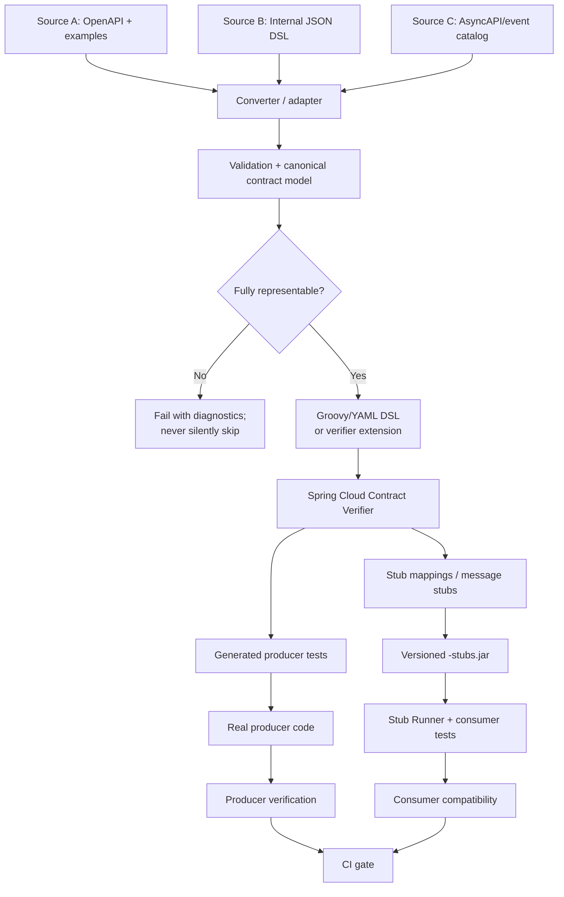
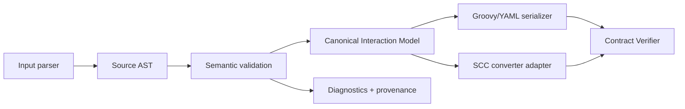
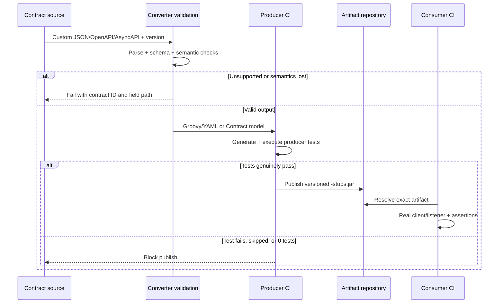

# Transforming Contracts and Adding Source Formats

## 1. When Groovy/YAML Is Not the Only Source Format

In **Spring Cloud Contract**, producers and consumers define the HTTP or messaging behaviors both sides must honor. Contracts are typically written in **Groovy DSL** or **YAML DSL**; Verifier uses them to generate producer-side tests and stubs, and consumers use **Stub Runner** with CI to detect breaking API changes.

In practice, an organization may already rely on other interface sources:

- **OpenAPI** documents describing endpoints, requests, responses, and JSON Schemas.
- **AsyncAPI** or event catalogs describing messages, channels, and schemas.
- An **internal JSON/YAML** format integrated with the organization’s API repository.
- Contracts from another **consumer-driven contract system**.
- Test cases managed in a versioned registry with clear ownership.

The question then is not merely “what additional file extension should we read?”. Any converter must preserve **request matchers, response status/headers/body, producer states, dynamic values, and message semantics** so generated producer tests and stubs genuinely protect consumers.

This lesson belongs to the **Customization and Extension** chapter and focuses on two strategies:

1. **Offline conversion (preprocessing)**: custom source format → Groovy/YAML contracts supported by Spring Cloud Contract.
2. **Converter/extension point integration**: enabling the Spring Cloud Contract pipeline to ingest the new format via an extension mechanism supported by **your active version**.

The ultimate goal is not creating more formats. The goal is **preserving agreement semantics**, generating real producer tests, packaging traceable stubs, and letting real consumer clients verify compatibility.

After this lesson, you will know how to design an intermediate model, map HTTP and message scenarios, choose an integration path, organize the build, verify converters with golden and mutation tests, and integrate them into CI with quality gates.

## 2. Three Concepts Often Conflated

| Concept | Example | Role |
|---|---|---|
| **Source format** | OpenAPI, internal JSON, AsyncAPI, Groovy DSL, YAML DSL | Where teams declare expectations |
| **Contract representation used for generation** | Contract/spec objects accepted by Verifier or valid Groovy/YAML | Source for generating tests and stubs |
| **Artifacts/outputs** | Generated Java tests, WireMock mappings, `-stubs.jar` | Used to verify the producer and run consumer tests |

**Contract transformation** translates information from one representation to another, possibly normalizing or enriching metadata. **Adding a source format** teaches the pipeline to understand a new input file type. The two are related but distinct:

- Converting an internal JSON file to YAML DSL **does not require** modifying Spring Cloud Contract internals.
- Writing a runtime converter extension may require changing classpaths, service discovery, plugin lifecycles, and deployments.
- A schema-only OpenAPI document **does not necessarily** contain enough producer state, example bodies, trigger methods, or consumer-specific assertions to generate useful contract tests.

A converter that succeeds syntactically yet **drops an error code or turns a JSON number into a string** is a compatibility bug, not a “success”.

### 2.1. What Is **Not** Within a Converter's Scope?

A converter does not replace:

- Agreement on semantics between producer and consumer.
- Real producer or message-publisher code.
- Base classes, fixtures, and test infrastructure for generated producer tests.
- Consumer HTTP clients/listeners.
- Release, versioning, review, and deprecation policies.

It only brings **an agreed-upon contract description** onto the path Spring Cloud Contract can understand and verify.

## 3. Overall Architecture: Source → Normalization → Verification



**Reliable order:**

1. Parse the source and check the format version.
2. Read each interaction with a stable ID.
3. Normalize **exact data types and semantics**.
4. Reject unsupported fields that affect the contract.
5. Render into a form Verifier understands, or supply contract objects via an extension.
6. Generate and **execute** producer tests; do not just generate files.
7. Package stubs under the right artifact/version once verification passes.
8. Run real consumer clients/listeners against the corresponding stubs.

### 3.1. Two Different Integration Paths

```text
Path A — Offline converter:
  source/*.order-contract.json
       |
       | project preprocessor
       v
  target/generated-contracts/*.yml
       |
       | Verifier reads contractsDirectory
       v
  tests + stubs

Path B — Runtime extension:
  source/*.order-contract.json
       |
       | custom converter loaded by Verifier/plugin
       v
  Internal Contract model
       |
       v
  tests + stubs
```

Path A is generally easier to govern because it yields **human-readable intermediate output** and clean build boundaries. Path B is convenient when many modules need to consume source files directly, though it depends more heavily on Spring Cloud Contract’s SPI/API and classpath in a specific version.

## 4. Define the Input Standard Before Writing a Converter

Never start with a parser that accepts “arbitrary JSON”. Define a versioned source format with contract IDs and explicit rules.

### 4.1. Proposed Internal JSON Source Structure

Illustrative file `src/contract-input/orders/get-paid-order.order-contract.json`:

```json
{
  "formatVersion": 1,
  "id": "ORD-GET-PAID-001",
  "description": "Checkout fetches a paid order",
  "protocol": "http",
  "producer": "order-service",
  "consumer": "checkout-service",
  "given": {
    "fixture": "order-42-paid"
  },
  "request": {
    "method": "GET",
    "path": "/api/orders/42",
    "headers": {
      "Accept": "application/json"
    }
  },
  "response": {
    "status": 200,
    "headers": {
      "Content-Type": "application/json"
    },
    "body": {
      "id": 42,
      "state": "PAID",
      "currency": "VND"
    }
  }
}
```

This is a **lesson-defined illustrative format**; `formatVersion`, `given.fixture`, and `protocol` are **not** properties automatically understood by Spring Cloud Contract. The converter must define:

- `id` is a stable traceability ID, not an HTTP header.
- `given.fixture` requests producer state setup in the base test or fixture harness; **it does not magically turn into database rows**.
- `request` and `response` carry the interface details to emit into the DSL.
- `formatVersion` governs converter schema evolution.
- `producer`/`consumer` support ownership, versioning, and diagnostics; they need not appear in DSL output.

### 4.2. Why Separate `source` from Generated Files?

```text
order-service/
├── src/
│   ├── contract-input/
│   │   └── orders/get-paid-order.order-contract.json
│   └── test/
│       ├── java/com/example/orders/contract/
│       │   └── OrderContractBase.java
│       └── resources/
│           └── contract-fixtures/
└── target/
    └── generated-contracts/
        └── http/orders/get-paid-order.yml
```

This layout is **illustrative for Maven**. Source files live in version control; outputs are regenerated from source during builds and **never hand-edited**. In Gradle, the equivalent output typically resides under `build/`.

If output lands in `target/`, the conversion step must run **after clean and before the Contract Verifier goal reads `contractsDirectory`**. Otherwise, a clean build wipes the YAML files and Verifier finds zero contracts.

### 4.3. Minimum Requirements for a New Format

| Group | Must Define | Example |
|---|---|---|
| Source version | Input schema, converter compatibility | `formatVersion: 1` |
| Identity | Stable ID and source reference | `ORD-GET-PAID-001` |
| Protocol | HTTP or message | `http` |
| Request matcher | Method/path/query/header/body | `GET /api/orders/42` |
| Expected outcome | Status/headers/body or destination/message | `200` + JSON |
| Producer state | Fixture/trigger needed to reproduce test | `order-42-paid` |
| Data types | number/string/boolean/null/list/object | `id: 42` number |
| Dynamic value policy | Matchers, stub samples, types/formats | UUID or timestamp if needed |
| Consumer dependencies | Fields/errors/statuses the client relies on | `state=PAID` |
| Diagnostics | File/line/contract ID and unsupported reason | “missing response.status” |

Not every contract uses every group; an outbound message lacks an HTTP status, for example. Still, the converter must **know which groups are mandatory for each interaction type**.

## 5. Mapping Source JSON to Spring Cloud Contract YAML DSL

From the input in Section 4, a generated YAML DSL file might look like:

```yaml
description: Checkout fetches a paid order
request:
  method: GET
  url: /api/orders/42
  headers:
    Accept: application/json
response:
  status: 200
  headers:
    Content-Type: application/json
  body:
    id: 42
    state: PAID
    currency: VND
```

**This is the YAML DSL consumed by Verifier as a contract source**, distinct from internal JSON containing `formatVersion` and `given.fixture`. The converter must **filter or explicitly map custom metadata** rather than dumping unsupported keys into YAML and assuming Verifier ignores them.

### 5.1. Basic Mapping Table

| Internal JSON | YAML DSL | Notes |
|---|---|---|
| `description` | `description` | Preserve descriptive semantics |
| `request.method` | `request.method` | Keep GET/POST unchanged |
| `request.path` | `request.url` | When path is an exact URL |
| `request.headers` | `request.headers` | Header names/casing handled appropriately for HTTP |
| `request.query` | `request.queryParameters` where appropriate | Distinguish repeated query keys from comma-separated |
| `request.body` | `request.body` | Preserve JSON types |
| `response.status` | `response.status` | Keep exact status and semantics |
| `response.headers` | `response.headers` | Especially Content-Type/Location |
| `response.body` | `response.body` | Never coerce numbers to strings |
| `given.fixture` | Project base test/fixture resolver | No automatic database mapping |
| `id`, `producer`, `consumer` | Filename/external metadata | Used for traceability and ownership |

A mapping table **is not proof** that the converter is right. Inspect generated YAML/Groovy, generated tests, and stubs to confirm header/query matchers preserve exact semantics.

### 5.2. Simple Output Verification

For the sample contract:

```text
Input  : id=42(number), state="PAID"(string), status=200
Output : id=42(number), state="PAID"(string), status=200
Assert : JSON body includes all fields consumer depends on
```

Unacceptable errors:

```text
Wrong: id: "42"         # turned number into string
Wrong: state: ".*"      # dropped business-value constraint
Wrong: status: 201      # changed 200 to 201
Wrong: request.url: /api/orders
                        # dropped /42 path segment
Wrong: missing Content-Type if client needs a JSON decoder
```

To catch discrepancies, compare the **semantic model** of source and output, not merely raw text strings with differing key orders.

## 6. Groovy DSL: Equivalent Output When Richer Logic Is Needed

A Groovy representation of the same interaction:

```groovy
import org.springframework.cloud.contract.spec.Contract

Contract.make {
    description 'Checkout fetches a paid order'

    request {
        method GET()
        url '/api/orders/42'
        headers {
            header 'Accept', 'application/json'
        }
    }

    response {
        status OK()
        headers {
            contentType(applicationJson())
        }
        body(
            id: 42,
            state: 'PAID',
            currency: 'VND'
        )
    }
}
```

**Do not emit both Groovy and YAML for the same request predicate in the same contract set**, unless your organization enforces explicit deduplication/routing. Two mappings matching `GET /api/orders/42` yield nondeterministic responses when one changes.

### 6.1. Choose Groovy or YAML as the Target?

| Criterion | Groovy DSL | YAML DSL |
|---|---|---|
| Readers familiar with code | Easy to use Groovy helpers/matchers | Requires reading YAML structure |
| Machine generation | Requires safe Groovy escaping/syntax | Easy to serialize as a data tree |
| Nested data/lists | Expressible | Expressed naturally |
| Dynamic data/complex matchers | Rich DSL helpers | Version-specific YAML matcher DSL |
| Diff review | Concise with good conventions | Field changes are easy to spot |
| Security with untrusted input | Never embed arbitrary text into executable Groovy | Still validate input, but avoids emitting executable code |

If the new source is structured data produced by another system, **YAML DSL is usually an easier intermediate target**; still verify its ability to express required matchers/dynamic values. Never interpolate raw input into Groovy source without escaping/validation because Groovy can execute code during parsing/evaluation.

## 7. Never Lose Data Types, Request Conditions, or Error Branches

A converter can produce syntactically valid YAML that violates the contract. Common mistakes arise when normalizing data without preserving **semantics**:

| Input | Expectation to Preserve | Common Conversion Bug |
|---|---|---|
| `"id": 42` | JSON number | Emitted as string `"42"` |
| `"active": false` | JSON boolean false | Emitted as string `"false"` |
| `"items": []` | Empty array | Turned into `null` or dropped |
| `"deliveryDate": null` | Field present with null value | Property stripped from response |
| Absent `deliveryDate` | Property absent | Auto-populated with null |
| `state=PAID` | Exact business enum | Turned into wildcard `.*` |
| Two query keys `tag=a&tag=b` | Two values for same key | Merged into `tag=a,b` |
| `Content-Type: application/json` | Client uses JSON decoder | Header dropped |
| `404 + ORDER_NOT_FOUND` | Business error | Body dropped, only status kept |
| `POST 201 + Location` | Consumer navigates via Location | Only body kept |
| Ordered JSON array | Ordering significant if API promises it | Automatically re-sorted |
| Tenant header | Routing/authorization | Dropped as assumed metadata |

### 7.1. JSON Numbers Are Not Always `double`

When an input parser coerces all numbers to floating point, an ID like `9007199254740993` loses precision under IEEE-754 double. Large IDs must use an appropriate integer type—or string if **the source contract actually specifies a string**. A converter must never unilaterally alter types without agreement from API owners and consumers.

For `BigDecimal`, clarify formatting and comparison behavior when monetary amounts have scale. `10.00` and `10` may be numerically equal yet serializers, clients, or business rules may depend on representation. Never normalize them arbitrarily as “just formatting”.

### 7.2. Missing, Null, Empty String, and Empty Array

These responses:

```json
{"items":[]}
```

```json
{"items":null}
```

```json
{}
```

are not equivalent to every consumer. A DTO or validator may distinguish all three. During transformation, preserve **key presence** and value types; never strip all `null` fields with a blanket “cleanup” pass.

### 7.3. Case-Insensitive Header Names Do Not Mean Dropping Constraints

HTTP header names are case-insensitive per spec, yet **header values** often carry specific semantics. If the consumer relies on `X-Tenant-Id`, the converter must retain that constraint rather than stripping it when generating stubs. When comparing outputs, you may canonicalize **header names** to avoid noisy diffs, while keeping values and matching rules intact.

## 8. Request Matching: Path, Query, Body, and Patterns

When a source describes:

```text
GET /api/orders?state=PAID&limit=20
Accept: application/json
```

the converter must recognize `state` and `limit` as **query parameters**, not path segments or request body fields. Example YAML DSL:

```yaml
description: Filter paid orders
request:
  method: GET
  urlPath: /api/orders
  queryParameters:
    state: PAID
    limit: "20"
  headers:
    Accept: application/json
response:
  status: 200
  headers:
    Content-Type: application/json
  body:
    - id: 42
      state: PAID
      currency: VND
```

**Syntax note:** verify actual output against the **DSL parser and WireMock mappings generated by your running Spring Cloud Contract version**. Multi-value query params, matchers, and URL escaping have version-specific details.

### 8.1. Exact Paths vs. Path Templates

A source may state:

```text
Path template: /api/orders/{id}
Example id   : 42
Matcher      : id must be a positive integer
```

Simply replacing `{id}` with `.*` in regex lets stubs accept invalid URLs. Conversely, emitting only `/api/orders/42` may be too narrow if consumer tests need multiple values. Define explicit rules:

1. **Example** so the stub serves a concrete body.
2. **Matcher** so Verifier/WireMock accept valid requests.
3. **Producer-side assertions** testing routes/controllers across representative and boundary values.
4. **Consumer behavior** verifying the client encodes path parameters properly.

Never equate “OpenAPI has `{id}`” with “we have full matchers, fixtures, and producer tests for all IDs”.

### 8.2. Body Matchers Are More Than a JSON Example

For `POST /api/orders`:

```json
{
  "sku": "BOOK-1",
  "quantity": 2
}
```

Consumers may submit many valid `sku` values. If the source contract specifies `sku` is a non-empty string and `quantity` is a positive integer, the converter must distinguish:

- **Example payload**: concrete values used to build stubs/tests.
- **Request matcher**: constraints on what the consumer may send.
- **Validation branch**: when `quantity=0`, the producer returns `400 INVALID_QUANTITY`.

A contract with only a success response does not automatically cover validation. A converter must not fabricate arbitrary error branches from a JSON Schema; create interactions whose **expectations are agreed upon by both producer and consumer**.

### 8.3. Matchers Must Retain Error-Catching Power

A sensible matcher design:

| Field | Semantics | Suggested Rule |
|---|---|---|
| `id` | Identifier | Validate type/format plus stable example |
| `state` | Consumer-facing status | Exact `PAID` for that scenario |
| `eventId` | Dynamic ID | UUID/format matcher if API promises it |
| `createdAt` | Dynamic timestamp | ISO-8601 matcher or explicit time policy |
| `traceId` | Observability field | Do not pin fixed value unless part of contract |

In Groovy DSL, a common response-side matcher looks like:

```groovy
response {
    status OK()
    body(
        id: 42,
        state: 'PAID',
        currency: 'VND'
    )
    bodyMatchers {
        jsonPath('$.id', byType())
    }
}
```

**Scope of this snippet:** it demonstrates type checking for `id`; exact helper names and producer/stub matcher generation must be checked in your version's generated tests. If the consumer relies strictly on `id=42`, using `byType()` alone weakens the assertion compared to exact equality. Never swap matchers just to silence a failing test.

## 9. Error Branch Example: Converters Must Not Keep Only the Happy Path

Internal JSON source describing an error:

```json
{
  "formatVersion": 1,
  "id": "ORD-NOT-FOUND-001",
  "protocol": "http",
  "description": "Order not found",
  "request": {
    "method": "GET",
    "path": "/api/orders/9999",
    "headers": {
      "Accept": "application/json"
    }
  },
  "response": {
    "status": 404,
    "headers": {
      "Content-Type": "application/json"
    },
    "body": {
      "code": "ORDER_NOT_FOUND",
      "message": "Order does not exist"
    }
  }
}
```

YAML DSL output:

```yaml
description: Order not found
request:
  method: GET
  url: /api/orders/9999
  headers:
    Accept: application/json
response:
  status: 404
  headers:
    Content-Type: application/json
  body:
    code: ORDER_NOT_FOUND
    message: Order does not exist
```

**Never** let `404` act as a catch-all default for unmapped requests. WireMock returns an unmatched `404` when a client calls the wrong path; a consumer test checking only status code would pass falsely. Contracts need **business error codes** and tight request predicates to distinguish domain errors from unmatched requests.

### 9.1. Converters Must Track Every Branch

An API may return `200`, `404`, or `400` depending on input/state. An OpenAPI `responses` entry may list all three status codes without providing **concrete request/state examples** needed to generate three meaningful producer tests.

Safe conversion rules:

1. Generate each **interaction case** from agreed-upon examples and request conditions.
2. If producer state for `404` or `409` is missing, fail or flag it as needing completion rather than assuming an empty DB.
3. Never create two WireMock mappings matching the same request with different responses without an explicit discriminator or scenario.
4. Log unmappable fields in a diagnostic report for owners to resolve.

## 10. Message Contracts: Source Formats Richer Than HTTP

An event catalog source might define:

```json
{
  "formatVersion": 1,
  "id": "EVT-ORDER-PAID-001",
  "protocol": "message",
  "producer": "order-service",
  "description": "OrderPaid emitted after payment",
  "trigger": "publishPaidOrderForContract()",
  "output": {
    "destination": "orders.paid",
    "headers": {
      "eventType": "OrderPaid"
    },
    "body": {
      "eventId": "EVT-42",
      "orderId": 42,
      "state": "PAID"
    }
  }
}
```

Corresponding Groovy contract:

```groovy
import org.springframework.cloud.contract.spec.Contract

Contract.make {
    description 'OrderPaid emitted after payment'
    label 'order_paid'

    input {
        triggeredBy('publishPaidOrderForContract()')
    }

    outputMessage {
        sentTo('orders.paid')
        headers {
            header('eventType', 'OrderPaid')
        }
        body(
            eventId: 'EVT-42',
            orderId: 42,
            state: 'PAID'
        )
    }
}
```

`triggeredBy(...)` is simply the method name on the producer **base test** that triggers the message-emitting business flow. A converter does not synthesize that method implementation, test binders, Kafka topics, RabbitMQ queues, or transaction handling. If a source has only an AsyncAPI channel/schema without **knowing the trigger or event-emission condition**, you must supply explicit test fixtures/triggers before trusting generated producer verification.

### 10.1. Converting AsyncAPI/Event Specs

| Source Information | Mappable Target | Caution |
|---|---|---|
| Channel/destination | `sentTo(...)` or input message per direction | Identify event producer vs. consumer |
| Message headers | `outputMessage.headers` | Retain `eventType`/correlation if consumer uses them |
| Message payload example | `outputMessage.body` | Preserve JSON types and nested objects/lists |
| Trigger/cause | `triggeredBy(...)` or inbound message setup | Not always present in source spec |
| Message key/partition | Metadata/adapter-specific mapping if supported | Never silently drop if consumer relies on ordering |
| Retries/duplicates/idempotency | Separate consumer workflow tests | A message contract does not prove exactly-once delivery |
| Serialization (JSON/Avro) | Appropriate adapter/codec | Do not equate a JSON example with Avro wire format |

**Do not use standalone HTTP WireMock to prove a message contract works.** Messaging requires a message verifier/test binder/adapter or test broker environment; consumers must run real listeners and verify actual behavior.

### 10.2. A New Format May Support Only a Subset of the Interface

Converter v1 might support **HTTP request/response examples** while not yet supporting:

- Inbound messages producing outbound messages.
- Dynamic `bodyMatchers`.
- Multipart uploads.
- Stateful scenarios.
- Avro/Protobuf binary payloads.
- Request streaming or Server-Sent Events.

This is not necessarily an architectural flaw if **the supported scope is published and enforced**. However, when an input uses an unsupported feature, **fail with a clear diagnostic** rather than stripping the field and emitting a weaker contract.

## 11. Designing a Canonical Model to Reduce Format Coupling

A maintainable adapter should not tangle JSON parsing, schema normalization, matcher selection, and YAML serialization inside one giant method.



A **project-level conceptual model** (not a Spring Cloud Contract API):

```java
// Pseudocode for the converter's domain model, not an SCC public API.
record HttpInteraction(
    String id,
    String description,
    String method,
    String path,
    Map<String, Object> requestHeaders,
    Map<String, Object> queryParameters,
    Object requestBody,
    int responseStatus,
    Map<String, Object> responseHeaders,
    Object responseBody,
    String fixtureRef
) {}

record MessageInteraction(
    String id,
    String destination,
    Map<String, Object> headers,
    Object body,
    String producerTrigger
) {}
```

Goals:

1. **Parser** owns syntax, schema version, and source file location.
2. **Semantic validator** ensures method/path/status exist, rejects unsupported types, and preserves matchers.
3. **Canonical model** holds normalized interactions and required metadata.
4. **Renderer/adapter** translates to YAML/Groovy or Verifier contract objects.
5. **Diagnostics** pinpoint source file, contract ID, field path, and failure reason.

Never name an internal model `org.springframework.cloud.contract.spec.Contract` when it is not the actual library class; keep the **converter domain model** distinct from the **SCC contract model** to avoid confusion.

## 12. Strategy A: Offline Converter Before Generation

This is usually the easiest approach to implement and control when converting an internal format into Groovy/YAML.

### 12.1. Recommended Workflow

```text
Version-controlled source:
  src/contract-input/*.order-contract.json
              |
              v
Validate schema v1 + semantic fields
              |
              v
Generate deterministic YAML files:
  target/generated-contracts/**/*.yml
              |
              v
Spring Cloud Contract Verifier
  contractsDirectory = target/generated-contracts
              |
              +-- generated producer tests
              '-- WireMock/messaging stub resources
```

**Note:** `target/generated-contracts` is build output, **not** a source directory. After `mvn clean`, the converter step must regenerate those files **before the Verifier plugin scans for contracts**. If tasks/goals run out of order, builds may pass with **0 contracts**.

### 12.2. Single-File Conversion Pseudocode

```text
convert(sourceFile):
    doc = parseStrict(sourceFile)
    require doc.formatVersion == 1
    require unique(doc.id)
    require doc.protocol in {"http", "message"}

    validateSchema(doc)
    validateSemanticRequirements(doc)
    validateFixtureReference(doc.given.fixture if present)

    interaction = normalizeToCanonicalModel(doc)
    failIfUnsupportedFeatures(interaction)

    output = serializeToSccYamlOrGroovy(interaction)
    parseOutputWithTargetContractParser(output)
    compareSemantics(interaction, output)

    writeDeterministically(output, byContractId(doc.id))
    reportMapping(sourceFile, doc.id, output.path)
```

**This pseudocode is neither a CLI nor a built-in API.** The project must implement the functions and corresponding converter tests; in particular, `validateFixtureReference` requires a fixture registry or agreement in the producer base test rather than silently ignoring `given` metadata.

### 12.3. A Concrete Fail-Fast Rule

Suppose a source contains:

```json
{
  "formatVersion": 2,
  "id": "ORD-GET-PAID-001",
  "protocol": "http",
  "request": {
    "method": "GET",
    "path": "/api/orders/42"
  },
  "response": {
    "status": 200
  }
}
```

If the converter supports only `formatVersion=1`, **reject** this input or apply a verified v2 migration path. Never silently ignore unknown v2 fields and emit an overly weak success contract.

Good diagnostic:

```text
CONTRACT_CONVERSION_FAILED
source : src/contract-input/orders/get-paid-order.order-contract.json
id     : ORD-GET-PAID-001
field  : $.formatVersion
reason : Unsupported version 2; supported versions: [1]
output : no contract generated
```

A log saying merely “parse error” without file/ID/path makes operating a converter across hundreds of contracts painful and error-prone.

## 13. Strategy B: Using Spring Cloud Contract’s Extension Point

Spring Cloud Contract provides extension points to customize how contracts are read/represented; across release lines, a **contract converter SPI** (commonly referenced as **`ContractConverter`**) exists. **Package names, interface signatures, return types, registration mechanisms, and classpath loading can change across versions.** Therefore, before implementing, inspect the **source/API/documentation of your exact Spring Cloud Contract artifact**, rather than copying an interface from an example targeting a different release.

Architectural responsibilities:

```text
Organization converter adapter
  - recognizes its own source format
  - parses into contract interactions
  - translates to the model supported by the current Verifier version
  - participates in plugin discovery/registration
  - fails clearly when input cannot be represented
```

When using the real SPI, verify these questions:

1. Does the converter accept **File, Path, InputStream**, or another model?
2. Can a single input file yield **multiple Contract objects**?
3. Must you implement **source → contract** only, or **contract → source** as well?
4. Is discovery via ServiceLoader, configuration property, or a plugin-specific hook?
5. Which classpath holds the converter when the **Maven/Gradle plugin generates tests**?
6. Are custom file extensions supported, and how does converter precedence work?
7. Which parts of the API are public/stable versus internal and subject to change on upgrades?

**Never ship a build/test converter inside the production application artifact.** Keep the adapter strictly on the **build/test tooling classpath** if business runtime does not need it.

### 13.1. Conceptual Adapter Design

The code below illustrates internal responsibilities, **not a directly compilable SPI signature**:

```java
// Pseudocode: OrganizationSourceAdapter is a project-defined API.
final class OrganizationSourceAdapter {

    boolean accepts(Path file) {
        return file.getFileName().toString()
            .endsWith(".order-contract.json");
    }

    List<CanonicalInteraction> parseAndValidate(Path file) {
        // 1. Validate formatVersion/required fields.
        // 2. Reject unknown semantic fields.
        // 3. Preserve JSON number/string/null/array.
        // 4. Resolve fixture/trigger metadata explicitly.
        // 5. Return one or more canonical interactions.
        throw new UnsupportedOperationException("Implementation required");
    }

    List<?> toVerifierContracts(
            List<CanonicalInteraction> interactions) {
        // Translate from project model to Contract API
        // of the exact Spring Cloud Contract version.
        throw new UnsupportedOperationException("Version-specific adapter");
    }
}
```

`CanonicalInteraction` and `OrganizationSourceAdapter` are **illustrative project names**, not pre-existing packages/classes. Do not copy this class as a working plugin; its purpose is highlighting the boundary between parsing/validation and the library-dependent adapter layer.

### 13.2. Which Classpath Does the Converter JAR Belong On?

In Maven, a converter used by the plugin normally must be **accessible from the Maven plugin's classpath/plugin realm**, not merely added under application `<dependencies>`.

Illustrative **POM layout with placeholders**:

```xml
<plugin>
    <groupId>org.springframework.cloud</groupId>
    <artifactId>spring-cloud-contract-maven-plugin</artifactId>
    <version>REPLACE_WITH_COMPATIBLE_CONTRACT_VERSION</version>
    <extensions>true</extensions>
    <dependencies>
        <dependency>
            <groupId>com.example.build</groupId>
            <artifactId>organization-contract-converter</artifactId>
            <version>REPLACE_WITH_CONVERTER_VERSION</version>
        </dependency>
    </dependencies>
</plugin>
```

This snippet only illustrates placing the converter artifact into **plugin dependencies**. It **does not guarantee** the custom format is supported or that the converter will be discovered. You must still register the extension per your version's supported mechanism and check plugin logs to confirm the converter actually ran.

In Gradle, build plugins/test generation tasks also have **separate classpaths and configurations**. Adding a converter library to the production module's `implementation` does not make Gradle's contract-generation task see it. Integrate via supported plugin/configuration APIs and verify against generated outputs.

### 13.3. Safe Discovery Registration

Some extension mechanisms use **Java ServiceLoader** with descriptors in `META-INF/services/<fully-qualified-interface>`. If your version genuinely uses that mechanism, the descriptor must point to the exact implementation FQN and the JAR must sit on the classpath where Verifier loads services.

**Never guess descriptor names or methods from this example.** Inspect your version's artifacts and interfaces, write an integration test proving `.order-contract.json` is recognized by the adapter, and verify the generated producer test. If no clean SPI exists, **falling back to preprocessing** is safer than patching internal plugin classes.

### 13.4. Trade-Offs Between the Two Strategies

| Criterion | Preprocessor → Groovy/YAML | Verifier-Integrated Converter |
|---|---|---|
| Coupling to SCC internals | Low when outputting supported DSL | Higher; tracks SPI/version |
| Reviewable intermediate output | **Yes** | Depends on adapter design |
| CI task ordering | Must wire step before generator | Fewer external steps, but requires proper discovery |
| Parser debugging ease | Can compare input/output files directly | Needs logging and standalone adapter runner |
| Multi-module reuse | Shared CLI/library | Shared converter JAR with right classpath |
| Upgrading Spring Cloud Contract | Check DSL compatibility | Check both SPI and API compatibility |
| Build-tool portability | Relatively easy | Tied to plugin integration mechanism |
| Risk of “silent failure” | If preprocessor skips files | If converter isn't discovered/doesn't accept |

**Practical recommendation:** start with a preprocessor for a new source format if the team wants transparent inspection and tight control. Choose an SPI only when concrete benefits justify maintaining versioned adapter code.

## 14. Maven Integration: Build Order Is Part of the Contract

Suppose source files live in `src/contract-input` and the preprocessor writes YAML to `target/generated-contracts`. The producer Maven Plugin must read **that exact output**.

Illustrative POM snippet:

```xml
<properties>
    <spring-cloud-contract.version>
        REPLACE_WITH_COMPATIBLE_VERSION
    </spring-cloud-contract.version>
</properties>

<build>
    <plugins>
        <plugin>
            <groupId>org.springframework.cloud</groupId>
            <artifactId>spring-cloud-contract-maven-plugin</artifactId>
            <version>${spring-cloud-contract.version}</version>
            <extensions>true</extensions>
            <configuration>
                <contractsDirectory>
                    ${project.build.directory}/generated-contracts
                </contractsDirectory>
                <baseClassForTests>
                    com.example.orders.contract.OrderContractBase
                </baseClassForTests>
                <testFramework>JUNIT5</testFramework>
                <testMode>MOCKMVC</testMode>
            </configuration>
        </plugin>
    </plugins>
</build>
```

This is a **path-illustrating POM snippet**, not a full build. You still need:

1. The actual preprocessor tool built/resolved in the pipeline.
2. A Maven execution/task **running after `clean` and before Verifier’s generate goal**; if sharing a lifecycle phase, verify execution order rather than guessing.
3. Spring Boot Test/JUnit 5/Rest Assured MockMvc libraries or appropriate adapters.
4. A base class loading fixture `order-42-paid`.
5. CI verifying **at least the expected count of interactions** in outputs/generators and reports.
6. A gate preventing stub publication if converter/generator/producer tests fail.

### 14.1. Why You Should Not Point to a Previous Build’s Output

```text
Wrong:
  mvn clean verify
  (converter runs only after verify)

Consequence:
  clean deletes target/generated-contracts
  verifier sees an empty directory
  generated tests may equal 0
  build might still pass because of other unit tests
```

Correct sequence:

```text
clean → convert contracts → validate outputs
      → generate contract tests → testCompile
      → execute generated producer tests
      → package versioned stubs → publish (if gates pass)
```

You can wire this with a dedicated Maven plugin execution before the contract-test generation phase or an ordered CI step sharing the workspace. **Do not mistake a descriptive shell sequence for an existing Maven goal**; verify the actual execution lifecycle.

### 14.2. Maven Multi-Module

In a reactor:

```text
commerce-parent/
├── order-service/
│   ├── src/contract-input/
│   └── pom.xml
└── checkout-service/
    └── pom.xml
```

`${project.basedir}` and `${project.build.directory}` are **per-module**. If multiple producer modules run converter executions, outputs must live in **each module’s own build directory** so two modules never overwrite the same file in a shared directory. The parent manages versions/config only and should not accidentally run converters on modules without contracts.

If contract sources live in a separate repository, pin the revision prior to conversion; never pull floating `main` when building an older release.

## 15. Gradle Integration: Task Dependencies and Caching

In Gradle, the equivalent idea:

```text
contractInputFiles
     |
     v
convertOrganizationContracts   (project-defined task)
     |
     v
generatedContractsDirectory
     |
     v
Spring Cloud Contract test generation task
     |
     v
test / contract verification / stub generation
```

A **Kotlin DSL sketch**, not a runnable complete configuration:

```kotlin
// Project-defined task; adapter needs its executable/dependencies.
val convertOrganizationContracts by tasks.registering {
    inputs.dir("src/contract-input")
    outputs.dir(layout.buildDirectory.dir("generated-contracts"))

    doLast {
        // Invoke the project's converter to emit YAML DSL.
        // Do not treat this comment as an implementation.
    }
}

// Once you verify the exact generate task name for your plugin/version:
// tasks.named("TASK_NAME_FROM_YOUR_PLUGIN") {
//     dependsOn(convertOrganizationContracts)
// }
```

**Note:** point `contractsDslDir` or the equivalent contracts source configuration **per your Gradle plugin version**, and attach the dependency to **the actual test generation task**. If the task name or plugin API changes, the build must fail loudly or be updated rather than silently skipping test generation.

### 15.1. Build Cache and Reproducibility

When enabling Gradle/Maven build caching, the converter must declare:

- **Inputs:** all source files, schema version, configuration, templates/serializers, converter binary version.
- **Outputs:** generated DSL files and manifest/provenance.
- **Determinism:** identical inputs yield identical bytes/semantics.
- **Incremental policy:** remove stale outputs when an input contract is deleted or renamed.
- **Isolation:** modules/jobs never write concurrently into the same output directory.

If converter logic changes while cache keys omit converter version, CI can reuse **stale outputs**. If an input file is deleted yet its generated YAML remains, tests keep running unowned contracts. Both corrupt quality signals.

## 16. Determinism, Security, and Source Control

A converter running in CI must safely process source files originating from PRs or external systems.

### 16.1. Deterministic Generation

The same input and converter version should produce semantically identical—ideally byte-identical—output:

- Sort file paths and keys consistently.
- Never insert `Instant.now()` or random UUIDs into expected bodies without a policy matcher.
- Use UTF-8 encoding, consistent line endings, and consistent YAML quoting.
- Derive output filenames from **validated contract IDs**, never uncontrolled raw paths.
- Clean or overwrite stale files within the **designated build directory**.
- Emit a manifest mapping source path/contract ID/output path/converter version.

You do not need byte-level JSON key ordering if the API makes no ordering guarantee, though deterministic output eases diff reviews and artifact provenance.

### 16.2. Never Execute Untrusted Data

JSON/YAML sources may contain externally supplied strings. If you generate **Groovy scripts** via raw string concatenation, unescaped inputs can produce syntax errors or inject arbitrary logic executed at build time.

Safeguards:

1. Parse inputs strictly against a schema with bounds on **file size, interaction count, and nesting depth**.
2. Never use `eval` to interpret input fields as Groovy expressions.
3. Escape strings and structures with a trusted serializer; prefer data-only DSL outputs when suitable.
4. When resolving `$ref`/imports in OpenAPI/AsyncAPI, restrict schemes/hosts/paths to prevent SSRF, reading files outside the workspace, or unbounded recursion.
5. Never put credentials, access tokens, or real customer data into contract fixtures/stubs.
6. Reject output paths trying to escape the build directory.
7. Pin versions, origins, and artifact verification for custom converter JARs.

**Stub data usually lacks production access controls.** Never publish mappings/bodies containing PII, JWTs, or secrets simply because the converter copied them from samples.

### 16.3. Controlling Source Schema Evolution

If `formatVersion=1` can no longer represent a new feature, there are three options:

| Option | When to Use | Requirement |
|---|---|---|
| Backward-compatible v1 extension | Adding optional metadata without changing semantics | Check older converter consumers |
| Bump to `formatVersion=2` | Breaking meaning or required structure changes | Converter has migration/compat policy |
| Keep unsupported fields out of source | Not ready to support yet | Do not count that interaction as fully covered |

Each source version requires a schema, test fixtures, and migration notes. **Never alter the interpretation of the same `formatVersion` without bumping/reviewing the converter** if it silently changes generated contracts.

## 17. Testing the Converter Itself: From Parser to Semantic Fidelity

A generated file parsing cleanly **proves only syntax**, not contract correctness. A converter needs at least four test layers:

| Layer | Goal | Examples |
|---|---|---|
| **Parser/schema** | Accept valid inputs, reject invalid ones | Missing status, bad `formatVersion`, unknown fields |
| **Semantic mapping** | Preserve types/request/response | `id` number, `404` error code |
| **Golden output** | Stable, reviewable DSL output | Compare normalized YAML against approved snapshots |
| **Verifier integration** | Output generates real producer tests/stubs | Generated class exists, tests run |
| **Consumer integration** | Produced stubs exercise real client | DTOs/error mappings/decisions work |

### 17.1. Minimum Input Test Cases Required

```text
converter-tests/
  valid/
    http-200-with-nested-body.json
    http-404-business-error.json
    http-post-with-query-and-headers.json
    http-empty-array.json
    message-order-paid.json
  invalid/
    missing-response-status.json
    unsupported-format-version.json
    unsupported-protocol.json
    duplicate-contract-id.json
    malformed-json.json
    ambiguous-matcher.json
    unsafe-output-path.json
```

This is a suggested layout for **projects implementing a converter**, not a directory pre-created by this lesson. When a new format supports only HTTP, `message-order-paid.json` must fail explicitly as unsupported rather than turning into a fake HTTP contract.

### 17.2. Golden Tests Should Not Lock Irrelevant Details

A straightforward golden test:

```text
Given input get-paid-order.order-contract.json
When converter v1 processes it
Then output:
  request.method = GET
  request.url = /api/orders/42
  response.status = 200
  response.body.id = 42(number)
  response.body.state = PAID(string)
  response.body.currency = VND(string)
And output YAML is accepted by the current version's SCC DSL parser
```

You can compare YAML **parsed into a semantic tree** rather than raw bytes if a serializer reorders keys or quotes without changing the contract. Still, for reproducible builds, verify deterministic output for your chosen serializer version.

### 17.3. Negative Tests Must Fail Clearly, Never Emit Incomplete Contracts

| Invalid Input | Expected Converter Behavior |
|---|---|
| Missing `response.status` | Report missing field; do not default to `200` |
| Unsupported `request.method=FETCH` | Report unsupported method |
| `formatVersion=999` | Reject or apply controlled migration |
| JSON scalar `id` changes type | Caught as type mismatch in golden/semantic tests |
| Source contains unsupported matcher syntax | Fail citing exact field path |
| Two contracts share the same ID | Report collision; never overwrite files |
| Two mappings share request predicate with differing responses | Report ambiguity or require state/discriminator |
| Nonexistent fixture reference | Fail before generating producer tests |
| Output path `../../outside` | Reject traversal; never write outside output root |

**Never log “warning, skipping contract” and let the pipeline continue publishing stubs.** Once a scenario belongs to the agreed contract set, silent skipping removes regression protection.

### 17.4. Mutation Testing for the Converter

Intentionally inject faults on a test branch:

1. Change converter logic so `404` always becomes `200`.
2. Coerce `id` from a JSON number to a string.
3. Drop the `Content-Type` header.
4. Change message destination `orders.paid` to `orders.other`.
5. Omit the `state` field from the body.
6. Replace `state=PAID` with matcher `.*`.

For each mutation, verify **which test catches it**. If both golden tests and generated producer tests stay green after dropping `state`, your test suite fails to protect that dependency. Never adjust expected outputs to match a mutation; the goal is testing **the converter and tests' fault detection**.

## 18. Verifying the Real Producer After Conversion

Verifier consumes the output DSL, yet generated producer tests still require:

- A Spring Boot application context or suitable test adapter.
- A base class providing fixtures/mocks needed by contracts.
- Generated tests to **compile, be discovered, execute**, and pass assertions.
- Error handlers, JSON converters, routing, or message publishers to **actually sit inside** the tested boundary.

### 18.1. Example HTTP Base Test

```java
package com.example.orders.contract;

import io.restassured.module.mockmvc.RestAssuredMockMvc;
import org.junit.jupiter.api.AfterEach;
import org.junit.jupiter.api.BeforeEach;
import org.springframework.beans.factory.annotation.Autowired;
import org.springframework.boot.test.autoconfigure.web.servlet.AutoConfigureMockMvc;
import org.springframework.boot.test.context.SpringBootTest;
import org.springframework.web.context.WebApplicationContext;

@SpringBootTest(webEnvironment = SpringBootTest.WebEnvironment.MOCK)
@AutoConfigureMockMvc
public abstract class OrderContractBase {

    @Autowired
    protected WebApplicationContext context;

    @BeforeEach
    protected void setUp() {
        RestAssuredMockMvc.webAppContextSetup(context);
        // Seed fixture order-42-paid from the project's registry.
    }

    @AfterEach
    protected void tearDown() {
        RestAssuredMockMvc.reset();
        // Clean test-scoped database/cache/mock state.
    }
}
```

This is a **skeleton** without fixture implementation. A real build needs compatible test dependencies and real seed/reset methods. If the adapter silently drops `given.fixture`, the generated `GET /api/orders/42` test may return `404` because order `42` does not exist; never change expected status to mask setup errors.

### 18.2. Generated Source vs. Execution Report

| Stage | Evidence | Ready to Publish Stubs as Verified? |
|---|---|---|
| Converter writes YAML | Files exist on disk | **Not yet** |
| Verifier generates Java tests | Generated sources exist | **Not yet** |
| Tests compile | Zero compilation errors | **Not yet** |
| Maven/Gradle runner executes & passes | Report includes generated tests, none skipped, 0 failures/errors | Proceed to next check |
| Stub mappings packaged | JAR exists with `stubs` classifier | Requires passing producer tests first |
| Consumer client test passes with new stub | Consumer report confirms behavior | Supports compatibility verdict |

A summary `Tests run: 100, Failures: 0` is insufficient if **all 100 tests are ordinary unit tests**. CI must reconcile expected contract IDs against generated test classes/methods or inspect the contract-test report explicitly.

### 18.3. When the Source Is OpenAPI

An OpenAPI operation might state only:

```yaml
paths:
  /api/orders/{id}:
    get:
      responses:
        "200":
          description: Order found
        "404":
          description: Order absent
```

That information is **insufficient** to generate meaningful contract tests:

- No request example/ID/condition distinguishing 200 vs. 404.
- No producer fixture defining which order exists.
- No response body example or error code.
- No complete matcher/path-variable rules.
- No consumer business dependencies stated.

If a converter invents arbitrary expectations, tests will not reflect real agreements. Supply **reviewed contract examples and metadata**, or mark incomplete interactions as **unresolved** instead of claiming coverage.

## 19. Packaging Stubs and Testing Consumers with the New Format

Once generated producer tests pass, Verifier builds stub resources; the producer publishes a versioned artifact such as:

```text
com.example:order-service:1.4.0:stubs
        ↓
order-service-1.4.0-stubs.jar
        ↓
Consumer Stub Runner
        ↓
Real HTTP client / message listener
```

**The stub artifact version is not the converter version.** Release metadata should track all of:

- Source contract revision/checksum.
- Converter artifact/version.
- Spring Cloud Contract plugin/runtime version.
- Producer build commit/version.
- Stub group/artifact/version/classifier.
- Generated producer test report.

### 19.1. Consumer Test Using the Exact Stub Version

```java
import org.junit.jupiter.api.Test;
import org.springframework.boot.test.context.SpringBootTest;
import org.springframework.cloud.contract.stubrunner.StubRunnerProperties;
import org.springframework.cloud.contract.stubrunner.spring.AutoConfigureStubRunner;
import org.springframework.cloud.contract.stubrunner.spring.StubRunnerPort;

@SpringBootTest
@AutoConfigureStubRunner(
    ids = "com.example:order-service:1.4.0:stubs",
    stubsMode = StubRunnerProperties.StubsMode.LOCAL
)
class CheckoutContractTest {

    @StubRunnerPort("com.example:order-service")
    int orderStubPort;

    @Test
    void checkoutUnderstandsPaidOrder() {
        // Build or configure the consumer's real OrderClient
        // pointing to http://localhost:<orderStubPort>.
        // Call GET /api/orders/42.
        // Assert id=42, state=PAID, and receipt-issuing decision.
    }
}
```

This is a **test skeleton**. `LOCAL` works only when `-stubs.jar` is installed in the test process's local Maven repository. Consumer CI pulling from a central repository generally uses `REMOTE`, repository configuration, and securely managed credentials.

**Do not merely assert that Stub Runner started.** Real clients can still fail due to Jackson strict mode, enum mapping, HTTP status/error decoders, or business policies. Consumer tests must exercise **production HTTP client/listener code** and assert behaviors the consumer relies upon.

### 19.2. A Correct Converter Does Not Automatically Prove Stub Compatibility

Suppose the converter emits response:

```json
{
  "id": 42,
  "state": "PAID",
  "currency": "VND",
  "estimatedDeliveryDate": "2026-12-01"
}
```

Producer test P2 passing does not prove consumer C1 accepts the new field: C1 might enforce strict JSON Schema or Jackson `FAIL_ON_UNKNOWN_PROPERTIES`. Run **C1 code against stub P2**, not merely P1 which lacks the field.

For messaging, use an appropriate adapter/test binder to deliver stub messages to the **real listener**. An HTTP-only WireMock server does not emit broker events or test idempotency/retry semantics.

## 20. CI Gates for Custom Source Formats



### 20.1. Recommended Set of Quality Gates

| Gate | Minimum Requirement | If Unmet |
|---|---|---|
| **Input ownership** | Source revision pinned; ID/owner clear | Unknown which contracts converted |
| **Schema version** | Converter supports source version | Fail; never skip |
| **Completeness** | Expected interactions match manifest, no collisions | Fail if missing |
| **Semantic equivalence** | Method/path/status/body/headers/matchers preserved | Fail citing field path |
| **Parser acceptance** | YAML/Groovy accepted by target Verifier | Fail |
| **Generated producer tests** | Generated, compiled, executed, passing; not 0/skipped | Block publish |
| **Stub artifact** | Contains exact mappings/bodies, version, and classifier | Block publish |
| **Consumer compatibility** | Real client/listener handles new stub version properly | Block rollout on unplanned breaks |
| **Determinism/provenance** | Same input + converter version yields matching output | Investigate caching/nondeterminism |
| **Security** | No secrets/unsafe refs/path traversal | Fail, quarantine input |

### 20.2. A Manifest Aid for Traceability

```json
{
  "sourceRevision": "example-commit-sha",
  "converterVersion": "1.0.0",
  "contractFormatVersion": 1,
  "contracts": [
    {
      "id": "ORD-GET-PAID-001",
      "source": "orders/get-paid-order.order-contract.json",
      "generated": "http/orders/get-paid-order.yml",
      "protocol": "http"
    }
  ]
}
```

This is a **project-designed manifest**, not a mandatory Spring Cloud Contract metadata file. In real CI, replace `example-commit-sha` with the actual commit and store checksums or artifact references. Do not add this manifest to any lesson files when tasks only permit editing Markdown and YAML `status`.

### 20.3. Count Interactions Instead of Counting Files

One source file may define multiple interactions; conversely, a single response example may require multiple request/state cases to protect consumers. Thus **never enforce a universal 1 input file = 1 generated test rule**.

Map out:

```text
source interaction ID
    → generated contract source
    → generated producer test method/class
    → stub mapping/message definition
    → consumer contract test
```

Gates should confirm **critical interaction IDs** are verified on both sides, rather than claiming 100% coverage merely because all input files parsed cleanly.

## 21. Troubleshooting Conversion and Custom Format Issues

| Symptom | Possible Cause | What to Check |
|---|---|---|
| Converter runs but emits no files | Extension/path mismatch or empty input | File discovery, suffix, source root |
| Generator sees `0 contracts` | Wrong task order; converter runs after Verifier | Lifecycle tasks, output directory |
| `mvn clean` wipes outputs | Generated contracts live in `target` without regeneration | Preprocessing must run before generate |
| YAML parse fails | Output violates DSL or quoting/indentation error | Inspect generated file and parser errors |
| `id: "42"` instead of number | Serializer turns all scalars into strings | Type in canonical model |
| Optional `null` field vanished | Inappropriate “omit nulls” rule | Missing vs. null semantics |
| HTTP test gets unexpected `404` | Converter dropped path/query/header matcher | Generated WireMock mapping and real request |
| Business `404` test passes on wrong path | Unmatched 404 stub mistaken for domain response | Assert JSON `code` and request journal |
| Two mappings match the same request | Duplicate sources/DSLs or missing discriminator | Contract IDs, request predicates, scenarios |
| An OpenAPI response code generates no test | Missing example/state or converter skipped it | Interaction inventory and diagnostics |
| Missing producer fixture | `given.fixture` ignored or missing base test setup | Fixture registry and generated test |
| Message test times out | Trigger/destination/adapter unmapped | Base test, message verifier, test broker config |
| Custom converter never called | JAR missing from plugin classpath or wrong discovery | SPI version and plugin realm/logs |
| Runtime `NoSuchMethodError` | Converter compiled against different SCC API than plugin | Dependency alignment and ABI compatibility |
| Passes locally, fails in CI | Different cache/working dir/locale | Input paths, charset, converter version |
| Deleted source contract still leaves old stub | Stale output directory/cache | Clean generated directory per scope |
| Stub P2 still serves P1 payload | Published/resolved wrong artifact version | Resolved coordinates, JAR mappings |
| Converter fails only on nested arrays | Parser/model lacks structure support | Recursive type validation and golden tests |
| Non-reproducible output | Clock/random/map iteration/network refs | Determinism, pinned deps, checksums |
| Secrets appear in stubs | Input samples unfiltered | Secret scanning and fixture policy |

### 21.1. Investigation Order from Source to Consumer

1. **Input file:** right file, version, and contract ID?
2. **Discovery:** did the adapter/CLI actually read that file?
3. **Validation:** were any warnings or unsupported fields skipped?
4. **Canonical model:** types, status, path, matchers, message metadata correct?
5. **Output DSL:** does generated Groovy/YAML cover all interactions without duplicate mappings?
6. **SCC Verifier:** did it parse and generate producer tests?
7. **Producer report:** did generated tests run and pass assertions?
8. **Stub package:** does the artifact have the right mappings/bodies and new version?
9. **Consumer test:** does the real client/listener receive the right payload and behavior?
10. **CI provenance:** reproducible from the same source revision and converter version?

Never change the consumer's expected response immediately upon seeing a test failure. The fault may lie in **a converter dropping a field**, **a missing fixture**, **skipped tests**, or **the consumer fetching the wrong stub version**, rather than an intentional API change.

### 21.2. Logs Must Be Helpful Yet Safe

A good error message:

```text
CONTRACT_CONVERSION_FAILED
contractId : ORD-CREATE-INVALID-002
source     : orders/create-invalid.order-contract.json
field      : $.request.body.quantity
problem    : Expected integer; received string
converter  : organization-converter 1.0.0
action     : Fix source type or update reviewed schema
```

Never log full authorization headers, raw access tokens, or payloads containing PII. Provide enough context to pinpoint **file/field/reason** without leaking sensitive data.

## 22. Hands-On Exercise: Adding a JSON Source Format for the Order API

**Context:** The Order Team currently authors Groovy contracts manually, while an architecture group just rolled out an internal JSON registry. The team wants to use the registry as the source of truth, convert to YAML DSL for the Spring Cloud Contract Maven Plugin, publish `-stubs.jar`, and have the Checkout Team run their real client against Stub Runner.

### 22.1. Expected Deliverables

After the exercise, you should have:

- At least three `formatVersion=1` JSON sources: `GET 200 PAID`, `GET 404 ORDER_NOT_FOUND`, and `POST 400 INVALID_QUANTITY`.
- An adapter converting those sources into YAML DSL in the build output directory.
- Clear diagnostics on invalid inputs and unsupported features.
- A producer base test providing the corresponding state/fixtures.
- Generated producer tests actually running and passing.
- A stub artifact with the right version/classifier.
- A Checkout consumer test with Stub Runner running through the real HTTP client.
- A CI gate detecting if the converter drops a critical interaction.

### 22.2. Step 1 — Define the Source

Use JSON `ORD-GET-PAID-001` from Section 4 as a template; add:

```json
{
  "formatVersion": 1,
  "id": "ORD-CREATE-INVALID-002",
  "description": "Zero quantity is rejected",
  "protocol": "http",
  "request": {
    "method": "POST",
    "path": "/api/orders",
    "headers": {
      "Content-Type": "application/json"
    },
    "body": {
      "sku": "BOOK-1",
      "quantity": 0
    }
  },
  "response": {
    "status": 400,
    "headers": {
      "Content-Type": "application/json"
    },
    "body": {
      "code": "INVALID_QUANTITY",
      "field": "quantity"
    }
  }
}
```

When authoring real files, enforce unique IDs, schema tests, and source ownership. If converter v1 does not yet support request bodies, it must fail clearly on `ORD-CREATE-INVALID-002` instead of emitting a POST path + `400` response without body matching.

### 22.3. Step 2 — Map to DSL

Target YAML for the validation interaction:

```yaml
description: Zero quantity is rejected
request:
  method: POST
  url: /api/orders
  headers:
    Content-Type: application/json
  body:
    sku: BOOK-1
    quantity: 0
response:
  status: 400
  headers:
    Content-Type: application/json
  body:
    code: INVALID_QUANTITY
    field: quantity
```

Verify:

- Request body `quantity` remains JSON number `0`, not string `"0"`.
- Status remains `400` and error code remains `INVALID_QUANTITY`.
- `Content-Type` header is retained for Jackson/HTTP converters.
- Output path is deterministic and never overwrites `GET 200` or `GET 404`.

### 22.4. Step 3 — Test Invalid Inputs

Test these failures one by one **in the converter’s test suite**:

1. Change `formatVersion` to `2` when the adapter supports only v1.
2. Remove `response.status`.
3. Change `quantity: 0` to `quantity: "0"`.
4. Duplicate `id=ORD-CREATE-INVALID-002` in another file.
5. Set an output filename containing `../`.
6. Add a `request.bodyMatcher` field the adapter does not yet recognize.

The goal is for the converter to **fail on the exact field with a helpful diagnostic**, never emitting weaker YAML than expected. After testing, restore valid inputs.

### 22.5. Step 4 — Producer Maven/Gradle Integration

Configure the pipeline in order:

```text
Clean build
→ parse/validate JSON source
→ convert YAML DSL
→ verify output count + contract IDs
→ Spring Cloud Contract generate tests/stubs
→ compile + execute generated producer tests
→ inspect test reports
→ package/publish -stubs.jar
```

Never declare success when the plugin finds no output files or generated tests are skipped. Open the generated Java source to inspect `OrderContractBase`, fixtures, and assertions; never hand-edit generated files.

### 22.6. Step 5 — Consumer Verification

In the Checkout Team, pin the stub version published by the producer:

```text
com.example:order-service:1.4.0:stubs
```

Run the real client against `GET /api/orders/42` and `GET /api/orders/9999`; verify receipt-issuing decisions and `ORDER_NOT_FOUND` handling. For `POST /api/orders` with invalid quantity, verify the client's error mapper.

If the converter turned `id` into a string or dropped `code`, at least one consumer or producer test must catch the discrepancy. If zero tests fail, flag a **coverage gap** rather than legitimizing faulty converter output.

### 22.7. Step 6 — Try an OpenAPI/AsyncAPI Source with Missing Details

Feed the converter an OpenAPI operation having only a response schema with **no example or producer state**. Ask learners to explain:

- What information is missing to produce a verifiable interaction?
- Should IDs, bodies, and statuses be invented arbitrarily?
- Should the build warn/require completion or fail?
- Who (API owner/consumer) must confirm examples and negative paths?

For AsyncAPI, explore how to specify **trigger methods, destinations, and test adapters**. When a format cannot describe critical behavior, the converter must state the limitation clearly and require additional contract data instead of claiming full coverage.

### 22.8. Self-Assessment Questions

| Question | Answer |
|---|---|
| Does writing internal JSON make Spring Cloud Contract understand it automatically? | **No**, an integrated converter/preprocessor is required |
| Is renaming `.json` to `.yml` enough? | **No**, contents must conform to SCC DSL |
| Can you omit `response.body` when the source schema lacks examples and call tests complete? | **No**, evaluate coverage/semantics |
| Does `given.fixture` automatically seed a database fixture in SCC? | **No**, a base test/fixture binder is needed |
| Can a single source file hold multiple interactions? | **Yes**, depending on schema and converter design |
| Is an SPI mandatory if a preprocessor already outputs valid YAML? | **No** |
| Is putting a custom converter JAR on the production classpath enough for the Maven plugin to load it? | **Not automatically**, proper plugin classpath/discovery is required |
| Does a converter generating YAML prove producer code is right? | **No**, generated producer tests must execute |
| Does building `-stubs.jar` prove the real consumer is compatible? | **No**, real consumer client/listener tests must run |
| Can an unsupported new field be silently ignored? | **No**, if it affects semantics |
| Are JSON `null` and a missing property identical across all consumers? | **No** |
| Does using version `+` always fetch the same stub artifact? | **No**, pin versions and record resolved coordinates |

## 23. Checklist for Customizing and Adding Source Formats

- [ ] Identified **why** a new format is needed instead of using Groovy/YAML DSL directly.
- [ ] Defined input schema, `formatVersion`, stable contract IDs, ownership, and change rules.
- [ ] Chose **preprocessor** or **SPI converter** based on capabilities of your Spring Cloud Contract version.
- [ ] If using an SPI, verified package/signatures/discovery and classpath for the exact Maven/Gradle plugin version.
- [ ] If using a preprocessor, ensured it runs **before** contract test generation after every clean build.
- [ ] Allocated isolated output directories/module namespaces so outputs never collide across tests/jobs.
- [ ] Preserved exact semantics for JSON numbers, strings, booleans, nulls, missing fields, arrays, and objects.
- [ ] Mapped HTTP method/path/query/headers/body and response status/headers/body completely.
- [ ] Prevented the converter from silently relaxing consumer-relied fields, error statuses, or business codes.
- [ ] Mapped dynamic values/matchers per approved policy without overly broad regexes.
- [ ] Linked producer fixtures/states/triggers explicitly; never silently dropped `given` metadata.
- [ ] Defined message destinations, headers, payloads, direction, and triggers prior to generation.
- [ ] Rejected unsupported features **explicitly**, never “warn and skip” at the cost of coverage.
- [ ] Checked for duplicate IDs, duplicate request predicates, and output filename collisions.
- [ ] Added golden tests, invalid-input tests, type-preservation tests, and mutation tests for the converter.
- [ ] Confirmed YAML/Groovy output is accepted by the **target Verifier parser**, and generated sources match expectations.
- [ ] Confirmed generated producer tests **compiled, executed, and passed**, not merely that sources/stubs exist.
- [ ] Packaged stub artifacts with the exact version/classifier and published only after verification.
- [ ] Configured consumer CI to run **real HTTP clients/listeners** against the right stub version and assert real behavior.
- [ ] Added compatibility tests for changes to the converter, source schema, or producer API.
- [ ] Ensured converter outputs are deterministic and build caches track input/schema/converter versions.
- [ ] Prohibited executing source strings with `eval` or injecting unescaped raw Groovy code.
- [ ] Bounded path traversal, external `$ref`s, input size/depth, and kept secrets/PII out of stubs.
- [ ] Maintained manifests/logs tracing source revision → converter version → output contract → producer test → stub → consumer test.
- [ ] Re-ran converter integration tests and checked artifact compatibility when upgrading Spring Cloud Contract plugin/runtime.
- [ ] Configured CI to block publication if any critical interaction vanishes, is skipped, or changes semantics unapproved.

**Remember:** **Adding a source format** only helps when **the transformation preserves agreement semantics**. Treat the converter as one link in the verification chain: **versioned source → validate/normalize → supported Groovy/YAML or contract model → executed generated producer tests → versioned stubs → consumer tests with real clients**. Successful parsing and file emission alone are not enough; **producer–consumer evidence and CI quality gates** determine whether the extended format actually helps Spring Cloud Contract catch breaking API changes.
