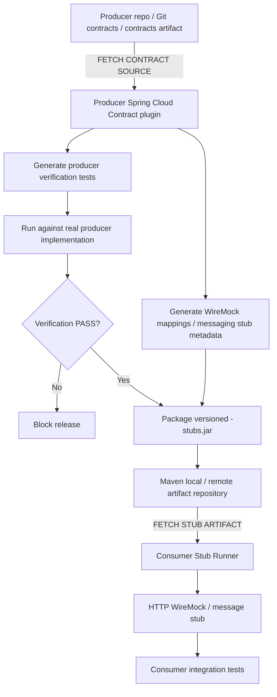
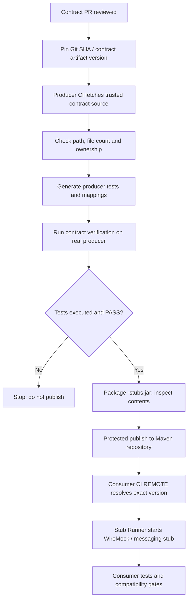

# Customizing How Contracts or Stub Artifacts Are Fetched

## 1. Context: Contracts and Stubs Can Live in Different Places

In a microservices system, `Order Service` acts as the **producer**, while `Checkout Service` and `Reporting Service` are **consumers**. Teams use **Spring Cloud Contract** to describe HTTP APIs or messages in Groovy/YAML DSL, generate producer tests, publish stub artifacts, and run consumer tests via **Stub Runner**.

Initially, contracts reside directly in the `Order Service` repository:

```text
order-service/
  src/test/resources/contracts/
    checkout-service/
      get_order.groovy
    reporting-service/
      get_order_report.yml
```

However, as multiple teams collaborate, an organization may decide to:

- Keep contracts inside the producer repository as before.
- Move contract sources to a **shared Git repository** so consumers can open independent PRs.
- Package contracts as a **Maven artifact** so producers fetch them by explicit version.
- Store stub artifacts in Maven local, Nexus/Artifactory, or another internal store.
- Run consumer tests in containers or CI runners lacking a developer machine's Maven local cache.
- Integrate a **non-Maven** stub source or an offline environment.

At that point, you must accurately distinguish **customizing how contract sources are fetched** from **customizing how stub artifacts are fetched**. The two are related yet distinct, acting at different points in the pipeline.

Learning objectives for this lesson in the **Customization and Extension** chapter:

1. Distinguish fetching **contract sources**, generating/packaging stubs, and fetching **stub artifacts**.
2. Know when to use local sources, Git/SCM, Maven artifacts, `CLASSPATH`, `LOCAL`, or `REMOTE`.
3. Understand common configuration groups in the Spring Cloud Contract Gradle/Maven plugin and Stub Runner.
4. Design versioned contract checkout/copy steps without hidden network dependencies.
5. Choose the right customization approach when a stub store does not support Maven repository layouts.
6. Protect credentials, checksums, provenance, and publication in CI.
7. Troubleshoot “no contracts found”, “wrong JAR downloaded”, and “WireMock did not match request” errors.

## 2. Two Distinct Flows in the Same Architecture



To discuss clearly, use four terms:

| Term | Meaning | Key Takeaway |
| --- | --- | --- |
| **Contract source** | Groovy/YAML DSL files or a JAR containing them | Read by the producer **before generating tests/stubs** |
| **Generated producer test** | Test code generated from the DSL | Must execute against the **real producer** |
| **Stub artifact** | JAR packaging mappings and stub data, typically classifier `stubs` | Consumer downloads and runs via Stub Runner |
| **Stub Runner** | Tool resolving artifacts and starting HTTP stubs/message adapters | Does not by itself verify producer implementation |

**Common mistake:** configuring `spring.cloud.contract.stubrunner.repository-root` and thinking the **producer generator** will pull contract sources from there. That property primarily governs **Stub Runner artifact downloading**, not the producer's DSL source configuration.

## 3. Decision Table: Which Layer Needs Customization?

| Need | Layer to Configure | Starting Point |
| --- | --- | --- |
| Contracts in `src/test/resources/contracts` | Producer plugin | Default or configured local path |
| Contracts in another local directory | Producer plugin | `contractsDslDir` or equivalent source-path config |
| Contracts from shared Git | SCM/CI + producer plugin | Check out pinned commit into a staging directory |
| Contracts packaged as Maven artifact | Producer plugin | Contract dependency/repository/mode per plugin version |
| Consumer reads stubs installed via `mvn install` | Stub Runner | `stubs-mode: LOCAL` |
| Consumer pulls stubs from Nexus/Artifactory | Stub Runner | `stubs-mode: REMOTE`, `repository-root` |
| Stub resources live on test classpath | Stub Runner | `stubs-mode: CLASSPATH` |
| Stubs live in a non-Maven registry | CI adapter or downloader extension | Prefer mirroring/normalizing into a Maven artifact |
| Only need custom HTTP fault mocks | Native WireMock test | No need to modify contracts or downloader |

**Priority principle:** use standard configuration first before considering extensions. Adding a custom-written downloader means taking ownership of authentication, retries, metadata, cleanup, checksums, caching, versioning, and compatibility across Spring Cloud Contract upgrades.

## 4. Default Setup: Contract Sources Inside the Producer Repository

A familiar layout:

```text
order-service/
  src/
    main/java/...
    test/java/...
    test/resources/contracts/
      checkout-service/get_order.groovy
      reporting-service/get_report.yml
```

Example Groovy contract:

```groovy
import org.springframework.cloud.contract.spec.Contract

Contract.make {
    description 'Checkout fetches details for order 42'
    request {
        method GET()
        url '/api/orders/42'
        headers {
            header('Accept', 'application/json')
        }
    }
    response {
        status OK()
        headers {
            contentType(applicationJson())
        }
        body(orderId: 42, status: 'CONFIRMED')
    }
}
```

Another YAML contract:

```yaml
description: Reporting fetches order total amount
request:
  method: GET
  url: /api/orders/42/report
response:
  status: 200
  headers:
    Content-Type: application/json
  body:
    orderId: 42
    totalAmount: 125000
    currency: VND
```

**Pros:** lives in the same commit as producer source; easy to review and bisect; no network resolver needed to locate DSL files. **Cons:** consumers often have to open PRs into the producer repo, and governance gets harder across many teams in separate repositories.

### 4.1. Changing the Local Path Does Not Change Where Stubs Are Downloaded

In `build.gradle` Groovy DSL, a **configuration fragment** example:

```groovy
contracts {
    contractsDslDir = file('src/contractTest/resources/contracts')
}
```

In the Spring Cloud Contract Maven plugin, depending on version, an equivalent path can be configured:

```xml
<configuration>
    <contractsDslDir>${project.basedir}/src/contractTest/resources/contracts</contractsDslDir>
</configuration>
```

These snippets are **not complete build files** and must be checked against the exact plugin/extension API for your version. They only alter **where the producer reads DSL files**. Consumers still require a stub artifact after generation, verification, and publishing.

**Often-missed check:** When using a non-default path, verify the generator task reads all `*.groovy`, `*.yml`, and `*.yaml` files across expected subdirectories; never infer from a green build that every contract was processed.

## 5. When Contract Sources Live in a Shared Git Repository

Suppose teams maintain a dedicated repository:

```text
contracts-repository/
  order-service/
    checkout-service/get_order.groovy
    reporting-service/get_report.yml
  payment-service/
    checkout-service/get_payment.groovy
```

The producer can fetch a **specific revision** and place the contracts into a build staging directory:


### 5.1. CI Checkout-and-Handoff Pattern

An **operational** shell example running inside a CI job with read access to the Git repository:

```bash
# CONTRACTS_SHA is a reviewed, reachable commit.
git clone https://git.example.test/platform/contracts-repository.git external-contracts
git -C external-contracts checkout --detach "$CONTRACTS_SHA"

# Then point the producer's DSL directory to
# external-contracts/order-service (or copy into a staging directory).
```

`git.example.test` is an illustrative hostname. Never commit usernames/passwords in URLs or print them to logs. For private Git, use a **read-only deployment identity** or short-lived token, never push privileges in consumer pipelines.

**Why pin a SHA instead of branch `main`?** If the same producer commit runs job A before a merge and job B after a merge, inputs diverge despite identical build commands. Pinning the revision yields verifiable provenance: *producer commit P was verified against contracts revision C*.

### 5.2. Pointing the Generator at the Right Staging Path

Suppose CI checks out contract sources to:

```text
external-contracts/order-service/
  checkout-service/get_order.groovy
  reporting-service/get_report.yml
```

In the producer Gradle project:

```groovy
contracts {
    contractsDslDir = file('external-contracts/order-service')
}
```

Avoid having the generator perform undeclared Git downloads inside a task action if that prevents Gradle from tracking changed inputs/revisions. The most verifiable pattern is an **explicit Git fetch step with provenance** running first, handing a concrete set of files to the generator.

### 5.3. Three Challenges of an External Git Repo

1. **Availability:** if the Git server is down, builds fail to fetch contracts; configure timeouts, mirrors, or explicitly versioned caches.
2. **Trust:** load contracts/DSL only from reviewed revisions; Groovy DSL is executable code in the build context and must not be treated as harmless data when untrusted.
3. **Lifecycle:** when removing a contract from the shared repo, producer/consumer owners must agree and old generated mappings must disappear from subsequent artifacts.

Never point `contractsDslDir` at the entire Git repository if it holds contracts for multiple producers. Scope it strictly to `order-service` so the generator does not pick up another service’s endpoints or messages.

## 6. Contract Sources as a Maven Artifact

An organization can package Groovy/YAML contracts into a versioned artifact for producers to download via **Maven coordinates**:

```text
com.example.contracts:order-contracts:1.5.0:stubs
```

The group, artifact, version, and classifier names here are **illustrative conventions**. Some projects publish a contracts-only artifact, while others use a `stubs` JAR containing both contracts and mappings; inspect your actual layout and Spring Cloud Contract plugin config.

Corresponding Maven repository path for a JAR with classifier `stubs`:

```text
com/example/contracts/order-contracts/1.5.0/
  order-contracts-1.5.0.pom
  order-contracts-1.5.0-stubs.jar
```

### 6.1. Selecting a Contract Revision via Maven Coordinates

Advantages:

- Producers do not need to clone Git on every build once the artifact is published.
- Versions can be pinned, making audits and reproduction straightforward.
- Multiple pipelines can reference the same contract artifact by a shared identifier.

Trade-offs:

- Requires a separate pipeline to package and publish contracts.
- Introduces a lag between a contract PR and the published artifact version.
- Requires clear ownership: who approves a new contract, and who authorizes dropping an old obligation.
- Never confuse an **unverified contract artifact** with a **producer-verified stub artifact**.

A contract artifact carrying only DSL **does not guarantee** that the real Order Service satisfies it. It is an **input to verification**, not the outcome of producer verification.

### 6.2. Gradle Plugin: Contract Dependency Configuration Group

Some Spring Cloud Contract Gradle plugin versions support fetching external contracts via blocks like `contractDependency`, `contractRepository`, and `contractsMode`.

**Reference example (verify against your plugin version's DSL):**

```groovy
contracts {
    contractsMode = 'REMOTE'
    contractDependency {
        stringNotation = 'com.example.contracts:order-contracts:1.5.0:stubs'
    }
    contractRepository {
        repositoryUrl = 'https://repo.example.test/repository/maven-releases/'
        username = providers.environmentVariable('CONTRACT_REPO_READ_USER').orNull
        password = providers.environmentVariable('CONTRACT_REPO_READ_TOKEN').orNull
    }
    contractsPath = '/order-service'
}
```

**Distinguish clearly:**

- `contractsMode` controls **how the producer plugin fetches contract sources**, not `stubrunner.stubs-mode`.
- `contractDependency` identifies the artifact **containing contracts** per project convention.
- `contractRepository` specifies **where to fetch contracts** and read credentials.
- `contractsPath` targets the contracts directory inside the artifact if supported by that plugin mechanism/version.

The `/order-service` path must match the actual artifact layout. If the JAR places contracts under `META-INF/.../contracts/`, check the plugin's root/path resolution rules rather than copying the Git directory tree verbatim into `contractsPath`.

**Version note:** Dependency declarations, property names, and `Provider`-to-`String` conversions vary across Gradle/Spring Cloud Contract versions. This example only illustrates configuration groups. In a real project, check your plugin version’s documentation and `./gradlew tasks --all` / generator logs; never assume copying a snippet verbatim works on every release.

### 6.3. Maven Plugin: External Contract Dependency

A common configuration form in the Spring Cloud Contract Maven plugin is:

```xml
<plugin>
    <groupId>org.springframework.cloud</groupId>
    <artifactId>spring-cloud-contract-maven-plugin</artifactId>
    <version>${spring-cloud-contract.version}</version>
    <extensions>true</extensions>
    <configuration>
        <contractsMode>REMOTE</contractsMode>
        <contractDependency>
            <groupId>com.example.contracts</groupId>
            <artifactId>order-contracts</artifactId>
            <version>1.5.0</version>
            <classifier>stubs</classifier>
        </contractDependency>
        <contractsRepositoryUrl>https://repo.example.test/repository/maven-releases/</contractsRepositoryUrl>
        <contractsPath>/order-service</contractsPath>
    </configuration>
</plugin>
```

This is a **plugin fragment in `pom.xml`**, not a complete POM. Some releases use different property names or contract repository representations, so check the configuration API for your **exact version**. The `${spring-cloud-contract.version}` property must be declared and compatible with Spring Boot/Cloud.

Credentials for resolving external contracts must come from a **secret store/settings or plugin-supported configuration**. Never hardcode passwords in the POM. Do not assume `settings.xml` credentials used for regular Maven dependencies are automatically honored by every custom contract resolver: verify the plugin's authentication mechanism.

## 7. Do Not Confuse a Source Contract Artifact with a Stub Artifact

Sharing Maven coordinates does not mean they serve the same purpose:

| Artifact | Who Creates It? | When Is It Used? | Ready to Run WireMock Directly? |
| --- | --- | --- | --- |
| Groovy/YAML source contracts | Proposed by consumer, accepted by producer | **Before** producer verification | No, needs generator |
| Shared contracts JAR | Contract repository pipeline | Producer fetches DSL | Only if it contains valid mappings, not by default |
| Generated producer tests | Contract Verifier plugin | Run against real producer | No |
| `order-service-2.0.0-stubs.jar` | Producer build after generating + packaging | Consumer Stub Runner | Yes, when containing valid HTTP mappings |

An organization may reuse the `stubs` classifier for a contracts-only artifact by convention. Therefore, **never infer producer verification merely from a `-stubs.jar` suffix**. Know which repository/pipeline built it, who published it, and whether generated producer tests ran and passed for it.

**Rule:** Producer verification must run against the **selected DSL revision** and the **matching producer implementation**; published stub artifacts must carry provenance tying both together.

## 8. Maven `-stubs.jar` Artifact: What Is Packaged and Where Does It Live?

After producer verification PASSes, the stub artifact may be named:

```text
com.example:order-service:2.0.0:stubs
order-service-2.0.0-stubs.jar
```

An illustrative layout:

```text
META-INF/
  com.example/
    order-service/
      2.0.0/
        contracts/
          checkout-service/get_order.groovy
          reporting-service/get_report.yml
        mappings/
          checkout-service/get_order.json
          reporting-service/get_report.json
```

JSON filenames and intermediate folders here are conceptual; the generator may name files differently or organize by consumer/group. For messaging, the artifact may contain contract metadata needed by Stub Runner/message adapters rather than expressing everything as WireMock HTTP mappings.

### 8.1. Inspect the JAR Before Blaming the Downloader

If Stub Runner downloads the artifact yet the consumer gets `404`, the cause may **not lie in the downloader**:

1. Does the JAR have the expected `META-INF` namespace and mappings?
2. Is the stub port running and is the client targeting that exact port?
3. Does `GET /api/orders/42` match the mapping's request conditions?
4. Is `stubsPerConsumer` enabled and inadvertently filtering out the mapping?
5. Is the stub artifact actually the version the producer just verified?

An inspection command on the downloaded artifact in your environment:

```bash
jar tf ~/.m2/repository/com/example/order-service/2.0.0/order-service-2.0.0-stubs.jar
```

Tweaking `repository-root` will not fix a WireMock request mismatch. Separate the layers: **resolve → extract → load → match → respond**.

## 9. Consumer Fetching Stubs: `CLASSPATH`, `LOCAL`, and `REMOTE`

Stub Runner offers three common modes:

| Mode | Where Stub Runner Loads From | When to Use |
| --- | --- | --- |
| `CLASSPATH` | Stub resources on the test/application classpath | Tests already package matching resources |
| `LOCAL` | Current process's Maven local repository | Developer builds/installs producer in the same environment |
| `REMOTE` | Maven-compatible artifact repository or matching resolver | CI, containers, multiple teams using Nexus/Artifactory |

`LOCAL` does not mean reading `src/test/resources/contracts`; `REMOTE` does not mean proxying requests to a live producer. These options choose **where stub artifacts are fetched from**, not HTTP behavior.

### 9.1. Stub Runner `LOCAL`

Suppose the producer installed `com.example:order-service:2.0.0:stubs` into the test machine's Maven local repository:

```java
import org.junit.jupiter.api.Test;
import org.springframework.boot.test.context.SpringBootTest;
import org.springframework.cloud.contract.stubrunner.spring.AutoConfigureStubRunner;
import org.springframework.cloud.contract.stubrunner.spring.StubRunnerProperties;

@SpringBootTest(properties = {
    "order.client.base-url=http://localhost:8091"
})
@AutoConfigureStubRunner(
    ids = "com.example:order-service:2.0.0:stubs:8091",
    stubsMode = StubRunnerProperties.StubsMode.LOCAL
)
class CheckoutOrderClientTest {

    @Test
    void readsOrderFromStub() {
        // Call the real OrderClient against localhost:8091.
        // Assertions should verify deserialized data and business behavior.
    }
}
```

This is a **test skeleton**, not a complete test since the method body is only comments. Pin a specific stub artifact version and configure the real client to read `order.client.base-url`. Never assume Stub Runner automatically redirects every HTTP client to the stub server.

### 9.2. Stub Runner `REMOTE`

In the consumer's `application-test.yml`:

```yaml
spring:
  cloud:
    contract:
      stubrunner:
        stubs-mode: REMOTE
        repository-root: "https://repo.example.test/repository/maven-releases/"
        ids:
          - "com.example:order-service:2.0.0:stubs:8091"
        username: "${STUB_REPO_READ_USER}"
        password: "${STUB_REPO_READ_TOKEN}"
```

The test environment also needs HTTP client configuration, for example:

```yaml
order:
  client:
    base-url: "http://localhost:8091"
```

**Two URLs serve different purposes:**

- `repository-root` points to where **JARs are downloaded**; Stub Runner authenticates with the artifact repository.
- `order.client.base-url` points to where **business HTTP requests are sent**; WireMock serves requests/responses.

If the client runs inside another Docker container, `localhost` refers to the **consumer container**, not Stub Runner. Configure appropriate hostnames/networking in that setup.

### 9.3. Stub Runner `CLASSPATH`

If stub resources sit on the classpath in a layout supported by your Stub Runner version, `CLASSPATH` may work. Do not conflate:

- “The JAR exists in `~/.m2/repository`”.
- “The JAR is a test dependency”.
- “The JAR's mapping resources are on the classpath and visible to Stub Runner”.

Those three conditions are not equivalent. When using `CLASSPATH`, verify dependency scopes/test classpath and exact resource layout. When unsure, `LOCAL`/`REMOTE` with Maven coordinates is easier to trace.

## 10. Customizing Maven Local or Remote Repository Paths

### 10.1. Maven Local Is Not in the Same Place Everywhere

Default locations are typically:

```text
Linux/macOS: ~/.m2/repository
Windows:      %USERPROFILE%\.m2\repository
```

However, `settings.xml`, `maven.repo.local`, or resolver settings can relocate it. A clean CI runner or Docker container **cannot automatically access the host's local repository**.

If you must use `LOCAL` inside Docker:

1. Build/install the artifact into an accessible Maven local repository.
2. Mount that exact directory where the Stub Runner process expects it.
3. Grant appropriate read permissions.
4. Never mount an entire home directory containing secrets just to share one JAR.

Across distributed CI runners, `REMOTE` with a versioned repository is usually simpler and more reproducible.

### 10.2. Remote Repository: URL, Permissions, and Maven Layout

Nexus/Artifactory typically expose:

```text
https://repo.example.test/repository/maven-releases/
https://repo.example.test/repository/maven-snapshots/
```

Domains are illustrative. The URL must point to a **Maven-compatible repository root**, not an HTML web UI or a direct path to a single JAR file.

Stub Runner needs access to metadata/POM/JAR files per Maven coordinates and version strategy. With private repositories, use read-only credentials; never give consumer CI publisher or admin tokens.

### 10.3. Organization Repository Mirrors and Proxies

An environment may use a Maven repository manager as a mirror, yet not every **Stub Runner** download path behaves identically to Maven CLI dependency resolution. When Stub Runner's resolver takes its own `repository-root` and credentials, verify **which settings/mirrors/proxies it actually honors** in your version.

**Never assume** editing `~/.m2/settings.xml` always suffices for Stub Runner, nor assume proxy environment variables are honored by every downloader extension.

## 11. Customizing Producer/Consumer Selection and Contract Subsets

A stub artifact may hold contracts for multiple consumers:

```text
contracts/
  checkout-service/
    get_order.groovy
  reporting-service/
    get_report.yml
```

Stub Runner supports **stubs per consumer** in matching configurations. Example:

```yaml
spring:
  application:
    name: checkout-service
  cloud:
    contract:
      stubrunner:
        stubs-mode: REMOTE
        repository-root: "https://repo.example.test/repository/maven-releases/"
        ids:
          - "com.example:order-service:2.0.0:stubs:8091"
        stubs-per-consumer: true
        consumer-name: checkout-service
```

**This does not customize where the JAR is downloaded from.** The artifact is still resolved from `repository-root`; the option only filters **which stub mappings are loaded** by consumer group.

Two common pitfalls:

- The folder inside the artifact is named `checkout-api` while configuration specifies `consumer-name: checkout-service`, resulting in zero loaded mappings.
- Two consumers have conflicting expectations for the exact same request; enabling filtering makes isolated tests green, yet the real producer can only implement one behavior. Fix the interface or introduce explicit versioning/conditions.

On the producer side, you must still run **all generated tests for all accepted contracts**, even if a consumer only loads a subset.

## 12. When Stubs Live in a Non-Maven System

Suppose an organization stores stubs at a non-standard location:

```text
object-storage://test-artifacts/order-service/2.0.0/stub-bundle.zip
```

That URI is purely **illustrative**, not a scheme Stub Runner natively understands. Before writing a custom downloader, consider three options:

### 12.1. Prefer Mirroring/Normalizing into a Maven Repository

Whenever possible, publish verified artifacts into Nexus/Artifactory or a **Maven-compatible repository** with stable coordinates. Benefits:

- Stub Runner already has built-in resolution (`REMOTE`).
- Standard GAV, classifiers, metadata, and version/release policies.
- Repository manager permissions, auditing, and caching.
- Less custom code to maintain when upgrading Spring Cloud Contract.

If CI mirrors from object storage, the mirroring step must **verify checksums/provenance**; never assume any arbitrary ZIP is a valid stub JAR with the right layout.

### 12.2. Prepare Maven Local Inside the Test Job

If a remote Maven repository is unavailable, the pipeline can download a stub JAR from an approved source, verify it, and **install it to Maven local** with exact GAV/classifier before running Stub Runner `LOCAL`.

Never use this path to turn an unverified mapping into a “verified stub”. Trace where the original artifact was built, confirm producer verification evidence exists, and verify the release checksum.

Installing a distributed JAR into Maven local also requires proper POM/metadata handling. Never blindly copy a file into `~/.m2/repository` expecting Maven resolvers to recognize it completely.

### 12.3. Use `CLASSPATH` When Appropriate

If stub resources are already packaged in test dependencies or a standalone test harness, `CLASSPATH` may fit. Check classpath/runtime resource layouts carefully and avoid simultaneously pulling from remote while accidentally picking up stale mappings on the classpath.

## 13. Custom Downloader Extension: When Is It Truly Necessary?

Some Spring Cloud Contract/Stub Runner releases allow **extending stub retrieval** via Stub Runner module extension points. However, **interface names, registration mechanisms, and downloader selection precedence change across versions**; never copy a guessed SPI class and assume it is a stable supported extension.

Consider a custom downloader only when:

1. Neither a Maven repository/mirror nor local/classpath preparation is feasible.
2. There is a **specialized artifact source** such as an internal service requiring token exchange or a proprietary API.
3. Auditing, provenance, checksum, and permission rules cannot be met by an intermediate staging step.
4. The team commits to maintaining the extension across Stub Runner upgrades.

### 13.1. Responsibility Contract for a Custom Downloader

Before writing code, define these requirements:

| Responsibility | Expected Behavior |
| --- | --- |
| **Parse coordinates** | Accept exact producer, version, classifier, artifact |
| **Version resolution** | Never pick an ambiguous “latest” in CI; pin versions |
| **Authentication** | Use read-only identities and short-lived tokens where supported |
| **TLS / trust** | Validate certificates; never disable TLS checks |
| **Download** | Bounded timeouts, limited retries, distinct handling for 401/403/404 |
| **Integrity** | Verify checksums/signatures/provenance per policy |
| **Caching** | Key caches by artifact digest/version; never serve stale data silently |
| **Extraction** | Validate JAR/ZIP structure; prevent path traversal on unpack |
| **Resource handling** | Clean temp files, never log secrets, enforce size limits |
| **Consumer grouping** | Preserve per-consumer mappings/contract metadata |
| **Observability** | Log source URI, resolved version, hash, and sanitized errors |

### 13.2. Pseudocode: Pre-Stub-Runner Adapter

This is **architectural pseudocode**, not an executable Java SPI:

```text
prepare_stubs(producerId, version):
    assert version is explicitly pinned
    auth = acquire_read_only_identity()
    bundle = download_with_timeout(source, producerId, version, auth)
    assert verify_expected_digest_and_origin(bundle)
    jar = validate_or_convert_to_supported_stub_jar(bundle)
    install_to_isolated_maven_local(jar, producerId, version, classifier="stubs")
    record_provenance(producerId, version, digest(bundle))

run_consumer_tests_with_stub_runner(mode="LOCAL")
```

An adapter **before** Stub Runner avoids hooking into internal downloader lifecycles. If the artifact does not align with Maven metadata/namespaces and cannot be packaged cleanly, design a dedicated integration or rethink distribution.

### 13.3. If Writing an Internal Stub Runner SPI Downloader

Inspect the documentation/source of your pinned library version to verify:

- Is the interface/extension point truly public and stable?
- Which registration mechanism (ServiceLoader, Spring bean, custom config) does that version support?
- Does it support multiple producer IDs, classifiers, dynamic ports, and contract metadata?
- Who starts/stops the WireMock server and manages temp directories?
- Does Stub Runner Boot/consumer test load the extension on the right classpath?
- Are there tests covering timeouts, bad checksums, missing artifacts, and credential rotation?

Never treat an **SPI example from an old release** as a guaranteed API across all Spring Cloud Contract versions. Without explicit library stability guarantees, pre-staging/Maven publishing usually carries lower risk.

## 14. Artifact Resolution Is Not HTTP Response Templating

Two distinct needs are often lumped together as “custom stubs”:

- **Custom resolver/downloader:** decides **which JAR is downloaded** and from where.
- **Custom WireMock transformer/matcher:** decides **which request matches** and **which HTTP response is returned** once mappings are loaded.

For example, making `GET /api/orders/42` respond slowly to test timeouts is **WireMock response behavior**, requiring no new downloader. Conversely, Stub Runner failing to find `order-service-2.0.0-stubs.jar` in Nexus is **artifact resolution**, unfixable via response templating.

**Where they intersect:** If the downloaded artifact contains WireMock mappings referencing transformers or scenarios, the runtime must support the matching extension/version. Downloading the JAR successfully **does not guarantee** all response transformers are registered.

## 15. Pinning Versions, Controlling SNAPSHOTs, and Avoiding Stale Caches

A critical question: **does the same consumer commit use the exact same stub artifact across two CI runs?**

| Selection Strategy | Example | Reproducibility |
| --- | --- | --- |
| Exact release | `com.example:order-service:2.0.0:stubs` | High when releases are immutable |
| Snapshot | `2.1.0-SNAPSHOT` | Depends on artifact timestamps/update policy |
| Dynamic version | `+` | Changes whenever a newer version is published |
| Git branch | `main` | Mutable unless pinned to a commit |
| Git SHA | Specific commit | Far more reproducible; requires retention |
| Direct URL without digest | `/latest/stubs.jar` | Very difficult to guarantee |

**In release/compatibility pipelines, prefer fixed versions/digests.** Dynamic versions help during exploration but make poor baselines for pinpointing which commit broke an API.

### 15.1. Three Cache Layers That Can Serve Stale Results

1. **Maven local / Gradle dependency cache:** holds previously resolved artifacts.
2. **Remote repository proxy/cache:** may retain metadata/snapshots per update policy.
3. **Stub Runner / runtime cache or loaded mappings:** may continue serving old versions until restarted/reloaded.

When debugging “published a new stub yet the consumer still gets the old body”, record **resolved coordinates and checksums**, inspect the active JAR, and check loaded server mappings. Do not blindly wipe every cache as a first reflex.

### 15.2. Immutable Artifacts and Build Reproducibility

A specific `order-service:2.0.0:stubs` should map to the exact content that passed verification. If the repository allows overwriting releases, two CI jobs using identical GAVs can download different bytes. Enforce:

- Disallow overwriting/redeploying releases in Nexus/Artifactory.
- Record producer commit, contract revision, plugin version, and artifact SHA-256.
- Publish only after producer verification.
- To fix a broken release, publish a **new version** instead of mutating an existing artifact.
- Never substitute Gradle task build caches for a proper Maven artifact repository.

## 16. Credentials and Trust Boundaries for Both Fetch Paths

**The two fetch paths should use separate identities**:

| Activity | Minimum Identity | Should Not Have |
| --- | --- | --- |
| Producer fetching source contracts from Git | Git read-only deploy identity | Push/admin |
| Producer fetching external contract artifact | Artifact repository read-only | Publisher/admin |
| Producer publishing verified stubs | Token scoped to producer namespace/repo | Write access to all artifacts |
| Consumer Stub Runner `REMOTE` | Artifact repository read-only | Deploy/delete/overwrite |
| CI PR from untrusted source | Minimal read rights per policy | Release publisher secrets |

Never place tokens in:

- Committed `pom.xml`, `build.gradle`, Groovy/YAML contracts, or `application.yml`.
- Command-line flags like `--password=secret` that leak into logs or process lists.
- Git URLs with embedded credentials.
- Docker image layers, test reports, or `-stubs.jar`.

Prefer secret managers/CI-protected variables and read-only service accounts. Disable command tracing if it could print sensitive values. Use HTTPS with proper truststores/CAs—**never disable TLS verification** just to “make stub downloading work”.

### 16.1. External Groovy Contracts Carry Higher Risk Than JSON

Groovy DSL is evaluated in the build environment and can execute code. Therefore:

- Only allow producer builds to read contracts from trusted, reviewed sources.
- Never let a job holding publisher tokens evaluate DSL from untrusted PRs.
- Pin revisions/artifact versions and verify provenance.
- Where signing/attestation is supported, verify provenance before granting publish access.

**Contract source governance is a build-security concern**, not solely an API correctness issue.

## 17. Reference CI Flow: From External Contracts to Verified Stubs



### 17.1. Required Gates

1. **Source gate:** contract SHA/version is approved; never read unpinned branches directly.
2. **Parse gate:** Groovy/YAML files are actually read by the generator; no unintended `NO-SOURCE`.
3. **Producer verification gate:** generated tests **actually execute**, not merely get generated.
4. **Package gate:** JAR contains exact namespace, mappings, and messaging metadata.
5. **Publish gate:** write credentials exist only in protected jobs; releases cannot be overwritten.
6. **Consume gate:** Stub Runner fetches the exact GAV/hash from the right source.
7. **Compatibility gate:** consumer HTTP clients/message handlers process responses/events properly.

### 17.2. Illustrative Provenance Manifest

This is **custom CI metadata**, not configuration automatically read by Spring Cloud Contract:

```yaml
producer: order-service
producerCommit: a1b2c3d4
contracts:
  source: git
  revision: e5f6a7b8
  path: order-service
stubArtifact:
  groupId: com.example
  artifactId: order-service
  version: 2.0.0
  classifier: stubs
verification:
  generatedTestsExecuted: true
  result: PASS
```

Short SHAs and versions in this example are placeholders. Real systems should record full commit SHAs, artifact digests, and links to test reports; `PASS` must originate from the real verification job, not a hand-written YAML value.

### 17.3. Using Gradle with Contract Sources in a Staging Directory

Keep in mind:

- Checkout/copy tasks must finish **before** the generator runs.
- Checked-out files are **inputs** to the generator; Gradle must detect additions, deletions, and edits.
- Relative paths can affect packages/base class mappings and must not be flattened arbitrarily.
- `--build-cache` does not fix a mutable contract source lacking a pinned revision.

If a contract file is deleted from the shared repo, its generated test/stub must also vanish; clean outputs and inspect artifact contents before publishing.

## 18. Phase-by-Phase Diagnostics

| Symptom | Possible Failing Layer | What to Check |
| --- | --- | --- |
| Producer finds zero contracts | DSL source path or external contract resolver | `contractsDslDir`, artifact coordinates/path, generator logs |
| New Git contracts not picked up | Checkout ref, permissions, revision pin | Checked-out commit SHA and source directory |
| External contract artifact downloads yet has no files | Layout/path mismatch | Inspect JAR contracts root and `contractsPath` |
| Maven contract resolver returns `401` | Invalid/expired read token | Verify read-only auth without printing tokens |
| Maven contract resolver returns `404` | Wrong GAV/version/classifier/path | Check Maven metadata and JAR filename |
| Stub Runner `LOCAL` cannot find artifact | JAR missing from **process** Maven local | Maven local path, install/publish step |
| Stub Runner `REMOTE` returns `403` | Identity lacks read permissions | Token scope, repository policy |
| Stub Runner `REMOTE` downloads application JAR | Missing `stubs` classifier | Check GAV and artifact contents |
| JAR exists yet contains no mappings | Producer packaging error or bad contract source | Artifact inspection, generated mappings |
| HTTP client gets `404` from WireMock | Request mismatch or stub returning business 404 | URL, method, query, headers, request journal |
| Consumer receives stale response | Stale artifact/version cache or un-reloaded mappings | Resolved version, hash, server lifecycle |
| Only Checkout gets stubs, Reporting does not | Consumer group filtering | `stubsPerConsumer`, `consumerName`, artifact layout |
| Producer test green yet API broken | Skipped tests or contracts unread | Test count, base class wiring, source revision |
| Passes locally, fails in CI | Different local/remote mode, network/certs/credentials | Compare effective properties and runtime user |
| Custom downloader fails intermittently | Retries, timeouts, caching, or concurrent writes | Sanitized logs, digests, atomic writes |

### 18.1. Same `404`, Completely Different Causes

**A. Artifact repository 404:**

```text
https://repo.example.test/repository/maven-releases/
  com/example/order-service/2.0.0/order-service-2.0.0-stubs.jar
```

No artifact exists at that GAV/classifier. Fix publishing, version, or root—never tweak request matchers.

**B. WireMock unmatched 404:**

```http
GET /api/orders/999
```

WireMock is running, yet no mapping matched the request. Inspect mapping request conditions—do not change `repository-root`.

**C. Business 404:**

The contract intentionally specifies `GET /api/orders/999` returns `404` with `ORDER_NOT_FOUND`. This is valid documented behavior, distinct from an unmatched error.

### 18.2. Minimum Investigation Sequence

1. Record **producer commit** and **contract source revision**.
2. Check whether the plugin reads the right path/GAV and generates expected tests.
3. Confirm **producer verification** passed on the current implementation.
4. Inspect the published `-stubs.jar` for required mappings.
5. Confirm the consumer resolved the exact **version/classifier/digest**.
6. Confirm WireMock/message adapter loaded the right stub and port.
7. Compare actual requests/messages against generated mappings/contracts.
8. Modify the downloader only when evidence proves the fault is in artifact resolution.

## 19. Hands-On Exercise: Moving from Local Contracts to a Shared Source

Suppose `Invoice Service` (producer) has a contract:

```text
invoice-service/src/test/resources/contracts/
  billing-service/get_invoice.groovy
```

The contract describes:

```http
GET /api/invoices/900
Accept: application/json
```

Response:

```json
{
  "invoiceId": 900,
  "totalAmount": 220000,
  "currency": "VND",
  "status": "ISSUED"
}
```

The team wants to:

1. Store contracts in a shared Git repository at path `invoice-service/`.
2. Have Producer CI fetch a specific commit SHA.
3. Have the build generate and execute producer tests before publishing.
4. Publish `com.example:invoice-service:3.1.0:stubs` to Nexus.
5. Have `Billing Service` run Stub Runner `REMOTE` on port `8092` with read-only credentials.
6. Later switch to a Maven artifact holding contracts to reduce Git checkout coupling during builds.

### 19.1. Questions

- Does fetching contracts from Git belong to the **producer generator** or **consumer Stub Runner**?
- Should you pin a Git commit SHA or simply use `main`?
- If a Maven contract artifact has not yet been verified by the producer, can it be treated as a verified stub?
- What happens when `contractsPath` points to the wrong directory?
- Write the consumer Stub Runner `REMOTE` config for `invoice-service:3.1.0:stubs:8092`.
- If the consumer gets stale bodies despite a new publish, which three places do you inspect first?
- If Nexus is private, should Billing CI use a publisher token or a read-only token?
- When should you consider writing a custom downloader?

### 19.2. Stub Runner Configuration Hint

```yaml
spring:
  application:
    name: billing-service
  cloud:
    contract:
      stubrunner:
        stubs-mode: REMOTE
        repository-root: "https://repo.example.test/repository/maven-releases/"
        ids:
          - "com.example:invoice-service:3.1.0:stubs:8092"
        username: "${STUB_REPO_READ_USER}"
        password: "${STUB_REPO_READ_TOKEN}"
```

HTTP client configuration in test:

```yaml
invoice:
  client:
    base-url: "http://localhost:8092"
```

Condition: the real `InvoiceClient` must read `invoice.client.base-url`; if the consumer runs in a separate container, replace `localhost` with the appropriate hostname/network address.

### 19.3. Answer Hints

| Question | Answer |
| --- | --- |
| Where does the Git source belong? | Input to the **producer build** to generate contract tests/stubs |
| Use `main` or a SHA? | Use a specific SHA so builds/verifications are reproducible |
| Is a contract artifact already verified? | No; the producer must run generated tests against its implementation |
| Wrong `contractsPath`? | Missing/unread contracts, risk of `NO-SOURCE` and false-green builds |
| Stale body? | Resolved GAV/hash, JAR contents, mappings loaded on the server |
| Token for Billing CI? | **Read-only**, never a publisher/admin token |
| Custom downloader? | Only when Maven mirrors, `LOCAL`, `CLASSPATH`, or CI adapters fall short |

### 19.4. Negative Exercises to Validate the Design

In an isolated test environment:

1. Intentionally pin a nonexistent `CONTRACTS_SHA`; the pipeline must fail immediately at source fetch.
2. Point `contractsPath` to the wrong folder; the pipeline must detect **missing tests/mappings** rather than passing silently.
3. Change `ids` to an unpublished stub version; the consumer must fail at **artifact resolution**, never calling production APIs.
4. Send `GET /api/invoices/901` with no mapping; distinguish WireMock unmatched 404 from a business 404.
5. Supply an artifact with an unexpected checksum; the adapter must reject it before loading mappings.

These are **suggested exercises**, not commands executed against the workspace during authoring.

## 20. Checklist When Customizing Contract or Stub Sources

- Did you confirm whether you are changing the **producer's DSL source** or the **consumer's JAR source**?
- Does the contract source config target the right producer subdirectory, including all Groovy/YAML files and consumer groups?
- If fetching from Git, is a SHA pinned using a read-only identity?
- If fetching from a Maven artifact, are GAV/classifier, contracts root/path, and reviewed version exact?
- Is it clear that a **contract artifact is not equivalent to a verified stub artifact**?
- Does producer verification generate **and actually execute** generated tests against the matching implementation?
- Does the stub JAR contain exact mappings/metadata, version, and provenance before publishing?
- Did Stub Runner intentionally pick `CLASSPATH`, `LOCAL`, or `REMOTE`?
- Do consumer tests target the **WireMock stub port**, not `repository-root`?
- Do `stubsPerConsumer` and `consumerName` filter mappings accurately?
- If containerized, are Maven local paths, hostnames/networks, and secrets configured properly?
- Does the repository use HTTPS/TLS, read-only accounts, and zero hardcoded tokens?
- Does the pipeline deny publisher tokens to untrusted PRs or unreviewed external contract sources?
- Are artifacts/versions pinned, avoiding `+`, mutable snapshots, or unpinned branches in release CI?
- Can you verify resolved JAR checksums, producer commits, and contract revisions when errors occur?
- Are custom downloaders/extensions written only when standard config and simple adapters cannot suffice?
- Do extensions enforce timeouts, retries, caching, integrity checks, concurrency safety, temp cleanup, and error tests?
- Do diagnostics distinguish artifact repository `404` from WireMock unmatched/business `404`?

**References to cross-check against your project's exact version:**

- [Spring Cloud Contract — Reference](https://docs.spring.io/spring-cloud-contract/reference/).
- [Spring Cloud Contract — Gradle Project](https://docs.spring.io/spring-cloud-contract/reference/gradle-project.html).
- [Spring Cloud Contract — Maven Project](https://docs.spring.io/spring-cloud-contract/reference/maven-project.html).
- [Spring Cloud Contract — Stub Runner](https://docs.spring.io/spring-cloud-contract/reference/project-features-stubrunner.html).
- [Spring Cloud Contract — Stub Runner Common Properties](https://docs.spring.io/spring-cloud-contract/reference/project-features-stubrunner/stub-runner-common.html).
- [Maven — Introduction to Repositories](https://maven.apache.org/guides/introduction/introduction-to-repositories.html).
- [Gradle — Incremental Builds](https://docs.gradle.org/current/userguide/incremental_build.html).

**Remember:** **The producer fetches contract sources** to generate and execute verification tests; **the consumer fetches stub artifacts** so Stub Runner can simulate HTTP or messaging behavior. Git checkouts, external contract artifacts, `contractsDslDir`, and `contractDependency` belong to the first path; `stubs-mode`, `ids`, and `repository-root` belong to the second. Prefer Maven-compatible repositories, pin versions/revisions, enforce least-privilege credentials, and publish stubs only after producer verification. When special requirements force a custom adapter or downloader, control provenance, caching, security, and lifecycle rather than settling for a one-off JAR download.
