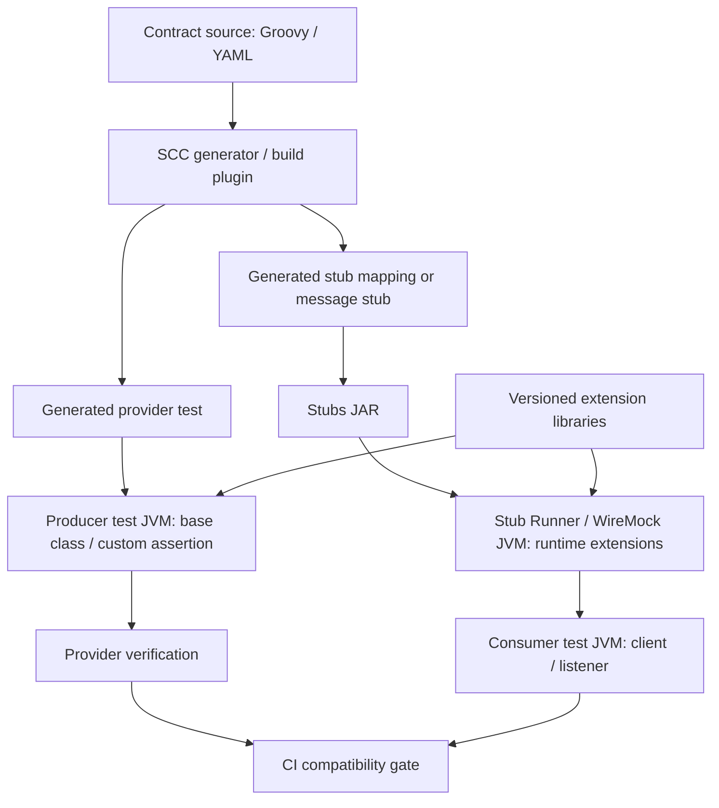
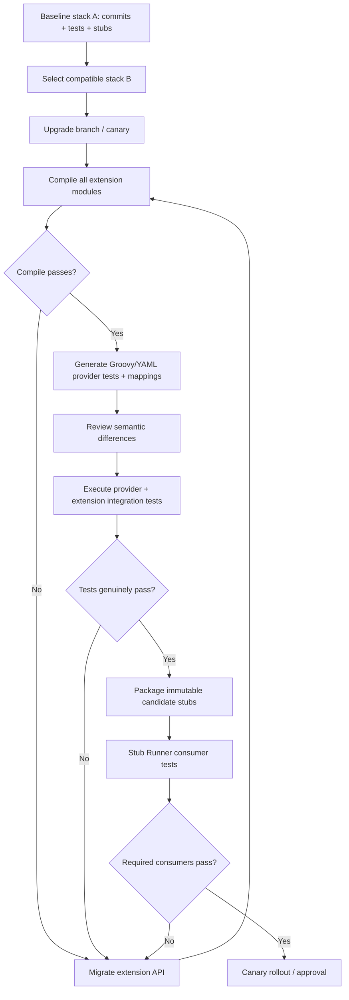

# Testing Extensions and Compatibility When Upgrading Spring Cloud Contract

Once a team adopts **Spring Cloud Contract (SCC)** across multiple projects, default settings sometimes fall short: producers need a **base test class** with custom data setup, matchers need **custom assertions**, WireMock needs **extensions** to transform responses, or messaging consumers need **adapters** for a specific transport. These customizations align contracts closely with business requirements, yet they also introduce coupling to **internal tool APIs and mechanisms**. When upgrading Spring Cloud Contract, Spring Boot, WireMock, JUnit, Gradle, or Maven, those extensions may stop compiling, stop loading, or keep running while yielding different outcomes.

This lesson belongs to the **Customization and Extension** chapter, covering **Testing Extensions and Compatibility When Upgrading Versions**. It explains how to verify customizations at every layer of the contract-testing workflow: **Groovy/YAML DSL → generated provider tests → provider verification → stub mappings/JAR → Stub Runner → consumer tests and CI**. We use `order-producer` and `checkout-consumer` as examples, where the API returns an order with an ID shaped like `ORD-1001` and emits an `OrderCreated` event.

**The goal is not “bumping dependencies while keeping the build green”, but ensuring promised behaviors remain verified by both producer and consumer on the new tool versions.**

## 1. Learning Objectives

After this lesson, you will be able to:

1. Distinguish **extension points**, **test helpers**, **WireMock runtime extensions**, and **message transport adapters**.
2. Identify **which phase** and **which JVM/classpath** each extension runs in.
3. Design unit tests for custom logic, integration tests for plugins/runtimes, and consumer tests for final stubs.
4. Check whether an upgrade alters **generated Java tests**, **WireMock mappings**, or **stubs JAR contents**.
5. Build a compatibility matrix across SCC, Spring Boot/Spring Cloud, JDK, JUnit, WireMock, and build tools.
6. Catch “false-green” failures: 0 generated tests, skipped tasks, unloaded extensions, overly broad matchers, or consumers reading stale stubs.
7. Organize canaries, migrations, rollbacks, and before/after upgrade evidence.

Key insight: **an identical source contract does not guarantee two tool versions emit identical outputs**. Verify **behavioral semantics**, not merely filenames.

## 2. One Contract Traverses Multiple Runtimes



An extension may execute in three very different places:

- **Generator/build time:** extends how contracts are read, how tests are generated, or how mappings are built.
- **Producer test time:** base classes, helper methods, custom assertions, or test binders.
- **Consumer stub runtime:** WireMock extensions, response transformers, request matchers, or message-trigger adapters.

If a library sits in **producer `testImplementation`** yet is absent from the **JVM running Stub Runner**, a custom WireMock transformer will not magically appear on the consumer. Conversely, adding a dependency to Stub Runner does not make a helper visible on the producer test classpath for generated provider tests.

### 2.1. Four Questions Before Upgrading Versions

| Question | Why It Matters |
| --- | --- |
| Which component loads the extension? | Determines which classpath and lifecycle to test |
| Does the extension use public or internal APIs? | Internal APIs break easily across upgrades |
| Does generated output depend on that extension? | Must compare generator sources and results |
| Do consumer tests actually exercise the extension feature? | Passing tests that never trigger the extension are weak evidence |

**Compatibility cannot be judged merely by Maven/Gradle resolving dependencies cleanly.**

## 3. Classifying Customizations by Risk Level

| Customization Type | Example | Upgrade Risk | What to Check |
| --- | --- | --- | --- |
| Base test class | MockMvc setup, fixtures, message verifier | Medium | Generated tests extend properly, setup runs |
| Helper assertion | Order ID format, date/amount validation | Medium | Method signature, argument types, assertion stays effective |
| Groovy DSL matcher | `byRegex`, `byCommand` | Medium–High | Generator translates matcher properly to tests/mappings |
| YAML DSL converter | Parse matchers, headers, payloads | High if custom | Existing inputs still parse with zero dropped fields |
| WireMock extension | Response transformer, custom request matcher | High | Extension loads, is invoked, and config remains compatible |
| Message transport adapter | Event trigger and test message receiver | High | Destination, label, headers, binder work properly |
| Build plugin customization | Task/goal wiring, source sets, packaging | High | Generate → compile → run → package works cleanly |
| Test reporting/CI gate | Parse XML, count tests, publish candidates | Medium–High | Zero silent skips and zero wrong artifact publishes |

These levels are **qualitative governance estimates**, not an official SCC ranking. Actual risk depends on complexity, reliance on internal APIs, and consumer blast radius.

### 3.1. Customizations Closer to Internal APIs Need Earlier Testing

A standalone Java helper checking a regex usually stays stable across many SCC versions as long as its signature stays intact. Conversely, an extension directly subclassing WireMock or generator internals may require immediate updates on major dependency bumps.

Prefer **extension APIs documented by your active version**, minimize reflection into internal classes, and avoid coupling to generated output folder layouts unless the tool guarantees stability.

## 4. Establishing a Pre-Upgrade Baseline

Before editing versions, capture a **reproducible baseline**:

1. Producer commit and contract revision.
2. SCC plugin/dependency versions, Spring Boot/Spring Cloud BOM, JDK, and build tool versions.
3. List of extensions and each library's version.
4. Discovered contract count, executed generated test count, and skipped test count.
5. Sample generated tests for critical DSL matchers.
6. Generated HTTP mappings or message stub resources.
7. Stubs JAR GAV/type/classifier and SHA-256.
8. Consumer test reports against the **candidate artifact**.
9. A suite of valid and invalid requests probing stub selection.
10. Any deprecation warnings or classpath conflicts in logs.

**Do not capture only a screenshot of `BUILD SUCCESS`.** Without knowing how many tests ran and which artifact was used, before–after comparisons lack evidence.

### 4.1. Minimum Tabular Baseline

| Item | Current Version | After Upgrade |
| --- | --- | --- |
| Build tool and JDK | Record exact version | Record new version |
| SCC Gradle/Maven plugin | A | B |
| Spring Boot/Spring Cloud BOM | A | B |
| WireMock runtime | A | B or managed version |
| Test engine | JUnit/Spock A | Actual engine running on B |
| Contract count | N | N or justified change |
| Generated test run count | N | N or justified change |
| Required provider tests | PASS | PASS |
| WireMock mapping behavior | PASS/negative cases | PASS/negative cases |
| Consumer Stub Runner suites | PASS | PASS |
| Stubs JAR digest | H_A | H_B, explainable |

`H_A == H_B` is not required when the generator changes; ZIP metadata or mapping serialization formatting may differ. **What matters is proving interface behavior and compatibility stay intact outside approved changes.**

## 5. Upgrading Versions Is More Than Changing One Dependency Line

Spring Cloud Contract lives inside an ecosystem:

```text
JDK
  └── Spring Boot / Spring Cloud release train
       ├── Spring Cloud Contract plugin/runtime
       ├── Test framework (JUnit / Spock / Groovy)
       ├── HTTP stack (RestAssuredMockMvc, MockMvc, WebTestClient...)
       └── WireMock / Stub Runner dependencies
Build tool (Maven or Gradle) wires these components together
```

Changing the SCC version often shifts transitive dependencies simultaneously. Do not arbitrarily force a brand-new SCC version alongside an ancient Spring Boot or WireMock just to avoid updating extension code.

### 5.1. How to Build a Compatibility Matrix

| Axis | What to Verify |
| --- | --- |
| JDK | Bytecode target level, reflection, TLS, or test engine |
| Spring Boot | Application/test context, auto-configuration, Security, Jackson |
| Spring Cloud BOM | SCC version and related Cloud libraries |
| SCC Gradle/Maven plugin | DSL parsing, generated code, stubs packaging |
| Groovy/YAML | Matchers, data types, defaults, converter behavior |
| JUnit/Spock | Test discovery, annotations, lifecycle callbacks |
| WireMock | Extension APIs, request matching, response templating, scenarios |
| Stub Runner | Coordinate resolution, starting HTTP/message stubs, loading extensions |
| Maven/Gradle | Plugin/task APIs, test source sets, build cache, publishing |
| CI runners | OS/JDK/tools/secrets/repository sources |

**Your matrix must follow official compatibility guidance for the versions your project actually runs.** Never assume major versions can be mixed freely. This lesson uses labels A/B to avoid endorsing an unverified specific version tuple.

### 5.2. Change Fewer Variables Per Test Iteration

An effective migration workflow:

1. Record the baseline on version A.
2. Pick a supported target stack B.
3. Upgrade on a dedicated branch.
4. Fix compilation/extension API breaks with clear justification.
5. Re-run generation, provider tests, mapping tests, and consumer tests.
6. Introduce business API changes only after the new stack stabilizes, or separate tool changes from contract changes explicitly.

This isolates **toolchain upgrade errors** from **producer breaking changes**.

## 6. A Baseline Contract for Extension Testing

Example `GET /api/orders/ORD-1001`:

```groovy
import org.springframework.cloud.contract.spec.Contract

Contract.make {
    description 'Read order with public ID ORD-xxxx'

    request {
        method GET()
        url '/api/orders/ORD-1001'
        headers {
            header('Accept', 'application/json')
        }
    }

    response {
        status OK()
        headers {
            contentType(applicationJson())
        }
        body(
            id: 'ORD-1001',
            status: 'CREATED',
            currency: 'VND'
        )
    }
}
```

Equivalent YAML:

```yaml
description: "Read order with public ID ORD-xxxx"
request:
  method: GET
  url: /api/orders/ORD-1001
  headers:
    Accept: application/json
response:
  status: 200
  headers:
    Content-Type: application/json
  body:
    id: ORD-1001
    status: CREATED
    currency: VND
```

These are **two ways to express the same scenario**, so in a real project keep only one file per scenario to avoid duplicate generated tests and mappings. Both describe the sample `ORD-1001`; neither by itself proves the producer enforces the order ID format for all IDs.

### 6.1. Which Invariants Must an Upgrade Preserve?

- Request method `GET` and URL path remain accurate.
- `Accept` header is sent by the consumer per contract.
- Response `200` and `Content-Type` match.
- Body fields keep exact names and data types.
- Generated provider tests assert the response.
- Stubs JAR contains the HTTP mapping for this request.
- Consumers using real clients parse the DTO and handle the response.

If generator version B formats mapping JSON differently while preserving every invariant above, that is not a regression.

## 7. Base Class: The Most Common Provider Test Extension

In many projects, generated tests inherit from a **base class** preparing the Spring application context and HTTP test adapter.

```java
package com.example.order.contract;

import io.restassured.module.mockmvc.RestAssuredMockMvc;
import org.junit.jupiter.api.BeforeEach;
import org.springframework.beans.factory.annotation.Autowired;
import org.springframework.boot.test.autoconfigure.web.servlet.AutoConfigureMockMvc;
import org.springframework.boot.test.context.SpringBootTest;
import org.springframework.test.web.servlet.MockMvc;

@SpringBootTest
@AutoConfigureMockMvc(addFilters = true)
public abstract class OrderContractBase {

    @Autowired
    private MockMvc mockMvc;

    @BeforeEach
    public void setUpContractHttp() {
        RestAssuredMockMvc.mockMvc(mockMvc);
    }
}
```

This example assumes generated tests use **RestAssuredMockMvc** and **JUnit Jupiter** with a Spring Boot test context. Depending on SCC version, other test modes need different setups; **do not assume this is the universal default for every application**.

### 7.1. Required Checks for the Base Class

- Generated tests actually `extends OrderContractBase`.
- `@BeforeEach` runs before every generated test.
- `MockMvc` is non-null and requests reach the real controller.
- Jackson serialization, Bean Validation, and `@ControllerAdvice` load when in scope.
- If contracts cover auth/filters, never accidentally set `addFilters=false` and claim security was verified.
- Fixtures reset between tests without order dependence.
- If using a live web server, test context/port wiring is configured properly.

**Simply compiling the base class does not prove generated tests inherit from it or execute its setup method.** Inspect generated sources and test reports.

### 7.2. Switching JUnit Engines Can Prevent Test Discovery

A newer plugin may emit JUnit Jupiter tests while the build still configures only a JUnit 4 runner or lacks the engine. The pipeline runs other unit tests while skipping generated tests.

Never patch around it just for a green build; enforce a **generated test count gate** and inspect class names in test reports.

## 8. Standalone Assertion Helpers: Test Extension Logic First

Suppose the team wants a reusable assertion for `id` shaped like `ORD-1001`. Extract pure logic from the framework:

```java
package com.example.order.contract;

import java.util.regex.Pattern;

public final class OrderIdRules {
    private static final Pattern PUBLIC_ID =
        Pattern.compile("^ORD-[0-9]{4}$");

    private OrderIdRules() {}

    public static boolean isValidPublicId(Object value) {
        return value instanceof String text
            && PUBLIC_ID.matcher(text).matches();
    }
}
```

Unit test with JUnit Jupiter:

```java
import static org.junit.jupiter.api.Assertions.*;

import org.junit.jupiter.api.Test;

class OrderIdRulesTest {

    @Test
    void acceptsValidId() {
        assertTrue(OrderIdRules.isValidPublicId("ORD-1001"));
        assertTrue(OrderIdRules.isValidPublicId("ORD-9999"));
    }

    @Test
    void rejectsInvalidId() {
        assertFalse(OrderIdRules.isValidPublicId("ORD-42"));
        assertFalse(OrderIdRules.isValidPublicId("CUS-1001"));
        assertFalse(OrderIdRules.isValidPublicId(null));
        assertFalse(OrderIdRules.isValidPublicId(1001));
    }
}
```

**This Java example requires a JDK supporting `instanceof` pattern matching.** On older Java versions, replace with `instanceof String` and an explicit cast; do not bump Java past your supported matrix just for an example.

### 8.1. Why Dedicated Unit Tests Matter

When upgrading the SCC plugin, the standalone helper still passes. If generated contract tests fail, you immediately know the fault lies in **how the helper is invoked or generated**, not the regex itself.

Conversely, if the helper changes rules yet generated tests remain green because they never actually call the helper, test counts and negative tests will expose the gap.

## 9. `byCommand`: Verify Signatures and Call Paths from Generated Tests

One SCC customization form references a custom assertion inside **response body matchers**, depending on DSL/API version. Illustrative intent:

```groovy
import org.springframework.cloud.contract.spec.Contract

Contract.make {
    request {
        method GET()
        url '/api/orders/ORD-1001'
    }

    response {
        status OK()
        body(
            id: 'ORD-1001',
            status: 'CREATED'
        )
        bodyMatchers {
            jsonPath('$.id', byCommand('assertValidPublicOrderId($it)'))
        }
    }
}
```

In the base test class, a helper invokes the pure rule:

```java
import static org.junit.jupiter.api.Assertions.assertTrue;

protected void assertValidPublicOrderId(Object actual) {
    assertTrue(
        OrderIdRules.isValidPublicId(actual),
        "Public order ID must match ORD-xxxx"
    );
}
```

**This customization pattern must be verified against your exact SCC version.** How `$it` is interpolated into generated tests, parameter types from JSONPath expressions, inherited method visibility, and `byCommand` syntax vary across versions and test modes. Never assume generated Java always matches this snippet's signature verbatim.

### 9.1. Four Mandatory Checks

1. **Generation:** contracts containing `byCommand` are parsed cleanly by your version without error.
2. **Compilation:** generated tests call a valid helper with matching imports, inheritance, and parameter types.
3. **Execution:** the helper genuinely executes and fails the test when `id` is invalid.
4. **Stub behavior:** WireMock mappings still serve valid responses to consumers; **provider-side** custom assertions do not automatically become request matchers in Stub Runner.

### 9.2. Mutation Testing to Prove the Helper Takes Effect

On a test branch, make the producer return `id="BAD"` instead of `ORD-1001`. If provider tests still pass, check:

- Generated test lacks the `byCommand` assertion.
- Was the helper actually invoked?
- Were tests discovered and executed?
- Does the generated test actually extend your base class?
- Did the matcher use the wrong JSONPath or assert only status?

After restoring the implementation, the suite must return green. **This provides stronger proof than merely seeing the method in source.**

## 10. Differences Between Provider Check Helpers and Runtime Extensions

Two pieces of code may both be called “extensions” yet **live in different lifecycles**:

| Attribute | Provider Helper | WireMock Runtime Extension |
| --- | --- | --- |
| Where it runs | Generated provider test JVM | Stub Runner / WireMock server JVM |
| Inputs | Assertion value, test fixture | HTTP request, response definition, parameters |
| Outputs | Test pass/fail | Response served to consumer |
| How it loads | Base class / test classpath | WireMock extension registration / runtime classpath |
| Impact on stubs | Usually indirect | Can alter responses or matching |
| Upgrade risk | Generated Java signatures / test framework | Extension APIs, runtime loading, mapping JSON |

**Do not copy a provider helper class to the consumer expecting Stub Runner to invoke it.** If a mapping references a transformer named `order-response-transformer`, that exact transformer must be registered in the runtime serving the stub.

## 11. WireMock Extensions: Test Loading, Invocation, and Effect

Some systems use **WireMock response transformers**, **custom matchers**, or templating to generate request-dependent responses. Before upgrading WireMock/SCC, verify:

1. Is the extension class API-compatible with the target WireMock version?
2. Is the extension instantiated and registered in the server?
3. Do mappings reference the exact extension name?
4. Is the extension invoked for expected requests?
5. Does output match expected status, headers, body, and content type?
6. Is the extension thread-safe under concurrent requests?
7. When the extension is missing, do tests **fail loudly** instead of silently serving a default response?

An **illustrative WireMock JSON mapping**, not SCC Groovy/YAML DSL:

```json
{
  "name": "get-order-with-custom-response",
  "request": {
    "method": "GET",
    "urlPath": "/api/orders/ORD-1001"
  },
  "response": {
    "status": 200,
    "headers": {
      "Content-Type": "application/json"
    },
    "jsonBody": {
      "id": "ORD-1001",
      "status": "CREATED"
    },
    "transformers": ["order-response-transformer"]
  }
}
```

`order-response-transformer` is an **example name**. For the mapping to work, a matching extension must be implemented and registered via your running WireMock version's API. **Writing a name in JSON does not cause WireMock to conjure up a transformer class.**

### 11.1. Never Assume a Single Fixed Extension Superclass Across Versions

WireMock introduces API changes across major versions; transformer types, parameter passing, and registration differ. When upgrading:

- Consult the extension API for your exact WireMock version.
- Compile the extension before loading it into Stub Runner.
- Check whether how SCC/Stub Runner launches WireMock supports injecting custom extensions.
- If a custom launcher/plugin config is required, verify classpath and registration in the consumer environment.
- Write tests targeting output behavior rather than locking tightly onto internal framework class names.

Never copy a `ResponseDefinitionTransformer` or `ResponseTransformerV2` implementation from a tutorial for another version assuming it remains valid. Check the **actual dependency target signatures** when maintaining extensions.

### 11.2. Separate Transformation Logic Unit Tests from WireMock APIs

If a transformer implements logic such as “echo `requestId` for valid headers”, extract the string/JSON transformation into a pure unit-tested function. Integration tests then verify **real WireMock invokes that function**.

When extension APIs shift, the team only updates the thin adapter without losing regression coverage for business logic.

## 12. WireMock Runtime Integration Test on a Dynamic Port

A simple test for **request/response behavior** using standard WireMock APIs without a custom extension:

```java
import static com.github.tomakehurst.wiremock.client.WireMock.*;
import static com.github.tomakehurst.wiremock.core.WireMockConfiguration.options;

import com.github.tomakehurst.wiremock.WireMockServer;
import java.net.URI;
import java.net.http.HttpClient;
import java.net.http.HttpRequest;
import java.net.http.HttpResponse;

WireMockServer server = new WireMockServer(options().dynamicPort());

try {
    server.start();

    server.stubFor(
        get(urlEqualTo("/api/orders/ORD-1001"))
            .willReturn(
                okJson("{\"id\":\"ORD-1001\",\"status\":\"CREATED\"}")
            )
    );

    HttpClient client = HttpClient.newHttpClient();
    HttpRequest request = HttpRequest.newBuilder(
        URI.create("http://localhost:" + server.port()
            + "/api/orders/ORD-1001")
    ).GET().build();

    HttpResponse<String> response = client.send(
        request,
        HttpResponse.BodyHandlers.ofString()
    );

    if (response.statusCode() != 200) {
        throw new AssertionError("Expected 200");
    }

    server.verify(1,
        getRequestedFor(urlEqualTo("/api/orders/ORD-1001")));
} finally {
    server.stop();
}
```

This is an **illustrative integration snippet**, not a standalone JUnit class (it needs dependency setup, `throws`/exception handling, and a test runner). When substituting a real extension, add extension registration config and assertions proving its effect.

### 12.1. Use Dynamic Ports and Clean Up

`dynamicPort()` avoids port collisions in parallel CI. Whether using JUnit, Testcontainers, or another runner, always stop servers and reset mappings, scenario states, and request journals per lifecycle design to prevent order-dependent tests.

### 12.2. Write Negative Tests for Unloaded Extensions

A solid integration test fails when a mapping requests a transformer that is not registered. Never assert only HTTP status 200 if the extension's real value is mutating bodies/headers, because a static stub can still return 200 and hide the fact that the transformer never ran.

## 13. Comparing Generated Mappings Before and After Upgrades

Upgrading SCC or WireMock can change JSON serialization, matcher syntax, default priorities, or JSONPath handling. **A diff does not always mean a regression**, yet you cannot blindly ignore every generator diff either.

Compare at two levels:

**Syntactic level:**

- Does the target WireMock runtime still parse the mapping JSON?
- Is the `request`/`response` structure valid?
- Were any fields renamed or deprecated/removed?
- Do `name`, `id`, `priority`, or `scenario` fields carry new meanings?

**Semantic level:**

- Do identical valid requests receive the same contract response?
- Do invalid requests accidentally match now?
- Are headers, query parameters, and body matchers still strict enough?
- Are JSON numbers/strings, nulls/missing fields, dates, and arrays handled properly?
- Did mapping overlaps or scenario behavior shift?
- Are transformers loaded and invoked as before?

### 13.1. Behavioral Verification Matters More Than Diffs

| Request | Expected on Version A | Expected on B Without Contract Change |
| --- | --- | --- |
| GET valid path | 200, valid JSON | 200, valid JSON |
| GET wrong path | Does not match success | Does not match success |
| GET with contracted Accept | Right response media type | Right response media type |
| Missing token/header (if required) | Does not match success or hits error mapping | Equivalent behavior |
| Number field sent as string in body | Does not match if type is contracted | Does not match |
| Valid ID differing from fixture | Matches when contract uses regex | Matches |
| Invalid ID | Does not match success | Does not match |
| Multiple mappings sharing URL | Picks mapping per defined priority | Unchanged semantics |
| Scenario `503 → 200` | Transitions state as designed | Still transitions properly |
| Transformer output header | Value per extension | Equivalent |

**Never interpret a WireMock unmatched 404 as a producer error contract 404.** To test producer-promised 401/403/409/503 responses, define explicit error contracts/mappings with clear predicates.

## 14. Golden Files and Semantic Assertions: How to Use Them

You can store **golden outputs** of generated tests/mappings as test fixtures for deep extensions. When version B emits different output, reviews spot the diff immediately.

However, raw snapshots often create noise due to:

- Changing generated IDs or filenames.
- Differing JSON key ordering, whitespace, or line endings.
- Shifting import orders or test formatting.
- Class or method names normalized differently by the generator.
- Differing timestamps or ZIP metadata inside JARs.

### 14.1. Two Sensible Snapshot Layers

1. **Structural snapshot:** preserves key structures such as assertion/matcher names, statuses, paths, and data types.
2. **Behavioral suite:** sends valid/invalid inputs through provider tests and WireMock, checking actual responses and test outcomes.

Never rely solely on a full-file text diff to claim “different bytes = breaking change” or “identical text = guaranteed zero regressions”. Whenever diffs appear, **inspect and explain any impact on the interface**.

### 14.2. Golden Files Are Not Implementation Sources

Golden mappings document test expectations; editable sources remain the contract DSL and generator config. If snapshots fail solely because a newer version reformats output, update golden files **only after reviewing semantic behavior**, never rubber-stamping all generator changes automatically.

## 15. Groovy DSL and YAML DSL: Two Parse Paths Requiring Separate Tests

One team may use Groovy in producer A and YAML in producer B. Plugin upgrades can affect parsers or conversions differently. Maintain an **equivalent contract fixture set** sharing identical requests, responses, and matchers.

YAML example:

```yaml
description: "GET order with valid public ID"
request:
  method: GET
  url: /api/orders/ORD-1001
  headers:
    Accept: application/json
response:
  status: 200
  headers:
    Content-Type: application/json
  body:
    id: ORD-1001
    status: CREATED
```

Common parsing divergence points:

- Does `id` stay a string or get parsed by YAML as a number?
- Do date/time strings get parsed into another type?
- How does `null` differ from an omitted field?
- Are regexes escaped properly?
- How is the `Content-Type` header converted?
- Do nested maps/arrays preserve shape?
- Are YAML matchers supported by the converter in the new version?

### 15.1. Never Run Duplicate Contracts in the Same Build

To test parity between Groovy and YAML, use **two independent test fixtures** or run separate test projects/branches and compare semantic outputs. Never accidentally package two descriptions of the exact same request into a production stubs JAR, creating duplicate mappings.

### 15.2. DSL Conversions Must Be Tested

If an organization writes its own Groovy → YAML or YAML → JSON mapping converter, test:

1. Valid parsing.
2. Preservation of method/path/headers/query/body.
3. Preservation of regexes/matchers and data types.
4. Preservation of status/response headers/body.
5. Preservation of message labels/destinations where applicable.
6. Round-trip or normalized representation checks where feasible.
7. Actual consumption of the output by generated tests and mappings.

Never treat YAML text having the same line count as Groovy source as proof of equivalence.

## 16. Messaging Extensions: Labels, Binders, and Runtime Triggers

An event contract:

```groovy
import org.springframework.cloud.contract.spec.Contract

Contract.make {
    description 'Emit OrderCreated v1'
    label 'order_created_v1'

    input {
        triggeredBy('publishOrderCreated()')
    }

    outputMessage {
        sentTo('orders.created')
        headers {
            messagingContentType(applicationJson())
        }
        body(
            eventId: 'EVT-1001',
            eventType: 'OrderCreated',
            schemaVersion: 1,
            orderId: 'ORD-1001'
        )
    }
}
```

If producers or consumers use a **custom message adapter**, upgrading SCC, Spring Cloud Stream, binders, or JUnit can affect:

- Does the generated test still call `publishOrderCreated()` properly?
- Are the test binder and message verifier loaded into the producer test context?
- Did configuration change the `orders.created` logical destination?
- Do headers/`Content-Type` keep the right shape?
- Did Jackson, Groovy, or Java upgrades alter message body serialization?
- Is label `order_created_v1` packaged inside the stubs JAR?
- Does `StubTrigger` on the consumer fire the right event and reach the listener?

### 16.1. Distinguish Message Stubs from Broker Semantics

A message contract test proves payload/headers/destination within its test setup. It **does not automatically prove** Kafka offset commits, partition ordering, RabbitMQ ack/nack, DLQs, retries, outbox transactions, or exactly-once business processing.

If custom adapters touch delivery semantics, pair contract tests with **broker integration tests**. Never upgrade a binder and declare safety solely because one `StubTrigger` test passed.

### 16.2. Test Negative Paths of the Message Adapter

Do not trigger only the happy path. Test:

- Events missing `schemaVersion` when required.
- Wrong types for `eventType` or `orderId`.
- Duplicate events with the same `eventId`.
- Events sent to the wrong destination.
- Listener deserialization errors per policy.
- Adapter unregistered in the test runtime.

Classify clearly which cases belong to **contracts** versus **integration** so you do not try to cram every broker behavior into SCC DSL.

## 17. Maven and Gradle: Do Not Lose Extensions to Task Graph Changes

In **Maven**, plugin configuration, test source generation, Surefire/Failsafe discovery, and stubs packaging interact. Illustrative command:

```bash
./mvnw -B -ntp clean verify
```

In **Gradle**, several SCC plugin versions provide tasks such as:

```bash
./gradlew tasks --all
./gradlew generateContractTests
./gradlew contractTest
./gradlew check --dry-run
./gradlew verifierStubsJar
```

**Verify exact task names on your current plugin version and project.** `generateContractTests` only generates tests—it does not run provider assertions; `--dry-run` only prints the graph. Never assume `./gradlew test` runs all generated contract tests.

### 17.1. Extension Code Must Sit on the Right Classpath

| Component | Required Classpath or Environment |
| --- | --- |
| Base class / provider helper | Producer test compile + test runtime |
| SCC generator plugin extension | Plugin/build-time classloader per plugin mechanism |
| WireMock transformer | Runtime JVM hosting the WireMock stub server |
| Consumer Stub Runner | Consumer test runtime + stub artifact resolution |
| Message adapter | Appropriate producer/consumer test app/binder |
| CI report parser/gate | Runner with tools and reports at exact paths |

A dependency in `testImplementation` is not automatically exposed to the Gradle plugin classloader; a Maven plugin dependency is not automatically on the application test runtime classpath. This is a **common classloader isolation issue** that must be solved per your build tool's extension contract.

### 17.2. Up-to-Date/Cache Can Hide an Extension That Never Ran

When suspecting caching:

```bash
./gradlew clean generateContractTests
./gradlew contractTest --rerun-tasks --info
```

These commands apply only if those tasks exist. Use this for diagnostics rather than forcing `--rerun-tasks` on every build.

In Maven, `clean verify` regenerates outputs, yet you must still inspect test counts, newly generated outputs, and dependency resolution. **`NO-SOURCE`, `SKIPPED`, or 0 tests must never count as a passing provider verification** if the module owns contracts.

## 18. Before–After Compatibility Testing with a Canary Project

A low-risk strategy is maintaining a small **canary producer** exercising the organization’s most critical extension patterns:

- One HTTP contract using `byRegex`.
- One provider test using a `byCommand` helper.
- One WireMock mapping using a registered custom transformer.
- One negative request catching overly broad mappings.
- One response containing a JSON number, null, and timestamp.
- One message contract with label/trigger.
- One consumer test running Stub Runner against the candidate stubs artifact.
- One check verifying generated tests actually execute.

### 18.1. Selective Test Matrix

| Verification Aspect | SCC A | SCC B | Action If Different |
| --- | --- | --- | --- |
| Groovy parsing | PASS | ? | Check DSL/parser migration |
| YAML parsing | PASS | ? | Inspect schema/matcher conversion |
| Generated Java compilation | PASS | ? | Check test engine/helper signatures |
| Custom `byCommand` invoked | PASS | ? | Compare generated calls and unit tests |
| WireMock transformer loaded | PASS | ? | Check API/registration/classpath |
| WireMock negative matching | PASS | ? | Compare request matcher semantics |
| Message trigger | PASS | ? | Check binder, label, destination |
| Provider tests executed | N tests | ? | Block 0 tests/skips |
| Candidate stubs JAR contents | Valid | ? | Inspect mappings/resources |
| Consumer Stub Runner test | PASS | ? | Check version/classifier/client |
| CI/reporting gate | PASS | ? | Update parser/paths if needed |

Run the canary **before upgrading dozens of services**, though **it cannot replace** per-service verification of real producers and consumers, since each project has distinct configs, fixtures, and APIs.

### 18.2. Canary Pass Conditions Must Include Negative Tests

If an extension drops off the classpath while WireMock still returns a static body matching expectations, a test asserting only status 200 will still pass. Include tests proving the **transformer actually produces a conditional value** or an invalid request is genuinely rejected, so the canary catches unloaded extensions.

## 19. Upgrade Process with Clear Stop Gates



**Never jump straight from “dependency resolution passes” to “publish release”.** Prove extensions load and execute across the new scenarios.

### 19.1. Before Merging

- Upgrade notes/compatibility guidance reviewed and decisions documented.
- Changed extension APIs listed explicitly.
- Base test and plugin classpaths aligned.
- Test generator retains critical matchers, statuses, and headers.
- Provider tests actually run, with zero “zero-test” passes.
- Positive/negative mapping behaviors pass.
- Candidate artifact has exact GAV/classifier/version/checksum.
- Consumer tests run against the **exact candidate**.
- Rollback plan and owner clearly assigned.

### 19.2. After Merging

- Monitor builds of producers and consumers using extensions.
- Watch for stub resolution errors, unmatched WireMock 404s, and missing message labels.
- When rolling out in waves, avoid forcing every service onto the new version simultaneously while cross-version compatibility holds.
- Document supported versions, deprecation dates, and migration steps.

## 20. CI: Retaining Evidence from Extensions to Candidate Artifacts

A job chain might include:

```text
Job 1: extension-unit-tests
  - Verify helper logic, pure transformer functions, converters.
  - Fail if any valid/invalid rule changes unintentionally.

Job 2: contract-generation-and-provider-verification
  - Parse Groovy/YAML contracts with target SCC version.
  - Generate/compile/run generated tests.
  - Verify test counts and reports.
  - Archive representative generated Java sources.

Job 3: wiremock-and-message-runtime-tests
  - Start WireMock with real extension registration.
  - Positive/negative request matching.
  - Message trigger/listener tests.

Job 4: package-verified-stubs
  - Inspect stubs JAR contents and classifier.
  - Record SHA-256 checksum, source commit, tool versions.
  - Publish immutable candidate artifact after quality gates.

Job 5: consumer-compatibility-tests
  - Stub Runner resolves exact candidate GAV/type/classifier.
  - Invoke consumer client/listener.
  - Assert success/error behavior.

Job 6: release-gate
  - All required tests and reports present.
  - Zero digest/version mismatches.
  - Promote only verified artifacts.
```

This is a **CI model**, not a workflow generated by SCC. Projects may combine jobs as long as dependencies and evidence remain intact.

### 20.1. Upgrade Evidence Manifest

```yaml
upgradeEvidence:
  producerCommit: REPLACE_WITH_FULL_GIT_SHA
  contractRevision: REPLACE_WITH_CONTRACT_SHA
  toolchain:
    java: "TARGET_SUPPORTED_JDK"
    springBoot: TARGET_BOOT_VERSION
    springCloudContract: TARGET_SCC_VERSION
    wireMock: TARGET_WIREMOCK_VERSION
    buildTool: TARGET_MAVEN_OR_GRADLE_VERSION
  verification:
    generatedProviderTests: REPLACE_WITH_NUMBER
    providerTestsStatus: FROM_ACTUAL_CI_RESULT
    extensionUnitTests: FROM_ACTUAL_CI_RESULT
    mappingBehaviorTests: FROM_ACTUAL_CI_RESULT
    consumerStubRunnerTests: FROM_ACTUAL_CI_RESULT
  candidateArtifact:
    groupId: com.example
    artifactId: order-producer
    version: 2.5.0-rc.1
    classifier: stubs
    sha256: REPLACE_WITH_VERIFIED_SHA256
```

This is an **illustrative CI-managed manifest**, not an SCC DSL or a file read automatically by Stub Runner. Statuses and hashes must come from trusted reports/files—never pre-fill `PASSED` as a placeholder and treat it as evidence.

### 20.2. CI Must Never Produce “False Greens”

Anti-patterns to block:

- Generation succeeds yet generated provider tests never execute.
- JUnit engine misses test discovery and the build still reports green.
- Custom transformer fails to load while tests only check static 200.
- New plugin version fails to emit error mappings while consumer tests omit negative cases.
- CI treats `-DskipTests`, `-x contractTest`, or `--dry-run` as proof of success.
- Consumers pull `LATEST` or stale versions from Maven caches.
- Publish job rebuilds a different JAR from the tested artifact.
- Extension failures are “fixed” by deleting critical assertions.

## 21. Stub Runner Compatibility Is an Independent Gate

The producer passing after an upgrade is not enough. Consumers must fetch the **stubs JAR generated by the target plugin** and run real client logic.

Spring Boot consumer test example:

```java
import org.springframework.boot.test.context.SpringBootTest;
import org.springframework.cloud.contract.stubrunner.spring.AutoConfigureStubRunner;
import org.springframework.cloud.contract.stubrunner.spring.StubRunnerProperties;

@SpringBootTest(properties = {
    "order.api.base-url=http://localhost:8085"
})
@AutoConfigureStubRunner(
    ids = "com.example:order-producer:2.5.0-rc.1:stubs:8085",
    stubsMode = StubRunnerProperties.StubsMode.LOCAL
)
class CheckoutConsumerContractTest {
    // Test genuinely invokes OrderClient and asserts DTOs/error branches.
}
```

### 21.1. What Consumers Must Confirm

- Did the resolved artifact match the expected group/artifact/version/classifier?
- Did the consumer run the exact JAR produced and packaged by producer verification?
- Do headers/queries/paths/bodies sent by the HTTP client match mappings?
- Are response statuses, headers, and JSON types deserialized properly?
- Are negative cases (400/401/403/404/409) tested per agreed contracts?
- Is any required custom WireMock extension genuinely loaded in Stub Runner's runtime?
- Does messaging `StubTrigger` work when needed?
- Do test reports confirm real test execution rather than merely booting the Spring context?

### 21.2. Mismatched Consumer and Producer Versions Can Conflict

A producer may build stubs JARs with SCC version B while a consumer runs Stub Runner version A. The artifact downloads cleanly, yet newer mapping/message formats cause runtime A to misunderstand or ignore parts of it.

Include **producer generator version × consumer Stub Runner/WireMock runtime version** in your compatibility matrix; upgrading only producers while ignoring legacy consumer tests can introduce breaking changes invisible to provider tests.

## 22. Rollback: Returning to Verified Behavior

When an upgrade fails, a **controlled rollback** beats deleting matchers or disabling tests just for a green build.

A minimal rollback plan includes:

1. Retaining the baseline stack A branch/commit.
2. Preserving stubs JAR A with immutable version/checksum.
3. Isolating dependency and extension edits on branch B.
4. Tracking which consumers moved to B and which remain on A.
5. Blocking release of B if required gates fail.
6. If B already shipped, issuing a new version/rollback deployment per policy rather than silently overwriting JAR B.
7. Re-running producer and consumer tests against the rolled-back artifact.
8. Documenting the failure, root cause, and migration action.

### 22.1. Why Never Overwrite the Same Version?

If `com.example:order-producer:2.5.0:jar:stubs` initially points to JAR B and after rollback points to JAR A, consumers with different caches run different bytes under identical coordinates—making test results irreproducible.

**Version pinning must pair with repository no-redeploy policies and checksums/provenance.**

### 22.2. Maintaining a Compatibility Window for Asynchronous Team Upgrades

In multi-team systems, consumers may adopt newer Stub Runner versions more slowly than producers. When needed, support a **compatibility window** backed by an explicit version matrix:

| Producer Stubs | Consumer Runtime | Must Verify |
| --- | --- | --- |
| Generator A | Stub Runner A | Baseline |
| Generator B | Stub Runner B | Target |
| Generator B | Stub Runner A | Consumer not yet upgraded |
| Generator A | Stub Runner B | Rollback/compat scenario |

Never assume every combination works automatically; publish explicit limits and support windows. For incompatible combinations, plan rollouts/versioning explicitly instead of relying on dynamic version resolution.

## 23. Troubleshooting Broken Extensions After an Upgrade

| Symptom | What to Check |
| --- | --- |
| `NoSuchMethodError` or `NoClassDefFoundError` | Dependency conflicts, major ABI/API breaks, classpath isolation |
| Build-time plugin does not load converter | Plugin classpath differs from test runtime classpath |
| Generated test fails compiling `byCommand` | Helper signature, inheritance, generated code/test framework |
| Build green yet tests don't run | JUnit engine, source sets, task graph, report counts |
| Custom WireMock transformer never invoked | Extension registration, mapping name, runtime classpath |
| Stub Runner starts yet mapping fails | Target WireMock version, JSON schema, transformers, priority |
| Consumer gets 404 | Unmatched request or stale artifact version; inspect WireMock journal |
| Regex matcher behaves differently post-upgrade | Groovy/YAML converter and JSONPath semantics |
| JSON number turns into string | YAML parsing, Jackson serialization, matcher conversion |
| Negative test stops catching errors | Overly broad mapping or high-priority catch-all |
| Message `StubTrigger` cannot find label | Stubs JAR contents, label/destination, message integration |
| CI reports `NO-SOURCE` | Misconfigured contract directory or generation task |
| Stubs JAR contains only metadata | Mapping generation or packaging path |
| Identical coordinates yet different bytes | Repository overwrite/cache; check SHA-256 |
| JUnit test/report names changed | Updated engine/naming/conventions; verify test counts |
| Fails only in CI | JDK, timezone, ports, fixtures, parallel state, or cached deps |

### 23.1. Diagnostic Runbook

```text
1. Identify producer and consumer Git commits.
2. Record SCC, Boot, JDK, WireMock, test engine, and build tool versions.
3. Determine whether the extension runs at generator, provider, or stub runtime.
4. Inspect classpaths/dependency trees and matching API signatures.
5. Run unit tests for extension logic.
6. Regenerate provider tests and inspect generated sources.
7. Check provider reports: executed count, failures, skipped tests.
8. Inspect generated mappings and full stub JAR contents.
9. Test positive/negative requests and confirm extension invocation.
10. Verify Stub Runner resolved the exact candidate GAV/hash.
11. Run real consumer client/listener and inspect request journal.
12. Separate framework migration bugs from business API changes.
13. Fix extension/contract/build config sources—never generated files.
14. Preserve regression tests and rollback plan.
```

**Never debug by deleting `byCommand` or replacing matchers with `.*` and declaring the upgrade successful.** That throws away the exact constraint contract testing exists to protect.

## 24. Hands-On Exercise: Upgrading Versions and Verifying Extensions

Prepare `order-producer` with the SCC Gradle/Maven plugin, `checkout-consumer` with Stub Runner, and one chosen extension (custom assertion helper or WireMock transformer). Pick two **verified compatible toolchains** instead of mixing random versions.

1. **Record baseline:** version A of Spring Boot, SCC, WireMock, JUnit, JDK, and build tool.
2. **Create source contract:** `GET /api/orders/ORD-1001` returning 200 JSON with `id/status/currency`.
3. **Write unit-tested helper:** implement `OrderIdRules` testing both valid and invalid IDs.
4. **Add custom assertion:** add `byCommand` or equivalent supported by your SCC version; inspect generated Java.
5. **Mutation:** make the producer return `BAD-ID`; provider tests must fail.
6. **Generate mappings:** verify the WireMock mapping for the HTTP contract has the right method/path/headers/body.
7. **Negative request test:** send invalid paths, headers, or IDs per rules; verify success mapping does not match when required.
8. **WireMock extension:** if using a transformer, write a test proving registration and observable effect.
9. **Message contract:** author an `OrderCreated` label, testing message verifier and `StubTrigger` when using messaging.
10. **Stubs JAR:** package the `stubs` classifier artifact, list contents, and record SHA-256.
11. **Consumer baseline:** run Stub Runner with artifact A; invoke the real client and save test reports.
12. **Create upgrade branch:** switch stack to B following your organization's compatibility guidance.
13. **Compile extensions:** surface class/method API breaks early.
14. **Regenerate:** generate provider tests/mappings on B and compare semantic diffs against A.
15. **Run provider tests:** verify counts and passes; reject skipped tests.
16. **Run extension runtime tests:** verify the WireMock extension loads and negative cases still hold.
17. **Consumer candidate:** publish/install version B candidate distinct from A; run Stub Runner against artifact B.
18. **Cross-version:** if supporting consumer runtime A, run B stubs on runtime A and record results.
19. **CI:** separate unit, generation/provider verification, mapping/extension integration, consumer, and release gates.
20. **Store manifest:** producer commit, tool versions, artifact version/checksum, consumer reports.
21. **Test rollback:** keep artifact A intact without overwriting B; re-run tests against A.
22. **Write report:** list regressions found, root causes, fixes, and added tests.

### 24.1. Self-Assessment Checklist

| Capability | Proof of Attainment |
| --- | --- |
| Extension classification | Distinguish generator/provider/stub runtime |
| Classpath awareness | Know where helpers and transformers must be placed |
| Base class | Generated tests inherit and setup executes |
| Custom assertion | Helper genuinely invoked and fails on bad data |
| Groovy/YAML | Equivalent parsers and matchers across versions |
| WireMock extension | Loads/invokes properly and behavior is tested |
| Message adapter | Labels/triggers/listeners function properly |
| Version matrix | Explicitly documents Boot/SCC/WireMock/JDK tuple |
| Semantic diff | Separates formatting shifts from behavior changes |
| Stub Runner | Tests against the exact candidate stubs artifact |
| CI | Blocks zero tests, skipped tests, or artifact mismatches |
| Rollback | Preserves immutable versions/digests without overwriting |

## 25. Conclusion: Dependency Upgrades Alone Are Not Enough—Upgrade Compatibility Evidence Too

In **Spring Cloud Contract**, extensions tailor contracts to specialized environments and business rules. Yet during version upgrades, extensions are prime points of silent breakage: **helpers stop being called by generated tests**, **transformers stop loading in Stub Runner**, **YAML converters drop matchers**, or **consumers test stale stubs JARs**.

A trustworthy upgrade workflow preserves **four verification layers**:

1. **Extension logic:** unit tests prove rules and adapters work.
2. **Generation + provider verification:** Groovy/YAML translates cleanly to generated tests and the real producer honors the contract.
3. **Stub runtime behavior:** mappings/message stubs run on the target WireMock/Stub Runner version, including positive and negative cases.
4. **Consumer + CI evidence:** real clients/listeners consume the **exact candidate version/checksum**, meeting release criteria with a ready rollback plan.

**What must be protected is promised communication behavior, not a rigid generated file format or a `BUILD SUCCESS` line.** By maintaining baselines, compatibility matrices, canaries, and an evidence chain from contract to artifact, teams can upgrade SCC systematically without silently eroding vital producer–consumer guarantees.
