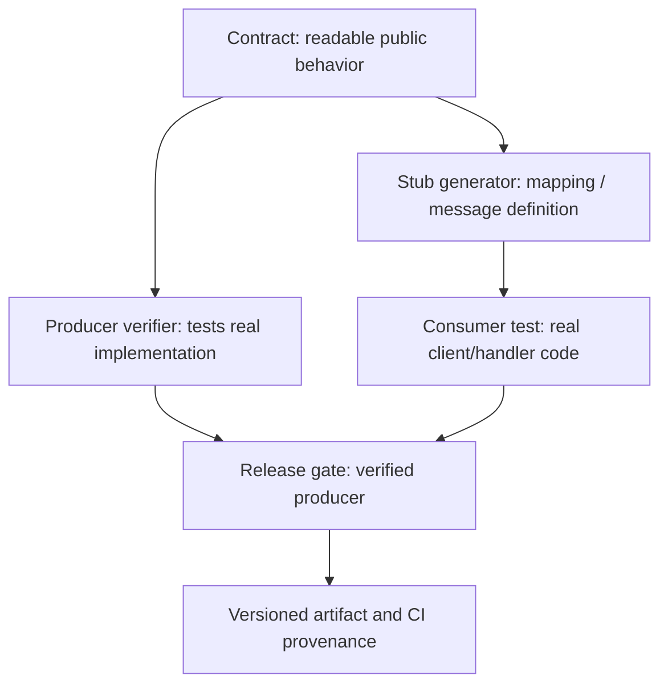
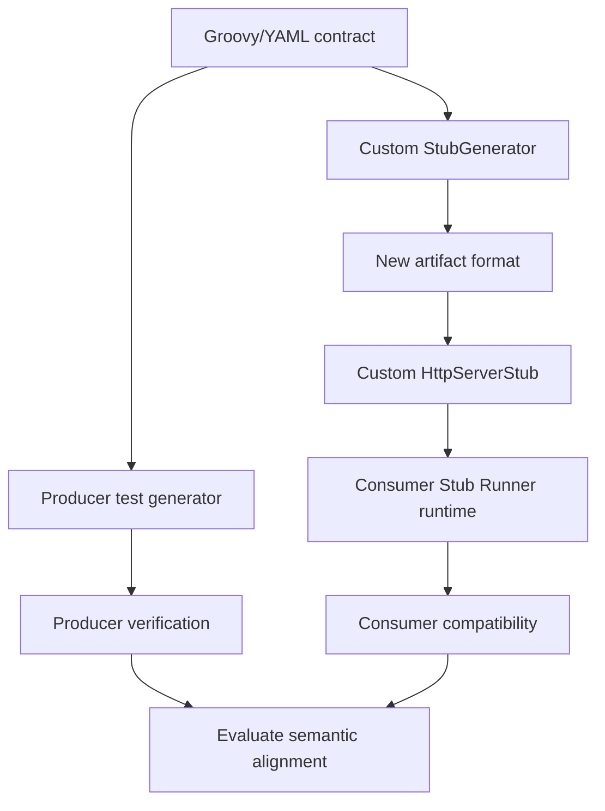
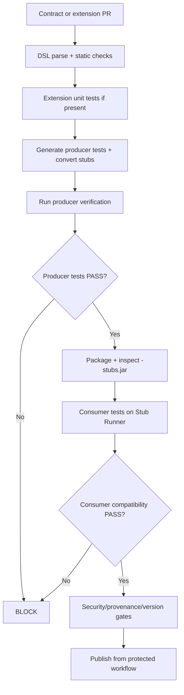
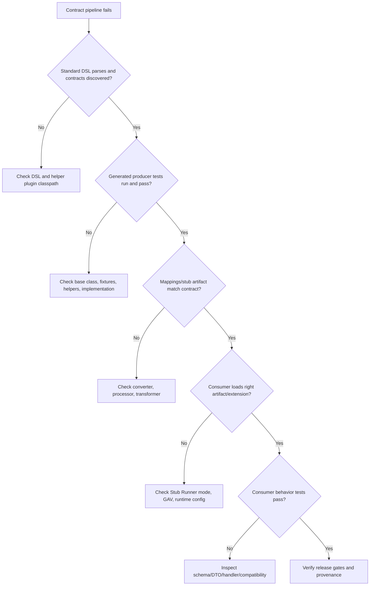

# Limiting Custom Code to Keep Contract Workflows Maintainable

## 1. Why Does More Custom Code Make Contracts Lose Value?

In the **SPRING_CLOUD_CONTRACT** module, Spring Cloud Contract supports contract testing between **producer** and **consumer**. Teams describe HTTP or messaging behavior via a **Groovy/YAML DSL**; Contract Verifier generates producer tests, converts HTTP contracts into stubs, packages artifacts, and lets consumers run them through **Stub Runner**. CI checks for incompatible API changes before release.

Spring Cloud Contract offers numerous extension points: custom test base classes, matchers, Groovy DSL helpers, WireMock extensions, converters, generators, and Stub Downloaders. These capabilities help when a system has specialized needs. However, if every team builds its own framework on top of the framework, understanding a simple contract may require reading dozens of classes, plugins, config files, and internal utilities.

For example, a contract that should simply describe:

```text
GET /api/orders/ord-1001
  -> 200 {"id":"ord-1001","status":"CREATED"}
```

instead gets written in a homegrown DSL:

```groovy
// ANTI-PATTERN: the following calls are IMAGINARY internal framework APIs.
contractsFor('orders') {
    onApiVersion(activeEnvironment()) {
        orderEndpoint(contextFromDatabase()) {
            assertUsing(CompanySpecificDynamicResponseRule('CREATED'))
        }
    }
}
```

Readers can no longer clearly see **which request** and **which response** constitute the actual promise. When upgrading Spring Cloud Contract or running consumer tests with another tool, custom code may miss classpaths, drift across versions, or produce mappings that diverge from generated producer tests.

**Lesson principle:** *Customize only when there is a proven gap in standard capabilities; place custom code at the lowest necessary tier, with ownership, tests, and a path back to standard configuration.*

### Learning Outcomes

After this lesson, you will be able to:

1. Distinguish DSL describing **public behavior** from custom code serving **how tests run**.
2. Choose intervention tiers from default configuration and fixtures/base tests up to SPI extensions.
3. Write readable Groovy/YAML contracts without hiding business rules inside helpers.
4. Organize producer base classes by HTTP/messaging or domain with clear scope.
5. Judge when WireMock metadata suffices versus when a response transformer is genuinely needed.
6. Understand the costs of `ContractConverter`, `StubGenerator`, `SingleTestGenerator`, and `StubDownloaderBuilder`.
7. Ensure producer tests, generated stubs, and consumer tests **never interpret contracts differently**.
8. Enforce customization limits across PR reviews, CI, versioning, and upgrade plans.

## 2. What Must Stay Stable Across Every Contract Workflow?

A contract has value when all three pillars stay connected:



Custom code must never create situations where:

- The contract specifies `404`, yet a custom stub converter turns it into `200`.
- Producer tests only check that `quantity` is a number, while a custom response transformer returns the string `"2"`.
- A test base class invokes a helper directly to forge a response **bypassing the producer behavior** under test.
- Consumer Stub Runner uses an extension missing from the classpath, so mappings fail to run.
- A Groovy helper queries a live database, causing the same contract to yield different results between CI and a developer laptop.
- A custom downloader always fetches “latest”, causing the same consumer commit to test different stub versions across runs.

### 2.1. Separate Three Types of Changes

| Change | Example | Right Place |
| --- | --- | --- |
| **API interface change** | Adding status `409`, changing message schema | Contract DSL + producer/consumer review |
| **Test/fixture setup change** | Seeding orders before each test, configuring MockMvc | Base test and test fixtures |
| **Infrastructure/toolchain change** | Custom stub downloader, non-WireMock stub server | Extension or build config, with clear owner |

If a change belongs to the first category, **never hide it inside the third**. Consumers must see the change in the contract diff rather than discovering it inside a post-processor's output.

## 3. Customization Ladder: Prefer Lower Tiers

| Tier | Solution | When to Use | Maintenance Cost |
| --- | --- | --- | --- |
| **0** | Standard Groovy/YAML DSL, standard matchers | Typical HTTP/message cases | Low |
| **1** | Maven/Gradle plugin options, test modes, conventions | Changing roots, packages, frameworks, ports | Low–medium |
| **2** | Base classes, test fixtures, test-specific helpers | Producer setup, message triggers | Medium |
| **3** | Pure Groovy DSL helpers, common test utilities | Truly reusable formatting rules | Medium–high |
| **4** | WireMock metadata, scoped stub customization | Delays, per-mapping approved transformers | High |
| **5** | Custom converter/generator/server/downloader | Unsupported formats or stub systems | Very high |

**Not every team needs to reach Tier 5.** With HTTP JSON and WireMock, most needs belong in Tiers 0–2. Deeper extension points demand ongoing compatibility across Spring Cloud Contract versions, WireMock, consumer runtimes, build plugins, and repositories.

### 3.1. The “Least Customization Possible” Rule

Before adding classes or plugins, ask:

1. Can this be expressed with **standard DSL contracts**?
2. Can it be solved with **matchers** or **dedicated fixture scenarios**?
3. Can it live in a **base test** without altering contract semantics?
4. Does a plugin option or WireMock **metadata** already satisfy it directly?
5. If custom code is required, does it run on **both the producer and consumer sides as needed**?
6. Are there regression tests for the extension itself?
7. Is there a path back to standard configuration on future upgrades?

Just because the documentation exposes an SPI does not make it the first tool to reach for.

## 4. Keep Contracts as Behavior Specs, Not Business Programs

A reviewer should understand a contract solely from its core elements:

- HTTP: `request.method`, `url`/`urlPath`, query/headers/body, `response.status`, headers/body/matchers.
- Messaging: `input`, `label`, `outputMessage.sentTo`, `body`, `headers`, content type.
- Sample values and request acceptance criteria.
- Scenario name and a brief business description.

### 4.1. Simple, Reviewable Groovy DSL Example

```groovy
import org.springframework.cloud.contract.spec.Contract

Contract.make {
    name 'get_order_created'
    description 'Read CREATED order so Checkout can decide payment'

    request {
        method GET()
        url '/api/orders/ord-1001'
        headers {
            header 'Accept': 'application/json'
        }
    }
    response {
        status 200
        headers {
            contentType(applicationJson())
        }
        body([
            id     : 'ord-1001',
            status : 'CREATED',
            amount : 125000,
            currency: 'VND'
        ])
    }
}
```

Reading this contract requires no knowledge of database schemas, Spring bean graphs, or internal helper suites. Producer verification tests send the request to the configured producer boundary; consumer stubs return the contract's sample response.

### 4.2. Equivalent YAML DSL

```yaml
name: get_order_created
description: Read CREATED order so Checkout can decide payment
request:
  method: GET
  url: /api/orders/ord-1001
  headers:
    Accept: application/json
response:
  status: 200
  headers:
    Content-Type: application/json
  body:
    id: ord-1001
    status: CREATED
    amount: 125000
    currency: VND
```

This is an **alternative representation of the same contract**; do not keep both in the build and duplicate identical request/response scenarios.

### 4.3. Why Should Groovy Contracts Never Access Databases?

```groovy
// ANTI-PATTERN: not standard DSL and must not be done.
def order = DatabaseConnection.fromEnvironment().findAnyPaidOrder()

Contract.make {
    request { method GET(); url "/api/orders/${order.id}" }
    response { status 200; body([status: order.status]) }
}
```

Now the contract depends on:

- Database availability/credentials while **parsing the DSL**.
- Data mutating across environments.
- Queries unrelated to the direct API promise.
- Generator execution timing rather than producer behavior under test.

**Better way:** put deterministic samples in the contract, and let the test base/fixture seed `ord-1001` in the test environment. When dynamic values are needed, use proper matchers—never use a production database as a DSL input.

## 5. Standard Matchers Replace Most Custom Validators

Before building a custom validation engine, exhaust DSL capabilities:

- Matchers for **method, path, query, headers**, and JSON body.
- Type/regex/JSONPath rules on responses for dynamic fields.
- Separate scenarios for distinct business branches.
- Clear distinction between fixture samples and asserted matchers.

### 5.1. Format Differs from Literal Value

Suppose the producer issues new order IDs:

```json
{
  "orderId": "ord-1001",
  "status": "CREATED"
}
```

If `orderId` is generated dynamically, the contract can use a matcher for **format** rather than forcing every producer test to receive literal `ord-1001`. Meanwhile, the stub still keeps a valid sample so consumer tests can deserialize it.

For a contract where producer and consumer care only about ID **type and format**, there is no need to build:

```text
CustomOrderIdValidator
  -> DynamicCompanyOrderIdMatcher
  -> CustomJsonGenerator
  -> CustomWireMockResponseTransformer
```

just to check a regex like `ord-[0-9]+`.

### 5.2. Overly Broad Matchers Are Also Unmaintainable

| Check | Risk | Proper Approach |
| --- | --- | --- |
| `status =~ /.*/` | Accepts statuses outside the contract | Constrain to actual enum values |
| `amount` matches any string | Misses number → string breaks | Assert numeric type |
| URL `/api/orders/.*` always returns `200` | Masks `404`, `PAID`, and routing bugs | Separate request paths or explicit predicates |
| Byte-for-byte JSON text assertion | Fails on key order or whitespace | Assert structure and consumer dependencies |

**Minimal customization does not mean loose testing.** Strictness comes from contract semantics, not from lines of custom code.

## 6. Put Custom Setup in Base Tests, Not in the DSL

An intentional place for customization is the **base class of generated producer tests**. Use it to configure MockMvc, RestAssured, message verifiers, fixtures, or test clocks while contracts stay focused on public behavior.

### 6.1. Spring MVC Producer with a Base Class

```java
package com.example.orders.contract;

import io.restassured.module.mockmvc.RestAssuredMockMvc;
import org.junit.jupiter.api.BeforeEach;
import org.springframework.beans.factory.annotation.Autowired;
import org.springframework.boot.test.autoconfigure.web.servlet.AutoConfigureMockMvc;
import org.springframework.boot.test.context.SpringBootTest;
import org.springframework.test.web.servlet.MockMvc;

@SpringBootTest
@AutoConfigureMockMvc
public abstract class OrdersContractBase {

    @Autowired
    private MockMvc mockMvc;

    @Autowired
    private OrdersContractFixtures fixtures;

    @BeforeEach
    protected void setUpContractData() {
        fixtures.reset();
        fixtures.create("ord-1001", "CREATED", 125000L, "VND");
        fixtures.create("ord-2002", "PAID", 89000L, "VND");
        fixtures.ensureMissing("ord-missing");
        RestAssuredMockMvc.mockMvc(mockMvc);
    }
}
```

`OrdersContractFixtures` and its `reset`, `create`, and `ensureMissing` methods are **project-implemented helpers**, **not Spring Cloud Contract APIs**. They must act on real data/components read by the controller, rather than fabricating simulated responses and claiming the producer was verified.

### 6.2. Maven Plugin Configuration

```xml
<build>
  <plugins>
    <plugin>
      <groupId>org.springframework.cloud</groupId>
      <artifactId>spring-cloud-contract-maven-plugin</artifactId>
      <version>REPLACE_WITH_COMPATIBLE_VERSION</version>
      <extensions>true</extensions>
      <configuration>
        <testFramework>JUNIT5</testFramework>
        <testMode>MOCKMVC</testMode>
        <baseClassForTests>
          com.example.orders.contract.OrdersContractBase
        </baseClassForTests>
        <failOnNoContracts>true</failOnNoContracts>
      </configuration>
    </plugin>
  </plugins>
</build>
```

This is a **POM fragment**. Replace the plugin version with one compatible with your project's Spring Boot/Spring Cloud/JDK versions; producers also need test dependencies such as `spring-boot-starter-test`, `spring-cloud-starter-contract-verifier`, and the matching HTTP stack.

### 6.3. What a Base Test Should and Should Not Do

| Do | Do Not |
| --- | --- |
| Seed/clear deterministic fixtures | Query random records from a shared DB |
| Initialize MockMvc or HTTP test clients | Mock entire responses so every test stays green |
| Set deliberate test clocks, locales, timezones | Rely on uncontrolled `LocalDateTime.now()` |
| Create proper test identities/authorization | Embed production credentials |
| Reset state before or after tests | Depend on test execution order |
| Trigger real producer events via explicit helpers | Pre-build messages in the verifier pretending the producer published them |

### 6.4. Keep Base Classes Small

A 1,000-line base class mixing order, payment, and inventory logic, fake brokers, DB cleanup, and custom HTTP middleware signals **excessive customization**. It couples every contract to massive setup.

Split them cleanly:

```text
OrdersContractBase
  -> OrdersContractFixtures      (test data)
  -> TestClockConfiguration      (if needed)
  -> HttpContractSecuritySetup   (if needed)

MessagingContractBase
  -> OrderEventTestDriver        (triggers real producer)
  -> TestMessagingConfiguration  (test binder/broker)
```

The class names in this diagram are **application design units**, not mandatory extensions provided by Spring Cloud Contract.

## 7. When One Base Class Is Not Enough: Use `baseClassMappings`

Spring Cloud Contract supports mapping **contract groups → base classes**. This is built-in configuration requiring no custom test generator.

Example for a producer having both Orders HTTP endpoints and event messaging:

```xml
<configuration>
  <testFramework>JUNIT5</testFramework>
  <baseClassForTests>com.example.contract.CommonContractBase</baseClassForTests>
  <baseClassMappings>
    <baseClassMapping>
      <contractPackageRegex>.*orders.*</contractPackageRegex>
      <baseClassFQN>com.example.contract.OrdersHttpBase</baseClassFQN>
    </baseClassMapping>
    <baseClassMapping>
      <contractPackageRegex>.*messaging.*</contractPackageRegex>
      <baseClassFQN>com.example.contract.OrdersMessagingBase</baseClassFQN>
    </baseClassMapping>
  </baseClassMappings>
</configuration>
```

**This configuration is illustrative.** Regexes match against the **contract package** determined by the generator; verify generated tests actually `extends` the right class. `CommonContractBase` must also exist if configured as fallback. Overlapping mappings or overly broad regexes can wire tests to the wrong setup.

### 7.1. When Mapping Is Worthwhile

- HTTP and messaging require genuinely different test infrastructures.
- Two domains have distinct fixture, clock, or auth policies.
- Contracts can be grouped cleanly by directory/package.

### 7.2. When to Avoid It

- Every single contract gets its own base class over one fixture value.
- Teams use `baseClassMappings` to dodge fixing shared preconditions.
- Fragile filename-based regexes silently match the wrong contracts.
- Deep base inheritance chains (`Base → CommonBase → CompanyBase → LegacyBase`) obscure setup.

**Goal:** base classes should represent a handful of **truly distinct test infrastructures**, not a custom mini-framework per request.

## 8. Groovy DSL Helpers: Abstract Only Stable, Readable Elements

Spring Cloud Contract documentation permits extending **Groovy DSL** with helper functions in a shared JAR. Remember this is a **Groovy-specific mechanism**: YAML cannot call those Java/Groovy helper methods directly.

### 8.1. Pure Utility Example

When many contracts share the exact same **synthetic** order ID sample:

```java
package com.example.contract.samples;

public final class ContractSamples {
    private ContractSamples() {}

    public static String createdOrderId() {
        return "ord-test-1001";
    }

    public static String missingOrderId() {
        return "ord-test-missing";
    }
}
```

Once `ContractSamples` is configured on the **classpath visible to the Groovy DSL converter**, Groovy contracts can reference it:

```groovy
import org.springframework.cloud.contract.spec.Contract
import static com.example.contract.samples.ContractSamples.createdOrderId

Contract.make {
    name 'get_created_order'
    request {
        method GET()
        url "/api/orders/${createdOrderId()}"
    }
    response {
        status 200
        headers { contentType(applicationJson()) }
        body([id: createdOrderId(), status: 'CREATED'])
    }
}
```

**Critical requirement:** the helper class must exist when the **plugin processes Groovy DSL**, not merely during `mvn test`; methods must follow static-compatibility constraints of the DSL mechanism. This snippet illustrates a **pure utility pattern** and does not claim every plugin version auto-loads these classes without proper dependency setup.

### 8.2. Is That Helper Truly Needed?

For one or two contracts, writing literals directly:

```yaml
request:
  method: GET
  url: /api/orders/ord-test-1001
response:
  status: 200
  body:
    id: ord-test-1001
    status: CREATED
```

is usually **more readable and lower-coupling** than maintaining a helper JAR. Never create abstractions just because `ord-test-1001` appears three times.

### 8.3. Checklist for Reusable Groovy Helpers

- [ ] Helper is **pure**: deterministic input → output with zero hidden network, DB, file, or clock access.
- [ ] Wraps only shared formats/samples; **never hides critical statuses, bodies, or URLs**.
- [ ] Code and dependency versions have a clear owner.
- [ ] Producer generator has the right plugin classpath.
- [ ] Consumers are not forced to install helpers just to read/run stubs when avoidable.
- [ ] Unit tests cover the helper alongside tests verifying **real contract parsing**.
- [ ] Contracts remain easily readable by eye in PR diffs.
- [ ] A plan exists to retire the helper if it becomes unnecessary.

### 8.4. Dangers of “Clever” Helpers

```groovy
// ANTI-PATTERN: these helpers are pseudocode, not framework APIs.
body(CustomOrderTemplate.forCurrentEnvironment())
url(CompanyApiPathResolver.guessPathFromBranchName())
headers(ProductionSecrets.fetchAuthHeaders())
```

They turn contracts into dynamic scripts tied to environments, branches, secrets, and databases—hard to review and impossible to reproduce. CI can emit different stubs from the same source commit. Keep helpers strictly **pure, stable, and transparent**.

## 9. Distinguish DSL Helpers from Producer Test Helpers

The two helper types serve different execution phases:

| Type | Runs When? | Appropriate Responsibilities |
| --- | --- | --- |
| **Groovy DSL helper** | When parser/converter processes contracts | Supply format patterns, immutable samples |
| **Producer base helper** | When generated tests execute | Seed fixtures, trigger real behavior, configure test clients |

If you need to seed a database, **do not do it in a DSL helper**. If you need to describe JSON schemas/matchers, **do not force the producer base test to parse DSL and patch responses**.

### 9.1. Message Producers: `triggeredBy` Needs a Helper, Not a New Generator

```groovy
import org.springframework.cloud.contract.spec.Contract

Contract.make {
    name 'order_created_event'
    label 'order_created'

    input {
        triggeredBy('publishOrderCreated()')
    }

    outputMessage {
        sentTo('orders.events')
        body([
            eventType: 'ORDER_CREATED',
            orderId  : 'ord-test-1001',
            quantity : 2
        ])
        headers {
            header('eventType', 'ORDER_CREATED')
            messagingContentType(applicationJson())
        }
    }
}
```

`publishOrderCreated()` is a **method defined by the producer test base**, not a built-in Spring Cloud Contract method.

A clean base design invokes **real production code**:

```java
package com.example.orders.contract;

import org.junit.jupiter.api.BeforeEach;
import org.springframework.beans.factory.annotation.Autowired;
import org.springframework.boot.test.context.SpringBootTest;
import org.springframework.cloud.contract.verifier.messaging.boot.AutoConfigureMessageVerifier;

@SpringBootTest
@AutoConfigureMessageVerifier
public abstract class OrdersMessagingBase {

    @Autowired
    private OrderEventTestDriver driver;

    @BeforeEach
    protected void prepare() {
        driver.clearTestState();
    }

    public void publishOrderCreated() {
        driver.createOrderThroughApplication("ord-test-1001", 2);
    }
}
```

`OrderEventTestDriver`, `clearTestState`, and `createOrderThroughApplication` are **project-written components**. They must traverse the real event-publishing path; if the helper directly calls a test broker `send("orders.events", sampleJson)` bypassing producer logic, generated tests fail to prove the producer emits the event.

`@AutoConfigureMessageVerifier` and test binders/brokers must align with your Spring Cloud Contract and messaging stack versions. **Never write a custom message generator** merely because the producer uses Kafka or RabbitMQ; evaluate supported integrations and message verifiers first.

### 9.2. Consumer-Side Verification

Consumers can invoke `StubTrigger.trigger("order_created")` with Stub Runner for the target artifact version; confirm the **real handler** receives and processes the message rather than asserting only that `trigger` returned true.

```java
// Illustrative consumer test configured with Stub Runner + Awaitility.
readModel.deleteByOrderId("ord-test-1001");
assertThat(readModel.hasOrder("ord-test-1001")).isFalse();

assertThat(stubTrigger.trigger("order_created")).isTrue();

await().atMost(Duration.ofSeconds(5)).untilAsserted(() ->
    assertThat(readModel.hasOrder("ord-test-1001")).isTrue()
);
```

`readModel` is a hypothetical consumer API. Brokers and credentials must belong to a **test** environment—never touch production resources. Tune polling/timeouts to the application and reset test state cleanly.

## 10. WireMock Metadata: Try It Before Writing a Transformer

In supported Spring Cloud Contract versions, contract `metadata` can contain a `wiremock` entry to fine-tune the **generated `StubMapping`**. A common example is simulating a **delay** in an HTTP stub.

### 10.1. When a Delay Is Needed

Checkout wants to test timeout fallbacks when Orders responds slowly. If the business contract still defines:

```json
{"id":"ord-test-1001","status":"CREATED"}
```

then a **simulated delay** can be applied on the **stub mapping** without changing the response body or writing a custom stub server.

Example **post-generation WireMock mapping JSON snippet** (not DSL input):

```json
{
  "request": {
    "method": "GET",
    "url": "/api/orders/ord-test-1001"
  },
  "response": {
    "status": 200,
    "jsonBody": {
      "id": "ord-test-1001",
      "status": "CREATED"
    },
    "fixedDelayMilliseconds": 1500
  }
}
```

This WireMock JSON example **illustrates the desired outcome**, without claiming the generator emits identical bytes everywhere. When using metadata in real contracts, verify syntax for your Spring Cloud Contract version, inspect the generated mapping, and run a Stub Runner test to confirm the delay works.

### 10.2. Crucial Limitation of Metadata

Spring Cloud Contract documentation states that WireMock metadata adjustments apply **on the stub side** and **do not automatically modify generated producer tests**. Therefore:

- If metadata only adds latency to test consumer timeouts, it serves a **consumer resilience test**.
- If metadata alters status/body unseen by producer tests, **producer and consumer drift out of sync**.
- Never treat stub metadata as a legitimate way to silently alter an API definition reviewed by the producer.

**Rule:** metadata drives explicit stub-testing behavior; real producer–consumer semantics belong in the standard contract verified by the producer.

## 11. WireMock Response Transformers: Two-Sided Operational Cost

WireMock supports custom extensions like response transformers. Spring Cloud Contract provides registration hooks in several configurations via the `WireMockExtensions` interface and `META-INF/spring.factories` service discovery.

### 11.1. What Many Teams Forget

A transformer may be registered while the generator/build runs, yet when **consumer Stub Runner** loads the JAR, WireMock in the consumer environment must know about that extension too. Documentation notes cases needing a custom `HttpServerStubConfigurer` (such as subclassing `WireMockHttpServerStubConfigurer`) to register custom extensions in Stub Runner.

**Merely naming a transformer in a mapping does not guarantee the consumer runtime has that class.**

### 11.2. Pre-Approval Checklist for a Transformer

| Question | Acceptance Criterion |
| --- | --- |
| Does a standard DSL/matcher/metadata solution exist? | If yes, prefer the standard option |
| Must it apply to **every mapping**? | Avoid unintended global transformers |
| Does the transformer read env vars, secrets, or runtime state? | Prevent nondeterminism and data leaks |
| Do consumers have the extension JAR and configurer? | Must prove via clean tests |
| Does it make responses differ from producer verification? | If yes, redesign immediately |
| Does it work with active WireMock/Contract versions? | Pin versions and test upgrades |
| Is the **missing-extension** case tested? | Must fail loudly, never silently serve wrong responses |

### 11.3. Anti-Pattern: Writing a Transformer to Force a Happy Status

```text
Producer returns: 409 OUT_OF_STOCK
Custom transformer rewrites to: 200 {"available":false}
Consumer test against stub: PASS
Producer generated test for 409: PASS
Real consumer in production: FAILS upon receiving 409
```

This creates **two conflicting behavioral definitions**. If the consumer genuinely needs a `200 available=false` API, negotiate and update the **contract and producer**—never bury a protocol adapter inside a WireMock transformer untested along the real path.

## 12. When Is Deep Pluggable Architecture Truly Needed?

Spring Cloud Contract documentation publishes extension points including:

| SPI / Extension Point | Problem Solved | Question Before Implementing |
| --- | --- | --- |
| `ContractConverter` | Reading/writing a **different contract format** | Can standard Groovy/YAML be used instead? |
| `SingleTestGenerator` | Changing how producer tests are generated | Do built-in test frameworks/languages suffice? |
| `StubGenerator` | Emitting a non-WireMock stub format | Is a different stub server genuinely required? |
| `HttpServerStub` | Running a different stub backend | Does Stub Runner + WireMock lack a core capability? |
| `StubDownloaderBuilder` | Fetching stubs from a specialized source | Do `LOCAL`/`REMOTE`/`CLASSPATH` or standard repos suffice? |
| `WireMockExtensions` | Registering extensions when using WireMock | Can standard metadata/mappings solve it? |
| `StubProcessor` | Post-processing generated stub mappings | Can it be expressed via contracts or WireMock metadata? |

These APIs **are real**, yet exact signatures, classes, methods, auto-discovery, and compatibility vary by version. Never copy a Spring Cloud Contract 3.x example assuming it works unchanged in 4.x/5.x.

### 12.1. The True Cost of an Extension

Even a single-class SPI entails:

```text
Custom module source
  + module dependencies and plugin dependencies
  + META-INF/spring.factories (if used by that SPI)
  + generator runtime classpath
  + producer test runtime
  + stub artifact format
  + consumer Stub Runner runtime/configurer
  + CI packaging/publishing/version pinning
  + docs, ownership, upgrade tests, and rollback
```

Without someone accountable for maintaining that chain, extension code becomes a **toolchain liability** rather than product value.

## 13. `ContractConverter`: Only for Formats Lacking a Standard Path

Some organizations have legacy OpenAPI, Pact, or internal formats. Spring Cloud Contract provides `ContractConverter` to translate external formats into the `Contract` model and back.

### 13.1. Converter Responsibilities

- Decide which files the converter accepts, typically by extension or schema.
- Translate inputs into **standard contract fields** (request, response, messaging).
- Preserve semantics for data types, headers, matchers, and error branches.
- Implement reverse conversion if workflows genuinely require bidirectional support.
- Emit clear errors when formats are unsupported.

Illustrative `META-INF/spring.factories` registration (structural example; verify against SPI version):

```properties
org.springframework.cloud.contract.spec.ContractConverter=\
com.example.contract.converter.ExampleContractConverter
```

**No `ExampleContractConverter` class exists inside Spring Cloud Contract.** It is a hypothetical FQCN for a team-authored implementation packaged into a JAR.

### 13.2. Why Not Write a Converter Just for a Few Fields?

If a team just needs to add `X-Trace-Id` or change status `400` to `422`, that is a **contract DSL edit**. Writing a converter to silently inject headers/statuses across all contracts:

- Hides API changes from PR diffs.
- Keeps consumers blind to what the producer actually promises.
- Creates divergence when generated tests and stubs run under different plugin versions.
- Complicates debugging when contracts are altered unexpectedly.

Consider a converter only when the source format is large and stable enough to preserve and **no standard conversion path satisfies the need**.

## 14. `SingleTestGenerator` and `StubGenerator`: Risk of Producer–Consumer Drift

### 14.1. Custom Producer Test Generator

`SingleTestGenerator` is used when customizing how producer tests are generated—for example, targeting an unsupported test language or framework.

Minimum requirements:

1. Generated test classes **compile** and execute in the test runner.
2. Assertions for status, body, headers, and messages are never omitted.
3. Matchers preserve semantic equivalence with standard DSL.
4. Failures trace clearly back to contract name and source.
5. Generated code never merely asserts fixtures against fixtures.
6. Regression tests run whenever plugins or test frameworks upgrade.

If your goal is simply changing **base classes, generated test packages, or test modes**, use plugin configuration before replacing the generator.

### 14.2. Custom Stub Generator

`StubGenerator` lets you emit mappings for a non-WireMock stub server. However, if consumers still run **default WireMock**, that output cannot load automatically.

A complete solution often requires:



Writing a plugin converter alone and assuming consumers already have working stubs is **incomplete**. Verify the entire path from contract to consumer.

### 14.3. Why “Speeding Up Tests” Is Rarely Justification

If generated producer tests run slowly due to context or database startup, prefer:

- Trimming oversized test fixture setups.
- Applying proper test slicing scoped to what contracts verify.
- Reusing Spring contexts per test policy.
- Removing external network calls from dependencies.
- Isolating test databases/brokers.

Avoid writing a `SingleTestGenerator` just to emit faster tests that strip out slow assertions.

## 15. `StubDownloaderBuilder`: Use Only When Standard Repositories Do Not Fit

Stub Runner fetches stubs via common modes:

| Mode | Source | Capability |
| --- | --- | --- |
| `CLASSPATH` | Stubs on test classpath | No custom downloader needed when packaged properly |
| `LOCAL` | Local Maven repository | Good for developer/producer `mvn install` |
| `REMOTE` | Maven-compatible repository | Good for CI with configured Nexus/Artifactory |

Only reach for `StubDownloaderBuilder` when the artifact source is **genuinely incompatible** and standard modes cannot reasonably work.

### 15.1. Example Custom Downloader Registration

```properties
# META-INF/spring.factories, illustrative registration for the matching SPI.
org.springframework.cloud.contract.stubrunner.StubDownloaderBuilder=\
com.example.contract.stubs.InternalStubDownloaderBuilder
```

`InternalStubDownloaderBuilder` is **team-authored code**, not a built-in Spring API. It must resolve artifacts matching exact coordinates, classifier, and version, enforce checksums/provenance, and authenticate securely.

### 15.2. A Downloader Easily Becomes a Liability

```text
Input: com.example:orders-producer:1.4.2:stubs
Custom downloader quietly substitutes latest 1.5.0
Consumer tests: PASS
Release pipeline claims stub 1.4.2 was tested
```

That creates false confidence. Downloaders must never silently bypass version pinning. A solid implementation must:

- Log both **requested** and **actually resolved** coordinates (never print secrets).
- Fail loudly if the exact version does not exist.
- Never auto-select latest unless explicitly approved for non-release exploratory environments.
- Verify checksums, signatures, and provenance as required.
- Use least-privilege credentials from a secret store, never committed to Git.
- Work consistently with both local caches and clean CI runners.

## 16. Classpaths and Dependencies: Where Can an Extension Run?

When extending Groovy DSL or test/stub generators, a subtle failure occurs when **classes sit on the producer test runtime classpath yet are missing from the plugin classpath**.

### 16.1. Distinguish Execution Domains

| Domain | Example | Where Extensions Load From |
| --- | --- | --- |
| **Build plugin** | Groovy DSL converters, test/stub generators | Plugin dependencies, plugin classloader |
| **Producer tests** | JUnit base classes, fixture helpers | Project test dependencies |
| **Artifact** | `-stubs.jar` holding mappings, contracts, metadata | Artifact packaging |
| **Consumer test** | Stub Runner, custom WireMock extensions | Consumer test dependencies/config |
| **Standalone Stub Runner** | Stub Boot/Docker process | Separate process classpath and runtime config |

Never conclude “we added the test dependency to the producer” means the consumer process has the transformer class. **Each execution domain has its own classloader and loading mechanism.**

### 16.2. Maven Config When Using a Groovy Helper JAR

An application may declare the helper under `scope=test` in the project while also adding it to **plugin dependencies** if the converter needs the class at generation time:

```xml
<dependencies>
  <dependency>
    <groupId>com.example.build</groupId>
    <artifactId>contract-samples</artifactId>
    <version>1.0.0</version>
    <scope>test</scope>
  </dependency>
</dependencies>

<build>
  <plugins>
    <plugin>
      <groupId>org.springframework.cloud</groupId>
      <artifactId>spring-cloud-contract-maven-plugin</artifactId>
      <version>REPLACE_WITH_COMPATIBLE_VERSION</version>
      <extensions>true</extensions>
      <dependencies>
        <dependency>
          <groupId>com.example.build</groupId>
          <artifactId>contract-samples</artifactId>
          <version>1.0.0</version>
        </dependency>
      </dependencies>
    </plugin>
  </plugins>
</build>
```

This illustrates **dependency structure only**, not a complete Maven project. `com.example.build:contract-samples:1.0.0` is a hypothetical artifact you must build and publish yourself. Add dual dependencies like this **only when a Groovy helper provides clear value**; otherwise, plain literal contracts are simpler and easier to manage.

### 16.3. When Consumers Cannot Run Contracts Due to Missing Helpers

A risk of publishing Groovy DSLs referencing custom helpers is **consumers wanting to re-parse source contracts yet lacking the helper class**. Documentation mentions converting contracts to YAML (`convertToYaml` in some versions/plugins) so consumers do not need Groovy helpers on their classpath; **test the actual generated artifact and consumer runtime** rather than assuming flipping an option handles every custom extension.

**Prefer publishing self-contained artifacts with producer-verified contract/stub data**, rather than forcing every consumer to install an “internal SDK” just to run simple HTTP mappings.

## 17. Maintenance Cost: Measure with Real Signals

Instead of arguing subjectively over “too much vs. too little custom code”, measure concrete signals:

| Signal | How to Inspect | Risk as It Grows |
| --- | --- | --- |
| Number of extension classes/JARs | How many custom SPIs and helper modules? | More artifacts to upgrade together |
| Pipeline stages coupled to custom code | Generators, mappings, consumer runtimes | One edit breaks multiple pipelines |
| Non-self-contained contracts | Must open helpers to read an HTTP body? | Slow reviews and missed breaking changes |
| Environment inputs affecting output | Branches, env vars, DBs, timezones | Irreproducible builds |
| Consumers needing shared extensions | Test JVMs, non-JVMs, standalone Boot | Hard to distribute and upgrade |
| Failure triage time | How long to tell DSL failure from extension bug? | Higher CI MTTR |
| Version compatibility coverage | Tested against supported SCC versions? | Framework upgrades grow expensive |
| Ownership | Named owner, docs, release/changelog? | Unmaintainable orphan code |

### 17.1. Customization Budget Policy

A team can adopt simple governance rules:

1. Every custom SPI requires a **short ADR/RFC** explaining why standard options fall short.
2. Every extension has an **owner** and at least one backup maintainer.
3. Every change to an extension runs both **producer verification** and **consumer stub tests**.
4. Framework upgrades check the **compatibility matrix** before merging.
5. After each upgrade, audit which extensions now have built-in equivalents.
6. Extensions must never **alter API promises** invisible in contract diffs.

These policies are **lesson governance recommendations**, not constraints enforced by Spring Cloud Contract itself.

## 18. Roadmap for Replacing a Custom Framework with Standard Mechanisms

Suppose a team maintains `CompanyOrderStubEngine` doing:

```text
CompanyOrderStubEngine
  1. Read Groovy DSL
  2. Prepare order database
  3. Generate random responses
  4. Randomly pick HTTP statuses
  5. Package JSON mappings
  6. Load stubs into consumer tests
```

The team wants to shed internal custom-code coupling.

### 18.1. Decomposition Steps

| Legacy Feature | Standard Replacement |
| --- | --- |
| Read Groovy DSL | Default Spring Cloud Contract parser |
| Seed test data | `OrdersContractFixtures` in producer base |
| Generate response IDs | Standard samples/matchers; keep tests deterministic |
| Pick contextual statuses | Split into explicit `200/404/409` contracts |
| Create HTTP mappings | Default `convert` / WireMock generator |
| Package `-stubs.jar` | Default `generateStubs` / build plugin |
| Load into consumer CI | Stub Runner `LOCAL` or `REMOTE` |

You do not need a big-bang rewrite. Migrate **one representative scenario** first, compare producer and consumer tests between old and new setups, and expand once semantic equivalence is confirmed.

### 18.2. Start with a Small Scope

```text
GET /api/orders/ord-1001 -> 200 CREATED
GET /api/orders/ord-missing -> 404 ORDER_NOT_FOUND
```

Convert these two scenarios to standard DSL with standard fixtures, run generated producer tests and Stub Runner consumer tests. Only once green should you migrate complex scenarios like eventual consistency, streaming, or message events.

### 18.3. Never Delete Extensions While Consumers Still Depend on Old Artifacts

If legacy stub releases rely on a custom transformer or custom server runtime, abruptly deleting the extension JAR on consumers breaks tests for older versions. Inventory active consumers/versions, plan migrations, and **maintain backward compatibility** for supported releases.

## 19. CI Must Test Both Contracts and Custom Code

Even a tiny extension requires two test levels:

1. **Extension unit/integration tests:** verify helper, converter, transformer, and downloader logic directly.
2. **End-to-end contract pipeline:** the contract itself generates producer tests, produces stubs, and runs consumer tests cleanly.

### 19.1. Suggested Pipeline



### 19.2. Extension-Specific Assertions

| Extension | Required Tests |
| --- | --- |
| Groovy helper | Deterministic input/output, exact types, environment-independent |
| `baseClassMappings` | Generated classes extend the right base for each group |
| WireMock metadata | Mappings have exact delay/fault; generated producer tests **keep same semantics** |
| Transformer | Affects only selected mappings; consumer runtime loads extension |
| Converter | Exact file types, maps all request/response/message fields; round-trip if supported |
| Generator | Output compiles/loads, assertions never dropped |
| Downloader | Resolves exact GAV/classifier/version, clear errors, valid checksum/provenance |
| Custom stub server | Port lifecycle, mapping registration, start/stop, and concurrent tests |

### 19.3. Maven Lifecycle and Evidence

In a properly configured Maven producer:

```text
generate-test-sources -> generateTests
process-test-resources -> convert
test -> generated tests execute via Surefire (if discovered)
package -> generateStubs / stub artifact
verify -> configured quality gates
install / deploy -> after verification completes
```

`generateTests` is not `test`. `generateStubs` producing a JAR does not prove the producer honors the contract if tests were skipped. If a custom generator or test naming causes Surefire to run **0 generated tests**, the pipeline can report a false green.

```bash
# Guidance for a properly configured Maven project.
./mvnw -B -ntp clean verify

# Inspect entries inside the stub artifact after verification passes.
jar tf target/orders-producer-1.4.2-stubs.jar
```

Do not merely assert `jar tf` lists files; verify mappings, contract sources, test reports, and that consumer code uses the exact version.

## 20. Version Control and Upgrading Spring Cloud Contract

Spring Cloud Contract may alter implementations or SPIs across releases. A custom extension referencing old packages or internal classes may fail to compile or stop loading at runtime after an upgrade.

### 20.1. Upgrade Verification Matrix

| Component | What to Confirm During Upgrades |
| --- | --- |
| Groovy DSL | Custom helpers still parse with no static compatibility errors |
| YAML DSL | Formatting and matchers retain exact semantics |
| Maven/Gradle plugins | Compatible with Boot/JDK versions; extension classpath intact |
| `baseClassMappings` | Regexes and generated packages/`extends` unchanged unexpectedly |
| `ContractConverter` | Interface and discovery remain compatible |
| `SingleTestGenerator` | Generated sources compile and tests execute |
| `StubGenerator` | Output format valid, mappings complete |
| WireMock extensions | API/registration/configurer and dependency versions match |
| Stub Runner | Loads artifacts and runtime extensions on consumers |
| CI/artifacts | Zero skipped tests, stale caches, or version mismatches |

### 20.2. Test on Current and Candidate Releases

A safe upgrade strategy:

1. Pin the current Spring Cloud Contract version and save sample outputs.
2. Run the exact same contracts through the new toolchain on a separate branch.
3. Compare generated test assertions, **not just file counts**.
4. Compare WireMock mappings or message definitions at the **semantic level**.
5. Run producer tests against real fixtures and code.
6. Run supported consumers against candidate stubs.
7. Publish only after extension owners and API owners sign off.

**Avoid byte-for-byte JSON comparisons** when formatters or field orderings shift while semantics stay intact. Inspect critical fields, matchers, statuses, and any changes that could break compatibility.

### 20.3. Never Republish a New Extension Over an Old Version

Extension code is a versioned dependency. Republishing `contract-samples:1.0.0` with different contents causes build caches to run mismatched binaries. Pin versions, publish immutably, and verify provenance just like stub artifacts.

## 21. Security of Custom Code

Extensions can run **during Maven builds**, with access to CI environment variables, filesystems, and repository credentials. A “convenient” DSL helper could accidentally exfiltrate secrets over the network during parsing.

### 21.1. Practices to Block

- DSLs/helpers reading `System.getenv("PRODUCTION_TOKEN")` to populate HTTP headers.
- Stub downloaders logging raw repository passwords or fetching unapproved URLs.
- Response transformers querying production databases to make responses “more realistic”.
- Contract processors copying raw production payloads into generated JARs.
- Test fixtures hitting production brokers or webhooks.
- Untrusted PR CI jobs holding publish/release credentials.
- Publicly exposing the WireMock Admin API to debug transformers.

### 21.2. Secure-by-Default Design

- Use **synthetic data**, keeping real PII and secrets out of Groovy/YAML.
- Keep parse-time helpers pure—no I/O, network, or secret access.
- Run CI scanners across sources, generated tests, mappings, stub JARs, and logs.
- Run Stub Runner and WireMock strictly inside **isolated test networks**.
- Give custom downloaders read-only credentials, version pinning, and TLS/repository allowlists.
- Require security reviews whenever privileged extensions change.

**Because custom code executes during builds, dependency control and supply-chain review matter just as much as DSL quality.**

## 22. Troubleshooting: Is the Bug in the Contract or Customization?

| Symptom | Likely Source | What to Check |
| --- | --- | --- |
| Groovy DSL fails with `ClassNotFound` | Helper JAR missing from plugin classpath | Check plugin dependencies and versions |
| Passes locally, fails in CI during Groovy parsing | Env-dependent helper or cache | Remove env coupling; run clean build |
| Test class extends wrong base | `baseClassMappings` regex mismatch | Check generated source/contract packages |
| Generated tests run 0 cases | Test generator/naming/Surefire discovery | Check test reports and generated class patterns |
| Producer tests PASS, consumer stub serves different schema | Custom stub processor/transformer | Diff DSL, generated tests, and mappings |
| WireMock reports unknown transformer | Consumer runtime lacks extension/configurer | Check Stub Runner test classpath and registration |
| Stub Runner cannot find artifact | Custom downloader returned wrong coordinates/version | Check GAV/classifier, repository, and logs |
| Flaky pass/fail results | Randomness/time/DB state in DSL helper | Move dynamic state into controlled fixtures |
| Groovy contract works, YAML cannot use helper | Groovy-only extension | Use standard YAML or appropriate converter |
| Extension breaks after SCC upgrade | SPI or WireMock version incompatibility | Compare version APIs; run integration suite |
| Removing old code breaks LTS consumers | Old stubs still depend on custom extension | Inventory supported consumers and pin runtimes |

### 22.1. Layer-by-Layer Investigation Flow



### 22.2. Fault-Isolation Test

When a transformer appears to return the wrong response:

1. Fetch the **contract source** at the producer-verified revision.
2. Read **generated producer assertions** and test reports.
3. Inspect the **WireMock mapping** inside the exact-version stub JAR.
4. Run consumer tests with and without the extension in an **isolated test setup**.
5. Compare responses, statuses, and matchers, pinpointing which layer changed them.
6. If an extension altered semantics, fix or remove the extension—never loosen contracts just to turn tests green.

Never use a `curl 200` against a stub to prove a producer API works.

## 23. Case Study: Three Teams All Wanting to “Customize for Speed”

### 23.1. Context

Orders Producer serves:

- **Checkout Consumer**: needs `GET /api/orders/{id}` with status `CREATED` or `PAID`.
- **Inventory Consumer**: consumes `ORDER_CREATED` messages to reserve stock.
- **Mobile Gateway**: runs standalone Stub Runner in its test pipeline.

A platform team proposes a `company-contract-kit` library bundling:

```text
1. A helper querying order IDs from a database
2. A custom JSON serializer for all responses
3. A response transformer rewriting statuses and timestamps
4. A downloader auto-fetching latest stubs
5. One shared base class for both HTTP + messaging
```

The stated goal is “reducing boilerplate”.

### 23.2. Analysis

| Idea | Risk | Recommended Decision |
| --- | --- | --- |
| Query order IDs from DB during DSL parse | Nondeterministic, tightly coupled | **Drop**; seed fixtures in base tests |
| Custom serializer for all responses | Types may diverge from standard API | **Skip** when Jackson/DSL suffices |
| Transformer rewriting status/timestamp | Producer/consumer drift | **Never use** to alter contract behavior |
| Auto-fetch `latest` downloader | Breaks version pinning and reproducibility | Use `REMOTE` + pinned versions |
| Shared HTTP/messaging base class | Bloated setup, hard to debug | Split `OrdersHttpBase` and `OrdersMessagingBase` |

After review, the teams keep only:

- Two transport-scoped base classes.
- One pure fixture helper for Orders test data.
- One common helper for synthetic ID formatting **only if genuinely repeated widely**.
- Standard Maven plugin and Stub Runner.

### 23.3. Measuring the Outcome

Before and after removing the custom kit, run:

1. Generated producer HTTP tests for `CREATED`, `PAID`, and `404`.
2. Generated producer messaging tests for `ORDER_CREATED`.
3. Consumer Checkout tests with the pinned-version Stub Runner.
4. Consumer Inventory handler tests with event stubs.
5. Standalone stubs in an isolated test network for Mobile Gateway.
6. Clean CI build and stub artifact contents inspection.

Only when **all semantics align and all tests pass** is removal of the custom framework signed off. Fewer lines of code are a secondary bonus; **contract readability and reproducibility** are the primary gains.

## 24. Hands-On Exercise: Deciding Customization Levels for Payment Contracts

### 24.1. Prompt

Payments Producer has two contracts:

```text
POST /api/payments
  request {orderId, amount, currency}
  201 {paymentId, status: "AUTHORIZED"}
  409 {code: "DUPLICATE_PAYMENT"}
```

Checkout Consumer uses HTTP stubs; Settlement Consumer receives `PAYMENT_AUTHORIZED` messages. The team proposes **four technical changes**:

1. Write a Groovy DSL helper fetching a payment ID from the staging database.
2. Build a custom `ContractConverter` just to add the `currency` field.
3. Split producer base tests into HTTP and messaging.
4. Add a WireMock transformer to inject a fixed delay for timeout tests.

### 24.2. Classification

| Proposal | Suggested Decision | Rationale |
| --- | --- | --- |
| Helper reading staging database | **Reject** | DSL must not depend on live environments or real data |
| Converter adding `currency` field | **Reject** | Field is API semantics; write it directly in DSL |
| Two base classes | **Conditionally approve** | The two transports genuinely need separate test infrastructures |
| Delay transformer | **Prefer metadata first** | Resilience tests shouldn't require custom Java code by default |

### 24.3. Example HTTP Contract

```groovy
import org.springframework.cloud.contract.spec.Contract

Contract.make {
    name 'authorize_payment_success'
    request {
        method POST()
        url '/api/payments'
        headers { contentType(applicationJson()) }
        body([
            orderId : 'ord-test-1001',
            amount  : 125000,
            currency: 'VND'
        ])
    }
    response {
        status 201
        headers { contentType(applicationJson()) }
        body([
            paymentId: 'pay-test-1001',
            status   : 'AUTHORIZED'
        ])
    }
}
```

### 24.4. YAML Duplicate Error Contract

```yaml
name: authorize_payment_duplicate
request:
  method: POST
  url: /api/payments
  headers:
    Content-Type: application/json
  body:
    orderId: ord-test-duplicate
    amount: 125000
    currency: VND
response:
  status: 409
  headers:
    Content-Type: application/json
  body:
    code: DUPLICATE_PAYMENT
```

**Fixture requirement:** the producer must create the duplicate state through business setup (e.g., an existing payment for that order or an already-processed idempotency key). Putting `ord-test-duplicate` in the request only helps stubs disambiguate mappings; **it does not prove the producer enforces duplicate detection**.

### 24.5. Learner Tasks

1. Write a PR comment explaining why a custom converter must not be added for `currency`.
2. Draw the boundary between `PaymentsHttpBase` and `PaymentsMessagingBase`.
3. Write a reproducible test fixture for the `201` branch.
4. Write a test fixture for `409` independent of test execution order.
5. Define the `PAYMENT_AUTHORIZED` contract with `label`, `sentTo`, headers, and body.
6. Write a consumer test calling the real HTTP client and asserting payment state.
7. Write a consumer handler test with message stubs verifying async state changes.
8. Document how to simulate delays without changing status/body contracts.
9. Build a dependency table assuming a team **must** use a WireMock extension.
10. Propose tests that detect when custom converters/transformers cause producer–consumer drift.
11. Design a CI gate blocking 0 generated contract tests or wrong stub artifact versions.
12. Define criteria for retiring a legacy extension while LTS consumers still depend on it.

### 24.6. Self-Check Questions

**Question 1.** When should you prefer `baseClassMappings` over writing a custom generator?

**Answer:** When generated tests only need to extend **different base classes** per contract group while standard test generation suffices.

**Question 2.** If a DSL helper is added only to the producer `test` dependency, is the plugin guaranteed to see it?

**Answer:** Never assume so. Groovy DSL evaluates inside the **plugin execution context**; it may require a plugin dependency per your version's guide.

**Question 3.** Does WireMock delay metadata automatically verify the real producer's latency?

**Answer:** No. That is **stub-side behavior**, useful for consumer timeout tests without generating producer performance assertions.

**Question 4.** Should a custom `StubDownloaderBuilder` automatically upgrade every version to latest during release tests?

**Answer:** No. That breaks **pinning, reproducibility, and provenance**, decoupling test results from specific candidates.

**Question 5.** Why might a new `StubGenerator` also require a custom `HttpServerStub`?

**Answer:** Because Stub Runner runs WireMock format by default; if the generator outputs another server format, a runtime capable of loading and serving it is needed.

**Question 6.** What are the warning signs that custom code has exceeded reasonable limits?

**Answer:** Contracts cannot be read standalone, parsing relies on DBs/env/secrets, generated producer tests and consumer stubs return divergent behaviors, or framework upgrades routinely break unowned extensions.

## 25. Practical Pre-Merge Checklist for Custom Code

### A. Contracts and Use Cases

- [ ] A concrete producer/consumer use case exists and contract diffs still reflect public behavior.
- [ ] Standard Groovy/YAML DSL, matchers, fixtures, and plugin configuration were tried first.
- [ ] Zero DB queries, HTTP calls, or secrets execute during DSL parsing.
- [ ] Necessary HTTP `200/404/409` or message branches appear in explicit contracts.
- [ ] No overly broad matchers causing false positives.
- [ ] No overlapping request matchers with conflicting responses.

### B. Customization Tier and Ownership

- [ ] Sound justification exists for any custom SPI or transformer.
- [ ] Extensions have an owner, version, release notes, and concise docs.
- [ ] Helper code is pure/deterministic, never embedding business logic in place of contracts.
- [ ] Base classes split along genuinely distinct infrastructures rather than arbitrary per-fixture splits.
- [ ] Verified generated `extends` clauses when using `baseClassMappings`.
- [ ] Migration/rollback and retirement plans exist when extensions become obsolete.
- [ ] Checked licenses, dependencies, and upgradeability of extension JARs.

### C. Both Sides of the Contract

- [ ] Generated producer tests **actually execute** against the protected implementation.
- [ ] Stub mappings match approved contract requests, statuses, bodies, and headers.
- [ ] Metadata/transformers never silently change API semantics.
- [ ] Consumer Stub Runner includes required extensions/configurers when needed.
- [ ] Consumer tests use real HTTP clients/message handlers and assert business outcomes.
- [ ] Messaging tests do more than merely assert `trigger(label) == true`.
- [ ] A clean CI job executes the full producer → artifact → consumer chain without relying on stale caches.

### D. Security, Publishing, and Upgrades

- [ ] Zero secrets or real user data in DSLs, fixtures, or generated artifacts.
- [ ] Custom downloaders enforce version pinning, checksums/provenance, and least privilege.
- [ ] JAR artifacts use immutable versions linked to verified source commits.
- [ ] Test reports record generated cases run/passed/failed/skipped.
- [ ] Release gates block unapproved `inProgress`/`ignored` contracts.
- [ ] Still-supported consumers/branches undergo compatibility testing.
- [ ] An extension compatibility suite runs whenever upgrading Spring Cloud Contract or WireMock.
- [ ] Customizations never turn Standalone Stub Runner into a production service.

## 26. References

- [Spring Cloud Contract — DSL Customization](https://docs.spring.io/spring-cloud-contract/reference/customization/dsl-customization.html): reusing Groovy helpers, plugin dependencies, and `convertToYaml`.
- [Spring Cloud Contract — WireMock Customization](https://docs.spring.io/spring-cloud-contract/reference/customization/wiremock-customization.html): `WireMockExtensions`, metadata, post-processing, and stub-side limits.
- [Spring Cloud Contract — Using the Pluggable Architecture](https://docs.spring.io/spring-cloud-contract/reference/customization/pluggable-architecture.html): `ContractConverter`, `SingleTestGenerator`, `StubGenerator`, `HttpServerStub`, and `StubDownloaderBuilder`.
- [Spring Cloud Contract — Maven Project](https://docs.spring.io/spring-cloud-contract/reference/maven-project.html): `baseClassForTests`, `baseClassMappings`, test frameworks, and plugin lifecycle.
- [Spring Cloud Contract — HTTP Contracts](https://docs.spring.io/spring-cloud-contract/reference/project-features-contract/http.html): request/response DSL and standard matchers.
- [Spring Cloud Contract — Messaging](https://docs.spring.io/spring-cloud-contract/reference/project-features-messaging.html): message contracts, triggers, body/header/content types, and verifiers.
- [Spring Cloud Contract — Stub Runner Core](https://docs.spring.io/spring-cloud-contract/reference/project-features-stubrunner/stub-runner-core.html): consuming stubs by artifact/version.
- [Maven — Introduction to the Build Lifecycle](https://maven.apache.org/guides/introduction/introduction-to-the-lifecycle.html): distinguishing generate/test/package/verify/install/deploy.

**Remember:** custom code is worth adding only when it **delivers value unattainable easily through contract DSLs, matchers, fixtures, or standard configuration**. Keep public API declarations clear in Groovy/YAML; put dynamic setup in base tests; use WireMock extensions or SPIs only with strong justification, ownership, tests, versioning, and maintenance plans. Extension quality should be measured by whether **producer tests and consumer stubs continue reflecting the exact same contract** across CI runs and framework upgrades—not by how many utility classes were written.
