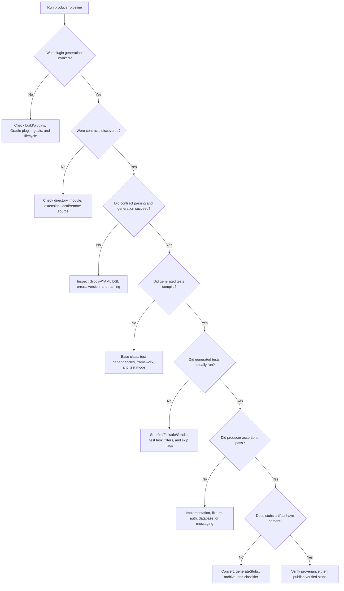

# Plugin Cannot Find Contracts or Does Not Generate Tests

You add `spring-cloud-contract-maven-plugin` to `pom.xml`, create a Groovy or YAML file in the repository, and run `mvn verify`. The build may report **BUILD SUCCESS**, yet the generated tests directory is empty, there are no test cases for the API you just wrote, or the consumer still uses an old set of stubs. Conversely, the build may also stop with a message saying **no contracts found**, **DSL parsing error**, or **generated tests fail to compile**. These are distinct categories of failures that need to be diagnosed in order rather than changing configuration, data, and code all at once.

In the **SPRING_CLOUD_CONTRACT** learning path, Spring Cloud Contract uses **Groovy/YAML DSL** to describe HTTP or messaging contracts, generates tests for the **producer**, publishes **stubs JARs**, lets the **consumer** use **Stub Runner**, and integrates with **CI** to detect incompatible API changes. This lesson belongs to the **Troubleshooting** chapter and focuses on resolving scenarios where **the plugin cannot find contracts or does not generate tests** in Maven/Gradle projects.

After this lesson, you will be able to pinpoint whether a failure lies in **contract discovery, parsing, plugin activation, generation, test compilation, test execution, or stub packaging**; read logs, effective POM, and the Gradle task graph accurately; apply targeted configuration fixes; and configure CI so it does not mark a build as successful when `0 producer contract tests` are executed.

## 1. Classify Symptoms Before Fixing

The phrase “not generating tests” can describe at least six different states:

| Category | Observation | Initial Conclusion |
|---|---|---|
| **A. Contracts not visible** | Log reports `No contracts found` or contract count is 0 | Check path, module, file extension, source dependency |
| **B. Cannot parse contract** | Groovy/YAML DSL error, import error, or contract structure error | File exists, but its content is not accepted |
| **C. Plugin did not run** | Maven/Gradle log has no generate step; source output is empty | Plugin is not activated or goal/task is not bound to the lifecycle |
| **D. Tests generated but fail to compile** | Generated Java/Groovy files exist; class/import/base class errors | Test classpath, framework, test mode, or generated code issue |
| **E. Compiled but not executed** | `.class` files exist; Surefire/Gradle test reports do not show contract tests | Test runner does not discover them or tests are skipped |
| **F. Tests ran but stubs are missing** | Producer tests PASS; no `-stubs.jar` or mappings exist | Conversion/packaging/publication is separate from generation |

**Do not call all of these categories a “plugin bug.”** For example, a missing `baseClassForTests` usually causes tests **not to compile**, rather than preventing the plugin from finding the Groovy DSL. Likewise, `Tests run: 0` is a **test execution** issue and does not prove that the generation step failed.

### 1.1. Decision Flowchart



An effective investigation always identifies the **first failing step**, then inspects only the configuration affecting that step.

## 2. Diagnostic Goal: Build an Evidence Chain

To prove that a producer satisfies a contract, you must distinguish each stage:

```text
Groovy/YAML contract files
          ↓
Plugin discovery
          ↓
DSL parsing/validation
          ↓
Generated producer test sources
          ↓
Test compilation
          ↓
JUnit/Spock execution against real producer
          ↓
Producer assertions PASS
          ↓
Convert contract → stub mapping
          ↓
Package and publish stubs artifact
          ↓
Consumer Stub Runner tests
```

Having a **stubs JAR** does not mean **generated producer tests ran**. Having **generated test source** does not mean **tests were executed by JUnit**. Seeing **BUILD SUCCESS** does not mean **contracts were discovered**.

### 2.1. Stage-by-Stage Evidence Table

| Stage | Minimum Evidence | If Missing |
|---|---|---|
| Source | Contract file in the right module and directory | Wrong path or not committed |
| Discovery | Log/plugin output identifies contracts | Source path, local/remote source, or plugin did not run |
| Generation | Generated test files | DSL parse, generator config, plugin tasks |
| Compilation | Test classes or compiler success | Base test, JDK, dependencies |
| Execution | Test runner reports contain generated cases | Naming, includes/excludes, skip flags |
| Verification | Tests pass, failures/errors equal 0 | Implementation, fixture, transport |
| Stub output | Mappings/contracts inside the archive | Convert/package goal/task |
| Publication | GAV/version/classifier resolves | Maven repository, credentials, or publication |

These pieces of evidence **complement one another**. Any single file inside `target/` is not enough to conclude that the entire pipeline is healthy.

## 3. First Step: Pin the Environment and Reproduce the Error

Before editing a POM or DSL file:

1. Record the exact **commit/branch** and **producer module**.
2. Record the **Spring Boot, Spring Cloud, and Spring Cloud Contract versions**.
3. Confirm the JDK and Maven/Gradle versions actually used by CI.
4. Record the **verbatim build command**, including `-pl`, profiles, flags, and environment variables.
5. Reproduce with a minimal contract that does not depend on network access or random data.
6. Classify the symptom into A–F from section 1.
7. Do not change multiple variables in a single attempt.

With Maven Wrapper:

```bash
./mvnw -version
./mvnw -B -ntp clean verify
```

With Gradle Wrapper:

```bash
./gradlew --version
./gradlew clean check
```

**These are commands for learners to practice in a project**, not commands executed during the authoring of this lesson. `clean` helps remove generated output from previous builds, but it can delete files under the build directory; check the build directory if the project stores data there manually. Do not run `clean` in a shared environment without knowing its impact.

### 3.1. Why Is the Exact Build Command Necessary?

These commands are not equivalent:

```bash
./mvnw test
./mvnw -pl order-service test
./mvnw -pl order-service -am clean verify
./mvnw -DskipTests package
./mvnw org.springframework.cloud:spring-cloud-contract-maven-plugin:generateTests
```

They may target different modules, run different lifecycle phases, or skip test execution. Running `generateTests` may produce generated source without running JUnit. Running `package -DskipTests` may produce a stubs artifact **without producer verification evidence**.

## 4. Default Contract Location and Module Structure

In many **Spring Cloud Contract Maven plugin** setups, the default local contract source is:

```text
src/test/resources/contracts/
```

An example producer:

```text
order-service/
├── pom.xml
├── src/
│   ├── main/java/com/example/order/
│   │   ├── OrderServiceApplication.java
│   │   └── OrderController.java
│   └── test/
│       ├── java/com/example/order/contract/
│       │   └── OrderContractTestBase.java
│       └── resources/
│           └── contracts/
│               ├── checkout-service/
│               │   ├── get_paid_order_200.groovy
│               │   └── get_missing_order_404.yml
│               └── billing-service/
│                   └── order_paid_event.groovy
└── target/                       # Generated after Maven build
```

**The default directory is resolved relative to the module**, not necessarily the aggregator root. If the repository is a monorepo and Maven is running for `checkout-service`, it will not automatically look for contracts in `order-service/src/test/resources/contracts`.

### 4.1. Common Path Mistakes

| Actual Location | Possible Issue |
|---|---|
| `src/test/resource/contracts` | Missing `s` in `resources` |
| `src/test/resources/contract` | Singular instead of plural |
| `src/main/resources/contracts` | Not the default Maven plugin path unless overridden |
| `contracts/` at repository root | Plugin is unaware of it unless configured |
| `order-service/src/test/resources/contracts` | Running Maven from another module may not scan it |
| `src/test/resources/contracts-old` | Folder no longer matches configuration |
| Absolute path on developer machine | CI uses a different workspace and cannot find it |
| Contracts only live in an un-checked-out Git submodule | CI has no local files |
| Files are in `.gitignore` or uncommitted | Present locally, missing in CI |

Do not rush to change `contractsDirectory` to an arbitrary relative path. First determine `project.basedir`/project root and **the directory the plugin is actually using**.

## 5. Create a Minimal Contract to Test Discovery

A small contract helps isolate a plugin issue from a complex DSL issue.

File `src/test/resources/contracts/checkout-service/get_paid_order_200.groovy`:

```groovy
import org.springframework.cloud.contract.spec.Contract

Contract.make {
    name 'checkout_get_paid_order_200'
    description 'Checkout reads a paid order'

    request {
        method GET()
        url '/api/orders/ORDER-42'
        headers {
            header 'Accept', 'application/json'
        }
    }

    response {
        status OK()
        headers {
            contentType(applicationJson())
        }
        body(
            id: 'ORDER-42',
            status: 'PAID',
            totalAmount: 125000
        )
    }
}
```

If the generator reads this contract, basic **discovery and parsing** are working. However, for the **generated producer test to run and pass**, Order Service must have the endpoint and fixture returning the response above. Successfully creating a contract does **not** automatically create the controller or `ORDER-42` data.

### 5.1. A Standalone YAML Contract

File `src/test/resources/contracts/checkout-service/get_missing_order_404.yml`:

```yaml
name: checkout_get_missing_order_404
description: Order does not exist
request:
  method: GET
  url: /api/orders/ORDER-MISSING
  headers:
    Accept: application/json
response:
  status: 404
  headers:
    Content-Type: application/json
  body:
    code: ORDER_NOT_FOUND
```

This YAML describes a **different case** from the Groovy `200` contract. Do not write the same request/response once in Groovy and once in YAML and put them in the same directory unless you want duplicate tests or stub mappings.

### 5.2. Checks After Adding a Contract

- The file extension is supported by your plugin version (typically `.groovy` and `.yml`; check `.yaml` support by version).
- The file actually resides under the directory the plugin is reading.
- Groovy DSL includes `Contract.make` and the right import/package.
- YAML has root `request` and `response` structures as supported by the DSL.
- YAML indentation uses consistent spaces with no mixed tabs.
- Enum/helper methods `GET()`, `OK()`, `applicationJson()` match your version's DSL.
- No real production mocks/secrets appear in the contract.
- The contract name is unique according to the naming policy.
- No hidden syntax errors caused by copying from Markdown, smart quotes, or special characters.

## 6. The Maven Plugin Must Actually Be Activated

A common mistake is declaring only the dependency:

```xml
<dependency>
    <groupId>org.springframework.cloud</groupId>
    <artifactId>spring-cloud-starter-contract-verifier</artifactId>
    <scope>test</scope>
</dependency>
```

This dependency **does not replace** Maven plugin generation. In the producer `pom.xml`, you need the appropriate plugin under `build/plugins` or a verified equivalent activation mechanism.

### 6.1. Sample Maven Configuration for Spring MVC

```xml
<properties>
    <spring-cloud-contract.version>CONTRACT_VERSION_PHU_HOP</spring-cloud-contract.version>
</properties>

<dependencyManagement>
    <dependencies>
        <dependency>
            <groupId>org.springframework.cloud</groupId>
            <artifactId>spring-cloud-contract-dependencies</artifactId>
            <version>${spring-cloud-contract.version}</version>
            <type>pom</type>
            <scope>import</scope>
        </dependency>
    </dependencies>
</dependencyManagement>

<dependencies>
    <dependency>
        <groupId>org.springframework.boot</groupId>
        <artifactId>spring-boot-starter-test</artifactId>
        <scope>test</scope>
    </dependency>
    <dependency>
        <groupId>org.springframework.cloud</groupId>
        <artifactId>spring-cloud-starter-contract-verifier</artifactId>
        <scope>test</scope>
    </dependency>
</dependencies>

<build>
    <plugins>
        <plugin>
            <groupId>org.springframework.cloud</groupId>
            <artifactId>spring-cloud-contract-maven-plugin</artifactId>
            <version>${spring-cloud-contract.version}</version>
            <extensions>true</extensions>
            <configuration>
                <contractsDirectory>
                    ${project.basedir}/src/test/resources/contracts
                </contractsDirectory>
                <baseClassForTests>
                    com.example.order.contract.OrderContractTestBase
                </baseClassForTests>
                <testMode>MOCKMVC</testMode>
                <testFramework>JUNIT5</testFramework>
                <failOnNoContracts>true</failOnNoContracts>
            </configuration>
        </plugin>
    </plugins>
</build>
```

This is only a **POM fragment** for a Spring MVC producer, not a complete POM. You still need the Spring Boot parent/BOM, JDK, dependencies, and actually compatible versions. Replace `CONTRACT_VERSION_PHU_HOP` with the version chosen for your release train; keep the plugin and verifier versions aligned.

### 6.2. Why Is `extensions=true` Needed?

In Spring Cloud Contract Maven guides, the plugin is typically declared with:

```xml
<extensions>true</extensions>
```

to integrate the plugin with the Maven build as supported by that version. However, **this attribute does not automatically fix** a wrong contracts directory, missing base class, or skipped test runner. If the project has custom plugin executions, compare against the **effective POM** to avoid duplicate runs or missed goals.

### 6.3. `failOnNoContracts` Is a Guardrail, Not Magic

In plugin versions that support it, `failOnNoContracts` can fail the build when the generator finds no contracts. However:

- If the plugin does not run, that parameter never gets a chance to apply.
- If the goal is being skipped, fail-on-no-contracts does not prove tests ran.
- If the plugin version does not support it or uses different parameter syntax, the setting may have no effect.
- If only some contracts are missed while other files remain, a contract count > 0 does not guarantee all cases are covered.

CI should check the **expected contract inventory**, generated test classes, and test reports rather than relying on a single flag.

## 7. `pluginManagement` vs. `build/plugins`

In Maven, `pluginManagement` mainly **manages default version/configuration** for plugins. It does not mean the same thing as declaring an active plugin under `build/plugins`.

For example, in a parent POM:

```xml
<build>
    <pluginManagement>
        <plugins>
            <plugin>
                <groupId>org.springframework.cloud</groupId>
                <artifactId>spring-cloud-contract-maven-plugin</artifactId>
                <version>${spring-cloud-contract.version}</version>
            </plugin>
        </plugins>
    </pluginManagement>
</build>
```

The producer child module may need to activate it:

```xml
<build>
    <plugins>
        <plugin>
            <groupId>org.springframework.cloud</groupId>
            <artifactId>spring-cloud-contract-maven-plugin</artifactId>
            <extensions>true</extensions>
            <configuration>
                <baseClassForTests>
                    com.example.order.contract.OrderContractTestBase
                </baseClassForTests>
            </configuration>
        </plugin>
    </plugins>
</build>
```

The version can be inherited from the parent's `pluginManagement`. If generated tests do not appear, **do not just grep for the artifactId string in the repository**; check whether the plugin is actually applied in the **producer module's effective POM**.

### 7.1. Inspecting the Effective POM

```bash
./mvnw -B -ntp help:effective-pom
```

For multi-module projects, you can select the producer:

```bash
./mvnw -B -ntp -pl order-service help:effective-pom
```

When reading the output, confirm:

1. `spring-cloud-contract-maven-plugin` is in `build/plugins` of the module to be verified.
2. The version is not unexpectedly overridden by a parent or profile.
3. `contractsDirectory` resolves properly.
4. `baseClassForTests` has the exact FQN.
5. `testMode` matches the Spring stack.
6. `executions` and lifecycle bindings match the version.
7. No `skip` flag or profile disables the plugin.

`help:effective-pom` can print extensive configuration details and repository URLs. When sharing CI logs, avoid exposing secrets injected via settings or environment variables.

## 8. Maven Lifecycle: Running the Right Phases and Goals

The Maven plugin provides several important goals:

| Goal | Function | Evidence |
|---|---|---|
| `generateTests` | Generates producer verification tests from DSL | Generated test sources |
| `convert` | Converts DSL into stub mappings | Generated mappings |
| `generateStubs` | Packages contracts/mappings into a stubs JAR | Artifact `-stubs.jar` |
| `help` | Looks up parameters/goals for the plugin version | Plugin metadata |
| `run` | Runs a stubs server for testing | Does not replace producer verification |
| `pushStubsToScm` | Publishes stubs to SCM as configured | Only used in specific SCM workflows |

In many Maven plugin versions, `generateTests` is bound to `generate-test-sources` and `generateStubs` to `package`. **Defaults and bindings must be checked against your actual version**; a parent POM or custom execution can alter how they are invoked.

### 8.1. Different Commands Answer Different Questions

```bash
# Check toolchain versions
./mvnw -version

# Focus on testing the generateTests goal
./mvnw -B -ntp \
  org.springframework.cloud:spring-cloud-contract-maven-plugin:generateTests

# Run build lifecycle up to the test phase
./mvnw -B -ntp clean test

# Run lifecycle up to verify
./mvnw -B -ntp clean verify
```

Using a **fully qualified plugin goal** avoids issues where Maven cannot resolve the plugin prefix. However, running `generateTests` directly **does not run JUnit** and may miss preparation steps if the project depends on other lifecycle phases or executions.

### 8.2. When Does Generation Not Happen?

- Running only a goal that skips the required phase.
- The Maven profile containing the plugin is not activated.
- The plugin is in parent `pluginManagement` without being used by the module.
- Plugin executions are disabled, overridden, or bound to the wrong phase.
- The plugin version cannot be resolved.
- Plugin configuration has a skip flag.
- Running on the **consumer module** instead of the producer.
- The build tool is Gradle, but someone edited an unused Maven POM.

**How to handle:** confirm the plugin is invoked in the build log, then inspect the output of that specific goal. Do not add a bunch of manual executions before checking what lifecycle bindings the plugin version already provides.

## 9. Multi-Module: Looking in the Wrong Directory Is Very Common

A Maven reactor:

```text
commerce-platform/
├── pom.xml
├── order-service/
│   ├── pom.xml
│   └── src/test/resources/contracts/
├── checkout-service/
│   └── pom.xml
└── common-model/
    └── pom.xml
```

When running from the root:

```bash
./mvnw -B -ntp -pl order-service -am clean verify
```

Check:

- Is the producer module `order-service` selected by Maven?
- Is the plugin configured in `order-service/pom.xml` or validly inherited/applied?
- Does `project.basedir` point to **order-service**?
- Are generated tests located under `order-service/target/...` instead of the root `target/`?
- Do `order-service`'s own test reports include the generated classes?
- `common-model` may build in the reactor without needing to run the contract plugin.
- `checkout-service` is the consumer and does not generate Order Service's producer tests.

### 9.1. Scoping `contractsDirectory` Per Module

Example:

```xml
<contractsDirectory>
    ${project.basedir}/src/test/resources/contracts
</contractsDirectory>
```

Inside a producer module, `project.basedir` is typically the module directory, not the aggregator root. Do not commit absolute paths like `C:\Users\dev\workspace\...` or `/home/alice/...` in a POM if CI uses a different workspace.

### 9.2. Confusing Root Build Output

If the child module generates tests successfully but you only inspect:

```text
commerce-platform/target/generated-test-sources/contracts
```

you might mistakenly conclude that the plugin did not generate tests. Look at the **producer module output**, for example:

```text
commerce-platform/order-service/target/generated-test-sources/contracts
commerce-platform/order-service/target/surefire-reports
```

The paths above are common Maven examples; actual configurations may vary.

## 10. Files Not Found Due to Naming or Extension

Spring Cloud Contract supports contract DSLs for specific types and versions. If the source directory is correct but the contract count is 0, check:

| Issue | Example | Remediation |
|---|---|---|
| Extension unsupported by version | `.yaml` when plugin only accepts specific formats/paths | Check version docs, use a supported extension |
| Filename lacks proper extension | `get_order.groovy.txt` | Rename to `get_order.groovy` |
| File only exists in README/snippet | Markdown code fence instead of a DSL file | Create an actual contract file |
| File is uncommitted | Present locally, missing in CI | Check Git tracked files |
| Wrong casing on Linux | `Contracts` vs `contracts` | Standardize path casing |
| Folder excluded by config | Path/exclude pattern | Inspect patterns and plugin config |
| File unreadable | Permission/encoding error | Check permissions/UTF-8 |
| Package layout inside artifact differs from expected | `contractsPath` mismatch | Inspect contract dependency archive |

**Do not bulk-rename files** before checking whether the plugin uses a local directory or an external contract dependency. An external source configuration can ignore the local path even when files there are valid.

### 10.1. Verify Whether Files Are Real Groovy/YAML

Sometimes IDEs or Windows Explorer hide extensions. A file shown as `get_paid_order.groovy` may actually be named `get_paid_order.groovy.txt`. On Linux CI, an uppercase character in a path may also fail to match on a case-sensitive filesystem.

Verify the **full filename and actual file content**, not just the IDE file tree. Avoid placing contract folders inside temporary build outputs that `clean` can wipe out.

## 11. Groovy DSL: File Exists, Generator Fails to Parse

A valid Groovy contract usually needs the import:

```groovy
import org.springframework.cloud.contract.spec.Contract

Contract.make {
    request {
        method GET()
        url '/api/orders/ORDER-42'
    }
    response {
        status OK()
    }
}
```

Common errors:

### 11.1. Missing or Wrong Import

```groovy
// Anti-pattern: Contract is not imported and there is no corresponding binding.
Contract.make {
    request {
        method GET()
        url '/api/orders/ORDER-42'
    }
}
```

Errors may mention `MissingPropertyException` or `unable to resolve class`. Fix by using the right import for your DSL version, rather than adding arbitrary Groovy dependencies before checking the plugin version.

### 11.2. Using Kotlin/Java DSL Syntax in a Groovy File

`.groovy` files must use Groovy DSL matching the plugin version. Java/Kotlin DSLs have their own APIs and support mechanisms; you cannot rename a Java file to `.groovy` and expect the generator to translate the syntax.

### 11.3. Calling Matchers/Helpers Absent in That Version

Helpers such as `byRegex`, `byType`, `bodyMatchers`, or request/response DSL methods can vary across release lines. If a stack trace reports `MissingMethodException`, look up the helper **in the documentation for your exact version**, without assuming method names are identical across all releases.

### 11.4. Groovy Code With Side Effects During Parsing

Groovy DSL can contain dynamic computation, but you should avoid:

- Reading production secrets/env vars to generate tokens.
- Making network API calls during contract generation.
- Depending on file parsing order.
- Generating uncontrolled random IDs.
- Accessing a real database inside DSL files.

Those behaviors cause generation to differ between local machines and CI and make troubleshooting harder. Contracts should express **stable behavior** and controlled test data.

## 12. YAML DSL: Syntax and Schema Errors

A simple YAML contract:

```yaml
name: checkout_get_paid_order_200
request:
  method: GET
  url: /api/orders/ORDER-42
response:
  status: 200
  headers:
    Content-Type: application/json
  body:
    id: ORDER-42
    status: PAID
    totalAmount: 125000
```

Common mistakes:

| Error | Example | Consequence |
|---|---|---|
| Wrong indentation | `response` nested under `request` | Parser/DSL does not recognize structure |
| Tabs where spaces are required | Tabs in indentation | YAML parser error |
| Misspelled key | `responses` instead of `response` | Expected response is not created |
| Wrong string/number type | `"125000"` instead of number `125000` | Assertion may mismatch types |
| Unquoted special values | String containing `: `, `#`, or characters needing escape | YAML misinterprets the value |
| List at root when DSL expects a contract object | `- name: ...` | May be unsupported depending on parser/version |
| DSL field from another version | Unrecognized message/matcher key | Generation fails or field is ignored |
| Multiple documents in one file | `---` multiple YAML docs | Parser/version-dependent; not supported by default |

**A parser accepting YAML syntax does not mean the DSL semantics are valid.** YAML can be syntactically valid while the plugin ignores an unknown key. Read error logs and generated output to verify the entire scenario was recognized.

### 12.1. Do Not Rely Solely on a Generic YAML Validator

A YAML linter can verify indentation and syntax. Only the corresponding plugin can confirm that keys such as `request.method`, `response.status`, `outputMessage.sentTo`, and matcher structures match the **Spring Cloud Contract DSL version**.

When investigating, separate:

1. **Does the YAML file parse cleanly?**
2. **Does the plugin recognize the Contract DSL schema?**
3. **Does the generator create the right test?**
4. **Does the generated test contain the necessary assertions?**

## 13. Contracts Located in an External Repository/Artifact

Not every producer keeps contracts in `src/test/resources/contracts`. Some organizations store DSL files in a separate Git repo or artifact and have the producer download them during the build.

In Spring Cloud Contract Maven plugin versions that support it, configuration may use `contractDependency`, `contractsPath`, `contractsMode`, and repository settings.

Illustrative POM fragment:

```xml
<configuration>
    <baseClassForTests>
        com.example.order.contract.OrderContractTestBase
    </baseClassForTests>
    <contractDependency>
        <groupId>com.example.contracts</groupId>
        <artifactId>order-contracts</artifactId>
        <version>CONTRACT_SOURCE_VERSION_PHU_HOP</version>
    </contractDependency>
    <contractsPath>com/example/order-service</contractsPath>
</configuration>
```

**This is not a guaranteed recipe across all versions.** You must verify that the artifact exists, the classifier/extension/layout are right, the plugin uses the appropriate fetch mode, Maven repositories/credentials permit access, and `contractsPath` matches the **path inside the archive**.

### 13.1. Common Causes When Fetching Contracts Remotely

- Artifact `com.example.contracts:order-contracts` has not been published.
- Expected version does not exist or snapshot metadata is stale.
- Repository URL points to the wrong Maven endpoint.
- Plugin is set to `LOCAL` while contracts only exist remotely.
- Credentials are not injected in CI.
- Download hit a cached older version.
- `contractsPath` does not match the archive layout.
- Consumer-specific directory does not follow the naming policy.
- Source artifact has contracts under `META-INF/...` instead of the path the plugin scans.
- Build runs offline and cannot download the artifact the first time.

**Do not confuse `contractDependency` (the DSL source for producer generation) with the stubs JAR** (the output artifact for Stub Runner). Even when source contracts live in a separate artifact, the producer must still run generated verification against its **real implementation**.

### 13.2. When Should You Inspect the Archive?

If Maven resolves a contract dependency successfully but the generator reports 0 contracts, inspect the **downloaded archive itself** to see where the DSL files live. Valid coordinates only guarantee the archive file was found—**they do not guarantee the expected directories and extensions exist inside**.

Given an archive with a known path:

```bash
jar tf path/to/order-contracts.jar
```

This is an illustrative command for hands-on practice; do not use it to read files outside the scope of the lesson during authoring workflows.

## 14. Gradle: Same Root Causes, Different Task Names

If the project uses Gradle, editing a Maven POM has no effect. Check whether the Spring Cloud Contract Gradle plugin is applied to the **producer project** and whether the task graph runs generation.

Some tasks across Gradle plugin versions:

| Task | Role |
|---|---|
| `generateContractTests` | Generates producer tests |
| `contractTest` | Runs contract tests per source set/plugin config |
| `generateClientStubs` | Converts DSL into mappings |
| `verifierStubsJar` | Packages the stubs archive |
| `check` | Verification lifecycle; may depend on `contractTest` if tasks are wired properly |

Check the task list:

```bash
./gradlew tasks --all
```

Example of running generation alone if the task is present:

```bash
./gradlew generateContractTests
```

And checking test execution:

```bash
./gradlew contractTest
./gradlew check
```

**Do not assume** `check` in every Gradle project always runs `contractTest`, or that `verifierStubsJar` proves contract tests passed. Inspect actual task dependencies and reports.

### 14.1. Contract Paths in Gradle

Many Gradle Spring Cloud Contract projects store contract DSLs in a directory such as:

```text
src/contractTest/resources/contracts/
```

Some versions or configurations may use another path. The plugin provides parameters to select the contracts DSL directory (e.g., `contractsDslDir` in supporting versions). If Maven's `src/test/resources/contracts` path is copied verbatim into a Gradle project without updating plugin config, the generator may find nothing.

**Diagnostic rule:** inspect the source path **the Gradle task actually scans**, rather than relying on memory of another version's “default path.”

### 14.2. Gradle Source Sets and Task Execution

After `generateContractTests`, generated files may live under `build/generated-test-sources/contractTest/` or a custom path. Confirm that:

- The `generateContractTests` task is invoked.
- Task input files match the DSL source.
- Task output contains generated tests.
- `contractTest` compiles and runs those tests.
- The test framework/JUnit engine is compatible.
- `UP-TO-DATE`/build cache is not hiding improperly declared source inputs.
- The producer module is not skipped by `onlyIf`, excludes, disabled tasks, or project selection.

Do not reflexively wipe the entire Gradle cache; first check the task graph and input/output dependency configuration.

## 15. Plugin Runs, Finds Contracts, Yet Generated Output Is Empty

This scenario requires deeper diagnosis:

1. Does the log genuinely say **contracts found**?
2. Does the plugin classify those files as **valid producer contracts**?
3. Is a contract template/matcher causing the generator to skip all or individual cases?
4. Does the file contain a DSL expression that fails to return the required contract object?
5. Is the plugin writing generated code to a different path than the one you are inspecting?
6. Is generated source deleted by a subsequent task/`clean` after generation?
7. Do multiple modules share outputs, causing you to check the wrong module?
8. Does plugin configuration have a filter or source path override?
9. Did Maven handle a compilation/generation error as a warning/skip?
10. Is there a regression/behavior difference from changing the plugin version?

**Do not assume “the plugin did not generate” just because the default directory is empty** if the project configured a custom `testSourceDirectory`/generated sources path. Read the output directory from plugin logs and effective configuration.

### 15.1. A Minimal Contract as a Discriminating Test

If the plugin generates tests for a simple `GET /health` or `GET /api/orders/ORDER-42` contract but fails to generate for a complex contract, the cause is likely a **DSL or version-specific feature**.

If even the minimal contract is not recognized, prioritize **plugin activation/path**.

Do not add dozens of matchers or test fixtures to a minimal contract before confirming discovery and generation work.

## 16. Generated Test Files Exist, But Fail to Compile

Once generation succeeds, test compilation can fail due to the base class or dependencies.

Example configuration:

```xml
<baseClassForTests>
    com.example.order.contract.OrderContractTestBase
</baseClassForTests>
```

If the actual class resides at `com.example.order.testing.OrderContractBase`, the generated test will extend a nonexistent FQN.

### 16.1. Minimal Base Class for MVC

```java
package com.example.order.contract;

import io.restassured.module.mockmvc.RestAssuredMockMvc;
import org.junit.jupiter.api.BeforeEach;
import org.springframework.beans.factory.annotation.Autowired;
import org.springframework.boot.test.autoconfigure.web.servlet.AutoConfigureMockMvc;
import org.springframework.boot.test.context.SpringBootTest;
import org.springframework.test.web.servlet.MockMvc;

@SpringBootTest
@AutoConfigureMockMvc
public abstract class OrderContractTestBase {

    @Autowired
    MockMvc mockMvc;

    @Autowired
    OrderContractFixture fixtures;

    @BeforeEach
    protected void prepare() {
        fixtures.resetOrders();
        fixtures.insertPaidOrder("ORDER-42", 125000);
        fixtures.ensureAbsent("ORDER-MISSING");

        RestAssuredMockMvc.mockMvc(mockMvc);
    }
}
```

This is a **skeleton example**. `OrderContractFixture` must be created by your project; appropriate Spring Boot/Spring Test, Contract Verifier, RestAssured MockMvc, and JUnit dependencies are required.

If generated tests fail to compile:

- Read the error line in the generated source.
- Verify the FQN of the base class.
- Verify package/imports and visibility.
- Check which JUnit version the generator produces.
- Verify the test source root is added to the compiler.
- Verify the `RestAssuredMockMvc` dependency and test scope.
- Check whether the JDK supports the generated Java syntax.
- Check Spring Boot/Cloud/Contract version alignment.

**Never edit generated Java files directly.** Every regeneration can overwrite them. Fix the contract, base class, plugin configuration, or dependencies instead.

## 17. `testMode` Does Not Match the HTTP Stack

A Spring MVC producer can use `MOCKMVC`. A WebFlux-only or JAX-RS producer requires a different adapter depending on version support.

| Test mode | Target stack | Common issue |
|---|---|---|
| `MOCKMVC` | MVC requests via MockMvc | Base class does not configure RestAssuredMockMvc |
| `EXPLICIT` | Real HTTP to embedded server/test port | Server not started or wrong base URI/port |
| `WEBTESTCLIENT` | WebFlux WebTestClient if supported by plugin version | Used on unsupported version or missing reactive test context |
| `JAXRSCLIENT` | JAX-RS mode if supported by version | Missing proper client/server infrastructure |

**Do not configure `WEBTESTCLIENT` merely because the producer has a WebFlux dependency** without checking plugin support and generated code. If the plugin does not support that mode, generation may fail or behave unexpectedly.

### 17.1. When the Failure Is Actually Test Execution, Not Generation

For example, generated tests use the RestAssured HTTP client and call `localhost:8080`, while the producer is running on a different random port. Tests may fail with `Connection refused` or port errors even though generation succeeded completely.

Distinguish between:

- **Generator**: produces request/assertion code.
- **Base test**: sets up the target application/HTTP adapter.
- **JUnit runner**: executes the generated requests.
- **Producer implementation**: returns the real response.

If the error is `Connection refused`, fix the port/server setup; do not change `contractsDirectory`.

## 18. Maven Surefire/Failsafe: Did Generated Tests Actually Run?

An especially dangerous case is when generated Java files **exist** and tests **compile**, yet the test runner reports:

```text
Tests run: 0, Failures: 0, Errors: 0, Skipped: 0
BUILD SUCCESS
```

Possible causes include:

- Test classes do not match naming conventions/includes.
- Missing JUnit Jupiter engine or wrong test framework version.
- Surefire/Failsafe plugin does not pick up generated sources.
- Tests are annotated with `@Disabled`/`@Ignore`.
- A profile excludes generated packages.
- `-DskipTests` or `-Dmaven.test.skip=true`.
- Test task is not bound to the selected Maven lifecycle.
- Another module is running tests.
- Test code is only compiled in a separate source set not invoked by the runner.

### 18.1. Why Can Total Tests > 0 Still Be Meaningless?

A producer may have 80 unit tests and 0 contract tests. A report showing `Tests run: 80` does not prove contract verification ran.

Look for the **generated producer test classes/methods** inside:

```text
target/surefire-reports/
target/failsafe-reports/
```

Or other paths if the project uses a custom runner configuration. Cross-check against **expected contract cases**, not just the total count.

### 18.2. Check Test Naming and Runner Config

In common Surefire versions, naming patterns like `*Test`, `*Tests`, and `Test*` are discovered by default/common configuration. However, users can override includes/excludes.

If a generated class does not match, configure Surefire/Failsafe to select it, or adjust naming/generator settings per your supported version. Do not rename generated classes manually.

### 18.3. Do Not Use Skip Flags to “Fix” Compilation Errors

`-DskipTests` generally skips test execution; `-Dmaven.test.skip=true` can skip both compilation and execution depending on the plugin. They can let a build pass a failing step, but they strip away producer verification evidence.

In particular, **do not publish verified stubs** from a build using skip flags. If a job needs a fast build without running tests, label it as **compile/smoke** rather than a contract-verified release.

## 19. Plugin Cannot Be Resolved: Separate Environment from DSL

Error messages can appear before the generator reads any contract file:

```text
Plugin ... could not be resolved
No plugin found for prefix ...
Could not find artifact ...
PKIX path building failed
401 Unauthorized / 403 Forbidden from repository
```

These errors are usually **plugin/dependency resolution, repository, or TLS issues**, not Groovy/YAML contract defects.

### 19.1. Verification Steps

1. `groupId` must be `org.springframework.cloud`.
2. `artifactId` must be `spring-cloud-contract-maven-plugin`.
3. `version` must exist and align with the Boot/Cloud release train.
4. Does the Maven mirror/repository policy allow downloading the plugin?
5. Does CI use Maven settings and credentials with the right `server id`?
6. Are TLS certificate truststores/proxies valid?
7. Is the build running in offline mode or blocked from the repository?
8. Can Maven resolve the plugin prefix?

To diagnose prefix resolution, use the fully qualified goal name:

```bash
./mvnw org.springframework.cloud:spring-cloud-contract-maven-plugin:generateTests
```

If the full command also fails to resolve the artifact, fix the repository, version, or credentials. **Do not edit contract contents** to solve plugin download errors.

### 19.2. Do Not Compromise Repository Security Just Because a Build Fails

Do not disable TLS verification, put usernames/passwords in POM files, or add untrusted repositories just to make the generator run. Use Maven settings/CI secret injection and manage mirrors/certificates through infrastructure processes.

## 20. Log Levels and Debug Output: Collect the Right Level of Evidence

When normal output is insufficient, Maven offers debug mode:

```bash
./mvnw -B -ntp -X \
  org.springframework.cloud:spring-cloud-contract-maven-plugin:generateTests
```

Gradle also provides log levels:

```bash
./gradlew generateContractTests --info
./gradlew generateContractTests --stacktrace
```

**Warning:** `-X` and `--debug` can print extensive environment details, paths, parameters, repository URLs, and sometimes credentials if the logging system does not redact them. Enable only when needed, redact secrets before sharing logs, and never commit raw logs to the repository.

### 20.1. Lines to Look For in Logs

| Log Signal | Interpretation |
|---|---|
| Plugin goal/task executed | Basic plugin activation is correct |
| Contract source path printed | Confirms the actual directory the plugin reads |
| Number of contracts discovered | Input files were recognized |
| Parse/DSL exception | File exists, syntax/semantics are invalid |
| Generated source output directory | Locate exactly where tests are written |
| Test compile error | Generation finished, code does not compile |
| Surefire/Gradle test runner summary | Whether execution happened |
| Convert mappings output | Mappings were generated |
| Stubs JAR path/classifier | Artifact packaging completed |

Do not look solely for `BUILD SUCCESS`. A diagnostic conclusion must be backed by **the log line proving the corresponding stage**.

## 21. Practical Scenario 1: Plugin Placed in the Wrong Section

**Symptom:** Maven build is green, no `generateTests` in the log, no generated source.

**Initial configuration:**

```xml
<build>
    <pluginManagement>
        <plugins>
            <plugin>
                <groupId>org.springframework.cloud</groupId>
                <artifactId>spring-cloud-contract-maven-plugin</artifactId>
                <version>CONTRACT_VERSION_PHU_HOP</version>
            </plugin>
        </plugins>
    </pluginManagement>
</build>
```

**Diagnosis:** The parent only manages the plugin; the child module has not actually declared usage of the plugin.

**Fix:** Activate the plugin under `build/plugins` in `order-service`; verify the effective POM and rerun generation.

**Completion evidence:**

- Log includes the plugin goal.
- Groovy/YAML files are discovered.
- Generated test source appears.
- Producer tests are executed by the test runner and pass.

Do not end the investigation just because you added XML to the POM.

## 22. Practical Scenario 2: Wrong `contractsDirectory`

**Symptom:** Plugin goal runs, yet the log reports no contracts found.

Wrong POM example:

```xml
<contractsDirectory>
    ${project.basedir}/src/main/resources/contracts
</contractsDirectory>
```

while the files actually live at:

```text
order-service/src/test/resources/contracts/
```

**Fix:**

```xml
<contractsDirectory>
    ${project.basedir}/src/test/resources/contracts
</contractsDirectory>
```

Or move the source files according to team policy. Maintain a **single source of truth**; do not copy the same contract set into two places “so the plugin finds it either way,” as that leads to version drift.

**Evidence:** Logs point to the right path, and generated tests reflect the latest contract rather than an old duplicate.

## 23. Practical Scenario 3: Valid YAML, Invalid DSL

**Symptom:** YAML parser reports no syntax error, yet the generator fails or omits the expected case.

Structurally wrong example:

```yaml
name: checkout_missing_order
request:
  method: GET
  url: /api/orders/ORDER-MISSING
responses:
  status: 404
```

The issue is the `responses` key instead of `response` per the illustrated DSL.

**Fix:**

```yaml
name: checkout_missing_order
request:
  method: GET
  url: /api/orders/ORDER-MISSING
response:
  status: 404
```

**Evidence:** The plugin recognizes the case and generated source contains a `404` status assertion. Do not stop after running only a YAML linter.

## 24. Practical Scenario 4: Generated Source Exists, Base Class Is Missing

**Symptom:** Generated test files appear, `testCompile` or Maven test compilation fails with:

```text
cannot find symbol: class OrderContractTestBase
```

**Cause:** `baseClassForTests` in the POM differs from the actual package/class, or the base class is not on the test classpath.

**Fix steps:**

1. Determine the FQN of the base test class, e.g. `com.example.order.contract.OrderContractTestBase`.
2. Verify the class exists under `src/test/java` or the appropriate test source set.
3. Correct the POM mapping.
4. Check test dependencies/imports.
5. Regenerate and compile.
6. Run producer tests and read reports.

**Do not** edit each generated class to extend another name; the generator will overwrite it.

## 25. Practical Scenario 5: Tests Generated, 0 Cases Run

**Symptom:** Maven plugin generated test sources, yet Surefire reports `Tests run: 0`.

Suspects:

- Generated classes are placed in a separate package excluded by Surefire.
- Missing Jupiter engine/Spock runner.
- Generated code uses annotations/test frameworks incompatible with dependencies.
- Maven is running from the wrong module.
- `skipTests` is enabled in a parent/profile.
- Class name does not match Surefire's naming pattern.
- Tests compiled, but the runner is not bound to the phase.

**How to diagnose:**

```bash
# Build producer in the right module
./mvnw -B -ntp clean test

# Find generated sources
find target/generated-test-sources/contracts -type f -print

# Find JUnit XML reports
find target/surefire-reports -name 'TEST-*.xml' -print
```

In a real repository with many unit tests, inspect the report for the **specific generated class/method**, not just the total test count.

**Evidence:** Test `checkout_get_paid_order_200` has a report showing it executed without skipping and fails if the controller returns the wrong `200`/body.

## 26. Practical Scenario 6: Messaging Contract Does Not Generate or Fails to Run

A message contract may look like:

```groovy
import org.springframework.cloud.contract.spec.Contract

Contract.make {
    name 'billing_order_paid_v1'
    label 'billing_order_paid_event_v1'

    input {
        triggeredBy('publishOrderPaid()')
    }

    outputMessage {
        sentTo('orders.events')
        headers {
            header('contentType', 'application/json')
            header('eventType', 'ORDER_PAID')
        }
        body(
            orderId: 'ORDER-42',
            eventType: 'ORDER_PAID',
            totalAmount: 125000
        )
    }
}
```

If the generator parses the contract but test compilation fails because `publishOrderPaid()` does not exist, **that is not a discovery problem**. The producer test base needs a hook or method called by the generated test.

An illustrative base test:

```java
@SpringBootTest
@AutoConfigureMessageVerifier
public abstract class OrderMessageContractBase {

    @Autowired
    OrderPaymentService orderPaymentService;

    @BeforeEach
    void setUp() {
        // Seed test order, clear output messages.
    }

    public void publishOrderPaid() {
        orderPaymentService.markPaid("ORDER-42");
    }
}
```

Imports, Spring Cloud Contract messaging integration, a test binder/broker, and concrete implementation are required. The `publishOrderPaid()` hook must invoke **real producer business logic**, rather than pushing a canned sample message directly to test output.

### 26.1. Do Not Expect HTTP Mappings from Every Message Contract

Message-only contracts generate message tests and message stubs, but do not necessarily create WireMock HTTP mapping JSON files. Checking an empty `mappings/` directory and concluding the plugin ignored the contract may be applying the **wrong verification criterion**.

For messaging, verify:

- Generated message tests are produced.
- The `triggeredBy` hook is invoked.
- The message verifier/binder observes output.
- Destination, headers, and body are asserted.
- The real producer emits the right event.
- Consumer Stub Runner tests reference the corresponding label/sample if the workflow uses them.

## 27. Practical Scenario 7: Stubs JAR Missing While Tests Run

**Symptom:** Producer contract tests run and pass, yet the consumer cannot download the `stubs` artifact.

A build may produce:

```text
target/order-service-1.4.0.jar
```

while missing:

```text
target/order-service-1.4.0-stubs.jar
```

Investigate:

1. Did the `convert` goal produce mappings?
2. Was the `generateStubs` goal run/bound to the lifecycle?
3. Did the build run up to `package` or stop at `test`?
4. Is the plugin skipped during the packaging step?
5. Does the stubs artifact have the `stubs` classifier and right version?
6. In a multi-module build, is the archive in the producer module?
7. Did Maven `install/deploy` attach and publish the stubs artifact?
8. Is the consumer using `LOCAL` or `REMOTE`, and which version?

**`mvn test` normally does not package artifacts.** Do not expect `-stubs.jar` after a command that only runs up to the test phase.

### 27.1. Do Not Confuse Stub Runner `ids` with Maven Dependency Notation

Stub Runner commonly uses:

```text
groupId:artifactId:version:classifier:port
```

For example:

```text
com.example:order-service:1.4.0:stubs:8085
```

`8085` is the HTTP stub server port, **not** a Maven artifact version or classifier. Maven artifact resolution failure does not mean producer test generation failed; the two issues should be categorized separately.

## 28. CI: How to Detect “0 Contracts” and “0 Tests” Early?

A producer pipeline should check:

1. Source contracts are in the right place and cover the minimum expected scenarios.
2. The plugin generation goal/task was actually invoked.
3. Generated sources contain the expected test classes.
4. Generated tests compile.
5. The JUnit/Spock runner executes the generated tests.
6. Tests are not skipped.
7. Producer assertions pass.
8. The stubs artifact is packaged from the same build.
9. The artifact has valid version, classifier, and contents.
10. No secrets exist inside contracts/stubs.

### 28.1. Sample GitHub Actions Maven Producer Workflow

```yaml
name: Producer Contract Verification

on:
  pull_request:
  push:
    branches: [main]

permissions:
  contents: read

jobs:
  verify:
    runs-on: ubuntu-latest
    steps:
      - uses: actions/checkout@v4

      - uses: actions/setup-java@v4
        with:
          distribution: temurin
          java-version: '17'
          cache: maven

      - name: Verify Maven producer
        run: ./mvnw -B -ntp clean verify

      - name: Confirm generated test source
        shell: bash
        run: |
          test -d target/generated-test-sources/contracts
          find target/generated-test-sources/contracts \
            -type f \( -name '*.java' -o -name '*.groovy' \) \
            -print -quit | grep -q .

      - name: Confirm test reports exist
        shell: bash
        run: |
          test -d target/surefire-reports
          find target/surefire-reports \
            -type f -name 'TEST-*.xml' \
            -print -quit | grep -q .

      - name: Upload reports
        if: always()
        uses: actions/upload-artifact@v4
        with:
          name: producer-contract-reports
          path: |
            target/surefire-reports/
            target/failsafe-reports/
          if-no-files-found: warn
```

**Limitation of this illustrative workflow:** verifying that the generated folder is non-empty and JUnit reports exist **does not prove those reports belong to generated contract tests**. A module with ordinary unit tests can pass both checks even if contract tests were never executed by the runner.

A stricter CI release gate should parse JUnit XML/contract inventory to verify that the exact generated test cases executed and were not skipped. How JUnit XML is parsed must match the naming/conventions of your plugin version rather than checking only the total test count.

### 28.2. Block Skip Flags in Releases

Flags to audit:

```text
-DskipTests
-Dmaven.test.skip=true
```

Also check plugin-specific skip properties, Gradle `enabled=false` or `onlyIf`, JUnit `@Disabled`, Maven profiles, and Surefire includes/excludes.

Do not treat a stubs artifact as verified if the build used skip flags to bypass producer verification.

### 28.3. Sample Release Gate Criteria

| Condition | Pass? |
|---|---|
| Contract inventory discovered | Required |
| Generated producer tests complete | Required |
| Test execution includes expected generated cases | Required |
| Failures/errors = 0 | Required |
| Out-of-policy skipped contract tests = 0 | Required |
| Producer implementation satisfies HTTP/message contracts | Required |
| Stubs artifact has right version/classifier | Required before publish |
| Clear commit/build provenance | Required before publish |
| Consumer compatibility matrix | Per release policy |

A good pipeline **fails closed** when evidence is missing, instead of treating missing reports as success.

## 29. Quick Troubleshooting Lookup Table

| Symptom | Likely Root Cause | First Action |
|---|---|---|
| No `generateTests` log | Plugin not activated | Check effective POM or Gradle task graph |
| `No contracts found` | Wrong path/module/extension | Verify goal's source directory |
| Missing contracts only in CI | Uncommitted files, case-sensitive path | Check Git tracked files and Linux paths |
| Groovy `MissingMethodException` | DSL API version mismatch | Check DSL against plugin version |
| YAML syntax error | Indentation/quotes | Fix syntax and rerun generator |
| YAML parses OK, case ignored | Unrecognized DSL key | Inspect generated output and schema |
| Maven plugin not resolved | Version/repository/credentials | Fix plugin coordinates or Maven settings |
| Generated source empty despite found contracts | Generation config/DSL behavior | Try minimal contract, read logs |
| Generated test compile fails | Base class/imports/dependencies | Read first compiler error and FQN |
| `cannot find symbol` base class | Wrong `baseClassForTests` | Fix FQN/test source set |
| MockMvc error | Mismatched adapter/test mode | Choose right mode for MVC/WebFlux/server |
| `Connection refused` | Test server not running or wrong port | Check base URI/random port |
| `Tests run: 0` | Surefire/JUnit discovery/skip | Read reports, framework, includes |
| Unit tests exist, no contract tests | Looked only at total count | Cross-check generated class names |
| `404` from producer test | Wrong route/fixture/implementation | Compare request URL and test DB |
| `404` from WireMock | Unmatched mapping | Inspect stub mappings, method/path/headers |
| Messaging test fails to compile | Missing `triggeredBy` hook | Base class/message verifier setup |
| Messaging test produces no event | Hook does not call producer or binder fails | Trace business code path |
| `-stubs.jar` missing | `package`/`generateStubs` not run | Check goals/lifecycle |
| Stubs JAR exists without HTTP mappings | Convert failed or message-only | Distinguish HTTP vs message contracts |
| Consumer cannot resolve stub | Wrong classifier/version/repository | Check Maven artifact coordinates |
| Passes locally, fails in CI | Different JDK/CI profile/cache/DB | Compare toolchain and test infrastructure |
| Green build lets breaking change slip | Contract tests did not run or matchers too loose | Mutation test and check generated assertions |

## 30. Layered Investigation Procedure

When facing a real failure, follow an ordered checklist:

### Layer 1 — Inputs

- [ ] Correct producer module.
- [ ] Contract files committed.
- [ ] Correct folder and extension.
- [ ] Local vs. external contract source clearly identified.
- [ ] No unintended duplicate contract definitions.

### Layer 2 — Plugin

- [ ] Maven plugin is in `build/plugins`/effective POM.
- [ ] Gradle plugin is applied to the right project.
- [ ] Plugin/version can be resolved.
- [ ] Generation goals/tasks are executed.
- [ ] Not disabled by a profile or skip flag.

### Layer 3 — DSL and Generation

- [ ] Groovy/YAML is valid for the plugin version.
- [ ] Contract discovery count matches expectations.
- [ ] Generated test files are created in the right output directory.
- [ ] Generated source reflects the intended request, response, and assertions.
- [ ] No duplicate test names or overwritten output files.

### Layer 4 — Compilation/Execution

- [ ] Base class FQN exists.
- [ ] Test framework/test mode matches.
- [ ] Test source root is compiled.
- [ ] JUnit/Spock runner executes the generated tests.
- [ ] No generated contract tests are unexpectedly skipped.
- [ ] Reports show executed test cases and statuses.

### Layer 5 — Producer Behavior and Stubs

- [ ] Real producer implementation is invoked.
- [ ] Fixtures are isolated and deterministic.
- [ ] HTTP status/header/body or message destination/header/body pass.
- [ ] Stubs artifact is packaged when lifecycle reaches the right phase.
- [ ] Classifier/version/contents are valid.
- [ ] Consumer Stub Runner uses the right artifact.

### Layer 6 — CI and Provenance

- [ ] JDK/Boot/Cloud/Contract versions are properly pinned.
- [ ] Repository credentials are secure.
- [ ] Releases do not skip tests.
- [ ] Artifact comes from the same verified commit.
- [ ] Mutation tests prove critical breaking changes fail.
- [ ] Reports provide enough detail to pinpoint root causes if failures recur.

## 31. Hands-on Exercise: Fixing a Producer “Not Generating Tests”

**Context:** Order Service uses Maven; Checkout expects `GET /api/orders/ORDER-42` to return `200` and `GET /api/orders/ORDER-MISSING` to return `404`. A developer says “I added Spring Cloud Contract, but I don't see any tests.”

### Step A — Reproduce the Baseline

1. Confirm JDK/Maven versions and Maven Wrapper.
2. Confirm you are in the right module `order-service`.
3. Check `pom.xml` for the Contract Verifier dependency and Maven plugin.
4. Identify the default or configured contracts directory.
5. Run `./mvnw -B -ntp clean verify` in the test environment.
6. Record the first error without making random edits.

### Step B — Check Discovery

1. Create minimal Groovy contract `checkout_get_paid_order_200`.
2. Create standalone YAML contract `checkout_get_missing_order_404`.
3. Place both under `src/test/resources/contracts/checkout-service/`.
4. If the plugin does not find them, verify directory, extension, and effective POM.
5. If the plugin finds them but parsing fails, inspect the Groovy/YAML stack trace.

### Step C — Check Generation

1. Run the `generateTests` goal or appropriate Maven lifecycle.
2. Inspect the generator's output directory in the logs.
3. Confirm generated test files contain the corresponding HTTP requests and assertions.
4. Verify test class names and `extends OrderContractTestBase`.
5. Do not edit generated files manually.

### Step D — Check Compilation

1. Create the exact base class FQN.
2. Configure `MOCKMVC` for the Spring MVC producer.
3. Use a test fixture to seed `ORDER-42` and exclude `ORDER-MISSING`.
4. Check Spring Boot Test/JUnit/RestAssured dependencies.
5. Run `clean test` and read compiler errors if any appear.

### Step E — Check Execution

1. Open Surefire/Failsafe reports.
2. Confirm both generated contract cases executed.
3. Temporarily change the controller to return `202` instead of `200` for a paid order.
4. The `200` producer contract test must fail.
5. Restore the implementation and confirm it passes.
6. If the mutation goes undetected, check generated assertions and the bean graph.

### Step F — Package and Consumer

1. Run the lifecycle up to `package` or `verify` per project setup.
2. Inspect the stubs JAR and mappings for both scenarios.
3. Install or publish the stubs artifact after producer verification passes.
4. Consumer Checkout runs Stub Runner with the right GAV/classifier/version.
5. Checkout client tests read `200` properly and handle `404 ORDER_NOT_FOUND`.
6. Enforce these checks in the CI gate.

**Completion criteria:** the learner accurately classifies discovery/generation/compilation/execution failures, proves generated tests run against the real producer and catch mutations, and confirms the stubs artifact is published only after producer verification passes.

## 32. Self-Check Questions

1. **Is `No contracts found` the same as `Tests run: 0`?** No; one is a discovery failure, the other is an execution failure.
2. **Does adding the `spring-cloud-starter-contract-verifier` dependency make Maven auto-generate tests?** No; the plugin must be activated.
3. **Does `pluginManagement` automatically activate a plugin in child modules?** No.
4. **Where do local Maven contracts usually live?** `src/test/resources/contracts`.
5. **Why should you inspect `project.basedir`?** To determine the relative path of the module being built.
6. **Is placing contracts at the repository root enough?** No, if the plugin scans a different module directory.
7. **What can a missing import cause in Groovy `Contract.make`?** Parse/resolution errors when the generator reads the file.
8. **If YAML syntax is valid, does that guarantee Spring Cloud Contract understands it?** No; DSL keys and semantics must also be valid.
9. **Will `.groovy.txt` be recognized as `.groovy` by the plugin?** Do not assume so; the actual extension must be right.
10. **What must you verify when changing `contractDependency`?** Artifact version, repository, path inside the archive, and fetch mode.
11. **Does `generateTests` run JUnit?** No, it generates test sources.
12. **If generated test files exist but fail to compile, what should you check first?** Compiler error, baseClass FQN, and dependencies.
13. **Can `MOCKMVC` and `WEBTESTCLIENT` be swapped arbitrarily?** No; it depends on the stack and plugin version.
14. **Does `Connection refused` prove the generator failed to generate tests?** No; it usually relates to the runtime HTTP target.
15. **Why inspect test runner reports?** To confirm generated tests actually ran and were not skipped.
16. **Why is `Tests run > 0` insufficient?** They could all be unit tests.
17. **What is the effect of `-DskipTests`?** It skips test execution and removes producer verification evidence.
18. **Does having `-stubs.jar` prove producer tests passed?** No.
19. **Why might a message-only contract have no WireMock HTTP mapping?** Because a message contract does not necessarily model an HTTP response.
20. **Is a missing `triggeredBy` hook a discovery failure?** No, it is usually a compilation/runtime setup issue in the generated message test.
21. **Why must versions/toolchain be compatible?** DSL/generator/test imports/task behavior can differ.
22. **If it passes locally only and CI finds no contracts, what should you inspect?** Git tracked files, path case sensitivity, module, and checkout config.
23. **What does a `200` → `202` status mutation demonstrate?** That generated producer assertions are sensitive to that breaking change.
24. **Why not hand-edit generated Java files?** The generator will overwrite them; the root cause lies in DSL/base/config.
25. **What is the most important takeaway in troubleshooting?** Find the first failing step in the chain: discovery → generation → compilation → execution → verification → packaging.

## 33. References and Version Scope

To apply this to a real project, check the **exact Spring Cloud Contract release line** you have pinned:

- [Spring Cloud Contract — Reference](https://docs.spring.io/spring-cloud-contract/reference/)
- [Spring Cloud Contract — Maven Project](https://docs.spring.io/spring-cloud-contract/reference/maven-project.html)
- [Spring Cloud Contract — Gradle Project](https://docs.spring.io/spring-cloud-contract/reference/gradle-project.html)
- [Spring Cloud Contract — Contract DSL](https://docs.spring.io/spring-cloud-contract/reference/)
- [Spring Cloud Contract — Messaging](https://docs.spring.io/spring-cloud-contract/reference/)
- [Spring Cloud Contract Maven Plugin — Goals](https://docs.spring.io/spring-cloud-contract/docs/current/spring-cloud-contract-maven-plugin/plugin-info.html)
- [Spring Cloud Contract Maven Plugin — generateTests](https://docs.spring.io/spring-cloud-contract/docs/current/spring-cloud-contract-maven-plugin/generateTests-mojo.html)
- [Spring Cloud Contract Maven Plugin — generateStubs](https://docs.spring.io/spring-cloud-contract/docs/current/spring-cloud-contract-maven-plugin/generateStubs-mojo.html)
- [Apache Maven — Introduction to the Build Lifecycle](https://maven.apache.org/guides/introduction/introduction-to-the-lifecycle.html)
- [Maven Surefire Plugin — Usage](https://maven.apache.org/surefire/maven-surefire-plugin/usage.html)
- [Gradle — Testing in Java & JVM Projects](https://docs.gradle.org/current/userguide/java_testing.html)

**Version scope:** generated test paths, plugin parameter names, test frameworks, `testMode`, `.yaml` support, Gradle task graphs, contract source locations, and DSL helpers can differ across Spring Cloud Contract releases. Do not mix 4.x configuration with 5.x documentation without verification; `docs/current` pages can also point to a different version than `reference`. This lesson provides a diagnostic methodology and configuration examples, **not a report of running Maven/Gradle on a specific producer**.

## Conclusion

When **the Spring Cloud Contract plugin cannot find contracts or does not generate tests**, the most effective approach is to **identify the exact failing stage**. Check whether the plugin is activated in the right producer module; where source contracts are being scanned; whether Groovy/YAML DSL is accepted by the parser; whether generated test sources appear; whether the base class and test dependencies compile; whether Surefire/Gradle actually runs the generated cases; and whether the stubs artifact was packaged in the right lifecycle.

**Do not equate BUILD SUCCESS, generated sources, or a stubs JAR with successful producer verification.** A reliable pipeline requires proof of **discovery → generation → compilation → execution → assertions PASS**, and only then publishes stubs with the right version/classifier for Stub Runner. When CI fails on zero contracts or `0 generated contract tests`, combined with mutation checks for critical behaviors, your team will catch incompatible API or message changes before consumers hit real failures.
