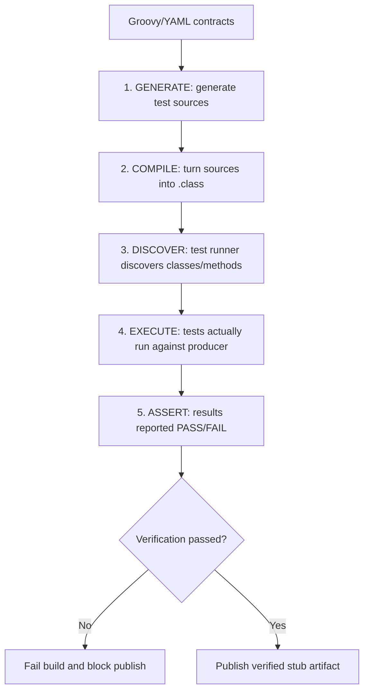
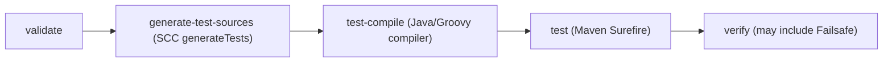
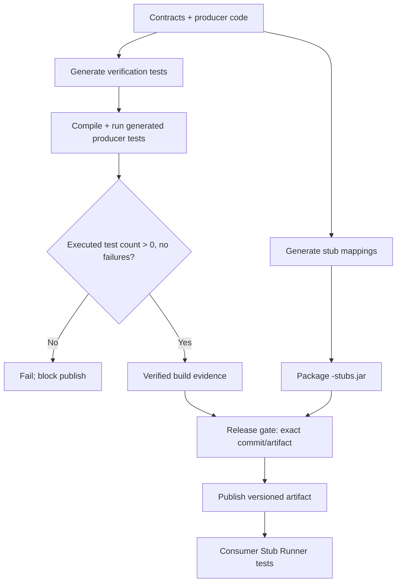

# Generated Tests Are Created but Not Executed by the Build Tool

## 1. The Issue: Seeing Java/Groovy Files Yet CI Stays “Green”

A team uses **Spring Cloud Contract** for contract testing between `Payment Service` (producer) and `Checkout Service` (consumer). A Groovy/YAML contract describes the HTTP API `GET /api/payments/42`, and the build generates a producer verification test and WireMock stub mapping. Checkout uses Stub Runner with `payment-service-1.2.0-stubs.jar` to test its client.

The next day, a developer intentionally modifies the controller: changing the response `status: PAID` to `status: PENDING`. The expectation is that the **generated producer test** must fail. However:

- Java/Groovy files still appear in `build/generated-test-sources` or `target/generated-test-sources`.
- Running `./gradlew test` or `./mvnw test` finishes successfully.
- There is no assertion for `PAID` in the test reports.
- CI may still package the stub and publish a version without verifying the real producer code.

This is a **broken execution chain** issue, not necessarily a DSL bug. **Generating test files does not mean the build tool compiled, discovered, executed, and checked their results.**

This lesson belongs to the **Troubleshooting** chapter of the **Spring Cloud Contract** module. The goal is to pinpoint the exact layer where the failure occurs, apply the corresponding fix for **Gradle** or **Maven**, and add a verification gate so the issue does not silently recur.

You will learn:

1. How to distinguish **generated → compiled → discovered → executed → asserted**.
2. How to identify the right tasks/goals: Gradle `generateContractTests` **differs** from `contractTest`; Maven `generateTests` **differs** from Surefire `test`.
3. How to diagnose source sets, test-compile classpath, JUnit 4/5, Spock, Maven Surefire/Failsafe, test filters, and skip flags.
4. Why a generated class may not match the default `*Test` naming pattern.
5. How to read task statuses, test reports, and executed test counts; avoiding conclusions from a single `BUILD SUCCESS` line.
6. How to design a CI gate requiring producer verification before publishing `-stubs.jar`.

## 2. Five Layers to Check in Order

A complete producer verification process must pass through:



Quick diagnostic questions:

| Layer | Evidence Needed | If Missing |
| --- | --- | --- |
| **Generate** | `*.java`/`*.groovy` files generated from the target contract | Wrong contract source/plugin configuration |
| **Compile** | Generated test class exists in test-classes output | Source root not compiled, dependency or base class error |
| **Discover** | Test engine/Surefire/Gradle registers classes and methods | Naming/filter/test engine/test classpath |
| **Execute** | Report shows executed test cases, not just “tests found” | Task not invoked, skipped, cached, or disabled |
| **Assert** | Real assertions check producer response/message | Test not wired to implementation/trigger or running empty test |

**State the symptom accurately before fixing**:

- “`GeneratedPaymentTest.java` exists, no `.class`” → investigate **compile**.
- “`.class` exists, Surefire reports `Tests run: 0`” → investigate **discovery**.
- “Test case is in report but marked `skipped`” → investigate **execution/conditions**.
- “Test passes without hitting the real controller” → investigate **test setup/semantic verification**, not just task wiring.

## 3. A Sample Contract to Reproduce the Problem

In the producer, an illustrative HTTP contract:

```groovy
import org.springframework.cloud.contract.spec.Contract

Contract.make {
    description 'Look up a completed payment'
    request {
        method GET()
        url '/api/payments/42'
        headers {
            header('Accept', 'application/json')
        }
    }
    response {
        status OK()
        headers {
            contentType(applicationJson())
        }
        body(paymentId: 42, status: 'PAID')
    }
}
```

The YAML DSL can express the same interaction:

```yaml
description: Look up a completed payment
request:
  method: GET
  url: /api/payments/42
  headers:
    Accept: application/json
response:
  status: 200
  headers:
    Content-Type: application/json
  body:
    paymentId: 42
    status: PAID
```

Do not keep **both files** in the same active contracts set if they are just equivalent examples without an intent to test two distinct obligations: doing so can produce duplicate mappings. When practicing, pick **one** format.

Visualize the generated JUnit test after plugin processing:

```java
// PSEUDOCODE illustrating intent, NOT verbatim generated code.
// Package and class name depend on contract directory structure/plugin version.
class Payment {
    @org.junit.jupiter.api.Test
    void shouldReturnPaidPayment() {
        // Sends GET /api/payments/42 to the producer via MockMvc
        // or the selected test mode.
        // Asserts HTTP status=200 and JSON status="PAID".
    }
}
```

**Easy-to-miss detail:** Some contract layouts are converted by Spring Cloud Contract into classes named after the **contract directory**. For example, a `payment/` directory can generate a `Payment` class that does not end with `Test`. Consequently, **Maven Surefire with defaults `*Test`, `*Tests`, `Test*`, `*TestCase` may not pick it up** unless plugin configuration expands the patterns. Do not assume generated classes are always named `PaymentTest`.

## 4. Distinguish Three Easily Confused Commands

| Purpose | Gradle with Spring Cloud Contract | Maven with Spring Cloud Contract |
| --- | --- | --- |
| **Only generate** producer tests | `generateContractTests` | Goal `spring-cloud-contract:generateTests` |
| **Run** generated producer tests | `contractTest` task in standard plugin setups | Test lifecycle via Maven Surefire, after `generate-test-sources`/`test-compile` |
| **Package** HTTP stub mappings | `generateClientStubs`, `verifierStubsJar` | `convert`, `generateStubs` per lifecycle/plugin config |

The official Spring Cloud Contract Gradle documentation instructs **`./gradlew contractTest`** to run generated tests. With the `contractTest` source set layout, running `./gradlew test` **only targets the standard test source set**; it does not necessarily run generated contract tests. In Maven, `generateTests` is bound by default to `generate-test-sources`, which has not yet reached the test engine. Therefore, invoking only the generator goal cannot verify the producer.

**Version caution:** Task names, output paths, wiring into `check`, and JUnit/Spock configurations can differ across Spring Cloud Contract releases and customized build scripts. Always inspect the **actual task graph and test reports** instead of relying on a guessed task name.

## 5. Non-Destructive Diagnostic Workflow Without Premature Edits

Perform these five steps in the **producer module**, not the consumer module:

1. **Identify build tool and module:** Maven or Gradle, and which module declares the Spring Cloud Contract plugin?
2. **Read the generated source:** What class, package, and test method annotations/Spock features are present?
3. **Locate the compiled class:** Is it compiled into the test output of the task that needs to run?
4. **Inspect the test runner:** Which Surefire/Failsafe or Gradle `Test` task scans that class?
5. **Read the XML test report:** Check `tests`, `skipped`, `failures`, `errors`; which test methods actually executed?

Do not delete generated tests or hand-edit generated code. If changes are needed, edit the **DSL source**, **plugin settings**, **test base class**, **source-set wiring**, or **test runner configuration**.

### 5.1. An Investigation Log Table

| Field to Record | Illustrative Example |
| --- | --- |
| Producer/module | `payment-service` |
| Spring Cloud Contract plugin version | Version resolved by the build |
| Contract file | `payment/get_payment.groovy` |
| Generated class | `org.example.contract.Payment` |
| Generated source path | `build/generated-test-sources/contractTest/java/...` |
| Compiled class path | `build/classes/java/contractTest/...` |
| Test runner | Gradle `:payment-service:contractTest` |
| Discovered/executed tests | `1 / 1` per report |
| Actual producer behavior | `200, status=PENDING` |
| Expected behavior | `200, status=PAID` |
| Producer verification | Must **FAIL** when response is intentionally broken |

Paths and class names are examples. What matters is checking your project's **actual paths** rather than looking only inside `src/test/java`.

## 6. Gradle: Why Doesn't `test` Run Generated Contract Tests?

In common Spring Cloud Contract Gradle plugin versions, the plugin uses the **`contractTest` source set**. Contracts typically reside at:

```text
src/contractTest/resources/contracts/
```

Corresponding base test classes live in:

```text
src/contractTest/java/
src/contractTest/groovy/
```

Generated JUnit/Groovy tests are usually written under `build/generated-test-sources/contractTest/`. The plugin wires them into the source set and creates the `contractTest` task.

In Spring Cloud Contract documentation since 3.x, `src/test/resources/contracts` is supported as a **legacy migration path** and may emit warnings. Do not confuse the Maven default (`src/test/resources/contracts`) with the Gradle default (`src/contractTest/resources/contracts`).

### 6.1. Distinguish `test`, `contractTest`, `check`

Suppose the build defines these tasks:

```text
:payment-service:generateContractTests
:payment-service:compileContractTestJava
:payment-service:contractTest
:payment-service:test
:payment-service:check
```

These are **illustrative task names to confirm at runtime**. They do not perform the same role:

- `generateContractTests` generates code.
- `compileContractTestJava` compiles generated sources and sources in the contract test source set.
- `contractTest` runs producer verification tests.
- `test` runs unit/integration tests in the standard `test` source set.
- `check` is the lifecycle verification task, which **may be wired by the plugin to `contractTest`** when default conventions apply.

**Preferred command for direct verification:**

```bash
./gradlew :payment-service:contractTest --info --console=plain
```

The `:payment-service:` path assumes a Gradle multi-project build. In a single-module project, use `./gradlew contractTest --info`.

### 6.2. Inspect the Task Graph First

```bash
./gradlew :payment-service:tasks --all --console=plain
./gradlew :payment-service:help --task contractTest
./gradlew :payment-service:check --dry-run
./gradlew :payment-service:contractTest --dry-run
```

With `--dry-run`, Gradle only simulates task scheduling and **does not execute tests**. It helps check whether `check` depends on `contractTest`, but it is not evidence that assertions ran.

If `check` does not include `contractTest`, it may be because the plugin was not applied to the required module, tasks were customized, or a separate source set/test suite is used. **Do not rush to add manual task dependencies** before inspecting the existing graph, as that can create duplicate or broken wiring.

### 6.3. When a Customized Project Needs to Wire `check` to `contractTest`

In `build.gradle` Groovy DSL, **only after confirming the `contractTest` task actually exists and is not yet wired to `check`**:

```groovy
// Supplementary fragment for a project that already applies the SCC Gradle plugin.
tasks.named('check') {
    dependsOn tasks.named('contractTest')
}
```

This configuration makes `check` depend on `contractTest`; it **does not configure the source set, test runtime classpath, or JUnit engine**. In releases where wiring is already automatic, do not add this snippet. If the test task was renamed, substitute the actual task name.

### 6.4. A Misleading Command

```bash
./gradlew generateContractTests
```

This command can generate all files cleanly and return `BUILD SUCCESSFUL` without running `contractTest`. In CI, label it clearly: “**generate**” is preparation; “**verify**” is the executing test task.

## 7. Gradle: Generated Sources Exist, but Are Not Compiled

If generated Java files exist but no `.class` files appear, check:

1. `contracts.generatedTestJavaSourcesDir` or the corresponding property for your plugin version.
2. Whether `contracts.sourceSet` was overridden to a different source set.
3. Whether `compileContractTestJava` or `compileContractTestGroovy` is actually scheduled.
4. Whether the base class is on the compile classpath **of the `contractTest` source set**.
5. Whether dependencies like `spring-cloud-starter-contract-verifier`, JUnit, Spock, and Groovy are attached to the right source-set configuration.

A commonly used project example:

```groovy
plugins {
    id 'java'
    id 'org.springframework.cloud.contract' version '<compatible-scc-version>'
}

contracts {
    // Illustrative settings only; verify against your actual plugin version.
    testFramework = 'JUNIT5'
    contractsDslDir = file('src/contractTest/resources/contracts')
    baseClassForTests = 'com.example.payment.contract.PaymentContractBase'
}
```

This fragment is **not a complete `build.gradle`**: you still need Spring Boot/Cloud dependency management, proper dependencies, and the real test base class. If `baseClassMappings` or `packageWithBaseClasses` is configured, those may **take precedence over `baseClassForTests`**.

### 7.1. Mismatched Source Root Paths

A customized project:

```groovy
contracts {
    generatedTestJavaSourcesDir = file("$buildDir/custom-contract-tests")
}
```

while `contractTest` compiles sources from a different location due to misconfiguration. Files get generated, yet never enter the compiler's source inputs.

**How to fix:** use Spring Cloud Contract's official configuration so generator and source set stay aligned; do not arbitrarily place generated files into `src/test/java` or add every `build/` folder directly to the `test` source set. Doing so can cause double compilation, duplicate tests, or stale generated tests.

### 7.2. Base Class and Package Mapping

A generated test may look like:

```java
package org.springframework.cloud.contract.verifier.tests;

public class Payment extends com.example.payment.contract.PaymentContractBase {
    // generated methods ...
}
```

If `PaymentContractBase` lives in `src/test/java` and `contractTest` cannot see classes from the `test` source set, compilation will fail. In a dedicated Gradle `contractTest` structure, place base classes in the appropriate source set or declare dependencies/task wiring properly.

**Distinguish compile error from no-discovery:** when a base class error fails compilation, tests **are not compiled**; when classes compile cleanly yet the test runner finds nothing, investigate the JUnit engine/filters next.

## 8. Gradle: `contractTest` Runs, but Finds No Tests

A Gradle `Test` task requires:

- `testClassesDirs`: paths to compiled test classes.
- `classpath`: test runtime classpath, including the test framework/engine.
- Correct test framework selection (`useJUnitPlatform()` for JUnit 5/modern Spock).
- No include/exclude filters filtering out generated tests.

### 8.1. JUnit 5: Configure JUnit Platform for the Right Task

In a JUnit 5 project, for example:

```groovy
// build.gradle fragment when the contractTest task exists.
tasks.named('contractTest', Test) {
    useJUnitPlatform()
    testLogging {
        events 'passed', 'skipped', 'failed'
        exceptionFormat 'full'
    }
}
```

**Note:** configuring `tasks.named('test', Test) { useJUnitPlatform() }` applies only to the `test` task, not necessarily to `contractTest`. If all `Test` tasks need JUnit Platform, you can use `tasks.withType(Test).configureEach { useJUnitPlatform() }` **when** all test frameworks in the project are compatible; do not apply it blindly worldwide if the project still needs a separate JUnit 4 runner or TestNG.

The JUnit 5 runtime needs its corresponding test engine; Spring Boot projects usually use `spring-boot-starter-test`, yet the `contractTest` source set must still receive the dependency properly. In newer Gradle versions, also ensure `junit-platform-launcher` is on the test runtime classpath per Gradle documentation.

### 8.2. JUnit 4, JUnit 5, and Spock Differ

| Generated Code | Runner/Engine Needed | Symptom if Mismatched |
| --- | --- | --- |
| JUnit 4 (`org.junit.Test`) | JUnit 4 runner or Vintage when running on JUnit Platform | Jupiter-only discovery misses the tests |
| JUnit 5 (`org.junit.jupiter.api.Test`) | Jupiter engine on JUnit Platform | Class exists but no matching engine runs it |
| Spock (`Specification`, features) | Groovy compile + compatible Spock engine | Groovy tests fail to compile or are not discovered |

**Do not hand-edit annotation imports in generated files.** Align `testFramework`, dependencies, and the test task runner; regenerate and verify the output.

### 8.3. Includes/Excludes and Test Filtering

Check build logic that might restrict tests:

```groovy
tasks.named('contractTest', Test) {
    // Example of a filter config that can accidentally exclude all generated tests:
    exclude '**/*ContractSpec.class'
}
```

Builds may also have tag filters, `--tests`, project-specific include patterns, custom `onlyIf`, or `enabled=false`.

To test a single class confirmed to exist:

```bash
./gradlew :payment-service:contractTest \
  --tests '*Payment*' \
  --info
```

`--tests` only applies to Gradle `Test` tasks, and the pattern must match compiled class/method names. If the task has no compiled classes, a filter cannot materialize them. **Do not treat `--tests` as proof tests ran unless the report records actual test cases.**

## 9. Gradle: Reading `UP-TO-DATE`, `FROM-CACHE`, `NO-SOURCE`, and `SKIPPED` Correctly

| Status | Meaning | Recommended Diagnosis |
| --- | --- | --- |
| `UP-TO-DATE` | According to Gradle, inputs/outputs have not changed since last run | Verify task outputs/reports from the relevant run |
| `FROM-CACHE` | Outputs restored from build cache for a cacheable task | Confirm task is cache-safe and cache keys are complete |
| `NO-SOURCE` | Task found no source/test classes to process | Check source set, contract path, and generator outputs |
| `SKIPPED` | Skipped by condition, disabled, or invocation flag | Check `onlyIf`, `enabled`, flags |
| Task does not appear | Outside selected task graph or excluded via `-x` | Check `--dry-run`, task dependencies |
| Task runs with `0 tests` | Task starts, test discovery finds no cases | Check engine, classpath, filters |

An `UP-TO-DATE` line **does not automatically indicate a bug**: it can be a valid optimization. However, if you just edited the producer implementation and the verification task is still treated as up-to-date with no matching test reports, investigate input tracking and the task graph.

### 9.1. Isolate Build Cache Effects

```bash
./gradlew :payment-service:contractTest --info
./gradlew :payment-service:contractTest --no-build-cache --info
./gradlew :payment-service:contractTest --rerun-tasks --no-build-cache --info
```

- `--no-build-cache` disables the build cache, **not up-to-date checks**.
- `--rerun-tasks` forces re-execution of the selected task and its dependencies.
- You do not always need `clean` or wiping the global cache; use these commands **to isolate the cause**, not as defaults for every CI run.

If the generated test actually runs against PENDING logic with a PAID assertion, it must fail; if it still passes, check whether the generated test is calling the intended endpoint/producer instance.

## 10. Maven: `generate-test-sources` Is Not `test`

The Spring Cloud Contract Maven plugin usually binds the `generateTests` goal to the `generate-test-sources` phase. Simplified lifecycle:



To both generate and run JUnit tests in a properly configured Maven producer project, run the lifecycle to `test` or `verify`:

```bash
./mvnw -B -ntp clean test
./mvnw -B -ntp clean verify
```

If you only invoke:

```bash
./mvnw -B -ntp spring-cloud-contract:generateTests
```

its primary job is **generating sources**; it does not proceed through `test-compile` and `surefire:test`. Calling the goal directly can succeed even when producer tests have never executed.

### 10.1. Check the Right Module in Multi-Module Maven

A CI job running only the aggregator POM or an `api-contracts` module may skip the plugin/tests of the `payment-service` module.

```bash
./mvnw -B -ntp -pl payment-service -am verify
```

`-pl` selects the module and `-am` builds required reactor dependencies. Verify that `payment-service` actually has plugin execution and generated tests, not just the contract artifact module. Adjust `-pl` if module coordinates or folders differ.

### 10.2. `pluginManagement` Does Not Create an Execution

A Spring Cloud Contract entry inside `<pluginManagement>` of a parent POM only defines defaults when the plugin is used; it is **not equivalent** to declaring the plugin as active in the producer module.

Inspect `<build><plugins>`, the effective POM, executions, and the plugin version actually used by the reactor module. Setups may use `<extensions>true</extensions>` or executions depending on the release; do not copy a snippet from another module and assume the goal ran.

## 11. Maven: Generated Sources Exist, but the Compiler Does Not See Them

Depending on how the plugin is configured, generated tests may be written to:

```text
target/generated-test-sources/contracts/
target/generated-test-sources/contractVerifier/
```

**There is no immutable directory name across all Spring Cloud Contract releases.** Check your `generatedTestSourcesDir` configuration and `generateTests` log for the actual version. Maven must add that directory to **test source roots** before `testCompile`; files in `target/` are not automatically compiled simply because they exist.

### 11.1. Example: Inspecting Test Source Roots

In the producer Maven build:

```bash
./mvnw -B -ntp help:effective-pom
./mvnw -B -ntp test-compile
```

Inspect Maven Compiler/GMavenPlus logs, registered source directories, and compiled test classes under `target/test-classes`. Do not judge solely by whether the IDE displays the source file; the IDE may need a Maven reimport, whereas **the CLI build is the source of truth for CI**.

### 11.2. When `build-helper-maven-plugin` Is Needed

If the plugin/build lifecycle does not automatically register the generated directory and you have specifically confirmed the cause is a **missing test source root**, you can use:

```xml
<!-- Fragment under build/plugins; only use when the source root is not auto-registered -->
<plugin>
    <groupId>org.codehaus.mojo</groupId>
    <artifactId>build-helper-maven-plugin</artifactId>
    <executions>
        <execution>
            <id>add-contract-generated-test-source</id>
            <phase>generate-test-sources</phase>
            <goals>
                <goal>add-test-source</goal>
            </goals>
            <configuration>
                <sources>
                    <source>${project.build.directory}/generated-test-sources/contracts</source>
                </sources>
            </configuration>
        </execution>
    </executions>
</plugin>
```

**Substitute the path matching actual generator output**, such as `contractVerifier` if that is where your plugin writes Java tests. Do not blindly add two guessed directories. If the plugin already registers the directory itself, adding it again will not fix a discovery problem.

### 11.3. Source Files Exist, but Compilation Fails

Causes:

- Base class FQN in the generated test does not exist or package mapping is wrong.
- `spring-cloud-contract-verifier`, Rest Assured/MockMvc, or JUnit dependencies are missing from the **test compile classpath**.
- Incompatible Java toolchain/target version.
- Generated Groovy requires a Groovy compiler plugin and extra source roots.
- Plugin version generates imports for a different framework than your dependencies.

A compilation error should fail the build. If CI remains green, check whether CI **runs `test-compile` for that module**, or is invoking a `package`/custom goal that bypasses verification.

## 12. Maven Surefire: Classes Compiled, Yet `Tests run: 0`

This is a classic discovery issue. Maven Surefire matches common class naming patterns by default:

```text
**/Test*.java
**/*Test.java
**/*Tests.java
**/*TestCase.java
```

However, SCC may generate a class named `Payment` from `contracts/payment/`. The `Payment` class **does not match** those default naming patterns, even though it contains JUnit `@Test` methods. With Spock, a `PaymentSpec` class may also require an explicit include rule.

**Diagnosis**:

1. Inspect the actual generated class name and package, rather than guessing from the DSL filename.
2. Confirm `target/test-classes` contains that `.class` file.
3. Inspect Surefire output and `target/surefire-reports`.
4. Check `<includes>`, `<excludes>`, `-Dtest`, tag/engine filters, and profiles.
5. Explicitly select the matching class to confirm the test engine can execute it.

### 12.1. Configuring Surefire to Pick Up the Generated Package

Suppose generated classes belong to `org.springframework.cloud.contract.verifier.tests`, and you **already verified** the path:

```text
target/test-classes/org/springframework/cloud/contract/verifier/tests/Payment.class
```

A Surefire fragment:

```xml
<plugin>
    <groupId>org.apache.maven.plugins</groupId>
    <artifactId>maven-surefire-plugin</artifactId>
    <version>${maven-surefire-plugin.version}</version>
    <configuration>
        <includes>
            <!-- Keep standard unit tests -->
            <include>**/*Test.java</include>
            <include>**/*Tests.java</include>
            <include>**/Test*.java</include>
            <include>**/*TestCase.java</include>
            <!-- Include DSL-generated classes in the verified package -->
            <include>**/org/springframework/cloud/contract/verifier/tests/**/*.java</include>
        </includes>
        <failIfNoTests>true</failIfNoTests>
    </configuration>
</plugin>
```

**Important:**

- `${maven-surefire-plugin.version}` is a property that must be defined in your project's dependency/plugin management; do not copy it verbatim if undeclared.
- Adjust the package path to match actual generated output, especially when using `basePackageForTests`, `baseClassForTests`, or custom package mappings.
- This configuration **expands discovery**; it does not replace **compiling generated sources**.
- Once you override `<includes>`, retain the patterns needed for regular unit tests.
- `failIfNoTests` does not guarantee **every contract group** has tests; if the module has unit tests, the total count stays non-zero even if generated tests are missing. Inspect the specific reports.

With Surefire 3.6.x, JUnit Platform handling and engine selection may differ from 2.x/3.0.x; use APIs and dependencies compatible with your actual Surefire version.

### 12.2. Running a Single Generated Class While Debugging

```bash
# Only after confirming the generated class is named Payment and is compiled.
./mvnw -B -ntp -Dtest=Payment test
```

`-Dtest` is a **class/method filter**, not a command that generates DSL tests. If Maven cannot find the class, check compilation; if you specify the class and no JUnit engine runs it, check runtime dependencies.

**Never leave `-Dtest=SomeUnitTest` in release CI**, as it can exclude generated contract tests from verification.

### 12.3. Maven Spock: Needs Both Groovy Compilation and Class Selection

With Spock, generated classes are typically `*Spec`. A Maven project needs a Groovy test compiler, such as **GMavenPlus**, to compile `src/test/groovy` and generated Groovy sources.

If a `Spock Specification` compiled cleanly but Surefire does not select the class, add the appropriate include:

```xml
<!-- maven-surefire-plugin fragment for Spock conventions -->
<configuration>
    <includes>
        <include>**/*Test.java</include>
        <include>**/*Tests.java</include>
        <include>**/*Spec.java</include>
    </includes>
</configuration>
```

`*Spec.java` above is a **Surefire pattern for compiled classes**, not an instruction to rename generated `*.groovy` files to Java; Surefire matches compiled class names using the `*.java` convention. If the project uses a different prefix, package, or class pattern, adjust accordingly. Also check that the Spock engine matches the JVM/Groovy version.

**Note:** adding `*Spec` to Surefire alone does not make Maven compile Groovy. Those are two issues at **two different layers**.

## 13. Maven Failsafe: When Contract Tests Move to `integration-test`

Some teams run contract verification as integration tests, naming classes `*IT` or placing them in a separate source set/phase. In that setup, **Maven Failsafe Plugin** may be used instead of Surefire:

| Tool | Typical Phase | Key Defaults |
| --- | --- | --- |
| **Surefire** | `test` | Unit-like tests, patterns `*Test` / `*Tests` |
| **Failsafe** | `integration-test` and `verify` | Integration tests like `IT*` / `*IT` / `*ITCase` |

If generated classes are included by Failsafe while the pipeline only runs `./mvnw test`, it **will not execute integration tests**. Moreover, Failsafe requires both the `integration-test` goal to run tests and `verify` to **evaluate results and fail the build** per plugin convention.

An example fragment:

```xml
<plugin>
    <groupId>org.apache.maven.plugins</groupId>
    <artifactId>maven-failsafe-plugin</artifactId>
    <version>${maven-failsafe-plugin.version}</version>
    <executions>
        <execution>
            <goals>
                <goal>integration-test</goal>
                <goal>verify</goal>
            </goals>
        </execution>
    </executions>
</plugin>
```

This skeleton applies only when the project **intentionally** uses Failsafe and generated classes match its configuration; check `<includes>`, source roots, dependencies, and test naming. Do not configure both Surefire and Failsafe to run the same class “just to be safe,” as that duplicates verification and can break tests with side effects.

## 14. Filters and Flags: Ways Tests “Disappear”

| Tool | Suspicious Condition | Impact |
| --- | --- | --- |
| Gradle | `-x contractTest` | Excludes task from the graph |
| Gradle | `tasks.named('contractTest') { enabled = false }` | Task does not execute |
| Gradle | `onlyIf { false }` | Task reports `SKIPPED` |
| Gradle | `--tests 'SomeUnitTest'` on another task | Does not select generated classes |
| Maven | `-DskipTests` | May compile tests without executing them |
| Maven | `-Dmaven.test.skip=true` | Skips both test compilation and execution in supporting plugins |
| Maven | `-Dtest=SomeUnitTest` | Selects only the specified tests |
| Maven | `<includes>`/`<excludes>` | Generated classes may be left out |
| Maven | `-DskipITs` | Failsafe integration tests may be skipped |
| Both | JUnit tags/engines, Spock filters | Tests compile but are not selected by the engine |
| Both | Running only codegen / packaging goals | Never reaches verification |

**Never add skip flags to a release pipeline to “speed up CI” if producer tests are a precondition for publishing stubs.** If tests are slow, optimize source sets, caching, and fixtures, while keeping the compatibility verification gate intact.

### 14.1. “Skipped Test” Differs from “Test Not Found”

A test case with `@Disabled`, a JUnit assumption, Spock `@Ignore`, or a test profile condition may be **discovered yet skipped**. Reports usually show a `skipped` test case; whereas when Surefire fails to match a class name, that class may **not appear in the report at all**.

Therefore check all of:

- **Number of discovered/executed tests**.
- **Skipped count** and skip reasons.
- **Test case names** appearing in reports, not just total counts.
- **Assertions**, to verify the test genuinely checks the producer.

## 15. Test Reports: How to Prove Generated Tests Ran

### 15.1. Gradle

Reports are typically located under:

```text
build/test-results/contractTest/
build/reports/tests/contractTest/
```

With a custom test task or another Gradle test suite, folder names may vary. Inspect the actual task's output properties rather than hard-coding paths across every project.

### 15.2. Maven

Typically:

```text
target/surefire-reports/
target/failsafe-reports/
```

Example JUnit/Surefire XML report:

```xml
<testsuite name="org.example.Payment"
           tests="1" failures="1" errors="0" skipped="0">
    <testcase name="shouldReturnPaidPayment"
              classname="org.example.Payment">
        <failure message="Expected PAID but was PENDING" />
    </testcase>
</testsuite>
```

This is a **sample report** to illustrate how to read the fields, not verbatim Spring Cloud Contract output. If a report has zero cases from the generated tests' namespace or names, investigate **test runner inclusion**, even if the total unit test count is greater than 0.

### 15.3. Metrics Interpretation Table

| Observation | Likely Conclusion | Next Step |
| --- | --- | --- |
| Generated source exists, report is empty | Not compiled/discovered/run | Trace layer by layer |
| 50 unit tests, 0 contract tests | False green CI for contract verification | Check separate task/source set/Surefire patterns |
| 10 contract tests, 10 skipped | Zero assertions executed | Inspect ignore/disabled/conditions |
| 10 contract tests, 1 failure | Producer violates at least one contract | Fix implementation or negotiate contract |
| 10 contract tests, 10 passed | Tested interactions passed | Does not mean every API/use case is covered |

**Inspect reports specifically for generated test groups**, not just module-wide `Tests run > 0`.

### 15.4. Manual Inspection on Windows

In PowerShell, learners can quickly list generated XML reports:

```powershell
Get-ChildItem -Recurse -File build/test-results/contractTest -Filter '*.xml'
Get-ChildItem -Recurse -File target/surefire-reports -Filter 'TEST-*.xml'
```

These commands target **projects with the corresponding report path**; they do not apply to both Maven and Gradle simultaneously. If a report directory does not exist, check task selection first. On Linux/macOS, use `find` or `ls` instead.

## 16. CI Publish Gate: Generating a Stub JAR Does Not Guarantee Verification

Because Spring Cloud Contract has two branches—generating tests and generating stub mappings—a pipeline can accidentally run **generateClientStubs/verifierStubsJar** without running `contractTest`. The resulting JAR may contain valid-looking mappings that have never been verified against the producer implementation.



**A build must not treat `verifierStubsJar SUCCESS` as producer verification PASS.** The publish stage must be guarded by test task/goal outcomes and execution reports.

### 16.1. Suggested Gradle CI

```bash
# Even if the plugin wires check -> contractTest, confirm with --dry-run/reports.
./gradlew :payment-service:check --info

# Explicit gate for generated producer tests:
./gradlew :payment-service:contractTest --info

# Only after verification PASSES, package/publish per release policy.
./gradlew :payment-service:verifierStubsJar
```

If steps run in **separate jobs**, ensure the artifact/contract commit cannot change between verify and publish. A release gate can require publication to depend on the verification task within the same job, or consume an immutable verified artifact depending on your system.

### 16.2. Suggested Maven CI

```bash
# Run through verify instead of stopping at generate-test-sources.
./mvnw -B -ntp -pl payment-service -am clean verify

# Only publish when the verify job for the exact commit/contract revision passed.
# Actual deploy command and credentials are managed by the release pipeline.
```

Do not run Maven/Gradle publish from an isolated job lacking dependencies and expect the tool to “remember” that tests passed in an earlier job.

### 16.3. The Gate Must Protect Minimum Test Counts

An effective gate:

1. Reads the manifest/catalog of active contracts in the producer module.
2. Verifies the generator does not report unexpected `NO-SOURCE`.
3. Confirms expected generated classes/methods appear in test reports.
4. Checks `tests - skipped` exceeds a minimum threshold for critical contract groups.
5. **Fails the release** if a consumer/HTTP/message group is missing, even when all other unit tests pass.

The number of `contracts` **does not always equal the number of test classes**: multiple contract methods can live in one class. Therefore, the gate should measure **reconcilable test cases/contract IDs**, not merely count `*.java` files.

## 17. Test Mode, Base Class, and Test Setup After the Runner Executes

Once the test runner **actually executes** a generated method, any remaining issue shifts to test semantics:

- `testMode=MOCKMVC`: generated tests use MockMvc/RestAssuredMockMvc in an appropriate context.
- `testMode=EXPLICIT`: generated tests can use a real HTTP client against the configured server/port.
- Messaging contracts: the base class triggers the publisher, and the message verifier/adapter/binder must work.

If `PaymentContractBase` configures mocks incorrectly or points HTTP calls to a **WireMock stub instead of the producer**, tests can pass without verifying the real controller implementation.

### 17.1. Sample Base Class for HTTP Mode

```java
// Conceptual SKELETON; lacks complete imports and test context setup.
// Choice of MockMvc/RestAssuredMockMvc depends on Spring Cloud Contract version.
@SpringBootTest
@AutoConfigureMockMvc
public abstract class PaymentContractBase {
    // Every generated test must use the producer's real setup.
    // With fixtures, prepare paymentId=42 in status PAID.
}
```

Merely adding annotations is not enough if the generated test client is not wired into the right MockMvc setup. Follow the **version-specific** Spring Cloud Contract example to configure the base class and confirm requests hit the implementation under test.

### 17.2. Negative Control Exposes “False Green Tests”

In an unpublished experimental branch:

1. Run generated producer tests with correct `PAID` behavior → expect PASS.
2. Intentionally change the controller/fixture to return `PENDING` for the same request.
3. Run the **exact contract test task/goal** and require the assertion to FAIL.
4. Revert the experimental change.
5. Verify CI blocks publishing when the assertion FAILS.

If step 3 still PASSES, check whether the test actually ran, whether it hit a stub instead of the producer, whether matchers are overly broad, or whether the fixture bypasses the modified code path. This validates effectiveness far better than just inspecting generated files.

## 18. Troubleshooting by Symptom

| Symptom | Common Cause | Check and Fix |
| --- | --- | --- |
| `generateContractTests` SUCCESS, no test report | Only ran the generate task | Run `contractTest` |
| `./gradlew test` green, contract tests missing | Separate `contractTest` source set | Run `:module:contractTest`, check `check` wiring |
| `contractTest NO-SOURCE` | No compiled tests/empty source set | Check DSL path and generator/source roots |
| `contractTest SKIPPED` | `onlyIf`, `enabled=false`, flags | Read `--info`, remove unintended skips |
| `contractTest FROM-CACHE` | Restored from cache | Verify cache key; use `--rerun-tasks` when debugging |
| Maven `generateTests` SUCCESS, Surefire `0 tests` | Generated class `Payment` misses naming pattern | Add Surefire include for the right package |
| Generated `*.java` exists, `*.class` does not | Directory not in test source roots | Check plugin wiring/build-helper |
| Spock generated `*.groovy` exists, won't compile | GMavenPlus/Groovy source roots or dependencies | Configure compiler for generated Groovy |
| JUnit 5 methods not discovered | Missing JUnit Platform/Jupiter engine or task lacks platform | Configure matching runner/engine |
| JUnit 4 methods not discovered on platform | Missing Vintage engine or excluded by filter | Configure JUnit 4/Vintage intentionally |
| `*Spec` not picked up by Surefire | Default naming excludes `*Spec` | Add include; check Spock engine |
| `-Dtest=SomeUnitTest` in CI | Filter runs only a specific unit test | Remove override for releases |
| `-DskipTests` or `-x contractTest` | Tests intentionally skipped | Guard pipeline/gate |
| Maven `test` green, Failsafe ITs didn't run | ITs run in `integration-test` | Run `verify`, bind Failsafe goals |
| Multi-module runs parent only | Wrong producer module selected | Check `-pl`, Gradle project path |
| Generated test runs, assertion doesn't fail | Wrong test base, hits stub, or broad matcher | Negative control, inspect actual request |
| Stub JAR published while contract tests didn't run | Publication not gated by verification | Block publish until test report passes |
| IDE runs tests, CLI does not | IDE source roots/runner differ from Maven/Gradle | Use CLI as source of truth and fix build config |

## 19. Rapid Diagnostic Questions for a Production Incident

Answer in sequence:

1. **Which task/goal generated the tests?** `generateContractTests` or `generateTests`?
2. **Which task/goal did the CLI build actually invoke?** `contractTest`, `test`, `verify`, or `publish`?
3. **Does the compiled class exist?** In the right source set and test output?
4. **Is the test framework/engine aligned?** JUnit 4/JUnit 5/Spock?
5. **Do naming/filters select the class?** Surefire include/exclude, Gradle `--tests`, tags?
6. **Are there any skip flags or `onlyIf` conditions?**
7. **Does the report contain cases from generated tests?** How many pass/fail/skipped?
8. **Does the test hit the real producer?** Or is it calling a mock/stub/wrong fixture?
9. **Is the published artifact tied to verification of that exact commit?**
10. **Which stub version is the consumer test using?** Is it pulling a stale version from local/remote cache?

If #3 is “no,” focus on compilation. If #3 is “yes” and #7 is “no,” focus on discovery/scheduling. If #7 is “yes” and #8 is “no,” focus on the base class/test mode. Do not haphazardly alter matchers or contract DSL when the defect is in build wiring.

## 20. Hands-on Exercise: Three Distinct Failure Cases

Suppose `Inventory Service` (producer) has the contract:

```yaml
description: Stock level for SKU BOOK-01
request:
  method: GET
  url: /api/stock/BOOK-01
response:
  status: 200
  headers:
    Content-Type: application/json
  body:
    sku: BOOK-01
    available: 12
```

Generated tests must verify `available = 12` under the right fixture state.

### 20.1. Case A — Gradle Generates Tests, Yet `test` Stays Green

Illustrative log:

```text
> Task :inventory-service:generateContractTests
> Task :inventory-service:test
BUILD SUCCESSFUL
```

You see:

```text
build/generated-test-sources/contractTest/java/.../Stock.java
```

but there is no `contractTest` test report.

**Tasks:**

1. Explain why `test` does not prove contract verification.
2. Propose two commands to inspect the task graph and run the right task.
3. If `check` also omits `contractTest`, identify what to confirm before adding `dependsOn`.

**Suggested answer:** SCC Gradle uses a `contractTest` source set/task; inspect `./gradlew :inventory-service:check --dry-run`, then run `./gradlew :inventory-service:contractTest --info`. Only adjust wiring after confirming the plugin/task graph and source-set setup.

### 20.2. Case B — Maven Has `Stock` Class, Surefire Reports No Tests

In a Maven project:

```text
target/generated-test-sources/contractVerifier/.../Stock.java
target/test-classes/org/example/contract/Stock.class
target/surefire-reports/      # No Stock test case
```

**Tasks:**

1. Explain why a compiled class is not enough.
2. List Surefire's default naming patterns.
3. Propose an include pattern for the **confirmed `org.example.contract` package**.
4. What else must be checked beyond the pattern?

**Suggested answer:** Surefire looks by default for `Test*`, `*Test`, `*Tests`, `*TestCase`; `Stock` does not match. You can add `<include>**/org/example/contract/**/*.java</include>` in `maven-surefire-plugin` **after confirming that is the right generated test package**. You still need to check the JUnit engine, test method annotations, skip flags, and XML test reports.

### 20.3. Case C — Tests Run, Yet Wrong API Still Passes

The generated test report contains:

```xml
<testsuite tests="1" failures="0" errors="0" skipped="0">
    <testcase name="shouldReadStock" classname="org.example.contract.Stock"/>
</testsuite>
```

However, a developer changes the controller response from `available: 12` to `available: 0`, and the test still passes.

**Tasks:**

1. List three causes **outside test discovery**.
2. Describe how to use a negative control to investigate.
3. Suggest how to protect CI.

**Suggested answer:** The base test may be calling a stub server or another mock instead of the Inventory controller; the `BOOK-01` fixture may bypass the modified code path; or matchers/assertions are overly broad. Rerun the contract test with controlled broken behavior, inspect where requests go and what assertions check; CI must fail publishing when generated tests FAIL or critical contract groups have no executed cases.

## 21. Checklist Before Concluding the Issue Is Resolved

- Did you distinguish **generate, compile, discover, execute, assert** rather than merely seeing generated files?
- For Gradle, did you invoke `contractTest` (not just `test`/`generateContractTests`) and inspect the `check` task graph?
- For Maven, did you run the lifecycle through `test`/`verify` rather than stopping at `generate-test-sources`?
- Are generated Java/Groovy sources included in the matching test compiler's source roots?
- Are the base class, test framework, runtime dependencies, and JUnit Platform/Spock engine compatible?
- For Surefire/Failsafe, did you inspect class naming/includes/excludes and phase configuration?
- Are there no unintended `skipTests`, `maven.test.skip`, `-x contractTest`, `enabled=false`, or `onlyIf` settings?
- Did you distinguish `UP-TO-DATE`, `FROM-CACHE`, `NO-SOURCE`, `SKIPPED`?
- Do test reports show **executed generated test cases**, not just other unit tests?
- Do generated methods contain assertions on key status/header/body/message fields?
- Does a negative control prove a broken producer implementation causes generated tests to FAIL?
- Does CI enforce producer verification for the **exact commit and contract revision** before publishing `-stubs.jar`?
- Do consumer Stub Runner tests use the right artifact version without acting as a substitute for producer verification?
- Have you avoided hand-editing generated sources or dropping assertions/contracts to force a green build?

**Official documentation to cross-check for your project version:**

- [Spring Cloud Contract — Gradle Project](https://docs.spring.io/spring-cloud-contract/reference/gradle-project.html) — `contractTest` task, source set, and `generateContractTests`.
- [Spring Cloud Contract — Maven Project](https://docs.spring.io/spring-cloud-contract/reference/maven-project.html) — `generateTests`, test compilation, Spock/GMavenPlus.
- [Spring Cloud Contract Maven Plugin — generateTests goal](https://docs.spring.io/spring-cloud-contract/docs/current/spring-cloud-contract-maven-plugin/generateTests-mojo.html).
- [Gradle — Testing in Java & JVM Projects](https://docs.gradle.org/current/userguide/java_testing.html) — test source sets, discovery, filtering, reports.
- [Maven Surefire — Test Inclusion and Exclusion](https://maven.apache.org/surefire/maven-surefire-plugin/examples/inclusion-exclusion.html) — class naming patterns.
- [Maven Surefire — Using JUnit Platform](https://maven.apache.org/surefire/maven-surefire-plugin/examples/junit-platform.html) — engines and runtime.
- [Maven Failsafe Plugin](https://maven.apache.org/surefire/maven-failsafe-plugin/).

**Key takeaway:** **Seeing generated tests on disk only completes the code generation step.** In Gradle, verify the `contractTest` task and separate source set; in Maven, verify `generate-test-sources → test-compile → Surefire/Failsafe`, paying special attention to **class naming patterns** and the **JUnit/Spock engine**. Consider a producer verified only when generated tests **have been discovered, executed, and checked against the real implementation**, reports contain the relevant test cases, and CI **blocks stub publication** if they do not run or fail.
