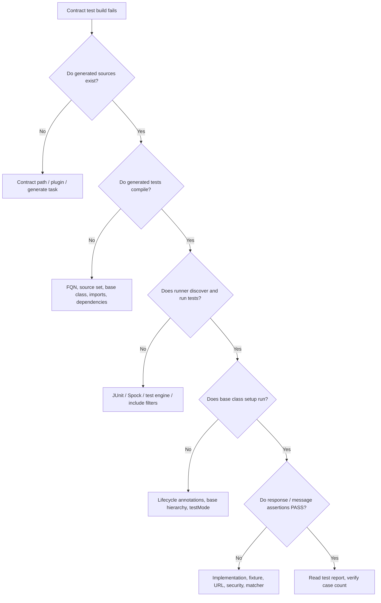
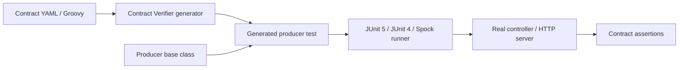
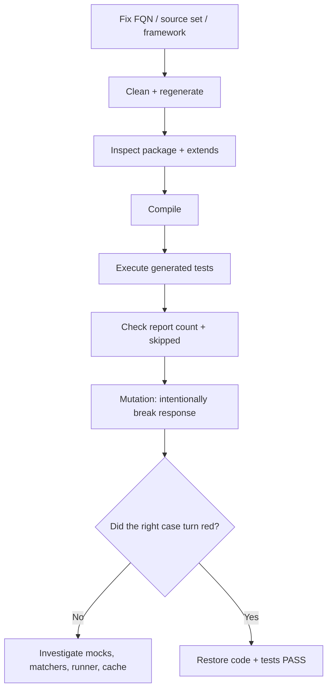

# Wrong Base Class, Package, or Test Framework

> **Chapter:** Troubleshooting  
> **Module:** `SPRING_CLOUD_CONTRACT` — learn contract testing between producer and consumer using Groovy/YAML DSL for HTTP or messaging, generating producer verification tests, publishing stubs, using Stub Runner, and integrating CI to detect incompatible API changes.

## Learning Objectives

After this lesson, you will be able to:

1. Distinguish three easily confused failure groups: **wrong base class**, **wrong package/source set**, and **mismatched test framework/test engine**.
2. Determine from a stack trace whether the failure occurred in **contract discovery, generation, compilation, test discovery, runtime setup, or assertion**.
3. Understand how Spring Cloud Contract generated producer tests **extend a base class**, why the fully qualified name (`FQN`) must be exact, and why the contract directory does not automatically equal the base class's Java package.
4. Configure `baseClassForTests`, `basePackageForTests`, `packageWithBaseClasses`, and `baseClassMappings` appropriately, and recognize precedence rules.
5. Place base classes in the right source root—Maven `src/test/java` or Gradle `src/contractTest/java`—without confusing the `test` and `contractTest` source sets.
6. Align JUnit 5, JUnit 4, or Spock properly with lifecycle annotations, test runners, dependencies, and test engines.
7. Diagnose differences among HTTP `MockMvc`, `Explicit`, `WebTestClient`, and messaging test setups without silently disabling what needs verification.
8. Use generated sources, the task graph, Maven/Gradle test reports, and an intentional mutation to prove tests genuinely work.
9. Build a checklist/CI gate preventing **BUILD SUCCESS with 0 generated contract tests** or skipped tests.
10. Know when an error belongs to producer verification vs. consumer Stub Runner, avoiding contract changes to patch a build/classpath issue.

## 1. One Error Report, Three Root-Cause Groups

Suppose `inventory-service` is the producer and `checkout-service` is the consumer. The producer has a contract:

```http
GET /api/stock/SKU-001 HTTP/1.1
Accept: application/json
```

Promised response:

```http
HTTP/1.1 200 OK
Content-Type: application/json

{
  "sku": "SKU-001",
  "available": true,
  "quantity": 4
}
```

Spring Cloud Contract Verifier generates Java tests to verify Inventory's implementation. A developer runs the build and gets one of these errors:

```text
[ERROR] cannot find symbol
  symbol: class InventoryContractBase

[ERROR] package com.example.inventory.contract does not exist

No tests found for given includes

java.lang.NullPointerException:
  RestAssuredMockMvc has not been initialized

Expected status code <200> but was <404>
```

Not all four indicate a "bad contract." Their causes are completely different:

- **Base class not found**: the generated Java test has `extends InventoryContractBase`, but the compiler cannot resolve the class name on the test classpath.
- **Wrong package**: the base class exists, yet its `package` declaration differs from the FQN chosen by the plugin, or the Java file sits in the wrong source root/module.
- **Wrong framework/runner**: generated tests are JUnit Jupiter while the task runs JUnit 4/Vintage, or the base uses JUnit 4 `@Before` while generated tests run JUnit 5 so setup never executes.
- **Wrong test mode or setup**: tests are discovered and run, but lack the right MockMvc context/port, resulting in 404, connection refused, or NPE.

**First principle: fix at the layer where the failure originates.** Do not alter Groovy/YAML contract bodies or disable tests just to stop the compiler or JUnit runner from complaining.

## 2. Diagnostic Map: Find the First Failing Step



When reading logs, identify the **task/phase** first:

| Stage | Symptom | Primary Check |
| --- | --- | --- |
| Parse/generate | No generated tests | `contractsDirectory`/`contractsDslDir`, plugin, ignored/inProgress |
| Java/Groovy compile | `cannot find symbol`, `package ... does not exist` | `extends`, FQN, file package, source root, test classpath |
| Test discovery | `No tests found`, 0 tests | JUnit Platform, Spock engine, filters, `Test` task |
| Runtime setup | `RestAssuredMockMvc` uninitialized, `context == null` | `@BeforeEach`/`@Before`/`setup()` and base |
| HTTP execution | 404, 415, connection refused, 401 | `testMode`, controller, converter, security, server port |
| Messaging execution | `triggeredBy` method missing or no event received | Messaging base, trigger, destination, binder |
| Assertion | Expected JSON/status differs from actual | Producer implementation, fixtures, contract semantics |
| Green build, no tests | Empty report/`NO-SOURCE`/`SKIPPED` | Test count gate, lifecycle wiring, filters |

**Golden order:** open the **generated Java/Groovy test** itself and read its `package`, `extends`, imports, annotations, and generated methods. This proves what the plugin actually decided, far more reliably than reading `pom.xml`/`build.gradle` alone.

## 3. Architecture: Contract → Generated Test → Base Class

For an HTTP producer, the typical flow is:



A generated test does not automatically know:

- Which Spring context holds the controller.
- Whether the test must start an HTTP server.
- Which fixture data must be prepared.
- Whether the producer must stub an out-of-boundary collaborator.
- Whether a message verifier must be injected or a binder configured.

The **base class** is where you place this required setup. Generated tests can inherit directly or through a configured class hierarchy.

### 3.1. Simple Contract Example

Maven producer path:

```text
src/test/resources/contracts/stock/stock_available.yml
```

Content:

```yaml
name: stock_available
request:
  method: GET
  url: /api/stock/SKU-001
  headers:
    Accept: application/json
response:
  status: 200
  headers:
    Content-Type: application/json
  body:
    sku: SKU-001
    available: true
    quantity: 4
```

A generated JUnit 5 test might look **similar to**:

```java
package com.example.inventory.contract;

import org.junit.jupiter.api.Test;

public class StockTest extends InventoryContractBase {

    @Test
    public void stock_available() throws Exception {
        // Generated HTTP request + assertions produced by the plugin.
    }
}
```

This is a **structural illustration**, not verbatim output from a specific plugin version. Class names, method names, imports, and HTTP calls must be verified from your actual generated output.

### 3.2. Three Things That Can Differ

1. **Contract file path**: `src/test/resources/contracts/stock/stock_available.yml`.
2. **Generated test package**: e.g., `com.example.inventory.contract`, controlled by `basePackageForTests` or plugin settings.
3. **Base class FQN**: `com.example.inventory.contract.InventoryContractBase` or another package selected via `baseClassForTests`/mappings.

**Do not infer that `basePackageForTests` must equal the base class's package.** A generated test in another package can still `extends com.example.contractsupport.InventoryContractBase` as long as the class is `public`, dependencies/imports are valid, and required methods are accessible.

## 4. Distinguish Four Easily Confused Options

| Option | What It Does | When to Use |
| --- | --- | --- |
| `baseClassForTests` | Specifies **one base class FQN** for generated tests | Simple setup with a single HTTP/message test base |
| `basePackageForTests` | Sets the **Java package of generated tests** | When you want generated code in a clear package |
| `packageWithBaseClasses` | Sets a package containing **multiple base classes by naming convention** | Multiple contract groups organized by folder |
| `baseClassMappings` | **Contract package regex → base class FQN** | Explicit mapping for HTTP vs messaging or v1 vs v2 |

According to Spring Cloud Contract documentation, when multiple mechanisms apply, precedence is:

**`baseClassMappings` → `packageWithBaseClasses` → `baseClassForTests`**.

Thus, you can update `baseClassForTests` yet generated tests will keep extending the old class if a `baseClassMappings` entry still matches.

### 4.1. Single Base Class

Maven plugin fragment:

```xml
<plugin>
  <groupId>org.springframework.cloud</groupId>
  <artifactId>spring-cloud-contract-maven-plugin</artifactId>
  <version>${spring-cloud-contract.version}</version>
  <extensions>true</extensions>
  <configuration>
    <testFramework>JUNIT5</testFramework>
    <testMode>MOCKMVC</testMode>
    <basePackageForTests>com.example.inventory.generated</basePackageForTests>
    <baseClassForTests>
      com.example.inventory.contract.InventoryContractBase
    </baseClassForTests>
  </configuration>
</plugin>
```

```java
package com.example.inventory.contract;

public abstract class InventoryContractBase {
    // Producer test setup.
}
```

Generated tests can live in `com.example.inventory.generated` while the base lives in `com.example.inventory.contract`. This is valid whenever the compiler can see the base class.

**Do not set `baseClassForTests` to a package name** like `com.example.inventory.contract` when the plugin expects a **class FQN**. You must provide the concrete class name, e.g., `...InventoryContractBase`.

### 4.2. Naming Convention with `packageWithBaseClasses`

Suppose contracts are arranged as:

```text
src/test/resources/contracts/
└── api/
    ├── v1/
    │   └── stock_available.yml
    └── v2/
        └── stock_available.yml
```

If configured:

```xml
<packageWithBaseClasses>
  com.example.inventory.contractbase
</packageWithBaseClasses>
```

the plugin may apply a rule that **takes the last two components** of the contract package path, combines them in CamelCase, and appends `Base`. For `api/v1` and `api/v2`, the expected convention names are:

```text
com.example.inventory.contractbase.ApiV1Base
com.example.inventory.contractbase.ApiV2Base
```

**Do not guess when the project has deeply nested directories.** Deeper contract paths or different plugin versions may derive different names; inspect the generated `extends` clause to verify.

A file at `contracts/api/v1/stock_available.yml` does not require the base class to sit in a Java `api/v1` directory. This option specifies the **package containing base classes**; the contract path is used to derive the **class name** by convention.

### 4.3. `baseClassMappings`: Ideal for HTTP and Messaging

With two boundaries:

```text
contracts/
├── http/
│   └── stock_available.yml
└── messaging/
    └── stock_changed.yml
```

You may want:

- HTTP tests to extend `com.example.contractbase.HttpContractBase`.
- Messaging tests to extend `com.example.contractbase.MessageContractBase`.

Gradle Groovy DSL (illustrating syntax documented by Spring Cloud Contract):

```groovy
contracts {
    testFramework = 'JUNIT5'
    testMode = 'MockMvc'
    basePackageForTests = 'com.example.generated'

    baseClassForTests =
        'com.example.contractbase.FallbackContractBase'

    baseClassMappings {
        baseClassMapping(
            '.*http.*',
            'com.example.contractbase.HttpContractBase'
        )
        baseClassMapping(
            '.*messaging.*',
            'com.example.contractbase.MessageContractBase'
        )
    }
}
```

The contract path/package must actually match the regex. **Overly broad regexes** like `.*` match every package and can unexpectedly make all contracts inherit the same base.

### 4.4. Maven `baseClassMappings`

Equivalent XML fragment:

```xml
<configuration>
  <testFramework>JUNIT5</testFramework>
  <baseClassForTests>
    com.example.contractbase.FallbackContractBase
  </baseClassForTests>
  <baseClassMappings>
    <baseClassMapping>
      <contractPackageRegex>.*http.*</contractPackageRegex>
      <baseClassFQN>
        com.example.contractbase.HttpContractBase
      </baseClassFQN>
    </baseClassMapping>
    <baseClassMapping>
      <contractPackageRegex>.*messaging.*</contractPackageRegex>
      <baseClassFQN>
        com.example.contractbase.MessageContractBase
      </baseClassFQN>
    </baseClassMapping>
  </baseClassMappings>
</configuration>
```

This is a **fragment inside `spring-cloud-contract-maven-plugin`**, not a complete `pom.xml`. Check the configuration schema for your exact plugin version and inspect the generated code.

### 4.5. Errors from “Unexpected” Precedence

Example:

```groovy
contracts {
    baseClassForTests = 'com.example.contractbase.NewBase'
    baseClassMappings {
        baseClassMapping('.*', 'com.example.contractbase.OldBase')
    }
}
```

A developer expects tests to extend `NewBase`. However, the `.*` regex matches every contract package and **overrides** the fallback. When generated tests still `extends OldBase`, editing `baseClassForTests` again will not fix anything.

**How to fix:** remove or narrow the overly broad mapping, or explicitly point the mapping to the right target. Then regenerate and **re-read** `extends`.

## 5. Maven Source Layout: Where Does the Base Class Live?

For a typical Maven producer project:

```text
inventory-service/
├── pom.xml
├── src/
│   ├── main/java/com/example/inventory/
│   │   └── StockController.java
│   └── test/
│       ├── java/com/example/inventory/contract/
│       │   └── InventoryContractBase.java
│       └── resources/
│           └── contracts/stock/
│               └── stock_available.yml
└── target/
    ├── generated-test-sources/contracts/
    │   └── ... generated test source ...
    └── surefire-reports/
        └── TEST-...xml
```

In this example, the base file declares at the top:

```java
package com.example.inventory.contract;
```

and sits under `src/test/java/com/example/inventory/contract/`. `baseClassForTests` must be:

```text
com.example.inventory.contract.InventoryContractBase
```

### 5.1. “File Exists” Does Not Mean the Compiler Sees It

Common mistakes:

- File sits in `src/main/resources` instead of Java test sources.
- File is named `InventoryContractBase.java` but declares `package com.example.inventory.tests`, differing from the configured FQN.
- Base class belongs to **another Maven module** not added to the test classpath.
- Java class is **package-private** in a different package from generated tests.
- Dependency is only in an inappropriate scope or was excluded.
- File was manually placed in `target/generated-test-sources` and wiped by `mvn clean`.
- IDE sees the class via manual source mapping, while Maven CI does not because source roots differ.

### 5.2. Do Not Fix by Copying the Class into the Generated Directory

An unsustainable fix:

```text
target/generated-test-sources/contracts/InventoryContractBase.java
```

Generated directories are **build outputs** that `clean` can delete or the plugin can overwrite. Keep base classes in project-managed source roots and inspect Maven's test compilation classpath.

### 5.3. If the IDE Shows Red While Maven `verify` PASSES

This may be an **IDE source root/indexing problem**, not broken producer code. Verify whether Maven CLI compiles and runs tests; if it PASSES while the IDE does not recognize `target/generated-test-sources/contracts`, reimport the Maven project or adjust IDE source mapping per the plugin.

Do not carelessly alter `pom.xml` if the problem is IDE-only; conversely, **a green IDE does not prove Maven CI has the right test source roots**.

## 6. Gradle Source Layout: Do Not Confuse `test` with `contractTest`

Modern Spring Cloud Contract Gradle plugins use a dedicated `contractTest` source set.

```text
inventory-service/
├── build.gradle
├── src/
│   ├── main/java/com/example/inventory/
│   │   └── StockController.java
│   ├── test/java/com/example/inventory/
│   │   └── StockControllerUnitTest.java
│   └── contractTest/
│       ├── java/com/example/inventory/contract/
│       │   └── InventoryContractBase.java
│       └── resources/contracts/stock/
│           └── stock_available.yml
└── build/
    ├── generated-test-sources/contractTest/java/
    ├── test-results/contractTest/
    └── reports/tests/contractTest/
```

Per official documentation, the plugin moved contract sources to `src/contractTest/resources/contracts`, and `src/test/resources/contracts` is the legacy compatibility path **deprecated since version 3.0.0**.

### 6.1. Right Name, Wrong Location Still Fails

A real-world problem:

- Generated tests are in the `contractTest` source set.
- The base class sits in `src/test/java`.
- `src/test/java` is not automatically on `contractTest`'s compile path.
- Generated test compilation fails: `cannot find symbol InventoryContractBase`.

**Preferred fix:** move the base class to `src/contractTest/java`, or configure source sets/classpath intentionally and test it. Avoid duplicating the same class across both source sets if doing so alters how Gradle packages/compiles and hurts maintainability.

### 6.2. Gradle JUnit 5 Configuration with an Explicit Base Class

`build.gradle` fragment (Groovy DSL, assuming the project already has compatible Spring Boot/JDK/repositories):

```groovy
plugins {
    id 'java'
    id 'org.springframework.cloud.contract' version '5.0.3'
}

dependencies {
    contractTestImplementation(
        'org.springframework.cloud:spring-cloud-starter-contract-verifier'
    )
}

contracts {
    contractsDslDir =
        file('src/contractTest/resources/contracts')

    testFramework = 'JUNIT5'
    testMode = 'MockMvc'
    baseClassForTests =
        'com.example.inventory.contract.InventoryContractBase'
    basePackageForTests =
        'com.example.inventory.generated'
    failOnNoContracts = true
}

tasks.named('contractTest', Test) {
    useJUnitPlatform()
    reports.junitXml.required = true
}
```

This is a **fragment**, not a complete build; a project still needs Spring Boot/Java plugins, dependency management, and web/test starters compatible with the Spring Cloud Contract version.

**Important:** `tasks.test { useJUnitPlatform() }` applies only to the `test` task. Generated tests run under `contractTest`, so `useJUnitPlatform()` must be set on the **right task**.

### 6.3. Output Paths Can Be Customized

The plugin provides `generatedTestJavaSourcesDir`/`generatedTestGroovySourcesDir` options, and some projects change where code is generated. Therefore, do not keep searching only a default path if configuration was customized.

Instead of guessing, check the Gradle task graph, `generateContractTests` logs, and the generated source path reported by the plugin.

### 6.4. Multi-Module: Which Module Are You Testing?

In a Gradle monorepo:

```text
:inventory-producer:generateContractTests
:inventory-producer:compileContractTestJava
:inventory-producer:contractTest
```

These are the three producer tasks. `:checkout-consumer:test` PASSING does not guarantee producer generated tests ran. With multiple subprojects, the base class must reside on the **test classpath of the exact producer source set** being compiled.

## 7. Framework: JUnit 4, JUnit 5, and Spock Are Not Interchangeable

Spring Cloud Contract supports multiple test frameworks. Common configurations:

| Framework | `testFramework` Value | Generated Test Style | Matching Base Setup |
| --- | --- | --- | --- |
| **JUnit 5** | `JUNIT5` | `org.junit.jupiter.api.Test` | `@BeforeEach`, Jupiter engine |
| **JUnit 4** | `JUNIT` | `org.junit.Test` | `@Before`, JUnit 4 runner |
| **Spock** | `SPOCK` | Groovy `Specification` | `def setup()` / Spock lifecycle |

Documentation is maintained across multiple Spring Cloud Contract release lines and some pages still show JUnit 4 examples; the **default framework** also varies across versions/docs. In important projects, **explicitly configure `testFramework` and inspect annotations in generated tests**, rather than guessing from an old example.

### 7.1. Classic Error: JUnit 5 Test with a JUnit 4 Base

```java
package com.example.inventory.contract;

import org.junit.Before;

public abstract class InventoryContractBase {
    @Before
    public void setup() {
        // setup RestAssuredMockMvc
    }
}
```

If generated tests use Jupiter (`org.junit.jupiter.api.Test`), JUnit 4's `@Before` **is not a Jupiter lifecycle callback**. Tests may be discovered yet setup never runs, leading to NPE/404 or requests hitting the wrong target.

Fix:

```java
import org.junit.jupiter.api.BeforeEach;

public abstract class InventoryContractBase {
    @BeforeEach
    public void setup() {
        // setup RestAssuredMockMvc
    }
}
```

Note: `@BeforeEach` in the base class must be a **non-private** method inherited/recognized by JUnit Jupiter. Using `public void` in examples makes accessibility explicit.

### 7.2. Reverse Error: Generated JUnit 4 with a Jupiter Base

```java
import org.junit.jupiter.api.BeforeEach;

public abstract class InventoryContractBase {
    @BeforeEach
    public void setup() {
        // setup
    }
}
```

If the plugin generates `org.junit.Test` and the JUnit 4 runner executes it, `@BeforeEach` is not invoked by JUnit 4's lifecycle. Fix **in one of two ways**:

- Switch all generated tests and the runner to `JUNIT5`/Jupiter; or
- Use `JUNIT` and `org.junit.Before`/JUnit 4 runner consistently.

**Do not mix lifecycle annotations from two frameworks hoping some test engine will invoke all of them.** JUnit Vintage allows running JUnit 4 tests on the Platform, but it does not turn `@Before` into a Jupiter callback.

### 7.3. Missing Test Engine

Symptoms:

```text
TestEngine with ID 'junit-jupiter' failed to discover tests

No tests found for given includes

Cannot resolve org.junit.jupiter.api.Test

NoClassDefFoundError: org/junit/jupiter/api/Test
```

Depending on the exact message, possible causes include:

- JUnit Jupiter API is present for compile, but the Jupiter engine is missing at runtime.
- Gradle `contractTest` has not enabled `useJUnitPlatform()`.
- Maven Surefire is too old or incompatible with JUnit 5 in the project.
- Tests are filtered out by a wrong class name pattern, leaving 0 tests run.
- Version mismatch across dependencies due to BOM/classpath conflict.
- Generated tests live in a source set not scanned by the runner.

**Separate compile from discovery:** if `org.junit.jupiter.api.Test` fails to resolve at compile time, check dependencies first. If compilation succeeds yet 0 tests are discovered, check the runner/test engine/task/filters.

### 7.4. Declare Versions Explicitly; Do Not Rely on Defaults

Maven plugin XML:

```xml
<configuration>
  <testFramework>JUNIT5</testFramework>
  <testMode>MOCKMVC</testMode>
  <baseClassForTests>
    com.example.inventory.contract.InventoryContractBase
  </baseClassForTests>
</configuration>
```

Gradle Groovy:

```groovy
contracts {
    testFramework = 'JUNIT5'
    testMode = 'MockMvc'
    baseClassForTests =
        'com.example.inventory.contract.InventoryContractBase'
}
tasks.named('contractTest', Test) {
    useJUnitPlatform()
}
```

If the project uses `SPOCK`, you need the `groovy` plugin/Spock dependencies compatible with your Groovy/JDK versions and the Spock engine running on JUnit Platform per version.

## 8. JUnit 5 + MockMvc Configuration: Minimal Standard Example

### 8.1. Producer Controller

```java
package com.example.inventory;

import org.springframework.http.MediaType;
import org.springframework.web.bind.annotation.GetMapping;
import org.springframework.web.bind.annotation.PathVariable;
import org.springframework.web.bind.annotation.RequestMapping;
import org.springframework.web.bind.annotation.RestController;

@RestController
@RequestMapping("/api/stock")
public class StockController {

    @GetMapping(
        value = "/{sku}",
        produces = MediaType.APPLICATION_JSON_VALUE
    )
    public Stock get(@PathVariable String sku) {
        return new Stock(sku, true, 4);
    }

    public record Stock(
        String sku,
        boolean available,
        int quantity
    ) {}
}
```

This controller models only **one success interaction**; if the API defines error contracts, add corresponding behavior. Do not infer from this example that other SKUs also have 4 units in stock.

### 8.2. Base Test Using `standaloneSetup`

With `MockMvc` test mode:

```java
package com.example.inventory.contract;

import com.example.inventory.StockController;
import io.restassured.module.mockmvc.RestAssuredMockMvc;
import org.junit.jupiter.api.BeforeEach;

public abstract class InventoryContractBase {

    @BeforeEach
    public void setup() {
        RestAssuredMockMvc.standaloneSetup(
            new StockController()
        );
    }
}
```

You need the plugin generating JUnit 5 tests extending `InventoryContractBase` and `RestAssuredMockMvc` on the runtime classpath. When base setup is right, generated tests invoke the **real controller** within MockMvc's scope.

**Limitation:** `standaloneSetup` does not automatically load all security filters, controller advices, and converters from the Spring Boot application context. When those components affect the contract, use Spring context setup.

### 8.3. Base Test Using `WebApplicationContext`

```java
package com.example.inventory.contract;

import io.restassured.module.mockmvc.RestAssuredMockMvc;
import org.junit.jupiter.api.BeforeEach;
import org.springframework.beans.factory.annotation.Autowired;
import org.springframework.boot.test.autoconfigure.web.servlet.AutoConfigureMockMvc;
import org.springframework.boot.test.context.SpringBootTest;
import org.springframework.web.context.WebApplicationContext;

@SpringBootTest
@AutoConfigureMockMvc
public abstract class InventoryContractBase {

    @Autowired
    private WebApplicationContext context;

    @BeforeEach
    public void setup() {
        RestAssuredMockMvc.webAppContextSetup(context);
    }
}
```

With Spring Boot and an application class in a scanned package, this test boots the **Spring MVC context** for generated verification. If `context == null`, inspect the test engine and Spring test integration instead of immediately editing contract JSON.

### 8.4. When Do You Need a Real Test Context?

Use a context when contracts depend on:

- `@ControllerAdvice` and error payloads.
- Custom Jackson configuration/JSON converters.
- Validation and exception mapping.
- Spring Security filters/auth context.
- Controller wiring with Spring beans.
- Request filters/interceptors affecting status/headers.

For a simple controller, `standaloneSetup` is fast and may suffice. Choose the level of integration matching your test boundary without booting unrelated microservices unnecessarily.

### 8.5. Do Not Mock the Controller Under Test

An anti-pattern:

```java
StockController controller = mock(StockController.class);
when(controller.get("SKU-001"))
    .thenReturn(new StockController.Stock("SKU-001", true, 4));

RestAssuredMockMvc.standaloneSetup(controller);
```

Generated tests can PASS solely because the mock returns the exact expected contract values, even if real producer code is broken. Keep the controller/service responsible for producing the public response **real**, mocking only collaborators outside the test boundary.

## 9. Test Mode Mismatch: Errors That Look Like Base Class Issues

Test framework (JUnit/Spock) and **test mode** (HTTP transport) are two independent axes.

| `testMode` | Generated Test Calls Through | Appropriate Base Setup |
| --- | --- | --- |
| `MockMvc` / `MOCKMVC` | `RestAssuredMockMvc` | `standaloneSetup` or `webAppContextSetup` |
| `Explicit` / `EXPLICIT` | Real HTTP over sockets | Embedded server running, URI/port configured |
| `WebTestClient` | Reactive `WebTestClient` | Appropriate WebFlux test setup/client |
| `JaxRsClient` | JAX-RS client | Server/WebTarget per supported mode |

Do not use `RestAssuredMockMvc.standaloneSetup(...)` in the base while configuring `testMode='Explicit'`. Generated tests will use a real HTTP client/server; standalone MockMvc opens no TCP port.

### 9.1. Signs of a Mode Mismatch

- `Connection refused` on `localhost:8080` when using `EXPLICIT` without a running server.
- `404` from another process occupying that port.
- `RestAssuredMockMvc` uninitialized when using `MOCKMVC`.
- Reactive test finds no suitable client because the base only creates Servlet MockMvc.
- Spring context boots, yet tests still hit the wrong URI.

### 9.2. JUnit 5 + Explicit Mode with Random Port

```java
package com.example.inventory.contract;

import io.restassured.RestAssured;
import org.junit.jupiter.api.BeforeEach;
import org.springframework.boot.test.context.SpringBootTest;
import org.springframework.boot.test.web.server.LocalServerPort;

@SpringBootTest(
    webEnvironment = SpringBootTest.WebEnvironment.RANDOM_PORT
)
public abstract class InventoryHttpContractBase {

    @LocalServerPort
    int port;

    @BeforeEach
    public void setup() {
        RestAssured.baseURI = "http://localhost";
        RestAssured.port = port;
    }
}
```

This base only fits when generated tests are configured with `testMode=EXPLICIT` and Spring Boot starts an embedded server. Some versions require additional base URI/port or test setup per generator; **open a generated test to see what client it invokes**.

If starting the server on a random port, do not leave `8080` hard-coded in generated tests or the environment. With parallel tests, `RestAssured`'s global static configuration may need isolation to prevent port collisions across classes.

### 9.3. Choose Mode Based on the Real Producer

- Spring MVC controller: usually start with `MockMvc`.
- WebFlux endpoint: choose `WebTestClient` if appropriate.
- JAX-RS endpoint: check `JaxRsClient`.
- Need to verify routing/network/real server: `Explicit`.

**Do not switch modes just “to make tests green”** if doing so silently drops authentication, serialization, or behavior the contract must enforce.

## 10. Spock: A Completely Different Base Class Style from JUnit

If `testFramework='SPOCK'`, generated tests are typically Groovy specifications rather than Java JUnit 5 tests.

Example Spock base:

```groovy
package com.example.inventory.contract

import com.example.inventory.StockController
import io.restassured.module.mockmvc.RestAssuredMockMvc
import spock.lang.Specification

abstract class InventoryContractSpecBase extends Specification {

    def setup() {
        RestAssuredMockMvc.standaloneSetup(
            new StockController()
        )
    }
}
```

Here `def setup()` is Spock's lifecycle method; there is no need to add `@BeforeEach` to a Spock method. The base class must `extends spock.lang.Specification` (directly or indirectly) if the generator produces Spock `extends` subclasses from it.

### 10.1. Error When Mixing JUnit Tests with a Spock Base

A dangerous situation:

```groovy
abstract class InventoryContractSpecBase extends Specification {
    def setup() {
        // MockMvc setup for Spock
    }
}
```

while the plugin is configured with `JUNIT5` and generated Java tests extend `InventoryContractSpecBase`. You can hit compile errors or incompatible behavior because a Java/JUnit generated test is not a Spock specification.

**Solution:** pick one consistent setup:

- `JUNIT5` → Java base class + `@BeforeEach` + JUnit Jupiter engine.
- `SPOCK` → Groovy `Specification` base + `setup()` + Spock dependencies/engine.

Do not try adding a handful of dependencies “to make both work” without understanding the generated code.

### 10.2. Groovy Source Set

In Gradle, Spock bases live in `src/contractTest/groovy` per plugin/source-set setup. You need the Groovy plugin and `contractTestGroovy` compilation. If you place the base only in `src/contractTest/java` while the class needs Spock/Groovy APIs, check the compilation classpath and corresponding source sets.

### 10.3. Spock on JUnit Platform

Modern Spock versions run on JUnit Platform; Gradle's `useJUnitPlatform()` may still be required for `contractTest`. However, that **does not turn Spock tests into Jupiter tests**. The Spock test engine and framework generator must match compatible Groovy/JDK versions.

If specifications are not found, inspect `spock-core`, Groovy runtime, engine, and generated Groovy output.

## 11. Base Class Method Visibility and Java Packages

Even when generated tests locate the base class, code can still break due to **visibility**.

### 11.1. Package-Private Base

```java
package com.example.inventory.contract;

abstract class InventoryContractBase {
}
```

If generated tests are in `com.example.inventory.generated`, a non-`public` class cannot be accessed by the Java compiler from another package.

Fix:

```java
package com.example.inventory.contract;

public abstract class InventoryContractBase {
}
```

### 11.2. Uncallable Custom Assertion Methods

Some contracts use `by_command` or `assertThat` to invoke a helper method on the base class.

Example helper method:

```java
package com.example.inventory.contract;

public abstract class InventoryContractBase {

    protected void assertValidStockCode(String value) {
        if (value == null || !value.matches("SKU-[0-9]{3}")) {
            throw new AssertionError("Invalid stock code");
        }
    }
}
```

If the generated test needs to call this method and it is `private` or has the wrong signature, you may see:

```text
cannot find symbol: method assertValidStockCode(String)
method ... has private access
```

**How to fix:** inspect the generated call expression to find the **exact name, parameters, and value types**, then make the method `protected` or `public` as needed. Do not edit the contract to remove the business assertion just to hide a compile error.

### 11.3. Static vs. Instance

If generated Java code calls `assertValidStockCode(value)` as an instance method, the helper must be accessible in an instance context. If a custom command is actually generated as a static call, the API/signature must match how the generator invokes it.

Do not guess from contract DSL syntax. **Generated source is the truth about how the call is emitted.**

### 11.4. Base Class Constructors

If a generated test extends a base that only defines a constructor with required parameters, the subclass's implicit default constructor will fail to compile:

```text
constructor InventoryContractBase in class ...
cannot be applied to given types
```

In test bases, prefer a no-arg constructor and use Spring dependency injection or setup methods. If constructor injection is needed, verify the generated test actually emits a matching constructor; by default, do not expect the generator to know how to supply your arguments.

## 12. Why Package Errors Can Come from the Generated Package Instead of the Base

A pattern:

```text
src/test/resources/contracts/
└── inventory/
    └── stock_available.yml
```

With `basePackageForTests='com.example.verifier.generated'`, the generated class might appear at:

```text
com.example.verifier.generated.Inventory
```

Yet in a different version/configuration with different grouping, deeply nested contract paths can affect the generated package/class name.

Investigate in order:

1. Identify the actual **contract root**, not just the file path you want the plugin to read.
2. Verify the plugin generated a test for that file.
3. Read the top of the generated class: `package` and `extends`.
4. Check `basePackageForTests`.
5. Check whether `baseClassMappings`/`packageWithBaseClasses` overrides the FQN.
6. Read the base class's `package` declaration.
7. Inspect the compiler's input source set.
8. After fixing, clean/regenerate and re-read.

**Do not move all base classes into the generated tests' package** just because the compiler reports missing symbols; fixing the FQN or source-set visibility is usually sufficient and far less intrusive.

## 13. Messaging Contracts: Base Needs Its Own Trigger/Setup

Spring Cloud Contract supports both HTTP and message contracts. A message contract might look like:

```yaml
name: stock_changed
label: stock_changed
input:
  triggeredBy: publishStockChanged()
outputMessage:
  sentTo: inventory.events
  headers:
    contentType: application/json
    eventType: StockChanged
  body:
    eventType: StockChanged
    sku: SKU-001
    available: true
    quantity: 4
```

Generated producer tests invoke `publishStockChanged()` on the base hierarchy and verify the message sent to the destination. If an HTTP base class only configures MockMvc, messaging tests can fail:

```text
cannot find symbol: method publishStockChanged()

No message received on destination inventory.events
```

These are **two different failure types**:

- `cannot find symbol`: the trigger method does not exist or is inaccessible in the selected base.
- `No message received`: the trigger may have run, while the publisher/binder/adapter or destination fixture is misconfigured.

### 13.1. Illustrative Messaging Base

```java
package com.example.inventory.contract;

import org.springframework.beans.factory.annotation.Autowired;
import org.springframework.boot.test.context.SpringBootTest;
import org.springframework.cloud.contract.verifier.messaging.boot.AutoConfigureMessageVerifier;

@SpringBootTest
@AutoConfigureMessageVerifier
public abstract class StockMessageContractBase {

    @Autowired
    StockEventPublisher publisher;

    public void publishStockChanged() {
        publisher.publish(
            "SKU-001",
            true,
            4
        );
    }
}
```

`StockEventPublisher` is an **illustrative domain interface/class** that your application must define; appropriate messaging dependencies/binder/adapter are also required. `@AutoConfigureMessageVerifier` only configures messaging verification within Spring Cloud Contract—it does not spin up a Kafka cluster or guarantee a real broker.

With JUnit 5, you may also have matching test configuration/lifecycle hooks. `publishStockChanged()` must be **public/protected** so generated tests in another package can call it from subclasses.

### 13.2. Why Map HTTP and Messaging to Two Base Classes?

- HTTP bases configure `RestAssuredMockMvc`.
- Messaging bases configure the verifier, triggers, and publisher.
- Each contract requires the right fixtures/destinations.
- Extending an HTTP base by mistake leaves generated messaging tests without triggers.
- Extending a messaging base by mistake leaves HTTP tests without a MockMvc context.

Use `baseClassMappings` by `http`/`messaging` folder or an explicit `packageWithBaseClasses` convention, **not relying on a single fallback** when your system uses multiple test modes.

### 13.3. Organizing Contracts into Categorized Folders Helps Debugging

```text
contracts/
├── http/
│   └── stock_available.yml
└── messaging/
    └── stock_changed.yml
```

When a generated test extends the wrong base, verify whether `.*http.*`/`.*messaging.*` regexes match the exact contract package path computed by the plugin.

## 14. Real Error Patterns and How to Read Them

### 14.1. `cannot find symbol: class BaseClass`

```text
target/generated-test-sources/contracts/StockTest.java:5:
  error: cannot find symbol
  public class StockTest extends InventoryContractBase {
                                 ^
  symbol: class InventoryContractBase
```

**Most likely causes:**

- Wrong `baseClassForTests` FQN.
- Base class is not in test sources/source set.
- Class resides in another module missing from the test classpath.
- Base class is not `public` across packages.
- Regex mapping overrides to a nonexistent class.

**Investigation:** inspect generated `extends`, verify the base's `package`/class declaration, source roots, and classpath.

### 14.2. `package ... does not exist`

```text
error: package com.example.inventory.contracts does not exist
```

May be caused by a wrong generated import package, a base declaring a `package` different from its FQN path, or missing module dependencies. Do not move base paths into `src/main` when the base belongs in test sources.

### 14.3. Incompatible Types or `cannot inherit from final`

```text
cannot inherit from final InventoryContractBase
```

Generated tests must extend the base. `final` is incompatible; use `public abstract class` or an extendable concrete class.

### 14.4. JUnit 5 Finds No Tests

```text
No tests found for given includes: [*Stock*]
```

Possible causes: no generated class, Gradle mistakenly ran `test` instead of `contractTest`, JUnit Platform is not enabled, wrong test filter, or missing engine.

**Do not solve this by setting `ignoreFailures=true`.** Both test generation and test execution commands must produce genuine report output.

### 14.5. Base Setup Is Never Called

```text
IllegalStateException: No RestAssuredMockMvc configuration found
```

If generated tests use Jupiter while the base imports `org.junit.Before`, the failure is likely a lifecycle mismatch. Check safely with a debugger breakpoint or log inside `@BeforeEach` and inspect annotations in generated tests.

Sometimes the setup method exists yet does not run because a test overrides the same name/lifecycle, or the base is not inherited as assumed. Inspect the call stack and `extends`.

### 14.6. 404 Even Though the Real Endpoint Exists

If `RestAssuredMockMvc.standaloneSetup(new StockController())` registers only a different controller, a generated test calling `/api/stock/SKU-001` will get 404. If `@ControllerAdvice` is missing, error contracts may receive the wrong body/status.

Check controller mappings and how the context is constructed. **Do not change the contract URL to match a broken fixture URL** when the real public API commits to a different path.

### 14.7. `Connection refused` with Explicit

```text
java.net.ConnectException: Connection refused
```

Possible causes: server did not start, wrong base URI/port, `@LocalServerPort` not injected because `@SpringBootTest(RANDOM_PORT)` is missing, or the test targets another process. Fix mode setup and verify the embedded server's actual port.

### 14.8. 401/403 When Base Lacks Auth Fixtures

If a generated test requests an endpoint protected by Spring Security and the base supplies an invalid dummy token, 401/403 is legitimate application behavior. Use a test identity/mock JWT or security test config suited to the test goal; **never use production tokens** and never disable filters and claim security was verified.

### 14.9. `"Tests run: 0"` Yet `BUILD SUCCESS`

This indicates missing evidence, not a compliant producer. Inspect generated sources, test engine, includes/excludes, and reports; add a `0 tests = fail` guard when expected scenarios exist.

## 15. Diagnostic Workflow with Maven

Illustrative commands **learners can run in a configured Spring Cloud Contract producer project**. These were not executed while authoring this material.

### 15.1. Generate and Inspect Code

```bash
mvn -B clean spring-cloud-contract:generateTests
```

Depending on plugin bindings and project configuration, you can use the lifecycle:

```bash
mvn -B clean generate-test-sources
```

Then inspect `target/generated-test-sources/contracts` and check:

```java
package com.example.inventory.generated;

public class StockTest
    extends com.example.inventory.contract.InventoryContractBase {
    // ...
}
```

If Maven reports it cannot resolve prefix `spring-cloud-contract`, use the **fully qualified goal**:

```bash
mvn -B org.springframework.cloud:spring-cloud-contract-maven-plugin:generateTests
```

Pick a plugin/version compatible with your BOM/project. **Plugin prefix resolution** is a Maven invocation issue, not a broken contract body.

### 15.2. Run Verification

```bash
mvn -B clean verify
```

For deeper error logs:

```bash
mvn -B clean verify -e
```

`-e` prints exception stack traces; use `-X`/debug only when needed and in an environment with appropriate log visibility (without exposing credentials).

### 15.3. Locate Reports in the Right Place

In a standard Maven project:

```text
target/surefire-reports/TEST-*.xml
target/failsafe-reports/TEST-*.xml
```

Exact reports depend on plugin/test naming/execution. Determine whether generated tests are executed by Surefire or Failsafe and confirm cases are actually discovered.

If `mvn verify` PASSES with 0 generated tests, inspect `skip` flags, test includes/excludes, and lifecycle bindings; do not rely on exit code alone.

### 15.4. When Is the Effective POM Needed?

If a parent POM or profile overrides plugin settings, inspect the **effective POM** in the project itself. This diagnostic technique reveals the final `baseClassForTests`/`testFramework` after inheritance and profiles. Do not read a single child POM fragment and assume it represents the final configuration.

## 16. Diagnostic Workflow with Gradle

In a Gradle producer project:

```bash
# Inspect task graph only, without running tests.
./gradlew clean build --dry-run --console=plain

# Generate sources managed by the Spring Cloud Contract plugin.
./gradlew generateContractTests --console=plain

# Execute the contract test source set directly.
./gradlew contractTest --console=plain

# For a fresh run bypassing output cache:
./gradlew clean contractTest \
  --rerun-tasks --no-build-cache \
  --console=plain --info
```

In multi-module builds:

```bash
./gradlew :inventory-producer:clean \
  :inventory-producer:contractTest \
  --rerun-tasks --no-build-cache \
  --console=plain
```

### 16.1. Key Task Outcomes

| Gradle Output | Troubleshooting Meaning |
| --- | --- |
| `generateContractTests SUCCESS` | Generator ran; does not prove tests compiled or executed |
| `compileContractTestJava FAILED` | Focus on FQN/base/package/dependencies |
| `contractTest NO-SOURCE` | No matching test sources/classes |
| `contractTest SKIPPED` | Task skipped/disabled/filtered or conditional |
| `contractTest UP-TO-DATE` | Previous outputs reused |
| `contractTest FROM-CACHE` | Task output restored from build cache |
| `contractTest FAILED` | Read reports/stack traces for setup/HTTP/assertion error |
| `contractTest SUCCESS` | Still inspect test counts and skipped counts |

**`--dry-run` does not run tests.** It proves only that a task is in the graph, not that JUnit/Spock methods executed.

### 16.2. Open the Right Report

```text
build/test-results/contractTest/TEST-*.xml
build/reports/tests/contractTest/index.html
```

If the project customizes `testResultsDir` or the test task, use the actual configuration. Do not look at `build/test-results/test` to judge producer contract verification.

### 16.3. Why `-x contractTest` Is Dangerous

```bash
# DO NOT use in a producer verification gate:
./gradlew build -x contractTest
```

The command can report `BUILD SUCCESSFUL` while generated contract tests never execute. If a pipeline publishes `verifierStubsJar` while verification was bypassed, consumers may use **stubs unverified by producer code**.

## 17. Root-Cause Diagnosis Table

| Symptom | Error Group | First Check | Priority Fix |
| --- | --- | --- | --- |
| `cannot find symbol Base` | Base/FQN | Generated `extends`, package, source root | Fix FQN/location/access |
| `package ... does not exist` | Package/classpath | Base package declaration, test classpath | Fix imports/source set/dependency |
| `base is not public` | Visibility | Base class modifier | Make base `public` |
| `method ... has private access` | Helper visibility | Generated call and base method | `protected/public`, right signature |
| `constructor ... cannot be applied` | Base constructor | Base constructors | No-arg/clean test setup |
| JUnit test compiled, 0 discovered | Framework/runner | `@Test` import, task engine/filter | Jupiter + `useJUnitPlatform()` |
| `@BeforeEach` never runs | Lifecycle | JUnit 4/5 mix, inheritance | Match annotation/framework |
| Spock `Specification` never runs | Spock engine | Groovy/Spock deps and runner | Consistent `SPOCK`/engine |
| `contractTest NO-SOURCE` | Gradle source set | Contract path/base path | `src/contractTest/...` |
| `generateTests` generates no code | Contract discovery | `contractsDirectory`, ignored | Fix source path/config |
| Wrong base despite editing `baseClassForTests` | Config precedence | `baseClassMappings` / convention | Fix mapping/convention |
| `RestAssuredMockMvc` uninitialized | Test mode/lifecycle | `testMode` and callback | Setup right mode |
| `Connection refused` | Explicit mode | Embedded server, port | Start server and set port |
| 404/415 | HTTP wiring | Controller mapping/media type | Fix controller/converter |
| 401/403 | Security | Filter chain/test identity | Auth fixture/integration |
| Message method not found | Messaging base | `triggeredBy` method | Fix trigger/base mapping |
| No message received | Messaging runtime | Binder/destination/publisher | Fix adapter/fixture |
| Maven verify PASS, 0 tests | Build gate | Surefire/Failsafe reports | Count/required-case gate |

Do not rewrite contracts every time you see an error in this table. **Most of these issues are wiring/classpath/test runner problems**, not API terms that need renegotiating.

## 18. Real-World Troubleshooting Cases in Sequence

### Case A — Base Class Moved Package During Refactoring

Before:

```java
package com.example.inventory.contract;
public abstract class InventoryContractBase {}
```

After refactoring:

```java
package com.example.inventory.testsupport;
public abstract class InventoryContractBase {}
```

Yet the Maven plugin still says:

```xml
<baseClassForTests>
  com.example.inventory.contract.InventoryContractBase
</baseClassForTests>
```

**Result:** generated source references the old FQN → compilation fails.

**Fix:** update the FQN in plugin configuration (or use an appropriate mapping); clean/regenerate; verify generated `extends` points to the new class; compile and execute.

### Case B — Gradle Base Class Left in `src/test/java`

```text
src/test/java/com/example/inventory/InventoryContractBase.java
src/contractTest/resources/contracts/stock/stock_available.yml
```

The plugin generates `contractTest` sources, yet the base class is not inside the contract test source root.

**Fix:** move the base to `src/contractTest/java`, verify `contractTestImplementation` dependencies and the compile task. Do not rush to alter project-wide test source sets when only one base class needs moving.

### Case C — `JUNIT5` Enabled While Keeping JUnit 4 `@Before`

```text
testFramework=JUNIT5
Base setup: org.junit.Before
```

Generated Jupiter tests make HTTP calls while `RestAssuredMockMvc` has not been initialized.

**Fix:** switch the base to `org.junit.jupiter.api.BeforeEach` and ensure the Jupiter runner and test task match. Other JUnit 4 tests may run alongside, but never mix lifecycles inside the same base.

### Case D — Regex Overrides All Base Classes

```groovy
baseClassMappings {
    baseClassMapping('.*', 'com.example.OldBase')
}
baseClassForTests = 'com.example.NewBase'
```

**Result:** generated tests still use `OldBase`.

**Fix:** remove the `.*` mapping or narrow the regex, then confirm the inherited class in generated source.

### Case E — Spock Base with JUnit Generator

```text
Generated: Java + org.junit.jupiter.api.Test
Base: InventorySpec extends spock.lang.Specification
```

**Fix:** pick either Java/Jupiter or Groovy/Spock consistently; do not just add a dependency while leaving mismatched source sets/test engines.

### Case F — Explicit Test Mode with MockMvc Setup

```text
testMode=EXPLICIT
Base: RestAssuredMockMvc.standaloneSetup(new StockController())
```

**Result:** generated tests use an HTTP socket with no server; connection refused.

**Fix:** use an embedded server with `RANDOM_PORT` + `RestAssured.port`, or switch mode back to `MOCKMVC` if your test boundary does not require sockets.

### Case G — HTTP Base Selected for Messaging

```text
Contract: input.triggeredBy: publishStockChanged()
Generated test extends HttpContractBase
HttpContractBase has no publishStockChanged()
```

**Fix:** map `messaging` regex → `StockMessageContractBase`, declare the trigger with the exact signature, and set up the message verifier/binder.

### Case H — IDE Shows Red, Maven CI Is Green

**Likely cause:** IDE has not marked the generated test source root, or Maven profiles are out of sync. Check generated files and CLI reports before changing Java packages.

### Case I — Gradle CI Is Green Without Running Contract Tests

**Cause:** running `test` instead of `contractTest` or passing `-x contractTest`. Fix the task graph/quality gate; do not touch producer code without evidence of an implementation bug.

## 19. Post-Fix Verification Procedure

Each time you fix wiring, do not stop at “the compiler stopped complaining.” Perform **four verification levels**:

1. **Generation:** contracts are discovered and generated sources appear.
2. **Compilation:** generated tests extend the right base and compile with imports and helpers.
3. **Execution:** the JUnit/Spock runner executes the required test cases.
4. **Assertion sensitivity:** changing producer output to violate the contract makes the test FAIL.



### 19.1. Simple Mutation

For a contract requiring `quantity: 4`, temporarily change the controller:

```java
return new Stock(sku, true, 0);
```

Generated test `stock_available` **must FAIL** if real code and contract assertions are wired properly. Afterward restore `4` and rerun. Run this check in an isolated branch; **never** ship breaking test mutations to production.

### 19.2. Distinguish Tests Not Running from Tests Running and Failing

- No generated tests → has not reached compilation.
- Compilation fails → has not reached runtime.
- 0 tests executed → no assertions ran.
- Tests executed and failed → inspect response/mode/fixture before questioning contract semantics.
- Tests executed and PASSED yet mutation did not fail → mocks may be too broad or matchers too weak.

**Never call “BUILD SUCCESS” complete when 0 contract tests ran.**

## 20. CI Quality Gate Preventing Base/Framework Mistakes from Recurring

A producer quality gate should verify:

- Contract source directory is valid and holds required scenarios.
- Plugin configuration explicitly sets `testFramework`/`testMode`.
- `baseClassMappings` contains no overly broad regex accidentally capturing all contracts.
- Base classes live in a source set that actually compiles.
- Generated tests `extends` the expected base class.
- JUnit/Spock test count is greater than 0 and covers all required scenarios.
- No required test is `skipped`/`ignored`/`inProgress` without approval.
- Test reports contain case names, failures, runtime, and artifact provenance.
- Verified stubs are published only after verification PASSES.

### 20.1. Team-Defined Policy Manifest

```yaml
producer: inventory-service

verification:
  testFramework: JUNIT5
  testMode: MOCKMVC
  expectedBase:
    http: com.example.inventory.contract.HttpContractBase
    messaging: com.example.inventory.contract.StockMessageContractBase

requiredScenarios:
  - stock_available
  - stock_changed

qualityGate:
  generatedTestsRequired: true
  executedTestsMinimum: 2
  skippedRequiredTests: 0
  failedRequiredTests: 0
```

This is **illustrative YAML for a CI policy**, not a Spring Cloud Contract configuration file read automatically by the plugin. Using it requires a script/tool reconciling the manifest against generated sources and actual JUnit XML reports.

### 20.2. Why Verifying the Right Base Matters

A generated test extending a base that “compiles cleanly” yet constructs a mock controller returning fixed data produces a **false green**. Therefore, a quality gate should not check only whether the class exists; it must ensure tests exercise the **producer implementation** the contract is meant to protect and run a deliberate mutation check during plugin upgrades or setup refactors.

### 20.3. Test Count Alone Cannot Replace Semantic Checks

Two tests `stock_available` and `stock_not_found` are required. A pipeline running 2 tests from another module can still report a total count of 2. Inspect actual scenario names/FQNs, not just the aggregate count.

### 20.4. Test Sources Must Belong to the Right Build

In a monorepo, avoid folding `:checkout-consumer:test` reports into `:inventory-producer:contractTest` reporting. Never publish a stub JAR from an unverified producer build, even if consumer tests still PASS against an old stub.

## 21. Anti-Patterns and Better Alternatives

| Anti-pattern | Consequence | Alternative |
| --- | --- | --- |
| Editing contract body upon seeing `cannot find symbol` | Leaves compile root cause unfixed | Inspect generated `extends`/FQN/source set |
| Changing `baseClassForTests` while forgetting mappings | Generated tests still inherit old class | Check precedence and regex |
| Putting Gradle base in default `src/test/java` | `contractTest` may not see it | `src/contractTest/java` |
| Enabling `useJUnitPlatform()` only for `test` | `contractTest` may run 0 tests | Configure the right task |
| Using `org.junit.Before` with Jupiter | Base setup never runs | `@BeforeEach` |
| Using Spock `setup()` in a JUnit base | Lifecycle mismatch | Pick one consistent framework |
| `final`/package-private base class | Generated subclass cannot extend it | Public/non-final/proper visibility |
| Adding every dependency to “fix” errors | Classpath conflicts, harder debugging | Read the first compiler/runtime error |
| Running Explicit without starting a server | Connection refused | Embedded server + dynamic port |
| Disabling Security when tests must verify auth | False PASS | Security integration fixture |
| Mocking controller to return canned responses | Real producer untested | Mock only out-of-boundary collaborators |
| Relying on green IDE status | CI source roots may differ | Maven/Gradle CLI + reports |
| Running `generateContractTests` and calling it verified | Tests never executed | `contractTest`/`verify` + reports |
| Using `-x contractTest` to hide errors | Loses producer verification | Fix root cause, block publish |
| `Tests run: 0` yet green build | Zero evidence | Fail-on-zero/required-case gate |

## 22. Practice Exercises

**Exercise 1 — Classify Errors.** Given `cannot find symbol InventoryBase`, `No tests found`, `Connection refused`, `Expected 200 but was 404`, and `No message received`, identify the first phase to investigate.

**Exercise 2 — FQN.** A base class declares `package com.example.inventory.contract` and class name `InventoryContractBase`. Write the exact `baseClassForTests` value. Why is `com.example.inventory.contract` alone insufficient?

**Exercise 3 — Maven Source Root.** Contract sits at `src/test/resources/contracts/stock/stock_available.yml` and base sits at `src/main/resources`. Move the base to the right source root and describe how to verify generated tests compile.

**Exercise 4 — Gradle Source Set.** Gradle `contractTest` cannot find a base class placed in `src/test/java`. Fix the layout/source set and explain why `./gradlew test` PASSING is meaningless for this issue.

**Exercise 5 — Framework Mismatch.** The plugin uses `JUNIT5` while the base imports `org.junit.Before`. What runtime symptoms can occur? Write the right annotation and confirm which runner must execute the tests.

**Exercise 6 — Spock.** Write a Groovy `Specification` base with `setup()` for MockMvc. Which dependencies/source sets are needed? Why shouldn't a `JUNIT5` test generator extend a Spock base?

**Exercise 7 — Base Mappings.** Plugin has `baseClassForTests=NewBase` and `baseClassMappings('.*' → OldBase)`. Which base will generated tests pick? What must change if only HTTP contracts should use `NewBase`?

**Exercise 8 — HTTP Mode.** Generated tests use `EXPLICIT`, while the base runs only `standaloneSetup`. Propose two fixes and explain the trade-off between socket-based testing and MockMvc.

**Exercise 9 — Messaging.** Contract has `input.triggeredBy: publishStockChanged()`, yet generated tests extend `HttpBase`. Propose `baseClassMappings` and the right trigger method to eliminate `cannot find symbol`.

**Exercise 10 — Zero Tests Reported.** Maven `verify`/Gradle `build` is green, yet test reports contain no generated cases. List at least six checks spanning contract discovery through runner and CI gate.

**Exercise 11 — Mutation.** After fixing the FQN, the producer always returns `quantity=4`. Intentionally change it to `0` on a test branch. What should the generated verifier do? If the test stays green, what could the causes be?

**Exercise 12 — Refactor Plan.** A repo renames its base package and splits HTTP/messaging contracts. Write a migration checklist covering source roots, FQN, mapping regex, test framework, test mode, generated tests, reports, and candidate stubs.

### Suggested Answers

1. `cannot find symbol`: compile; `No tests`: discovery/engine; `Connection refused`: server/Explicit; 404: controller mapping/setup; no message: publisher/binder.
2. `com.example.inventory.contract.InventoryContractBase`; must include both package and class name.
3. Place the Java base in `src/test/java/...`, verify `mvn clean verify` and generated `extends`.
4. Use `src/contractTest/java` or explicit classpath setup; `test` and `contractTest` are distinct tasks.
5. Use `org.junit.jupiter.api.BeforeEach`, run Jupiter; check `contractTest.useJUnitPlatform()` in Gradle.
6. `extends spock.lang.Specification`, `def setup()`, compatible Groovy/Spock deps and engine.
7. The `.*` mapping takes precedence (`OldBase`); remove/narrow the mapping or set an accurate HTTP regex.
8. Use an embedded server with random port for Explicit or switch mode to MockMvc, choosing based on the boundary to verify.
9. Map `.*messaging.*` → `MessageContractBase`, define `public void publishStockChanged()`, and set up the message verifier.
10. Check contract paths, plugin, generated files, compiled classes, `@Test` imports, engines, tasks, reports, and filters.
11. Generated test must FAIL; if not, check overly broad mocks, skipped contracts, 0 tests, or weak matchers.
12. Controlled refactor, clean/regenerate, inspect `extends` and reports, run mutation check, then publish stubs.

## 23. Quick Diagnostic Checklist

**When compilation fails:**

- [ ] What `package` and `extends` does the generated test have?
- [ ] Is the base class FQN in plugin config exact?
- [ ] Does `baseClassMappings` override `baseClassForTests`?
- [ ] Does `packageWithBaseClasses` apply an unintended convention?
- [ ] Is the Java/Groovy base file in the right source set?
- [ ] Is the base `public`, non-`final`, with a valid constructor?
- [ ] Do helpers match generated call names, signatures, and visibility?
- [ ] Does the test classpath include Verifier/RestAssured/Spock/JUnit dependencies?

**When runtime/test discovery fails:**

- [ ] Does generated `@Test` belong to JUnit 4 or 5, or is it a Spock `Specification`?
- [ ] Does the base use the matching `@Before`/`@BeforeEach`/`setup()`?
- [ ] Does Gradle `contractTest` enable `useJUnitPlatform()`?
- [ ] Is Maven Surefire/Failsafe actually executing generated tests?
- [ ] Does `testMode` match the HTTP transport setup?
- [ ] Are Spring context/controller/advice/security wired properly?
- [ ] Do the messaging trigger/binder/destination exist?
- [ ] Do reports show executed cases rather than 0/skipped?

**Before merge/release:**

- [ ] Verified with a clean build and readback of generated sources?
- [ ] Did required contract tests run and PASS?
- [ ] Does a simple mutation breaking the response turn the test red?
- [ ] Did you avoid “fixing” errors by disabling tests or dropping assertions?
- [ ] Are stub artifacts published only from verified producer builds?
- [ ] Do consumer Stub Runner tests use the right candidate after producer passes?

## 24. Summary

**Wrong base class, package, or test framework errors are test-layer wiring failures, not necessarily contract errors.** With Spring Cloud Contract, trace the path **DSL → generated test → base class → runner → producer behavior → assertions** and find the first broken layer.

When the compiler reports `cannot find symbol`, inspect generated `extends` and verify the base's **FQN, source set, and `public` visibility**. When tests do not run, check `testFramework` (`JUNIT5`/`JUNIT`/`SPOCK`), lifecycle annotations (`@BeforeEach`/`@Before`/`setup()`), and the JUnit/Spock engine. When tests run yet fail with NPE/404/connection refused, compare **testMode** against your HTTP base setup: MockMvc opens no sockets, while Explicit requires a real server and port. For messaging, triggers and the verifier adapter must reside in the matching base.

In particular, `baseClassMappings` can override `packageWithBaseClasses` and `baseClassForTests`, and Gradle's `contractTest` source set differs from `test`. Therefore, **generated sources and JUnit XML reports are your most reliable evidence**. After applying a fix, clean/regenerate, compile, run all required tests, and run a mutation test to confirm a contract violation turns the build red. Only then do you have grounds to publish verified stubs for consumers and CI.

## References

- [Spring Cloud Contract 5.0.3 — Maven Project](https://docs.spring.io/spring-cloud-contract/reference/maven-project.html) — `baseClassForTests`, `basePackageForTests`, `packageWithBaseClasses`, `baseClassMappings`, generation, and test modes.
- [Spring Cloud Contract 5.0.3 — Gradle Project](https://docs.spring.io/spring-cloud-contract/reference/gradle-project.html) — `contractTest` source set, base class naming, Gradle tasks, JUnit/Spock configuration.
- [Spring Cloud Contract — First Application](https://docs.spring.io/spring-cloud-contract/reference/getting-started/first-application.html) — how generated tests extend base classes, RestAssuredMockMvc setup.
- [Spring Cloud Contract — How-to Guides](https://docs.spring.io/spring-cloud-contract/reference/howto.html) — troubleshooting requests/responses, setting up test context, and debugging.
- [Spring Cloud Contract — Messaging](https://docs.spring.io/spring-cloud-contract/reference/project-features-messaging.html) — messaging verifier, triggers/destinations, and test setup.
- [Spring Cloud Contract Maven Plugin — generateTests Parameters](https://docs.spring.io/spring-cloud-contract/docs/current/spring-cloud-contract-maven-plugin/generateTests-mojo.html) — FQN mappings, testFramework, and fail-on-no-contract options (verify against your actual plugin version).
- [JUnit 5 — User Guide](https://junit.org/junit5/docs/current/user-guide/) — lifecycle inheritance and JUnit Platform.
- [Gradle — Testing in Java & JVM Projects](https://docs.gradle.org/current/userguide/java_testing.html) — `Test` task, test engines, `useJUnitPlatform()`, and reports.
- [Maven Surefire Plugin](https://maven.apache.org/surefire/maven-surefire-plugin/) — test discovery, JUnit provider, and XML reports.
- [Spock Framework — Documentation](https://spockframework.org/spock/docs/) — `Specification`, `setup()`, and Spock engine.
