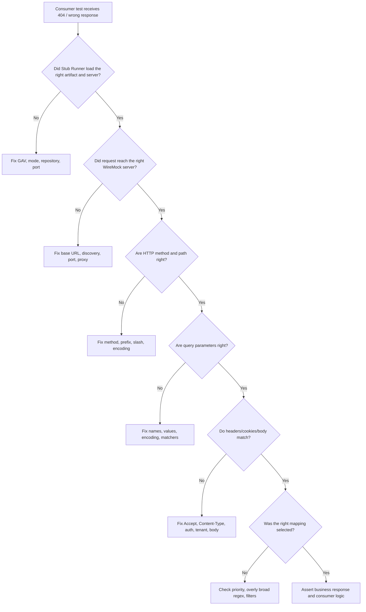
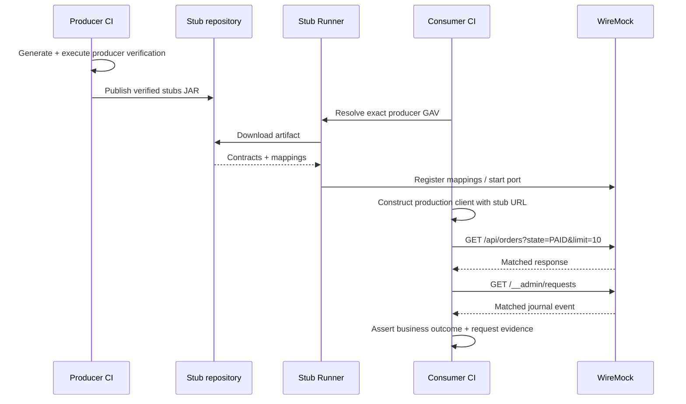

# Request Does Not Match Stub Due to URL, Query, or Header

## 1. Identify the Right Failure: Stub Runner Starts, Yet HTTP Returns 404

In **Spring Cloud Contract (SCC)**, producer and consumer agree on HTTP or messaging behavior via **Groovy/YAML DSL**. The producer generates and runs tests to verify its implementation and packages a stub artifact; the consumer uses **Stub Runner** to download stubs and test its real HTTP client. CI ties both sides together to detect incompatible API changes.

A common issue in the **Troubleshooting** chapter is: **Stub Runner started and the stub JAR loaded, yet the consumer receives HTTP 404 or an unexpected response because the request does not match the mapping**.

For example, the contract requires:

```http
GET /api/orders?state=PAID&limit=10 HTTP/1.1
Accept: application/json
X-Tenant-Id: tenant-demo
```

While the real client sends:

```http
GET /api/orders/?limit=10&state=PAID HTTP/1.1
Accept: */*
X-Tenant-Id: tenant-demo
```

If the stub is declared with exact URL and headers, **multiple mismatches** may be happening at once:

- Path `/api/orders/` has a trailing `/`, differing from `/api/orders`.
- Query order is reversed, which can fail to match if the mapping compares the **entire URL**.
- Header value `Accept: */*` does not satisfy an `Accept: application/json` equality matcher.

**This is a request matching failure**, not necessarily a producer business-logic bug. Do not change a `404` response in the contract to `200` just to hide the error.

### Learning Objectives

After this lesson, you will be able to:

1. Distinguish **WireMock HTTP 404 from an unmatched request**, a **business 404 defined by the contract**, and a **404 from a Maven repository missing the stub artifact**.
2. Understand how WireMock matches **method, full URL or URL path, query parameters, and headers**.
3. Diagnose failures from path prefixes, trailing `/`, encoding, query order, missing/extra params, casing, default headers, or token/header matchers.
4. Author Groovy/YAML DSL that avoids unnecessary coupling to query order while preserving critical business constraints.
5. Use `@StubRunnerPort`, `StubFinder`, `mappingsOutputFolder`, and WireMock admin endpoints to gather evidence.
6. Read the request journal, unmatched requests list, and **near misses** to identify which attribute diverged.
7. Test the consumer's real HTTP client code, not merely `curl` or a Mockito mock.
8. Design sensitive tests/CI: when a request has the wrong path, query, or header, it **must fail for the right reason**.

> **Principle:** Before editing the DSL, prove **which request reached which server**, **which mapping was registered**, and **which attribute prevented the match**.

## 2. Layered Troubleshooting Workflow



**Do not jump from A straight to editing the producer controller.** With contract testing, determine whether the failure lies in **artifact resolution**, **stub server**, **client routing**, **request matching**, or **response decoding**.

| Layer | Symptom | Evidence to Gather |
|---|---|---|
| Artifact | Stub Runner reports `-stubs.jar` not found | `groupId:artifactId:version:classifier`, mode, repo |
| Server | Stub fails to start or wrong port | Running port from Stub Runner; loaded mappings |
| Routing | Journal stays empty even though test runs use case | Real base URL/Feign/RestClient/WebClient |
| Method/path | Journal shows `POST` or different path | Request `method`, `url`, `absoluteUrl` |
| Query | Missing/wrong param; query order/encoding | Raw URL and parsed query parameters |
| Headers | Missing or wrong `Accept`/`X-Tenant-Id` | Actual headers and expected mappings |
| Matching | Default HTTP 404, `wasMatched=false` | `/__admin/requests/unmatched`, near misses |
| Consumer logic | HTTP matched, domain outcome wrong | DTO decoder, status/body, business assertions |

## 3. WireMock Mechanism: Requests Must Satisfy Mapping Conditions

SCC converts HTTP contracts into **WireMock stub mappings**. A typical mapping constrains:

- **HTTP method:** `GET`, `POST`, `PUT`, `DELETE`…
- **URL:** matches `url` (path and query), or `urlPath` / `urlPathPattern` (path only).
- **Query parameters:** `queryParameters` by parameter name and matcher.
- **Headers:** `headers` by header name and value matcher.
- **Cookies, form parameters, body patterns:** if specified by the contract.
- **Matching priority:** when multiple mappings match.

Conditions are **ANDed together**: a request matching the path but missing a required header is still rejected. For each attribute, matchers such as `equalTo`, `contains`, and `matches` carry different semantics. **Do not inspect only the URL** and ignore headers.

### 3.1. Comparing `url` vs. `urlPath`

WireMock supports at least four common variants:

| Mapping Key | Meaning | Scenario |
|---|---|---|
| `url` | Equality on **path + query string** | Fixed URL needing exact raw query |
| `urlPattern` | Regex on **path + query string** | Dynamic URL matching the whole string |
| `urlPath` | Equality on **path only** | Independent of query parameter order |
| `urlPathPattern` | Regex on **path only** | Path variables matching a pattern |

Illustrative WireMock mappings:

```json
{"request":{"method":"GET","url":"/api/orders?state=PAID&limit=10"}}
```

differs from:

```json
{
  "request": {
    "method": "GET",
    "urlPath": "/api/orders",
    "queryParameters": {
      "state": {"equalTo": "PAID"},
      "limit": {"equalTo": "10"}
    }
  }
}
```

In the first form, a request with reversed query parameters like `?limit=10&state=PAID` is **not the same URL string**. In the second form, WireMock checks each query parameter individually, so **parameter name ordering is not part of the URL path matcher**.

**Note:** `urlPath` checks only the path. Without `queryParameters`, query strings may be unconstrained even when business rules require them. Do not drop query matchers just to make tests pass.

### 3.2. Unconstrained Differs from Requiring “Absent”

If a mapping does not mention header `X-Trace-Id`, WireMock normally **does not require that header to be absent**. Likewise, a `urlPath=/api/orders` mapping that omits `sort` normally does not reject requests carrying `sort`.

When a query param or header must **not appear**, use WireMock's `absent` matcher or the corresponding DSL expression if supported by your version. Do not assume omitting a field from a contract forbids the client from sending it.

### 3.3. HTTP 404 Is a Signal, Not a Diagnosis

A `404` can be:

- **WireMock default 404**: no mapping matched.
- **Contract response 404**: a mapping matched and intentionally returned `ORDER_NOT_FOUND`.
- **Application response 404**: the test accidentally called the real producer.
- **Artifact repository HTTP 404**: Stub Runner failed to download the JAR before any WireMock server started.

Therefore, **asserting `status == 404` alone is insufficient** to prove a contract error path. Assert the error body and/or the request journal's matched mapping.

## 4. SCC YAML Example: Path, Query, and Headers Declared Separately

Hypothetical contract for consumer `checkout-service` calling producer `order-service`.

File `list-paid-orders.yml` in the contracts directory **configured for the producer SCC plugin**:

```yaml
name: list_paid_orders_for_tenant
description: "Checkout lists up to 10 paid orders"
request:
  method: GET
  urlPath: /api/orders
  queryParameters:
    state: PAID
    limit: "10"
  headers:
    Accept: application/json
    X-Tenant-Id: tenant-demo
response:
  status: 200
  headers:
    Content-Type: application/json
  body:
    orders:
      - id: ORD-42
        state: PAID
    nextPage: null
```

Meaning:

- `urlPath` constrains the **path** `/api/orders`.
- `queryParameters` constrains parameter **names** `state` and `limit` and their values.
- `headers` requires the client to send matching `Accept` and `X-Tenant-Id`.
- The response body is **synthetic test data**, not real order data.
- Generated producer tests call the real producer API in the test environment; stub mappings for the consumer simulate the declared behavior.

**Verify against your environment:** actual plugin version, DSL parser, and generated mapping. SCC YAML supports `request.urlPath`, `request.queryParameters`, and `request.headers`; generated JSON field ordering or filenames need not match YAML verbatim.

### 4.1. Semantically Equivalent Groovy DSL

```groovy
import org.springframework.cloud.contract.spec.Contract

Contract.make {
    name('list_paid_orders_for_tenant')
    description('Checkout lists up to 10 paid orders')
    request {
        method GET()
        urlPath('/api/orders') {
            queryParameters {
                parameter 'state': 'PAID'
                parameter 'limit': '10'
            }
        }
        headers {
            header 'Accept': 'application/json'
            header 'X-Tenant-Id': 'tenant-demo'
        }
    }
    response {
        status OK()
        headers {
            header 'Content-Type': 'application/json'
        }
        body(
            orders: [[id: 'ORD-42', state: 'PAID']],
            nextPage: null
        )
    }
}
```

Groovy and YAML are **two ways to declare the same behavior**. Once a project picks one format, avoid keeping two active identical files that accidentally generate duplicate mappings.

### 4.2. Readable Example of a Generated WireMock Mapping

An illustrative JSON mapping (omitting `id`, `uuid` metadata, and generator details):

```json
{
  "request": {
    "method": "GET",
    "urlPath": "/api/orders",
    "queryParameters": {
      "state": {"equalTo": "PAID"},
      "limit": {"equalTo": "10"}
    },
    "headers": {
      "Accept": {"equalTo": "application/json"},
      "X-Tenant-Id": {"equalTo": "tenant-demo"}
    }
  },
  "response": {
    "status": 200,
    "headers": {"Content-Type": "application/json"},
    "jsonBody": {
      "orders": [{"id": "ORD-42", "state": "PAID"}],
      "nextPage": null
    }
  }
}
```

This **illustrates WireMock mechanics**, without promising SCC emits these exact JSON bytes across every version. When troubleshooting, inspect the **actual mappings registered by Stub Runner**, rather than arguing from assumptions about what the generator “must have understood.”

## 5. Valid Requests vs. Non-Matching Requests

| Actual HTTP Request | Against Section 4 Mapping | Reason |
|---|---|---|
| `GET /api/orders?state=PAID&limit=10` + both headers | **Match** | All conditions satisfied |
| `GET /api/orders?limit=10&state=PAID` + headers | **Match** if queries declared separately | Query parameter order is unconstrained with `urlPath` + matchers |
| `GET /api/orders/?state=PAID&limit=10` | **No match** | Path has trailing `/` |
| `GET /API/orders?state=PAID&limit=10` | Usually **no match** for exact path | Different path casing |
| `GET /api/orders?status=PAID&limit=10` | **No match** | Wrong param name `state` → `status` |
| `GET /api/orders?state=paid&limit=10` | **No match** with exact equality | Wrong value casing |
| `GET /api/orders?state=PAID` | **No match** | Missing required `limit` |
| `GET /api/orders?state=PAID&limit=010` | **No match** with exact equality | String `010` differs from `10` |
| `GET /api/orders?state=PAID&limit=10`, `Accept: */*` | **No match** if exact `Accept` required | Wrong header value |
| `GET /api/orders?state=PAID&limit=10`, missing `X-Tenant-Id` | **No match** | Missing required header |
| `POST /api/orders?...` | **No match** | Different method |
| `GET /api/orders?state=PAID&limit=10&sort=createdAt` | May **match** | Unconstrained extra param can be accepted |

**“Match” in this table is the expected outcome for the illustrative mapping**, not an execution log. If the server holds other mappings, a request failing mapping A might hit mapping B and return another response. Always check which mapping served the request when conflicts exist.

## 6. Confirm the Right Stub Artifact and HTTP Server Before Checking URLs

Suppose the consumer runs:

```java
@SpringBootTest
@AutoConfigureStubRunner(
    ids = "com.acme.billing:order-service:1.4.2:stubs",
    stubsMode = StubRunnerProperties.StubsMode.REMOTE,
    repositoryRoot =
        "https://repo.example.org/repository/maven-releases/",
    failOnNoStubs = true,
    mappingsOutputFolder = "target/registered-stubs"
)
class CheckoutOrderContractTest {
    // Tests invoke the real OrderHttpClient and CheckoutService.
}
```

**This is a configuration skeleton**; Spring Boot/JUnit/Stub Runner dependencies must be added. For Maven, `target/registered-stubs` is a suitable debug output; for Gradle, place it under `build` or a managed temporary directory.

### 6.1. Verify Three Distinct Identities

```text
Stub artifact:
  com.acme.billing:order-service:1.4.2:stubs

Artifact repository:
  https://repo.example.org/repository/maven-releases/

Running HTTP stub server:
  http://localhost:<stub-runner-selected-port>
```

`repositoryRoot` is **where the stub JAR is downloaded from**, not where API requests are sent. Stub Runner can choose a dynamic port: do not hard-code `18080` unless the ID specifies a port and the environment guarantees it is free.

### 6.2. Retrieve the Port from Stub Runner

```java
@StubRunnerPort("com.acme.billing:order-service")
int orderStubPort;
```

Or:

```java
@Autowired
StubFinder stubFinder;

// After Stub Runner has started:
URL orderStubUrl =
    stubFinder.findStubUrl("com.acme.billing", "order-service");
```

If the test injects `@StubRunnerPort` yet the application's `OrderHttpClient` still reads a production URL from another profile, **the server runs fine while requests never reach the stub**. That is a routing bug, not a URL matcher issue.

**Lifecycle note:** Do not assume a `@StubRunnerPort` field on the test instance is populated when Spring constructs client beans via `@DynamicPropertySource`. If dynamic injection is needed, use test configuration with clear lifecycle ordering, or instantiate the **production client class** via its constructor once the stub URL is available and test Spring wiring separately.

### 6.3. Dump Registered Mappings

SCC documentation supports `mappingsOutputFolder` to write mappings for each stub artifact/server and port to disk. You can cross-check:

- Are artifact/service name `order-service` exact?
- Does the running port match `orderStubPort`?
- Does the registered mapping use `url` or `urlPath`?
- Which `queryParameters` and `headers` does the mapping declare?
- Are mappings filtered by `stubsPerConsumer`/`consumerName`?
- Are there duplicate path mappings or overly broad matchers?

**Goal:** turn assumptions into evidence. **The JAR existing** does not prove **the needed mapping was loaded**; and **the mapping being loaded** does not prove **the client called the right server**.

## 7. URL/Path Mismatches: The Most Common Mistakes

### 7.1. Base URL Combined with Request Path

Production client example:

```text
order.api.base-url   = https://orders.example.internal
request path         = /api/orders
```

In a contract test, it needs to become:

```text
order.api.base-url = http://localhost:<order-stub-port>
request path       = /api/orders
```

If the consumer sets:

```text
order.api.base-url = http://localhost:<order-stub-port>/api
request path       = /api/orders
```

then depending on how `RestClient`/`Feign`/`WebClient` builds URIs, the request may become `/api/api/orders`, or the path may be replaced per URI resolution rules. **Do not guess by concatenating strings on paper**: inspect the actual request URL in the journal to see exact library output.

### 7.2. Trailing Slash

```text
Contract mapping:  /api/orders
Actual request:    /api/orders/
```

Under equality, the two paths **differ**. Some production servers redirect or normalize trailing slashes automatically, whereas WireMock mappings do not necessarily mimic that.

**The right fix** depends on the API contract:

- If the producer commits to **one canonical path**, fix the consumer to send that exact path.
- If both paths are intentionally supported, write corresponding contracts/tests, or use a narrowly scoped path matcher.
- Do not default to `/api/orders/?` regex on every endpoint just to pass tests if the API never promised an optional slash.

### 7.3. Case, Hyphens, Path Versions, and Context Paths

```text
/api/orders           ≠ /API/orders
/api/v1/orders        ≠ /api/v2/orders
/checkout/api/orders  ≠ /api/orders
/api/order            ≠ /api/orders
```

These differences can stem from `server.servlet.context-path`, API gateway rewrites, `@RequestMapping` on controllers, base URL config, or environment variables. **Stub Runner does not automatically replicate all production gateway rewrite rules**. When testing gateway rewrites, use dedicated integration tests or model stubs around the exact requests your client sends.

### 7.4. URL Encoding and Path Variables

Suppose an order ID contains spaces or special characters:

```text
Logical ID:    "ORD A/1"
Encoded path:  /api/orders/ORD%20A%2F1   (illustrative)
```

An unencoded `/` in an ID can be interpreted as a **path separator**; `%2F` and `/` differ during URL matching. Encoding can also be decoded or normalized multiple times by proxies/servers.

Check:

- Does your URI builder encode path variables per library/version behavior?
- Are you pre-encoding and causing **double encoding** into `%252F`?
- Are spaces normalized as `%20` or another character per URL rules?
- What **raw URL** does the WireMock journal record?
- Does the contract use an exact path or an ID-appropriate pattern?

**Do not loosen regexes to `.*` to mask broken encoding.** If IDs legitimately contain `/`, design consistent routing/encoding and include special-character contract examples.

### 7.5. Redirects and Different Hosts

A `301/302/307/308` from a proxy or legacy URL can cause an HTTP client to change method, path, or host depending on client settings. WireMock mappings usually do not handle your infrastructure redirects. If the journal is empty while the client still gets a response, inspect the redirect chain and actual destination host, not only the final assertion.


## 8. Query Mismatches: Names, Values, Ordering, and Encoding

Query parameters are often overlooked because two requests look “equivalent” in code. However, WireMock matches either the **raw URL string** or **individual query parameters** depending on the mapping.

### 8.1. Query Parameter Ordering

```text
Expected:
  /api/orders?state=PAID&limit=10

Actual:
  /api/orders?limit=10&state=PAID
```

If the mapping uses:

```json
{"request":{"method":"GET","url":"/api/orders?state=PAID&limit=10"}}
```

then the two raw URLs **are not equal**, even though the server application would parse the same parameters.

**Solution:** if parameter order is not part of the API contract, use `urlPath` and independent query matchers as in section 4. Do not modify the client solely to force query ordering for tests if clients/libraries are free to order params differently.

### 8.2. Missing or Extra Query Parameters

Suppose `state=PAID` and `limit=10` are required:

```text
/api/orders?state=PAID                   # missing limit
/api/orders?state=PAID&limit=10          # complete
/api/orders?state=PAID&limit=10&debug=1  # extra debug
```

If the mapping defines equality matchers for `state` and `limit`, a request missing `limit` will not match. An unlisted `debug` param **may not break matching**, since WireMock does not forbid unlisted query parameters by default.

Actions to take:

1. Check whether the real producer API requires `limit` or provides a default.
2. If optional, define contracts covering both **with** and **without** `limit` when the consumer relies on both.
3. If `debug` is forbidden by API/security policy, do not treat the absence of a matcher as proof it is rejected; write an explicit contract/test or validation.
4. Do not replace matchers with `.*` covering all queries without understanding business semantics.

### 8.3. Numbers in Queries Are Still Strings on the Wire

```text
limit=10
limit=010
limit=10.0
limit=ten
```

A backend application may parse several representations to the same numeric value, yet WireMock's `equalTo("10")` checks a **string**. SCC generates matchers from the values declared in DSL; inspect the registered JSON mapping to be sure.

If the API accepts any positive integer, consider a **bounded regex matcher** when supported by DSL/plugin, such as `[1-9][0-9]*`. But if the consumer **must** send `10` due to a business constraint, keep the equality check.

### 8.4. Wrong Parameter Name or Casing Convention

```text
state=PAID      ≠ status=PAID
state=PAID      ≠ state=paid
includeClosed=1 ≠ include_closed=1
```

Never assume query parameter names or values are case-insensitive. Enforce exact casing per the producer API. If the production API accepts multiple variants, document and test them explicitly in contracts/tests.

### 8.5. URL Encoding: Spaces, Plus Signs, and Percent Signs

```text
q=New%20York
q=New+York
q=New%2520York
```

Depending on context and encoding/decoding rules, `+` may be interpreted as a space in form-style queries; `%20` is percent-encoding for space; `%2520` is often double encoding.

When hitting a mismatch:

- Record the **raw request URL** from the journal.
- Inspect the parsed query received by WireMock.
- Inspect the HTTP client's `UriBuilder` and check for multiple `encode` calls.
- Compare values at the **same representation layer**: decoded query value vs. decoded value, or raw URL vs. raw URL.
- Do not guess YAML edits based on characters printed at a different layer.

**Trap:** HTTP/client libraries apply different encoding rules across URI builders, query forms, frameworks, and proxies; always rely on the actual request and specific library version.

### 8.6. Repeated Parameters and Arrays

```text
/api/orders?tag=urgent&tag=vip
/api/orders?tag=urgent,vip
/api/orders?tag[]=urgent&tag[]=vip
```

These are **three distinct wire representations**. If the backend accepts multiple values, determine whether the API specifies repeated keys, comma-separated values, or bracket notation.

WireMock supports multi-value query matchers such as `havingExactly`/`including` in Java DSL and equivalent JSON representations, but **do not assume your SCC YAML DSL version emits that exact matcher**. For advanced cases, verify plugin capabilities and generated mappings.

### 8.7. Empty, Absent, and Null Values

```text
/api/orders                 # state absent
/api/orders?state           # state with no explicit value
/api/orders?state=          # state with empty value
/api/orders?state=null      # state is the string "null"
```

Libraries can parse these differently. Define explicit contracts if the consumer relies on **absent** vs. **empty** semantics. JSON `null` cannot serve as an implicit convention for query strings.

## 9. Header Mismatches: Exact Values Matter, Not Just Header Names

Headers are often added by HTTP clients, API gateways, interceptors, security filters, or test configs. Sometimes source code never mentions `Accept`, yet the actual request carries `Accept: */*`.

### 9.1. `Accept` vs. `Content-Type`

| Header | Sender Uses It to Express | Usually Important When |
|---|---|---|
| `Accept` | Response media types the client accepts | GET and content negotiation |
| `Content-Type` | Media type of the **request body** | POST/PUT/PATCH sending JSON/XML |
| `Authorization` | Request authentication/authorization | Auth-protected endpoints |
| `X-Tenant-Id` | Selected tenant | Multi-tenant routing or authorization |
| `X-Correlation-Id` | Request tracing | Observability, usually optional |

Example:

```text
Contract expects:
  Accept: application/json

Client actually sends:
  Accept: */*
  Content-Type: application/json
```

Sending `Content-Type: application/json` does **not** satisfy an `Accept` constraint. For a bodyless `GET` request, clients might not send `Content-Type` at all; do not require it merely because the response is JSON.

### 9.2. Casing of Header Names and Values

In HTTP, **field names** are case-insensitive, so `Accept` and `accept` generally represent the same header. However, **value matching** depends on the matcher:

```text
Accept: application/json
Accept: application/*+json
Accept: */*
```

`equalTo("application/json")` does not treat `*/*` as equivalent. For media types with parameters like:

```text
Content-Type: application/json; charset=UTF-8
```

an exact `application/json` matcher may fail even though both represent JSON to the application.

**How to fix:** if charset variation is genuinely permitted, use a properly scoped matcher (such as a JSON media-type prefix/regex) or configure the client to send the canonical header; do not remove `Content-Type` checks when the consumer relies on a JSON decoder.

### 9.3. Intentional Groovy Header Matcher

Example **allowing only JSON responses** without requiring an exact string for media-type parameters:

```groovy
import org.springframework.cloud.contract.spec.Contract

Contract.make {
    request {
        method GET()
        urlPath('/api/orders') {
            queryParameters {
                parameter 'state': 'PAID'
                parameter 'limit': '10'
            }
        }
        headers {
            header 'X-Tenant-Id': 'tenant-demo'
            header 'Accept': value(
                consumer(regex('application/json(?:;.*)?')),
                producer('application/json')
            )
        }
    }
    response {
        status OK()
        headers {
            contentType(applicationJson())
        }
        body(orders: [[id: 'ORD-42', state: 'PAID']])
    }
}
```

This illustrates the **two-sided DSL intent**: producer verification uses the concrete value `application/json` when sending requests; consumer stub mappings accept values matching the declared regex. Always inspect generated tests and JSON stub mappings, as client/server-side DSL values depend on request/response context and SCC version.

**Do not relax to `.*` or `.*json.*` when the contract genuinely requires valid `application/json`**; overly broad regexes can match meaningless values.

### 9.4. Auth Headers and Dynamic Values

If a contract defines:

```yaml
headers:
  Authorization: "Bearer TEST_TOKEN"
```

then a client sending `Bearer REAL_TEST_TOKEN` will fail to match if the generated mapping uses equality. Never paste a production token into a contract to “fix” a mismatch.

Safer approaches:

- Use a fixed **synthetic token** in tests when only checking HTTP header wiring.
- Use a format-constrained regex matcher when token values vary.
- Test real **access control** separately in appropriate security/integration tests.
- Never log raw `Authorization` headers in CI request journals.
- Distinguish WireMock unmatched 404 from `401/403` produced by business stub mappings or production security filters.

### 9.5. Automatic Headers and Multi-Value Headers

Clients may automatically attach `User-Agent`, `Host`, `Accept-Encoding`; interceptors may add `Traceparent` or multiple `Accept` values. If the contract does not need to distinguish them, **do not constrain them in DSL** just because they appeared in one run.

When the API requires one or more specific values, use appropriate matchers. WireMock supports multi-value matching (e.g., includes/exactly) at the WireMock level, though you must verify your SCC generator supports the corresponding DSL expression.

### 9.6. Tenant Headers Affect Security and Data Isolation

`X-Tenant-Id` frequently carries business/authorization semantics. **Never edit a contract to remove a tenant matcher** solely to make a request match. If the consumer sends the wrong tenant, that could be a logic bug causing data leaks or reading the wrong orders.

Verify:

1. Does the client read the tenant from the right security/session context?
2. Does the interceptor attach the header in the test context?
3. Does the header value match the tenant fixture?
4. Do stub mappings cover both success and tenant mismatch/error cases?
5. Does producer verification test real behavior when the tenant header is missing/wrong?

## 10. Observing Real Requests: The WireMock Request Journal

To avoid guessing requests from code, inspect the **request journal** on the exact WireMock server started by Stub Runner.

Useful admin endpoints (per WireMock version):

```text
GET     /__admin/mappings
GET     /__admin/requests
GET     /__admin/requests/unmatched
GET     /__admin/requests/unmatched/near-misses
POST    /__admin/near-misses/request
DELETE  /__admin/requests
```

These endpoints run in a **test environment** on the WireMock server; never expose an admin interface publicly or run against production APIs.

### 10.1. Start with Unmatched Requests

Suppose Stub Runner provides `orderStubPort`. In your test environment terminal, run:

```bash
curl -s "http://localhost:18081/__admin/requests/unmatched"
```

`18081` is only an **illustrative port**. With dynamic ports, substitute the value returned by `@StubRunnerPort`/`StubFinder`. Never hard-code 18081 for every test run.

An illustrative response:

```json
{
  "requests": [
    {
      "url": "/api/orders/?limit=10&state=PAID",
      "method": "GET",
      "headers": {
        "Accept": "*/*",
        "X-Tenant-Id": "tenant-demo"
      }
    }
  ],
  "requestJournalDisabled": false
}
```

Seeing `/api/orders/` and `Accept: */*` already pinpoints at least two differences from the section 4 contract. **There is no need yet to change the generator or producer implementation.**

### 10.2. Near Misses: Which Mapping Came Closest?

WireMock provides near-miss diagnostics to locate mappings closest to an unmatched request. A handy endpoint:

```http
GET /__admin/requests/unmatched/near-misses HTTP/1.1
```

The output lists the request and nearest request patterns with distance/match details, highlighting diverging paths, headers, or query params.

You can also query near misses for a specific request:

```http
POST /__admin/near-misses/request HTTP/1.1
Content-Type: application/json

{
  "method": "GET",
  "url": "/api/orders/?limit=10&state=PAID",
  "headers": {
    "Accept": "*/*",
    "X-Tenant-Id": "tenant-demo"
  }
}
```

This is a **minimal example of key fields**; exact API behavior and payload fields depend on your WireMock version. Inspect the full response/journal request when needed. **Near misses are proximity-based diagnostic hints, not confirmation that a mapping matched.**

### 10.3. Confirm a Matched Event in the Journal

`GET /__admin/requests` returns serve events. After fixing the request, verify:

- The event shows the expected `method=GET` and `url`.
- `wasMatched=true` when the request was served by a mapping.
- If multiple mappings exist, inspect mapping/response details to confirm **which mapping** was chosen.
- Final HTTP status/body match the contract and consumer handling works.
- No related unmatched events remain.

**Do not merely assert zero unmatched requests if no request was ever sent.** Assert that **at least one real request** from the client reached the right stub.

### 10.4. Resetting the Journal and Test Isolation

Before each test scenario, you can call:

```http
DELETE /__admin/requests HTTP/1.1
```

This clears the **request journal**, not the mappings. Then invoke the use case and read the journal to avoid picking up requests from earlier tests.

If CI runs in parallel against the same Stub Runner server, **do not globally reset** between tests, as that can wipe another test's evidence. Use separate servers/test isolation or synthetic correlation IDs. Always redact `Authorization` and sensitive data when saving journals.

### 10.5. The Request Journal Can Be Disabled

WireMock allows disabling the request journal to save memory in some workloads. If disabled, verification APIs may have no data or behave unexpectedly. Keep the journal enabled in **contract test environments** when tests assert on requests.

## 11. Consumer Code: Distinguish Configured URL from Sent Request

A consumer using Spring Framework `RestClient` might look like:

```java
@Component
public class OrderHttpClient {
    private final RestClient http;

    public OrderHttpClient(
            RestClient.Builder builder,
            @Value("${order.api.base-url}") String baseUrl) {
        this.http = builder.baseUrl(baseUrl).build();
    }

    public OrderListDto listPaidOrders(String tenantId) {
        return http.get()
            .uri(uriBuilder -> uriBuilder
                .path("/api/orders")
                .queryParam("state", "PAID")
                .queryParam("limit", 10)
                .build())
            .accept(MediaType.APPLICATION_JSON)
            .header("X-Tenant-Id", tenantId)
            .retrieve()
            .body(OrderListDto.class);
    }
}
```

Here:

- `baseUrl` comes from the consumer's Spring Environment; tests must point it to Stub Runner.
- `path("/api/orders")` produces the exact path with no extra slash or prefix.
- `queryParam` lets the URI builder encode parameters; avoid manual string concatenation.
- `accept(MediaType.APPLICATION_JSON)` sends the expected `Accept` header.
- `X-Tenant-Id` is passed explicitly and should be tested with synthetic values.
- `OrderListDto` is a consumer-defined DTO, not an SCC class.

**This snippet requires imports, package, and Spring dependencies**; it is a production code example, not standalone runnable code in this lesson.

### 11.1. A Meaningful DTO

```java
public record OrderListDto(
    List<OrderDto> orders,
    String nextPage
) {
    public record OrderDto(String id, String state) {}
}
```

When tests invoke the real client and receive JSON from the stub, Jackson/deserializers must map field names and types properly. Never mock `OrderHttpClient` and claim URL/query/headers were tested.

### 11.2. Misleading Bugs from Manual String Concatenation

Fragile code:

```java
String url = baseUrl + "/api/orders?state=" + state
    + "&limit=" + limit;
```

If `baseUrl` already carries a slash/path/query, or `state` contains special characters, the URL breaks. Use a URI builder with proper encoding and clean base URLs, and inspect the **request journal** to catch real bugs.

### 11.3. Client Overridden by Proxy/Interceptor

When using Feign, `WebClient`, load balancers, service discovery, gateways, interceptors, or HTTP proxies, the `baseUrl` in source code **may not be the actual request URL**. Check:

- Which Spring profile is active?
- Is there a separate client `url` or service ID configured?
- Does an interceptor add or modify headers?
- Does a URI template double-encode path/query?
- Does a proxy rewrite paths or issue redirects?
- Do caching or fallbacks prevent the client from sending requests?

**If the journal is empty**, do not rush to edit `urlPath`; first prove requests are reaching the right Stub Runner server.


## 12. Consumer Test: Prove the Real Client Sent the Right URL, Query, and Headers

This example uses a **dynamic port assigned by Stub Runner**, then instantiates the **real production `OrderHttpClient` class** to issue HTTP calls. This avoids reading the stub port too early in Spring's lifecycle. If the project also wants to verify **Spring bean wiring** for `@Value`, add a test profile explicitly configuring the base URL or a test configuration with proper lifecycle ordering.

Before running, the producer must publish/install the artifact:

```text
com.acme.billing:order-service:1.4.2:stubs
```

containing the `GET /api/orders` mapping with `state=PAID`, `limit=10`, and required headers from section 4.

### 12.1. JUnit 5 with Stub Runner and Production Client

```java
import static org.junit.jupiter.api.Assertions.*;

import com.fasterxml.jackson.databind.JsonNode;
import java.util.stream.StreamSupport;
import org.junit.jupiter.api.Test;
import org.springframework.beans.factory.annotation.Autowired;
import org.springframework.boot.test.context.SpringBootTest;
import org.springframework.cloud.contract.stubrunner.spring.AutoConfigureStubRunner;
import org.springframework.cloud.contract.stubrunner.spring.StubRunnerPort;
import org.springframework.cloud.contract.stubrunner.spring.StubRunnerProperties;
import org.springframework.web.client.RestClient;

@SpringBootTest(webEnvironment = SpringBootTest.WebEnvironment.NONE)
@AutoConfigureStubRunner(
    ids = "com.acme.billing:order-service:1.4.2:stubs",
    stubsMode = StubRunnerProperties.StubsMode.LOCAL,
    failOnNoStubs = true
)
class OrderHttpRequestMatchingTest {

    @StubRunnerPort("com.acme.billing:order-service")
    int orderStubPort;

    @Autowired
    RestClient.Builder builder;

    @Test
    void sendsCorrectPathQueryAndHeaders() {
        assertTrue(orderStubPort > 0, "Stub Runner must start");

        String stubUrl = "http://localhost:" + orderStubPort;
        RestClient admin = RestClient.create(stubUrl);

        // Clear only the request journal, not mappings.
        admin.delete()
            .uri("/__admin/requests")
            .retrieve()
            .toBodilessEntity();

        // Exact client class used in production.
        OrderHttpClient realClient = new OrderHttpClient(
            builder, stubUrl
        );

        OrderListDto response = realClient.listPaidOrders(
            "tenant-demo"
        );

        assertNotNull(response);
        assertEquals(1, response.orders().size());
        assertEquals("ORD-42", response.orders().get(0).id());
        assertEquals("PAID", response.orders().get(0).state());

        JsonNode journal = admin.get()
            .uri("/__admin/requests")
            .retrieve()
            .body(JsonNode.class);

        assertNotNull(journal);
        boolean seenMatched = StreamSupport.stream(
            journal.path("requests").spliterator(), false
        ).anyMatch(event -> {
            JsonNode req = event.path("request");
            String url = req.path("url").asText();

            return event.path("wasMatched").asBoolean(false)
                && "GET".equals(req.path("method").asText())
                && url.startsWith("/api/orders?")
                && url.contains("state=PAID")
                && url.contains("limit=10")
                && req.path("headers")
                    .path("Accept").toString()
                    .contains("application/json")
                && req.path("headers")
                    .path("X-Tenant-Id").toString()
                    .contains("tenant-demo");
        });

        assertTrue(
            seenMatched,
            "Actual consumer call must match the expected stub"
        );
    }
}
```

**This is an educational example**: add imports for production code and ensure compatible Spring Boot/SCC versions. The `headers` check uses `toString().contains(...)` for brevity and is **not a complete matcher for production security**; in real projects, parse WireMock's JSON header arrays according to their actual structure and assert exact values.

### 12.2. Why Assert Both Response and Request Journal?

- **Response assertions** prove the client decoded the sample payload and received meaningful fields.
- **Journal assertions** prove the request reached the right WireMock server with the expected method/path/query/headers.
- **`wasMatched`** distinguishes a mapped response from an unmatched default `404`.

Asserting only the body allows a client to pass using cached or mocked data. Asserting only the journal could miss broken deserialization. Combining both provides much stronger evidence.

### 12.3. Order-Independent Query Verification

The example above uses `url.contains(...)` for quick illustration, yet in strict tests you **should not** rely on `contains("limit=10")` since it also matches `limit=100`. Instead, **parse the raw URI into query params** and verify:

```text
method             == GET
path               == /api/orders
query["state"]     == ["PAID"]
query["limit"]     == ["10"]
header["Accept"]   includes application/json
header["X-Tenant-Id"] == tenant-demo
wasMatched         == true
```

This is **criteria pseudocode**, not Java code. Use an appropriate URI parser library and verify query lists/multi-values according to the real contract.

### 12.4. Do Not Reset the Journal When Tests Share Stub Runner in Parallel

If two tests simultaneously clear `/__admin/requests`, test A can erase test B's evidence. Options:

- Run matching tests sequentially or use isolated stub servers.
- Use synthetic correlation IDs and filter the journal by request ID if mappings allow.
- Isolate caches, clocks, and fixtures.
- Clear the journal **before** your own test's request, never after another test has started.

When consumer tests run across parallel JVMs/CI workers, dynamic ports prevent port conflicts, but the request journal still needs server-scoped isolation.

## 13. When a Request Matches the Wrong Mapping Due to Priority and Regex

Failures are not always `wasMatched=false`. A request can match the **wrong mapping**, returning the wrong status or body.

Suppose two mappings exist:

```json
{
  "priority": 1,
  "request": {
    "method": "GET",
    "urlPathPattern": "/api/orders/.*"
  },
  "response": {"status": 200, "body": "{\"state\":\"PENDING\"}"}
}
```

and:

```json
{
  "priority": 5,
  "request": {
    "method": "GET",
    "urlPath": "/api/orders/ORD-42"
  },
  "response": {"status": 200, "body": "{\"state\":\"PAID\"}"}
}
```

In WireMock, **smaller priority numbers take higher precedence**. The broad regex mapping at priority `1` can intercept `/api/orders/ORD-42` ahead of the exact mapping at priority `5`, causing the client to receive `PENDING` even though the path looks right.

### 13.1. What to Check

- Do multiple mappings share the same method/path pattern?
- Is a `urlPathPattern` broad enough to “swallow” multiple endpoints?
- Are `priority` values or registration order affecting selection?
- Does the request journal/serve event show which mapping ID/`stubMapping` was selected?
- Do the contracts distinguish behavior via query/header/state?
- Did a `.*` matcher accidentally erase a distinguishing signal?

**Do not fix this by randomly tweaking priorities** when two contracts actually specify conflicting responses for the same request. Identify which request attribute—such as tenant, fixture state, or version header—the real API uses to differentiate responses.

### 13.2. `stubsPerConsumer`: Mapping Exists but Is Not Registered

If the producer organizes contracts as:

```text
contracts/
  checkout-service/list-paid-orders.yml
  reporting-service/summary-orders.yml
```

and the consumer enables:

```java
@AutoConfigureStubRunner(
    ids = "com.acme.billing:order-service:1.4.2:stubs",
    stubsPerConsumer = true,
    consumerName = "checkout-service"
)
```

Stub Runner may register only mappings matching `consumerName`/folder layout. Mappings exist in the JAR yet **are not loaded** if folder names do not match.

Evidence to inspect:

- Does `consumerName` equal `checkout-service` or the expected `spring.application.name`?
- Does the mappings dump include `list-paid-orders`?
- Does that stub artifact/version contain the consumer folder?
- Is Stub Runner using the right mode and classifier?

**Distinguish clearly:** `stubsPerConsumer` filters mappings by **consumer name**, it does not choose a version of the checkout consumer.

## 14. When the JSON Body Is Also a Matching Condition

This lesson focuses on URL/query/headers, yet for `POST`/`PUT` requests, matching all three **can still fail due to the request body**.

For example, a contract requires:

```yaml
name: create_order
request:
  method: POST
  urlPath: /api/orders
  headers:
    Content-Type: application/json
  body:
    productId: "SKU-100"
    quantity: 2
response:
  status: 201
  headers:
    Content-Type: application/json
  body:
    id: "ORD-501"
    state: CREATED
```

A request sending `Content-Type: text/plain` or a JSON body missing `quantity` will fail to match. Do not remove the header matcher if the API rejects `text/plain`. Instead:

1. Check the actual `Content-Type` sent by the client.
2. Inspect the JSON serializer and raw body received by WireMock.
3. Inspect generated `bodyPatterns` / JSON matchers.
4. Check semantics for optional fields, nulls, and number/string types.
5. Run producer verification to ensure the contract reflects the real API.

**Do not use exact raw JSON strings** when field order/whitespace does not matter, yet avoid overly loose JSON matchers. SCC supports JSONPath/regex body matchers and corresponding DSLs; choose matchers accurate for both producer and consumer.

## 15. Deciding Whether to Fix the Client or the Contract

Whenever a request mismatches, always ask: **is the client wrong relative to the contract, or is the contract too strict/wrong relative to the agreed API?**

| Situation | Where to Fix? | Reason |
|---|---|---|
| Contract requires `/api/orders`; client calls `/api/order` | **Client** | Wrong committed route |
| Contract requires `limit=10`; client sends `limit=100` due to pagination bug | **Client** | Business logic bug |
| Contract specifies full URL exact query order when order is meaningless | **Contract matcher** (after review) | Avoids needless coupling |
| Client sends `Accept: */*` when official API requires JSON | **Client** | Must send proper Accept |
| Contract requires `Content-Type` on bodyless GET when API does not | **Contract** (after review) | Unnecessary constraint |
| Contract drops tenant check to make tests green | **Never do this** | Loses security/multi-tenancy verification |
| Producer supports optional `limit`, contract only has 10 | **Add scenario** | Protects optional behavior too |
| Request differs due to gateway path prefix | **Clarify test layer** | Decide whether WireMock models pre- or post-rewrite API |
| Client double-encodes query | **Client URL builder** | `%2520` is likely wrong |
| Contract `.*` regex matches every request | **Contract** | Matcher no longer catches regressions |
| `Authorization` header uses real non-static token | **Fixture/matcher and security tests** | Never embed production secrets |

### 15.1. Workflow When Suspecting the Contract Is Too Strict

1. Collect the request journal and generated mappings to prove the exact difference.
2. Review the API contract agreed by producer and consumer teams.
3. Separate **business requirements** from irrelevant serialization/URL ordering details.
4. Propose DSL matcher changes with **two-sided review**.
5. Run generated producer tests to verify the implementation satisfies the updated contract.
6. Generate/publish the properly versioned stub artifact.
7. Run consumer tests against that exact artifact with negative controls.

**Never edit raw mapping JSON inside a consumer build and pretend it is a producer-verified contract.** If using temporary mappings during development, label them clearly as standalone test fixtures and never treat them as release contract proof.

## 16. Three Types of 404s to Separate in Logs

| 404 Source | Observation | Action |
|---|---|---|
| **Repository 404** | Stub Runner fails to download `group:artifact:version:stubs` | Check version, classifier, repository/credentials |
| **WireMock unmatched 404** | Stub server running; request appears in `/__admin/requests/unmatched` | Diagnose method/path/query/header/body |
| **Contract-defined 404** | Request has `wasMatched=true`; response body contains domain error code | Assert consumer decodes `ORDER_NOT_FOUND` properly |

### 16.1. Business 404 Contract

```yaml
name: order_not_found
request:
  method: GET
  urlPath: /api/orders/ORD-404
  headers:
    Accept: application/json
response:
  status: 404
  headers:
    Content-Type: application/json
  body:
    code: ORDER_NOT_FOUND
    message: Order not found
```

A test checking only `404` can **false PASS** if the client mistakenly calls `/api/order/ORD-404` and WireMock returns a default `404`. Assert all of:

- Error body has `code = ORDER_NOT_FOUND`.
- Journal shows the expected request with `wasMatched=true`.
- Consumer maps the error to the right business outcome.
- No related unmatched requests exist.

### 16.2. Do Not Confuse Producer 404 with WireMock 404

If test config accidentally targets staging/real producer, the application's 404 response body may look very similar to the contract. That is why **request evidence on the WireMock server** is needed; matching body alone does not prove the test hit the stub route.

## 17. Diagnostic Checklist for Common HTTP Clients

### 17.1. Spring `RestClient`

- Which `baseUrl` is injected into the real bean?
- Does `uri(uriBuilder -> ...)` produce the right path/query and encoding?
- Is `accept(APPLICATION_JSON)` set instead of default `*/*`?
- Do headers/interceptors add `X-Tenant-Id` before or after the builder?
- Does `retrieve()` throw on 4xx, hiding details behind an exception class?

### 17.2. Spring `WebClient`

- `baseUrl` in `WebClient.Builder` and relative URI resolution?
- Is `queryParam` appended twice by filters?
- Are `defaultHeader`/`headers` overridden?
- Is the Reactor `Mono` subscribed via `block()` or `StepVerifier` in tests?
- Do retries/fallbacks replay requests or mask a 404 mismatch?
- Does the reactive client use service discovery or an explicit URL?

### 17.3. Spring Cloud OpenFeign

- Do `@FeignClient(name = ...)` and `url` properties bypass discovery?
- Do `@GetMapping`/`@RequestParam` match the exact query keys?
- Does a Feign `RequestInterceptor` add or alter headers?
- Does `RequestTemplate` encode paths/queries properly?
- Does the service ID map to the right Stub Runner artifact/service?

### 17.4. Other HTTP Clients

With JDK `HttpClient`, OkHttp, or Apache HttpClient, the principle is identical: record actual method/URL/headers and compare against registered mappings. **Do not swap clients just to avoid debugging**; keep the production code path under test.

## 18. CI Gate: How to Prevent False Green Tests?

A consumer contract test should establish an **evidence chain**:



### 18.1. Minimum Conditions for a Meaningful PASS

- Stub artifact pins an approved version/classifier and source.
- Stub Runner loads the right service/artifact; `failOnNoStubs` is not casually disabled.
- Required mappings exist with the right request fields.
- Real production client code targets the stub URL supplied by the runner.
- Test sends at least one request and the journal records method/path/query/headers.
- Event has `wasMatched=true` and expected response status/body.
- Client decodes and handles the response properly.
- Negative controls (wrong query/header/path) fail the test.
- Producer verification tests for the published stub version also ran.
- JUnit/Gradle/Maven test runner does not report an unexpected `0 tests`.

### 18.2. When CI Runs in Parallel

- Use dynamic ports to avoid port collisions.
- Avoid global request journal resets across tests sharing a server.
- Isolate tenants/fixtures, caches, and service discovery.
- When running multiple Stub Runner artifacts, look up ports by **`groupId:artifactId`** instead of guessing by order.
- Redact `Authorization`/cookies/PII in logs and CI artifacts.

### 18.3. Do Not Use Broad Regexes to Reduce Flaky Tests

Flaky tests can stem from ports, races, caching, or startup sequencing. Replacing an exact `urlPath` with `urlPathPattern: .*` to turn tests green **destroys the ability to detect wrong requests**. Fix the root cause instead.

### 18.4. Capture Useful Diagnostic Evidence

A useful failure report includes:

```text
Consumer build/commit: checkout-service @ <commit>
Producer stub ID: com.acme.billing:order-service:1.4.2:stubs
Stub mode: REMOTE
Repository: approved Maven releases
Stub port: <dynamic-port>
Mapping name/ID: <from registered mappings>
Expected method/path/query/headers: ...
Actual method/path/query/headers (redacted): ...
WireMock unmatched/near-miss summary: ...
Producer contract verification report: <CI link>
Consumer test result: FAIL
Difference category: URL / query / header / body / wrong-server
```

Never put bearer tokens, cookies, customer identifiers, or real payloads into logs or test artifacts. When debugging auth headers, log only **presence/shape** or synthetic values.


## 19. Hands-on Exercise: Find the Exact Cause of an Unmatched Request

### 19.1. Context

The Checkout team uses Spring Cloud Contract to test `OrderHttpClient` against stub artifact:

```text
com.acme.billing:order-service:1.4.2:stubs
```

Original contract:

```yaml
name: list_paid_orders_for_tenant
request:
  method: GET
  urlPath: /api/orders
  queryParameters:
    state: PAID
    limit: "10"
  headers:
    Accept: application/json
    X-Tenant-Id: tenant-demo
response:
  status: 200
  headers:
    Content-Type: application/json
  body:
    orders:
      - id: ORD-42
        state: PAID
```

The consumer test currently reports:

```text
Expected: 200 with orders[0].id = ORD-42
Actual:   404 Not Found

Stub Runner:
  order-service started on port 18081
  mappings loaded: 3
```

WireMock journal received:

```json
{
  "requests": [
    {
      "url": "/api/orders/?limit=10&state=PAID",
      "method": "GET",
      "headers": {
        "Accept": "*/*",
        "X-Tenant-Id": "tenant-demo"
      }
    }
  ]
}
```

**Note:** An unmatched record alone does not prove **mappings are completely absent from the JAR**; it only shows that specific request did not match. With the data above, there are two clear mismatches (trailing slash and `Accept`), while query order **should not fail** if the mapping was generated from `urlPath + queryParameters` as intended.

### 19.2. Tasks

1. List which layers in section 2's workflow are proven healthy and which are not.
2. Explain why `Stub Runner started on port 18081` is insufficient to conclude query/headers matched.
3. Identify **at least two independent mismatches** from the journal.
4. For a mapping using `urlPath` and independent `queryParameters`, state whether **reversing query order** causes the request to fail.
5. Propose client fixes to use the canonical path `/api/orders` and `Accept: application/json`.
6. If the producer **allows** trailing slashes, propose an additional contract/test with exact semantics without loosening patterns to `.*`.
7. Write `OrderHttpClient` using a URI builder with `queryParam`, `accept`, and the tenant header.
8. Use Stub Runner with a dynamic port in JUnit and inspect the journal after calling the real client.
9. Describe how to use `/__admin/requests/unmatched/near-misses` when multiple mappings exist.
10. Add a negative control: drop `X-Tenant-Id` or change `state=PAID` to `state=PENDING`; how should the test react?
11. Describe how to detect when a `404` response is WireMock's default rather than a business contract.
12. Describe how to verify artifact `1.4.2` was genuinely producer-verified, rather than relying solely on the annotation string.

### 19.3. Variants for Extra Challenge

**Variant A — Different Query Value Format**

```text
Expected: limit=10
Actual:   limit=010
```

If the mapping uses `equalTo("10")`, the request does not match. Decide **whether `010` is valid per the API** before editing the matcher.

**Variant B — Mapping Uses Full URL**

```json
{
  "request": {
    "method": "GET",
    "url": "/api/orders?state=PAID&limit=10"
  }
}
```

The client sends `?limit=10&state=PAID`. Explain why it fails even though business semantics match, and propose `urlPath + queryParameters` when query order does not matter.

**Variant C — Dynamic Header**

Contract requires:

```text
Authorization: Bearer TEST_TOKEN
```

The client uses a randomly generated test token. Describe how to design a synthetic fixture or bounded format matcher without using real production tokens or improperly removing authorization checks.

**Variant D — Wrong Mapping Priority**

```text
GET /api/orders?state=PAID&limit=10
  → request matched yet returned response from a generic regex mapping
```

Inspect `priority`, mapping ID, broad matchers, and conditions. Never treat `wasMatched=true` as enough when the response came from an unintended mapping.

### 19.4. Guided Answers

1. **Artifact and server** appear ready per logs, though exact version/mappings must be checked; **matching** failed.
2. Journal shows path **`/api/orders/` differs from `/api/orders`**.
3. Header **`Accept: */*` differs from `Accept: application/json`** under equality.
4. `state`/`limit` ordering is not an issue when the mapping uses independent query parameter matchers.
5. Fix the request path to `/api/orders`, send `Accept: application/json`, and keep `X-Tenant-Id`.
6. After fixing, assert the request journal shows **request matched**, response JSON is valid, and consumer domain outcome passes.
7. Pin the stub artifact version and record the producer verification report. Never use `+` in a release gate.

**Do not simply edit YAML to strip `Accept` and tenant headers just to pass tests.** If the real API requires them, that destroys coverage.

## 20. Common Troubleshooting Mistakes and How to Avoid Them

| Mistake | Why It Is Wrong | Better Approach |
|---|---|---|
| Seeing `404` and changing YAML response to `200` | 404 may be unmatched | Inspect request journal/near misses |
| Seeing stub JAR in Maven cache and trusting version | Cache may be stale | Pin GAV and provenance |
| Using `url: /path?query` when query order is irrelevant | Needless raw URL coupling | `urlPath` + `queryParameters` |
| Removing all queryMatchers | Stops checking business params | Relax only unneeded constraints |
| Removing tenant header to force a match | Loses auth/multi-tenancy check | Fix client or contract after review |
| Putting `Accept: application/json` in `Content-Type` | Two headers serve different purposes | Inspect actual request |
| Using `.*` regex on path, query, and headers | Hides wrong paths/data | Write API-bounded matchers |
| Treating every HTTP 404 as `ORDER_NOT_FOUND` | Default unmatched 404 false greens | Assert error code, `wasMatched` |
| Using a separate test HTTP client instead of production client | App client stays untested | Call the real `OrderHttpClient` |
| Asserting only zero unmatched requests | Passes even if zero requests were sent | Assert the expected request **occurred** |
| Resetting journal after calling the client | Wipes out the evidence just created | Reset before, assert after |
| Hard-coding ports in parallel CI | Port collisions/flakiness | Dynamic ports and isolation |
| Enabling `stubsPerConsumer` with wrong name | Mappings are not registered | Check consumerName and dump |
| Editing raw mapping JSON in consumer | Artifact diverges from producer | Fix DSL, verify, publish proper artifact |
| Skipping generated producer tests because stubs respond | Stubs only simulate | Keep producer verification gate |
| Seeing `wasMatched=true` and ignoring mapping ID | Broad regex may match wrongly | Inspect selected mapping/response |
| Printing `Authorization` in CI journals | Leaks secrets | Redact header, use synthetic values |
| Querying near misses on a non-stub port | Diagnosing wrong server | Use `@StubRunnerPort`/`StubFinder` |
| Assuming SCC auto-rewrites API gateway paths | Stub does not simulate gateway | Align contract and test layers |
| Letting CI PASS with `0 tests` | Zero assertions executed | Enforce test report/count checks |
| Using default mock/fallback when Stub Runner fails | False green tests | Fail closed, `failOnNoStubs=true` |

## 21. Checklist Before Closing a “Request Does Not Match Stub” Ticket

- [ ] Distinguished repository resolution errors from request matching errors.
- [ ] Recorded exact `groupId:artifactId:version:classifier` and mode.
- [ ] Stub Runner genuinely started the right producer stub server and port was verified.
- [ ] Real consumer application HTTP client targets the Stub Runner server URL.
- [ ] Checked active Spring profiles, service discovery, gateway/proxy, and URL config.
- [ ] Inspected registered mappings via `/__admin/mappings` or `mappingsOutputFolder`.
- [ ] Confirmed no mappings were unintentionally filtered out by `stubsPerConsumer`.
- [ ] Actual HTTP method matches the contract.
- [ ] Actual path matches `urlPath` without wrong prefix, slash, version, or casing.
- [ ] Path variables are encoded properly with no double-encoding.
- [ ] Query parameter **names** match.
- [ ] Query parameter **values** match, including type/string, casing, and empty/absent cases.
- [ ] Query ordering is not turned into an unnecessary constraint if API does not require it.
- [ ] Multi-value/repeated query keys are checked if the API uses them.
- [ ] `Accept` header is distinguished from `Content-Type`.
- [ ] Header values (media type/charset/tenant/auth) comply with spec.
- [ ] No real secrets appear in contracts, journals, or CI logs.
- [ ] Body matchers checked if the request carries a body.
- [ ] Request journal records at least one **real request** from the client.
- [ ] Event shows `wasMatched=true` and right mapping ID/priority where applicable.
- [ ] Unmatched requests and near misses inspected to pinpoint exact differences.
- [ ] Default 404 is not confused with a contract-defined 404.
- [ ] Error body/code and consumer business outcome are asserted.
- [ ] Negative tests with wrong URL/query/header turn CI red.
- [ ] Tests actually executed, not skipped, with no unexpected `0 tests`.
- [ ] Producer verification tests for the published stub version ran.
- [ ] No fallback to staging producer or unverified local cache remains.
- [ ] Diagnostic notes record artifact version, client request, mapping, and **proven** root cause.

## 22. Key Takeaways and References

When Spring Cloud Contract Stub Runner has started yet the consumer receives `404` or an unexpected response, diagnose in sequence:

**Right artifact → right server → right client route → right method/path → right query → right headers → right mapping → right response and consumer logic.**

- **URL:** Distinguish full exact URL (`url`) from path-only (`urlPath`). Avoid coupling to query order unless required by the contract.
- **Query:** Match names, values, encoding, repeated keys, and optional/absent cases; never remove needed matchers just to pass tests.
- **Headers:** Verify `Accept`, `Content-Type`, tenant, and auth per semantics; never expose secrets.
- **WireMock:** Use the request journal, unmatched requests, and near misses; even when matched, inspect **which mapping was selected**.
- **SCC:** Compare generated mappings against Groovy/YAML DSL, run producer verification, and pin stub artifact versions.
- **Consumer:** Test the real production HTTP client without mocking the boundary; assert both response and recorded request.
- **CI:** When requests are wrong, tests must **fail clearly**; every contract change requires review and stub regeneration from the producer.

### Official References

- [Spring Cloud Contract — Contract DSL: URL, urlPath, queryParameters, headers](https://docs.spring.io/spring-cloud-contract/reference/project-features-contract.html).
- [Spring Cloud Contract — Stub Runner Core: artifacts, HTTP stubs](https://docs.spring.io/spring-cloud-contract/reference/project-features-stubrunner/stub-runner-core.html).
- [Spring Cloud Contract — Viewing Registered Mappings with mappingsOutputFolder](https://docs.spring.io/spring-cloud-contract/reference/howto/how-to-see-registered-stubs.html).
- [Spring Cloud Contract — Stub Runner JUnit, StubFinder, and @StubRunnerPort](https://docs.spring.io/spring-cloud-contract/reference/project-features-stubrunner/stub-runner-junit.html).
- [Spring Cloud Contract — Stubs Per Consumer](https://docs.spring.io/spring-cloud-contract/reference/project-features-stubrunner/stub-runner-stubs-per-consumer.html).
- [Spring Cloud Contract — Stub Runner Configuration Properties](https://docs.spring.io/spring-cloud-contract/reference/configprops.html).
- [WireMock — Request Matching: URL, query, headers, body, priority](https://wiremock.org/docs/request-matching/).
- [WireMock — Verifying, Request Journal, Unmatched, and Near Misses](https://wiremock.org/docs/verifying/).
- [WireMock — Admin API Reference](https://wiremock.org/docs/standalone/admin-api-reference/).
- [Spring Framework — RestClient](https://docs.spring.io/spring-framework/reference/integration/rest-clients.html).

**Scope of evidence:** SCC consumer tests with Stub Runner demonstrate that the consumer can work with behaviors simulated by the selected stub. Only **producer verification tests** from the corresponding build verify the producer implementation; gateway, load, end-to-end security, and broker semantics may require additional integration tests.
