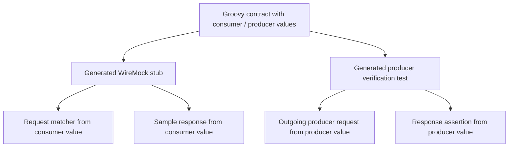
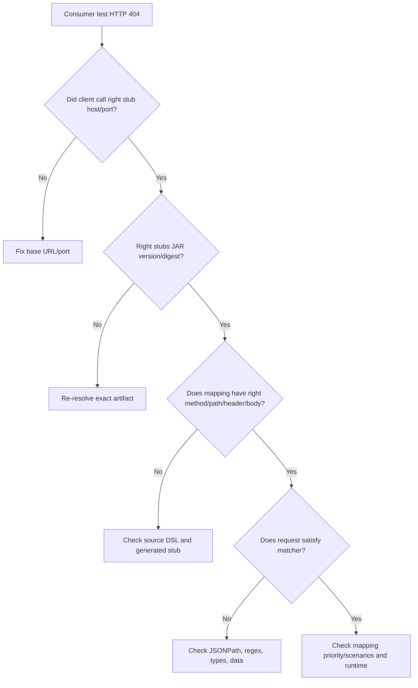
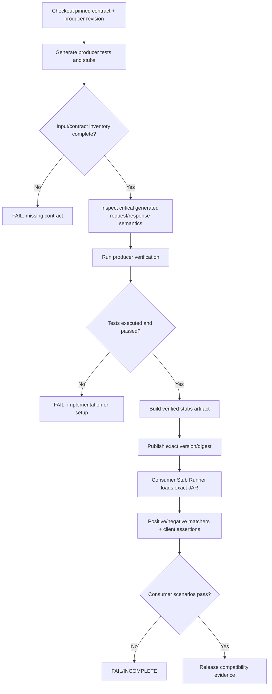

# Mixing Up Consumer Value and Producer Value

## 1. Symptom: Stub Is Green, Yet Producer Test Is Red

In **Spring Cloud Contract (SCC)**, producer and consumer agree on communication behavior using **Groovy/YAML DSL**. The tool uses contracts to **generate producer tests**, **generate HTTP or message stubs**, run **Stub Runner** on the consumer side, and integrate with **CI** to catch incompatible API changes.

A subtle mistake when learning the DSL is **swapping `consumer(...)` and `producer(...)`** in dynamic values. Suppose a team wants:

- Consumer sends `customerId` formatted as `cust-` followed by any digits.
- Generated producer test sends a concrete value, such as `cust-42`, for reproducibility.
- Producer responds with a dynamic `orderId` formatted as `ord-` followed by digits.
- HTTP stub returns a concrete sample value, such as `ord-101`, so the consumer has deterministic data.

If the two sides of `$(consumer(...), producer(...))` are swapped, you may run into:

1. WireMock stub only matches exact `cust-42` instead of valid `cust-[0-9]+` values.
2. Generated producer test lacks a valid concrete request value to send.
3. Producer test asserts a hardcoded response value even though the producer generates dynamic IDs.
4. Stub lacks a concrete response example to return to the client.
5. CI passes on one side while the other fails, or the two sides exercise non-equivalent scenarios.

**Goal of this lesson:** understand the exact meaning of `consumer value` and `producer value`; separate **request** and **response** directions; diagnose generated producer tests, WireMock mappings, and client tests; and fix contracts without weakening API constraints.

## 2. The Names `consumer` and `producer` Do Not Mean “Where the Request Goes”

In an HTTP contract:

- **Consumer** is the side **calling** the API, such as `checkout-service`.
- **Producer** is the side **implementing** the API, such as `order-service`.
- **Stub** simulates the producer for consumer tests.
- **Generated producer test** calls the real producer implementation and verifies behavior against the contract.

SCC allows a dynamic field to carry **two perspectives**:

```groovy
$(consumer(...), producer(...))
```

These two parts do not mean “request is consumer, response is producer.” Both **request** and **response** can need both sides. You must know **which generator output uses each side**.



**Rule to remember:** `consumer(...)` provides the **stub's perspective when the consumer interacts with it**, while `producer(...)` provides the **test's perspective when the producer runs**. Whether a role is **matching an input**, **sending an input**, **returning a sample output**, or **asserting an output** depends on request vs. response position.

## 3. Truth Table: Which Side Needs a Regex, and Which Needs a Concrete Example?

| Position in Contract | `consumer(...)` Serves | `producer(...)` Serves | Common Pattern |
| --- | --- | --- | --- |
| **Request** | WireMock **matches request** sent by consumer | Generated test **sends concrete request** to producer | `consumer(regex('cust-[0-9]+'))` and `producer('cust-42')` |
| **Response** | WireMock **returns sample response** to consumer | Generated test **asserts response** produced by producer | `consumer('ord-101')` and `producer(regex('ord-[0-9]+'))` |

This is the single most important model for fixing the bug. Read both directions carefully:

**Request:**

```text
consumer(regex) --> stub matcher accepts valid requests
producer(example) --> producer test sends a reproducible request
```

**Response:**

```text
consumer(example) --> stub returns concrete body to consumer tests
producer(regex) --> producer test allows real data to vary per pattern
```

A contract can use the same literal on both sides when a value is constant. Not **every field needs** a `consumer/producer` pair. Use dynamic values only when you need an **intentional difference** between stub-side matching/generation and producer-side verification.

### “Who Authored the Contract?” Does Not Decide the Side

A consumer team may author a contract under a consumer-driven workflow and submit it for producer review. Yet `producer(...)` still means **for producer verification**, not “the value written by the producer team.” Similarly, producer-owned contracts still use `consumer(...)` because **the stub must work from the consumer's perspective**.

## 4. Correct Groovy Example: Input `customerId` and Output `orderId`

Suppose `POST /api/orders` creates an order. Consumers may send customer IDs like `cust-42`, `cust-805`, etc. The producer generates new order IDs like `ord-101`, `ord-9901`, etc.

```groovy
import org.springframework.cloud.contract.spec.Contract

Contract.make {
    description 'Create order and receive dynamic orderId'

    request {
        method POST()
        url '/api/orders'
        headers {
            contentType(applicationJson())
        }
        body([
            customerId: $(consumer(regex('cust-[0-9]+')),
                          producer('cust-42')),
            quantity  : 2
        ])
    }

    response {
        status CREATED()
        headers {
            contentType(applicationJson())
        }
        body([
            orderId: $(consumer('ord-101'),
                       producer(regex('ord-[0-9]+'))),
            status : 'CREATED'
        ])
    }
}
```

### Reading Each Part

| Expression | What Can Be Tested | Expected Outcome |
| --- | --- | --- |
| `request.customerId.consumer(regex(...))` | Consumer sends `cust-777` | Stub matches if other conditions hold |
| `request.customerId.producer('cust-42')` | Generated test request | Sends body containing `"customerId":"cust-42"` |
| `response.orderId.consumer('ord-101')` | Consumer calls stub | Receives body containing `"orderId":"ord-101"` |
| `response.orderId.producer(regex(...))` | Producer returns `ord-9901` | Test passes if value matches `ord-[0-9]+` |
| `request.quantity = 2` | Both sides | Same literal value, no dynamic pair needed |
| `response.status = CREATED()` | Both sides | Producer must return 201; stub returns 201 |

### Actual Request and Response Example

Consumer sends:

```http
POST /api/orders HTTP/1.1
Content-Type: application/json

{"customerId":"cust-777","quantity":2}
```

Stub returns:

```http
HTTP/1.1 201 Created
Content-Type: application/json

{"orderId":"ord-101","status":"CREATED"}
```

Meanwhile, the generated producer test sends `cust-42` and accepts the producer returning `ord-9901`, provided all other assertions satisfy the contract.

**Key condition:** `cust-777` must match `request` after WireMock evaluates JSON/body, headers, and URL. A regex on one field **does not automatically ignore** other fields; `quantity` must still be 2 and the `Content-Type` header must still match.

## 5. Two Generated Artifacts Have Distinct Responsibilities

The producer contract in section 4 can generate:

### A. Stub-Side WireMock Mapping — Structural Illustration

```json
{
  "request": {
    "method": "POST",
    "url": "/api/orders",
    "headers": {
      "Content-Type": {
        "matches": "application/json.*"
      }
    },
    "bodyPatterns": [
      {
        "matchesJsonPath": {
          "expression": "$.customerId",
          "matches": "cust-[0-9]+"
        }
      }
    ]
  },
  "response": {
    "status": 201,
    "headers": {
      "Content-Type": "application/json"
    },
    "jsonBody": {
      "orderId": "ord-101",
      "status": "CREATED"
    }
  }
}
```

**This is a simplified illustration, not the exact JSON generated by every SCC version.** The generator may emit additional body matchers for `quantity = 2`, use `equalToJson` or a different representation, and store bodies as strings/files. Inspect the **actual generated mapping** to verify request matching was interpreted properly.

### B. Producer-Side Generated Test — Pseudocode

```java
// PSEUDOCODE: not verbatim generator output.
void createOrderContract() {
    // Sends concrete request to the real producer:
    POST("/api/orders",
         "{\"customerId\":\"cust-42\",\"quantity\":2}");

    // Asserts implementation response:
    assertStatus(201);
    assertJsonPathMatches("$.orderId", "ord-[0-9]+");
    assertJsonPathEquals("$.status", "CREATED");
}
```

If the real generated producer test asserts `orderId == "ord-101"` while the producer generates dynamic IDs, inspect the **`producer(...)` side of the response**, the test generator/version, and matchers. If the generated stub accepts only `cust-42`, inspect the **`consumer(...)` side of the request**.

**Never hand-edit files in `build/generated-...` or `target/generated-...`** as an official fix. Those are build outputs that get overwritten on regeneration. Fix the contract DSL and generator config, then regenerate.

## 6. First Mistake: Swapping Request Values

A developer wants the stub to accept multiple `customerId` values, yet writes:

```groovy
request {
    method POST()
    url '/api/orders'
    body([
        customerId: $(consumer('cust-42'),
                      producer(regex('cust-[0-9]+')))
    ])
}
```

**What went wrong?**

- `consumer('cust-42')` locks the stub side to **one fixed value** instead of the dynamic pattern it needs to match.
- `producer(regex(...))` is placed where the generated producer test needs a **concrete request to send**. The generator cannot send an abstract regex object as a valid intended JSON customer ID. Depending on the version, it may fail, generate unexpected data, or emit broken test code.
- Consequently, a consumer sending `cust-777` can be rejected by WireMock even though the source file appears at a glance to contain the right regex string.

### Fix for the Request Direction

```groovy
request {
    method POST()
    url '/api/orders'
    body([
        customerId: $(consumer(regex('cust-[0-9]+')),
                      producer('cust-42'))
    ])
}
```

**How to verify**, without relying solely on reading the source:

1. Generate stubs and inspect the JSON mapping for `POST /api/orders`.
2. Confirm `customerId` in the **request matcher** uses regex `cust-[0-9]+`.
3. Generate producer tests and confirm the outgoing request **actually sends `cust-42`**.
4. With Stub Runner, send `cust-42` and `cust-777` (both valid per regex) and observe the mapping match.
5. Send `other-42` or `cust-abc` and confirm it **does not match** that contract.

When a request fails to match, WireMock normally returns default 404; **an unmatched 404 is not evidence of a producer business error**. Use the request journal/mapping inspection to see the cause.

## 7. Second Mistake: Swapping Response Values

A developer wants the producer to generate dynamic IDs, yet writes:

```groovy
response {
    status CREATED()
    body([
        orderId: $(consumer(regex('ord-[0-9]+')),
                   producer('ord-101'))
    ])
}
```

**What went wrong?**

- The stub needs to return a **concrete sample response** to the consumer, yet `consumer(...)` holds a regex. A regex is a **rule**, not a generated order ID.
- The generated producer test uses `producer(...)` for assertions, yet here it pins **exact `ord-101`**. When the real producer returns `ord-9901`, the test fails even though the producer follows the agreed format.

Depending on the generator version, placing a regex on the wrong side can cause stub generation failures or unexpected content. Never assume WireMock will “pick” an arbitrary number from a regex.

### Fix for the Response Direction

```groovy
response {
    status CREATED()
    body([
        orderId: $(consumer('ord-101'),
                   producer(regex('ord-[0-9]+')))
    ])
}
```

**How to verify:**

- The WireMock response body must contain example value **`ord-101`**, not a regex string.
- The generated producer test must verify `orderId` **matches pattern `ord-[0-9]+`**, rather than pinning it to the exact example.
- If the producer returns `ord-9901`, the test can pass.
- If the producer returns `abc-9901` or omits `orderId`, the assertion must fail.

### Do Not Relax Every Response to `.*`

A common bad “fix” when tests fail is:

```groovy
orderId: $(consumer('ord-101'), producer(regex('.*')))
```

An overly broad regex accepts empty strings or meaningless values, destroying the ID format guarantee. Write a matcher **scoped to what the consumer actually relies on**, such as `ord-[0-9]+` or an appropriate UUID regex. If the producer switches to real UUIDs, update the contract to reflect the agreed schema rather than keeping `ord-...` examples just for convenience.

## 8. YAML DSL: Same Semantics, Different Syntax

In a YAML contract, you do not write `$(consumer(...), producer(...))` directly. Instead, you put **sample values** in `body` and declare **matchers** in the corresponding section.

### YAML for the Same Create-Order Scenario

```yaml
description: Create order and receive dynamic orderId
request:
  method: POST
  url: /api/orders
  headers:
    Content-Type: application/json
  body:
    customerId: "cust-42"
    quantity: 2
  matchers:
    body:
      - path: $.customerId
        type: by_regex
        value: 'cust-[0-9]+'
response:
  status: 201
  headers:
    Content-Type: application/json
  body:
    orderId: "ord-101"
    status: "CREATED"
  matchers:
    body:
      - path: $.orderId
        type: by_regex
        value: 'ord-[0-9]+'
```

**How to read it accurately:**

| YAML Location | Sample Value | Matcher | Role |
| --- | --- | --- | --- |
| `request.body.customerId` | `cust-42` | `request.matchers.body` regex | Producer test sends example; stub accepts regex-matching input |
| `request.body.quantity` | `2` | No separate matcher | Keeps literal constraint in contract |
| `response.body.orderId` | `ord-101` | `response.matchers.body` regex | Stub returns example; producer test asserts pattern |
| `response.body.status` | `CREATED` | No separate matcher | Fixed value to verify |

The `type: by_regex` and `path: $.field` syntax is used in SCC YAML DSL. **Verify against your exact version** for matcher types, schema, escaping, and JSON body applicability; never copy properties from another DSL into YAML assuming the generator understands them.

### Do Not Put Matchers on the Wrong Side

If you accidentally place the `orderId` matcher inside `request.matchers`, it will not generate the expected producer response assertion. Likewise, putting a `customerId` matcher under `response.matchers` will not make Stub Runner match incoming `customerId` values.

With YAML, checking **whether the field belongs to `request` or `response`** is just as important as checking the regex. This is the exact same swapped-side bug expressed in another syntax.

### YAML/Groovy Are Just Two Representations

Do not place **both contracts with identical method/path/behavior** inside the same scanned source root unless intentionally creating two scenarios with clearly distinct request conditions. Duplicate WireMock mappings produce nondeterministic results, and producer tests can duplicate and become confusing.

## 9. Path, Query, and Headers: Side Swaps Are Not Limited to JSON Bodies

The `consumer`/`producer` distinction also applies when dynamic values live in **paths, queries, headers, and other body formats** supported by the DSL.

### Dynamic URL: One Matcher and One Example URL

Groovy example showing how a URL value can express both sides using `value`:

```groovy
request {
    method GET()
    url value(
        consumer(regex('/api/orders/[0-9]+')),
        producer('/api/orders/42')
    )
}
```

Intent: the stub accepts `GET /api/orders/42` or `GET /api/orders/900`; the generated test uses concrete path `/api/orders/42`. Inspect the **actual generated WireMock request matcher** to confirm the regex was attached to URL or `urlPath` as intended.

Never put a regex on the `producer(...)` side when the generator needs a real URL to call.

### Query Parameters: Same Pattern as Request Body

An API contract uses `?page=2` while letting consumers send other page numbers:

```groovy
request {
    method GET()
    urlPath('/api/orders') {
        queryParameters {
            parameter 'page': $(consumer(regex('[0-9]+')),
                                producer('2'))
        }
    }
}
```

**Semantically**, WireMock needs to match numeric `page` values and the generated test needs a concrete `page=2`. Depending on setup, the DSL may express `queryParameters` with a different map/method syntax; this is a directional example for learners to **verify against their DSL/version and generated matcher**. When a URL carries multiple query parameters, HTTP query order is not always fixed; avoid a rigid raw-URL regex when the DSL offers dedicated query matchers.

### Dynamic Headers: Test Data Must Remain Valid

If a request needs `X-Request-Id` matching a UUID format, place the matcher on the **consumer side of the request** and a sample UUID on the **producer side**. For a response carrying a dynamic `X-Correlation-Id`, reverse it: the stub returns an example and the producer test checks the regex/data type.

**Never place a production token on the `producer(...)` side of a request** just so generated tests have concrete data. Use sandbox credentials or test identities, and evaluate real auth behavior with dedicated security integration tests; WireMock header matching does not validate JWT/OAuth2 signatures.

### Cheat Sheet for Four Locations

| Field | When in Request | When in Response |
| --- | --- | --- |
| URL/path | Stub matches `consumer`, test sends `producer` | Not applicable as a response URL |
| Query | Stub matches `consumer`, test sends `producer` | Not applicable unless inside body/link |
| Headers | Stub matches `consumer`, test sends `producer` | Stub returns `consumer`, test asserts `producer` |
| JSON fields | Stub matches `consumer`, test sends `producer` | Stub returns `consumer`, test asserts `producer` |

## 10. Data Types, JSONPath, and Null: Regex Cannot Fix Every Mismatch

A regex `[0-9]+` matches a **character string**, not automatically a JSON number. For example:

```json
{"quantity":2}
```

differs in type from:

```json
{"quantity":"2"}
```

If the consumer uses a strict parser or the producer enforces an integer type, writing a string regex matcher does not make the two payloads compatible. Use matchers matching the **value type** and inspect generated assertions.

### Additional Cases to Verify

- **Number vs. string:** `2` differs from `"2"`, especially with strict deserializers.
- **Null vs. missing field:** `"status": null` is completely different from omitting `status`.
- **Empty vs. absent array:** `[]` differs from omitting `items`.
- **Array count/order:** per-element matchers do not automatically enforce count or order unless declared.
- **Nested JSONPath:** `$.customer.id` differs from `$.id`; a wrong path causes the matcher to misapply or fail generation.
- **Date/UUID patterns:** a valid format regex does not guarantee a real calendar date, right timezone, or valid UUID semantics.
- **Enum values:** `CREATED`/`CONFIRMED` are usually core contract values and should not be replaced with unconditional matchers.

### Nested Field Illustration

```yaml
request:
  method: POST
  url: /api/orders
  headers:
    Content-Type: application/json
  body:
    customer:
      id: "cust-42"
    quantity: 2
  matchers:
    body:
      - path: $.customer.id
        type: by_regex
        value: 'cust-[0-9]+'
```

If a developer accidentally writes `path: $.customerId`, the matcher fails to protect the nested field. Depending on the version, the generated matcher may silently fail to work as intended or generation may error out. Passing with a single fixed fixture is not enough to prove the consumer can send other valid customer IDs.

**Takeaway for this category:** first check the **`consumer`/`producer` side**, then verify **JSON types, JSONPath, regex, and the actual contract fields being protected**. Getting one right while the other is wrong can still produce false greens or confusing failures.

## 11. Syntactically Valid Regex Is Not Automatically Semantically Right

Even when `consumer`/`producer` are on the right sides, a regex can still fail or weaken the contract.

### Check the Match Scope

| Pattern | Typically Valid Values | Values Worth Reviewing | Notes |
| --- | --- | --- | --- |
| `cust-[0-9]+` | `cust-42`, `cust-900` | `customer-42`, `cust-` | Good for prefix + at least one digit |
| `ord-[0-9]+` | `ord-101` | `abc-101` | Do not use `.*` when a specific prefix is required |
| `[0-9]{4}-[0-9]{2}-[0-9]{2}` | `2026-11-24` | `2026-99-99` still matches structurally | Regex does not prove a valid calendar date |
| `[a-zA-Z0-9_-]+` | `abc_12` | Unicode values depending on domain | Easily broader than the real domain |
| `.*` | Almost any string | Empty string, nonsense values | Usually too broad for IDs and enums |

**Do not equate regex matching with domain validation.** For instance, `cust-000` matches the regex yet may be rejected by business rules. If consumers depend on length, checksum, or status rules, specify and test those rules at the appropriate layer.

### Escaping Between DSL, Regex, and JSON

In Groovy/Java strings, backslashes may require escaping; in YAML single-quoted scalars, interpretation differs. For example, a pattern using `\d+` must be escaped appropriately for its host syntax.

To reduce confusion in documentation and exercises, examples here use `[0-9]+` rather than multi-layer escapes. If using advanced regexes, check:

1. The value **in the DSL** after parsing.
2. The value **in the generated WireMock JSON mapping** after escaping.
3. The matcher **in the generated producer test**.
4. **Positive/negative cases** such as empty ID, extra characters, and wrong prefix.

If a matcher fails on `"cust-42"` in JSON while `"cust-42"` passes in a standalone regex tool, the bug may be in **escaping/JSONPath/type conversion**, not the original pattern.

## 12. Producer Verification: Is It Really Checking the `producer` Value?

Generated producer tests run against producer code, so they need a proper base class and test environment. Example for Spring MVC + JUnit 5:

```java
package com.example.orders.contract;

import io.restassured.module.mockmvc.RestAssuredMockMvc;
import org.junit.jupiter.api.BeforeEach;
import org.springframework.beans.factory.annotation.Autowired;
import org.springframework.boot.test.autoconfigure.web.servlet.AutoConfigureMockMvc;
import org.springframework.boot.test.context.SpringBootTest;
import org.springframework.test.web.servlet.MockMvc;

@SpringBootTest
@AutoConfigureMockMvc
public abstract class OrderContractBase {

    @Autowired
    MockMvc mvc;

    @BeforeEach
    void configureMockMvc() {
        RestAssuredMockMvc.mockMvc(mvc);
    }
}
```

This is an **illustrative base class** for a Spring MVC configuration compatible with Rest Assured MockMvc. Compatible Spring Boot/JUnit/SCC versions, classpath, and test mode are required. For JAX-RS, WebFlux, or a real HTTP server, the base class must use the corresponding adapter/test mode; changing `producer(...)` will not fix a server/port mismatch.

### Inspect the Generated Test at the Right Time

Suppose the contract contains:

```groovy
customerId: $(consumer(regex('cust-[0-9]+')),
              producer('cust-42'))
```

Locate the **request body** sent by the generated test. If it contains `cust-42`, the request direction was interpreted properly. Next locate the response assertion for:

```groovy
orderId: $(consumer('ord-101'),
           producer(regex('ord-[0-9]+')))
```

If the assertion uses the matching regex, the response direction was interpreted properly. If the test still fails, inspect **what the real producer returned**, such as:

```json
{"orderId":"order-9901","status":"CREATED"}
```

This violates `ord-[0-9]+`, so the failure is a **valid breaking-change signal**, not a DSL error. Do not change it to `producer(regex('.*'))` to hide an unapproved producer schema change.

### Classifying Producer Test Failures

| Error | Root-Cause Group |
| --- | --- |
| Generated test fails to compile | DSL/generator, framework, classpath, or base class |
| Test runs yet fails with `Connection refused` | Real HTTP test mode, wrong server/port |
| Test sends wrong body value | Request `producer value` or generator config |
| Test receives `400` instead of `201` | Request/validation/auth or unsuitable fixture |
| Test receives `201` with wrong `orderId` | Producer implementation or response `producer matcher` |
| Test runs 0 methods | Test runner/task selection/generation source root |

**A red generated test does not automatically mean swapped sides.** Verify the contract source, test input, and actual response before concluding.

## 13. Stub Runner: Is It Using the Right `consumer` Value?

To test the consumer, `checkout-service` can load the stubs artifact published by the producer:

```java
import org.junit.jupiter.api.Test;
import org.springframework.beans.factory.annotation.Autowired;
import org.springframework.boot.test.context.SpringBootTest;
import org.springframework.cloud.contract.stubrunner.StubRunnerProperties;
import org.springframework.cloud.contract.stubrunner.spring.AutoConfigureStubRunner;

import static org.assertj.core.api.Assertions.assertThat;

@SpringBootTest(properties =
    "clients.orders.base-url=http://localhost:9090")
@AutoConfigureStubRunner(
    ids = "com.example:order-service:1.7.0:stubs:9090",
    stubsMode = StubRunnerProperties.StubsMode.LOCAL
)
class CheckoutOrderClientContractTest {

    @Autowired
    OrderClient orderClient;

    @Test
    void acceptsDynamicCustomerId() {
        OrderView result = orderClient.createOrder("cust-777", 2);
        assertThat(result.orderId()).isEqualTo("ord-101");
        assertThat(result.status()).isEqualTo("CREATED");
    }
}
```

**Note on illustrative code:** `OrderClient`, `OrderView`, and `clients.orders.base-url` are application APIs/properties, not built-in SCC classes. Tests need a real client bean, the Stub Runner dependency, artifact `1.7.0:stubs` in local Maven, and a matching contract mapping. You cannot copy this class verbatim without defining those application types and expect it to compile.

### Conditions to Confirm

1. Stub Runner actually loads **`com.example:order-service:1.7.0:stubs`**, not a stale `1.6.0` artifact in cache.
2. The consumer HTTP client calls **`localhost:9090`**, not the real producer.
3. Mappings contain the `cust-[0-9]+` matcher for `customerId`.
4. The mapping returns `ord-101` and `status = CREATED` as the consumer sample response.
5. Business assertions and test counts exist, not merely a WireMock startup check.

If the consumer sends `cust-777` and gets 404, inspect **method**, URL, query, headers, body, version, and JSONPath before editing regexes. A WireMock 404 from **no matching mapping** does not mean a contract-defined business 404.

### `LOCAL`, `REMOTE`, `CLASSPATH` Do Not Change Value Semantics

- `LOCAL` looks up artifacts in the local Maven repository.
- `REMOTE` resolves artifacts from a Maven-compatible registry.
- `CLASSPATH` loads resources from the classpath per configuration.

These modes determine only **where stubs are fetched**. They do not turn `consumer(...)` into `producer(...)`. In particular, an **older stub** can hold a broken matcher even after contract sources were fixed; rebuild/publish/reload the right version/digest to observe the fix.

## 14. Evidence-Based WireMock Request Matching Debugging

A test fails with:

```text
Expected: HTTP 201
Actual:   HTTP 404
Request:  POST /api/orders
Body:     {"customerId":"cust-777","quantity":2}
```

Do not immediately blame the producer. When the consumer uses Stub Runner, the request may simply fail to match any WireMock mapping.

### Facts to Compare

| Fact | Where to Get It | Question |
| --- | --- | --- |
| Actual URL/method | Consumer HTTP client/test logs | Did it send `POST /api/orders`? |
| Request headers | Redacted HTTP debug logs | Does it have `Content-Type: application/json`? |
| Request body | Sanitized test input | Is `customerId` at the right JSONPath? Are types and `quantity` right? |
| Stubs artifact identity | Stub Runner logs/build manifest | Was the right version/digest loaded? |
| Generated mapping | Stubs JAR / WireMock mappings | Does the matcher use a regex or literal `cust-42`? |
| Request journal | WireMock Admin API in test sandbox | How did the server actually receive the request? |
| Nearest-match diagnostics | WireMock unmatched request output if enabled | What is the largest diff between request and mapping? |

### Debugging Sequence



### Permissions and Safety When Using the Admin API

In an isolated test environment, WireMock typically exposes endpoints like `/__admin/mappings` and `/__admin/requests` to inspect mappings and the request journal. These endpoints can expose headers/bodies or allow modifying/resetting mappings; **never expose them publicly** or dump production tokens into logs. Use synthetic data, access restrictions, and redaction during investigations.

### Case of 201 with Wrong Body

If WireMock returns:

```json
{"orderId":"ord-[0-9]+","status":"CREATED"}
```

instead of a concrete ID, the **`consumer value` of the response** likely lacks a valid sample or output was transformed. Inspect the source DSL, generated mapping, and registered transformers. Never alter the consumer DTO to accept a regex string as a real ID.

## 15. With Messaging Contracts, Still Separate Test-Side and Stub-Side

Spring Cloud Contract is not limited to HTTP. A producer may emit an `OrderConfirmed` event when `confirmOrder()` runs:

```groovy
import org.springframework.cloud.contract.spec.Contract

Contract.make {
    description 'Emit OrderConfirmed event with dynamic eventId'
    label 'order_confirmed'

    input {
        triggeredBy('confirmOrder()')
    }

    outputMessage {
        sentTo('orders.confirmed')
        headers {
            header('eventType', 'OrderConfirmed')
            messagingContentType(applicationJson())
        }
        body([
            eventId: $(consumer('evt-701'),
                       producer(regex('evt-[0-9]+'))),
            orderId: 'ord-42',
            status : 'CONFIRMED'
        ])
    }
}
```

For **`outputMessage`**, the consumer side needs a **sample message** with `eventId = evt-701` when triggering the stub; producer verification checks that the publisher produces an `eventId` matching `evt-[0-9]+`. Swapping the two sides can lock the producer test to one fixed ID and leave the stub without valid concrete data.

### Other Fields Are Still Part of the Contract

- `label` is the name used by the consumer to trigger the stub event via supported mechanisms, not automatically a header or payload field.
- `input.triggeredBy` specifies the producer action to invoke in tests. The base class must implement that method.
- `outputMessage.sentTo` is the destination meaningful to the consumer.
- The `eventType` header and content type must match expectations.
- `eventId` can be dynamic; `orderId` and `status` are kept literal in this example.

**Scope of evidence:** Consumer `StubTrigger` emits a sample message through an adapter, which does not prove new producer code truly publishes it. You still need generated messaging producer verification on the exact revision plus separate integration tests for broker routing, serializers, acknowledgments/retries/ordering if business rules require them.

### What About Input Messages?

If a producer **consumes** an `input.messageFrom` message and processes a message body from a consumer, the incoming data acts similarly to a **request**: stub matchers/consumer-facing inputs and producer test fixtures must follow the DSL/backend support. However, trigger/destination flows, converters, and stub generation differ from HTTP; inspect generated messaging tests and the matching adapter rather than copying HTTP JSONPath patterns directly onto message transports and assuming they work.

## 16. Symptom-Based Diagnostic Table

| Symptom | Where to Check First | Likely Swapped Sides? | Verification Action |
| --- | --- | --- | --- |
| Consumer sends `cust-777`, stub returns 404 | Request `consumer value` | **Yes** | Check if mapping has literal `cust-42` instead of regex |
| Consumer receives `ord-[0-9]+` as literal text | Response `consumer value` | **Yes** | Inspect stub body and metadata/transformers |
| Producer test sends invalid request | Request `producer value` | **Yes** | Inspect generated outgoing request |
| Producer test fails because dynamic ID differs from `ord-101` | Response `producer value` | **Yes** | Check if generated assertion uses literal instead of regex |
| Producer test passes, consumer fails deserialization | Stub sample / DTO | **Possibly** | Check consumer response sample and JSON types |
| Consumer 404 with wrong `Content-Type` | Header matching | **Possibly** | Inspect generated request matcher and actual header |
| Consumer 404 when sending `page=3` | Query consumer matcher | **Possibly** | Check query matcher, URL encoding, default values |
| Producer test fails on null/missing field | JSON type/contract semantics | Not necessarily | Compare actual response, JSONPath, and nullability |
| Generated test fails to compile | DSL syntax/generator/framework | Possibly, not solely | Read compile errors and generated source |
| No generated tests | Source root/filters/tasks | **Not directly** | Check contract inventory and test execution |
| Producer test returns 500 | Code/fixture/dependency | Not necessarily | Inspect server logs, base class, request input |
| Stub response right, consumer misses it | URL/port or client code | Not necessarily | Check actual endpoint and deserializer |
| Stub Runner loads stale artifact | Artifact provenance/cache | **Not directly** | Compare version/digest before blaming DSL |
| Messaging trigger succeeds, listener receives nothing | Adapter/destination/headers | Not necessarily | Check label, binding, and listener |
| Real app returns ID failing regex | Producer implementation/schema | Not necessarily | Confirm breaking change before relaxing matcher |

### Do Not Lump Every Error into “Bad Contract”

A failure can occur in any of **six stages**:

```text
Contract source
    → Parsing / generation
    → Producer test compilation / execution
    → Stub mapping generation / packaging
    → Stub Runner loading / request matching
    → Consumer client handling / assertions
```

Swapped `consumer`/`producer` errors usually stand out when comparing **two outputs**: the generated producer test and the generated stub. If **both are right** and the consumer test still fails, investigate configuration/runtime/client code rather than randomly editing the DSL.

## 17. Reproducible Investigation Procedure from a Single Contract

Instead of editing and rerunning full CI repeatedly, use a **minimal reproducer**:

1. Pick **one concrete contract** with a dynamic pair.
2. State expectations clearly: how requests vary, which example the producer test sends, which response fields are dynamic, and which stub sample returns.
3. Generate producer tests and stubs from **one exact source revision**.
4. Read the generated test to confirm outgoing request values and response matchers.
5. Read the generated WireMock mapping to confirm request matchers and response sample.
6. Run the producer test against code/fixtures at the exact revision and record actual request/response.
7. Run the consumer test with the exact stubs artifact and record actual request/response.
8. Send one deliberate positive request and one negative request to verify the matcher.
9. Edit only the source contract, regenerate, and compare results.

### Minimum Evidence Table

| Question | PASS Evidence |
| --- | --- |
| Request `consumer value` right? | WireMock mapping matches `cust-777`, rejects `cust-abc` |
| Request `producer value` right? | Generated test sends `cust-42` |
| Response `consumer value` right? | Stub body returns `ord-101` |
| Response `producer value` right? | Generated test matches `ord-[0-9]+` |
| Producer code right? | Test runs against real implementation and passes |
| Consumer code right? | Real client handles stub response and assertions pass |
| Artifact right? | Stubs version/digest matches verified build |

**A `BUILD SUCCESS` log does not answer all of these.** To conclude producer–consumer compatibility, CI must know which tests ran and which artifacts were loaded.

### Generated Test Inspection Pseudocode

```text
Check producer generated test:
  outgoing request body.customerId == "cust-42"
  expected HTTP status == 201
  response $.orderId matches "ord-[0-9]+"
  response $.status == "CREATED"

Check generated stub:
  request body $.customerId matches "cust-[0-9]+"
  request body $.quantity == 2
  response $.orderId == "ord-101"
  response $.status == "CREATED"
```

These lines are a **checklist/pseudocode**, not actual SCC Java APIs. With WireMock, JSON matching varies by version; compare **final semantics** rather than searching for one hardcoded JSON property name.

## 18. Practice Exercise A: Intentionally Swap Request Sides, Find Root Cause

### Problem Statement

Producer exposes `POST /api/orders`. Consumer will call it with:

```json
{"customerId":"cust-777","quantity":2}
```

Yet the contract was mistakenly written as:

```groovy
Contract.make {
    request {
        method POST()
        url '/api/orders'
        headers {
            contentType(applicationJson())
        }
        body([
            customerId: $(consumer('cust-42'),
                          producer(regex('cust-[0-9]+'))),
            quantity: 2
        ])
    }
    response {
        status CREATED()
        body([
            orderId: 'ord-101',
            status: 'CREATED'
        ])
    }
}
```

### Tasks

1. Explain why a consumer sending `cust-777` may fail to match the stub.
2. Locate the generated WireMock mapping holding the matcher for `customerId`.
3. Locate the generated producer test and check which value it intends to send.
4. Rewrite the pair properly as `consumer(regex(...)), producer(example)`.
5. Rerun with `cust-42` and `cust-777`; both must match when other request conditions hold.
6. Run negative input `cust-abc`; it must not match this contract.
7. Confirm the producer test **actually sends `cust-42`** and passes against the implementation.

### Fix

```groovy
customerId: $(consumer(regex('cust-[0-9]+')),
              producer('cust-42'))
```

### Conclusion to Record

**Root cause:** the regex was placed on the producer side of the **request**, whereas the stub needs the regex on the consumer side to match client-supplied data. Investigation is complete only after **both the generated stub and generated producer test** are verified after the fix.

## 19. Practice Exercise B: Intentionally Swap Response Sides, Find Root Cause

### Problem Statement

The producer generates order IDs automatically and can return `ord-101`, `ord-102`, or `ord-9901`. The contract was written as:

```groovy
response {
    status CREATED()
    headers {
        contentType(applicationJson())
    }
    body([
        orderId: $(consumer(regex('ord-[0-9]+')),
                   producer('ord-101')),
        status: 'CREATED'
    ])
}
```

### Tasks

1. Predict the generated producer assertion result when the producer returns `ord-9901`.
2. Predict what body value the stub will contain if the generator tries to process a regex on the consumer side.
3. Inspect the generated mapping instead of assuming a regex generates sample data.
4. Change `consumer` to example `ord-101` and `producer` to regex `ord-[0-9]+`.
5. Run the producer test with a different valid ID from the sample; the assertion must accept it.
6. Have the implementation return `not-an-order-id`; the producer test must fail.
7. Run the consumer with Stub Runner, confirm the body has `ord-101`, and verify DTO deserialization.

### Fix

```groovy
orderId: $(consumer('ord-101'),
           producer(regex('ord-[0-9]+')))
```

### Conclusion to Record

**Root cause:** the regex was placed on the consumer side of the **response**, where the stub needs a returned example, while a literal was placed on the producer side, where generated tests need a matcher for dynamic IDs. Fixing the sides **protects the real format** while returning a stable sample to the consumer.

## 20. Practice Exercise C: Find a Misplaced Matcher in YAML

### Problem Statement

A team uses YAML DSL for `POST /api/orders`. A developer adds a matcher for `orderId` but mistakenly places it on the request side:

```yaml
description: Create order with dynamic orderId
request:
  method: POST
  url: /api/orders
  headers:
    Content-Type: application/json
  body:
    customerId: "cust-42"
    quantity: 2
  matchers:
    body:
      - path: $.orderId
        type: by_regex
        value: 'ord-[0-9]+'
response:
  status: 201
  headers:
    Content-Type: application/json
  body:
    orderId: "ord-101"
    status: "CREATED"
```

Here `orderId` is a **response field**, absent from the request body. The `request.matchers.body` matcher points to the wrong direction/JSONPath. Depending on version, this can cause parse/generation errors, unmatched requests, or missing expected assertions.

### Fix Required

Move the order ID matcher to `response.matchers.body`, and if the consumer should be able to send multiple customer IDs, add a `customerId` matcher on the request side:

```yaml
description: Create order with dynamic orderId
request:
  method: POST
  url: /api/orders
  headers:
    Content-Type: application/json
  body:
    customerId: "cust-42"
    quantity: 2
  matchers:
    body:
      - path: $.customerId
        type: by_regex
        value: 'cust-[0-9]+'
response:
  status: 201
  headers:
    Content-Type: application/json
  body:
    orderId: "ord-101"
    status: "CREATED"
  matchers:
    body:
      - path: $.orderId
        type: by_regex
        value: 'ord-[0-9]+'
```

### Self-Check Test Dataset

| Input / Test | Expected |
| --- | --- |
| Consumer POST `cust-42`, quantity 2 | Stub matches |
| Consumer POST `cust-777`, quantity 2 | Stub matches |
| Consumer POST `bad-777`, quantity 2 | Does not match contract |
| Consumer POST `cust-777`, quantity 9 | Must check literal `quantity = 2` constraint |
| Producer test outgoing `customerId` | `cust-42` (sample) |
| Real producer returns `orderId` `ord-9901` | Generated assertion passes |
| Real producer returns `orderId` `other-9901` | Generated assertion fails |
| Consumer reads stub response | `ord-101` and `CREATED` |

Results in the table are **design expectations**. Learners must verify actual matchers inside generated JSON and generated tests for their plugin version; never assume a test runner executed merely because the generator created sources.

### Question: Can You Just Fix the Matcher and Skip Producer Verification?

**No.** A stub can return sample `ord-101` accurately even if a new producer has started returning `other-9901`. Producer tests must run against the target code/revision and verify real response formats. Consumer stub tests and producer verification are two complementary forms of evidence.

## 21. CI: Block False Green Builds Caused by Swapped Sides or Missing Tests

A trustworthy verification workflow looks like:



### What Must Producer CI Verify?

- Source roots, contract filters, and required scenario counts match inventory.
- Generated producer tests **send concrete requests** per the request's `producer value`.
- Generated producer assertions **validate dynamic responses** per the response's `producer value`.
- Generated tests **compiled and actually executed** (not 0 tests).
- Producer code emits the right HTTP status/headers/body/messages per contract.
- Stubs artifact is generated from the **exact verified contract revision**.

### What Must Consumer CI Verify?

- Resolves the exact `group:artifact:version:stubs`, not a stale cached copy.
- Stub mappings use `consumer value` to match valid requests rather than locking onto one sample.
- Stub responses hold **concrete example values** for client deserialization.
- Real client calls the right stub server/port, or real listener receives messages through the adapter.
- Positive/negative tests cover request matchers and response assertions.
- Runtime test reports confirm required tests ran without being skipped or filtered out.

### Build-Tool Generate/Run Commands

With a Gradle producer configured with the SCC plugin:

```bash
./gradlew generateContractTests
./gradlew contractTest
./gradlew generateClientStubs
./gradlew verifierStubsJar
```

With a Maven producer configured with lifecycle bindings:

```bash
./mvnw -B clean verify
```

These are **reference commands**, not commands executed while authoring this lesson. Exact task/goal names, output paths, and stub artifact attachment depend on plugin/build versions. Inspect Gradle `tasks --all` or your actual Maven plugin/lifecycle. If `contractTest` or `verify` reports green while generated tests did not run, the release gate must flag missing evidence.

### Result Provenance

An illustrative CI record:

```yaml
producer:
  service: order-service
  revision: P-542
contracts:
  revision: C-128
  scenariosRequired: 2
producerVerification:
  status: PASS
  executed: 2
  failed: 0
stubs:
  coordinates: "com.example:order-service:1.7.0:stubs"
  sha256: "<computed-by-CI>"
consumer:
  service: checkout-service
  revision: K-322
  status: PASS
  scenariosExecuted: 3
```

IDs, counts, and checksums in this YAML are **synthetic for learning**, not default metadata emitted by SCC. Record `PASS` only when jobs genuinely ran the scenarios; if producer verification has not run, record `NOT_RUN`/`INCOMPLETE`.

### When One Side Passes and the Other Fails

| Producer Verifier | Consumer Stub Runner | Interpretation |
| --- | --- | --- |
| PASS | PASS | Compatibility evidence within tested contract and version scope |
| FAIL | PASS | Stub may be right while producer implementation is broken, or consumer loaded an old stub |
| PASS | FAIL | Consumer client, stub mapping, artifact, or contract semantics mismatch |
| NOT_RUN | PASS | Does not prove current producer revision satisfies contract |
| PASS | NOT_RUN | Does not prove target consumer version handles stub |
| NOT_RUN | NOT_RUN | No evidence from either side |

**Never use one side's green status to override the other side's conclusion.** Verify input sources, artifact revisions, and test counts before approving a release.

## 22. Frequently Asked Questions on `consumer value` and `producer value`

### 22.1. Does `consumer(...)` always mean request?

**No.** `consumer(...)` also appears in **response**: there it typically supplies the **sample value the stub returns to the consumer**. Confusing it with “request” is a direct cause of swapped-side bugs.

### 22.2. Does `producer(...)` always mean response?

**No.** In **request**, `producer(...)` is the concrete data the generated test sends to the producer. In **response**, it is the matcher/assertion applied to what the real producer returns.

### 22.3. Is a regex always required?

**No.** When a value is constant, writing a literal in `body`/`headers` is clearer. Use a consumer/producer pair only when **request matching** differs from the **test fixture**, or when the **stub response sample** differs from **producer output matching**.

### 22.4. Why does the test pass when the producer returns a different ID from the stub sample?

That can be **intended behavior**: the stub returns `ord-101` so the consumer gets stable data, while the real producer returns `ord-9901` and the `ord-[0-9]+` matcher accepts it. The contract protects **shape/semantics**, not necessarily a hardcoded random ID.

### 22.5. If a contract has only a response regex, can the stub generate a value automatically?

Do not count on it. For dynamic fields, the stub generally needs a **consumer-side concrete example**. Without one, the generator may fail or emit unintended data. Inspect the generated stub rather than assuming a regex acts as a fixture generator.

### 22.6. Why does WireMock still return 404 when the regex matches in tests?

Method/path/query/headers may differ, JSONPath may be wrong, JSON types may mismatch, a mapping may be shadowed by another priority/scenario, or Stub Runner loaded an **old artifact**. Compare the **actual request** against the **generated mapping**, not just the regex.

### 22.7. Can you hand-edit generated test files to unblock CI?

You should not. Generated files are easily overwritten and edits do not fix the corresponding **source contract/stub**. Update Groovy/YAML DSL or generator config under review, regenerate, and verify both outputs.

### 22.8. If a consumer has a strict deserializer, is loosening the response matcher enough?

**No.** A producer-side regex affects only producer assertions and does not validate all consumer DTO constraints. Consumer tests must run against matching **sample responses/fields/types** from stubs and still-supported consumer versions. Adding a new field can break a strict DTO even while producer contract tests pass.

### 22.9. Should all IDs become `.*` to avoid flakiness?

**No.** Define the domain format to protect (prefix, UUID, digits, length, nullability) and use an appropriately tight matcher. Flakiness from fixtures or generated test setup must be fixed at its root cause rather than deleting verification rules.

### 22.10. Is YAML `request.matchers` always equivalent to a Groovy pair?

For matcher types supported by the backend, they express the **corresponding intent**: sample request for producer tests and matcher for stubs; sample response for stubs and matcher for producer tests. However, DSLs differ in syntax, types, and expressiveness across versions; verify generated artifacts whenever converting formats.

## 23. Checklist for Resolving Swapped Consumer/Producer Values

### Contract Source

- [ ] Clearly identified **producer** and **consumer** of the HTTP API/message.
- [ ] Documented **which requests are valid** and **which responses the producer must emit**.
- [ ] Did not confuse `consumer` with “entire request” or `producer` with “entire response.”
- [ ] Request `consumer value` is used to **match stub inputs**.
- [ ] Request `producer value` is a **valid, concrete example** the generated producer test can send.
- [ ] Response `consumer value` is a **concrete example** the stub can return.
- [ ] Response `producer value` checks **real output** using an appropriate literal/matcher.
- [ ] Avoided overly broad `.*` regexes hiding schema bugs or breaking changes.
- [ ] Verified JSON types, nullability, JSONPath, array counts/ordering, and escaping.
- [ ] Kept invariant fields as literals instead of creating needless dynamic pairs.
- [ ] Avoided two mappings matching identical requests with conflicting responses.

### Generated Artifacts and Producer Verification

- [ ] Generated producer test actually sends the request specified on the **producer side**.
- [ ] Generated assertions reflect the **producer side** of the response rather than pinning dynamic values.
- [ ] Generated WireMock mapping uses the **consumer side** to match requests.
- [ ] Stub response contains a **consumer-side sample** with valid type and value.
- [ ] Base class, test framework, and test mode invoke the real producer implementation.
- [ ] Test reports confirm generated tests **executed**, not 0 tests.
- [ ] Producer test fails when intentionally returning a malformed ID or omitting a required field.
- [ ] Did not hand-edit generated sources to bypass failures.

### Stub Runner and Consumer Tests

- [ ] Consumer tests load the exact stubs artifact version/digest from a verified producer.
- [ ] HTTP client hits the right WireMock host/port/method/path and sends proper headers/body.
- [ ] Tested positive inputs `cust-42` and `cust-777`; both match when formatted properly.
- [ ] Negative inputs `cust-abc` and `bad-777` fail to match the `cust-[0-9]+` contract.
- [ ] Consumer receives sample ID `ord-101` and deserializes it cleanly.
- [ ] Request journal/nearest-match diagnostics inspected in a **restricted test environment** when needed.
- [ ] WireMock unmatched 404 is not mistaken for a business 404.
- [ ] Messaging stubs have matching label/destination/headers and listeners are verified via side effects.
- [ ] Assertions cover consumer business obligations, not just server startup.

### CI and Release

- [ ] Contract source revision and producer code revision are traceable.
- [ ] Producer verification passes **before** marking a stubs artifact verified.
- [ ] Consumer tests use the exact candidate stub without falling back to stale versions on failure.
- [ ] All required scenarios ran; skipped/`NOT_RUN` tests are flagged clearly.
- [ ] Reports separate **contract/generator**, **producer implementation**, **artifact resolution**, and **consumer behavior** failures.
- [ ] Out-of-contract behaviors (auth, DB, broker delivery, concurrency) have dedicated integration/E2E tests where needed.

## 24. One-Page Summary and Further Reading

When deciding how to write `consumer(...)` vs. `producer(...)`, start with **two questions**:

**Question 1: Is the value in the request or the response?**

- **Request:** consumer side is the **condition for the stub to accept a request**; producer side is the **data the generated test sends to the producer**.
- **Response:** consumer side is the **data the stub returns**; producer side is the **condition the generated test asserts on the producer response**.

**Question 2: Does the value need to be a concrete example or a rule?**

- Sending a real request or returning a sample response usually requires a **concrete value**.
- Matching flexible inputs or asserting dynamic outputs usually requires an **appropriate matcher/regex**.

### Final Cheat-Sheet Table

| | Request | Response |
| --- | --- | --- |
| **consumer value** | Stub-side **matcher**: `regex('cust-[0-9]+')` | Stub-returned **sample**: `'ord-101'` |
| **producer value** | Outgoing test **sample**: `'cust-42'` | Test-asserted **matcher**: `regex('ord-[0-9]+')` |

```groovy
// Request: stub matches regex, producer test sends concrete sample
customerId: $(consumer(regex('cust-[0-9]+')),
              producer('cust-42'))

// Response: stub returns concrete sample, producer test asserts regex
orderId: $(consumer('ord-101'),
           producer(regex('ord-[0-9]+')))
```

### Version-Aligned Reference Documentation

- [Spring Cloud Contract — Reference](https://docs.spring.io/spring-cloud-contract/reference/): Contract Verifier, Stub Runner, Groovy/YAML DSL concepts.
- [Spring Cloud Contract — HTTP Contract DSL](https://docs.spring.io/spring-cloud-contract/reference/project-features-contract/dsl-dynamic-properties.html): dynamic values and consumer/producer sides in requests/responses; URL path may vary across doc versions.
- [WireMock — Request Matching](https://wiremock.org/docs/request-matching/): request matchers, body patterns, and JSONPath.
- [Spring Cloud Contract — Maven/Gradle](https://docs.spring.io/spring-cloud-contract/reference/): match your exact plugin version to inspect generated tests, stubs, and tasks/goals.

**Note:** DSL method names, regexes/matchers, JSON mappings, and test generators can vary by Spring Cloud Contract version, WireMock, build tool, or HTTP/messaging integration. Snippets labeled `PSEUDOCODE` and simplified mappings here **illustrate intent**, not guaranteed verbatim output across every tool. When troubleshooting real issues, use generated tests/mappings **from the exact project and revision** as evidence.

**Key takeaway:** Mixing up `consumer value` and `producer value` cannot be fixed by guessing names or widening matchers. Always verify the **four roles**: **request consumer = stub matcher**, **request producer = test input**, **response consumer = stub sample**, and **response producer = test assertion**. Then inspect **generated producer tests**, **generated stubs**, run both sides against the exact artifact revision, and use positive/negative cases to confirm behavior. A green CI build with wrong stubs or unexecuted generated tests never proves producer–consumer compatibility.
