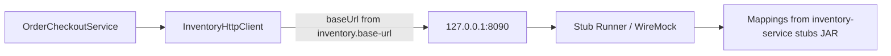
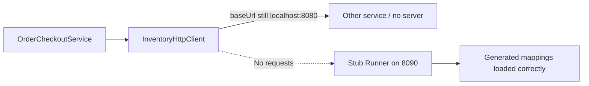
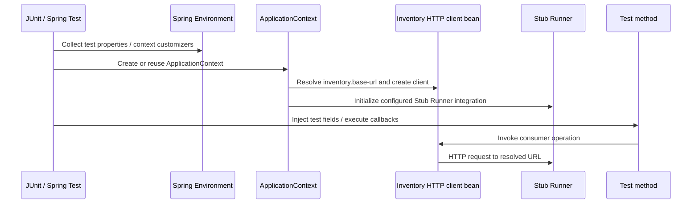
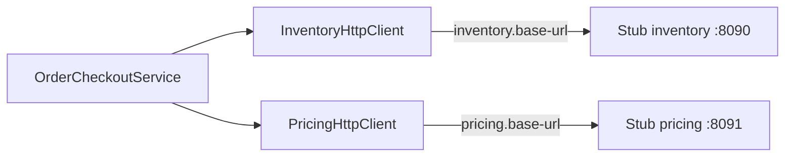
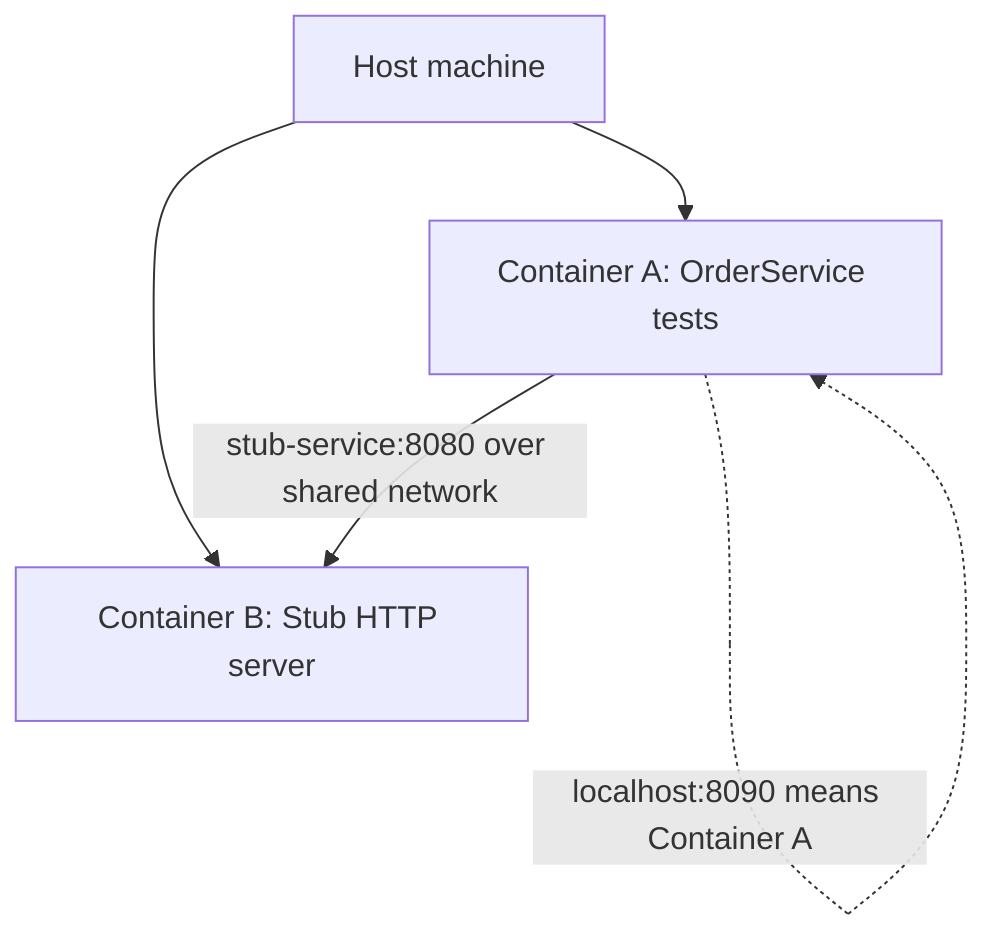
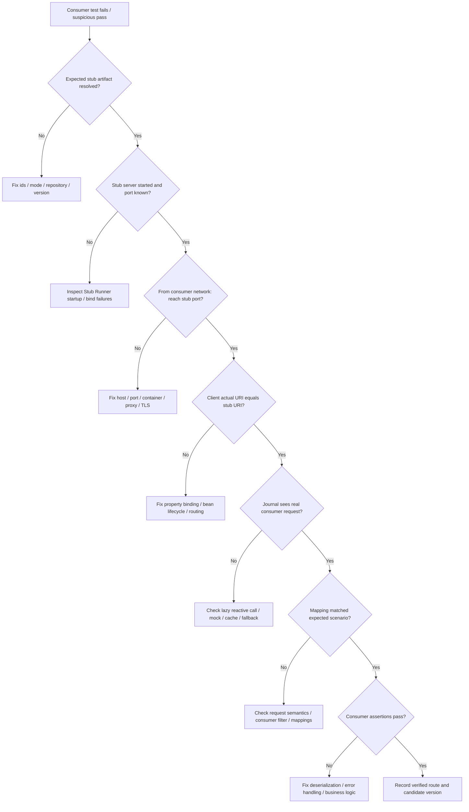
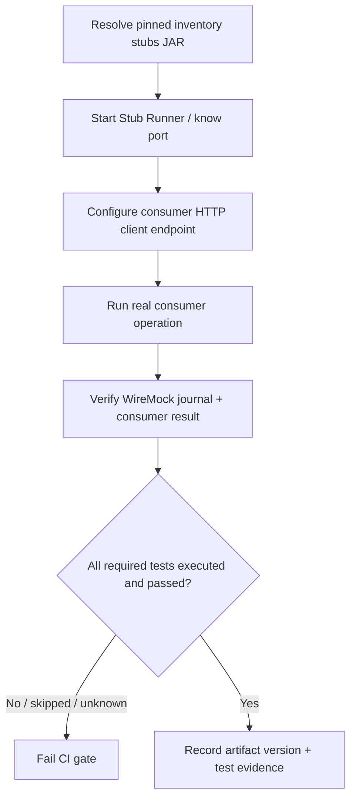

# Stub Port Is Not Passed into the Consumer's HTTP Client

**Symptom:** Spring Cloud Contract **Stub Runner** reports that the `InventoryService` stub has started, yet the `OrderService` test still hits `Connection refused`, `UnknownHostException`, sends requests to the real service, or gets data that does not match the contract. One especially easy-to-miss cause is: **the HTTP port Stub Runner actually uses has not been passed into the consumer's HTTP client**.

This is not necessarily a bug in Groovy/YAML DSL, WireMock mappings, or the producer itself. The stub may load cleanly on `127.0.0.1:8090`, while `RestClient`, `WebClient`, `RestTemplate`, or Feign still sends requests to `localhost:8080` or a URL from `application.yml`. Sometimes a test calls WireMock directly on the right port and passes, while the **real consumer code** uses a bean constructed **before the test injected the port**.

This lesson belongs to the **Troubleshooting** chapter of the **SPRING_CLOUD_CONTRACT** module. Per module goals, we use Groovy/YAML contracts to verify the producer, publish stubs, use Stub Runner for the consumer, and wire results into CI to catch incompatible APIs. This lesson focuses on the **port configuration path from Stub Runner to the HTTP client** and how to isolate the true root cause instead of accidentally turning tests into false greens.

Throughout this lesson:

- `InventoryService` is the **producer** exposing the stock reservation API.
- `OrderService` is the **consumer** whose real HTTP client calls that API.
- `inventory.base-url` is an **application-defined example property**, not a standard property mandated by Spring Cloud Contract.
- `com.example:inventory-service:1.4.2:stubs` is an illustrative stub artifact coordinate; replace it with your project's built and verified artifact.
- Examples primarily use modern Spring Boot/Spring Framework, JUnit 5, and HTTP WireMock; exact signatures may differ across Spring Cloud Contract/Stub Runner versions.

After this lesson, you will be able to:

1. Distinguish the real producer port, the consumer test application port, and the Stub Runner stub port.
2. Trace the chain `stub artifact → stub server → port → base URL property → HTTP client → real request`.
3. Fix **static port** configuration errors and design properly when **dynamic ports** are required.
4. Understand why `@StubRunnerPort` injects into a test field while an early-initialized HTTP client bean can still hold the wrong URL.
5. Avoid misusing `@DynamicPropertySource` when no mechanism starts the stub before the Spring context.
6. Diagnose Feign, WebClient, RestClient, RestTemplate, Docker/CI, and multi-stub setups.
7. Inspect the request journal to prove consumer code genuinely called the **right Stub Runner instance**, rather than a real service or fallback.
8. Include network, mapping, HTTP client config, and test result evidence in CI workflows.

## 1. The Issue Lies in the Link Between Two Verification Loops

Spring Cloud Contract typically builds **two complementary testing loops**:

| Side | Tools / Subject | What Can It Prove? |
| --- | --- | --- |
| Producer | Contract Verifier, generated tests, `InventoryService` code | Producer satisfies the assertions described in contracts |
| Consumer | Stub Runner, WireMock, real `OrderService` HTTP client | Consumer sends requests and handles responses per published stubs |

For the consumer, the intended flow is:



A common broken flow is:



Key point: **“Stub Runner started” does not mean “the consumer HTTP client was configured to call it.”** Stub Runner starts an HTTP server, while consumer Spring/application code decides the host, port, and base path of outgoing requests.

## 2. Three Types of Ports Frequently Confused

| Port | Owner | Purpose | How to Find It |
| --- | --- | --- | --- |
| **Consumer application test port** | `OrderService` Spring Boot test | Lets tests/external clients call the consumer app if an embedded web server starts | `@LocalServerPort` or `server.port` in test |
| **Stub Runner HTTP port** | WireMock started by Stub Runner | Consumer HTTP client calls this instead of the real producer | Fixed port in `ids`, `@StubRunnerPort`, `StubFinder`, or stub-runner logs |
| **Real producer service port** | Deployed `InventoryService` | Live API outside tests | Environment service discovery/ingress/config |

**Never set `inventory.base-url` using `@LocalServerPort`** if that port belongs to embedded `OrderService`; otherwise the client calls back into the consumer itself instead of the stub.

Example:

```text
OrderService test application:   localhost:51783   (random server.port)
InventoryService stub server:   localhost:8090
InventoryService in staging:    inventory.staging.internal:8443
```

In the consumer contract test, `InventoryHttpClient` must target `http://127.0.0.1:8090`, **not** either of the other two addresses. These numbers are illustrative only.

## 3. Quick Diagnostic Signals

| Signal | Priority Hypothesis | Evidence to Check |
| --- | --- | --- |
| Stub Runner logs port `8090`, exception mentions `8080` | Client kept default URL | Property value and URI at send time |
| `curl` to `8090` works, consumer test still gets `Connection refused` | Client uses another host/port, or different network namespace | Request target and where the process runs |
| Test returns live response instead of stub fixture | Client uses service discovery/staging URL | Feign/RestClient resolved base URL |
| Test receives `404` on stub port | Port is right yet request did not match, or default WireMock 404 | `/__admin/mappings`, request journal, body/method/path |
| `@StubRunnerPort` holds right number, HTTP client calls old port | Client bean constructed before test set the port | Lifecycle and where builder/client bean is created |
| Test passes even with Stub Runner shut down | Mock/cache/fallback/hardcoding bypasses HTTP | Verify request count; negative control |
| CI fails intermittently on static port | Port collision or parallel tests | Bind errors, test processes/parallelism |
| `localhost` works on host, fails in container | Different network namespaces | Locations of stub server and client container |
| Only one of multiple producers works | Wrong port/ID or shared property | Producer → port → base URL mapping |

**Do not edit matchers or regenerate JARs immediately upon seeing `Connection refused`.** That usually signals no TCP listener at the **chosen target**, occurring **before** WireMock evaluates DSL rules.

## 4. A Sample HTTP Contract to Keep the Diagnostic Target Stable

Agreed producer contract:

```http
POST /api/v1/reservations HTTP/1.1
Content-Type: application/json

{"sku":"SKU-001","quantity":2}
```

Response:

```http
HTTP/1.1 201 Created
Content-Type: application/json

{"reservationId":"RES-701","status":"HELD"}
```

Groovy DSL:

```groovy
import org.springframework.cloud.contract.spec.Contract

Contract.make {
    name 'create_reservation_success'

    request {
        method 'POST'
        url '/api/v1/reservations'
        headers {
            contentType(applicationJson())
        }
        body([
            sku: 'SKU-001',
            quantity: 2
        ])
    }

    response {
        status 201
        headers {
            contentType(applicationJson())
        }
        body([
            reservationId: $(consumer('RES-701'),
                             producer(regex('RES-[0-9]+'))),
            status: 'HELD'
        ])
    }
}
```

Assume generated producer tests for this contract ran and passed, and artifact `inventory-service:1.4.2:stubs` holds the matching mapping. The task here is **not** inventing a new contract, but ensuring the consumer uses the right stub HTTP server.

A literal-level YAML equivalent:

```yaml
name: create_reservation_success
request:
  method: POST
  url: /api/v1/reservations
  headers:
    Content-Type: application/json
  body:
    sku: SKU-001
    quantity: 2
response:
  status: 201
  headers:
    Content-Type: application/json
  body:
    reservationId: RES-701
    status: HELD
```

The YAML above **does not yet include the dynamic matcher** from Groovy; if needed, use YAML matcher syntax for your exact SCC version. Do not place both files describing the same scenario in the same source directory or you will generate duplicate mappings/tests.

## 5. Static Port Config: Simplest Way to Test Full Bean Wiring

When you control the port and run isolated tests, the clearest approach is **picking a fixed port upfront** for Stub Runner, then passing that **exact host/port** into the property the consumer HTTP client reads.

```java
import org.junit.jupiter.api.Test;
import org.springframework.beans.factory.annotation.Autowired;
import org.springframework.boot.test.context.SpringBootTest;
import org.springframework.cloud.contract.stubrunner.spring.AutoConfigureStubRunner;
import org.springframework.cloud.contract.stubrunner.spring.StubRunnerProperties;

@SpringBootTest(properties = {
    "inventory.base-url=http://127.0.0.1:8090"
})
@AutoConfigureStubRunner(
    ids = "com.example:inventory-service:1.4.2:stubs:8090",
    stubsMode = StubRunnerProperties.StubsMode.LOCAL
)
class OrderServiceContractTest {

    @Autowired
    OrderCheckoutService checkoutService;

    @Test
    void shouldReserveUsingInventoryStub() {
        ReservationResult result =
            checkoutService.prepareReservation("SKU-001", 2);

        // Consumer business assertions, not just "stub started".
        org.assertj.core.api.Assertions.assertThat(result.status())
            .isEqualTo("HELD");
    }
}
```

Assumptions: `OrderCheckoutService`/`ReservationResult` are real `OrderService` application code with matching dependencies/test config. Stub JAR `1.4.2:stubs` is installed in local Maven; WireMock can bind port `8090`.

The illustrative `ids` string has `groupId:artifactId:version:classifier:port`. **This is the stub server's port, not the consumer app's port.** Verify exact annotation/property names against your Stub Runner version.

### Advantages of a Static Port

- The property is ready **before Spring constructs HTTP client beans**.
- Spring injection, configuration classes, and client builders follow normal paths.
- The test exercises real application wiring instead of building a separate client in the test method.
- Easy to inspect `http://127.0.0.1:8090/__admin/mappings` directly.

### Drawbacks of a Static Port

- Two parallel suites can bind `8090` simultaneously, causing `Address already in use`.
- On a shared CI host, another service may already occupy the port.
- In Docker or separate-namespace runners, `127.0.0.1` can refer to a different container/process.

Do not hard-code the same port across parallel test jobs without isolation, port allocation, or collision protection.

## 6. Application Properties: Verify What the *Consumer* Actually Reads

Suppose `OrderService` configures its client via a property:

```yaml
# src/main/resources/application.yml of the example application
inventory:
  base-url: https://inventory.example.invalid
```

This is **application configuration**, not a property Stub Runner sets automatically. `example.invalid` is intentionally a non-working placeholder address.

A `RestClient` bean is constructed:

```java
package com.example.order;

import org.springframework.beans.factory.annotation.Value;
import org.springframework.context.annotation.Bean;
import org.springframework.context.annotation.Configuration;
import org.springframework.web.client.RestClient;

@Configuration
class InventoryClientConfig {

    @Bean
    RestClient inventoryRestClient(
            @Value("${inventory.base-url}") String baseUrl) {
        return RestClient.builder()
            .baseUrl(baseUrl)
            .build();
    }
}
```

When `@SpringBootTest(properties = "inventory.base-url=http://127.0.0.1:8090")` is processed before bean creation, the builder receives the chosen stub port. `RestClient` here is the Spring Framework 6.1+ API; older Spring apps may use `RestTemplate` or `WebClient`.

### Classic Misconfiguration

```yaml
# Test property written:
inventory:
  base-url: http://127.0.0.1:8090

# Yet real client code actually reads:
external:
  inventory:
    url: http://127.0.0.1:8080
```

Changing `inventory.base-url` has no effect if the client actually reads `external.inventory.url`. Trace backward from the **constructor/client builder** to the exact **property key**, including `@ConfigurationProperties` classes.

**Do not search `application-test.yml` for the word “inventory” and assume the URL was overridden.** Observe the **resolved value where the client is built or where requests are sent**.

## 7. Deeper Cause: When Is the HTTP Client Created?

A Spring test run involves multiple lifecycle points:



This diagram shows **lifecycle relationships**, not a guarantee of every internal callback order across all SCC/Spring Test versions. The key insight is: **a client bean may already be created before `@BeforeEach` or test-class field injection executes**. If the client captures a fixed `baseUrl` at construction, mutating a variable inside a test method **does not update the existing bean**.

### Anti-Pattern: Reading the Port Too Late

```java
@SpringBootTest
@AutoConfigureStubRunner(
    ids = "com.example:inventory-service:1.4.2:stubs",
    stubsMode = StubRunnerProperties.StubsMode.LOCAL
)
class OrderServiceContractTest {
    @StubRunnerPort("inventory-service")
    int stubPort;

    @Autowired
    OrderCheckoutService checkoutService;

    @BeforeEach
    void setUp() {
        // TOO LATE if InventoryHttpClient already built RestClient
        // from inventory.base-url in the ApplicationContext earlier.
        System.setProperty(
            "inventory.base-url",
            "http://127.0.0.1:" + stubPort
        );
    }
}
```

The snippet above is an **illustrative anti-pattern**. Calling `System.setProperty` does not make already-created beans re-read configuration, and mutating system properties causes cross-test interference when tests share a JVM.

### Three Different Ways of “Passing the Port”

| Approach | When Is Port Available? | Does an Already-Created HTTP Client Update? |
| --- | --- | --- |
| `@SpringBootTest(properties=...)` with fixed port | Before context creates beans | **Yes**: bean receives URL from the start |
| `@StubRunnerPort` injected into test field | When test instance is processed/injected | **Does not automatically** update created beans |
| Test sets `System.setProperty` in `@BeforeEach` | After context/bootstrap steps | **Does not automatically** update created beans |
| Configure URL via per-request supplier/late binding | Before each HTTP call | Yes, **if the client is explicitly designed to read the supplier** |
| Start stub before Spring context and register property early | Before bean initialization by design | Yes, when startup ordering is guaranteed |

Do not pick a “dynamic port injection” approach just because Java compiles it; ensure **both timing and target receiver** are right.

## 8. Dynamic Ports and `@StubRunnerPort`

When `ids` omits a port, Stub Runner can allocate an available port. In supporting SCC versions, `@StubRunnerPort` lets the test read the port for a specific artifact.

```java
import org.junit.jupiter.api.Test;
import org.springframework.boot.test.context.SpringBootTest;
import org.springframework.cloud.contract.stubrunner.spring.AutoConfigureStubRunner;
import org.springframework.cloud.contract.stubrunner.spring.StubRunnerPort;
import org.springframework.cloud.contract.stubrunner.spring.StubRunnerProperties;

@SpringBootTest
@AutoConfigureStubRunner(
    ids = "com.example:inventory-service:1.4.2:stubs",
    stubsMode = StubRunnerProperties.StubsMode.LOCAL
)
class InventoryStubPortDiscoveryTest {

    @StubRunnerPort("inventory-service")
    int port;

    @Test
    void discoversStubPort() {
        org.assertj.core.api.Assertions.assertThat(port)
            .isBetween(1, 65535);
    }
}
```

This example **only demonstrates port discovery**, not that the consumer called the right stub. Depending on SCC release, the annotation may accept `artifactId` or a specific stub identifier; verify against your `ids` syntax and version docs.

### What Are Dynamic Ports Useful For?

- CI running multiple test classes or modules concurrently.
- Tests avoiding holding fixed ports on a host.
- Stub Runner launching multiple producer stubs at once.
- IDEs, Docker, or varying build environments with different free ports.

Yet **picking a dynamic port does not automatically hand that URL to your HTTP client**. If `InventoryHttpClient` reads `inventory.base-url` when its bean is created, tests need either a **mechanism injecting the port before bean creation** or an explicitly designed **late-bound URL provider** on the client.

## 9. Using a Dynamic Port in a Test Without Early-Bound Bean URLs

A clear way to verify connectivity with a dynamic port is instantiating the **real application HTTP client class** inside the test once Stub Runner returns the port. Example adapter class defined by your project:

```java
package com.example.order;

import org.springframework.web.client.RestClient;

public final class InventoryHttpClient {
    private final RestClient restClient;

    public InventoryHttpClient(RestClient restClient) {
        this.restClient = restClient;
    }

    public ReservationResponse reserve(String sku, int quantity) {
        ReservationRequest request =
            new ReservationRequest(sku, quantity);

        return restClient.post()
            .uri("/api/v1/reservations")
            .contentType(org.springframework.http.MediaType.APPLICATION_JSON)
            .body(request)
            .retrieve()
            .body(ReservationResponse.class);
    }
}
```

`ReservationRequest` and `ReservationResponse` are application DTOs/records, not provided by SCC.

Once the port is available:

```java
@SpringBootTest
@AutoConfigureStubRunner(
    ids = "com.example:inventory-service:1.4.2:stubs",
    stubsMode = StubRunnerProperties.StubsMode.LOCAL
)
class InventoryClientWithDynamicPortTest {

    @StubRunnerPort("inventory-service")
    int stubPort;

    @Test
    void sendsRealClientRequestToStub() {
        String baseUrl = "http://127.0.0.1:" + stubPort;
        RestClient restClient = RestClient.builder()
            .baseUrl(baseUrl)
            .build();

        InventoryHttpClient client =
            new InventoryHttpClient(restClient);

        ReservationResponse response =
            client.reserve("SKU-001", 2);

        assertThat(response.status()).isEqualTo("HELD");
    }
}
```

Remaining imports (`Test`, `RestClient`, `assertThat`, SCC annotations) match earlier snippets. This illustrative test exercises the **real HTTP client adapter implementation** against a dynamic port rather than sending requests directly from a RestAssured harness.

**Important limitation:** because the test **constructs** `RestClient`/`InventoryHttpClient` itself, it **does not verify full production Spring bean wiring**. If the real bug lives in `@FeignClient` or `InventoryClientConfig` reading the wrong property, this test could still pass. To test real Spring wiring, use a static port upfront or inject properties **before `ApplicationContext` builds client beans**.

### A Common Design Mistake

```java
@BeforeEach
void updateOnlyTheTestVariable() {
    String stubUrl = "http://127.0.0.1:" + stubPort;
    // Nothing passes stubUrl into InventoryHttpClient.
}
```

A local test variable holding the right value accomplishes nothing if the **client uses a different value**.

## 10. When You Must Keep a Spring-Managed Client and Use Dynamic Ports

Two clear strategies exist:

1. **Inject the URL into `Environment` before client beans are built:** the stub server must start early under controlled test infrastructure, then register the property during context creation. You can use `ApplicationContextInitializer` or `@DynamicPropertySource` **only if** your stub management guarantees the URL/port is available when properties resolve.
2. **Design the client to use a dynamic provider:** the `InventoryHttpClient` bean takes a `Supplier<URI>`/routing abstraction and resolves the URL per request; tests configure the provider after receiving `@StubRunnerPort`. This alters client design and requires isolation and side-effect checks.

No single annotation guarantees this across every version/plugin setup. When lacking proof of bootstrap ordering, **prefer a fixed port in integration tests** over combining a static property callback with late field injection.

### The Pitfall with `@DynamicPropertySource`

Spring Test's annotation works for dynamic property sources created **before** `ApplicationContext` instantiates beans:

```java
// Conceptually RIGHT if the server already started early and port is ready.
@DynamicPropertySource
static void configureProperties(DynamicPropertyRegistry registry) {
    registry.add(
        "inventory.base-url",
        () -> "http://127.0.0.1:" + earlyStartedServer.port()
    );
}
```

`earlyStartedServer` here is **early-started custom test infrastructure**; it is not a `@StubRunnerPort` field and not a built-in SCC API. This snippet is **callback-structure pseudocode** and will not run without a lifecycle-aligned test infrastructure object.

**Do not write**:

```java
// WRONG: static callback cannot read a port from an instance field
// injected later on the test object.
@StubRunnerPort("inventory-service")
int stubPort;

@DynamicPropertySource
static void register(DynamicPropertyRegistry registry) {
    // No static stubPort variable is ready here.
}
```

Even if a port were stored in a static variable, **Stub Runner is not guaranteed to have started when the registry supplier runs**. If using this approach, enforce explicit startup/ordering and write an integration test proving the final bean received the right URL. Never assume `@DynamicPropertySource` automatically “waits for `@StubRunnerPort`.”

## 11. Late-Bound URL Provider: Only When the App Genuinely Needs Dynamic Targets

In some systems, multiple tenants or test environments require switching upstream URLs at runtime; the client can deliberately resolve the URI at call time:

```java
public final class InventoryHttpClient {
    private final RestClient restClient;
    private final java.util.function.Supplier<java.net.URI> baseUri;

    public InventoryHttpClient(
            RestClient restClient,
            java.util.function.Supplier<java.net.URI> baseUri) {
        this.restClient = restClient;
        this.baseUri = baseUri;
    }

    public ReservationResponse reserve(String sku, int quantity) {
        java.net.URI endpoint = baseUri.get()
            .resolve("/api/v1/reservations");
        return restClient.post()
            .uri(endpoint)
            .body(new ReservationRequest(sku, quantity))
            .retrieve()
            .body(ReservationResponse.class);
    }
}
```

Once the test receives `stubPort`, a test-scoped provider can return the matching URI. This tests the real Spring-managed client if the provider is a bean dependency and is configured **before the first request**.

**Drawback:** it introduces runtime target switching into application code. You must manage thread safety, config lifecycle, base paths, retries, and avoid shared mutable global state. Never redesign production architecture just to solve a test that could use a fixed port.

If the client intentionally supports dynamic endpoint configuration, `Supplier` is a clean seam. Otherwise, use `@SpringBootTest(properties=...)` with a fixed port or explicit early-start test infrastructure.

## 12. Why `System.setProperty` and `@BeforeEach` Usually Fail to Fix the URL

Example:

```java
@Configuration
class InventoryConfiguration {

    @Bean
    RestClient inventoryClient(
            @Value("${inventory.base-url}") String url) {
        return RestClient.builder().baseUrl(url).build();
    }
}
```

When Spring invokes `inventoryClient(...)`, `url` is already resolved and captured inside `RestClient`. Later in `@BeforeEach`:

```java
System.setProperty("inventory.base-url", "http://localhost:8090");
```

does not re-invoke the bean factory method, does not rebuild `RestClient`, and does not update existing components. It can also pollute other tests sharing the JVM because `System` properties are global.

If the application binds `@ConfigurationProperties` once, the same holds: **mutating `Environment` does not automatically rebind or recreate beans**. Only an explicit refresh mechanism (if actually used and tested by the app) alters behavior.

The solution is not adding more `System.setProperty` calls, but **deciding the URL source early and checking where the client reads it**.

## 13. Distinguish Port Errors from WireMock Mapping Errors

Once requests reach the right server, WireMock checks method/path/headers/body against loaded mappings. Before editing the DSL, distinguish:

| HTTP / Network Outcome | Priority Interpretation |
| --- | --- |
| `Connection refused` | Nothing listening on host:port **chosen by client**, or network/routing unreachable |
| `UnknownHostException` | DNS/host in client URL failed to resolve; usually not a mapping bug |
| `SSLHandshakeException` | HTTP/HTTPS/TLS configuration mismatch |
| `404` with WireMock unmatched report | Server received request yet found no matching mapping |
| `201` from an unexpected mapping | Fallback/priority/overlap; test may be a false green |
| `200` from real producer | Client may not be routed to stub; inspect URI and response headers |
| Timeout | Could be wrong route, stub delay, network, proxy, or client timeout; inconclusive alone |

**Do not assume `404` always means a wrong path.** It can be a response **intentionally defined in an error contract**. Inspect the body, matched mapping, or serve events to separate WireMock fallback 404 from a business response.

### Direct Stub Server Verification Commands

```bash
# Run in the exact host/network namespace where the stub runs.
curl --verbose http://127.0.0.1:8090/__admin/mappings

curl --verbose \
  -H 'Content-Type: application/json' \
  -d '{"sku":"SKU-001","quantity":2}' \
  http://127.0.0.1:8090/api/v1/reservations

curl --verbose http://127.0.0.1:8090/__admin/requests
```

`/__admin/mappings` shows which mappings the server holds; `/__admin/requests` shows received requests. Use WireMock's Admin API only in internal test environments, never exposed publicly; the journal can record headers/bodies with sensitive data.

If direct `curl` succeeds while the consumer service still fails, **leave the stub JAR alone** and inspect client config/URIs first.

## 14. Prove Requests Reach the Right Stub: Combine Consumer Code with the Journal

A test asserting only `Stub Runner started` or running direct `curl` **never tests `OrderService`'s HTTP client path**. A meaningful test should:

1. Start the stub from a verified artifact.
2. Reset the **request journal** before running consumer behavior, without deleting mappings.
3. Call the **real consumer code** (the service/client used by the application).
4. Assert business outcomes.
5. Verify that exact WireMock instance received the expected request.

Example with **static port 8090**:

```java
import static com.github.tomakehurst.wiremock.client.WireMock.*;
import static org.assertj.core.api.Assertions.assertThat;

import org.junit.jupiter.api.BeforeEach;
import org.junit.jupiter.api.Test;
import org.springframework.beans.factory.annotation.Autowired;
import org.springframework.boot.test.context.SpringBootTest;
import org.springframework.cloud.contract.stubrunner.spring.AutoConfigureStubRunner;
import org.springframework.cloud.contract.stubrunner.spring.StubRunnerProperties;

@SpringBootTest(properties =
    "inventory.base-url=http://127.0.0.1:8090")
@AutoConfigureStubRunner(
    ids = "com.example:inventory-service:1.4.2:stubs:8090",
    stubsMode = StubRunnerProperties.StubsMode.LOCAL
)
class OrderConsumerRouteVerificationTest {

    @Autowired
    OrderCheckoutService checkoutService;

    @BeforeEach
    void clearJournal() {
        configureFor("127.0.0.1", 8090);
        resetAllRequests();
    }

    @Test
    void shouldCallInventoryStubFromConsumerCode() {
        ReservationResult result =
            checkoutService.prepareReservation("SKU-001", 2);

        assertThat(result.status()).isEqualTo("HELD");

        verify(1, postRequestedFor(
                urlPathEqualTo("/api/v1/reservations"))
            .withHeader("Content-Type", containing("application/json"))
            .withRequestBody(
                matchingJsonPath("$.sku", equalTo("SKU-001")))
            .withRequestBody(
                matchingJsonPath("$.quantity", equalTo("2"))));
    }
}
```

`OrderCheckoutService`/`ReservationResult` are hypothetical app classes; the test requires SCC-compatible WireMock dependencies. `matchingJsonPath` and JSONPath matching behavior can depend on WireMock version; if you need to verify a JSON number **distinct** from a string, use an appropriate matcher (such as configured `equalToJson`) rather than assuming JSONPath-to-string proves type.

**Warning on static WireMock client:** `configureFor` stores the endpoint in static/global state. Running multiple test classes/servers concurrently in one JVM can overwrite it across tests. When running in parallel, prefer dedicated WireMock admin client instances, isolated ports and journals, or a test harness suited to your SCC version.

### Two Questions This Test Answers

- Does `prepareReservation(...)` go through the real HTTP client and send a request to Stub Runner?
- Did the stub server receive the exact method, path, and critical payload fields?

It **does not prove on its own** that the deployed producer obeys the contract. That belongs to producer Contract Verifier and integration/deployment tests.

## 15. Observe the Actual URL Sent by the HTTP Client

Before touching stub mappings, record at least:

```text
expectedStubUrl = http://127.0.0.1:8090
resolvedProperty = http://127.0.0.1:8080
actualRequestUri = http://127.0.0.1:8080/api/v1/reservations
receivedByStub = 0 requests
```

This is **illustrative data**, yet it immediately exposes a property/client routing bug without regenerating JARs.

### Read Spring `Environment`

```java
@Autowired
org.springframework.core.env.Environment environment;

@Test
void shouldUseStubBaseUrlFromEnvironment() {
    String actual = environment.getProperty("inventory.base-url");

    assertThat(actual)
        .isEqualTo("http://127.0.0.1:8090");
}
```

This test checks `Environment` after Spring resolves properties. Yet **it still does not prove the client bean used that value**; the client might read another key, hard-code a URL, get overridden by a customizer, or belong to a different context.

### Verify Properties Inside Client Configuration

A practical approach:

- Log or expose **in tests only** the URI scheme, host, and port where `RestClient`/`WebClient`/Feign is built.
- Attach a test interceptor/logger to the HTTP client to record the **actual request target**.
- Redact `Authorization`, cookies, tokens, and sensitive bodies; never enable full raw traffic logging outside isolated test environments.
- Compare the observed URI against the port announced by Stub Runner.

If tests use `http://localhost:8090`, also check IPv4/IPv6 resolution when connections fail mysteriously: `localhost` may resolve to `::1` while the stub binds only `127.0.0.1`, or vice versa.

## 16. `RestClient`: Check Where the Bean Is Built, Not Just Properties

A Spring Framework 6.1+ configuration:

```java
@Configuration
class InventoryRestClientConfiguration {

    @Bean
    RestClient inventoryRestClient(
            @Value("${inventory.base-url}") String baseUrl) {
        return RestClient.builder()
            .baseUrl(baseUrl)
            .defaultHeader("Accept", "application/json")
            .build();
    }
}
```

Easy mistake:

```java
@Bean
RestClient inventoryRestClient() {
    // Hardcodes old URI; all test property overrides do nothing.
    return RestClient.builder()
        .baseUrl("http://127.0.0.1:8080")
        .build();
}
```

Another mistake is calling `restClient.post().uri(absoluteUri)` with an absolute URL, **bypassing the default base URL**. Therefore:

1. Check the property received at bean construction.
2. Check whether every call site passes a relative path to `uri(...)`.
3. Check whether any customizer/interceptor rewrites host or scheme.
4. Check which client bean qualifier is injected into `OrderCheckoutService`; an app may define multiple `RestClient` beans.

**Fix at the right place:** have the client read the property and supply the test property before bean construction. Do not “fix” it by adding a stub mapping on `localhost:8080`.

## 17. `WebClient`: Reactive Clients Also Need the Right Base URL

Example bean:

```java
@Configuration
class InventoryWebClientConfiguration {

    @Bean
    WebClient inventoryWebClient(
            @Value("${inventory.base-url}") String baseUrl) {
        return WebClient.builder()
            .baseUrl(baseUrl)
            .build();
    }
}
```

Reactive consumer call:

```java
public Mono<ReservationResponse> reserve(
        String sku, int quantity) {
    return inventoryWebClient.post()
        .uri("/api/v1/reservations")
        .contentType(MediaType.APPLICATION_JSON)
        .bodyValue(new ReservationRequest(sku, quantity))
        .retrieve()
        .bodyToMono(ReservationResponse.class);
}
```

Note:

- `WebClient` performs asynchronous I/O; **do not assert the journal before the publisher is subscribed and completes**.
- Use `StepVerifier` or proper test awaiting to confirm the `Mono`/`Flux` actually executed.
- Calling `WebClient.builder().baseUrl(...)` sends no requests; `Mono` is lazy.
- Check final URI, connector config, proxy, and TLS if the port is right yet requests never arrive.

Example `StepVerifier`:

```java
StepVerifier.create(inventoryClient.reserve("SKU-001", 2))
    .assertNext(response ->
        assertThat(response.status()).isEqualTo("HELD"))
    .verifyComplete();
```

Verify the request journal only after the publisher completes. With retries/timeouts, observe actual request counts instead of writing `verify(1, ...)` if retries are valid behavior.

## 18. `RestTemplate`: `rootUri` and Absolute URLs

In older apps using `RestTemplate`:

```java
@Bean
RestTemplate inventoryRestTemplate(
        RestTemplateBuilder builder,
        @Value("${inventory.base-url}") String baseUrl) {
    return builder.rootUri(baseUrl).build();
}
```

When the client calls a relative path:

```java
restTemplate.postForEntity(
    "/api/v1/reservations",
    request,
    ReservationResponse.class
);
```

`rootUri` applies via `RestTemplateBuilder`. Yet when code passes an absolute URL:

```java
restTemplate.postForEntity(
    "https://inventory.staging.example.invalid/api/v1/reservations",
    request,
    ReservationResponse.class
);
```

`rootUri` is bypassed; even if test properties point to `8090`, requests go to the absolute URL. Inspect call sites and the app's actual URI template handler, especially when wrapped across layers.

### Do Not Edit Multiple HTTP Clients Without Knowing Which Bean Is Used

A project may contain:

```text
InventoryClient (Feign)
LegacyInventoryTemplate (RestTemplate)
InventoryAvailabilityWebClient (WebClient)
```

If you change `RestTemplate` config while `OrderCheckoutService` injects Feign, nothing changes. Find the **invoked bean via stack trace or instrumentation**, rather than editing every HTTP client at once.

## 19. OpenFeign: `name` Does Not Guarantee the Client Uses the Stub URL

With Spring Cloud OpenFeign, for example:

```java
@FeignClient(
    name = "inventory-service",
    url = "${inventory.base-url}"
)
interface InventoryFeignClient {
    @PostMapping("/api/v1/reservations")
    ReservationResponse reserve(
        @RequestBody ReservationRequest request);
}
```

When `inventory.base-url` is provided **before the Feign client bean is constructed**, the URL points to Stub Runner. Without `url`, some Feign setups use service discovery/load balancing by `name`. The client then tries resolving `inventory-service` as a service name instead of calling `localhost:8090`.

Check:

- Spring Cloud OpenFeign version and how `url` placeholders resolve.
- Whether properties supply the URL via `spring.cloud.openfeign.client.config.<client>.url` or custom config (exact property path varies by release).
- Whether a Feign builder/target bean overrides the URL after the annotation.
- Whether a circuit breaker/cache/fallback hides real requests.
- Which `FeignClient` is actually injected into `OrderCheckoutService`.

Do not assume setting `spring.application.name=inventory-service` in a consumer test passes the stub port. That sets the **running application's name**, not Feign's target URL.

## 20. URI Scheme, Host, Base Path, and Port Must All Match

The right port is a **necessary, not sufficient** condition for HTTP requests to hit the right mapping.

| Component | Valid Example | Common Mistake |
| --- | --- | --- |
| Scheme | `http` | `https` when WireMock opens HTTP only |
| Host | `127.0.0.1` in same network namespace | `localhost` inside another container |
| Port | `8090` | `8080` from default config |
| Base path | `/api/v1` | Extra `/inventory` or missing prefix |
| URI joining | `/api/v1/reservations` | `/api/v1/api/v1/reservations` |
| Headers | `Content-Type: application/json` | Wrong media type, missing required header |
| Body | `quantity` as JSON number | Sending `"2"` string or wrong object shape |

Example: client base URL `http://127.0.0.1:8090/inventory` with request path `/api/v1/reservations`—how paths join depends on the HTTP client and absolute vs. relative URI syntax; prefixes can be dropped or doubled. **Log the actual request URI** to confirm instead of guessing string joining.

### Signs of a TLS Mismatch

If the client calls `https://127.0.0.1:8090` while Stub Runner opens plain HTTP, you may get `SSLHandshakeException` or garbled responses. **Never disable certificate validation app-wide** just to pass tests. Align scheme/HTTPS stub config to the test goal.

## 21. Multiple Producer Stubs: Each Client Must Receive Its Own Port

`OrderService` may call both `InventoryService` and `PricingService`. If Stub Runner starts two HTTP stub servers on two ports, **the two HTTP clients must receive two distinct base URLs**.



A static port configuration:

```java
@SpringBootTest(properties = {
    "inventory.base-url=http://127.0.0.1:8090",
    "pricing.base-url=http://127.0.0.1:8091"
})
@AutoConfigureStubRunner(
    ids = {
        "com.example:inventory-service:1.4.2:stubs:8090",
        "com.example:pricing-service:2.1.0:stubs:8091"
    },
    stubsMode = StubRunnerProperties.StubsMode.LOCAL
)
class OrderWithTwoProducerStubsTest {
    // Verify Inventory client uses :8090, Pricing uses :8091.
}
```

Do not point both `@FeignClient` or `RestClient` beans at one shared `downstream.base-url` property when the app calls two upstreams. Likewise, do not mix up `@StubRunnerPort("inventory-service")` and `@StubRunnerPort("pricing-service")` when using dynamic ports.

### Diagnosing Port Swaps Between Two Stubs

If a request hits `:8091/api/v1/reservations` and WireMock returns 404, **the Pricing stub likely has no Reservation mapping at all**. That is a consumer routing error. Before editing URL matchers, check:

1. Which producer owns port `8091` in Stub Runner logs.
2. Which HTTP client bean sent the request.
3. Which property was injected into that bean.
4. What `/__admin/mappings` lists on each port.

When two producers expose similarly named endpoints, a request hitting the wrong port might **still return 200** from a different mapping; checking status alone is not enough.

## 22. Did Stub Runner Actually Load the Right Artifact Version?

A port only matters when Stub Runner **started a server for the right artifact**. If artifact resolution failed, tests may not even have a server to talk to.

| Mode | Artifact Source | What to Check |
| --- | --- | --- |
| `CLASSPATH` | Stubs on test classpath | JAR/resources on right classpath, producer name |
| `LOCAL` | Local repository, usually Maven `.m2` | Built/installed exact `groupId:artifactId:version:classifier` |
| `REMOTE` | Configured repository URL | `repositoryRoot`, credentials, network, coordinates/pinned version |

Example:

```text
Expected:
  com.example:inventory-service:1.4.2:stubs

Accidentally resolved:
  com.example:inventory-service:1.4.1:stubs
```

Two artifacts can contain different mappings. If an older stub version loaded, changing the client port will not fix the response payload. Diagnose in order:

1. **Did the exact artifact resolve?**
2. **Which host/port did the stub server bind?**
3. **Did the client call that host/port?**
4. **Did the request match the mapping?**
5. **Did the consumer handle the response properly?**

Avoid `+` or `latest` in reproducible release compatibility tests when immutable versions can be pinned. For snapshots, record resolved artifact/build timestamps and checksums.

### If Annotations Report a Port Yet Requests Still Fail

Port injection proves only that Stub Runner recorded a **server registration**; possibilities remaining include:

- The server stopped or the test context closed.
- The consumer runs in a different container and cannot reach loopback.
- A client proxy/routing layer altered the target.
- The mapping did not match the request.
- The artifact holds the wrong stub version.

A valid port number (1–65535) **does not automatically prove the service is reachable by the consumer**.

## 23. Static Ports on CI: Collisions and Isolation

Suppose two suites run concurrently:

```text
TestWorker A -> Stub Runner binds :8090
TestWorker B -> Stub Runner also tries :8090
```

Worker B may fail with `BindException: Address already in use` or, under poor isolation, hit Worker A's server by mistake. This differs from “port not passed to client,” yet produces similar client failures or unexpected responses.

### Mitigation Options

- **Dynamic port per test context**, wired cleanly through a verified injection mechanism.
- **Separate network namespace per job/container**, allowing identical port numbers without host collisions.
- **Distinct fixed port allocations** per suite when orchestration prevents overlap.
- **Reduced parallelism** only for tests needing static ports if cost is acceptable.
- Verify teardown stops stub servers after tests, avoiding leftover processes from earlier runs.

Do not solve this by picking a random new hard-coded port hoping it stays free. When using dynamic ports, wire the full client path rather than changing only `ids`.

### Why `server.port=0` Is Not the Answer

`server.port=0` tells Spring Boot's **consumer embedded server** to pick a random port. It **does not configure Stub Runner** to use that port. Stub Runner manages its own server via `@AutoConfigureStubRunner`/Stub Runner settings.

## 24. Docker and Testcontainers: Which Namespace Does `localhost` Belong To?

When both consumer tests and Stub Runner run inside the **same JVM/container**, `127.0.0.1:8090` works. If Stub Runner or the consumer sits in a **different container**, `localhost` points to the **container sending the request itself**.



Docker Compose example (illustrative structure):

```yaml
services:
  order-tests:
    image: example/order-test-runner
    environment:
      INVENTORY_BASE_URL: http://inventory-stub:8080
    depends_on:
      - inventory-stub
  inventory-stub:
    image: example/inventory-stub-runner
    ports:
      - "18090:8080"
```

This is **not a runnable Compose file**: image names and Stub Runner startup commands are placeholders. The point is distinguishing:

- From **container `order-tests`**, use `http://inventory-stub:8080` when both services share a Docker network.
- From the **host**, the published port mapping is `http://127.0.0.1:18090`.
- `http://localhost:18090` from **inside `order-tests`** is usually the **wrong** address.

Furthermore, `INVENTORY_BASE_URL` maps to `inventory.base-url` only if Spring Boot/app config binds env vars per expected rules. Inspect resolved properties inside the container instead of assuming an environment variable suffices.

### With Testcontainers

If the stub runs in a container while test code runs in the host JVM, use the **mapped host/port** supplied by Testcontainers after startup, rather than assuming the container port equals the host port. If the client also runs in a container, use the network alias and internal port.

Using Spring `@DynamicPropertySource` with a test-managed container is valid for registering host/port **after the container starts and before client beans are built**. However, do not mix Testcontainers port mechanisms with `@StubRunnerPort` if the two lifecycles differ.

## 25. Proxies, Service Discovery, and Load Balancers Can Bypass Test URLs

Some consumers do not issue HTTP via a simple client builder. Requests may pass through:

- Spring Cloud LoadBalancer.
- Service discovery (Eureka, Consul, Kubernetes service names).
- Feign client target/resolvers.
- Environment HTTP/HTTPS proxies.
- Service meshes or sidecars.
- Application interceptors/routing filters.

For instance, `@FeignClient(name="inventory-service")` without an explicit URL may rely on discovery. Meanwhile Stub Runner bound `localhost:8090`, yet nothing registered it into the discovery client.

### Two Clean Strategies—Do Not Mix Randomly

1. **Explicit URL route:** in consumer contract tests, point the HTTP client URL directly at the stub instance; bypass service discovery for that client under test.
2. **Discovery-aware integration:** if the goal is testing service discovery/load balancing itself, configure a test discovery provider returning the stub address and verify the client uses it.

When testing client serialization/response handling, an **explicit URL** is simpler and more reliable. Pull discovery into scope only when it is a dependency you intentionally verify.

### Watch Out for Proxies

A CI environment with `HTTP_PROXY`/`HTTPS_PROXY` can send loopback traffic through the proxy if `NO_PROXY` is misconfigured. Outcomes include DNS failures, 502/503, or non-WireMock responses. When diagnosing, check proxy settings **inside the JVM/client library itself**, not solely with terminal `curl`.

## 26. Check Caches, Fallbacks, and Client Mocks Before Claiming a Fix

A test can pass even when the client **never called the stub**:

```text
OrderCheckoutService
  -> cache returns RES-701
  -> no HTTP sent
  -> assert(status == HELD) PASS
```

Or:

```text
OrderCheckoutService
  -> HTTP timeout to wrong port
  -> fallback returns HELD
  -> assert(status == HELD) PASS
```

That is why checking **journal request counts** alongside business outcomes is vital.

### Negative Control — Falsification Test

In an isolated test branch:

1. Clear/reset the request journal on the exact stub.
2. Invoke the consumer service.
3. Confirm the journal recorded the expected request.
4. Temporarily switch the base URL to an unused port or stop the stub.
5. The route verification test **must fail** if its purpose is proving requests go through the stub.

**Not every consumer fallback test needs to fail when the stub stops**: in resilience tests, fallback may be the intended behavior. However, a route-verification test must assert that **requests were sent** and responses came from the stub rather than being masked by a fallback.

Checking only `assertThat(result.status()).isEqualTo("HELD")` can miss caching or hardcoded branches; adding `WireMock.verify(...)` or request event assertions is essential.

### `@MockBean` and Mockito

If a test uses `@MockBean InventoryHttpClient` or mocks the dependency under test, zero HTTP requests occur. Note also that `@MockBean` is replaced/deprecated in newer Spring Boot versions, where older examples migrate to `@MockitoBean`.

For **consumer contract integration tests**, never mock the exact client boundary being tested. Other dependencies may be mocked if test scope allows; document the boundary clearly and prove real requests are sent.

## 27. Diagnosing When the Server Receives Requests Yet Matchers Fail to Pick the Mapping

Once the journal confirms requests hit the right stub:

1. Check method: `POST` vs `GET`.
2. Check path: extra slash, context path, or differing query parameters?
3. Check `Content-Type`/`Accept` and required contract headers.
4. Check JSON body: field names, number vs string, nested objects, nullability.
5. Check matchers, WireMock priorities, scenario states, and fallback mappings.
6. Check the loaded artifact version/classifier.

For example, the client sends:

```json
{"sku":"SKU-001","quantity":"2"}
```

while the contract requires a JSON number:

```json
{"sku":"SKU-001","quantity":2}
```

When WireMock mappings enforce proper types/JSON bodies, the request fails to match or hits the wrong mapping. **Stop changing ports once the journal proves the right port.** That is a **request contract** error, not a **transport route** error.

### Stub Runner `stubsPerConsumer`

If `stubsPerConsumer=true` and `consumerName=order-service`, Stub Runner filters HTTP mappings by consumer folder inside the JAR. If folder paths mismatch the name, the stub server starts on the right port yet **registers no matching mappings**.

Distinguish:

- **Port open, mappings empty:** check artifact layout, consumer name/filter.
- **Port open, mappings active, request unmatched:** check HTTP request semantics.
- **Port missing/unreachable:** check server startup, routing/client URL/network.

Those are three completely different remediation paths.

## 28. Ordered Diagnostic Workflow: From Artifact to Request

Do not start by editing `pom.xml`, `application-test.yml`, Feign config, and WireMock mappings simultaneously. Check each link in order and stop at the first broken step.



### Step 1 — Confirm `ids`, Stub Mode, and Artifact

Record:

```text
groupId:     com.example
artifactId:  inventory-service
version:     1.4.2
classifier:  stubs
stubsMode:   LOCAL
```

Check Stub Runner logs to see which artifact resolved; if missing, **do not debug client ports first**. For remote repositories, check read access/network/proxy separately without exposing real credentials in logs.

### Step 2 — Get the Actual Stub Port

Reliable sources:

- Fixed port in `ids` if binding succeeded.
- SCC's `@StubRunnerPort`/Stub Finder for dynamic ports.
- Stub Runner/WireMock startup logs from that exact test run.

Never take the consumer app's `@LocalServerPort` and pass it into `InventoryHttpClient`.

### Step 3 — Check Reachability from the Client's Environment

On Linux/macOS hosts:

```bash
curl -v http://127.0.0.1:8090/__admin/mappings
```

On Windows PowerShell:

```powershell
Test-NetConnection -ComputerName 127.0.0.1 -Port 8090
```

If the consumer runs inside a container, test **from inside that container** using the matching network name/port. Running `curl` from a laptop/CI host does not prove connectivity from inside another container.

### Step 4 — Check Resolved Property and Actual Request Target

Compare:

```text
Stub server URL:       http://127.0.0.1:8090
Spring property:       inventory.base-url
Resolved property:     http://127.0.0.1:8090
HTTP client target:    http://127.0.0.1:8090/api/v1/reservations
```

If the last value diverges, check **which bean creates the client, when it is built, which key it reads, and whether absolute URIs/proxies/discovery apply**.

### Step 5 — Prove Requests Reach the Real Stub

- Reset the request journal on the **exact WireMock instance**.
- Call the operation via `OrderCheckoutService`.
- Verify method/path/headers/body and call count.
- If reactive, await publisher completion properly.
- Confirm no mock/cache/fallback bypassed the boundary.

### Step 6 — Diagnose Response/Consumer Logic

Only after verifying the route, inspect mappings, body serializers, status/error handling, DTOs, and business outcomes. For HTTP `404`, distinguish unmatched stub responses from contracts intentionally returning 404.

## 29. Detailed Error Matrix and Verification Steps

| Message or Symptom | Possible Cause | How to Verify | Fix at the Right Layer |
| --- | --- | --- | --- |
| `Connection refused: localhost:8080` | Client uses old default URL | Log actual URI, bean property | Inject `inventory.base-url` before bean creation |
| `Connection refused: localhost:8090` | Stub not listening there; wrong namespace | Admin endpoint, stub startup logs | Fix server startup/host/network |
| `Address already in use: bind` | Static port collision across suites | Logs, processes holding port | Dynamic ports or job isolation |
| `UnknownHostException: inventory-service` | Feign/discovery URL unoverridden | Feign target, DNS/client config | Explicit stub URL or test discovery |
| `SSLHandshakeException` | HTTPS client hitting HTTP stub or bad TLS | Scheme, WireMock HTTPS port | Align scheme/certs |
| HTTP `502` from proxy | Traffic not going straight to stub | Proxy logs, empty request journal | Configure `NO_PROXY`/routing |
| HTTP `404` from WireMock | Right server, no matching mapping | Admin mappings, requests | Check path/method/body/`consumerName` |
| HTTP `200` from `OrderService` | HTTP looped back to consumer itself | Compare `@LocalServerPort` vs stub port | Separate consumer and stub URLs |
| HTTP `201` yet journal = 0 | Hitting another server or mock/cache | Journal on right instance, actual URI | Call real consumer code, remove bypass |
| HTTP `201` yet wrong mapping | Fallback/priority/overlap | Matched mapping/serve event | Tighten matcher, fix priority |
| Passes locally, fails in CI | Port clash, container host, different profile | CI resolved values & network | Isolate/align config |
| `@StubRunnerPort` gets 8095, bean uses 8090 | Port injected after bean creation | Log constructor/client base URL | Early property or late-bound provider |
| `@DynamicPropertySource` gets 0/null | Server not started when supplier runs | Lifecycle tracing | Start server early, don't rely on late fields |
| Only Pricing stub works | Swapped `ids`/port properties | Producer → port mapping | Separate property per client |
| Stub JAR right yet mappings empty | Consumer filter or wrong packaging path | `/__admin/mappings`, `jar tf` | Fix layout/filter; do not change port |
| `WebClient` leaves empty journal | Never subscribed or mocked publisher | `StepVerifier`/subscription | Await reactive pipeline execution |
| Timeout despite right port | Delay/timeout/retry/proxy or network | Timing/headers/journal | Analyze resilience; don't blindly swap ports |

### Do Not Turn a Mismatch into a “Solution”

When a client hits the wrong port and fails, **changing assertions** to accept a fallback response or adding a stub mapping on the wrong port can make tests green while hiding broken wiring. The goal is **fixing the request path to target the real stub**.

## 30. Build a Routing Regression Test

Once fixed, a regression test worth keeping in CI verifies all of:

- Exact stub artifact version selected.
- HTTP client base URL points to the right test-environment server.
- Real client/service issues the request.
- Request journal on that exact stub records the expected request.
- Consumer decodes the response and produces the right business outcome.
- Intentionally breaking the stub route produces a **clear failure**.

Behavior specification example:

```text
Given Stub Runner loads inventory-service:1.4.2:stubs on port P
And OrderService's InventoryHttpClient points to P
When OrderCheckoutService prepares reservation SKU-001 quantity 2
Then Inventory stub receives exactly the expected POST request
And consumer obtains HELD response and reservation ID
```

**“Same port P” must be verified from actual runtime values**, not merely written identically in a comment.

### When Using a Fixed Port

Pick `8090` for both `ids` and `inventory.base-url`; avoid parallel execution without network isolation. Bean wiring runs through the real constructor, reads cleanly, and works well for many projects.

### When Using a Dynamic Port

- Obtain the real port from `@StubRunnerPort` or Stub Finder.
- Instantiating the client after receiving the port tests the real adapter, yet **does not automatically verify Spring bean factory wiring**.
- To keep a Spring-managed client, ensure the URL enters `Environment` **before bean creation** or use an intentional dynamic URL provider.
- Never rely on a global system property in `@BeforeEach` expecting “Spring will refresh the client automatically.”

### Safe Negative Control

In an isolated test/branch, point the property at an unused port and run route verification. The test must fail on network/request journal assertions **when its scope is proving HTTP traverses the stub**. Never test against production endpoints or real tokens.

## 31. CI Gate for Consumer Stub Runner Integration Tests

In a Spring Cloud Contract CI/CD setup, the producer must verify contracts before publishing stubs; the consumer must test real code against the **exact stub artifact**. Specific to this lesson, consumer CI must also prove **requests route to the right stub**, not merely check sample responses.

Minimal consumer pipeline:



**Illustrative** GitHub Actions job once local Maven already holds the right artifact:

```yaml
name: Consumer stub connectivity

on:
  pull_request:

jobs:
  inventory-stub-test:
    runs-on: ubuntu-latest
    steps:
      - uses: actions/checkout@v4
      - uses: actions/setup-java@v4
        with:
          distribution: temurin
          java-version: '21'
      - name: Install or obtain verified stub candidate
        run: ./ci/install-verified-inventory-stub.sh
      - name: Test actual consumer client against Stub Runner
        run: mvn -B -ntp test
      - name: Retain test reports
        if: always()
        uses: actions/upload-artifact@v4
        with:
          name: consumer-test-reports
          path: target/surefire-reports/
```

`ci/install-verified-inventory-stub.sh` is a **hypothetical script your project must supply**, not a built-in Spring Cloud Contract command. It must fetch an artifact with the **exact version/digest** from a trusted store—never substitute arbitrary `latest` downloads or stale Maven cache entries. `mvn test` must also be configured to run the **consumer Stub Runner suite**, not only unit tests.

### Fail-Closed Routing Gate

If the journal assertion sees zero requests, fail. If Stub Runner fails to download the JAR or bind a port, fail. If tests are skipped or fail to run, never report “consumer compatibility PASS.” CI must inspect test reports and executed test counts.

Never publish producer stubs merely because consumer tests pass; producer Contract Verifier must also verify the matching contract revision. Both pieces of evidence complement one another.

## 32. Link-by-Link Troubleshooting Checklist

- [ ] Identified producer artifact `groupId:artifactId:version:stubs` and stub mode.
- [ ] Stub Runner actually resolved the artifact from `LOCAL`/`REMOTE`/`CLASSPATH`.
- [ ] Stub port bound cleanly with no port collision.
- [ ] Consumer's `@LocalServerPort` is not confused with Stub Runner's port.
- [ ] If static port, values in `ids` and HTTP client property match.
- [ ] If dynamic port, `@StubRunnerPort`/StubFinder returns the right server registration.
- [ ] Client bean receives the property **before initialization**, or uses a tested late-binding mechanism.
- [ ] Not calling `System.setProperty` in `@BeforeEach` expecting existing beans to refresh.
- [ ] Not referencing uninjected test instance fields inside `@DynamicPropertySource`.
- [ ] Checked exact property key from client builder/`@ConfigurationProperties`.
- [ ] No hardcoded URL or absolute URI at call sites overrides the base URL.
- [ ] For Feign, test URL is used instead of unintended service discovery.
- [ ] For WebClient, publishers are subscribed to and awaited.
- [ ] For RestTemplate, `rootUri` is not bypassed by absolute URLs.
- [ ] HTTP/HTTPS scheme, host, port, context path, and URI joining are all aligned.
- [ ] In Docker/Testcontainers, client uses the right hostname and internal/mapped port for its location.
- [ ] Proxies, `NO_PROXY`, IPv4/IPv6, and TLS settings do not alter the route.
- [ ] With multiple producers, each HTTP client uses its own dedicated port and artifact.
- [ ] `/__admin/mappings` contains expected mappings on the stub instance under test.
- [ ] `stubsPerConsumer`/`consumerName` does not filter out needed mappings.
- [ ] Invoked **real consumer service/client**, not just direct `curl` to WireMock.
- [ ] Request journal confirms method/path/headers/body and call count.
- [ ] No mock, cache, fallback, or hardcoded response masks a routing error.
- [ ] Critical error paths tested, not just `201` success.
- [ ] Consumer suite test count is non-zero with no out-of-policy skips.
- [ ] Stub candidate and producer contract revision recorded for reproducibility.
- [ ] Diagnostic logs contain no `Authorization`, cookies, or real secrets.
- [ ] Verified with a negative control that route checks catch wrong ports.

## 33. Practice Exercises

Suppose:

```text
Stub Runner:
  artifact = com.example:inventory-service:1.4.2:stubs
  actual port = 8090

OrderService:
  InventoryHttpClient uses inventory.base-url
  application.yml default = http://localhost:8080
  test expected = http://127.0.0.1:8090

Request:
  POST /api/v1/reservations
  Content-Type: application/json
  {"sku":"SKU-001","quantity":2}

Expected:
  HTTP 201
  {"reservationId":"RES-701","status":"HELD"}
```

**Exercise A — Fix a Static Port Bug**

1. Write `@AutoConfigureStubRunner` with `ids` specifying port `8090`.
2. Use `@SpringBootTest(properties = ...)` to pass `inventory.base-url` before the context builds `RestClient`.
3. Verify which controller/client/service actually consumes the property.
4. Enable journal verification and call the real `OrderCheckoutService`.
5. Keep contract DSL and stub JAR untouched; fix only URL wiring.

**Exercise B — Diagnose a Dynamic Port**

6. Drop the port from `ids` so Stub Runner picks one dynamically, and read it with `@StubRunnerPort`.
7. Instantiate a real `InventoryHttpClient` **after** obtaining the port and call the stub; document that this does not prove Spring-managed bean wiring.
8. Try setting `System.setProperty` inside `@BeforeEach` after bean creation; explain why the client may keep calling the old port.
9. Design two fixes: (a) register property before context via explicit-lifecycle infrastructure; (b) design the client with a dynamic URI provider.
10. Explain why `@DynamicPropertySource` cannot read an instance field annotated with `@StubRunnerPort`.

**Exercise C — Distinguish Error Types**

11. Change the URL to `https://127.0.0.1:8090` while Stub Runner opens HTTP only. Note the TLS mismatch symptoms.
12. Send JSON with `quantity` as a string instead of a number. When the request reaches the journal yet fails to match, explain why this is no longer a port bug.
13. Enable `stubsPerConsumer` with a nonexistent consumer name. Verify the server runs yet mappings are empty.
14. Enable caching or mock `InventoryHttpClient` so business outcome passes with an empty journal; add a negative control.
15. Configure `PricingService` stub on port `8091` and verify both clients receive their respective URLs.
16. Run two suites using `8090` concurrently; analyze the port collision and propose isolation.

**Exercise D — CI and Networking**

17. Place consumer tests in a different container from the stub server; update the URL from `localhost:8090` to the right service name and internal port.
18. Compare `Test-NetConnection` on the host against real requests from the container; why can outcomes differ?
19. Add WireMock request journal route verification and mark the suite as required in CI.
20. Record artifact coordinates, Stub Runner port, HTTP client target URL (without secrets), and test count in the diagnostic report.
21. Write a release rule: never declare a consumer compatible if the stub received zero requests or the suite did not run.

**Completion criteria:** you not only identify **which port Stub Runner is listening on**, but also prove **real consumer code** sent requests to the **right host/port and mapping**, without mocks, caches, or fallbacks masking the result. Knowing **which link in the chain broke** lets you fix the right configuration layer without weakening the contract.

## References

- [Spring Cloud Contract — Stub Runner](https://docs.spring.io/spring-cloud-contract/reference/project-features-stubrunner.html): using stubs, modes, artifact IDs, and consumer integration.
- [Spring Cloud Contract — Stub Runner JUnit](https://docs.spring.io/spring-cloud-contract/reference/project-features-stubrunner/stub-runner-junit.html): running Stub Runner in tests and accessing stub ports.
- [Spring Cloud Contract — Stub Runner Common](https://docs.spring.io/spring-cloud-contract/reference/project-features-stubrunner/stub-runner-common.html): Stub Runner properties and stub registrations.
- [Spring Cloud Contract — Stub Runner Core](https://docs.spring.io/spring-cloud-contract/reference/project-features-stubrunner/stub-runner-core.html): `CLASSPATH`, `LOCAL`, `REMOTE` options and HTTP stub server.
- [Spring Cloud Contract — Reference](https://docs.spring.io/spring-cloud-contract/reference/): Contract Verifier, HTTP DSL, stub generation, and producer verification.
- [Spring Boot — Testing Spring Boot Applications](https://docs.spring.io/spring-boot/reference/testing/spring-boot-applications.html): `@SpringBootTest` and test configuration.
- [Spring Framework — Dynamic Property Sources](https://docs.spring.io/spring-framework/reference/testing/testcontext-framework/ctx-management/dynamic-property-sources.html): timing of dynamic property registration in `ApplicationContext`.
- [Spring Framework — REST Clients](https://docs.spring.io/spring-framework/reference/integration/rest-clients.html): `RestClient`, `RestTemplate`, and client URI configuration.
- [Spring Framework — WebClient](https://docs.spring.io/spring-framework/reference/web/webflux-webclient.html): reactive clients, base URLs, and publisher execution.
- [Spring Cloud OpenFeign — Reference](https://docs.spring.io/spring-cloud-openfeign/reference/): Feign `url`, named clients, and load balancing.
- [WireMock — Verifying Requests](https://wiremock.org/docs/verifying/): request journal and method/path/body assertions.
- [WireMock — Request Matching](https://wiremock.org/docs/request-matching/): matchers and how requests are selected.
- [WireMock — Admin API](https://wiremock.org/docs/standalone/admin-api-reference/): inspecting mappings and received requests in test environments.
- [Testcontainers — Networking](https://java.testcontainers.org/features/networking/): distinguishing container ports from host-mapped ports.
