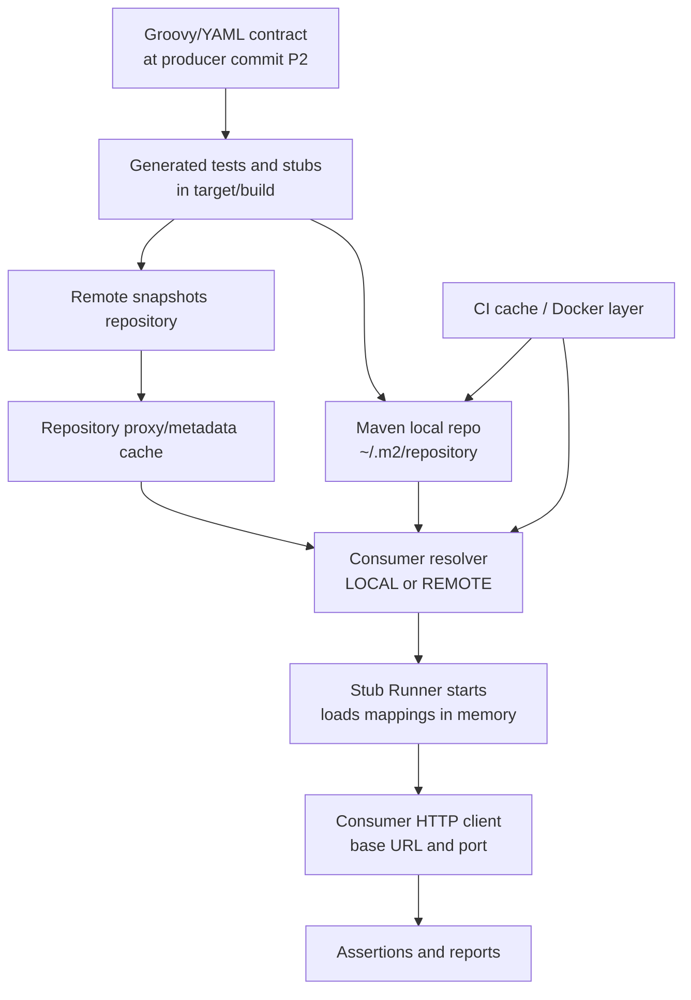
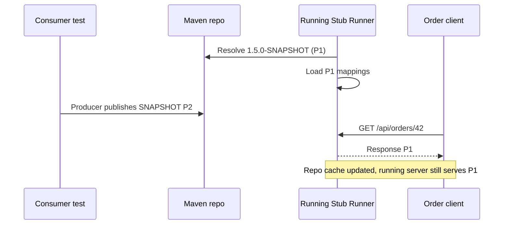
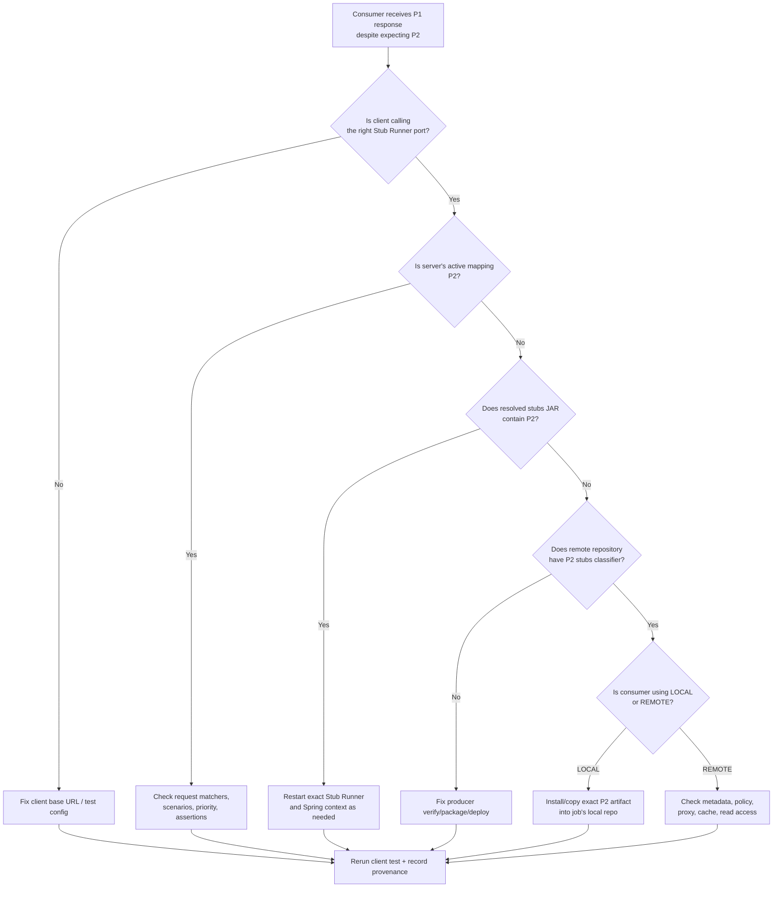

# Tests Use Stale SNAPSHOT Cache

## 1. Symptom: Producer Changed, Yet Consumer Still Sees Old Response

In **Spring Cloud Contract**, producer and consumer describe HTTP or messaging interfaces with **Groovy/YAML DSL**. Verifier generates tests that run against the real producer, generates stubs packaged into an artifact, and **Stub Runner** loads stubs into the consumer test environment. CI often runs these steps sequentially or across independent jobs.

When using `SNAPSHOT` versions, a very misleading failure occurs:

> Order Team updated the contract, generated producer tests passed, and artifact `1.5.0-SNAPSHOT` was built. Yet Checkout Team still receives the old response as if nothing changed.

For example, the new contract requires `GET /api/orders/42` to include `estimatedDeliveryDate`:

```json
{
  "id": 42,
  "state": "PAID",
  "currency": "VND",
  "estimatedDeliveryDate": "2026-12-01"
}
```

Consumer tests still receive:

```json
{
  "id": 42,
  "state": "PAID",
  "currency": "VND"
}
```

This **does not yet prove** the new producer violates the contract. Tests may be hitting an **old stub JAR** cached in the local Maven repository, runner cache, repository proxy, or an already-running Stub Runner server. The client might also be calling the **wrong server**, or the new SNAPSHOT **was never published**.

This lesson belongs to the **Troubleshooting** chapter and focuses on **“Tests use stale SNAPSHOT cache.”** The goal is to trace the exact artifact, separate each cache layer, choose targeted refresh steps, and design CI to prevent false greens. Never wipe entire caches reflexively before locating where stale data resides.

### 1.1. What You Will Be Able to Do After This Lesson

1. Explain why `1.5.0-SNAPSHOT` **is not immutable content**, even though the version string never changes.
2. Separate **source contract**, **generated stub**, **local Maven cache**, **remote repository metadata**, **CI cache**, and a **live Stub Runner**.
3. Diagnose differences between `StubsMode.LOCAL` and `StubsMode.REMOTE`.
4. Understand the exact effect and limits of `mvn -U`, `mvn clean`, and targeted purge actions.
5. Inspect **`stubs` classifier**, checksums, and actual WireMock mappings inside the JAR.
6. Run the real consumer client against the right stub version and reconcile producer generated tests with CI evidence.
7. Improve pipelines to avoid multiple jobs racing on the same mutable SNAPSHOT.

## 2. Running Case: Order Team and Checkout Team

Suppose Order Team publishes:

```text
groupId    = com.example
artifactId = order-service
version    = 1.5.0-SNAPSHOT
classifier = stubs
extension  = jar
```

Stub Runner coordinates are typically written:

```text
com.example:order-service:1.5.0-SNAPSHOT:stubs
```

In a local Maven repository, filenames look similar to:

```text
~/.m2/repository/com/example/order-service/1.5.0-SNAPSHOT/
    order-service-1.5.0-SNAPSHOT-stubs.jar
    order-service-1.5.0-SNAPSHOT.pom
    maven-metadata-*.xml
    ...
```

This is an **illustrative path**—do not assume your machine definitely uses `~/.m2`: Maven can be configured via `-Dmaven.repo.local`, `settings.xml`, or CI environment settings that relocate caches.

### 2.1. Three Builds, One Version String

| Milestone | Producer Commit | Response Content | Artifact Version |
|---|---|---|---|
| Build P1 | `aaa111` | Three fields | `1.5.0-SNAPSHOT` |
| Build P2 | `bbb222` | Adds `estimatedDeliveryDate` | `1.5.0-SNAPSHOT` |
| Consumer C1 | `ccc333` | Expects new payload | Resolves `1.5.0-SNAPSHOT` |

**The same `1.5.0-SNAPSHOT` string does not uniquely identify content.** To know whether C1 resolved P1 or P2, locate the **exact resolved artifact**, metadata/checksum, and stub mapping loaded by the server.

If a pipeline uses an immutable release such as `1.5.0`, redeploying **the same coordinates** with different content should normally be disallowed. With SNAPSHOTs, changing content across builds is expected during development, yet introduces non-reproducibility when consumer tests rely on mutable coordinates.

## 3. How Do SNAPSHOTs Work in a Maven Artifact Repository?

A Maven version ending in `-SNAPSHOT` represents an **in-development** build. When deployed to a Maven repository supporting unique snapshots, artifacts are stored with filenames containing a **timestamp and build number**, while users still reference the base version `1.5.0-SNAPSHOT`.

Example artifact names in a repository:

```text
order-service-1.5.0-20261124.031504-7-stubs.jar
order-service-1.5.0-20261124.051122-8-stubs.jar
```

These timestamps are illustrative; inspect the **repository's actual metadata** to see which build is selected. Maven relies on `maven-metadata.xml` and snapshot update policies to locate the latest artifact.

### 3.1. Metadata Can Point to Multiple Builds

An **illustrative** metadata excerpt, not taken from a live repository:

```xml
<metadata>
  <groupId>com.example</groupId>
  <artifactId>order-service</artifactId>
  <version>1.5.0-SNAPSHOT</version>
  <versioning>
    <snapshot>
      <timestamp>20261124.051122</timestamp>
      <buildNumber>8</buildNumber>
    </snapshot>
    <lastUpdated>20261124051122</lastUpdated>
    <snapshotVersions>
      <snapshotVersion>
        <classifier>stubs</classifier>
        <extension>jar</extension>
        <value>1.5.0-20261124.051122-8</value>
        <updated>20261124051122</updated>
      </snapshotVersion>
    </snapshotVersions>
  </versioning>
</metadata>
```

Notice the **`stubs` classifier and `jar` extension** in `snapshotVersion`. Metadata for the main application JAR does not guarantee metadata for the **`stubs` JAR** points to the latest build. Deploying only the application or only the POM does not prove a new `-stubs.jar` was published.

### 3.2. Why Does Metadata/Caching Keep Tests Stale?

A resolver may depend on:

- Its local copy of a previously downloaded artifact.
- Local metadata recording the timestamp of the last check.
- Repository `updatePolicy` for SNAPSHOTs, such as interval-based or every run.
- Repository manager/proxy caching upstream metadata or artifacts.
- Offline flags, network reachability, authentication, and download errors.

If a new build deploys while the resolver still reads stale metadata, it keeps selecting the old timestamp. If metadata updates while the `stubs` classifier artifact has not been published, the resolver cannot conjure a new stub JAR either.

**Rule:** editing contract source, running producer tests, installing/deploying the artifact, and consumer resolution **are four separate events**.

## 4. Layers That Can Stay “Stale”

Do not lump everything together as “Maven cache.” In a contract testing pipeline, at least six places deserve inspection:



| Layer | Sign It Is Stale | Priority Verification |
|---|---|---|
| **Contract source** | Contract P2 not checked out | Check producer commit/revision |
| **Generated output** | Stub mapping in `target` misses source edits | Clean build right module; inspect generated files |
| **Local Maven repo** | `-stubs.jar` in `~/.m2` still holds P1 body | `jar tf`, inspect mapping, checksum |
| **Remote repository/proxy** | Metadata or `stubs` classifier still points to P1 | Compare deploy times, metadata, and artifacts |
| **Consumer resolver/CI cache** | Old download/copy despite fresh repo | Record resolved location/version and cache key |
| **Running Stub Runner** | Serving mappings loaded from P1 | Check port, active mappings, restart server in scope |
| **Consumer client config** | Calling an entirely different server | Log actual URL, WireMock request journal |

### 4.1. “Stale Cache” and “Client Calling Wrong Server” Look Identical

For example, Stub Runner P2 started on `localhost:54321`, while the `OrderClient` bean still holds `http://localhost:8090` from an old test config. Port `8090` may serve P1, making it look like P2's cache is stale.

Before touching Maven caches, verify the **actual target called by the consumer**, which test class/method ran, and which server received the request. Keep `@StubRunnerPort`, `wiremock.server.port`, and `server.port` distinct; they do not mean the same thing.

## 5. Distinguish “Stale Stub” from Unpublished Producer Changes

A sound verification chain:

```text
1. Was contract P2 committed/checked out?
2. Were producer generated tests generated, executed, and passed?
3. Were P2 stub mappings generated?
4. Was P2 -stubs.jar installed/deployed at the right coordinates?
5. Did the consumer resolver pick the right P2 artifact?
6. Did the running Stub Runner load P2 mappings?
7. Did the consumer HTTP client call the right Stub Runner port?
8. Do assertions reflect P2 requirements?
```

If things stopped at step 2 or 3 with no publish evidence, **do not blame remote caches**. The pipeline may never have uploaded the new `-stubs.jar` to the repository.

### 5.1. Producer Tests Must Run Against Real Code

A P2 Groovy contract:

```groovy
import org.springframework.cloud.contract.spec.Contract

Contract.make {
    description 'PAID order includes estimated delivery date'

    request {
        method GET()
        url '/api/orders/42'
        headers {
            header 'Accept', 'application/json'
        }
    }

    response {
        status OK()
        headers {
            contentType(applicationJson())
        }
        body(
            id: 42,
            state: 'PAID',
            currency: 'VND',
            estimatedDeliveryDate: '2026-12-01'
        )
    }
}
```

This **replaces P1 for the same request predicate**; do not leave two versions with identical request matching and different responses in the same unconditioned mapping set. The producer must seed fixture order `42` appropriately; generated tests verify the real controller/serialization through the matching base test.

### 5.2. Equivalent YAML DSL

```yaml
description: PAID order includes estimated delivery date
request:
  method: GET
  url: /api/orders/42
  headers:
    Accept: application/json
response:
  status: 200
  headers:
    Content-Type: application/json
  body:
    id: 42
    state: PAID
    currency: VND
    estimatedDeliveryDate: "2026-12-01"
```

Keep only **one active representation** in source to avoid duplicate mappings. Never equate a YAML file parsing cleanly with producer verification: generated tests must **compile, execute via the runner, and pass assertions**.

## 6. Prove Which Stubs JAR Was Built

Use the **full** coordinates:

```text
groupId    = com.example
artifactId = order-service
version    = 1.5.0-SNAPSHOT
classifier = stubs
extension  = jar
```

If you inspect `order-service-1.5.0-SNAPSHOT.jar` (without classifier), you are inspecting the **application JAR**, not the artifact Stub Runner loads.

### 6.1. Inspect JAR Contents Before Blaming Caches

Reference command on a machine with JDK/JAR tools:

```bash
jar tf "$HOME/.m2/repository/com/example/order-service/1.5.0-SNAPSHOT/order-service-1.5.0-SNAPSHOT-stubs.jar"
```

Inspect resource paths, typically directories related to `mappings` and `__files` under the stub artifact's `META-INF` structure. **Internal JAR paths depend on plugin packaging and version**, so list actual entries rather than assuming `/mappings` is at the root.

To inspect the actual response, extract a **copy of the JAR into a separate temp folder** and read the listed mapping JSON files. Never edit a JAR in place inside the Maven cache, as that alters the artifact you are tracing.

### 6.2. Compare Checksums Against the Published Build

On Unix-like machines:

```bash
sha256sum "$HOME/.m2/repository/com/example/order-service/1.5.0-SNAPSHOT/order-service-1.5.0-SNAPSHOT-stubs.jar"
```

In PowerShell:

```powershell
Get-FileHash -Algorithm SHA256 "$HOME/.m2/repository/com/example/order-service/1.5.0-SNAPSHOT/order-service-1.5.0-SNAPSHOT-stubs.jar"
```

Checksums prove whether **two files are byte-for-byte identical or different**. They do not prove API correctness, nor does a different checksum guarantee different semantics if JARs embed timestamps/build metadata. Pinpointing the bug therefore requires **both checksums and mapping/behavior inspection**.

### 6.3. Three Pieces of Evidence to Store Together

```text
Source  : producer commit bbb222, contract ORD-GET-PAID
Package : com.example:order-service:1.5.0-SNAPSHOT:stubs
Evidence:
  - generated producer test name + report
  - stubs JAR checksum + mapping path/response
  - build/deploy ID and publish timestamp
```

Without any one of these links, claiming “the stub is fresh” remains guesswork.

## 7. `StubsMode.LOCAL`: Uses Only Artifacts on the Test Runner Machine

A consumer test may configure:

```java
import org.junit.jupiter.api.Test;
import org.springframework.boot.test.context.SpringBootTest;
import org.springframework.cloud.contract.stubrunner.StubRunnerProperties;
import org.springframework.cloud.contract.stubrunner.spring.AutoConfigureStubRunner;
import org.springframework.cloud.contract.stubrunner.spring.StubRunnerPort;

@SpringBootTest
@AutoConfigureStubRunner(
    ids = "com.example:order-service:1.5.0-SNAPSHOT:stubs",
    stubsMode = StubRunnerProperties.StubsMode.LOCAL
)
class CheckoutSnapshotContractTest {

    @StubRunnerPort("com.example:order-service")
    int orderStubPort;

    @Test
    void checkoutReadsOrder() {
        // Create/configure real consumer client with
        // http://localhost:<orderStubPort>.
        // Assert response carries protected behavior.
    }
}
```

In principle, `LOCAL` looks up stubs already **installed/present in the local artifact repository** of the running environment. It does not mean “always fetch the newest SNAPSHOT from the network.” If the local repo holds only P1, the consumer will keep using P1 or report missing artifacts depending on config.

### 7.1. Local Producer → Consumer Workflow

An **illustrative** development sequence on the same machine/environment sharing a Maven local repository:

```bash
# In the producer project/module, with plugin bound to lifecycle:
mvn clean install

# In the consumer project:
mvn test
```

Conditions for this sequence to be trustworthy:

1. Producer `clean install` **generated and executed contract tests**, unskipped by `skipTests`/filters.
2. Plugin **attached/installed the `stubs` classifier artifact**, not just the main application JAR.
3. Producer and consumer genuinely use the **same local Maven repository path**.
4. Consumer `Stub Runner` started fresh after the artifact updated.
5. Tests run the real consumer client and assert the new field/behavior.

**Do not assume `mvn clean install` always builds a stub JAR** if the Spring Cloud Contract plugin is misconfigured or unbound. Check build logs, installed files, and actual test reports.

### 7.2. Two CI Jobs Do Not Share a Local Repository by Default

```text
Producer Job A:
  ~/.m2/repository (... A)
  installs order-service 1.5.0-SNAPSHOT stubs P2

Consumer Job B:
  ~/.m2/repository (... B)
  still holds P1 stubs from cache or nothing at all
```

Even if both jobs run at the same time, an artifact installed in A does not magically appear in B on separate runners/containers. You need a **deploy to a shared repository** or explicit **build artifact handoff** with clear provenance, configuring the consumer to resolve from there.

If two jobs share the **same Maven local repository directory on a shared runner**, concurrent writes/reads on mutable SNAPSHOTs can race. Use per-job local caches for isolation; never turn a mutable shared directory into a pipeline “source of truth.”

### 7.3. Do Not Confuse the Local Maven Repository with Project `target`

- `mvn clean` deletes build outputs in the module's `target` per Maven lifecycle.
- It **does not automatically delete** `~/.m2/repository`.
- Re-installing the producer locally and re-downloading from remote are two separate actions.
- Restarting Stub Runner to load the new JAR is a **third** step.

If tests use `LOCAL` and you only run `mvn -U test` in the consumer, do not assume Stub Runner will hit the remote repository and replace local P1. Verify the **mode** and where artifacts are resolved from.

## 8. `StubsMode.REMOTE`: Metadata, Repository URL, and Snapshot Policy

In CI, consumers typically resolve artifacts from a shared Maven repository:

```java
@SpringBootTest
@AutoConfigureStubRunner(
    ids = "com.example:order-service:1.5.0-SNAPSHOT:stubs",
    stubsMode = StubRunnerProperties.StubsMode.REMOTE,
    repositoryRoot = "https://artifacts.example.invalid/repository/snapshots"
)
class CheckoutRemoteSnapshotTest {
    @StubRunnerPort("com.example:order-service")
    int orderStubPort;
}
```

`artifacts.example.invalid` is a **placeholder**, not a live repository. Configure the right repository URL, access permissions, and security for your environment. Depending on Spring Cloud Contract/Stub Runner version, repository settings, downloaders, and property names may vary; check docs and logs for your version.

### 8.1. `REMOTE` Does Not Mean All Caches Are Bypassed

`REMOTE` lets Stub Runner's resolver fetch stubs from a remote repository. However, resolution can still consult **local caches**, local/remote metadata, or update policies. Therefore:

- The P2 deploy must include the **`stubs` classifier JAR** and matching metadata.
- The consumer must point to the **right snapshots repository**, not accidentally a releases repo or stale mirror.
- The resolver must have read permissions for the new artifact.
- Cache/update policies must allow checking for fresh snapshots when needed.
- The Stub Runner server must be **recreated/reloaded** after resolution.

Do not assume `REMOTE` re-downloads fresh artifacts per test method. Normally stubs are resolved and the server starts per **test/context scope**, not per HTTP request.

### 8.2. SNAPSHOT Updates Depend on Metadata

Repositories can apply snapshot update policies such as `always`, `daily`, `interval:N`, or `never` depending on resolver/repository capabilities. **Illustrative** Maven POM snippet, not mandatory config for every Stub Runner downloader:

```xml
<repositories>
    <repository>
        <id>internal-snapshots</id>
        <url>https://artifacts.example.invalid/repository/snapshots</url>
        <releases>
            <enabled>false</enabled>
        </releases>
        <snapshots>
            <enabled>true</enabled>
            <updatePolicy>always</updatePolicy>
        </snapshots>
    </repository>
</repositories>
```

**Do not set `always` unconditionally across every pipeline**: it increases repository traffic and will not fix a missing/broken artifact. For reproducible builds, prefer **immutable candidate versions** or revision-pinned coordinates; use snapshot refreshes deliberately for dev workflows.

### 8.3. Repository Managers/Proxies Can Be a Separate Caching Layer

If the producer deploys to internal repository A while the consumer resolves through **repository group/proxy B**, metadata may lag or B may serve cached entries. When investigating, record:

```text
Producer deploy target  : repository A
Consumer repositoryRoot : repository B
Resolved artifact       : actual timestamp/classifier/checksum
Expected artifact       : timestamp/checksum from producer build P2
```

If A holds P2 while B still reports P1, inspect **repository metadata and cache/replication policies** with your repository administrators. Deleting the consumer's local repo will simply re-download **the same P1 from B**, leaving the root cause untouched.

### 8.4. Do Not Mistake the Regular Dependency JAR for the Stub JAR

When searching via repository UI or Maven CLI for:

```text
com.example:order-service:1.5.0-SNAPSHOT
```

explicitly check **classifier `stubs` and extension `jar`**. A brand-new application JAR and an old stub JAR can coexist in a repository if the classifier publish step was skipped or failed.

## 9. `mvn -U`, `clean`, and “Clearing Cache”: Different Effects

### 9.1. What Does `mvn -U` Do?

Maven's `-U` flag instructs Maven to **force snapshot update checks** for dependencies/artifacts managed by Maven resolution (and also retries previously failed resolutions). Example:

```bash
mvn -U -B -ntp clean verify
```

Practical realities:

- Helps when **Maven** holds cached SNAPSHOT metadata/dependencies and remote has a newer build.
- Does not make the producer **rebuild and publish** `-stubs.jar`.
- Does not alter requests/responses inside an already-running WireMock server.
- Does not force an **independent Stub Runner downloader** or custom resolver to bypass its own cache if it enforces its own resolution policy; verify version and logs.
- Does not turn `LOCAL` into `REMOTE`.
- Does not guarantee metadata inside a **repository proxy** is fresh.

That is why “just add `-U`” is not the answer to every problem.

### 9.2. What Does `mvn clean` Do?

`mvn clean` deletes the project's build output (typically `target`). It **does not automatically refresh** the Maven local repository or remote metadata, nor restart a standalone WireMock/Stub Runner service.

If the problem is stale `target/generated-contracts`, `clean` + proper lifecycle generation is needed. If the problem is `~/.m2`, cleaning the project alone still reuses the stale JAR.

### 9.3. When Should You Purge a Local Artifact?

Only after verifying:

1. Exact `group/artifact/version/classifier` coordinates.
2. Remote actually holds the newer JAR.
3. The resolver is reading an older local copy or stale metadata cache.
4. No other concurrent job/test is reading or writing the same file.

Instead of deleting all of `~/.m2`, use **targeted purge** mechanisms from Maven/dependency tooling or a **clean temporary local repository** for diagnosis. Maven Dependency Plugin purge commands behave differently depending on options/versions and typically target declared dependencies; **do not assume they purge every stub artifact resolved by Stub Runner at runtime**.

If you must operate directly on the filesystem, **verify the real path, target only the exact coordinate version, and preserve a copy/checksum for investigation**. Never wipe a local repo shared by active CI jobs, or delete an entire cache without evidence.

### 9.4. A Temporary Local Repository for Reproduction

Illustrative Maven command to isolate a build's Maven resolver:

```bash
mvn -U -Dmaven.repo.local="$PWD/.m2-contract-debug" -B -ntp test
```

`.m2-contract-debug` is only an **example** intentional temp local repository; this command may download many dependencies. Confirm whether your **Stub Runner version honors the same local repo setting**, as not every custom resolver reads this Maven CLI property.

The benefit is testing an environment **free of previously installed artifacts** without destroying evidence in the original cache. If the bug disappears, stale local state becomes likely; still reconcile checksums/mappings to prove it.

## 10. Find the Right Cache: Maven Settings, Environment, and CI Restores

A “I deleted the local JAR and it's still stale” error usually means you deleted from the **wrong local repository**, not the one tests actually use.

### 10.1. Settings That Can Relocate the Path

- `<localRepository>` in Maven `settings.xml`.
- Maven CLI/system property `-Dmaven.repo.local`.
- CI wrapper/Maven toolchain setting a per-job repository path.
- Docker image pre-populating `/root/.m2` or `/home/runner/.m2`.
- IDE/test runner using a different JVM/environment than your shell.
- Stub Runner downloader configured with a separate repository location.

An investigative CLI example:

```bash
mvn help:effective-settings
```

Maven Help Plugin can display effective Maven configuration when appropriate, yet **never log settings containing credentials** into public artifacts. Before sharing logs, mask all passwords/tokens/server credentials and focus on repository IDs/URLs and `localRepository`.

### 10.2. CI Cache Keys Can Restore Stale Artifacts

```text
CI job starts
  → restores ~/.m2 cache from an older job/commit
  → runs consumer tests with StubsMode.LOCAL
  → P1 SNAPSHOT is loaded
  → cache gets saved again at job end
```

When the consumer uses `LOCAL`, a cache hit can **be treated as a valid artifact source**, even though the producer just built P2 in another job. Dependency caching speeds up builds, not **artifact release and version pinning**.

CI systems separate caches from artifacts:

- **Cache**: performance optimization; may be overwritten/restored; never a source of truth.
- **Build artifact**: specific output of one job/commit with provenance and retention.
- **Maven release/snapshot repository**: where publishers upload artifacts by version/classifier with metadata.

To test exact P2 in the same pipeline, pass **artifact P2 with clear provenance** or deploy P2 to an agreed repository; do not expect a shared cache to invalidate itself.

### 10.3. Offline Mode and Network Errors

When Maven or a downloader runs offline, it may continue using local copies or fail on missing artifacts. If network/auth fails, some resolvers report remote resolution failure and fall back locally depending on mode and config.

**Never claim “REMOTE is up to date” just because tests had no network error.** Verify resolved path/checksum and logs confirming the new artifact was actually chosen; separate 401/403, 404 missing artifact, timeouts, and stale metadata.

## 11. Stub Runner Already Started: Updating the JAR Does Not Swap Live Mappings

Suppose `Stub Runner` resolved P1 and started WireMock on `localhost:54321`. Next, Order Team publishes P2 and you refresh the JAR in the local repo. **The running server still holds P1 mappings loaded in memory**; it does not watch the Maven repository for changes.



### 11.1. Proper Steps After an Artifact Changes

1. Shut down the **exact test context/server instance** holding P1.
2. Confirm the resolver will pick P2 locally/remotely per configured mode.
3. Start a new context/Stub Runner instance or restart the standalone server.
4. Capture the **new runtime port** (if dynamic) and update the client base URL before client calls run.
5. Issue a representative request and confirm the response/mapping carries P2 fields.

When Spring Test **caches application contexts** across test classes, two tests can reuse the same Stub Runner instance. `@DirtiesContext` can force context recreation when needed, though it increases startup time and **does not refresh your local Maven repository**. Never sprinkle `@DirtiesContext` everywhere to mask wrong artifact root causes.

### 11.2. Do Not Blindly Reset All Mappings

WireMock `resetAll()` can wipe loaded mappings/journals/scenarios. If the server is owned by Stub Runner, calling reset-all from one test can delete JAR-loaded mappings for others, triggering unmatched `404`s unrelated to SNAPSHOT caching.

When tests share a Stub Runner instance, standardize lifecycle/state isolation. To test P2, **restarting with the exact artifact** is far safer than “resetting mappings and hoping for reload.”

## 12. Inspect the Live Server via Port and WireMock Admin API

Do not inspect only the JAR on disk. Know which server the consumer actually calls.

### 12.1. Capture the Right Stub Runner Port

```java
@StubRunnerPort("com.example:order-service")
int orderStubPort;
```

With multiple upstream stubs, give each client **its exact artifact's port**. Do not pin `localhost:8080` merely because the real producer uses that port.

### 12.2. Meaningful HTTP Probe

An HTTP probe example:

```bash
curl --fail --silent --show-error \
  -H "Accept: application/json" \
  "http://localhost:54321/api/orders/42"
```

`54321` is illustrative; substitute the **runtime port from Stub Runner**. Confirm the payload includes `estimatedDeliveryDate`. Status `200` alone does not prove P2 mappings are loaded.

### 12.3. Inspect Loaded Mappings

On the WireMock HTTP stub server when the Admin API is enabled and reachable inside a **safe test environment**:

```bash
curl --silent --show-error \
  "http://localhost:54321/__admin/mappings"
```

Read the mapping for `GET /api/orders/42`, body/`bodyFileName`, priority, and scenario conditions. If the active mapping shows three P1 fields while the P2 JAR on disk has four fields, either the server has not restarted or you are hitting a **different instance/port**.

**Security:** WireMock's Admin API exposes and mutates stub state; never expose it publicly or dump responses holding tokens/PII into logs. Extract only needed IDs/paths/responses and redact secrets.

### 12.4. Unmatched `404` Does Not Mean “Using Old Build”

If a client sends `GET /api/order/42` (missing `s`) or differing headers/queries, WireMock returns an unmatched `404`—unlike a business `404 ORDER_NOT_FOUND` carrying an error body/code.

To separate them, inspect the **request journal** (when enabled in the test environment), matched/unmatched mappings, and body/error-code assertions. A path mismatch can look like a stale SNAPSHOT when the actual bug is a **wrong client request**.

## 13. Gradle, IDE, and Docker: Non-Maven Caches Still Matter

When using Gradle or running tests from an IDE, extra cache layers appear:

- **Gradle dependency cache** for Gradle-resolved dependencies.
- **Gradle task/build cache** storing generate/test task outputs under declared conditions.
- **IDE test runner** reusing environment, classpath, or Spring contexts.
- **Docker image layers** baking in `~/.m2` or generated stub files.
- **CI workspace caches** holding outputs from earlier runs.
- **Stub Runner downloader** keeping repository/cache logic separate from the build tool.

### 13.1. `--refresh-dependencies` Is Not “Wipe All Caches”

In Gradle, reference command:

```bash
./gradlew --refresh-dependencies test
```

tells Gradle to refresh dependency resolution per Gradle's rules. It **does not guarantee** an independent Stub Runner resolver or already-running WireMock server drops its cache and reloads mappings.

If a plugin or test framework resolves via Maven/Aether directly, determine **which resolver actually fetches the stubs JAR**. Never assume “I ran `--refresh-dependencies` so all integration tests use the new stub.”

### 13.2. Gradle Changing Modules

A `-SNAPSHOT` version may be treated by Gradle as a **changing module** under standard config, governed by its own cache TTL. When testing a fresh build, verify:

1. Whether the dependency is resolved by Gradle or by Stub Runner at runtime.
2. Repository URL and chosen artifact version.
3. Changing-module cache policy in that build.
4. Stub JAR checksum/mappings before running tests.

If a plugin fetches JARs via Aether independently, tuning Gradle's `cacheChangingModulesFor` **will not necessarily** alter plugin behavior. Test empirically rather than applying generic tricks.

### 13.3. Container Images Baking In Stale Local SNAPSHOTs

Suppose a Dockerfile or CI image pre-populates:

```text
/root/.m2/repository/com/example/order-service/1.5.0-SNAPSHOT/
    order-service-1.5.0-SNAPSHOT-stubs.jar
```

If the consumer job runs `LOCAL`, a brand-new container starts with **P1 already on its filesystem**. Rebuilding `checkout-service` source does not overwrite that file. Rebuild the image/artifact cleanly or switch to resolving from an explicit repository/artifact pipeline; never trust a cache layer just because the container is fresh.

When diagnosing, inspect **from inside the exact container/JVM running the tests**, not only `~/.m2` on the host.

## 14. Signs Separating Stale JAR, Stale Server, and Wrong Client URL

| P2 JAR on Test Machine? | Stub Runner Serving P2? | Client Test Receives P2? | First Conclusion |
|---|---|---|---|
| **No**, only P1 exists | No | No | Resolver/local cache or publish not updated |
| **Yes** | **No** | No | Server still serving P1 mappings, context not restarted, or reading another file |
| **Yes** | **Yes** | **No** | Client calling wrong port/server, proxy, or different request path |
| **Yes** | Yes | Yes yet test fails | Consumer expectations/parser/behavior need review |
| Unknown | Unknown | Gets 404 | Insufficient evidence; check artifact, port, request match |

A thorough diagnosis records **three separate traces**:

```text
Artifact:
  coordinate = com.example:order-service:1.5.0-SNAPSHOT:stubs
  checksum   = SHA-256 of resolved file
  body       = P1 or P2 response mapping?

Stub Runtime:
  process/context ID
  runtime port
  active mapping ID / body / source

Consumer Invocation:
  test class/method
  actual base URL
  request method/path/headers
  actual response + assertion
```

Without at least this evidence, a “test uses old stub” symptom could actually be a wrong base URL, mapping priority, URL encoding, or test client caching.

### 14.1. When Multiple Mappings Match the Same Request

Suppose the P2 JAR contains both P1 and P2 mappings for `GET /api/orders/42` with identical predicates. WireMock chooses based on **priority and matching/ordering rules**, creating the illusion that P2 was cached even though the new JAR loaded.

Therefore check:

- **How many mappings** in the JAR match that request predicate?
- Does `priority` or `scenarioState` cause P1 to win?
- Did converter/generator accidentally leave P1 output alongside P2?
- Did any test dynamically register a mapping overriding the artifact mapping?

Fix the **contract source, generator output, or state isolation**, not Maven's refresh interval.

### 14.2. Verify Real Requests via the Request Journal

When enabled, WireMock's request journal confirms whether the client sent `GET /api/orders/42`. Restrict logged data, as journals may hold sensitive authorization headers or request bodies.

A consumer test should assert both the **new field under test** and **business behavior**, rather than just `HTTP 200`:

```java
// Excerpt inside a JUnit test using the real OrderClient.
OrderDto order = orderClient.findById(42L);

assertThat(order.state()).isEqualTo("PAID");
assertThat(order.estimatedDeliveryDate())
    .isEqualTo("2026-12-01");
```

This snippet assumes the updated consumer's `OrderDto` defines `estimatedDeliveryDate` with a matching JSON decoder. If the goal is verifying an older consumer that ignores the new field, the right assertion is that **the older client's behavior remains intact when stub P2 adds the extra field**.

## 15. SNAPSHOTs in Messaging: Staleness Can Hit Both Payloads and Transport

Stale caches are not limited to HTTP WireMock. With message contracts, a producer may update an event:

```groovy
import org.springframework.cloud.contract.spec.Contract

Contract.make {
    description 'Successful payment emits OrderPaid'
    label 'order_paid'

    input {
        triggeredBy('publishPaidOrderForContract()')
    }

    outputMessage {
        sentTo('orders.paid')
        headers {
            header('eventType', 'OrderPaid')
        }
        body(
            eventId: 'EVT-42',
            orderId: 42,
            state: 'PAID',
            currency: 'VND'
        )
    }
}
```

Suppose SNAPSHOT P1 omitted `currency` while P2 adds it. Notification Team runs consumer tests yet still receives P1 messages.

**Separate three layers:**

1. Does stub artifact P2 contain the updated **message definition**?
2. Did Stub Runner/message stub adapter load the **right artifact** and register the updated label/destination?
3. Are the broker/test binder/consumer listener reading the **right message** rather than leftover P1 events sitting in a queue?

In messaging, even with a fresh artifact, running tests on a shared queue/topic holding **leftover P1 messages** looks just like a stale cache. Inspect `eventId`, correlation IDs, timestamps (if any), and destinations to separate **stale artifacts** from **stale message transport state**.

### 15.1. Do Not Confuse `messageFrom` with `triggeredBy`

- `triggeredBy('publishPaidOrderForContract()')`: generated producer tests call a base-test method triggering the business flow that emits the message.
- `messageFrom('source.destination')`: typically models an incoming message received by the producer under test before emitting output.

Never swap these two input types during conversion or contract edits just to make tests green. Changing semantics can stop tests from exercising the real production path.

### 15.2. HTTP Stub Runner Does Not Automatically Become Kafka/RabbitMQ

If consumer integration requires a message broker, use the matching message verifier/test binder/adapter or broker test environment. Never “fix” stale event bugs by checking a `GET` against an unrelated WireMock server.

When running in parallel, isolate message consumer groups, queue names, and test topic data; purging a shared queue is dangerous because it can delete events belonging to other concurrent tests.

## 16. Long-Term Mitigation: Do Not Use a Mutable SNAPSHOT as a Release Oracle

`1.5.0-SNAPSHOT` has a role in rapid iteration, yet it is a **mutable content label**. For trustworthy, auditable pipelines:

1. **Use immutable artifacts** for release gates: release versions or unique commit-based candidates per repository policy.
2. **Pin producer revisions and stub artifact coordinates**, never just “latest.”
3. **Record checksum/mapping provenance** so you know exactly which bytes the consumer tested.
4. **Never publish two different payloads under the same release coordinate**; for snapshots, record build/timestamps.
5. **Separate candidate builds from latest dev snapshots**, avoiding sharing one mutable key across all jobs.
6. **Enforce real producer verification**, never publishing stubs when tests were skipped.
7. **Run consumers against exact candidate artifacts**, rather than waiting for snapshot caches to refresh.

### 16.1. Commit-Based Candidate Versions

An organization may adopt unique candidate version names:

```text
Producer commit: bbb222
Candidate version: 1.5.0-rc-bbb222
Stub coordinate: com.example:order-service:1.5.0-rc-bbb222:stubs
```

This naming is an **illustrative convention** and must comply with your organization's Maven repository policies. Advantage: test C1 verifying candidate P2 **is unaffected when build P3 runs**.

If you still rely on unique timestamped SNAPSHOTs, ensure the consumer resolves the **exact identified build** via repository/metadata mechanisms, not merely base version `1.5.0-SNAPSHOT`.

### 16.2. Immutable Versions Separate Regressions from Caching

When P2 has its own coordinate, logs read:

```text
Expected: com.example:order-service:1.5.0-rc-bbb222:stubs
Resolved: com.example:order-service:1.5.0-rc-bbb222:stubs
SHA-256 : <exact checksum from build output>
```

Auditing becomes straightforward: if contents mismatch, the artifact pipeline is broken; if contents match yet the server returns old responses, runtime state or client routing is wrong. No more guessing “when did the SNAPSHOT change?”

## 17. Two Parallel Pipelines Can Race to Publish SNAPSHOTs

A race condition:

```mermaid
sequenceDiagram
    participant A as Producer build P2
    participant B as Producer build P3
    participant Repo as Snapshots repository
    participant C as Consumer CI for P2
    A->>Repo: Deploy 1.5.0-SNAPSHOT P2
    C->>Repo: Resolve unpinned metadata
    B->>Repo: Deploy 1.5.0-SNAPSHOT P3
    Repo-->>C: 1.5.0-SNAPSHOT P3
    C->>C: Test P2 assumptions against P3
    Note over C: Hard to trace; not a random fluke
```

Both builds may be valid; the bug is that **consumer C intended to test P2 while using an unpinned base version**.

### 17.1. Anti-Race Measures

- **Per-commit candidate artifacts:** pass exact coordinates from the producer job to the consumer job.
- **Promotion:** promote candidates only after both producer and consumer verification pass.
- **Concurrency control:** serialize mutable snapshot publishes if policy requires, or avoid overwriting the same key.
- **Repository isolation:** per-branch/per-job staging environments if needed, with cleanup and least-privilege access.
- **CI artifacts:** pass concrete JARs between jobs with checksums and commit IDs.
- **Failure diagnostics:** log timestamped resolved versions, repository URLs, and checksums from the consumer job.

A cache hit on the consumer can return P1; a mid-run metadata refresh can return P3. Relying on “P2 just published” is never enough.

### 17.2. Never Use `+` as a Release-Gate Version

In some Stub Runner mechanisms, `+` means selecting the latest version. That helps for **compatibility canaries**, yet lacks reproducibility if the repository updates mid-CI.

For release gates, pin exact versions or resolved candidates; if `+` is ever used, **record the resolved version** and never treat “passed against today's latest” as evidence for a different artifact.

## 18. Build a CI Pipeline That Protects Provenance

### 18.1. Required Producer Steps

```text
Producer CI (commit P2)
  [1] Check out exact commit and Groovy/YAML contracts
  [2] Generate producer contract tests
  [3] Compile + execute generated contract tests
  [4] Assert protected scenario counts ran, none skipped
  [5] Package -stubs.jar, inspect mappings/body files
  [6] Compute artifact checksum and record build metadata
  [7] Publish candidate/unique snapshot after verification
```

Illustrative Maven command:

```bash
mvn -B -ntp clean verify
```

In a real project, confirm plugin lifecycles build and attach stub artifacts. `verify` is only a **phase** and does not guarantee all scenarios ran if the plugin is misconfigured. With `install`/`deploy`, proceed **only after** generated tests and gates pass.

### 18.2. Required Consumer Steps

```text
Consumer CI (test P2)
  [1] Receive P2 coordinate/checksum from producer pipeline
  [2] Resolve exact -stubs.jar from designated artifact source
  [3] Compare checksum against expected artifact (if available)
  [4] Start a fresh Stub Runner instance
  [5] Log runtime port and artifact version without logging secrets
  [6] Inject base URL into real client
  [7] Run HTTP/message compatibility tests and behavior assertions
  [8] Archive reports + resolved provenance, clean up
```

### 18.3. Passing Candidate Artifacts Between Jobs

CI workflow **pseudocode**, not directly runnable GitHub Actions/GitLab/Jenkins syntax:

```yaml
producer_job:
  source_revision: bbb222
  verify_generated_contract_tests: true
  fail_if_contract_test_count_zero: true
  publish_candidate_artifact: true
  outputs:
    stub_coordinate: "com.example:order-service:1.5.0-rc-bbb222:stubs"
    stub_sha256: "<build-output-sha256>"

consumer_job:
  needs: producer_job
  input_coordinate: producer_job.outputs.stub_coordinate
  input_checksum: producer_job.outputs.stub_sha256
  start_new_stub_runner: true
  verify_http_client_behavior: true
  archive:
    - resolved_stub_metadata
    - test_reports
```

In real implementations, use your CI provider's mechanisms for artifact/output passing, secure auth, checksum validation, and concurrency control. The pseudocode above simply captures the **handoff contract between two jobs**.

### 18.4. Keeping Reproducibility When SNAPSHOTs Are Required

If team policy mandates SNAPSHOTs in daily integration:

- Specify the exact **producer build/timestamp** the consumer should verify, not an arbitrary one.
- Record checksum, source commit, artifact repository, and resolved metadata.
- Run tests with a fresh Stub Runner instance.
- Configure snapshot update policies appropriate to detect new builds when required.
- Never share mutable Maven caches across uncoordinated CI jobs.
- Keep at least one release/candidate gate using immutable artifacts for long-term confidence.

**Note:** caches speed up pipelines, yet correctness must be verified via **artifact identity and real behavior**, not whether “cache was on or off.”

## 19. Diagnostic Playbook: Start with Evidence, Not Wiping Caches

A standard playbook keeps both producer and consumer focused on **one concrete artifact and one concrete request**.

### 19.1. From Symptom to Fix Location



**There is no “immediately wipe `~/.m2`” branch.** The first action is verifying the target being called, active mappings, and the resolved artifact.

### 19.2. Step 1 — Record Exactly What Is Expected

An incident note should start with:

```text
Consumer test:
  project       : checkout-service
  test          : CheckoutContractTest#readsEstimatedDeliveryDate
  consumer code : commit ccc333

Expected stub:
  group         : com.example
  artifact      : order-service
  version       : 1.5.0-SNAPSHOT
  classifier    : stubs
  producer code : commit bbb222

Expected interaction:
  GET /api/orders/42
  HTTP 200
  JSON estimatedDeliveryDate = "2026-12-01"
```

Before debugging, confirm a test actually asserts the new field or affected behavior. A test asserting only `200` passes on both P1 and P2 and **never catches a stale cache**.

### 19.3. Step 2 — Check the Producer Side

In producer build P2:

1. Source contract P2 contains the new requirement.
2. Generated producer tests exist in the right classes/methods.
3. Tests **executed and passed** (not skipped).
4. Stub mapping P2 was generated with expected body/headers.
5. `-stubs.jar` was attached and **installed/deployed** under the right version/classifier.
6. A build ID, checksum, or timestamped repository artifact exists for traceability.

If you only see `BUILD SUCCESS` while Maven ran `-DskipTests` or Surefire missed generated tests, do not trust the stub as verified. **The root cause may be in the producer pipeline**, not consumer caches.

### 19.4. Step 3 — Check Where the Consumer Fetches Artifacts

Reconcile four facts:

```text
stubsMode            = LOCAL or REMOTE
repositoryRoot       = remote URL if used
effective local repo = actual path downloader reads
resolved artifact    = exact file/version/checksum
```

If `LOCAL`, check local files and install/transfer steps between jobs first. If `REMOTE`, check remote metadata, timestamps/classifiers, and download logs first. If local and remote checksums differ, verify **which one matches producer P2** rather than assuming remote is always right.

### 19.5. Step 4 — Check Stub Runner Runtime

Record:

- Actual port from `@StubRunnerPort` or startup logs.
- When the server/context started—before or after P2 was published.
- Active mapping for `GET /api/orders/42` via WireMock Admin API when permitted.
- Whether other mappings share the same predicate/priority/scenario.
- Whether any test calls `resetAll()` or overrides mappings.

If the JAR is already P2 while active mappings remain P1, **restart the server/test context** cleanly after confirming the resolver will pick P2.

### 19.6. Step 5 — Run the Real Client, Not Just a Stub Ping

Tests must exercise the **consumer's HTTP client/DTO/error decoder** and verify business decisions. A response with a new field does not guarantee strict client C1 can still parse it; that could be a **breaking change independent of caching**.

Record:

```text
request URL     = http://localhost:<runtime-port>/api/orders/42
actual status   = 200
actual payload  = presence/absence of estimatedDeliveryDate
client result   = parse OK / JSON exception / business assertion failure
stub artifact   = coordinate + checksum + build ID
```

Do not treat a deserialization error on payload P2 as a reason to revert to stub P1. If a consumer relies on a strict parser, perform a **compatibility review** before rolling out producer P2.

## 20. Quick Reference Table: Distinguishing Similar-Looking Causes

| Symptom | Possible Cause | Distinguishing Evidence | Fix at Right Layer |
|---|---|---|---|
| Consumer still gets P1 body | `LOCAL` cached P1 | Local JAR maps P1, remote has P2 | Install/transfer verified P2 |
| `REMOTE` still sees P1 | Metadata/cache update policy | Resolved timestamp is P1, remote has P2 | Refresh metadata/cache in right resolver |
| Repo UI shows P2 yet consumer sees P1 | Stale proxy/group repository | Direct repo A ≠ repo B | Fix mirror/proxy replication |
| P2 app JAR exists, stub JAR missing | Published without classifier | `stubs` `snapshotVersion` not updated | Fix producer attach/deploy |
| `mvn clean` did not fix it | Local repo keeps P1 | Fresh `target`, old `~/.m2` | Distinguish build output vs local cache |
| `mvn -U` did not fix `LOCAL` | No remote fetch happens | Downloader reads local only | Update local artifact/mode config |
| P2 JAR right yet test sees P1 | Stub Runner did not restart | Active mapping is P1 | Recreate runtime/context |
| P2 JAR and mapping right yet client sees P1 | Base URL hits another server | Client calls different port than `@StubRunnerPort` | Inject runtime URL properly |
| P2 mapping exists yet P1 body returned | Duplicate mappings/priority/scenario | Multiple mappings match same request | Fix generator/source/state |
| Test gets `404` | Unmatched request | Journal shows different path/header | Fix client request or mapping predicate |
| Consumer parse fails upon receiving P2 | Strict deserializer | Valid P2 payload, unknown-field exception | Review compatibility; don't hide behind old cache |
| Fresh CI job still sees P1 | Stale Docker/CI cache | Local repo inside container has P1 | Fix cache key/artifact handoff |
| Producer and consumer share SNAPSHOT yet expectations differ | Concurrent build race | Timestamp P3 ≠ expected P2 | Pin candidate/commit-specific version |
| `-stubs.jar` right yet message is stale | Broker/queue holds leftover P1 message | Event ID/correlation belongs to another test | Isolate broker state and adapter |
| Build passes tests yet contract missing | Generated tests did not run | Reports contain unit tests only | Check plugin/filters/skip flags |
| Remote returns 401/403 | Wrong repo permissions | Resolution failure, no fresh artifact | Fix credentials/permissions securely |
| Offline test passes after remote has P2 | Resolver reads cached local P1 | Offline mode + old checksum | Rerun against explicit P2 artifact |
| Fails only in parallel runs | Shared local repo/server/state | Timestamp/reset/mapping race | Separate job caches, servers, mutable state |

### 20.1. Severity Classification

- **Repository/transport incident:** cannot download the right artifact due to auth/network/mirror issues.
- **Artifact provenance defect:** downloaded artifact does not match the producer build intended for verification.
- **Stub runtime defect:** right artifact, yet running server serves old/wrong mappings.
- **Client contract failure:** server returns valid P2 yet consumer client fails to handle it.
- **Producer contract failure:** real producer code violates Groovy/YAML P2.

Classifying properly routes the issue to the **right team**: Order Team fixes producer/stub packaging; platform/repo owners fix metadata/proxies; Checkout Team and API owners handle client compatibility; test infrastructure owners fix server/state isolation. Never blame everything on “Maven bug.”

## 21. Step-by-Step Walkthrough: Same SNAPSHOT, Two Responses

### 21.1. Initial Situation

Earlier producer P1 build:

```json
{
  "id": 42,
  "state": "PAID",
  "currency": "VND"
}
```

Current producer P2 build:

```json
{
  "id": 42,
  "state": "PAID",
  "currency": "VND",
  "estimatedDeliveryDate": "2026-12-01"
}
```

Both share base version `1.5.0-SNAPSHOT`, yet commits and artifact checksums differ. Consumer C1 runs:

```java
@AutoConfigureStubRunner(
    ids = "com.example:order-service:1.5.0-SNAPSHOT:stubs",
    stubsMode = StubRunnerProperties.StubsMode.LOCAL
)
```

and still sees P1.

### 21.2. Investigation Step 1 — Check Producer P2

Order Team confirms:

```text
Source contract P2 contains estimatedDeliveryDate: YES
Generated producer test for GET /42 executed: YES
Generated assertions passed against producer P2: YES
New stub JAR in producer build output: YES
Stub JAR classifier installed/deployed: NOT YET VERIFIED
```

The next thing to check is not consumer caches yet, but **whether `-stubs.jar` was actually installed/deployed**.

### 21.3. Investigation Step 2 — What Is in the Local Cache?

Inside the **consumer test environment**, list the stub JAR:

```bash
jar tf "$HOME/.m2/repository/com/example/order-service/1.5.0-SNAPSHOT/order-service-1.5.0-SNAPSHOT-stubs.jar"
```

From the listing, locate the mapping for `GET /api/orders/42` and inspect its body file or inline JSON per actual layout. It reveals **three P1 fields**. Because the test uses `LOCAL`, there is no reason to expect it to fetch P2 from remote.

Action: producer installs the **newly verified stub** into the exact local repository the consumer uses, or passes the candidate build artifact through CI and configures the resolver to read that exact copy.

### 21.4. Investigation Step 3 — Test Still Sees P1 After Local Update

After the local JAR genuinely contains P2, consumer tests in the **old context** still receive P1. Check:

```text
Local JAR content : P2
Stub Runner active mapping on port 54321 : P1
Consumer base URL : http://localhost:54321
```

This is a **stale running server**, no longer a stale local Maven artifact. Shut down the old context/server and restart with the new artifact; confirm the client does not cling to an old runtime port after restart.

### 21.5. Investigation Step 4 — New Build Breaks Test C1

After restarting:

```text
Local JAR content : P2
Active mapping    : P2
HTTP response     : P2, includes estimatedDeliveryDate
Consumer C1       : strict DTO deserialization exception
```

This is a **real compatibility failure** of C1 with payload P2. Do not restore the P1 cache to force green tests. Instead:

1. Check whether the consumer legitimately requires rejecting unknown JSON fields.
2. If acceptable, upgrade the consumer DTO/parser and rerun compatibility tests.
3. If a closed schema is an API commitment, version the response or preserve the old format for C1.
4. Roll out producer P2 only once all supported consumers are verified.

**Key outcome:** fixing a stale cache can **expose a real breaking change** that the old stub had been hiding.

### 21.6. Controls to Add to CI After the Incident

```text
Producer:
  - verify generated tests execute
  - package -stubs.jar P2
  - record checksum and source commit
  - publish candidate/version with provenance

Consumer:
  - resolve exact artifact/checksum P2
  - start fresh Stub Runner
  - inject runtime port into client
  - assert fields and business behavior
  - retain logs/reports on failure
```

If mutable base SNAPSHOTs are still published, consumers need at least **timestamped resolved versions or checksums** to know which build tests ran against; never store only the string `1.5.0-SNAPSHOT`.

## 22. Practice Exercise: Fix a Test Using Stale SNAPSHOT Without Blind Cache Deletion

**Context:** `order-service` just changed the contract for `GET /api/orders/42`. Producer build P2 reported `SUCCESS` and the team says `1.5.0-SNAPSHOT` was published. Checkout CI has two jobs:

- **Job A** uses `StubsMode.LOCAL` and restores an old Maven cache.
- **Job B** uses `StubsMode.REMOTE` through a repository proxy.

Both jobs report “missing `estimatedDeliveryDate`,” yet when you run tests manually on another machine, the new response appears. Your goal is to investigate with **concrete evidence**, without defaulting to `mvn -U` or wiping `~/.m2`.

### 22.1. Step 1 — Lock Down Comparison Facts

Fill in a table before changing the environment:

| Fact | Producer P2 | Consumer Job A | Consumer Job B |
|---|---|---|---|
| Commit/build ID | `bbb222` | `ccc333` | `ccc333` |
| Artifact coordinate | `order-service:1.5.0-SNAPSHOT:stubs` | Same coordinate | Same coordinate |
| Mode | Publish | **LOCAL** | **REMOTE** |
| Actual local Maven repo | Check | Check | Check |
| Remote `repositoryRoot` | Deploy target | Not used | Proxy B |
| JAR checksum | Record from producer | Compute in Job A | Compute in Job B |
| Mapping contains new field? | Must exist | Unknown | Unknown |
| Active Stub Runner port | N/A | Runtime port A | Runtime port B |
| Actual response | Producer code P2 | P1 | P1 |

**Do not write “same version so same file”** in the checksum column. Two SNAPSHOT builds can differ byte-for-byte under the same base version.

### 22.2. Step 2 — Verify Artifact P2 Actually Exists

In producer build output:

1. Open the generated test report for contract `GET /42`.
2. Confirm the test **executed and passed**, without filters/skips.
3. List `-stubs.jar` contents with `jar tf`.
4. Locate the mapping response containing `estimatedDeliveryDate`.
5. Record the JAR's SHA-256 and where/under which version it was published.
6. Confirm the repository has a metadata entry for **classifier `stubs`**, not just the main application JAR.

**Mandatory output:** a `(producer commit P2, artifact checksum P2)` pair. Without it, pause consumer debugging since you do not yet know which build is valid.

### 22.3. Step 3 — Handle Job A Using `LOCAL`

Job A restores `~/.m2` from cache and uses P1. Do:

1. Check the local repository path inside **Job A's container**, not another host.
2. List the `stubs` classifier JAR and inspect its mapping.
3. If the mapping is P1, **install/transfer artifact P2 from the producer job** into the exact local repo Stub Runner reads.
4. Verify the new checksum/mapping file against the producer's record.
5. Restart Stub Runner/consumer test context to load P2.
6. Rerun the real client; record runtime port and response.

**Question:** will running `mvn -U test` reliably fix Job A? **No**: `LOCAL` mode with cache-restored artifacts may never fetch remotely. Trace the actual artifact path.

### 22.4. Step 4 — Handle Job B Using `REMOTE`

Job B resolves through repository proxy B. Compare:

```text
Producer deploy repository A:
  Does P2 stubs artifact exist?
  Does P2 metadata timestamp/classifier exist?

Consumer repositoryRoot B:
  Does metadata point to P1 or P2?
  What is the accessible artifact checksum?
  What are credentials and snapshot policy?
```

If B still exposes only P1 metadata:

- Check update policy, mirror/group proxy caching, and replication.
- If the repository manager has an official invalidate/refresh operation, execute it via platform ops permissions/procedures.
- Rerun resolution deliberately once metadata is updated; `mvn -U` can be used if **the Maven resolver manages that exact dependency**, yet verify Stub Runner's downloader is actually affected.
- Never wipe the entire runner pool's local repositories when the root cause sits in an upstream proxy.

If B already serves P2 while the server stays on P1, move to the runtime step.

### 22.5. Step 5 — Verify the Running Stub Runner

Record the port from `@StubRunnerPort("com.example:order-service")`. Inspect active mappings via Admin API if permitted. If the JAR is P2 yet mappings remain P1:

1. Check whether Spring Test context caching reused Stub Runner P1.
2. Stop only the old server/context; avoid stopping a server used by another test.
3. Start a fresh server and confirm it resolves P2.
4. Inject the **new port** into the real client.
5. Verify `GET /api/orders/42` and the new response.

Do not call `resetAll()` carelessly on a shared server; it can wipe Stub Runner-loaded mappings and create unrelated errors.

### 22.6. Step 6 — Test the Real Breaking Change

Suppose P2 is now served, yet Checkout uses strict Jackson settings and rejects `estimatedDeliveryDate`. Ask learners to:

- Explain why **this is no longer a stale SNAPSHOT cache bug**.
- Determine whether the client can safely ignore unknown properties.
- If the consumer needs a closed schema, propose API versioning or intentionally preserving the legacy response.
- Run consumer compatibility tests against **P2**, never reverting to P1 to force green tests.
- Record approval and add a regression test so the issue does not recur.

### 22.7. Expected Outcomes

| Case | Evidence | Right Action |
|---|---|---|
| Job A local holds P1 | Local checksum + P1 mapping | Install/transfer P2 and restart |
| Job B proxy sees only P1 | Proxy metadata/checksum P1 | Fix refresh/proxy at the right layer |
| Job B JAR is P2, server is P1 | Active mapping is P1 | Start fresh Stub Runner |
| Client calls wrong port | Client URL ≠ Stub Runner port | Fix port injection/routing |
| Server is P2, strict C1 fails | Actual P2 response + exception | Address real compatibility |
| P2 artifact lacks `stubs` classifier | Repo missing `-stubs.jar` | Fix producer package/deploy |

### 22.8. Self-Assessment Questions

| Question | Answer |
|---|---|
| Does `1.5.0-SNAPSHOT` uniquely identify one JAR? | **No**, contents can change across builds |
| Does `mvn clean` delete `~/.m2`? | **Not by default** |
| Does `mvn -U` automatically publish stub P2? | **No** |
| Does `StubsMode.LOCAL` automatically pull new remote SNAPSHOTs? | **Not by default** |
| Does `StubsMode.REMOTE` guarantee bypassing all local/proxy caches? | **No** |
| Is inspecting main `order-service.jar` enough to know stubs are fresh? | **No**, inspect classifier `stubs` |
| If P2 JAR is on disk, does a live Stub Runner auto-reload P2? | **Not by default** |
| Does `@StubRunnerPort` help verify the runtime port? | **Yes** |
| Does a stub returning `404` always mean stale SNAPSHOT? | **No**, it may be an unmatched mapping |
| Do different SHA-256 hashes prove different semantics? | **No**, inspect the mappings |
| Does a consumer test passing against P1 prove P2 compatibility? | **No** |
| Do two jobs using `1.5.0-SNAPSHOT` definitely test the same build? | **No** |
| Why pin candidate artifacts in release CI? | **Avoids mutable versions and ensures reproducibility** |

## 23. Checklist for Resolving and Preventing Stale SNAPSHOT Caches

### Before Touching Caches

- [ ] Identified the exact **contract interaction** and expected response/message.
- [ ] Know the source commit, producer build ID, and stub group/artifact/version/**classifier**.
- [ ] Proved generated producer tests **executed and passed**, unskipped.
- [ ] Inspected the real `-stubs.jar` for the updated mapping/payload.
- [ ] Have checksums/build provenance to compare producer and consumer artifacts.
- [ ] Confirmed whether the consumer uses `LOCAL`, `REMOTE`, or a custom downloader.
- [ ] Identified the local Maven repository **inside the actual test environment**.
- [ ] Checked remote `repositoryRoot`/mirrors/proxies and `stubs` classifier snapshot metadata.
- [ ] Know the runtime Stub Runner port, actual client base URL, and active mapping.

### During Remediation

- [ ] Did not wipe the entire Maven cache before knowing which artifact is stale and why.
- [ ] If `LOCAL` is stale, installed/transferred the new artifact to the right local repo and checked checksums.
- [ ] If `REMOTE` is stale, checked repository metadata/`updatePolicy`/proxy before deleting local files.
- [ ] Did not treat `mvn -U` as a universal fix for every downloader, especially in `LOCAL` mode.
- [ ] Did not treat `mvn clean` as refreshing remote SNAPSHOT metadata.
- [ ] Started a fresh Stub Runner server/context after the artifact actually updated.
- [ ] Injected the new port into the client; avoided calling the wrong server/port.
- [ ] If duplicate mappings or scenario states exist, fixed state/matching instead of blaming caches.
- [ ] If tests still return `404`, separated business errors from unmatched WireMock requests.
- [ ] For messaging, verified message adapters/broker queues do not hold stale events.
- [ ] Captured first-failure evidence and redacted logs rather than masking flakiness with retries.

### Making CI More Trustworthy

- [ ] Producer pipeline publishes stubs only when generated contract tests execute and pass.
- [ ] Consumer pipeline pins a **specific candidate/artifact build**, never blindly grabbing mutable latest.
- [ ] Logs source commit, artifact checksum, and resolved snapshot timestamp/build where available.
- [ ] Uses explicit versioned artifact handoffs/repositories between independent CI jobs.
- [ ] Never treats Maven/Gradle/Docker caches as a source of truth for published contracts.
- [ ] For parallel builds, avoids concurrent jobs publishing different payloads under one mutable key when consumers test a specific build.
- [ ] Tests exercise real HTTP clients/message listeners and assert critical fields, statuses, errors, or business behaviors.
- [ ] Includes compatibility tests of older consumers against new producer stubs, even for additive response fields.
- [ ] Enforces Stub Runner and test resource lifecycle/isolation to prevent unintended reuse of old mappings.
- [ ] CI archives test reports alongside coordinates/provenance and can reproduce the exact tested artifact.
- [ ] Re-evaluates resolution and snapshot update behavior whenever upgrading Spring Cloud Contract/Stub Runner/Maven plugins.

**Key takeaway:** With Spring Cloud Contract, **“tests use stale SNAPSHOT cache” is a provenance-chain problem**, not simply whether `-U` was passed to `mvn`. Trace in sequence: **contract source → producer generated tests → `stubs` classifier JAR → local/remote metadata and caches → running Stub Runner → real consumer URL and behavior**. Refreshing the **right layer** and keeping traceable candidate artifacts lets you distinguish caching issues from **real breaking changes**, preventing both false green builds and needless cache wipes.
