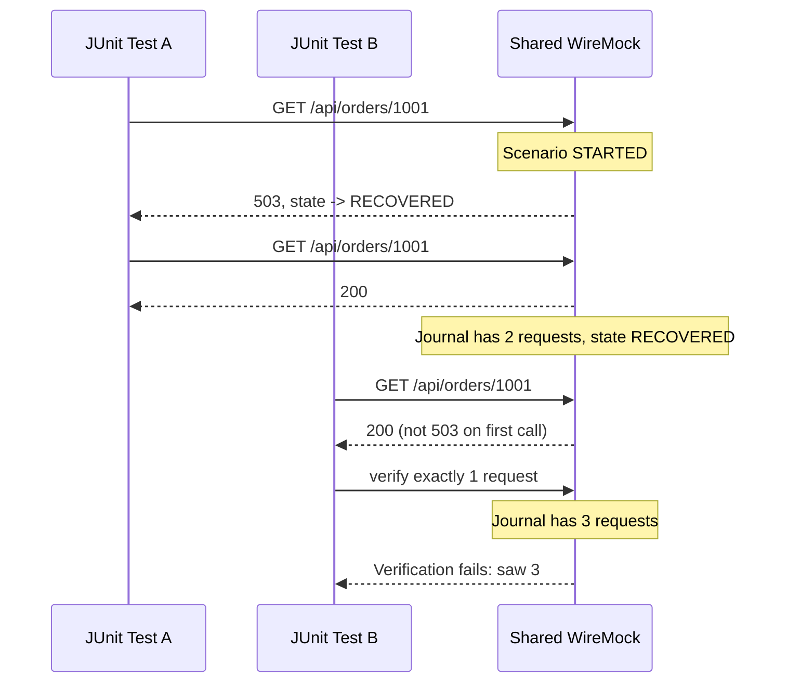
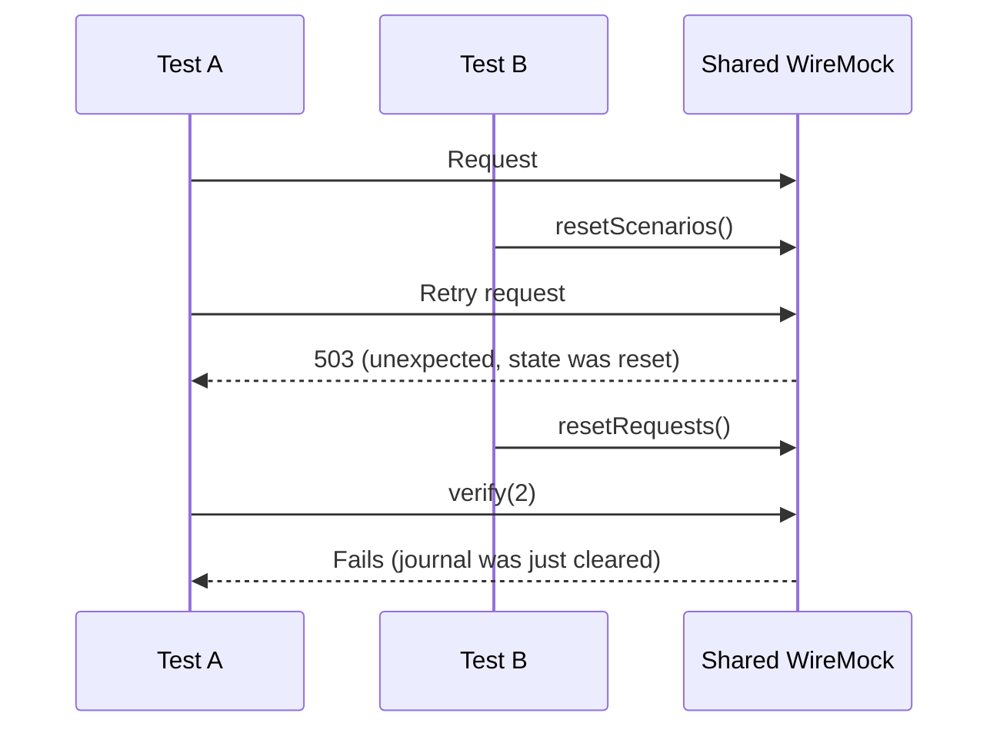

# Scenarios or Request Journal Causing Cross-Test Interference in Spring Cloud Contract

**Spring Cloud Contract (SCC)** lets producers describe HTTP or messaging interfaces with Groovy/YAML DSL, generate producer-side tests, package stubs, and use **Stub Runner** so consumers can verify compatibility. For HTTP contracts, Stub Runner normally launches **WireMock** to serve mappings matching incoming consumer requests.

A frustrating diagnostic bug appears when **each test passes in isolation, yet fails when running the full suite, reordering tests, or running in parallel**. For example: test A expects `503` on the first call and `200` on the second; after test A finishes, test B also expects `503` first yet receives `200`. In another case, test B verifies `GET /api/orders/1001` was called exactly once, yet WireMock reports three calls even though test B sent only one request.

Two root causes often lumped together are **WireMock scenario state** and the **request journal**. Both live inside the runtime stub server, yet serve different roles:

- **Scenario state** can **change which mapping applies**, directly altering responses.
- **Request journal** by default **records received requests** for inspection and call-count verification; it does not alter responses merely because more requests arrived, though leftover history breaks count assertions or muddies analysis. If a custom extension reads the journal to choose responses, that is custom behavior requiring separate testing.

This lesson belongs to the **Troubleshooting** chapter, covering **Scenarios or request journal causing cross-test interference**, focusing on reproduction, root-cause identification, state isolation, scoped resets, and designing safe HTTP/messaging tests across JUnit, Spring Test, Stub Runner, and CI.

## 1. Learning Objectives

After this lesson, you will be able to:

1. Distinguish **mapping definitions**, **scenario state**, **request journal**, and **client/application state**.
2. Explain why WireMock tests can become order-dependent even when source contracts do not change.
3. Reproduce a `503 → 200` failure caused by unreset scenario state.
4. Reproduce a `verify(1, ...)` failure caused by a request journal retaining prior tests' requests.
5. Apply `resetScenarios()`, `resetRequests()`, `resetAll()`, or fresh servers per required isolation level.
6. Know when **not to call `resetAll`** because it can wipe mappings registered by Stub Runner.
7. Diagnose unmatched requests, mapping priority, and scenario collisions without mistaking them for producer contract bugs.
8. Isolate tests under Spring context caching and parallel CI execution.
9. Capture enough evidence to separate state leakage, stale artifacts, and real breaking changes.
10. Turn a discovered flaky bug into a deterministic regression test.

## 2. WireMock State Model: Four Distinct Stores

A WireMock server maintains components with separate lifecycles:

| Component | What It Holds | Can Affect Responses? | Typical Cross-Test Leakage |
| --- | --- | --- | --- |
| Mapping definitions | Request matchers, responses, priority, scenario constraints | Yes | Stale/overlapping mappings shadow intended ones |
| Scenario state | Scenario name and current state like `STARTED`, `RECOVERED` | **Yes** | Subsequent test starts in leftover state |
| Request journal | Request/serve event history, unmatched details | By default **does not choose responses** | `verify(n)` counts prior tests' requests; noisy logs |
| Client/application state | Retry counters, cookie jars, caches, sessions, DB/mock state | Yes, per app logic | Client sends different requests or sees altered inputs |

Inspect these four **separately** rather than calling everything “WireMock cache.”

### 2.1. Lifecycle of Each State

- **Mappings:** registered from stubs JARs, JSON files, or Java DSL; one test editing/adding mappings affects others sharing that server.
- **Scenarios:** when mappings specify `inScenario(...)`, `whenScenarioStateIs(...)`, and `willSetStateTo(...)`, the server tracks state per scenario name within that **instance**.
- **Journal:** records served or unmatched requests whenever journaling is enabled.
- **Consumer application:** may retain access tokens, base URLs, DNS, HTTP connection pools, retry state, or circuit breakers across tests.

**Resetting the request journal does not reset scenario state. Resetting scenario state does not clear the request journal.** This is the single most important diagnostic insight in this lesson.

## 3. Signature Symptoms and Initial Hypotheses

| Symptom | Priority Hypothesis | Quick Verification |
| --- | --- | --- |
| Test expects 503 first, receives 200 | Scenario stuck in `RECOVERED` | Inspect `/__admin/scenarios` |
| Test expects 1 request, verify sees 3 | Request journal not reset | Inspect `/__admin/requests` |
| Passes alone, fails in suite | Shared WireMock instance or Spring context | Log server URL/port and lifecycle |
| Other tests get 404 after reset | `resetAll` cleared mappings | Inspect `/__admin/mappings` |
| Parallel runs return erratic responses | Another test resets or advances shared scenario/server | Identify server ownership and parallel groups |
| Retry test makes fewer than 2 calls | Client retry policy or scenario transition | Inspect request journal timeline and states |
| 404 despite having a 404 contract | May be WireMock unmatched 404 | Inspect matched mapping/near misses |
| Passes locally, fails in CI | Reused process/context, cache, port race, test order | Check JUnit/runner parallelism and artifact version |
| Request count grows after test finishes | Async/retry/background task still running | Stop background source and await deterministic completion |
| Scenario stays “weird” after reset | Another mapping shares scenario name or custom extension | Inspect all mappings/registrations |

These hypotheses are **starting points**, not final diagnoses. Receiving 200 instead of 503 can also stem from mapping priority, a different request URL, Stub Runner loading the wrong artifact, or another mock server listening on an old port.

## 4. WireMock Scenarios: Responses Depend on Mapping-Match History

WireMock supports stateful service simulation via **scenarios**. A scenario typically starts at Java API constant `STARTED` (shown in Admin APIs as `Started` depending on representation/version).

Example order API with a retryable failure:

```text
Scenario: order-api-retry

Initial state: STARTED
  GET /api/orders/1001
    -> HTTP 503
    -> transition state to RECOVERED

State RECOVERED
  GET /api/orders/1001
    -> HTTP 200 {"id":1001,"status":"CREATED"}
```

This is a **stub model for testing retries**. It does not prove the production producer recovers after one retry, nor does it verify SLAs or real network failures.

### 4.1. WireMock Java DSL Creating a Scenario

```java
import static com.github.tomakehurst.wiremock.client.WireMock.*;
import static com.github.tomakehurst.wiremock.stubbing.Scenario.STARTED;

wireMockServer.stubFor(
    get(urlEqualTo("/api/orders/1001"))
        .inScenario("order-api-retry")
        .whenScenarioStateIs(STARTED)
        .willSetStateTo("RECOVERED")
        .willReturn(aResponse()
            .withStatus(503)
            .withHeader("Content-Type", "application/json")
            .withBody("{\"code\":\"TEMPORARY_UNAVAILABLE\"}"))
);

wireMockServer.stubFor(
    get(urlEqualTo("/api/orders/1001"))
        .inScenario("order-api-retry")
        .whenScenarioStateIs("RECOVERED")
        .willReturn(okJson(
            "{\"id\":1001,\"status\":\"CREATED\"}"
        ))
);
```

This is a **stub registration snippet for an already-started `WireMockServer`**, not a complete JUnit class. Method names and imports must match your project's WireMock version.

**Important:** state transitions only when a request **matches a mapping configured with a state transition**. Seeing a request in the journal alone does not transition state if the request failed to match that mapping.

### 4.2. Shared Scenario Names Within the Same Server

If two different mappings both declare:

```text
.inScenario("order-api-retry")
```

they share **one state machine inside that WireMock instance**—there is no automatic per-test-method state. Once one test transitions to `RECOVERED`, any other test using the same instance and scenario name sees the effect.

Namespacing scenario names by use case, such as `checkout-order-retry` and `billing-order-retry`, reduces collisions across mappings. However, **renaming does not replace resetting or isolating servers** when tests intentionally exercise the same scenario.

## 5. Request Journal: History Log, Not a State Machine

The request journal supplies data to verify requests and diagnose mismatches:

- Request method, URL, query, headers, and body.
- Serve outcome and matched mapping per API/version.
- Matched and unmatched requests.
- Call counts for `verify(...)`.
- Timeline for analyzing retries, timeouts, and unexpected calls.

With the default journal, two tests sharing a server behave as:

```text
Test A:
  GET /api/orders/1001 -> records journal entry #1

Test B:
  GET /api/orders/1001 -> records journal entry #2

Test B:
  verify(1, GET /api/orders/1001) -> FAILS
  Because the journal now contains 2 matching requests.
```

**The journal does not cause the second request to receive a different response than the first.** It only causes `verify(1)`, “zero interactions,” near-miss diagnostics, or history-based reports **to see prior tests' traffic**.

### 5.1. When the Journal Can Indirectly Affect Behavior

If a project writes a custom WireMock extension or test helper that counts journal requests to vary responses, the journal participates in custom logic. However, that is **not a built-in replacement for scenarios**; such extensions must be tested and their backing state reset properly.

To model `503 → 200`, prefer **explicit scenarios** or a stateful test component with a defined lifecycle rather than implicitly counting journal rows.

### 5.2. Why Can the Journal Also Cause Resource Issues?

A long-lived shared server running many tests/retries and retaining unbounded requests can grow memory usage or slow down diagnostics. You can limit or disable the journal depending on WireMock version, yet **disabling the journal breaks history-based `verify` checks**.

Never “fix” a `verify(1)` failure by disabling the journal and dropping a critical assertion. Isolate or reset at the right boundary instead.

## 6. Sequence Diagram of Cross-Test Interference



Here **two separate bugs occur together with different causes**:

1. Wrong response due to **unreset scenario state**.
2. Wrong request count due to **unreset request journal**.

Calling `resetRequests()` alone fixes the second bug **without returning state to `STARTED`**. Calling `resetScenarios()` alone resets the scenario **without clearing the three recorded requests**.

## 7. Anti-Pattern: Tests Accidentally Depending on Execution Order

A fragile suite:

```java
// Illustrative anti-pattern: tests share a server with no reset.
@Test
void firstCallReturns503() throws Exception {
    assertEquals(503, sendGet().statusCode());
}

@Test
void nextCallReturns200() throws Exception {
    assertEquals(200, sendGet().statusCode());
}
```

Problem: standard JUnit **does not guarantee** two tests execute in method-name order. Every test method should establish its own starting state rather than relying on leftover state from another method.

Adding `@TestMethodOrder` can force ordering, yet that merely **masks the dependency**. It fails as soon as another test class, a different runner, or a single-test rerun executes.

### 7.1. Right Pattern: Keep One Retry Scenario Self-Contained in One Test

Instead of splitting 503 and 200 across two dependent tests, keep related steps inside **one self-contained test**:

```text
Given: scenario STARTED

When: consumer calls order API and retries per policy
Then: attempt 1 receives 503, attempt 2 receives 200
And: consumer completes the use case
And: WireMock receives exact request count per policy

Cleanup: stop/reset server per test ownership
```

If a suite must test both states separately, each test must **explicitly establish its scenario state** or use a fresh server, never depending on a previous test's outcome.

## 8. JUnit 5 Example: One Dedicated `WireMockServer` Per Test

A clean isolation pattern starts the server in `@BeforeEach` and stops it in `@AfterEach`.

```java
import static com.github.tomakehurst.wiremock.client.WireMock.*;
import static com.github.tomakehurst.wiremock.core.WireMockConfiguration.options;
import static com.github.tomakehurst.wiremock.stubbing.Scenario.STARTED;
import static org.junit.jupiter.api.Assertions.assertEquals;

import com.github.tomakehurst.wiremock.WireMockServer;
import java.net.URI;
import java.net.http.HttpClient;
import java.net.http.HttpRequest;
import java.net.http.HttpResponse;
import org.junit.jupiter.api.AfterEach;
import org.junit.jupiter.api.BeforeEach;
import org.junit.jupiter.api.Test;

class OrderRetryStubIsolationTest {

    private WireMockServer wireMock;
    private HttpClient http;

    @BeforeEach
    void startAndRegister() {
        wireMock = new WireMockServer(options().dynamicPort());
        wireMock.start();
        http = HttpClient.newHttpClient();

        wireMock.stubFor(
            get(urlEqualTo("/api/orders/1001"))
                .inScenario("order-api-retry")
                .whenScenarioStateIs(STARTED)
                .willSetStateTo("RECOVERED")
                .willReturn(aResponse().withStatus(503))
        );

        wireMock.stubFor(
            get(urlEqualTo("/api/orders/1001"))
                .inScenario("order-api-retry")
                .whenScenarioStateIs("RECOVERED")
                .willReturn(okJson(
                    "{\"id\":1001,\"status\":\"CREATED\"}"
                ))
        );
    }

    @AfterEach
    void stopServer() {
        if (wireMock != null) {
            wireMock.stop();
        }
    }

    private int getStatus() throws Exception {
        HttpRequest request = HttpRequest.newBuilder(
                URI.create(
                    "http://localhost:" + wireMock.port()
                    + "/api/orders/1001"
                ))
            .GET()
            .build();
        return http.send(
            request,
            HttpResponse.BodyHandlers.discarding()
        ).statusCode();
    }

    @Test
    void firstAttemptFailsThenSecondSucceeds() throws Exception {
        assertEquals(503, getStatus());
        assertEquals(200, getStatus());
        wireMock.verify(
            2, getRequestedFor(urlEqualTo("/api/orders/1001"))
        );
    }

    @Test
    void anotherTestAlsoStartsFrom503() throws Exception {
        assertEquals(503, getStatus());
        wireMock.verify(
            1, getRequestedFor(urlEqualTo("/api/orders/1001"))
        );
    }
}
```

This is a **JUnit 5 example of WireMock behavior** using Java `HttpClient` and a WireMock version with matching APIs. Every test gets a **fresh instance, port, mappings, scenario state, and journal**, eliminating order dependence.

**Important limitation:** the example calls WireMock directly to demonstrate isolation; it **does not test production `OrderClient` retries**. Real integration/consumer tests must invoke the real client/use case, let retries occur naturally, and assert outcomes/side effects.

### 8.1. Why Do Dynamic Ports Matter?

If multiple test classes try to bind WireMock on `8085` at once, one server fails to bind or clients hit the wrong stale instance. `dynamicPort()` picks an available port at startup, provided **the client receives that actual port** before sending requests.

Never hard-code `static final String BASE_URL="http://localhost:8085"` when servers use dynamic ports. Pass the URL via test config to the real client.

## 9. Shared Server: Reset Scenarios and Journal at the Right Scope

In some suites, starting a server per test is too expensive. A **shared server** can work if tests run sequentially and each test restores state before executing.

Example with a `WireMockServer` owned by the test suite itself:

```java
@BeforeEach
void resetTransientState() {
    wireMockServer.resetScenarios();
    wireMockServer.resetRequests();
}
```

These two methods are **standard APIs on matching `WireMockServer` versions**; check your project's WireMock version.

Meaning:

- `resetScenarios()` returns scenarios to their initial state.
- `resetRequests()` clears request journal history.
- Neither call **is meant to delete registered mappings**.
- If test A added a custom mapping, these two calls **do not remove that mapping**. You still need a mapping-lifecycle policy.

### 9.1. Pick the Right Reset for the Leak Type

| Situation | Appropriate Action | What Remains Unfixed? |
| --- | --- | --- |
| Leftover `RECOVERED` state | `resetScenarios()` | Journal and mappings stay intact |
| `verify(1)` sees old requests | `resetRequests()` | Scenario state stays unchanged |
| Both leak | Call both methods | Extra dynamic mappings still remain |
| Test added temporary mappings | Remove/reset mappings per ownership or create new server | Other state must still be checked |
| Server ownership unclear | Isolate instance or context | Global reset can break other tests |
| Suite runs concurrently on same server | **Reset alone is insufficient** | Another test can hit during reset |

### 9.2. Reset Before or After Tests?

**Resetting in `@BeforeEach`** lets each test establish its preconditions even if a previous test crashed before cleanup. You can combine `@AfterEach` to clear sensitive data or free memory, yet never rely solely on a previous test's after-hook.

If a test verifies the journal after a request, **never reset between the call and `verify`**. Resets belong at clean boundaries—after all assertions of the previous test finish and before the next test starts.

### 9.3. A Shared Server Is Unsafe When Resetting Across Threads

Suppose test A just got 503 and is about to retry while test B calls `resetScenarios()`. Test A's second attempt gets 503 again because state was reset to `STARTED`. Meanwhile B calling `resetRequests()` erases the request A is about to verify.

**Shared server + per-method reset is safe only with no concurrent access to shared state**, or with proper isolation/serialization.

## 10. Be Careful with `resetAll()`: It Can Wipe Mappings

WireMock also offers broader reset calls, such as `resetAll()` or mapping resets depending on API version. They are not equivalent to `resetRequests()`.

In suites that re-register all mappings before every test, a full reset can make sense. However, in an environment where **Stub Runner already loaded mappings from a stubs JAR**, a full reset can alter or wipe those registered mappings; the very next test suddenly gets **404 unmatched**.

### 10.1. Ownership Rules

| Who Owns the Server / Mappings? | Safe Strategy |
| --- | --- |
| Test creates server and registers mappings itself | New server per test, or full reset then re-register |
| Shared fixture with fixed mappings | Reset state/journal, control any mapping edits |
| Stub Runner owns the WireMock instance | Avoid blind full resets; reset only transient state or isolate test context |
| Shared test server across multiple services | Never let one suite run a global reset while others use it |
| Remote stub server not owned by tests | Needs a separate lifecycle contract; never call admin reset |

**Do not use `resetAll()` as a default “fix flaky test” button** without knowing which mappings it wipes and how your WireMock version handles default mappings.

### 10.2. When Full Reset Is Needed, Re-Register Mappings

Pattern:

```text
Before each test:
  reset mappings + scenarios + journal
  register all required mappings
  configure client URL
  execute test
  verify results

After each test:
  release server or clean owned state
```

When mappings come from SCC/Stub Runner, let the **component owning mappings** reinitialize them through its lifecycle rather than deleting them in a test and guessing how to reload from the JAR.

## 11. Using the Admin API to Inspect Live State

When WireMock runs locally on `http://localhost:8085`, you can inspect state via the Admin API (when enabled and reachable in your test version/config):

```bash
# Active mappings
curl -s http://localhost:8085/__admin/mappings

# Active scenario states
curl -s http://localhost:8085/__admin/scenarios

# Request journal / serve events
curl -s http://localhost:8085/__admin/requests

# Unmatched requests
curl -s http://localhost:8085/__admin/requests/unmatched
```

These endpoints are **standard WireMock Admin API paths**, not `order-producer` endpoints. Verify version, permissions, and environment in real projects.

### 11.1. Triggering Targeted Resets via HTTP Admin API

Use only **on a WireMock test server you own**, never on a shared server:

```bash
# Reset scenario states back to initial
curl -X POST http://localhost:8085/__admin/scenarios/reset

# Clear recorded request history
curl -X DELETE http://localhost:8085/__admin/requests
```

Both operations must run **before a test with no other tests using the server concurrently**. On a Stub Runner instance holding JAR-loaded mappings, resetting scenarios/journal is far less invasive than a full reset, yet still affects any concurrent test.

### 11.2. Admin API and Security

The request journal can store `Authorization`, `Cookie`, `Set-Cookie`, emails, or sensitive payloads. Access the Admin API only inside controlled test environments, restrict access, **redact credentials when capturing logs**, and never post raw production-data request journals to public issue trackers or CI artifacts.

## 12. Case Study 1: Retry Test Receives 200 on Second Test Instead of 503

**Context:** consumer applies a retry policy when the producer transiently returns 503. WireMock mappings transition `STARTED → RECOVERED`.

**Failure trace:**

```text
Test A: shouldRetryOn503
  initial state = STARTED
  request #1 -> 503, state = RECOVERED
  request #2 -> 200
  PASS

Test B: shouldShowTemporaryErrorOnFirstCall
  test assumes initial state = STARTED
  request #1 -> 200 (because state stayed RECOVERED)
  FAIL: expected 503
```

### 12.1. How to Identify the Root Cause

1. Record the WireMock instance/port used by Test A and Test B.
2. Inspect the scenario name and state right before Test B runs.
3. Cross-check mappings: the 503 mapping matches only `STARTED`; the 200 mapping matches `RECOVERED`.
4. Check the request journal to see which test transitioned state.
5. Run B alone on a fresh server: if it gets 503, state leakage is confirmed.
6. Add scenario reset setup or per-test servers.
7. Rerun the full suite in reversed order and under your parallel policy.

### 12.2. Right Fixes vs. Wrong Fixes

**Right fix:** each test establishes its initial state via isolation/reset; if A and B hit a shared server concurrently, switch to dedicated servers or controlled serial execution.

**Wrong fix:** changing B's expectation to 200 just because A currently runs first; adding `Thread.sleep` “to wait for scenario reset”; or forcing test order without managing state.

## 13. Case Study 2: `verify(1)` Reports Three Requests

**Context:** a consumer test verifies the API is called only once.

```java
orderClient.getOrder("1001");

wireMockServer.verify(
    1,
    getRequestedFor(urlEqualTo("/api/orders/1001"))
);
```

If an earlier test sent two requests to that path, the journal still holds three matching requests. The assertion fails even though `orderClient.getOrder` in the current test ran only once.

### 13.1. Diagnosis

- Call `GET /__admin/requests` and filter by method/path.
- Compare timestamps and request headers/test correlation IDs if present.
- Check whether a retry interceptor actually sent multiple requests.
- Check whether a background job or health check hits the same endpoint.
- Check when the journal is reset.
- If the journal is disabled, confirm whether `verify` is even supported under that config.

**Do not jump to concluding the consumer has a retry bug** solely from `expected 1, got 3`. It could be journal leakage, or the consumer could genuinely be retrying three times. Separate them using log timelines and state from the current test.

### 13.2. Solution

With a dedicated server per test, a fresh journal is cleanest. With a sequential shared server, call `resetRequests()` **before executing the current test**, with no other test interleaving.

If a test counts requests across a multi-attempt retry use case, preserve the journal for that test's scope until `verify` completes.

### 13.3. Never Drop Call-Count Assertions That Protect Business Rules

For payments, order placement, or email sends, asserting “exactly one side effect” can be critical. Never “fix” `verify(1)` by changing it to `atLeast(1)` if business logic/contracts forbid duplicates. Fix isolation and re-verify the actual request count.

## 14. Spring Test Context Caching and Stub Runner Runtime Sharing

Spring Test can **cache `ApplicationContext`** across test classes with equivalent configuration. In many setups, Stub Runner/WireMock initializes within the context lifecycle or associated beans, causing tests to **inadvertently share a stub server** longer than a single test method.

Example:

```java
import org.springframework.boot.test.context.SpringBootTest;
import org.springframework.cloud.contract.stubrunner.spring.AutoConfigureStubRunner;
import org.springframework.cloud.contract.stubrunner.spring.StubRunnerProperties;

@SpringBootTest(properties = {
    "order.api.base-url=http://localhost:8085"
})
@AutoConfigureStubRunner(
    ids = "com.example:order-producer:1.4.0:stubs:8085",
    stubsMode = StubRunnerProperties.StubsMode.LOCAL
)
class OrderConsumerContractTest {
    // Real client calls Stub Runner.
}
```

This illustrates a **client calling a stub server**. It does not create a new `WireMockServer` per test; exact lifecycles depend on SCC/Spring Test versions and test configuration.

### 14.1. Questions to Check

1. Are two test classes sharing the same cached `ApplicationContext`?
2. Is Stub Runner managing one or multiple WireMock instances?
3. Are server URLs/ports identical across classes?
4. Is JUnit parallel execution enabled?
5. Do any tests call Admin API resets or register dynamic mappings?
6. Are scenario names shared across contracts/test suites?
7. Does each test establish state before calling the client?

### 14.2. `@DirtiesContext` Comes with a Cost

In certain cases, marking a Spring context “dirty” so it closes and rebuilds isolates Stub Runner's lifecycle:

```java
import org.springframework.test.annotation.DirtiesContext;

@DirtiesContext(
    classMode = DirtiesContext.ClassMode.AFTER_CLASS
)
class OrderConsumerContractTest {
    // Tests in this class are scoped to this context lifecycle.
}
```

**Do not treat `@DirtiesContext` as a blanket fix for every flaky test**: it slows suites by recreating contexts and **does not isolate an external/shared stub server outside the context**. If tests still share a standalone server, dirtying the context solves nothing.

### 14.3. Admin API Resets Must Respect Ownership

With WireMock managed by Stub Runner, tests can call the Admin API at the stub server URL if configuration permits; however, **never call a full reset and wipe SCC-loaded mappings**. If transient state/journal resets are needed, build a test fixture targeting the exact URL and invoke only targeted reset APIs.

## 15. Parallel Tests: Race Conditions Break Resets

A shared WireMock instance can be hit from multiple test threads simultaneously:



Here **both A and B may have written “correct” setup/teardown for sequential execution**, yet fail when run concurrently on the same server. Resets do not provide transaction isolation across tests.

### 15.1. Mitigation Approaches

| Approach | Strength | Trade-off |
| --- | --- | --- |
| Dedicated `WireMockServer`/dynamic port per test | Strong isolation of scenarios, journal, and mappings | Startup overhead |
| Dedicated server per test class | Lower overhead | Methods within the class still need resets |
| Dedicated server per serialized test group | Fewer servers | Reduces parallelism; all tests must share the lock |
| Distinct scenario names + distinct request matchers | Reduces collisions | Journal and resets remain shared |
| JUnit `@ResourceLock` on shared resource | Prevents tests sharing a lock from running concurrently | Must be applied consistently to **every involved test** |
| `@DirtiesContext` and context isolation | Isolates Stub Runner per Spring context | Costly; does not protect external shared servers |

### 15.2. JUnit Resource Lock Example

```java
import org.junit.jupiter.api.parallel.ResourceLock;
import org.junit.jupiter.api.parallel.ResourceAccessMode;

@ResourceLock(
    value = "shared-wiremock-order",
    mode = ResourceAccessMode.READ_WRITE
)
class OrderConsumerTest {
    // All test suites sharing WireMock must declare the same lock.
}
```

This is a **JUnit Jupiter mechanism** for tests sharing one JVM/test engine. It does not lock a WireMock server across **separate CI jobs or JVM processes**. For cross-process isolation, use separate servers/ports/repositories or higher-level resource orchestration.

### 15.3. `@Execution(SAME_THREAD)` Does Not Cover Every Class

`@Execution(SAME_THREAD)` constrains JUnit execution within a specific scope, yet does not automatically prevent another test class on another thread/process from calling the same shared WireMock server. Always verify the exact scope of your parallel settings.

## 16. Colliding Scenario Names Across Mappings and Test Suites

Scenario state is keyed by **scenario name inside the same server**. If both the Checkout team and Billing team name theirs `"retry"`, their mappings can interfere even on different URLs.

A cleaner naming convention:

```text
checkout:order-api:retry-503-once
billing:invoice-api:retry-503-once
notification:order-created:delivery-demo
```

However, **unique names do not replace resets**:

- The same test still reuses the same scenario name on its next run.
- Runtime mappings might be registered twice.
- An extension may hold state outside the scenario map.
- The request journal still accumulates all requests on the instance.

### 16.1. Read All Mappings When Debugging

Do not open only the JSON mapping for the failing contract. Check:

- How many mappings share the same method/path?
- Is there a generic catch-all mapping?
- Does `priority` cause another response to win?
- Which mappings share the same `scenarioName`?
- Do custom transformers or webhooks alter outputs?
- Were stub files from two versions loaded simultaneously?

**Lower priority numbers generally take higher precedence in WireMock.** A high-priority generic mapping can shadow a scenario-specific mapping, producing wrong responses that resetting state will never fix.

## 17. Unmatched 404 Is Not a Producer Contract 404

When a request matches no WireMock mapping, the server returns a **default 404**. That differs from an agreed contract specifying the producer returns:

```http
HTTP/1.1 404 Not Found
Content-Type: application/json

{"code":"ORDER_NOT_FOUND"}
```

If scenario state stayed in `RECOVERED` while only `STARTED` had a 503 mapping, or if path/headers mismatch, requests may not be served as expected. Investigate using the **request journal, unmatched requests, mappings, and scenario states** before changing consumer code.

### 17.1. 404 Diagnostic Table

| Observation | Likely Meaning |
| --- | --- |
| 404 with `ORDER_NOT_FOUND` body per agreed mapping | Contract domain error |
| WireMock default 404, unmatched request | No matching mapping found |
| 404 from hitting wrong port/base URL | Client missed the intended Stub Runner instance |
| 404 after `resetAll()` | Runtime mappings were wiped |
| 404 only in one scenario state | No mapping defined for the current state |
| 404 only when header is missing | Success mapping requires header; no error mapping exists |

**Never add a catch-all 200 mapping to “fix” a 404.** That lets contract-violating requests succeed, turning consumer tests into false greens.

## 18. Retries and the Real Client: Separate Stub Behavior from App Logic

The WireMock Java DSL `503 → 200` example only proves the stub can serve two sequential responses per scenario. A real consumer may:

- Retry at most twice.
- Retry only `GET`/idempotent operations.
- Apply exponential backoff.
- Skip retries on `401`/`403`.
- Honor `Retry-After` when in policy.
- Trigger a circuit breaker or timeout.
- Send modified headers on retries.
- Hit additional health-check or token-refresh endpoints.

### 18.1. What Must the Consumer Test Assert?

```text
Given:
  Stub scenario STARTED, empty journal
  OrderClient points to exact Stub Runner URL

When:
  CheckoutService calls OrderClient.getOrder("1001")

Then:
  CheckoutService receives valid DTO
  WireMock records exact GET count per retry policy
  No duplicate business side effects occur
  No extra requests reach production endpoints

Cleanup:
  Isolate state before the next test
```

Never test a standalone throwaway `HttpClient` and claim your application's Feign/WebClient/RestClient retry interceptor works.

### 18.2. Async Retries Can Write to the Journal After Assertions

A consumer with background retries or scheduled tasks can keep sending requests just as a test method finishes. The next test resets the journal, and the lingering background task writes into it anyway.

**Await deterministic business completion and shut down executors/schedulers per lifecycle**, rather than sprinkling `Thread.sleep(200)`. When using Awaitility or bounded polling, ensure final assertions reflect settled state with no cleanup race.

## 19. Spring Cloud Contract: Source Contracts vs. Scenario Stubs

A simple HTTP contract:

```groovy
import org.springframework.cloud.contract.spec.Contract

Contract.make {
    description 'Successfully read order 1001'

    request {
        method GET()
        url '/api/orders/1001'
        headers {
            header('Accept', 'application/json')
        }
    }

    response {
        status OK()
        headers {
            contentType(applicationJson())
        }
        body(
            id: 1001,
            status: 'CREATED',
            currency: 'VND'
        )
    }
}
```

Equivalent YAML:

```yaml
description: "Successfully read order 1001"
request:
  method: GET
  url: /api/orders/1001
  headers:
    Accept: application/json
response:
  status: 200
  headers:
    Content-Type: application/json
  body:
    id: 1001
    status: CREATED
    currency: VND
```

Both examples describe the **same scenario**, so in a real build choose one DSL to avoid duplicate generated tests/mappings.

### 19.1. Contract DSL Does Not Auto-Create `503 → 200` Inside a Stateless Stub

The contract above describes one `200` response. Modeling an initial `503` followed by `200` requires **WireMock scenario mappings or a tool-supported stateful mechanism**, plus confirming those mappings actually reach the test server.

Do not assume having two separate contracts for the same `GET /api/orders/1001` returning `503` and `200` makes WireMock alternate between them automatically. With identical request predicates, they **overlap** and resolve by priority/registration behavior.

### 19.2. How Are Scenario Mappings Packaged?

Projects vary in approach:

- Tests register WireMock scenario mappings directly via Java DSL.
- Separate JSON mappings live in WireMock fixtures.
- A custom build step packages scenario JSON into the stub artifact.
- Stub Runner loads mappings from the stubs JAR per plugin/version layout.

**Never claim SCC DSL automatically turns every contract pair into WireMock scenarios.** Inspect the **actual JAR** to verify scenario JSON/mappings were packaged; if mappings sit only in `src/test` without entering the artifact, consumer Stub Runner cannot load them.

## 20. Check the Stubs JAR and Version to Avoid Misdiagnosis

A suspected state-leakage test might actually be loading a **different stub artifact** than the one just updated.

Consumer example:

```java
import org.springframework.boot.test.context.SpringBootTest;
import org.springframework.cloud.contract.stubrunner.spring.AutoConfigureStubRunner;
import org.springframework.cloud.contract.stubrunner.spring.StubRunnerProperties;

@SpringBootTest(properties = {
    "order.api.base-url=http://localhost:8085"
})
@AutoConfigureStubRunner(
    ids = "com.example:order-producer:1.4.0:stubs:8085",
    stubsMode = StubRunnerProperties.StubsMode.LOCAL
)
class CheckoutConsumerContractTest {
    // Calls real OrderClient and asserts outcomes.
}
```

If the producer PR built candidate `1.5.0-rc.1` while the test still pins `1.4.0`, resetting scenarios/journal cannot fix a **version mismatch**. Verify:

1. Does `ids` select the right group/artifact/version/classifier?
2. Does the `LOCAL` repo hold the candidate's stubs JAR?
3. Does `REMOTE` mode have the right `repositoryRoot` and credentials?
4. Does the JAR contain the new mappings/scenario JSON?
5. Does the SHA-256 of the downloaded JAR match the producer manifest?
6. Is the live Stub Runner server actually using the right port/base URL?

### 20.1. Artifact and Server Instance Are Two Separate Identities

```text
Artifact identity:
  com.example:order-producer:1.5.0-rc.1:jar:stubs
  repository + SHA-256

Runtime identity:
  WireMock server instance
  host/port
  context/job ID
  mappings loaded
  scenario states
  journal entries
```

Two tests can use the **same artifact** on **different servers** and stay completely isolated. Conversely, two tests expecting different artifacts can accidentally hit the **same old server** if base URL/port were not updated.

## 21. The Request Journal Is Not a Broker or Database Log

For messaging contracts, SCC can emit sample events via Stub Runner/`StubTrigger`. However, WireMock's HTTP request journal **does not capture**:

- Kafka offsets/partition commits.
- RabbitMQ ack/nack or redeliveries.
- DLQ/DLT records.
- Database transaction commits.
- Outbox dispatcher retries.
- Listener side effects.

If two messaging tests interfere with each other, inspect **broker topic/queue state, consumer group IDs, test binders, listener concurrency, idempotency stores, and DB fixtures**, not just WireMock's journal.

### 21.1. A Message Contract Scenario

```groovy
import org.springframework.cloud.contract.spec.Contract

Contract.make {
    description 'OrderCreated v1 is emitted after order creation'
    label 'order_created_v1'

    input {
        triggeredBy('publishOrderCreated()')
    }

    outputMessage {
        sentTo('orders.created')
        headers {
            messagingContentType(applicationJson())
        }
        body(
            eventId: 'EVT-1001',
            eventType: 'OrderCreated',
            schemaVersion: 1,
            orderId: 'ORD-1001'
        )
    }
}
```

If listener tests reuse the same `eventId` across runs against a real idempotency store, later tests may discard the message as a duplicate. That is **consumer/database state**, not a WireMock scenario.

### 21.2. How to Isolate Messaging Tests

- Unique test topic/queue/group IDs where needed.
- Safe broker/container state resets.
- Distinct event IDs per test or idempotency store resets.
- Await handler completion before cleanup.
- Prevent prior test background listeners from consuming subsequent test messages.
- Verify `StubTrigger` labels and payloads match the candidate artifact.

Never treat a passing message stub test as complete proof of broker delivery semantics.

## 22. Choose an Isolation Strategy by Cost and Safety

| Environment | Preferred Strategy | When to Increase Isolation? |
| --- | --- | --- |
| Small WireMock unit test | Fresh server per test, dynamic port | When startup gets costly and needs tuning |
| Single-class HTTP consumer test | Reset scenarios/journal before test if sequential and mappings fixed | When tests add mappings or have async calls |
| Multiple test classes sharing Spring context | Grouped or isolated contexts, coordinated resets | When context caching leaks state |
| Parallel CI across multiple JVMs | Fresh server per job/process | When shared remote stub server causes races |
| Stub Runner with stubs JAR | Keep runner-owned mappings, controlled state resets | When complex custom scenario mappings are needed |
| Full E2E environment | Dedicated namespaces/resources, owned teardown | When teams share brokers/DBs |
| Temporary troubleshooting | Run alone, reverse order, disable parallel to prove hypothesis | Once confirmed, implement permanent isolation |

### 22.1. When Are Resets Not Enough?

Resets do not fix:

- Background requests arriving after reset.
- Client-side circuit breaker/retry state.
- Consumer-side cookie/session caches.
- Persistent database or broker state.
- Shared port pointing to another server.
- Overlapping mappings or wrong priorities.
- Stale artifact JAR versions.
- Custom extensions holding private static state.

If resetting twice still fails, **do not add more sleeps or infinite reset loops**. Identify the true state owner and isolate or manage its lifecycle properly.

## 23. Step-by-Step Diagnostic Procedure

When a suite flakes, follow this sequence:

```text
1. Record test name, seed/parallel config, ordering, and CI job.
2. Identify the exact WireMock host/port/instance of the failing test.
3. Record Stub Runner GAV/classifier/version and source repository.
4. Inspect which mapping matched, its priority, and scenarioName.
5. Check scenario state before and after the request.
6. Check request journal before the test: how many entries already exist?
7. Run the failing test alone with a fresh server/context.
8. Run pairs A -> B and B -> A to reproduce leakage.
9. Test resetScenarios alone, then resetRequests alone.
10. Inspect response codes and matched/unmatched journal events.
11. Check async retries, client caches, and shared Spring contexts.
12. Check JUnit parallelism, resource locks, and ports.
13. Apply scoped resets or server-per-test isolation.
14. Rerun the suite with randomized ordering and your parallel policy.
15. Keep the regression test, fixture ownership, and evidence.
```

### 23.1. Root-Cause Analysis Table

| Evidence | Priority Conclusion | Fix Direction |
| --- | --- | --- |
| State before B is `RECOVERED`; B passes only on fresh server | Scenario leakage | Reset scenarios/fresh server |
| Journal before B has 2 GETs; verify expects 1 GET | Journal leakage | Reset requests/fresh server |
| State `STARTED`, journal empty yet wrong response | Mapping/priority/client URL | Check full mappings and target |
| Fails only under parallel execution | Shared server/reset race | Isolate or serialize on resource |
| Fails only when CI reuses context | Context lifecycle and static state | Rescope Spring context/server |
| Request missing `Accept` or wrong path | Consumer client/request mismatch | Fix client/contract, not reset |
| Stubs JAR lacks scenario JSON | Packaging/configuration | Package mapping into artifact properly |
| Consumer downloads old version | Artifact resolution | Pin right candidate, check checksum |
| Fails after async retry | Background retry still running | Await/stop task and clean up |
| Duplicate message ignored | Idempotency store/broker | Reset state outside WireMock |

## 24. CI: Turn Cross-Test Interference into a Regression Test

A reliable CI gate should:

1. Execute real generated producer tests, not only generate sources.
2. Verify discovered contract/test counts; reject unexpected 0-test runs.
3. Run consumer tests against exact candidate stubs JARs, avoiding dynamic versions.
4. Use unique/dynamic server ports when running in parallel.
5. Avoid shared mutable WireMock state across CI jobs.
6. Test a subset in both orders `A → B` and `B → A`.
7. When investigating flakiness, rerun with identical inputs/versions to separate races from artifact drift.
8. Retain test reports and **redacted** matched/unmatched request diagnostics.
9. Record WireMock version, scenario names, and before/after states when available.
10. Record Stub Runner `ids`, repository, and artifact SHA-256.
11. Block releases when required consumer/producer tests fail rather than “retrying until green.”
12. Keep a negative regression case after fixing so the bug stays fixed.

### 24.1. Test Order Reversal Without Enforcing Order as a Fix

A properly isolated test must satisfy:

```text
Run A alone: PASS
Run B alone: PASS
Run A then B: PASS
Run B then A: PASS
Run A and B concurrently (if suite allows): PASS
```

If policy intentionally disables parallelism for a shared resource, document it explicitly as a **test infrastructure constraint** rather than hiding behind one fixed order forever.

### 24.2. Evidence to Retain After Failures

| Evidence | Purpose |
| --- | --- |
| Test class/method and JUnit report | Identify failing case and actual counts |
| Scenario name/state | Diagnose state leakage |
| Journal entry count by request pattern | Separate stale history from real retries |
| Matched mapping ID/name | Check priority/overlap |
| URL/port/server lifecycle | Catch hitting the wrong stub instance |
| Stub Runner GAV/classifier | Confirm exact contract artifact |
| Stubs JAR SHA-256 | Detect caching/overwrites |
| Retry client config and timeline | Identify background requests |
| Spring context cache/parallel settings | Detect shared state |
| Sanitized logs | Investigate without leaking tokens/PII |

**Never upload raw bearer tokens, cookies, or real customer data into request journal artifacts.**

## 25. Practice Exercise: Intentionally Create and Fix Both Leakage Types

Set up a test project with JUnit Jupiter, WireMock, a Java HTTP client, and (if available) Spring Cloud Contract/Stub Runner. Use synthetic JSON fixtures, never production credentials.

1. **Create a shared server:** start `WireMockServer` on a dynamic port in `@BeforeAll`.
2. **Register a scenario:** first `GET /api/orders/1001` returns 503 and transitions to `RECOVERED`; subsequent requests return 200.
3. **Reproduce state leak:** write test A making two calls; test B expecting 503 on its first call without resetting scenarios.
4. **Run A → B:** inspect before/after state via Admin API or direct server API.
5. **Run B alone:** compare outcomes to prove test B depends on external state.
6. **Reset scenarios:** add `resetScenarios()` in setup; rerun both orders.
7. **Reproduce journal leak:** have test A send two GETs, then test B send one GET and call `verify(1)`.
8. **Reset journal only:** add `resetRequests()`; verify count passes while scenario state remains unreset unless reset separately.
9. **Reset both:** add both calls to `@BeforeEach` and ensure tests do not run concurrently against the shared server.
10. **Test full reset:** in a disposable project, call `resetAll()` and observe whether mappings vanish; re-register mappings per your version.
11. **Switch to server-per-test:** use `@BeforeEach`/`@AfterEach` and `dynamicPort()` per section 8.
12. **Compare speed vs. isolation:** record startup cost and stability, choosing the right strategy for your suite.
13. **Run in parallel:** deliberately run two tests against the shared server to reproduce the race if your setup allows.
14. **Try `@ResourceLock`:** apply a shared lock name across all tests using that shared instance in the same JVM.
15. **Mapping overlap:** add a high-priority catch-all GET mapping and observe wrong responses even after scenario resets.
16. **Unmatched 404:** send a request missing a header or with a wrong path; separate WireMock 404 from contract 404.
17. **Request journal:** record timelines for two retry requests, inspect matched mappings, and redact headers.
18. **Spring Test caching:** create two test classes with similar `@AutoConfigureStubRunner` configs; determine whether they share a runtime.
19. **Candidate artifact:** if using SCC, build the stubs JAR, inspect mappings with `jar tf`, and pin classifier `stubs`.
20. **Real consumer test:** call `OrderClient` and assert retry/error handling rather than only calling a raw `HttpClient`.
21. **Messaging experiment:** send two `OrderCreated` events with the same `eventId` to a test listener and identify idempotency state outside WireMock.
22. **CI regression:** run the suite in multiple orders, keep state/journal reports, and block passes on 0-test runs.
23. **Summary:** write a runbook distinguishing scenario state, journal, mappings, client state, and artifact versions.

### 25.1. Self-Assessment Rubric

| Competency | Proof of Mastery |
| --- | --- |
| Scenario state | Can explain how `STARTED → RECOVERED` alters responses |
| Request journal | Can explain how stale history skews verify counts |
| Reset distinction | Knows `resetScenarios` differs from `resetRequests` |
| Full reset caution | Does not blindly wipe Stub Runner-managed mappings |
| JUnit isolation | Tests pass in both orders and individually |
| Parallelism | Zero reset races on shared servers |
| Admin API | Can inspect scenarios, mappings, and requests |
| Stub Runner | Knows exact runtime and artifact version in use |
| Negative cases | Distinguishes unmatched 404 from error contracts |
| Retries | Tests real client and policy-compliant call counts |
| Messaging | Distinguishes WireMock journal from broker/DB state |
| CI | Keeps regression tests and sanitized evidence |

## 26. Conclusion: Reset the Right State, Never Corrupt the Contract

When a **Spring Cloud Contract + Stub Runner/WireMock** test fails intermittently, the first thing to verify is **which stateful component tests are sharing**:

- **Scenario state** governs which mapping can match at each stage of a flow. Leftover state turns a “first” call into a later-stage call.
- **Request journal** records history by default. It does not alter responses itself, yet can make `verify(1)` or retry checks count traffic from earlier tests.
- **Mappings** can be added, duplicated, wiped by a full reset, or shadowed by priority.
- **Clients, Spring contexts, brokers/DBs, and artifact versions** are separate state/drift sources that resetting WireMock will not solve.

The safest isolation strategy is **giving each test its own server and state**. When a shared server is needed for speed, enforce ownership, reset only the required transient state, prevent parallel races, and keep loaded mappings intact. With Stub Runner, always verify the **stubs JAR/classifier/version** the consumer actually loads.

**A trustworthy green test must be repeatable alone, under reordered runs, and under your declared concurrency model**, while preserving true producer and consumer commitments. Separating scenarios, the request journal, and external state lets teams fix cross-test interference cleanly without loosening matchers, changing expected statuses, or masking real API regressions.
