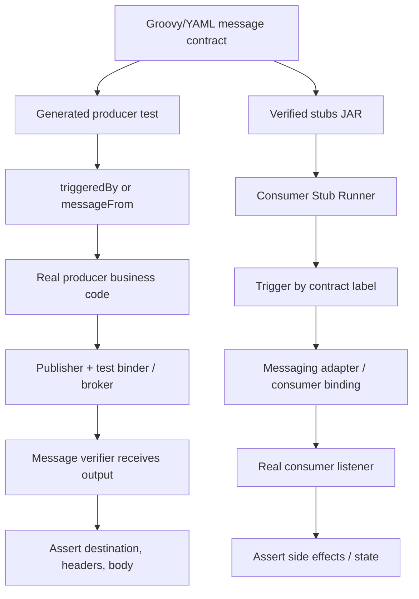
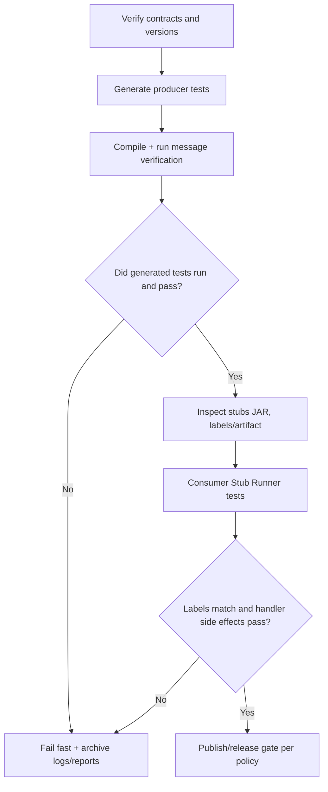

# Messaging Test Does Not Receive Messages or Waits Too Long

A producer contract test runs nearly to completion and stalls waiting to receive a message. A consumer test calls `StubTrigger.trigger("billing_order_paid_v1")`, yet Billing's listener never records the event. Sometimes the test passes locally and times out in CI. These symptoms all look like “**message not received**,” yet the root cause can sit in the **business trigger, Spring Cloud Contract message verifier, binder, destination, serializer, listener, broker, race condition, or async waiting strategy**.

In the **SPRING_CLOUD_CONTRACT** learning path, HTTP or messaging contracts are expressed with **Groovy/YAML DSL**; **Contract Verifier** generates producer tests, stubs are packaged/published, **Stub Runner** lets consumers test independently, and **CI** catches incompatible API/message changes. This lesson belongs to the **Troubleshooting** chapter and focuses on **Messaging test does not receive messages or waits too long**.

The goal is systematic troubleshooting—**never “fixing” by increasing timeouts indefinitely**. We will separate producer verification from consumer stub tests; locate where messages are lost between trigger and assertion; inspect destinations and Spring Cloud Stream bindings; spot JSON header/schema errors; design async tests with bounded deadlines and isolated data; and build CI evidence.

## 1. Distinguish the Two Test Directions Before Debugging

In Spring Cloud Contract messaging, a contract typically has an **input** (how to trigger) and an **outputMessage** (the expected message).

**Producer-side verification:**

- Generated tests call a business hook `triggeredBy(...)` **or** send an input message described by `messageFrom(...)`.
- The **real producer inside the test context** must process the action and emit output.
- The message verifier observes output at the contract destination.
- Tests assert the observed message's headers and body.

**Consumer-side Stub Runner:**

- The consumer downloads the producer's **stubs artifact**.
- Tests call `StubTrigger`/`StubFinder` with the **label** published in the contract.
- Stub Runner emits the **sample message** into the consumer's messaging environment.
- The **consumer's real listener/handler** receives and processes the message.
- Tests assert consumer handling outcomes, such as an invoice record.

**The two directions do not run the same code.** If producer tests observe no message, fix the hook/binder/producer. If consumer Stub Runner triggered yet the handler received nothing, fix stub resolution/label/routing/consumer. Generic advice like “try raising sleep to 30 seconds” hides configuration bugs.

### 1.1. Diagram of Both Paths



### 1.2. Ask Five Questions Immediately

1. **Is the test running on the producer or consumer side?**
2. **Where must the message travel from and to?** E.g., `orders.events`, `inventory.commands`.
3. **What is the trigger point?** A Java hook, input message, HTTP request, or Stub Runner label?
4. **At which layer was the event last observed?** Publisher log, output channel, broker, consumer listener, or database?
5. **At which layer did the timeout happen?** Generator, message receive, test assertion, broker startup, or consumer side effect?

Edit configuration only after answering these.

## 2. Symptom Matrix and Suspected Causes

| Symptom | High Probability | Check First |
|---|---|---|
| Generated producer test receives no output | Hook does not call publisher, wrong `sentTo`, verifier not attached to channel | Hook, message verifier, and binding |
| Test hangs before assertions start | Producer blocked on dependency/broker or deadlock | Thread dump, transactions, logs |
| Producer emits yet verifier times out | Observing wrong destination or message consumed elsewhere | Binding name/destination/consumer group |
| Stub Runner `trigger(label)` returns `false` | Missing label, wrong artifact, or route unregistered | `labels()` and stub GAV |
| Trigger returns `true`, consumer receives nothing | Stub sends to different destination, incompatible adapter/binder | Binding, subscriber, handler |
| Listener receives yet assertion times out | Side effect uncommitted, wrong test DB/key, swallowed exception | Logs, transaction, repository |
| Fails only under parallel runs | Another test consumes message or shared data collides | Test isolation and correlation |
| Fails only in CI | Slow broker startup, different profile/config, CPU, or cached artifact | Readiness, pinned versions |
| JSON body received yet parse fails | Content type, JSON shape, serializer, schema ID | Headers and payload bytes |
| Message arrives twice | Retry/redelivery or dual publishing | Ack, idempotency, test consumer group |
| Passes when raising timeout | Race/slow load; root cause may still exist | Per-stage timing breakdown |
| Message-only stubs lack HTTP mappings | Can be completely normal | Check contract/label; don't demand WireMock JSON |

**“Message not received” may actually mean “received yet failed to persist outcome.”** Place clear observation points at each hop to locate the first failing segment.

## 3. Running Case Study: Order Service and Billing Service

Suppose Order Service (producer) emits an event when an order is paid; Billing Service (consumer) consumes the event to create an invoice.

Expected contract:

```text
Producer:    order-service
Trigger:     markPaid("ORDER-42")
Destination: orders.events
Header:      eventType = ORDER_PAID
ContentType: application/json
Body:
  eventId    = EVT-42
  orderId    = ORDER-42
  totalAmount= 125000
Consumer:    billing-service
Side effect: invoice for ORDER-42 created exactly once
```

We need two independent pieces of evidence:

- **Producer verification:** Order Service genuinely emits an event matching the contract.
- **Consumer verification:** Billing genuinely processes the stub message per contract.

A green consumer Stub Runner test does not automatically prove the real producer emits the event. Conversely, a green producer test does not prove Billing subscribed to the right topic and deserialized cleanly.

### 3.1. IDs for Tracking Messages

Use deterministic synthetic data:

```json
{
  "eventId": "EVT-42",
  "eventType": "ORDER_PAID",
  "orderId": "ORDER-42",
  "totalAmount": 125000,
  "currency": "VND"
}
```

At each step, you can log synthetic **`eventId` and `orderId`** (never PII/tokens). When multiple messages flow, `eventId` distinguishes receiving the intended message from reading a stray event.

## 4. Groovy Message Contract: Producer Actively Emits an Event

Example file `src/test/resources/contracts/billing-service/order_paid_event.groovy`:

```groovy
import org.springframework.cloud.contract.spec.Contract

Contract.make {
    name 'billing_order_paid_event_v1'
    label 'billing_order_paid_v1'

    input {
        triggeredBy('publishOrderPaid()')
    }

    outputMessage {
        sentTo('orders.events')
        headers {
            header('contentType', 'application/json')
            header('eventType', 'ORDER_PAID')
        }
        body(
            eventId: 'EVT-42',
            eventType: 'ORDER_PAID',
            orderId: 'ORDER-42',
            totalAmount: 125000,
            currency: 'VND'
        )
    }
}
```

**Meaning of each part:**

- `name` identifies the scenario.
- `label` is the key letting consumer **Stub Runner** trigger the message stub.
- `triggeredBy('publishOrderPaid()')` tells the **generated producer test which hook to invoke**.
- `sentTo('orders.events')` is the destination the verifier observes.
- `headers` and `body` specify the data the producer must emit.

**A contract never emits messages by itself.** If the hook is missing, fails to call real business code, or the publisher is disabled, generated tests cannot receive an event simply because the Groovy file exists.

### 4.1. Equivalent YAML DSL — For Comparison, Do Not Duplicate Cases

```yaml
name: billing_order_paid_event_v1
label: billing_order_paid_v1
input:
  triggeredBy: publishOrderPaid()
outputMessage:
  sentTo: orders.events
  headers:
    contentType: application/json
    eventType: ORDER_PAID
  body:
    eventId: EVT-42
    eventType: ORDER_PAID
    orderId: ORDER-42
    totalAmount: 125000
    currency: VND
```

This is the **same scenario expressed in YAML for syntax comparison**. In a real project, pick **one of the two files** per test case to avoid duplicate contracts/tests/message stubs. Verify YAML syntax, headers, and generated adapters against your Spring Cloud Contract version.

## 5. Check Whether the `triggeredBy` Hook Executes Real Business Code

An illustrative base test:

```java
@SpringBootTest
@AutoConfigureMessageVerifier
public abstract class OrderMessagingContractBase {

    @Autowired
    OrderPaymentService orderPaymentService;

    @Autowired
    OrderContractFixture fixture;

    @BeforeEach
    void prepare() {
        fixture.resetTestData();
        fixture.insertUnpaidOrder("ORDER-42", 125000);
        fixture.clearCapturedMessages();
    }

    public void publishOrderPaid() {
        orderPaymentService.markPaid(
            "ORDER-42",
            "EVT-42"
        );
    }
}
```

This snippet needs **imports, test dependencies, fixtures, services, and a test binder/broker** provided by your project. `@AutoConfigureMessageVerifier` is the annotation recommended in Spring Cloud Contract docs for messaging verification base classes in supporting versions.

When the generated test calls `publishOrderPaid()`:

1. The fixture must create payable Order `ORDER-42`.
2. `OrderPaymentService.markPaid` executes business logic.
3. The producer adapter actually emits the message.
4. The message verifier receives output through the configured integration.
5. Assertions check the event against the contract.

### 5.1. Anti-Pattern: Hook Fabricates a Sample Message Directly

```java
// ANTI-PATTERN: does not verify the real publisher.
public void publishOrderPaid() {
    testOutputChannel.send(
        MessageBuilder.withPayload(
            "{\"eventType\":\"ORDER_PAID\",\"orderId\":\"ORDER-42\"}"
        ).build()
    );
}
```

This assumes a `testOutputChannel`; it is an **illustrative anti-pattern**, not complete code. If the test hook directly pushes a compliant message into the channel the verifier listens on, tests stay green even when producer business code never runs.

**Principle:** tests may **mock input data** and the **broker boundary**, yet must never replace the **output behavior** under verification.

### 5.2. Signs the Hook Is Not Working

- Generated Java test calls `publishOrderPaid()`, yet the compiler reports method not found.
- Hook runs with zero logs/call traces from `markPaid`.
- Hook passes the wrong order ID so business code exits early.
- Transaction has not committed, so `@TransactionalEventListener(phase = AFTER_COMMIT)` never fires.
- Publisher disabled by a profile or feature flag.
- Hook starts a `CompletableFuture` without awaiting completion per contract.
- Publisher bean unexpectedly replaced by a mock/`@Primary` fake.
- Real event emits to a different binding than `sentTo`.

**How to isolate:** set a breakpoint/spy/trace on the business method and publisher adapter; if they are never called, do not raise receive timeouts.

## 6. Transaction Pitfall: `AFTER_COMMIT` Events Never Arrive

A common pattern using Spring events and messaging:

```java
@Transactional
public void markPaid(String orderId) {
    Order order = repository.findById(orderId).orElseThrow();
    order.markPaid();
    repository.save(order);
    eventPublisher.publishEvent(
        new OrderPaidDomainEvent(orderId)
    );
}
```

In some setups, a listener publishes messages only after commit:

```java
@TransactionalEventListener(
    phase = TransactionPhase.AFTER_COMMIT
)
public void onOrderPaid(OrderPaidDomainEvent event) {
    publisher.publish(event);
}
```

If the test base marks all generated tests `@Transactional` and Spring TestContext **rolls back the transaction** at test end, `AFTER_COMMIT` events will not fire as expected.

### 6.1. Symptoms and Investigation

| Symptom | Question |
|---|---|
| Service method runs yet produces no output message | Did the transaction commit or roll back? |
| Integration test emits no message while production does | Is `@Transactional` on the test class/base? |
| Event arrives only after removing `@Transactional` | Does the listener use `AFTER_COMMIT`? |
| DB state visible in test yet listener doesn't run | Is test transaction separate from service transaction? |
| Message arrives after assertion timeout | When do commit and async event listener execute? |

**How to fix** depends on test goals. Let the business method own its transaction and commit against a **test database**, or design the test to control commit timing. Never blindly strip `@Transactional` everywhere; understand transaction boundaries and clean up test data afterward.

## 7. `messageFrom`: When the Producer Responds to an Input Message

Not every contract uses only `triggeredBy`. Some describe **input message → output message**, such as Inventory receiving a reserve command and emitting a result event.

Example:

```groovy
import org.springframework.cloud.contract.spec.Contract

Contract.make {
    name 'inventory_reserve_stock_success'

    input {
        messageFrom('inventory.commands')
        messageHeaders {
            header('contentType', 'application/json')
            header('commandType', 'RESERVE_STOCK')
        }
        messageBody(
            commandId: 'CMD-42',
            orderId: 'ORDER-42',
            sku: 'SKU-42',
            quantity: 2
        )
    }

    outputMessage {
        sentTo('inventory.events')
        headers {
            header('contentType', 'application/json')
            header('eventType', 'STOCK_RESERVED')
        }
        body(
            eventId: 'EVT-STOCK-42',
            commandId: 'CMD-42',
            orderId: 'ORDER-42',
            status: 'RESERVED'
        )
    }
}
```

This is an **architectural example**. In generated producer tests, the framework sends the input to the specified destination, the real producer handler processes it, and the verifier receives output. Support for `messageFrom`, `messageBody`, `messageHeaders`, and header/body translation depends on your plugin version's DSL and adapter.

### 7.1. Failures Specific to Input → Output

- `messageFrom` points to `inventory.commands`, while function input binding points to `orders.commands`.
- Input was sent, yet no subscriber/consumer group is listening.
- Body deserialization fails, so the handler is never invoked.
- `commandType` header misses router matching.
- Handler runs asynchronously while the output verifier listens on the wrong channel.
- Input and output share the same destination, causing tests to read back old inputs.
- Producer emits an error event to a dead-letter/error channel while the contract waits only for the success event.
- A competing consumer group grabs the input before the handler under test.

Do not inspect only the output. With this pattern, verify **input was delivered properly and the handler received it**.

## 8. `sentTo` Is Not Always a Bean/Channel Name

One of the biggest causes of message timeouts is misunderstanding destinations.

In Spring Cloud Contract, the meaning of `messageFrom` and `sentTo` **depends on the messaging integration**. For Spring Cloud Stream and Spring Integration, documentation describes resolving channel destinations first and falling back to channel names; for Camel/JMS, semantics differ. Never assume any arbitrary name resolves automatically.

### 8.1. Three Names to Distinguish in Spring Cloud Stream

Example `reserveStock` function:

```yaml
spring:
  cloud:
    function:
      definition: reserveStock
    stream:
      bindings:
        reserveStock-in-0:
          destination: inventory.commands
        reserveStock-out-0:
          destination: inventory.events
```

In this example:

- `reserveStock`: function bean name.
- `reserveStock-in-0`: **input binding name** under the functional model.
- `inventory.commands`: **external destination** for input.
- `reserveStock-out-0`: **output binding name**.
- `inventory.events`: **external destination** for output.

Do not swap `reserveStock-out-0`, `inventory.events`, and a RabbitMQ/Kafka queue name expecting the plugin to guess correctly across all adapters.

### 8.2. Common Mismatch Table

| Contract | Application Binding | Consequence |
|---|---|---|
| `sentTo('orders.events')` | `orderPaid-out-0.destination=orders.event` | Off by one character; verifier sees nothing |
| `sentTo('inventory.events')` | Output binding only has bean name `reserveStock-out-0` | Must verify how adapter resolves it |
| `messageFrom('inventory.commands')` | App only subscribes to `order.commands` | Input never reaches handler |
| Message puts `eventType` in header | Handler routes by `type` | Dispatcher ignores it |
| Consumer subscribes to `payments.events` | Stub Runner sends to `orders.events` | No message reaches consumer |
| Kafka key differs from expected | Handler filters by partition/key | Message lands on another partition/route |

**Principle:** write down **`contract destination → binding name → broker destination/queue/topic → handler method`** in a table before tuning timeouts.

## 9. Spring Cloud Stream Functional Model: Verify Bound Functions

A function:

```java
@Bean
Function<ReserveStockCommand, StockReservedEvent> reserveStock(
        StockService stockService) {
    return command -> stockService.reserve(command);
}
```

Input/output connect as expected only when Spring Cloud Stream is configured with the right function/bindings and binder.

### 9.1. Common Mistakes

- `spring.cloud.function.definition` does not match the bean name.
- Function bean exists yet is inactive because multiple function beans exist.
- Binding name misspelled `-in-0` or `-out-0`.
- Project uses legacy annotation-based code while copying newer functional binding configs.
- Using `Consumer<T>` with no default output while the contract expects an output.
- Code runs side effects, yet events emit from another bean/`StreamBridge` that is unconfigured.
- Input/outcome types incompatible with converters.
- Test profile overrides destination so producer and verifier watch different channels.

**Specifically:** a `Consumer<T>` bean consumes messages without emitting outputs. When a contract expects output, a corresponding publisher path must exist—merely adding `sentTo` to the DSL cannot conjure output.

## 10. Verify `@AutoConfigureMessageVerifier` and the Messaging Adapter

Spring Cloud Contract messaging docs require configuring a **message verifier** on the producer test base when using supported integrations.

A minimal base test:

```java
@SpringBootTest
@AutoConfigureMessageVerifier
public abstract class ProducerMessagingContractBase {

    @Autowired
    OrderPaymentService orderPaymentService;

    public void publishOrderPaid() {
        orderPaymentService.markPaid("ORDER-42", "EVT-42");
    }
}
```

Imports, test dependencies, fixtures, and a real messaging integration are required. Without `@AutoConfigureMessageVerifier`, or when the transport is unsupported/missing an adapter, generated tests may fail to send/receive even when contracts are valid.

### 10.1. Questions You Must Answer

1. Does the project use **Spring Cloud Stream**, **Spring Integration**, **Spring JMS**, **Spring AMQP**, or **Apache Camel**?
2. Does your plugin/version support the chosen integration?
3. Are multiple frameworks on the classpath causing auto-detection to pick the wrong route?
4. Are message verifier sender/receiver auto-configured or custom?
5. Does the test framework load the verifier's auto-configuration?
6. Is `sentTo` interpreted as a destination or channel name by the adapter?
7. Are a real producer channel and consumer subscriber active in the test context?
8. Which message type are serializers/deserializers using?
9. Is the test trying to connect to a real broker or an in-memory test binder?
10. Are there adapter logs/exceptions prior to receiver timeout?

**Do not randomly add dependencies “so the plugin sees messages.”** First confirm your framework and plugin version; multiple binders on the classpath can trigger unintended adapter selection.

### 10.2. Extension Interfaces for Custom Adapters

Spring Cloud Contract provides abstractions such as:

```java
org.springframework.cloud.contract.verifier.messaging.MessageVerifierSender
org.springframework.cloud.contract.verifier.messaging.MessageVerifierReceiver
```

They represent sending and receiving messages in producer verification. Implement a custom adapter only when built-in framework integrations fall short and your team understands the interface contract for your version. A custom receiver reading the wrong channel/correlation can time out forever even when the producer emits properly.

## 11. Test Binder vs. Real Broker: Different Verification Levels

Spring Cloud Stream provides a **test binder** to test applications without real Kafka/RabbitMQ. It works well for fast, deterministic producer contract tests, yet cannot prove every broker-specific behavior.

| Test Infrastructure | Strengths | Not Covered |
|---|---|---|
| Spring Cloud Stream test binder | In-memory, fast, minimal networking | Kafka partitions, real RabbitMQ routing/ACL/TLS |
| Spring Integration channel test | Easy send/receive control | Middleware durability and networking |
| Testcontainers Kafka | Closer to real Kafka | Still requires prod-aligned versions/config |
| Testcontainers RabbitMQ | Tests exchanges/queues/bindings/acks | Does not guarantee full prod topology |
| Shared dev broker | Real environment | Easily flaky, cross-team noise, stale state |
| Production broker | Unsuitable for regular tests | Risk of real data corruption/side effects |

### 11.1. Test Binder Dependencies Depend on the Release Train

In newer Spring Cloud Stream docs, the test binder typically uses artifact:

```xml
<dependency>
    <groupId>org.springframework.cloud</groupId>
    <artifactId>spring-cloud-stream-test-binder</artifactId>
    <scope>test</scope>
</dependency>
```

In some older Spring Cloud Contract/Stream lines, examples use the `test-binder` classifier on `spring-cloud-stream`. **Do not mix both styles from different version docs.** Pick the dependency and `TestChannelBinderConfiguration` setup matching your Boot/Cloud Stream release train.

### 11.2. Do Not Mix Test Binder and Broker Binder Carelessly

Spring Cloud Stream documentation notes that when the test binder is on the test classpath, it may be used for messaging tests instead of the real binder; combining both in one module/test may require dedicated setup. A test believed to exercise Kafka while actually running on an in-memory binder **does not verify Kafka connectivity**.

If you need both levels:

- Run **producer contract tests** through the test binder.
- Run a **separate Kafka/RabbitMQ integration suite** against the real binder/Testcontainers.
- Clearly document which suite tests contracts and which tests middleware.
- Never extrapolate test-binder passes to production ACLs, partitioning, or message redelivery.

## 12. Example Test Binder Check for Standalone Input → Output

Before blaming Contract Verifier, you can write a **Spring Cloud Stream integration test** to verify function/bindings work.

Illustrative example using Spring Cloud Stream test binder:

```java
@SpringBootTest
@Import(TestChannelBinderConfiguration.class)
class ReserveStockStreamTest {

    @Autowired
    InputDestination input;

    @Autowired
    OutputDestination output;

    @Test
    void emitsStockReserved() {
        byte[] command = (
            "{\"commandId\":\"CMD-42\"," +
            "\"orderId\":\"ORDER-42\"," +
            "\"sku\":\"SKU-42\",\"quantity\":2}"
        ).getBytes(StandardCharsets.UTF_8);

        input.send(
            MessageBuilder.withPayload(command)
                .setHeader(
                    MessageHeaders.CONTENT_TYPE,
                    MimeTypeUtils.APPLICATION_JSON
                )
                .build(),
            "reserveStock-in-0"
        );

        Message<byte[]> actual = output.receive(
            5000,
            "reserveStock-out-0"
        );

        assertThat(actual).isNotNull();
        String json = new String(
            actual.getPayload(),
            StandardCharsets.UTF_8
        );
        assertThat(json).contains("ORDER-42");
    }
}
```

**This is an illustrative skeleton, not a complete Java file**: full imports, the function bean, matching test-binder version, JSON conversion/schema, binding configs, and thorough assertions are required. `InputDestination.send(..., bindingName)` and `OutputDestination.receive(timeout, bindingName)` APIs can vary by version.

This test answers only **whether input/output bindings work**. It is **not a generated Spring Cloud Contract test**, and `contains("ORDER-42")` does not protect the full payload schema. Once the basic binder test passes, return to Contract DSL and the verifier adapter.

### 12.1. If `output.receive` Returns `null`

Check:

- Is the function definition bound?
- Does input name `reserveStock-in-0` exist?
- Is output binding really `reserveStock-out-0`?
- Did converting the body to `ReserveStockCommand` fail?
- Did `StockService.reserve` throw an exception?
- Does the function emit output directly or send asynchronously via another publisher?
- Was the test binder actually loaded?
- Did another test already drain the message from `output`?

Do not rush to increase `5000` to `60000` when the function is unconfigured.

## 13. Headers and `contentType` Causing Handlers to Drop Messages

A message can reach the right queue yet still be ignored by handlers because of **headers**.

The contract requires:

```text
contentType = application/json
eventType   = ORDER_PAID
```

Yet the real producer sends:

```text
contentType = text/plain
eventType   = ORDER_COMPLETED
```

If the consumer routes by `eventType` or its converter inspects `contentType`, the handler is skipped or deserialization fails.

### 13.1. Inspect the Exact Payload Representation

Compare:

```json
{
  "eventType": "ORDER_PAID",
  "orderId": "ORDER-42",
  "totalAmount": 125000
}
```

against actual wire bytes/types:

- `byte[]` holding UTF-8 JSON.
- JSON `String`.
- Java DTO pre-converted by a converter.
- Avro/Protobuf binary with schema ID.
- **Double-serialized** JSON, e.g., a JSON string containing JSON text.

A consumer expecting an `OrderPaidEvent` DTO may fail on a String payload if message converters are misconfigured. Never log only `payload.toString()`; check **runtime type, `contentType`, encoding, and converters**.

### 13.2. Serializer/Converter Error Table

| Symptom | Likely Cause | What to Check |
|---|---|---|
| `MessageConversionException` | Cannot convert body to DTO | JSON shape, `contentType`, trusted types |
| `ClassCastException` | Handler receives `String` instead of DTO | Function generic types and converters |
| Wrong `eventType` header | Router picks no handler | Header mapping and business type |
| `contentType` header omitted | Converter falls back unexpectedly | `MessageHeaders` and binder config |
| JSON number turned into string | Validation or deserialization failure | Typed JSON/schema |
| Unknown enum/event type | Dispatcher skips or throws | Schema version and fallback policy |
| Avro schema ID not found | Cannot resolve schema | Test Schema Registry/config |
| Wrong timestamp format | Parser exception | Contract matcher and timezone |

**Do not blame a timeout when logs already show a conversion exception.** The failure happened earlier: the message arrived yet could not be processed.

## 14. Message Destinations, Consumer Groups, and Broker Routing

Kafka and RabbitMQ have distinct semantics; one wrong destination name makes messages “vanish.”

### 14.1. Kafka

Verify:

- Producer targets the right topic?
- Consumer subscribes to the right topic?
- Data actually published and broker-acked?
- Consumer group ID shared with another test?
- How are old/new offsets determined?
- Under what conditions does `auto.offset.reset` apply?
- Which partition does the partition key route to?
- Did the test wait for consumer partition assignment before publishing?
- Any poll-loop exceptions or rebalances?
- Does a dead-letter/retry topic hold the message?

**Do not assume `auto.offset.reset=earliest` always replays every record.** It applies primarily when a group/partition has no valid committed offset; an existing group with committed offsets behaves differently.

### 14.2. RabbitMQ

Verify:

- Which exchange does the producer publish to?
- Do exchange, routing key, and binding key match?
- Was the queue declared/bound before publishing?
- Does the consumer listen on the right queue?
- Was the message dead-lettered/nacked/requeued?
- Do prefetch/ack settings let another consumer steal the message?
- Do the queue/exchange have TTL or `auto-delete`?
- Is the virtual host (`vhost`) right?
- Did the test publish before queue bindings were ready?

A producer publishing to the right exchange with the wrong routing key never reaches the queue. Trace **`exchange → binding → queue → listener`**, not only the exchange name.

### 14.3. Use a Dedicated Consumer Group Per Test Run

When multiple test jobs subscribe to one queue/consumer group:

- One job can consume events emitted by another job.
- Another consumer can steal the message before the asserting listener sees it.
- Tests pass or fail unpredictably depending on timing.
- Parallel tests become non-reproducible.

Use **independent namespaces, topics/queues, or consumer groups** per broker and test policy; attach a run ID to consumer groups where appropriate and clean up afterward.

## 15. When Is a Timeout Merely a Symptom?

A message test may wait across:

```text
T_total =
  T_broker_ready
  + T_bindings_ready
  + T_trigger
  + T_business_processing
  + T_publish
  + T_delivery
  + T_consumer_processing
  + T_assertion
```

Not every step is strictly sequential, yet this breakdown frames the question: **where is time actually being spent?**

### 15.1. Distinguish Timeout Categories

| Timeout Type | Where It Happens | Remediation |
|---|---|---|
| Broker startup timeout | No connection/binding yet | Readiness and Testcontainers startup |
| Producer event trigger timeout | Business operation incomplete | Thread/transaction tracing |
| Message verifier receive timeout | No output seen on channel | Inspect destination/adapter |
| Consumer listener receive timeout | No event arrives from Stub Runner | Label/binder/topic/group |
| Side-effect assertion timeout | Handler ran yet DB not updated | Transactions/async processing |
| JUnit global test timeout | Test runner aborts whole test | Review phases and total budget |
| CI job timeout | Entire job killed | Resources, deadlocks, infra readiness |

Raising a timeout helps only when **the event will genuinely arrive and the true cause is bounded latency**. It never fixes wrong labels, wrong destinations, missing subscribers, or parser exceptions.

### 15.2. Deadlines Must Be Bounded and Log Useful Context

A good test:

- Enforces a **finite maximum wait**.
- Waits on a **condition**, not a fixed sleep duration.
- Reports **`eventId`, destination, binding, phase, and last observed state** on timeout.
- Never logs tokens/PII/sensitive payloads.
- Uses distinct budgets for local in-memory tests vs. broker integration tests.
- Cleans up in `finally` if it created topics/queues/consumer groups.
- Never bumps wait times just to turn CI green without investigating.

## 16. Avoid Blind `Thread.sleep`; Wait on Conditions

Anti-pattern:

```java
triggerOrderPaid();
Thread.sleep(30000);
assertThat(invoiceRepository.findByOrderId("ORDER-42"))
    .isPresent();
```

Problems:

- The test always wastes 30 seconds even when the handler finishes in 30 ms.
- If the event arrives at 31 seconds, the test still fails.
- If the event never arrives, the test simply burns time.
- Gives zero clue **which stage** stalled.
- Across many tests, total CI duration balloons.

### 16.1. Use Awaitility for Consumer Side Effects

Condition-based approach:

```java
import static org.awaitility.Awaitility.await;
import static org.assertj.core.api.Assertions.assertThat;

import java.time.Duration;

@Test
void createsInvoiceAfterOrderPaidEvent() {
    stubTrigger.trigger(
        "com.example:order-service",
        "billing_order_paid_v1"
    );

    await()
        .pollInterval(Duration.ofMillis(100))
        .atMost(Duration.ofSeconds(8))
        .untilAsserted(() ->
            assertThat(
                invoiceRepository.findByOrderId("ORDER-42")
            ).isPresent()
        );
}
```

This illustrates code inside a test class with injected `StubTrigger` and `InvoiceRepository`, isolated test data, and Awaitility on the test classpath.

**Critical detail:** `trigger(...)` returns a boolean; always **assert the trigger result**, otherwise the test wastes 8 seconds waiting for a nonexistent label. A better consumer test checks both trigger success and side effects.

### 16.2. Do Not Confuse Polling Timeouts with Listener Timeouts

Awaitility only waits on **the condition supplied by the test**. If the binder fails to connect or the handler throws and rolls back, polling still expires. Capture listener logs/exceptions so a deserialization error is not mistaken for “waited too long.”

## 17. Consumer Stub Runner: Verify Artifact and Label Before Waiting

A Spring Boot consumer test may use:

```java
import org.springframework.boot.test.context.SpringBootTest;
import org.springframework.cloud.contract.stubrunner.spring.AutoConfigureStubRunner;
import org.springframework.cloud.contract.stubrunner.spring.StubRunnerProperties;

@SpringBootTest
@AutoConfigureStubRunner(
    ids = "com.example:order-service:1.4.0:stubs",
    stubsMode = StubRunnerProperties.StubsMode.LOCAL
)
class BillingMessageContractTest {
    // Inject StubTrigger and Billing listener dependencies.
}
```

This is a **skeleton**; add test dependencies, Spring messaging integration, exact artifact version, test binder, and fixtures.

### 17.1. Inspect Registered Labels

`StubTrigger` provides APIs to trigger by label or producer coordinates. Example:

```java
@Autowired
StubTrigger stubTrigger;

@Test
void stubContainsExpectedLabel() {
    Map<String, Collection<String>> knownLabels =
        stubTrigger.labels();

    assertThat(knownLabels.toString())
        .contains("billing_order_paid_v1");
}
```

Using `toString()` is only a quick illustration; production-grade tests should **inspect the actual collections** and match exact labels/producers rather than relying on `Map` formatting.

If the label is absent from `labels()`, check:

1. Did the consumer resolve the exact `groupId:artifactId:version:classifier`?
2. Does the stubs archive contain that message contract?
3. Does `label` in the DSL match what the test calls?
4. Did Stub Runner enable the right messaging framework integration?
5. Do multiple stubs artifacts define colliding labels?
6. Did consumer-specific stubs filtering exclude the contract?
7. Is `LOCAL` reading a fresh artifact or an old cached copy in local Maven?
8. Do the test profile/classpath provide the right binder/adapter?

**Never increase timeouts once Stub Runner confirms the label does not exist.**

### 17.2. Assert Trigger Outcome Explicitly

Check the trigger result before waiting for side effects:

```java
@Test
void processesStubOrderPaid() {
    boolean triggered = stubTrigger.trigger(
        "com.example:order-service",
        "billing_order_paid_v1"
    );
    assertThat(triggered).isTrue();

    await()
        .atMost(Duration.ofSeconds(8))
        .untilAsserted(() ->
            assertThat(
                invoiceRepository.findByOrderId("ORDER-42")
            ).isPresent()
        );
}
```

Method signature `trigger(String ivyNotation, String labelName)` appears in Stub Runner docs; identifier can be `groupId:artifactId` or `artifactId` depending on setup. This snippet cannot run standalone without imports, test context, and beans.

**Trigger succeeding does not prove the consumer received or processed the message.** It confirms only that Stub Runner triggered the contract route; asserting the side effect proves the listener worked.

## 18. Stub Runner Messaging: Pick the Right Framework Adapter

A test classpath may include multiple frameworks:

- Spring Cloud Stream;
- Spring Integration;
- Spring AMQP;
- Apache Camel;
- Spring JMS.

Spring Cloud Contract docs note Stub Runner may need configuration to **select the messaging framework** when multiple integrations coexist on the classpath.

Example disabling unused adapters when intending to use Spring AMQP, in versions supporting these properties:

```yaml
spring:
  cloud:
    contract:
      stubrunner:
        stream:
          enabled: false
        integration:
          enabled: false
```

This is a conditional example, **not mandatory config for every app**. Check auto-configuration and property names for your exact version.

### 18.1. Symptoms of Selecting the Wrong Adapter

- `StubTrigger` returns `true`, yet the message enters an in-memory channel while the consumer listens on RabbitMQ.
- Consumer uses Spring Cloud Stream test binder while Stub Runner sends straight to another Spring Integration channel.
- App includes a real Kafka binder, yet a test profile accidentally selects the test binder.
- Both Spring AMQP and Stream sit on the classpath, and Stub Runner routes via the unexpected integration.
- An adapter registers the label/route, yet destination resolution mismatches.

Solution: **map out which framework is active and where messages actually land**, then disable out-of-scope adapters or split suites per transport.

## 19. Consumer-Side Triggering with Input-Driven Contracts

Not every contract uses `triggeredBy`. For input → output contracts, Stub Runner can register stub routes keyed on the message source the consumer simulates.

Example:

```text
Consumer sends command to inventory.commands
         ↓
Stub route receives input per contract
         ↓
Stub Runner emits STOCK_RESERVED to inventory.events
         ↓
Checkout consumer listener receives result
```

In this case, calling `StubTrigger.trigger("some-label")` may **not be the right mechanism** for every message contract; determine whether the contract is an **input-driven stub** or a **triggered outbound-only stub**.

### 19.1. Distinguish Both Patterns

| Contract Type | Producer-Side Trigger | Consumer-Side Behavior to Test |
|---|---|---|
| `triggeredBy` → `outputMessage` | Calls business hook in producer | Uses label to emit stub message if route supports it |
| `messageFrom`/`messageBody` → `outputMessage` | Sends input command into producer | Consumer sends command into stub route and observes output |
| Input-only or output-only | Depends on DSL/version/adapter | Do not assume one trigger pattern fits all |

Inspect the source Groovy/YAML DSL and the routes/labels registered by Stub Runner before picking a test API.

## 20. Test Data and State Isolation: The #1 Cause of Flakiness

A message test may consume the **right event type emitted by another test**. Under parallel runs, tests share topics and `ORDER-42` fixture data, causing intermittent passes and timeouts.

### 20.1. Isolation Rules

- Give each test a deterministic `eventId`/`commandId` or unique test-run ID.
- Never use production customer/order IDs.
- Reset test databases and message capture state before each test.
- When sharing a broker, use test-specific consumer groups/topics/queues where practical.
- Never share mutable in-memory queues across test methods without synchronization.
- When tests share a context, enforce a clear cleanup/reset strategy.
- Do not enable parallel execution before proving isolation.
- Avoid leftover consumer groups from prior CI jobs.
- Account for duplicate events, late deliveries, and order-of-execution assumptions.
- Contain side effects; never send real emails or payments.

### 20.2. Do Not Assert Only `message count > 0`

A weak assertion:

```java
await().until(() -> receivedMessages.size() > 0);
```

This can pass on a stale event lingering in the queue. Better:

```java
await()
    .atMost(Duration.ofSeconds(8))
    .untilAsserted(() ->
        assertThat(receivedEvents)
            .anySatisfy(event -> {
                assertThat(event.getEventId())
                    .isEqualTo("EVT-42");
                assertThat(event.getOrderId())
                    .isEqualTo("ORDER-42");
                assertThat(event.getType())
                    .isEqualTo("ORDER_PAID");
            })
    );
```

This assumes a thread-safe collection updated by the listener. For async handling, prefer `BlockingQueue` or a thread-safe test probe over an unsynchronized `ArrayList`.

## 21. Race Condition: Sending Before Subscribers/Binders Are Ready

A frequent CI failure:

1. Test context begins initializing brokers/bindings.
2. Test immediately calls `publishOrderPaid()`.
3. Producer emits the event before the consumer/test probe has subscribed.
4. Event is dropped (depending on transport).
5. Verifier waits until timeout.

### 21.1. Readiness Checks Instead of Fixed Sleeps

Verify:

- Has the Spring application context fully started?
- Are binder connections/consumer subscriptions ready?
- Has the Kafka consumer group received partition assignments?
- Are RabbitMQ queues/exchanges/bindings declared?
- Are Testcontainers healthchecks and networking ready?
- Did the test output probe subscribe before triggering?
- With ephemeral/in-memory channels, was the subscriber registered in time?
- Could a message sent during `@BeforeAll` arrive before listeners?

Not every transport shares the same readiness mechanism. Use API/broker-specific readiness probes; never treat `Thread.sleep(2000)` as proof.

### 21.2. Waiting on Readiness with a Bounded Deadline

Pseudocode example:

```text
await broker/container healthy (deadline 30s)
await binding/subscriber ready (deadline 10s)
record eventId and clear test probe
trigger producer/business action
await expected event/message (deadline 8s)
assert payload/headers and side effect
cleanup
```

These seconds are **illustrative test budgets**, not Spring Cloud Contract defaults.

## 22. Retries, Redelivery, Acks, and Dead-Letter Queues

A message can be emitted yet fail consumer processing:

- Handler throws an exception.
- Broker retries/redelivers.
- Message routes to a dead-letter topic/queue.
- Test assertion queries the DB before transaction commit.
- Backoff exceeds the test timeout before retry occurs.
- Consumer acks prematurely then fails downstream.
- Consumer processes duplicates and drops them via idempotency keys.
- Error handler swallows exceptions without clear test logs.

### 22.1. Do Not Confuse “Not Received” with “Processed and Failed”

When using a broker:

1. Verify the message entered the topic/queue.
2. Verify the consumer polled/received delivery.
3. Verify the listener method ran.
4. Inspect exception logs and retry counts.
5. Check DLQ/DLT.
6. Check transaction commits/rollbacks.
7. Check side effects and idempotency records.
8. Only then conclude a timeout came from a lost message.

A timeout on `await().untilAsserted(invoice exists)` can be caused by a **database constraint violation**, completely unrelated to Stub Runner.

### 22.2. Test Duplicate Delivery Intentionally

In event-driven systems, at-least-once delivery can send duplicates to consumers. Add a protective consumer integration test:

```text
Same eventId EVT-42 delivered twice
        ↓
Billing handles idempotently
        ↓
Only one invoice for ORDER-42
```

Duplicate handling is not the cause of every timeout, yet when dual publishing or retries occur, tests must distinguish **never received** from **received and deduplicated per policy**.

## 23. Producer Verification: Read Generated Tests Before Editing Runtime

A valid message contract source does not prove generated tests actually ran.

In a configured Maven producer:

```bash
./mvnw -B -ntp clean verify
```

Common locations to inspect:

```text
target/generated-test-sources/contracts/
target/surefire-reports/
target/failsafe-reports/
```

Exact paths depend on plugin/version and build configuration.

### 23.1. Three Mandatory Pieces of Evidence

1. **Source generated:** generated test calls `publishOrderPaid()` or sends `messageFrom`.
2. **Test executed:** Surefire/Failsafe/JUnit/Spock reports record the test case executed, unskipped.
3. **Message assertion present:** generated test actually waits and asserts destination/headers/body per contract.

If `Tests run: 0`, it is **not a messaging timeout**; it is a generation/test-discovery failure. If compilation fails due to a missing hook, execution never even reaches receive timeouts.

### 23.2. Check Whether Generated Tests Extend the Right Base Class

In the producer Maven POM, you may declare:

```xml
<configuration>
    <baseClassForTests>
        com.example.order.contract.OrderMessagingContractBase
    </baseClassForTests>
</configuration>
```

When HTTP and messaging contracts use different bases, map them by contract package/path per plugin version support. A generated messaging test extending an HTTP MockMvc-only base will lack `@AutoConfigureMessageVerifier` and messaging hooks.

Never edit files in `target/generated-test-sources` directly; update the DSL, base class, or plugin mappings and regenerate.

## 24. Multi-Module Setup and Classpath Can Break Test Transport

Maven reactor example:

```text
commerce-platform/
├── pom.xml
├── order-service/
│   ├── pom.xml
│   └── src/test/resources/contracts/
├── billing-service/
│   └── pom.xml
└── common-event-model/
    └── pom.xml
```

Producer verification must run on **`order-service`**, not Billing:

```bash
./mvnw -B -ntp -pl order-service -am clean verify
```

Inspect reports and generated tests in `order-service/target`. Consumer Stub Runner tests live in `billing-service` with separate dependencies.

### 24.1. An Easily Missed Classpath Pitfall

If root test dependencies pull in RabbitMQ, Spring Integration, Stream test binder, and Kafka binder all together, adapter auto-selection can vary across modules/profiles. Scope dependencies cleanly or separate test suites so tests never receive messages over the wrong transport.

**Do not swap all dependencies blindly because a test timed out.** Read the auto-configuration report and active profiles first.

## 25. Logging and Observability to Pinpoint Where Messages Vanish

Place observation checkpoints tied to a shared `eventId`:

```text
T0   test invokes publishOrderPaid(EVT-42)
T1   OrderPaymentService.markPaid entered
T2   DB transaction committed
T3   Publisher prepared ORDER_PAID
T4   Binder publish acknowledged
T5   Broker/topic/queue contains EVT-42
T6   Consumer listener received EVT-42
T7   Consumer handler completed EVT-42
T8   Invoice for ORDER-42 committed
T9   Test assertion observed invoice
```

Seeing T3 without T4 points to publisher/binder. Seeing T4 without T6 points to routing/subscriptions. Seeing T6 without T8 points to handler/transaction. Seeing T8 yet timing out points to test datasource/queries/visibility.

### 25.1. Safe Fields to Log

| Field | Benefit |
|---|---|
| `testRunId` | Separates CI jobs/test methods |
| `eventId`/`commandId` | Correlates messages |
| Producer service/module/version | Identifies source artifact |
| Destination/topic/queue/binding | Exposes misrouting |
| Message type/schema version | Identifies handler selection |
| Per-phase timestamps | Locates slow stage |
| Exception class/error code | Separates parse errors from timeouts |
| Test binder vs real broker | Clarifies integration depth |
| Test name/contract label | Links error to scenario |

Never log bearer tokens, customer PII, real payment data, full broker credentials, or raw secrets.

### 25.2. Enable Targeted Logging

Example test profile:

```yaml
logging:
  level:
    org.springframework.cloud.contract: DEBUG
    org.springframework.cloud.stream: DEBUG
    org.springframework.integration: INFO
```

This config is illustrative only. For broker-specific tests, you may need Kafka/RabbitMQ binder/client logs. Avoid enabling global `TRACE` routinely in CI: logs bloat, timing shifts, and sensitive payloads risk exposure.

## 26. Three Independent Tests to Narrow Down the Fault

An effective debugging strategy splits the path:

### 26.1. Producer Service Test

Call `OrderPaymentService.markPaid` with fixtures and verify the publisher adapter/test spy receives the event. Failure here means the bug is **before the broker**.

### 26.2. Transport Binding Test

Use `InputDestination` and `OutputDestination` (or a broker test consumer) to send/receive messages **without complex business logic**. Failure here points to binder/destination/converter.

### 26.3. Consumer Handler Test

Feed a valid message directly to the listener/binder and assert the invoice side effect. Failure here points to handler/DTO/repository/transaction.

When all three pass individually yet end-to-end contracts time out, inspect **coordination**: readiness, path resolution, event ID/correlation, transactions, and version/config drift.

**Never replace producer contracts with these three isolated tests.** They are diagnostic isolation tools; after fixing, always rerun generated contract tests.

## 27. “Waiting Forever” from Threads/Deadlocks or Blocking Handlers

Not every timeout means a lost message. A handler can stall by:

- Calling upstream HTTP with no read timeout.
- Calling blocking `.get()` on a future inside the same executor.
- Using a single-worker pool that self-submits and waits.
- Deadlocking database locks or in-memory locks.
- Retrying infinitely on persistent errors.
- Subscribing on a scheduler with zero free threads.
- Leaving a Reactor pipeline unsubscribed or blocking the event loop.
- Completing a callback on an already-shut-down executor.

### 27.1. Diagnose Before Raising Timeouts

1. Capture a thread dump when the test hangs in **your test environment**.
2. Inspect whether handler threads are `RUNNABLE`, `WAITING`, or `BLOCKED`.
3. Check network I/O/read timeouts.
4. Check thread-pool saturation.
5. Check reactive blocking calls and schedulers.
6. Check DB locks/transactions.
7. Check retry loops/backoff policies.
8. Check for callbacks or completion signals that never fire.
9. Set explicit timeouts on **every external operation**, not only JUnit's global timeout.

**Never write infinite wait loops in test helpers.** If an upstream hangs, fail at the deadline and log the stage.

## 28. Testcontainers: Broker Not Ready Yet

When using Kafka/RabbitMQ Testcontainers:

- A “running” container does not mean the broker inside is ready.
- Container-assigned bootstrap servers/ports differ from hard-coded `localhost:9092`.
- CI can be slower due to image pulls, networking, and cold starts.
- If the test binder sits on the classpath, the app may **ignore the container** even after startup.
- Profiles/properties may bind before the container exposes its endpoint.
- Reusing a container across suites can retain old messages and consumer groups.

### 28.1. Readiness Checklist

- [ ] Container started and passed health/readiness signals.
- [ ] App receives exact bootstrap servers/host/port from the container.
- [ ] Producer connects and publishes a test message.
- [ ] Consumer/binding subscribed before triggering.
- [ ] Topic/queue declared/initialized.
- [ ] Dedicated consumer group/test namespace used.
- [ ] No unintended test binder shadows the real binder.
- [ ] Startup timeout budget is separate from receive timeout.
- [ ] Controlled container cleanup/teardown configured.
- [ ] Broker version/image pinned per policy.

Never change a 5-second receive timeout to 90 seconds if the cause is a **wrong bootstrap address**. The event will never arrive.

## 29. Seven Real-World Debugging Cases

### 29.1. Case A — Hook Never Emits a Real Event

**Symptom:** `triggeredBy` runs yet the producer verifier times out.

**Observation:** `OrderPaymentService.markPaid` is never invoked; the hook fabricates a sample message elsewhere.

**Fix:** update the hook to call real business logic, seed appropriate fixtures, and confirm the publisher is not mocked away.

**Evidence:** mutating `eventType` or destination in the implementation causes the generated producer test to fail.

### 29.2. Case B — Destination Off by One Character

**Symptom:** producer logs show publishing to `orders.events`, yet contract specifies `sentTo('orders.event')`.

**Fix:** align the contract with agreed behavior and binding config. If production code violates the contract, fix the producer rather than loosening DSL to hide a breaking change.

**Evidence:** verifier observes the exact destination and header/body assertions pass.

### 29.3. Case C — `@TransactionalEventListener(AFTER_COMMIT)` Never Runs

**Symptom:** service transitions state in test yet emits no event.

**Observation:** generated test/base opens a test transaction and rolls back, while the listener waits for commit.

**Fix:** let the business transaction commit to a test DB or design commit-controlled tests; clean up state afterward.

**Evidence:** event appears after commit without depending on arbitrary timing.

### 29.4. Case D — Stub Runner Label Missing

**Symptom:** `trigger("billing_order_paid_v1")` returns `false`.

**Fix:** check `labels()`, stubs artifact GAV/classifier/version, contract `label`, consumer-specific filtering, and auto-config.

**Evidence:** label registers, trigger returns `true`, and consumer listener receives the sample event.

### 29.5. Case E — Handler Receives Event Yet Fails Deserialization

**Symptom:** broker holds the record, listener logs `MessageConversionException`, test waits for invoice and times out.

**Fix:** align `contentType`, JSON shape, event DTO, or converter/schema registry per contract.

**Evidence:** listener parses event, handler completes, and invoice state is persisted.

### 29.6. Case F — Parallel Tests Compete for Consumption

**Symptom:** single test passes; full suite times out intermittently.

**Fix:** isolate test-run IDs, consumer groups, topics/queues/DB fixtures; clean shared state and control parallel execution.

**Evidence:** repeated suite runs pass without reading `eventId` from another test.

### 29.7. Case G — “Fixed” by Increasing Timeout

**Symptom:** bumped 5 seconds to 60 seconds; passes occasionally while CI slows and remains flaky.

**Observation:** unstable binder registration or transaction timing.

**Fix:** readiness probes, phase-specific deadlines, and condition polling; measure real durations instead of fixed sleeps.

**Evidence:** tests finish reliably within sensible deadlines and pinpoint failing phases in logs.

## 30. Quick Symptom → Cause → Action Lookup Table

| Symptom | Likely Root Cause | First Check / Fix |
|---|---|---|
| `triggeredBy` method missing | Wrong base class | Generated test `extends`/base mapping |
| Generated test lacks message assertion | DSL/contract not parsed as expected | Source contract and generated code |
| Producer service never runs | Hook builds sample event directly | Trace business code |
| Output appears only after commit | `AFTER_COMMIT` + rollback | Transaction boundary |
| Missing verifier bean | Missing messaging integration | `@AutoConfigureMessageVerifier`/classpath |
| Receiver null/timeout | Wrong channel or unregistered | Sender/receiver adapter |
| `sentTo` differs from binding | Wrong destination | Binding/destination mapping |
| Function receives no input | Wrong `spring.cloud.function.definition` | Bean name and bindings |
| Consumer bean produces no output | Uses `Consumer<T>` while contract expects output | Add proper publisher path |
| Header type mismatch | Router filters on another key | Header name/value |
| Deserialization failure | Wrong `contentType`/schema | Converter logs |
| Kafka record present, listener silent | Group/partition/subscription | Assignment/offsets |
| RabbitMQ published, queue empty | Wrong exchange/routing key | Binding/topology |
| Listener runs yet DB unchanged | Exception/rollback/dropped side effect | Handler logs and transaction |
| Trigger label returns `false` | Wrong stubs artifact/label | `labels()` and GAV |
| Trigger `true`, listener silent | Wrong adapter/destination | Stub Runner route + consumer binding |
| Message-only stub lacks WireMock JSON | Normal for messaging | Inspect contract/label |
| CI slower than local | Cold broker/startup/resources | Readiness and phase timings |
| Parallel runs fail | Shared group/queue/fixtures | Isolation |
| Duplicate events | Retry/redelivery/dual publish | Idempotency |
| Consumer waits 8s despite handler running | Wrong DB query or slow commit | Side-effect visibility |
| JUnit timeout kills test | Total timeout smaller than budget | Set bounded per-phase budget |
| Message test generated yet unexecuted | Test runner/skip flags | Surefire/Failsafe reports |
| Test binder hides Kafka issues | Suite uses in-memory binder | Separate real-broker integration |
| Broker container starts, producer fails connect | Wrong bootstrap endpoint | Dynamic property mapping |
| Logs lack `eventId` | Missing correlation observability | Test-run ID/event ID |
| Raised timeout yet still fails | Config/logic bug won't self-heal | Find the first failing step |

## 31. CI: Fail Informative, Never Hang Jobs Indefinitely

A CI pipeline can be structured as:



### 31.1. Data to Capture on Timeouts

- Producer/consumer modules and source commits.
- Spring Boot/Cloud/Contract/Stream versions.
- Contract name/label.
- Stubs artifact GAV/classifier/version.
- Test binder vs. Kafka/RabbitMQ integration.
- Input/output binding names and destinations.
- Synthetic correlation/event IDs.
- Phase timestamps and exception classes.
- JUnit/Surefire/Failsafe reports.
- Broker/container startup status (if applicable).
- Thread dumps only when needed, handled securely.

### 31.2. Prevent Tests from Hanging Forever

At test level:

- Use Awaitility or async test conditions.
- Enforce a **finite deadline**.
- Fail with clear messages naming label/`eventId`/destination.
- Never put `Thread.sleep(60000)` in tests.
- Create and clean up test resources carefully.
- Keep test-infrastructure retries separate from business message retries.

At CI level:

- Set job timeouts reasonably above startup + test budget.
- Upload reports even on failure.
- Block publishing stubs if producer contract tests fail.
- Never enable `continue-on-error` for mandatory producer verification.
- Never raise global timeouts to mask a test waiting on the wrong destination.

### 31.3. Reference Maven Producer Workflow

```yaml
name: Verify producer messaging contracts

on:
  pull_request:
  push:
    branches: [main]

permissions:
  contents: read

jobs:
  messaging-contracts:
    runs-on: ubuntu-latest
    steps:
      - uses: actions/checkout@v4

      - uses: actions/setup-java@v4
        with:
          distribution: temurin
          java-version: '17'
          cache: maven

      - name: Run producer verification
        run: ./mvnw -B -ntp clean verify

      - name: Upload reports
        if: always()
        uses: actions/upload-artifact@v4
        with:
          name: messaging-test-reports
          path: |
            target/surefire-reports/
            target/failsafe-reports/
          if-no-files-found: warn
```

This is a **CI skeleton**, not a full workflow. Add infrastructure setup (if using brokers), a generated-test coverage gate, XML report checks, artifact checks, dependency version pinning, and repository-specific security controls.

**A green workflow that did not run generated messaging tests is not a producer verification PASS.** Reconcile contract inventory against executed tests rather than trusting `BUILD SUCCESS` alone.

## 32. Hands-on Exercise: Resolving an Infinitely Hanging Billing Test

**Context:** Order Service emits `ORDER_PAID`, and Billing uses Stub Runner to test its invoice-creation listener. One run waits 8 seconds and fails; another waits 60 seconds and fails.

### Phase A — Identify Test Direction

1. Identify whether the failing test is producer verification or consumer Stub Runner.
2. Record contract name `billing_order_paid_event_v1` and label `billing_order_paid_v1`.
3. Record destination `orders.events`, header `eventType`, and body `eventId/orderId`.
4. Record artifact coordinates and Spring Cloud Contract/Stream versions.
5. Identify whether messaging infrastructure is an in-memory binder or a real broker.

### Phase B — Producer Baseline

1. Create Groovy contract with `triggeredBy('publishOrderPaid()')`.
2. Create a base class with `@AutoConfigureMessageVerifier`.
3. Have the hook invoke real `OrderPaymentService.markPaid`.
4. Seed test orders and clear messages before each test.
5. Run generated producer contract tests and inspect reports.
6. Confirm the output message reaches the right destination with expected headers/body.

### Phase C — Scope Verification via Mutation

1. Temporarily change `eventType=ORDER_PAID` in implementation to `ORDER_CANCELLED`.
2. Generated producer message test must fail.
3. Restore the implementation.
4. Temporarily change publisher destination to `wrong.events`.
5. Generated test must fail for missing message at the expected destination.
6. If it still passes, check whether the hook sends a canned sample message instead of running the implementation.

### Phase D — Consumer Stub Runner

1. Install/publish the right stubs JAR after producer verification passes.
2. Point Billing's Stub Runner (`LOCAL` or `REMOTE`) at the exact GAV.
3. Assert `StubTrigger.labels()` includes `billing_order_paid_v1`.
4. Assert `trigger(...)` returns `true`.
5. Wait for the invoice by `orderId` using Awaitility with a bounded deadline.
6. Inspect listener logs and DB if the invoice does not appear.

### Phase E — Deliberately Introduce Faults

1. Change one character in the destination and observe the clear failure reason.
2. Change the `eventType` header and observe handler routing.
3. Change `contentType` to trigger a converter error and locate it in logs.
4. Run two tests concurrently sharing a consumer group and observe contention risk.
5. Restore valid configuration and isolate test resources.
6. Never use timeout bumps as a default fix.

### Phase F — CI

1. Pin toolchain, plugin, and binder versions.
2. Add readiness checks when using brokers/Testcontainers.
3. Log `eventId`/correlation at each phase.
4. Upload test reports on timeouts.
5. Block publishing if generated producer tests fail or are skipped.
6. Have consumer CI verify against the exact target stubs artifact version.

**Completion criteria:** learners pinpoint whether messages were lost at trigger, publisher, binder, broker, listener, or side effect; distinguish wrong labels from real timeouts; replace `Thread.sleep` with condition-based waiting; and produce independent producer/consumer verification evidence.

## 33. Troubleshooting Checklist Before Adjusting Timeouts

- [ ] Identified whether the test is producer-side or consumer-side.
- [ ] Know exact contract/label and artifact version.
- [ ] Were generated producer tests created and executed?
- [ ] Does the `triggeredBy` hook genuinely invoke business code?
- [ ] For `messageFrom`, did the input reach the handler?
- [ ] Did transactions required for publishing commit?
- [ ] Do `@AutoConfigureMessageVerifier` and the adapter match versions?
- [ ] Is the right messaging framework active (Stream, Integration, JMS, AMQP, Camel)?
- [ ] Confirmed test binder vs. real broker?
- [ ] Does `sentTo` match the destination/binding observed by the receiver?
- [ ] Are function definitions and `-in-0`/`-out-0` exact?
- [ ] Are `contentType` and `eventType` headers exact?
- [ ] Did body/schema deserialization succeed without errors?
- [ ] Are broker topics/exchanges/queues and routing/consumer groups right?
- [ ] Are subscribers/bindings ready before triggering?
- [ ] Are there no leftover messages from earlier tests?
- [ ] Did the consumer listener run and commit side effects?
- [ ] Checked retries/DLQ/redeliveries?
- [ ] Does `StubTrigger.labels()` contain the expected label?
- [ ] Was `trigger(...)` asserted to return `true`?
- [ ] Does the test enforce a finite deadline and condition-based polling?
- [ ] On timeout, do logs record `eventId` and the last completed phase?
- [ ] Does CI archive reports and block release on test failures?
- [ ] Confirmed with mutation tests that contracts protect intended outputs?
- [ ] No tokens/PII exposed in payloads or logs?

## 34. Self-Check Questions

1. **How does producer messaging verification differ from a consumer Stub Runner test?** Producer tests verify output from the real implementation; consumer tests verify the handler against stub messages.
2. **Does `triggeredBy` emit a message automatically?** No, the generated test calls a hook supplied by the base class.
3. **What is `label` used for?** Lets Stub Runner trigger the matching outbound stub.
4. **Can `sentTo` differ from a channel bean name?** Yes, depending on integration/binding resolution.
5. **Why is a hook that directly sends a sample message dangerous?** Tests can pass even if the producer never emits real events.
6. **When might `AFTER_COMMIT` fail to run?** When a test transaction rolls back without committing.
7. **When is `messageFrom` used?** Models an input message sent into the producer to trigger output.
8. **Why does `Consumer<T>` not automatically produce output?** Because a consumer function has no return value; a separate publisher is needed if the contract requires output.
9. **How do `reserveStock-out-0` and `inventory.events` differ?** One is a binding name; the other is an external destination.
10. **What does `@AutoConfigureMessageVerifier` do?** Configures messaging verification integration in the base test per framework/version.
11. **Does the test binder prove Kafka ACLs or TLS?** No; broker integration tests are required.
12. **Does `StubTrigger.trigger(...)` returning `true` prove Billing processed the event?** No; assert listener side effects too.
13. **What should you check if `labels()` lacks your label?** Check contract `label` and exact stubs artifact/version.
14. **Why won't raising timeouts fix a wrong destination?** Because the message never arrives at the receiver.
15. **How can a wrong `contentType` show up?** Converter exceptions or ignored messages.
16. **Why does sharing a Kafka group ID cause flakiness?** Consumers compete and alter offset state.
17. **Why might a queue stay empty despite publishing to the right RabbitMQ exchange?** Wrong routing key/binding, or queue not yet bound.
18. **Does `auto.offset.reset=earliest` replay every record regardless of committed offsets?** No.
19. **If the test receives the message yet no invoice exists, where is the fault?** Handler/transaction/DB side effect or query visibility.
20. **Why use `eventId`?** To correlate the exact message and avoid picking up stale events.
21. **How does `Thread.sleep` differ from Awaitility?** Sleep waits blindly for a fixed time; Awaitility polls a condition up to a deadline.
22. **When are Testcontainers brokers needed?** When verifying real routing, acks, serializers, or middleware behavior.
23. **What happens with multiple messaging frameworks on the classpath?** Adapter auto-selection may pick an unintended transport.
24. **Must a message-only contract produce WireMock HTTP mappings?** No.
25. **What is the most important evidence on a timeout?** The last checkpoint where `eventId` was observed and the first failing stage.

## 35. References and Version Scope

Cross-check against official documentation for your **exact Spring Cloud Contract/Cloud Stream release train**:

- [Spring Cloud Contract — Messaging](https://docs.spring.io/spring-cloud-contract/reference/project-features-messaging.html)
- [Spring Cloud Contract — Stub Runner Core](https://docs.spring.io/spring-cloud-contract/reference/project-features-stubrunner/stub-runner-core.html)
- [Spring Cloud Contract — Maven Project](https://docs.spring.io/spring-cloud-contract/reference/maven-project.html)
- [Spring Cloud Contract — Configuration Properties](https://docs.spring.io/spring-cloud-contract/reference/configprops.html)
- [Spring Cloud Stream — Reference](https://docs.spring.io/spring-cloud-stream/reference/)
- [Spring Cloud Stream — Binder Abstraction](https://docs.spring.io/spring-cloud-stream/reference/spring-cloud-stream/overview-binder-abstraction.html)
- [Spring Cloud Stream — Testing and Test Binder](https://docs.spring.io/spring-cloud-stream/reference/)
- [Spring Integration — Reference](https://docs.spring.io/spring-integration/reference/)
- [Awaitility — Documentation](https://github.com/awaitility/awaitility/wiki/Usage)

**Version scope:** `messageFrom/triggeredBy/outputMessage` DSL, `@AutoConfigureMessageVerifier`, `StubTrigger`, binder auto-configuration, `InputDestination/OutputDestination` APIs, test-binder dependencies, timeout APIs, and destination mappings can vary across Spring Boot/Spring Cloud Contract/Stream versions. Code blocks in this lesson **illustrate debugging techniques**, not a complete built or benchmarked project. When applying, inspect your actual generated tests, effective binding config, and messaging adapters.

## Conclusion

When a **messaging test fails to receive messages or waits too long**, never start by raising timeouts. First determine whether the test is **producer verification or consumer Stub Runner**, then trace **`trigger → business code → publisher → binder/broker → receiver/listener → side effect → assertion`**. A message may never have been emitted, hit the wrong destination, been rejected by converters, been stolen by another consumer, or been processed in an uncommitted transaction.

A reliable test combines **accurate Groovy/YAML contracts**, a **`triggeredBy` hook invoking real producer logic**, matching message verifier/binder setup, exact `label` and stubs artifact on the consumer, **readiness checks**, **deadline-bounded polling**, and **`eventId` correlation**. Pairing generated producer tests, Stub Runner consumer tests, broker integration tests where needed, and **fail-fast CI with logs/reports** lets teams pinpoint the exact failing layer and catch incompatible message changes **without turning the test suite into an unmanageable waiting game**.
