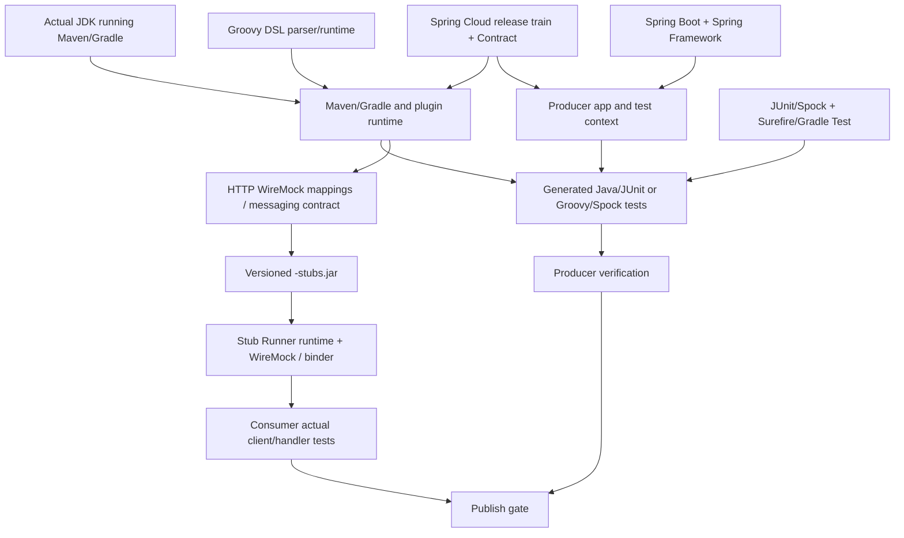
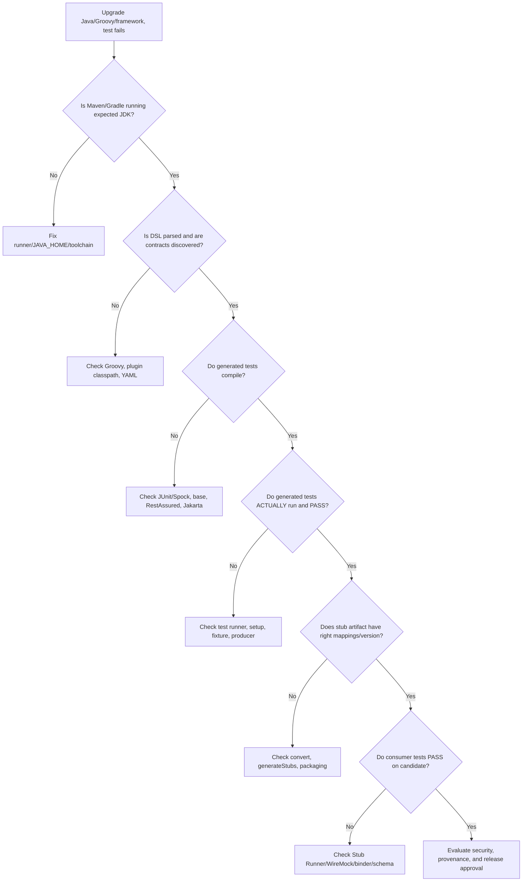

# Checking Java, Groovy, and Testing Framework Changes

## 1. Why Can a Tool Change Break an Unchanged Contract?

In **Spring Cloud Contract** (module `SPRING_CLOUD_CONTRACT`), the producer and consumer describe HTTP or messaging behavior using the **Groovy/YAML DSL**, generate producer-side tests with Contract Verifier, package stubs, and use **Stub Runner** in consumer CI. This toolchain does not run in isolation: it depends on **Java/JDK, Groovy, Spring Boot/Cloud, JUnit or Spock, Maven/Gradle, Rest Assured, WireMock, and messaging libraries**.

A team might not modify any contracts at all, yet after upgrading the JDK or Spring Boot encounter:

- `.groovy` files fail to parse: bytecode, classpath, or missing Groovy library errors.
- Generated Java tests fail to compile: old JUnit imports, wrong base class, or changed Rest Assured packages.
- Maven builds report `BUILD SUCCESS` without running contract tests.
- Generated tests run, but WireMock mappings or `-stubs.jar` are not produced.
- Producer tests pass, yet the consumer cannot download stubs, deserialize JSON, or trigger messages by `label`.
- A developer's machine passes due to local JDK/Maven caches, while clean CI fails.

This may be a **toolchain compatibility error**, not necessarily an API breaking change. Conversely, merely fixing the build to compile again without running consumer contract tests can **mask a genuine breaking change**.

**Lesson goal:** establish a verification process before, during, and after changing **Java, Groovy, or the test framework**, ensuring the same contracts continue to produce **equivalent producer tests and consumer stubs**.

### After This Lesson, You Will Be Able To

1. Map out the dependency layers in a Spring Cloud Contract toolchain.
2. Build a compatibility matrix before upgrading Java, Spring Boot/Cloud, Groovy, JUnit/Spock, and build plugins.
3. Separate the **JDK running Maven/Gradle**, **Java source/target**, **Groovy running inside the plugin**, and **consumer runtime**.
4. Migrate base tests from JUnit 4 to JUnit 5 and verify that generated tests actually execute.
5. Detect conflicts between the Groovy runtime, Spock variant, and plugin classloader.
6. Verify HTTP `MOCKMVC`/`EXPLICIT`/`WEBTESTCLIENT` and messaging verifiers for the active stack.
7. Use a clean CI matrix, artifact provenance, and consumer tests to catch regressions.
8. Classify failures by layer and decide whether to roll back or proceed with the upgrade.

## 2. Compatibility Layer Model

A Spring Cloud Contract build is more than just a "Spring Cloud Contract version." Multiple components must be evaluated together:



Not every arrow represents a direct Maven dependency; the diagram illustrates **impact relationships during version upgrades**.

### 2.1. Easily Confused Distinctions

| Component | Meaning | Examples to inspect |
| --- | --- | --- |
| **Build JDK** | JVM running Maven or Gradle | `java -version`, `./mvnw -version` |
| **Java target/release** | Bytecode emitted by `javac` | `maven.compiler.release` or Gradle toolchain |
| **Test runtime JDK** | Runtime used to load generated tests | Surefire/Gradle test JVM, fork/toolchain |
| **Groovy DSL runtime** | Groovy used to parse `Contract.make` | Plugin classloader/dependency version |
| **Groovy test runtime** | Groovy used to run Spock specs | `groovy` matching the Spock variant |
| **Spring Boot/Framework** | Application/test context and web stack | Boot/BOM, MVC/WebFlux, Jakarta |
| **Spring Cloud Contract plugin** | Generate tests, convert, package stubs | Plugin version + configuration |
| **Stub Runner** | Download and run stubs on the consumer | Spring Cloud Contract consumer dependency |
| **WireMock/runtime binder** | Serve HTTP or send messages | API, extensions, content type, destination |

For example, **compiling Java 17** with `--release 17` does not mean you are **running Maven with Java 17**. A plugin parsing Groovy still uses the JVM running Maven, which might be Java 21 or Java 25.

### 2.2. How Many Layers Can One Change Affect?

| Planned change | Layers that must be checked |
| --- | --- |
| Upgrade JDK 17 → 21 | Build tool, plugin bytecode/Groovy parsing, generated test compile/run |
| Upgrade Java source/target | Producer code, test classes, deployment runtime |
| Upgrade Groovy major | DSL parsing, custom helpers, Spock variant, plugin runtime |
| JUnit 4 → JUnit 5 | Generated test framework, base annotations, Surefire/JUnit Platform |
| Spock 1.x → 2.x | Groovy variant, JUnit Platform discovery, fixture lifecycle |
| Spring Boot 2.x → 3.x | Java baseline, `javax.*` → `jakarta.*`, Spring Security/Test libs |
| Spring Boot 3.x → 4.x | Spring Framework 7, module/dependency migration, integration changes |
| Spring Cloud release train | BOM compatibility and Contract/Stream components |
| WireMock major | Stub mapping/API/extension dependencies, Stub Runner runtime |
| Maven/Gradle plugin | Contract discovery, test generation, stubs packaging, and phase binding |

**Do not conclude compatibility just because Maven resolves dependencies.** Downloading JARs does not prove tests compile, execute, or return the right behavior.

## 3. Start with a Baseline: Record a Healthy System

Before upgrading any version, preserve a **reproducible comparison point**. You do not need to copy large numbers of project files into documentation; simply collect metadata from the build/CI itself.

### 3.1. Safe Inventory Commands

```bash
# JDK currently used by the shell.
java -version

# JVM actually running the Maven Wrapper.
./mvnw -version

# Effective dependency tree of the producer.
./mvnw -B -ntp dependency:tree

# Baseline producer verification.
./mvnw -B -ntp clean verify
```

With Gradle, you can use:

```bash
./gradlew --version
./gradlew dependencies
./gradlew clean check
```

**These are instructional commands for learners**, not a requirement to run builds while writing documentation. In a real project, the Gradle plugin may provide dedicated tasks for generated contracts; check the exact version/plugin instead of assuming `check` covers all of them.

### 3.2. Sample Baseline Record

```yaml
# INVENTORY DOCUMENT, not Spring Cloud Contract DSL.
baseline:
  sourceCommit: a1b2c3d4
  buildJdk: "17"
  bytecodeTarget: "17"
  buildTool: "Maven Wrapper (pinned distribution)"
  springBoot: "VERSION_FROM_EFFECTIVE_BUILD"
  springCloudTrain: "TRAIN_FROM_EFFECTIVE_BUILD"
  springCloudContractPlugin: "VERSION_FROM_EFFECTIVE_BUILD"
  groovyRuntime: "VERSION_FROM_DEPENDENCY_ANALYSIS"
  producerTestFramework: "JUNIT5"
  producerTestMode: "MOCKMVC"
  testRunner: "Surefire version from effective POM"
  consumerStubRunner: "VERSION_FROM_CONSUMER_BUILD"
  expectedContractCount: 3
  expectedGeneratedTests: 3
  expectedArtifact: "com.example:orders-producer:1.4.2:stubs"
```

Strings like `VERSION_FROM_*` are **placeholders**; they must not be treated as real versions. In practice, attach the **commit**, generated tests run/pass/fail/skip report, artifact SHA-256, and consumer test results.

### 3.3. Ask Three Questions Before Upgrading

1. **What does the change solve?** Security patch, new JDK LTS support, Groovy/Spock update, or JUnit migration?
2. **Which versions are in scope?** Producer, consumer, shared build plugins, contract source repository, and standalone Stub Runner?
3. **How do we prove contracts are preserved?** Generated tests, mapping/stub inspection, and consumer behavior tests against the exact candidate artifact.

Avoid bundling Java, Groovy, Boot, JUnit, WireMock, and HTTP semantic upgrades into the same commit when they can be separated. Independent changes make isolating failures much easier.

## 4. Choose Versions via the Compatibility Matrix, Not by Guessing Numbers

Spring Cloud uses a **release train** designed to work with a specific Spring Boot generation. Spring Cloud Contract lives within that ecosystem. When choosing versions:

1. Identify the Spring Boot and Spring Cloud release train **officially supported together**.
2. Confirm that the Spring Cloud Contract plugin, verifier, and Stub Runner are compatible with that stack.
3. Read the **system requirements** of the Spring Boot and Java versions in use.
4. Check the actual Groovy/Spock/JUnit/test dependencies managed by the BOM.
5. Verify that the build tool wrapper and test runner support the new JDK.
6. Record the tested version set in CI; do not rely solely on a single documentation table.

### 4.1. Example Boot–Cloud Relationships to Check

According to the Spring Cloud project page and release compatibility notes, several **generational** pairs are published:

| Spring Boot generation | Spring Cloud release train | Notes |
| --- | --- | --- |
| `3.4.x` | `2024.0.x` | Line targeting Boot 3.4 |
| `3.5.x` | `2025.0.x` | Line targeting Boot 3.5 |
| `4.0.x` | `2025.1.x` | Line targeting Boot 4.0 |
| `4.1.x` | `2025.1.x` with compatible maintenance releases | Check minimum maintenance version |
| `4.2.x` | Corresponding release train per docs at upgrade time | Do not infer from major number |

This table shows **generational relationships**, not a guarantee that every patch is compatible or still under support. For Boot `4.2.x`, consult the current compatibility page rather than relying on a static table in this document. **Spring Cloud Contract, Stream, WireMock, and test plugins must also be tested individually**. See: [Spring Cloud Project](https://spring.io/projects/spring-cloud/) and [Spring Cloud Supported Versions](https://github.com/spring-cloud/spring-cloud-release/wiki/Supported-Versions).

### 4.2. Why Not "Upgrade Only the Contract Plugin to the Latest Version"?

A newer plugin may require different Java or Spring dependencies while the producer application still uses an older BOM. When that happens:

- The Groovy parser may compile the DSL with a different runtime.
- Generated Java tests may import APIs incompatible with older dependencies.
- WireMock mappings or the Stub Runner runtime may have mismatched versions.
- Maven dependency mediation may hide classpath conflicts.

**Solution:** manage versions as a **compatible set**, use the appropriate BOM/version catalog, and verify both producer and consumer. You do not need to force every component to have the **same version number** when their own documentation defines independent versioning.

## 5. Upgrading Java: Separate JDK, Target Bytecode, and Runtime

Suppose an organization plans to switch the CI JDK from Java 17 to Java 21. Updating `JAVA_HOME` alone is **not enough**.

### 5.1. Explicit Maven Target Configuration

```xml
<properties>
  <!-- Illustrative value: choose according to actual producer runtime. -->
  <maven.compiler.release>17</maven.compiler.release>
</properties>
```

This option requires **`javac` to support `--release`**, and produces bytecode/APIs compatible with Java 17. However:

- Maven itself may still run on **JDK 21**.
- The compiler plugin must support the corresponding configuration.
- The Spring Cloud Contract plugin and Groovy DSL parser must work on the **JDK running Maven**.
- Generated contract tests are also compiled during the build.
- If the test JVM is configured separately (fork/toolchain), verify which JDK it uses.

### 5.2. Gradle Java Toolchain

```groovy
// build.gradle, illustrative for a Java project using Gradle toolchains.
java {
    toolchain {
        languageVersion = JavaLanguageVersion.of(17)
    }
}
```

Gradle toolchains typically control the JDK for compilation and tests per plugin and configuration. **The Gradle daemon still runs on its own JVM**, so build plugin/Groovy compiler compatibility must also be verified. Do not conclude that if `./gradlew --version` reports JDK 21, the compile task also uses JDK 21 when the toolchain selects 17.

### 5.3. Typical Errors and Their Meanings

| Error | Possible cause | Check to run |
| --- | --- | --- |
| `Unsupported class file major version` | Groovy/ASM/test framework cannot read new JDK bytecode | Build JDK, Groovy/ASM/plugin versions |
| `invalid target release: 21` | Compiler/JDK too old to target Java 21 | `./mvnw -version`, toolchain |
| `class file has wrong version` | Old runtime loads classes compiled for newer Java | JDK running tests/app |
| `InaccessibleObjectException` | Reflection into JDK internals blocked | Involved library; upgrade version instead of opening modules indiscriminately |
| `NoSuchMethodError` | Runtime deps/API mismatch | Effective dependency tree, classpath |
| Local pass, CI fail | Different JDK/toolchain/cache | Compare build metadata and clean runner |

Do not use `--add-opens` as a permanent fix for every reflective access error. It may be useful during a controlled transition, but replace incompatible libraries and record the reason plus a deadline for removing the flag.

## 6. Upgrading Groovy: The DSL Parser Is Not Just a Test Library

The Contract Groovy DSL is **executed/parsed at generate/convert time**, not only when producer JUnit tests run. Thus Groovy can appear in the **plugin runtime**, **test dependencies**, and **Spock runtime** at different versions.

### 6.1. Key Changes to Know

- Groovy 4 moved main Maven modules from `org.codehaus.groovy` to `org.apache.groovy`; common source packages remain under `groovy.*`.
- Groovy 5 has different minimum JVM requirements than Groovy 4; when upgrading, verify the **exact JDK and Groovy runtime**.
- Spock publishes **artifact variants per Groovy generation**, such as suffixes `-groovy-4.0` or `-groovy-5.0`.
- Maven/Gradle plugins may bundle their own Groovy version in the plugin classloader.
- Groovy DSLs with custom imports, helper JARs, or AST transforms are usually more sensitive than plain YAML DSLs.

See [Apache Groovy — Download/System Requirements](https://groovy.apache.org/download) and [Spock Framework](https://spockframework.org/spock/docs/current/).

### 6.2. Standard DSL Example for a Regression Baseline

```groovy
import org.springframework.cloud.contract.spec.Contract

Contract.make {
    name 'get_order_created'

    request {
        method GET()
        url '/api/orders/ord-1001'
        headers {
            header 'Accept': 'application/json'
        }
    }

    response {
        status 200
        headers {
            contentType(applicationJson())
        }
        body([
            id    : 'ord-1001',
            status: 'CREATED'
        ])
    }
}
```

Such a contract must parse cleanly on both old and new toolchains. Yet **parsing PASS is not enough**: compare generated assertions and stub mappings to ensure they retain the same meaning.

### 6.3. YAML Reduces Groovy DSL Source Coupling, But Does Not Eliminate All Risks

Equivalent contract:

```yaml
name: get_order_created
request:
  method: GET
  url: /api/orders/ord-1001
  headers:
    Accept: application/json
response:
  status: 200
  headers:
    Content-Type: application/json
  body:
    id: ord-1001
    status: CREATED
```

YAML does not execute user-written Groovy helpers during parsing, making it helpful when avoiding reliance on Groovy helper libraries. However, **the Spring Cloud Contract plugin, generated tests, and runtime dependencies still have version requirements**. Do not conclude "switching to YAML lets us upgrade Java/Groovy arbitrarily."

### 6.4. Avoid Accidentally Changing YAML Scalar Types

When converting between Groovy and YAML, review types carefully:

| Intended value | Groovy example | YAML example | Risk |
| --- | --- | --- | --- |
| Boolean | `true` | `true` | Avoid `"true"` if a boolean is needed |
| Number | `12` | `12` | Avoid `"12"` if numeric is needed |
| String ID | `'00123'` | `"00123"` | Leading zeros lost if YAML parses as numeric |
| Null | `null` | `null` | Distinguish null from absent field |
| Timestamp | `'2026-01-01T00:00:00Z'` | `"2026-01-01T00:00:00Z"` | Quote to preserve string semantics |

Do not compare DSL text alone. Inspect the actual JSON/messaging body after generation and test on the consumer side.

## 7. Groovy Classpath and Custom Helpers

A Groovy contract file may import a helper:

```groovy
import org.springframework.cloud.contract.spec.Contract
import static com.example.contract.TestSamples.orderId

Contract.make {
    name 'lookup_order_with_helper'
    request {
        method GET()
        url "/api/orders/${orderId()}"
    }
    response {
        status 200
        body([id: orderId(), status: 'CREATED'])
    }
}
```

`TestSamples` is a **project-authored helper**. If `MissingPropertyException` or `ClassNotFoundException` appears after upgrading the plugin, check the classpath **at convert/generate time**, not just the JUnit test classpath.

### 7.1. Two Classpaths Cannot Be Conflated

| Layer | Example | How to inspect |
| --- | --- | --- |
| Maven plugin/Groovy parser | `spring-cloud-contract-maven-plugin` and plugin dependencies | Effective POM, plugin resolution/build log |
| Producer test | `spring-cloud-starter-contract-verifier`, JUnit, Rest Assured | Test dependency tree, test compilation |
| Consumer test | Stub Runner/WireMock, HTTP client, or binder | Consumer test dependency tree |

A dependency declared with `<scope>test</scope>` in the producer **does not prove** the helper is available on the Maven plugin classloader. Configure plugin dependencies for the active version, or avoid custom helpers when they bring little benefit.

### 7.2. Signs a Helper Should Be Removed During Upgrade

- The helper calls a database/network while parsing contracts.
- The helper uses current time/unseeded randomness, producing different output on every build.
- The helper relies on version-dependent internal Groovy AST/compiler APIs.
- It exists solely to avoid repeating two simple sample strings.
- The consumer needs an extra internal JAR just to parse the contract source.

Prefer **clear DSL, stable samples, and fixtures inside producer base tests**. Shared data can be moved to YAML or plain test helpers as appropriate, while preserving semantics.

## 8. JUnit 4 → JUnit 5: Changing Imports Is Not Enough

JUnit 4 and JUnit 5 (Jupiter) have **different annotations and test discovery/execution mechanisms**. This change is especially critical because Spring Cloud Contract **generates test sources**, while Surefire/Gradle test tasks must **discover and execute** those tests.

### 8.1. Common Migration Mapping

| JUnit 4 | JUnit Jupiter | Notes |
| --- | --- | --- |
| `org.junit.Test` | `org.junit.jupiter.api.Test` | Test annotation in different package |
| `@Before` | `@BeforeEach` | Runs setup before each test |
| `@BeforeClass` | `@BeforeAll` | Static by default unless configured with appropriate lifecycle |
| `@After` | `@AfterEach` | Cleans up test state |
| `@RunWith(SpringRunner.class)` | `@ExtendWith(SpringExtension.class)` or Spring Boot test integration | Do not copy JUnit 4 runner to Jupiter |
| `@Rule`/`@ClassRule` | Jupiter extensions or equivalent APIs | Not a mechanical rename |
| `org.junit.Assert` | `org.junit.jupiter.api.Assertions` or AssertJ | Review semantics |
| JUnit 4 runner | JUnit Platform + Jupiter engine | Surefire/Gradle must support discovery |

**Not every `@Rule` has a direct equivalent.** When migrating, replace it with an appropriate Jupiter extension/testing utility and re-run generated tests.

### 8.2. Legacy JUnit 4 Base Test (Illustrative)

```java
import org.junit.Before;
import org.junit.runner.RunWith;
import org.springframework.test.context.junit4.SpringRunner;

@RunWith(SpringRunner.class)
public abstract class OldOrdersContractBase {

    @Before
    public void setup() {
        // Configure MockMvc and test data.
    }
}
```

The class above **is only a JUnit 4 skeleton**. It is not enough to run contract tests without real MockMvc/client setup and fixtures.

### 8.3. JUnit 5 Base Test with MockMvc

```java
package com.example.orders.contract;

import io.restassured.module.mockmvc.RestAssuredMockMvc;
import org.junit.jupiter.api.BeforeEach;
import org.springframework.beans.factory.annotation.Autowired;
import org.springframework.boot.test.autoconfigure.web.servlet.AutoConfigureMockMvc;
import org.springframework.boot.test.context.SpringBootTest;
import org.springframework.test.web.servlet.MockMvc;

@SpringBootTest
@AutoConfigureMockMvc
public abstract class OrdersContractBase {

    @Autowired
    private MockMvc mockMvc;

    @Autowired
    private OrdersContractFixtures fixtures;

    @BeforeEach
    protected void setup() {
        fixtures.reset();
        fixtures.createOrder("ord-1001", "CREATED");
        fixtures.ensureMissing("ord-missing");
        RestAssuredMockMvc.mockMvc(mockMvc);
    }
}
```

`OrdersContractFixtures`, `reset`, `createOrder`, and `ensureMissing` are **application-implemented test helpers**, not Spring Cloud Contract APIs. They must establish preconditions so the **real** controller/service returns the expected response. Using `protected` keeps setup inheritance clear when generated tests live in another package.

**Difference to check:** if the plugin's generated test targets JUnit 4 while the base uses `@BeforeEach`, the test may not run setup as intended. Conversely, a generated JUnit 5 test extending a JUnit 4 base may compile without invoking lifecycle hooks as expected.

## 9. Configure the Producer Plugin Explicitly Instead of Relying on Defaults

Spring Cloud Contract documentation across eras contains examples for **JUnit 4**, **Spock**, or **JUnit 5**; Maven plugin defaults can also vary between versions. Therefore, during migration, **explicitly choose** the framework/mode rather than relying on defaults.

### 9.1. POM Fragment for JUnit 5 + MockMvc

```xml
<dependencies>
  <dependency>
    <groupId>org.springframework.boot</groupId>
    <artifactId>spring-boot-starter-test</artifactId>
    <scope>test</scope>
  </dependency>
  <dependency>
    <groupId>org.springframework.cloud</groupId>
    <artifactId>spring-cloud-starter-contract-verifier</artifactId>
    <scope>test</scope>
  </dependency>
</dependencies>

<build>
  <plugins>
    <plugin>
      <groupId>org.springframework.cloud</groupId>
      <artifactId>spring-cloud-contract-maven-plugin</artifactId>
      <version>REPLACE_WITH_COMPATIBLE_VERSION</version>
      <extensions>true</extensions>
      <configuration>
        <testFramework>JUNIT5</testFramework>
        <testMode>MOCKMVC</testMode>
        <baseClassForTests>
          com.example.orders.contract.OrdersContractBase
        </baseClassForTests>
        <failOnNoContracts>true</failOnNoContracts>
        <failOnInProgress>true</failOnInProgress>
      </configuration>
    </plugin>
  </plugins>
</build>
```

This is a **fragment**, not a standalone runnable POM. Replace `REPLACE_WITH_COMPATIBLE_VERSION` according to actual Boot/Cloud/JDK versions. `spring-boot-starter-test` and `spring-cloud-starter-contract-verifier` must have properly managed versions; depending on the Boot generation or modularized test dependencies, test starters may need adjustment.

### 9.2. Why Enable the Gates?

- `failOnNoContracts`: avoids a "green" build when no contracts are found.
- `failOnInProgress`: prevents releasing while contracts marked `inProgress` skip producer verification generation.
- `testFramework=JUNIT5`: ensures JUnit Jupiter generation is intentionally used by the project.
- `testMode=MOCKMVC`: defines how generated tests invoke the HTTP boundary.
- `baseClassForTests`: ensures generated tests use the right test context and fixtures.

Do not treat these options alone as sufficient: CI must still verify **how many contract tests the runner actually executed**.

### 9.3. Inspect Generated Sources—Do Not Guess

After `generateTests`, check for these indicators:

```java
// Illustrates generated JUnit 5 test structure, not byte-for-byte output.
import org.junit.jupiter.api.Test;

public class OrdersContractTest extends OrdersContractBase {

    @Test
    public void getOrderCreated() throws Exception {
        // Generated request and assertions go here.
    }
}
```

If `org.junit.Test` or a class extending `spock.lang.Specification` unexpectedly appears, the plugin config may be overridden, stale classes may remain without `clean`, or the build may be using a different plugin artifact.

## 10. Surefire, Failsafe, and JUnit Platform: Sources of "False Greens"

Spring Cloud Contract generates sources in the appropriate phase, but Maven **Surefire** or **Failsafe** actually executes tests according to project configuration.

### 10.1. Relevant Maven Lifecycle Phases

```text
generate-test-sources
  -> Contract Verifier generateTests

process-test-resources
  -> Contract Verifier convert (HTTP mappings)

test-compile
  -> Java/Groovy generated source compilation

test
  -> Surefire executes discovered producer tests

package
  -> Contract Verifier generateStubs, packages stubs classifier

integration-test / verify
  -> Failsafe/integration gates if configured by project

install / deploy
  -> only after required gates pass
```

In Gradle, **the task graph and lifecycle names differ**; do not use the Maven phase table to assume Gradle runs in the exact same order automatically.

### 10.2. Scenarios That Produce a False BUILD SUCCESS

| Situation | Can the build succeed? | Is the producer verified? |
| --- | --- | --- |
| `generateTests` creates Java files that never run | Yes | **Not yet** |
| Surefire runs unit tests but 0 generated contract tests | Yes | **Not yet** |
| `-DskipTests` or a skip profile is active | Yes | **Not yet** |
| JUnit 4 tests with only Jupiter engine, missing Vintage when still needed | Tests may be skipped | **Must not assume PASS** |
| Spock specs are not discovered by the test runner | Possible | **Not yet** |
| Generated JUnit 5 tests execute and assertions pass | Yes | **Yes, within contract scope** |
| Producer passes, but stub JAR lacks mappings | Possible | **Not enough to publish** |

`failIfNoTests` only detects when *the entire suite has zero tests*; it can miss cases where unit tests run while generated contracts vanish. **Count executed generated contract cases** from reports against the expected contract inventory.

### 10.3. Inspecting Test Reports

```text
Expected HTTP contracts: 3
Expected generated producer test cases: 3
Actually executed generated cases: 3
Failed: 0
Skipped: 0
Stub package: present, correct classifier/version
```

These are **illustrative numbers**. Messaging, `ignored`, or `inProgress` contracts must be counted according to policy and config; do not mechanically assume "file count equals Java test count" when a file contains multiple contracts or the converter applies specific rules.

### 10.4. Do Not Fix by Keeping Both Engines Unchecked

During transition, a project may run JUnit Jupiter and JUnit Vintage side by side to support legacy JUnit 4 tests. This **can be temporarily useful**, provided you clearly distinguish:

- Which generated tests run under Jupiter?
- Which tests only run via Vintage?
- Are any legacy tests running twice?
- When removing Vintage, are any important tests left behind?

Establish a plan to remove transitional dependencies once migration finishes.

## 11. Spock and Groovy: Choose the Right Variant

Spock 2.x runs on the **JUnit Platform**, not the legacy JUnit 4 runner. Spock versions publish variants matching **Groovy major** versions.

### 11.1. Dependency Example (Do Not Pin One Version for All Environments)

```xml
<!-- Illustrates Spock only. Choose version/variant matching the Groovy runtime. -->
<dependency>
  <groupId>org.spockframework</groupId>
  <artifactId>spock-core</artifactId>
  <version>REPLACE_WITH_SPOCK_GROOVY_VARIANT</version>
  <scope>test</scope>
</dependency>
```

An artifact suffixed with `-groovy-4.0` is built for Groovy 4 and should not be treated as interchangeable with artifacts for Groovy 3 or 5. When reading older guides:

- Confirm the exact **Spock generation**.
- Confirm the **Groovy variant**, JVM, and Groovy plugin.
- Verify test discovery on **JUnit Platform**.
- Align Spring test integration (`spock-spring`) if using a Spring context.
- Check dependency convergence to prevent two Groovy majors in the same runtime.

### 11.2. When Not to Migrate JUnit and Groovy Simultaneously

If an application uses JUnit 4 generated tests alongside some Spock tests, pick a **primary migration path**:

1. Lock the target Spring Boot/Cloud/Contract versions.
2. Select a supported JUnit 5 **or** Spock version/variant.
3. Migrate the test base and test runner while keeping HTTP/messaging contracts unchanged.
4. Run the producer/stub/consumer suite.
5. Only afterward upgrade the Groovy major version or expand Java runtime support, when separable.

Changing multiple version axes at once makes it impossible to tell whether an error comes from the Groovy parser, Spock runtime, JUnit Platform, or business logic.

## 12. Test Mode Must Match the HTTP Stack

Spring Cloud Contract provides multiple HTTP producer verification modes. Mode names appear in plugin enums/config; detailed support depends on the version.

| Test mode | Characteristics | What to watch for |
| --- | --- | --- |
| `MOCKMVC` | Spring MVC requests via MockMvc | Servlet/MVC app, Rest Assured MockMvc setup |
| `WEBTESTCLIENT` | HTTP tests via WebTestClient | Reactive/WebFlux app or corresponding test client |
| `EXPLICIT` | Sends real HTTP to app on a test port | Embedded server/port, base URI, startup timing |
| `JAXRSCLIENT` | Tests JAX-RS with matching client | Only when stack/framework supported; often needs a server |

### 12.1. Does Upgrading Java/Boot Require Changing testMode?

**No.** If the producer still uses Spring MVC, you can keep `MOCKMVC` when upgrading Java or the test framework. Only when migrating from Servlet to WebFlux do you need to evaluate `WEBTESTCLIENT` and base setup.

Switching the test framework from JUnit 4 to JUnit 5 is a **different axis** from switching the mode from MockMvc to Explicit. Do not confuse them:

```xml
<testFramework>JUNIT5</testFramework>
<testMode>MOCKMVC</testMode>
```

### 12.2. Explicit Mode Example (Illustrative)

```java
import io.restassured.RestAssured;
import org.junit.jupiter.api.BeforeEach;
import org.springframework.boot.test.context.SpringBootTest;
import org.springframework.boot.test.web.server.LocalServerPort;

@SpringBootTest(webEnvironment = SpringBootTest.WebEnvironment.RANDOM_PORT)
public abstract class OrdersExplicitContractBase {

    @LocalServerPort
    private int port;

    @BeforeEach
    protected void setup() {
        RestAssured.baseURI = "http://localhost";
        RestAssured.port = port;
    }
}
```

This class belongs to Spring Boot stack examples supporting those imports; when upgrading across a major Boot generation, **re-verify the package of `@LocalServerPort` for that version**. For parallel test execution, mutable static state in `RestAssured` needs proper isolation/configuration.

**Note:** never run against a production port; `RANDOM_PORT` keeps the test instance isolated from real servers.

### 12.3. What Failures Does a Wrong Mode Cause?

| Symptom | Likely cause |
| --- | --- |
| `No MockMvc instance found` | Base test has not initialized MockMvc properly |
| Generated test uses RestAssuredMockMvc, but base only sets RestAssured HTTP port | `MOCKMVC` and `EXPLICIT` are mixed up |
| `Connection refused localhost:8080` | Explicit mode app is not running or base URI/port is wrong |
| WebFlux app with only MVC test dependencies | Wrong test stack selected |
| Test compiles, but response body cannot be decoded | HTTP converter/Content-Type or stack mismatch |

Inspect the **generated code** to see which client it invokes, rather than looking only at the POM configuration.

## 13. Rest Assured and Changed Package Imports

Many older Spring Cloud Contract guides contain the import:

```java
// Older example in some documentation:
import com.jayway.restassured.module.mockmvc.RestAssuredMockMvc;
```

In newer Rest Assured lines, the standard import is:

```java
// Example matching many newer builds:
import io.restassured.module.mockmvc.RestAssuredMockMvc;
```

Do not fix packages with a single find-and-replace and consider the job done. Check:

- The Rest Assured version managed by the Spring Cloud Contract/Boot BOM.
- Whether the `rest-assured-mock-mvc` dependency is present.
- Which package generated tests import and which package the base class imports.
- Whether `assertThat`/matcher APIs are still valid.
- Whether JUnit setup actually calls `RestAssuredMockMvc.mockMvc(mockMvc)` or a compatible method.

### 13.1. Why `package does not exist` May Just Be a Symptom

The root cause may be that **generated tests import a different version** than the package in dependencies. Instead of adding both `com.jayway` and `io.restassured` artifacts to the project, identify **one compatible version set** and perform a clean rebuild.

## 14. Spring Boot Migration: Test Annotations and Jakarta

When moving from Boot 2.x to Boot 3.x, check the transition of legacy Java EE APIs from the `javax.*` namespace to `jakarta.*`. For example:

```java
// Before Jakarta EE migration:
import javax.validation.Valid;

// After migration, in the corresponding Jakarta stack:
import jakarta.validation.Valid;
```

Not every `javax.*` package changed (for instance, `javax.crypto` belongs to the JDK). Replace only the Jakarta EE APIs required by the new framework/dependencies. Producer fixtures/test configs, controllers, and generated tests may all need adjustments.

Boot 4.x builds on a newer Spring Framework/Jakarta generation and introduces modularization changes. Therefore, the same `@SpringBootTest` annotation may require different starters/dependencies depending on the web/test stack. Read the migration guide and verify imports **directly on the target version**.

### 14.1. Contract DSL Can Stay Unchanged While the Test Base Must Change

Example contract:

```yaml
name: get_order_created
request:
  method: GET
  url: /api/orders/ord-1001
response:
  status: 200
  headers:
    Content-Type: application/json
  body:
    id: ord-1001
    status: CREATED
```

Still describes the exact same behavior even though the producer upgraded its framework. **Do not change the contract solely because the framework version increased**, unless API behavior genuinely changed. Risk lies in the test base, test framework, serializer, and implementation.

### 14.2. When Schema Changes Due to Serialization

Upgrading Boot/Jackson or message converters can cause:

- `LocalDateTime`/`Instant` to serialize differently.
- Enums to be written in a different format.
- `null` fields to be added or omitted.
- `BigDecimal` scale or number formatting to change.
- HTTP `Content-Type` to differ in charset or media type.

These differences can affect real consumers. **Contracts and consumer tests** must catch behavior changes, rather than merely patching generated tests to compile.

## 15. Messaging: Java and Framework Upgrades Also Affect Brokers/Binders

For messaging contracts, generated producer tests typically verify published messages by **destination, headers, body, and content type**. Consumer Stub Runner can trigger messages by label when integration is configured.

### 15.1. Sample Groovy Messaging Contract

```groovy
import org.springframework.cloud.contract.spec.Contract

Contract.make {
    name 'order_created_event'
    label 'order_created'

    input {
        triggeredBy('publishOrderCreated()')
    }

    outputMessage {
        sentTo('orders.events')
        body([
            eventType: 'ORDER_CREATED',
            orderId  : 'ord-1001',
            quantity : 2
        ])
        headers {
            header('eventType', 'ORDER_CREATED')
            messagingContentType(applicationJson())
        }
    }
}
```

`publishOrderCreated()` is a **method the producer test base must implement itself**; it is not a built-in API. `label` is the interface to trigger stubs in consumer tests, while `sentTo` is the message destination. Upgrading Spring Cloud Stream or the binder can change how logical destinations map to runtime queues/topics.

### 15.2. Illustrative Producer Base Class

```java
import org.junit.jupiter.api.BeforeEach;
import org.springframework.beans.factory.annotation.Autowired;
import org.springframework.boot.test.context.SpringBootTest;
import org.springframework.cloud.contract.verifier.messaging.boot.AutoConfigureMessageVerifier;

@SpringBootTest
@AutoConfigureMessageVerifier
public abstract class OrderMessageContractBase {

    @Autowired
    private OrderEventTestDriver driver;

    @BeforeEach
    protected void setup() {
        driver.reset();
    }

    public void publishOrderCreated() {
        driver.createOrderThroughApplication("ord-1001", 2);
    }
}
```

`OrderEventTestDriver` and methods `reset`/`createOrderThroughApplication` are **project-written components**. They must trigger the real application flow (at the appropriate boundary) so producer tests observe the emitted message. Never manually push a pre-built JSON event onto a queue and claim the producer implementation has been verified.

### 15.3. Consumer Message Test

```java
// Snippet in a test with Stub Runner, message binder/broker, and Awaitility.
readModel.deleteByOrderId("ord-1001");
assertThat(readModel.hasOrder("ord-1001")).isFalse();

assertThat(stubTrigger.trigger("order_created")).isTrue();

await().atMost(Duration.ofSeconds(5)).untilAsserted(() ->
    assertThat(readModel.hasOrder("ord-1001")).isTrue()
);
```

`readModel` is a hypothetical consumer API. The test must verify the **real handler** after triggering; do not pre-seed the read model and then assert it exists. After upgrading a broker/binder, check **destination mapping, message converters, and content types**, not just DSL parsing.

### 15.4. Messaging Failure Matrix on Framework Changes

| Symptom | Layer to inspect |
| --- | --- |
| `@AutoConfigureMessageVerifier` not recognized | Contract/message verifier deps and annotation package |
| `triggeredBy` method not found | Base class/visibility/generator test framework |
| Producer test does not observe message | Binder/test broker/destination |
| Consumer `StubTrigger.trigger(label)` returns false | Missing label, wrong artifact, or missing runtime integration |
| Message arrives but handler does not run | Binding/converter/consumer configuration |
| Deserialization error after Boot upgrade | Serializer/content type/schema types |

A stub event does not prove delivery ordering, retries, exactly-once semantics, or production broker security; those properties require dedicated integration tests.

## 16. Migrating Maven and Gradle Without Dropping Contract Tasks

Spring Cloud Contract provides plugins for both Maven and Gradle, yet **syntax and lifecycles differ**. When switching build tools, do not merely translate `pom.xml` into `build.gradle`.

### 16.1. Conceptual Comparison Table

| Goal | Maven (per plugin configuration) | Gradle (per active plugin/tasks) |
| --- | --- | --- |
| Contract sources | `contractsDirectory` typically under test resources | `contractsDslDir` or corresponding plugin config |
| Select test framework | `<testFramework>JUNIT5</testFramework>` | `contracts { testFramework = ... }` per version |
| Select mode | `<testMode>MOCKMVC</testMode>` | `contracts { testMode = ... }` |
| Generate tests | `generateTests` goal | Tasks provided by the Gradle Contract plugin |
| Convert mappings | `convert` goal | Gradle plugin conversion task |
| Package stubs | `generateStubs` goal | Gradle plugin stubs task |
| Runner | Surefire/Failsafe | Gradle `Test` tasks/JUnit Platform |
| Artifact publication | Maven install/deploy | Gradle publication configuration |

Gradle task names and how they hook into `check/build` can change across plugin versions. **Inspect the actual version's task graph output**; do not assume every task runs automatically through `test`.

### 16.2. Gradle JUnit Platform

```groovy
// build.gradle: used when the project runs JUnit Jupiter or Spock 2.x.
tasks.withType(Test).configureEach {
    useJUnitPlatform()
}
```

This is a snippet of Gradle configuration and **does not include** all required plugins/dependencies. If the project uses Gradle Kotlin DSL, syntax differs. Verify that the contract plugin generates tests into the proper source set and that the task actually executes generated cases.

### 16.3. Risks When Changing the Gradle Wrapper

- Newer/older Gradle versions have different JVM execution policies.
- Groovy bundled inside the Gradle daemon **is not necessarily** the Groovy version the Spring Cloud Contract plugin uses to parse DSL.
- Java toolchains and the Gradle daemon may run on different JDKs.
- Spock/Groovy variants must match the test runtime.
- Custom Contract Gradle tasks may require updating configuration or the plugin version.

Run all verification using the **committed, pinned wrapper** (`./mvnw`, `./gradlew`), not an arbitrary system-installed Maven/Gradle.

## 17. Stub Artifact Compatibility: Producer Compilation Alone Is Not Enough

After producer verification, Maven may produce:

```text
com.example:orders-producer:1.4.2:stubs
```

In a Maven repository, the corresponding artifact is the classified JAR:

```text
orders-producer-1.4.2-stubs.jar
```

Stub Runner IDs may append a port:

```text
com.example:orders-producer:1.4.2:stubs:8090
```

Port `8090` is not part of the artifact coordinates. If using Maven `dependency:get`, the parameter order differs:

```bash
./mvnw -B -ntp dependency:get \
  -Dartifact=com.example:orders-producer:1.4.2:jar:stubs
```

That command can succeed if the **local cache** already holds the artifact; to verify remote resolution after a plugin upgrade, use a clean runner or an appropriate repository API.

### 17.1. Inspecting the JAR After Upgrading the Plugin

```bash
jar tf target/orders-producer-1.4.2-stubs.jar
```

Verify:

- Correct GAV, version, extension, and classifier.
- Source contracts are present in the artifact per plugin layout.
- HTTP WireMock mappings retain the right method/path/headers/body/status.
- Messaging definitions retain label, destination, and payload.
- Response-body files referenced by mappings are packaged.
- No stale resources remain from build cache or an uncleaned `target`.
- The artifact remains readable by supported consumers' Stub Runner.

**`jar tf` only lists entries**; it does not verify mapping semantics. Inspect the contents and run consumer tests.

### 17.2. Must Every Consumer Use the Same Library Version?

Producer and consumer do not necessarily need to upgrade all Spring dependencies simultaneously. However, the **stub format**, repository resolution, and consumer WireMock/Stub Runner runtime must be **compatible in practice**. If a producer plugin upgrade produces mappings an older consumer runtime cannot parse, you should:

- Check mapping syntax/extensions/metadata.
- Run **consumer CI against the exact new artifact**.
- Plan an independent upgrade path for consumer test dependencies.
- Avoid forcing consumers to upgrade production frameworks solely to run stubs if solvable within test scope, while verifying real constraints.

Never claim bidirectional compatibility across major versions without documentation and test results.

## 18. Testing Compatibility with a Two-Way Matrix

An upgrade may keep existing producer tests PASSing while causing older consumers to FAIL. Therefore, run both:

1. **New producer against approved contracts**.
2. **Still-supported consumers against the candidate stub** from the new producer.

### 18.1. Example Matrix

| Producer toolchain | Consumer/runtime | Check | Illustrative outcome |
| --- | --- | --- | --- |
| Java 17 + Boot gen A + old Contract | Old Checkout main | Baseline | PASS |
| Java 21 build + target 17 + new Contract | Old Checkout main | Stub candidate | PASS |
| Java 21 build + target 17 + new Contract | Checkout LTS | Stub candidate | FAIL: strict JSON mapping |
| Java 21 build + target 17 + new Contract | Inventory messaging | Event stub | NOT_TESTED |
| Java 21 build + target 17 + new Contract | Mobile standalone Stub Runner | HTTP stub | PASS |

This is a **hypothetical scenario**, not test results from a real system. Any `FAIL` or `NOT_TESTED` row for a supported consumer must be evaluated before release. Never mark overall compatibility PASS just because the producer build is green.

### 18.2. Choosing a Reasonable Number of Combinations

You do not need a Cartesian product of every JDK × every Boot × every Contract × every Groovy × every consumer. Focus on:

- The current **supported baseline**.
- The target **upgrade candidate**.
- **Consumers/LTS branches** actively consuming the API/event.
- **Java runtimes** the tools genuinely need to support.
- Each **test framework/mode** used in the organization.
- A **clean runner** free of stale caches.

Add extra combinations only when justified: multi-JDK deployment targets, artifacts consumed across diverse test runtimes, or high-risk extensions.

### 18.3. Evidence to Store per Row

```yaml
# ILLUSTRATIVE REPORT, not a schema mandated by Spring Cloud Contract.
candidate:
  producerCommit: abcd1234
  buildJdk: "21"
  bytecodeTarget: "17"
  springCloudContractVersion: "PINNED_ACTUAL_VERSION"
  contractRevision: abcd1234
  artifact: "com.example:orders-producer:1.5.0-rc1:stubs"
  artifactSha256: "COMPUTE_FROM_ARTIFACT"
  producerGeneratedTestsRun: 3
  producerGeneratedTestsFailed: 0
  consumerCheckoutMain: PASS
  consumerCheckoutLts: FAIL
  consumerInventoryMessaging: NOT_TESTED
  releaseDecision: BLOCKED
```

Do not replace `COMPUTE_FROM_ARTIFACT` with a guessed checksum; compute it from the built file and pass the exact artifact to consumer jobs to preserve provenance.

## 19. CI Matrix for Java/JDK and Contract Verification

The GitHub Actions example below illustrates only the **JDK matrix mechanism**, not a complete release pipeline:

```yaml
name: Contract toolchain compatibility

on:
  pull_request:
    branches: [main]

permissions:
  contents: read

jobs:
  producer-verification:
    runs-on: ubuntu-latest
    strategy:
      fail-fast: false
      matrix:
        java: ['17', '21']

    steps:
      - uses: actions/checkout@v4

      - uses: actions/setup-java@v4
        with:
          distribution: temurin
          java-version: ${{ matrix.java }}
          cache: maven

      - name: Record active JVM
        run: |
          java -version
          ./mvnw -version

      - name: Verify producer contracts
        run: ./mvnw -B -ntp clean verify

      - name: Upload reports
        if: always()
        uses: actions/upload-artifact@v4
        with:
          name: producer-contract-reports-java-${{ matrix.java }}
          path: target/surefire-reports/
          if-no-files-found: error
```

Note: this is a **template** for a single-module Maven project; adapt Maven modules, stack-supported JDK versions, Failsafe reports, contract counts, and artifact packaging. Once rendered into YAML, GitHub Actions expressions must have the exact form `${{ matrix.java }}`. For production releases, **pin Actions by commit SHA** per security policy and never expose deploy secrets to untrusted PRs.

### 19.1. If Only Targeting Java 17, Why Test JDK 21?

If developers or CI plan to run Maven on JDK 21, the test matrix catches Groovy parser, plugin reflection, test runner, and ASM failures **even while the bytecode target remains Java 17**. That does not imply the production application will run on 21.

### 19.2. Add Anti-False-Green Gates

In real CI, the workflow above must add:

```text
assert contracts discovered > 0
assert generated contract tests compiled
assert generated contract tests executed and skipped == 0
assert required negative cases ran
assert no inProgress contracts at release
assert -stubs.jar exists and contains required mappings/contracts
assert candidate digest is recorded
assert supported consumer tests PASS with EXACT candidate
```

This list represents **gate logic**, not a ready-to-run script. Accurately counting generated tests depends on the report format and generated test naming settings of your project's plugin version.

## 20. Should a CI Matrix Always Run Every JDK?

No. An oversized matrix increases costs and slows down PRs. Use a **risk-based** approach:

| Branch/job | Objective | Suggested cadence |
| --- | --- | --- |
| PR quick gate | Primary target JDK, producer generated tests | Every PR |
| Compatibility gate | Current JDK + new target | Toolchain upgrade PRs or nightly |
| Consumer full gate | Still-supported consumers/branches | Before release |
| Dependency upgrade validation | Boot/Cloud/Groovy/Spock candidate | On BOM/plugin changes |
| Post-release smoke | Artifact downloads and test env works | After publish |

**Cadence is an operational guideline**, not a mandatory policy. Modules subject to strict security rules or rapid release cycles may require tighter gates.

### 20.1. Managing Caching

Version transition bugs are easily masked by:

- Stale JARs in local Maven `~/.m2`.
- Gradle build cache holding old generated sources.
- Stub Runner `LOCAL` using a previously installed version.
- Pipelines using a profile that skips convert/generate.

In critical verification runs, use `clean` and an **isolated local Maven repository environment**. You do not need to wipe the whole team's cache to prove correctness; use a clean CI runner or cache namespace per toolchain.

## 21. Comparing Generated Tests and Mappings Semantically

Plugin upgrades may alter generated Java and JSON **filenames, ordering, or formatting** without changing API behavior. Do not use byte-for-byte diffs as the **sole criterion**.

### 21.1. What Should Be Compared?

| Layer | Items to compare |
| --- | --- |
| Contract input | Request method/path/query/headers/body, response status/body, messages |
| Generated producer test | Assertions remain present, right test framework/mode, right base class |
| Actual execution | Test count, pass/fail/skip, fixtures, no false-green |
| Stub mappings | Request matchers, response headers/body, content type, error status |
| Message stub | Label, destination, payload, headers, content type |
| Consumer behavior | DTO parsing, error mapping, business state, async handler |

### 21.2. Data Type Shift from JSON Number to String

Before example:

```json
{"id":"ord-1001","amount":125000}
```

After:

```json
{"id":"ord-1001","amount":"125000"}
```

After a framework upgrade, a serializer may change representation without touching the DSL. Producer tests should catch this if the contract locks the type; strict consumer deserializers must also be tested against the candidate stub. If a matcher accepts any string, the shift could slip past. **Never relax a matcher just to pass an upgrade** when type is part of the API contract.

### 21.3. Especially Critical Error Branches

If a consumer calls:

```text
GET /api/orders/ord-missing
```

and expects `404` with body `{"code":"ORDER_NOT_FOUND"}`, do not assert only status `404`. WireMock can return `404` when **no mapping matches**, giving a false-green consumer test after a stub generator change.

## 22. Failure Triage Table Ordered by Lowest Investigation Cost

| Symptom | First suspect | How to verify |
| --- | --- | --- |
| `Unsupported class file major version` | JDK/Groovy parser/ASM incompatibility | Maven/Gradle JVM, plugin/Groovy version |
| `Invalid target release` | Wrong compiler toolchain | `./mvnw -version`, compiler release |
| `ClassNotFoundException: groovy...` | Groovy major/dependencies mismatch | Build/plugin/test dependency classpaths |
| `NoSuchMethodError` in Groovy/Spock | Conflicting runtime deps | Dependency tree/Spock variant |
| `package org.junit does not exist` | Generated JUnit 4 vs. JUnit 5 runtime | Generated imports and test dependencies |
| `@BeforeEach` does not run | JUnit engine/base class mismatch | Generated `@Test`, Surefire test run |
| `0 tests executed` | Generated tests not discovered | Test framework/config, Surefire/Gradle |
| `RestAssuredMockMvc` missing | Changed package/dependency | `io.restassured` vs. `com.jayway` |
| `No MockMvc instance` | Wrong base setup or test mode | `MOCKMVC` and base class |
| `Connection refused` | Explicit test did not start server or wrong port | `RANDOM_PORT`/baseURI |
| `javax.validation.*` missing | Jakarta migration | Source imports + deps |
| `StubRunner cannot load mappings` | WireMock/version/metadata mismatch | JAR entries, runtime logs |
| `StubTrigger.trigger` returns false | Wrong label/transport/contract artifact | Label, GAV, binder setup |
| Consumer JSON parse fails | Changed type/content type | Actual stub response and DTO |
| Local pass, CI fail | Different cache, JDK, profile, runner | Clean build metadata |

### 22.1. Classification Flowchart



### 22.2. Experiment to Isolate the Failing Layer

A helpful investigation technique keeps the same **contract source revision** and:

1. Runs the producer baseline with the old toolchain.
2. Runs the producer candidate with the new toolchain on a clean runner.
3. Compares **generated source, test reports, and stub mappings**.
4. Runs consumers against the **exact candidate artifact**, not latest.
5. Classifies into: *build/DSL compatibility*, *test execution*, *stub representation*, or *real API incompatibility*.
6. Fixes only the identified layer and re-runs the full chain.

Never alter expected statuses/fields just to clear a compile error.

## 23. Case Study: Java 17 → 21 and JUnit 4 → JUnit 5

### 23.1. Scenario

Orders Producer has:

```text
Producer:
  Java build/runtime: 17
  Spring Boot/Cloud: current compatible versions
  Contract plugin: current version
  Generated tests: JUnit 4
  Test mode: MOCKMVC

Consumers:
  Checkout (HTTP Stub Runner, pinned version)
  Inventory (messaging stub trigger)
  Mobile Gateway (standalone stubs)
```

The team wants to:

- Run Maven on JDK 21.
- Continue deploying Java 17 bytecode initially.
- Migrate generated producer tests to JUnit 5.
- Preserve the semantics of HTTP/messaging contracts.

### 23.2. Verifiable Plan

| Step | Change | Check to pass |
| --- | --- | --- |
| 1 | Record JDK17/contract plugin/test reports baseline | Producer & consumer PASS |
| 2 | Select Cloud/Boot/Contract versions supporting JDK21 | Compatibility docs + dependency review |
| 3 | CI adds JDK21 job still targeting 17 | DSL parses, generated sources compile |
| 4 | Set `testFramework=JUNIT5` | Generated imports show `org.junit.jupiter` |
| 5 | Migrate base `@Before` to `@BeforeEach` | Fixtures run before every generated test |
| 6 | Configure Surefire/JUnit Platform | Generated test count does not drop |
| 7 | Build single stub candidate | JAR has right mappings/version |
| 8 | Run Checkout/Inventory/Mobile | Every supported consumer PASSES |
| 9 | Upgrade production runtime when ready | Verify deployment/runtime separately |

### 23.3. First Failure: Java/JUnit Mismatch

Building with JDK 21 runs `generateTests` cleanly, yet generated tests contain `org.junit.Test` while the test runtime has only Jupiter. CI may report 0 generated cases. Resolution:

1. Inspect effective plugin config and generated imports.
2. Explicitly set `testFramework=JUNIT5`.
3. Update the test base lifecycle.
4. Ensure the test runner supports JUnit Platform.
5. Re-run `clean verify` and count executed generated cases.

**Do not** mark status PASS when `generateTests` creates files that are never executed.

### 23.4. Second Failure: Consumer Messaging Skipped

HTTP Checkout PASSES, but the Inventory job fails to trigger events due to label/binder changes after the plugin upgrade. A check inspecting only HTTP WireMock mappings misses this. Verify:

- The message contract still declares `label 'order_created'`.
- The stub artifact contains the right message contract.
- The consumer Stub Runner/binder runtime is compatible.
- The real handler receives the event and updates state after triggering.

### 23.5. Release Decision

```text
JDK 21 producer build: PASS
Generated JUnit 5 producer tests: PASS (3/3)
HTTP stub packaging: PASS
Checkout main consumer: PASS
Checkout LTS consumer: PASS
Inventory messaging consumer: FAIL
Mobile standalone Stub Runner: NOT_TESTED

Release decision: BLOCKED
```

This is a **hypothetical scenario report**. Even though the JDK/producer build is green, do not publish while required consumers remain FAIL/NOT_TESTED. Fix the binder/label or establish a transparent policy-approved migration/waiver before finalizing.

## 24. Practice Exercise: Planning a Boot, Groovy, and Test Framework Upgrade

### 24.1. Prompt

Payments Producer exposes:

```text
POST /api/payments
201 {"paymentId":"pay-test-1001","status":"AUTHORIZED","amount":125000}
400 {"code":"INVALID_AMOUNT"}
409 {"code":"DUPLICATE_PAYMENT"}
```

The `PAYMENT_AUTHORIZED` message contract is consumed by Settlement Consumer via Stub Runner. The current system uses Java 17, an older Groovy release with Spock, and a JUnit 4-style producer test base (hypothetical model). The team wants Java 21, newer Spring Boot/Cloud versions, a new Groovy major, and JUnit 5.

### 24.2. Tasks

1. Write a **baseline inventory**: JDK, target, BOM, plugin, Groovy, Spock, JUnit, Stub Runner, and reports.
2. Choose a small **compatibility matrix**: JDK17 baseline and JDK21 candidate; do not guess Boot/Cloud versions.
3. Write the `201` HTTP Groovy contract with `amount` as a numeric type.
4. Write the `400 INVALID_AMOUNT` YAML contract for a request amount of 0.
5. Write the `409 DUPLICATE_PAYMENT` contract with clear idempotency fixtures.
6. Write the `PAYMENT_AUTHORIZED` message contract with `label` and `sentTo`.
7. Migrate the base class from JUnit 4 `@Before` to JUnit 5 `@BeforeEach`.
8. Ensure generated tests are Jupiter and discovered by the test runner.
9. Select the Spock/Groovy variant if the team keeps Groovy specs.
10. Propose how to inspect generated test reports and the `stubs` classifier JAR.
11. Design consumer tests for Checkout `main`/LTS and Settlement messaging.
12. Create a triage table for three failures: Groovy unsupported bytecode, 0 tests, consumer schema mismatch.
13. State the release decision if Checkout LTS FAILS or Settlement is NOT_TESTED.

### 24.3. Sample HTTP Groovy Contract

```groovy
import org.springframework.cloud.contract.spec.Contract

Contract.make {
    name 'authorize_payment_success'

    request {
        method POST()
        url '/api/payments'
        headers {
            contentType(applicationJson())
        }
        body([
            orderId : 'ord-test-1001',
            amount  : 125000,
            currency: 'VND'
        ])
    }

    response {
        status 201
        headers {
            contentType(applicationJson())
        }
        body([
            paymentId: 'pay-test-1001',
            status   : 'AUTHORIZED',
            amount   : 125000
        ])
    }
}
```

### 24.4. YAML Contract for the Invalid Amount Branch

```yaml
name: authorize_payment_invalid_amount
request:
  method: POST
  url: /api/payments
  headers:
    Content-Type: application/json
  body:
    orderId: ord-test-2002
    amount: 0
    currency: VND
response:
  status: 400
  headers:
    Content-Type: application/json
  body:
    code: INVALID_AMOUNT
```

**These are two distinct branches** with distinguishable request bodies. Producer fixtures must drive the real controller into the `201` path or `400` validation path; never hardcode mock responses just to pass the test.

### 24.5. Self-Check Questions and Answers

**Q1.** Does running Maven on JDK 21 with `maven.compiler.release=17` prove the plugin/Groovy are compatible with JDK 21?

**A:** No. `release` controls the Java compilation target; the plugin/Groovy still run inside the build JVM. You must run parse/generate/compile/tests on JDK 21.

**Q2.** Must Groovy contracts using `Contract.make` be converted to YAML just because JUnit 4 is upgraded to JUnit 5?

**A:** No. The DSL format and generated test framework are **two independent axes**. You can keep the Groovy DSL and generate JUnit 5 tests as long as versions are compatible.

**Q3.** Can a Spock `-groovy-4.0` variant run by default on any Groovy 3 or Groovy 5 runtime?

**A:** No. Choose the variant matching the Groovy major version and verify the JDK/test runtime; never skip version checks for a release.

**Q4.** Why might `BUILD SUCCESS` fail to prove producer contract compliance?

**A:** Generated tests may not be discovered, may be skipped, or may only generate sources without executing.

**Q5.** Why must a dedicated stub candidate version be kept?

**A:** So consumers test the exact artifact tied to the verified producer commit, unaffected by caches or `latest`.

**Q6.** If producer tests PASS but the Settlement messaging test FAILS after upgrading the binder, should we publish?

**A:** Not while Settlement remains a required consumer to protect. Fix the binder/label/schema or obtain an approved migration/waiver.

## 25. Pre-Merge Upgrade Checklist

### A. Java and Build Tool

- [ ] Document the JDK running Maven/Gradle locally and in CI.
- [ ] Document Java source/target or `maven.compiler.release`.
- [ ] Review Spring Boot system requirements for the target JDK.
- [ ] Verify Maven/Gradle Wrapper and plugins are compatible with the new JDK.
- [ ] Ensure no bytecode/ASM/reflection errors are masked by uncontrolled flags.
- [ ] Use a clean CI runner to avoid cache-skewed results.

### B. Spring Boot, Cloud, and Contract

- [ ] Spring Cloud release train matches the Spring Boot generation.
- [ ] Spring Cloud Contract plugin and verifier/stub runner test dependencies have managed versions.
- [ ] `javax`/`jakarta` and module/test starter migrations have been reviewed where needed.
- [ ] Effective build contains no two conflicting versions of the same module.
- [ ] Do not rely on default test framework settings during migration.
- [ ] Release notes, owner, and rollback plan exist for major changes.

### C. Groovy, JUnit, Spock, and Base Tests

- [ ] Groovy DSL parses on the new toolchain.
- [ ] Custom Groovy helpers and plugin classpath are compatible.
- [ ] Spock artifact variant matches the Groovy major version, if used.
- [ ] `testFramework=JUNIT5` when targeting Jupiter; no unintended legacy imports/runners remain.
- [ ] Base tests use `@BeforeEach` and proper MockMvc/HTTP mode setup.
- [ ] Generated Java/Groovy tests compile and are discovered by the runner.
- [ ] Generated contract test cases **actually run**, and skipped counts are verified.
- [ ] Test mode matches the MVC/WebFlux/explicit runtime.

### D. Stub and Consumer Compatibility

- [ ] `convert`/`generateStubs` produces output in the expected format/version.
- [ ] Stub JAR has the right groupId, artifactId, version, and classifier.
- [ ] HTTP request/response mappings do not unintentionally shift semantics.
- [ ] Message `label`, `sentTo`, body, headers, and content type remain compatible.
- [ ] Consumer Stub Runner uses the **exact candidate version**.
- [ ] Supported consumers/branches PASS or have a valid waiver.
- [ ] CI records provenance: source commit, contract revision, test reports, artifact digest.
- [ ] No real secrets/PII exist in generated tests/mappings/JARs.
- [ ] Release does not proceed while any required consumer is FAIL/NOT_TESTED.

### References

- [Spring Cloud — Project and Release Train Compatibility](https://spring.io/projects/spring-cloud/): selecting Spring Cloud by Spring Boot generation.
- [Spring Cloud — Supported Versions](https://github.com/spring-cloud/spring-cloud-release/wiki/Supported-Versions): support policy, release trains, and compatibility links.
- [Spring Boot — System Requirements](https://docs.spring.io/spring-boot/system-requirements.html): Java, Spring Framework, Maven/Gradle requirements of the current Boot release.
- [Spring Boot — Migration Guide](https://github.com/spring-projects/spring-boot/wiki/Spring-Boot-4.0-Migration-Guide): changes when upgrading to Boot 4.
- [Spring Cloud Contract — Maven Project](https://docs.spring.io/spring-cloud-contract/reference/maven-project.html): `testFramework`, `testMode`, base classes, and test generation.
- [Spring Cloud Contract — Gradle Project](https://docs.spring.io/spring-cloud-contract/reference/gradle-project.html): Gradle plugin, source sets, and Spock/Groovy dependencies.
- [Spring Cloud Contract Maven Plugin — generateTests Goal](https://docs.spring.io/spring-cloud-contract/docs/current/spring-cloud-contract-maven-plugin/generateTests-mojo.html): current options and defaults to verify per version.
- [Spring Cloud Contract — Stub Runner Core](https://docs.spring.io/spring-cloud-contract/reference/project-features-stubrunner/stub-runner-core.html): artifact IDs, modes, and consumer setup.
- [Apache Groovy — Download/System Requirements](https://groovy.apache.org/download): JVM requirements and Groovy generations.
- [Spock Framework — Documentation](https://spockframework.org/spock/docs/current/): Spock 2.x, Groovy variants, JUnit Platform.
- [Apache Maven — Build Lifecycle](https://maven.apache.org/guides/introduction/introduction-to-the-lifecycle.html): generate/test/package/verify/install/deploy phases.

**Remember:** when upgrading Java, Groovy, or the testing framework, the goal is not merely **compiling cleanly again**. You must verify the actual JDK, Groovy/plugin classpath, JUnit/Spock engine, executed generated tests, properly versioned stub artifact, and that **supported consumers can handle the output**. Maintain a clear boundary between *tool compatibility issues* and *real API changes*, verified through a producer → candidate stub → consumer pipeline with provenance; that is how you upgrade toolchains while keeping contract testing trustworthy.
