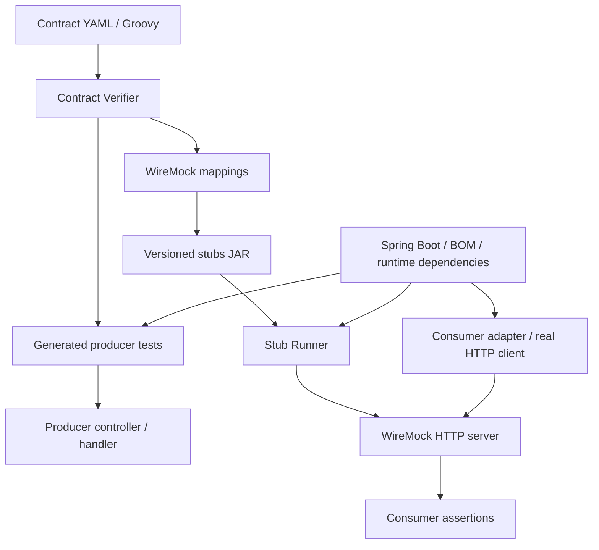
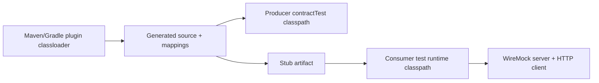
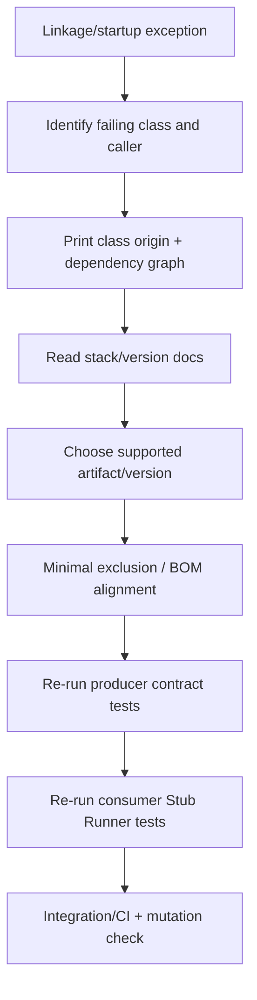
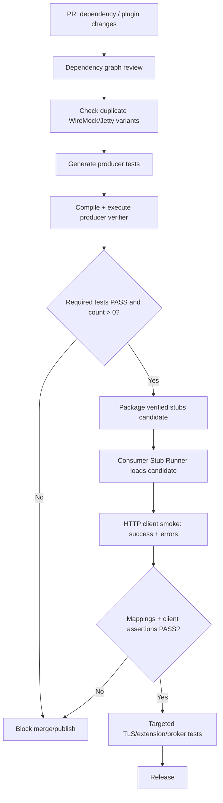

# Reviewing WireMock, HTTP Clients, and Dependency Conflicts

> **Chapter:** Tool Compatibility  
> **Module:** `SPRING_CLOUD_CONTRACT` — contract testing between producer and consumer with Spring Cloud Contract, describing HTTP or messaging behavior with the Groovy/YAML DSL, generating producer tests, publishing stubs, using Stub Runner, and integrating CI to catch breaking API changes.

## Learning Objectives

After this lesson, you can:

1. Distinguish **Spring Cloud Contract Verifier**, **WireMock**, **Stub Runner**, the **application's HTTP client**, and test support libraries; identify the exact component responsible when a test fails.
2. Review compatibility across **Java/JDK, Spring Boot, Spring Framework, Spring Cloud release train, Spring Cloud Contract, WireMock, Jetty, Groovy, RestAssured, JUnit, and Apache HttpClient** without guessing versions.
3. Use `mvn dependency:tree`, `dependencyInsight`, and the test runtime classpath to find libraries resolved to the wrong version or unintentionally excluded.
4. Explain the meaning of `NoSuchMethodError`, `NoClassDefFoundError`, `ClassNotFoundException`, `UnsupportedClassVersionError`, `LinkageError`, and Servlet/Jetty startup errors.
5. Distinguish `org.wiremock:wiremock`, `org.wiremock:wiremock-standalone`, `org.wiremock:wiremock-jetty12`, and legacy WireMock coordinates; decide **with evidence** how to resolve conflicts.
6. Understand the differences between generated producer tests in `MOCKMVC`, `EXPLICIT`, and `WEBTESTCLIENT` modes and real consumer tests through WireMock.
7. Verify `base URL`, dynamic ports, paths, headers, charsets, redirects, HTTPS, TLS certificates, and timeouts when consumers use `RestClient`, `RestTemplate`, `WebClient`, Feign, or JDK `HttpClient`.
8. Investigate mismatched stub mappings, legacy mappings, custom extensions, JSON data/response transformers, and differences between producer test code and consumer test code.
9. Build a **reproducible dependency upgrade workflow** with versions/BOM, dependency locks, reports, test counts, and an intentional mutation check.
10. Design CI quality gates so verified stubs are never published when producer contract tests fail or do not run, and consumer tests never pass due to the wrong artifact/port/server.

## 1. Why Does the Same Contract Pass on Machine A and Fail in CI B?

Suppose a system consists of:

- `inventory-service`: **producer** providing the inventory API.
- `checkout-service`: **consumer** needing to check stock availability before placing an order.
- `Spring Cloud Contract Verifier`: reads Groovy/YAML contracts and generates producer-side tests.
- `Stub Runner`: downloads `inventory-service-...-stubs.jar` and starts WireMock for the consumer.
- `RestClient` or `WebClient`: the real HTTP client of `checkout-service`.

The contract:

```http
GET /api/stock/SKU-001 HTTP/1.1
Accept: application/json
```

Response:

```http
HTTP/1.1 200 OK
Content-Type: application/json

{"sku":"SKU-001","available":true,"quantity":4}
```

A developer runs tests locally and succeeds. Yet CI reports:

```text
java.lang.NoSuchMethodError: ...MockHttpServletRequestBuilder.header(...)
```

Another runner reports:

```text
java.lang.NoClassDefFoundError: jakarta/servlet/DispatcherType
```

And on the consumer:

```text
Connection refused: localhost/127.0.0.1:8080

Expected: 200
Actual:   404
```

All three errors can happen **even when the contract JSON is completely valid**:

- `NoSuchMethodError`: a library calls a method **that does not exist in the class loaded at runtime**.
- `NoClassDefFoundError`: a required class is missing or fails to load; common when the runtime classpath/Servlet/Jetty versions are incompatible.
- `Connection refused`/`404`: the client calls the wrong host/port, the server is not running, or WireMock has no matching mapping.

**First conclusion:** do not edit contract contents in response to every test failure. Identify whether the failure layer is **API behavior, transport, stub server, generated tests, build wiring, or the dependency graph**.

## 2. Component Diagram and Verification Directions



| Component | Responsibility | What to check first on failure |
| --- | --- | --- |
| **Contract DSL** | Defines request/response or message behavior | Method/path/headers/body, syntax, matchers |
| **Verifier generator** | Generates producer verification tests and mappings | Plugin config, generated source, test framework |
| **Producer HTTP test mode** | Sends requests to the real controller/server in tests | `MockMvc` vs `Explicit`, base class, context |
| **WireMock** | Simulates HTTP endpoints from mappings | Startup, Jetty, mapping schema, unmatched requests |
| **Stub Runner** | Locates artifacts, runs mock servers, provides ports | `ids`, `stubsMode`, repository, selected version |
| **Real HTTP client** | Serialization, headers, URL, TLS, timeout, status handling | Client adapter and configuration |
| **Dependency resolver** | Selects JARs on test/runtime classpath | Maven effective POM, Gradle insight, BOM |
| **Test engine** | Executes JUnit/Spock assertions | Jupiter/Vintage/Spock, filters, zero-test checks |

### 2.1. Producer PASS and Consumer PASS Prove Different Things

**Producer verification PASS:** producer code under test satisfies the contracts that produced the generated tests.

**Consumer Stub Runner PASS:** the consumer client/handler handles **the selected stub mappings**.

Neither one alone proves the entire production connection works: real TLS, auth, service discovery, databases, and retries require appropriate integration/smoke tests.

### 2.2. Diagnostic Order Must Follow Evidence

1. Tests **do not compile**: check linkage/dependencies/source sets before investigating JSON responses.
2. Tests **do not run**: check engine/task filters; do not conclude the implementation is correct.
3. Stub server **fails to start**: check WireMock/Jetty/servlet/classpath.
4. Server runs but requests **never arrive**: check URL/host/port/SSL/proxy.
5. Requests arrive but **404 unmatched**: check mappings/method/path/query/headers/body.
6. Mapping matches but **payload is wrong**: check contract/stub version, serialization, response transformers.
7. Tests run and fail **at the assertion**: resolve contract vs. producer/client discrepancy.
8. Build is green: check the **number of executed generated producer tests**, reports, and artifact used.

## 3. Review Versions via a Matrix, Not Rumor

The libraries below follow independent release cadences:

| Layer | Examples to record explicitly | Sign of version mismatch |
| --- | --- | --- |
| JDK | Java compiler/toolchain and test JVM | `UnsupportedClassVersionError` |
| Spring Boot | Parent/BOM/plugin version | Dependency management differs from test runtime |
| Spring Framework | Spring MVC/Test, WebFlux, Servlet APIs | `NoSuchMethodError`/`NoClassDefFoundError` |
| Spring Cloud train | BOM covering Contract/LoadBalancer/OpenFeign… | Mismatched release train for Boot |
| Spring Cloud Contract | Maven/Gradle plugin, Verifier, Stub Runner | Generator/runtime mismatch |
| WireMock | Core/server/standalone/Jetty module | Jetty, mappings, extension APIs |
| Jetty/Servlet | Jetty 11/12, Jakarta APIs | Servlet class/server startup failures |
| RestAssured | `rest-assured`, `spring-mock-mvc` | Failures when generated requests run |
| Apache HttpClient | HttpClient 4 and 5 have different APIs | Different classes/methods/transport |
| Jackson/JsonPath/JsonUnit | Serializer and JSON assertions | Conversion/matcher runtime errors |
| JUnit/Spock/Groovy | Generator/test engine/source set | 0 discovered tests, `NoClassDef` |

**Do not assume** "Spring Cloud Contract 5 means WireMock 5 must be used" or "Boot 4 automatically upgrades WireMock to the latest beta." Each ecosystem has its own versioning. Use a **compatible version set managed by the BOM/docs** of the actual stack, then inspect the resolved dependency graph.

### 3.1. Inventory Matrix Before Making Changes

A team-filled record:

```yaml
runtimeInventory:
  javaToolchain: "<actual-java-version>"
  springBoot: "<boot-version>"
  springCloudReleaseTrain: "<cloud-train>"
  springCloudContractPlugin: "<contract-plugin-version>"
  verifierRuntime: "<resolved-version>"
  stubRunnerRuntime: "<resolved-version>"
  wireMockRuntime: "<resolved-version-and-artifact>"
  jettyRuntime: "<resolved-version-if-used>"
  restAssuredRuntime: "<resolved-version-if-used>"
  junitOrSpockEngine: "<actual-test-engine>"
  httpClientImplementation: "<RestClient/WebClient/Feign/JDK/other>"
  producerTestMode: "<MOCKMVC/EXPLICIT/WEBTESTCLIENT>"
```

This is a **self-audit manifest**, not a format read by Spring Cloud Contract. Version numbers must come from the **effective/resolved graph**, not simply copied from `pom.xml` or `build.gradle`.

### 3.2. Separate Three Kinds of "Version"

- **Plugin version** used to generate tests/mappings during the build.
- **Runtime/test dependency version** actually loaded by JUnit/Spock/Stub Runner.
- **Producer stub artifact version** such as `com.example:inventory-service:1.3.0:stubs`.

A build with plugin `5.0.3` whose test runtime is forced onto an incompatible library generation can still fail. A consumer with a healthy runtime that downloads `stubs:1.2.0` while intending to verify producer `1.3.0` can also pass falsely.

## 4. WireMock: Pick the Right Artifact, Avoid Stacking Multiple Variants

The current WireMock site documents the **3.x** line and a **4.x beta** line; beta APIs and dependencies are subject to change. For this lesson, WireMock 3.x examples use the primary coordinates:

| Artifact | Purpose | Notes |
| --- | --- | --- |
| `org.wiremock:wiremock` | Standard WireMock 3.x | Depends on runtime libraries on the classpath |
| `org.wiremock:wiremock-standalone` | Uber JAR with many **shaded** dependencies | Useful for transitive conflicts; check extension compatibility |
| `org.wiremock:wiremock-jetty12` | Variant for Jetty 12 environments | Requires Java 17+, suited to specific stacks/runtimes |
| `com.github.tomakehurst:wiremock-jre8` and legacy artifacts | WireMock 2.x/legacy project | Do not force into modern stacks without reason |

Do not add **all three WireMock 3.x variants** to the same test classpath just to "be safe." They are not three independent features to install side by side; doing so introduces duplicate classes and competing dependencies.

### 4.1. How Do Standard and Standalone WireMock Differ?

- **Standard JAR:** exposes normal runtime dependencies; appropriate when dependency management is already compatible.
- **Standalone/uber JAR:** bundles dependencies and relocates packages (shading) to reduce collisions with external libraries.
- **Not a silver bullet:** shading mitigates certain conflicts, yet custom extensions or integrations relying on external classes/packages still need verification. Swapping artifacts will not fix bad URLs, mappings, or application classloaders.

Example Maven standalone dependency for a test module **explicitly owning its own WireMock server**:

```xml
<dependency>
  <groupId>org.wiremock</groupId>
  <artifactId>wiremock-standalone</artifactId>
  <version>3.13.2</version>
  <scope>test</scope>
</dependency>
```

This is an **example coordinate from WireMock 3.x documentation**, not an instruction requiring every project to use version 3.13.2. If the Spring Cloud Contract/Boot BOM manages WireMock, verify compatibility **before overriding**.

### 4.2. Jetty 11 and Jetty 12

WireMock 3.x documentation explains that standard WireMock is based on Jetty 11, whereas many Spring applications use Jetty 12. You may see:

```text
java.lang.ClassNotFoundException: jakarta.servlet....
java.lang.NoClassDefFoundError: org/eclipse/jetty/...
java.lang.NoSuchMethodError: org.eclipse.jetty....
```

**Do not delete all Jetty dependencies the moment you see the word Jetty.** Instead check:

1. Which WireMock artifact is resolved?
2. Are both Jetty 11 and 12 present on the **same test runtimeClasspath**?
3. Does the real app use Tomcat, Undertow, or Jetty?
4. Which dependency brings in the Jetty version winning conflict resolution?
5. If Jetty 12 is needed, is the `wiremock-jetty12` variant compatible with your Spring Cloud Contract/Stub Runner version?

A Gradle fragment **only when the project uses WireMock Jetty 12 directly and compatibility has been verified**:

```groovy
dependencies {
    testImplementation 'org.wiremock:wiremock-jetty12:3.13.2'
}
```

WireMock docs note a few differences in the Jetty 12 variant: custom reason phrases may not be returned, and multipart decoding or redirects on directory paths have limitations. If a contract relies on such behavior, **do not treat the two Jetty variants as fully equivalent**.

### 4.3. Do Not Upgrade to WireMock 4.x Beta Just to Fix a NoClassDef

WireMock 4.x beta changes module layout (`wiremock-core`, `wiremock-junit5`, `wiremock-jetty`, …). If Spring Cloud Contract relies on WireMock 3 extension/server APIs, forcing WireMock 4 beta can introduce new errors.

Upgrade major versions only with a **compatibility statement** and thorough testing across Contract Verifier, Stub Runner, custom extensions, and mappings. "Newer version" does not mean "more correct classloader."

### 4.4. Two WireMock Versions on the Classpath

During migration, a starter may pull in WireMock 3 while an old POM declares WireMock 2. Possible outcomes:

- One version wins Maven dependency mediation/Gradle conflict resolution.
- Classes share the same FQN but have different method signatures.
- An extension compiled against one generation loads another at runtime.
- Local and CI tests diverge due to profiles/locks/caches.

**The fix:** trace the dependency path bringing in the old artifact and apply a **targeted exclusion**, rather than declaring the winning version correct simply because the build compiles.

## 5. Maven: Inspecting the Effective Dependency Graph

When a project uses Maven, distinguish:

- **Project dependencies**: libraries on compile/test/runtime classpaths.
- **Plugin dependencies**: libraries inside a Maven plugin's classloader.
- **BOM/dependencyManagement**: version selection rules, not necessarily adding dependencies to the classpath.
- **Profiles and parent POMs**: may change the graph in CI compared to local.

### 5.1. Diagnostic Commands for Learners

```bash
# Run in the failing producer or consumer module:
./mvnw dependency:tree

# Filter conflict-prone groups; quotes keep the list intact.
./mvnw dependency:tree \
  -Dincludes="org.wiremock:*,com.github.tomakehurst:*,org.eclipse.jetty:*,io.rest-assured:*,org.apache.httpcomponents.client5:*"

# View final configuration after parent, profiles, and dependencyManagement.
./mvnw help:effective-pom

# When Maven resolves dependencies fine but tests still fail:
./mvnw -B clean verify -e
```

Commands are written for **learners to run in a real project**; within the scope of STEP 4 of this lesson, Maven/Gradle is not executed. Depending on the Maven Dependency Plugin version, filter/verbose output formatting may vary; if the filter returns nothing, run full `dependency:tree` and trace transitive paths.

### 5.2. An Illustrative Dependency Tree

```text
[INFO] com.example:checkout-service:jar:2.0.0
[INFO] +- org.springframework.cloud:spring-cloud-starter-contract-stub-runner:test
[INFO] |  \- org.wiremock:wiremock:jar:3.x:test
[INFO] \- com.example:test-tools:jar:1.0.0:test
[INFO]    \- com.github.tomakehurst:wiremock-jre8:jar:2.x:test
```

This is a **synthetic graph for learning analysis**, not actual output from a specific Spring Cloud Contract version.

Answer the question: when the same class FQN appears in multiple JARs, **which one** does the runtime load? The Maven tree shows mediation/exclusions, yet the classpath also involves plugin isolates, test runners, and shaded code. For tricky conflicts, check **class origin** at runtime.

### 5.3. BOMs Help Align Versions, But Cannot Make Everything Compatible Automatically

A POM fragment:

```xml
<properties>
  <spring-cloud-contract.version>5.0.3</spring-cloud-contract.version>
</properties>

<dependencyManagement>
  <dependencies>
    <dependency>
      <groupId>org.springframework.cloud</groupId>
      <artifactId>spring-cloud-contract-dependencies</artifactId>
      <version>${spring-cloud-contract.version}</version>
      <type>pom</type>
      <scope>import</scope>
    </dependency>
  </dependencies>
</dependencyManagement>
```

A real application requires a compatible Spring Boot parent/BOM, Spring Cloud release train, and plugin version; this **is not a complete POM**. `5.0.3` is only an illustrative version from the referenced docs and must not be copied into a project without checking Boot/JDK.

A producer Verifier dependency:

```xml
<dependency>
  <groupId>org.springframework.cloud</groupId>
  <artifactId>spring-cloud-starter-contract-verifier</artifactId>
  <scope>test</scope>
</dependency>
```

A consumer Stub Runner dependency:

```xml
<dependency>
  <groupId>org.springframework.cloud</groupId>
  <artifactId>spring-cloud-starter-contract-stub-runner</artifactId>
  <scope>test</scope>
</dependency>
```

Versions can be managed by the BOM; do not insert explicit versions on individual dependencies when the BOM already manages them properly.

### 5.4. When to Add an Exclusion?

**Do not** do something like:

```xml
<!-- Do not copy this kind of exclusion without investigating first. -->
<exclusions>
  <exclusion>
    <groupId>org.eclipse.jetty</groupId>
    <artifactId>*</artifactId>
  </exclusion>
</exclusions>
```

That could strip out Jetty artifacts that WireMock actually requires.

Proper process:

1. Inspect the full dependency path pulling in the conflicting version.
2. Identify the artifact and version **resolved at test runtime**.
3. Choose a supported library pairing.
4. Add the **minimal exclusion** on the dependency carrying the wrong artifact, or deliberately swap the WireMock adapter.
5. Re-run the test that starts WireMock and verify URLs/mappings.
6. Re-check the tree afterward to ensure no other required dependency was removed.

## 6. Gradle: Do Not Look Only at `test` Dependencies

With modern Spring Cloud Contract Gradle plugins, the producer usually has a `contractTest` source set. This is a core distinction:

- `testRuntimeClasspath` is used by the regular test task.
- `contractTestRuntimeClasspath` is used by generated producer contract tests.
- The plugin classpath can differ from both.
- Consumer Stub Runner tests usually live in `test` or a dedicated integration test task.

### 6.1. Useful Commands

```bash
./gradlew dependencies \
  --configuration testRuntimeClasspath

./gradlew dependencies \
  --configuration contractTestRuntimeClasspath

./gradlew dependencyInsight \
  --dependency wiremock \
  --configuration contractTestRuntimeClasspath

./gradlew dependencyInsight \
  --dependency jetty \
  --configuration contractTestRuntimeClasspath

./gradlew dependencyInsight \
  --dependency httpclient5 \
  --configuration testRuntimeClasspath

./gradlew contractTest --info --console=plain
```

If Gradle reports that a configuration does not exist, **do not create a configuration by that name just to make the command run**. Inspect the source sets/tasks actually created by the plugin; in multi-module builds, prefix tasks with `:inventory-producer:`.

### 6.2. Reading Why Gradle Selected a Version

`dependencyInsight` can show:

- A module selected via **conflict resolution**.
- A version **constrained** by a BOM/platform.
- A `forced` version or `resolutionStrategy.force` override.
- A module excluded or substituted via dependency substitution.
- An artifact living in a different configuration than the failing one.

When a newer version is selected, **do not assume it is compatible**. Gradle selects versions by resolution rules, not by testing binary API compatibility.

### 6.3. Aligning the Spring Cloud Contract Gradle Plugin (Fragment)

```groovy
plugins {
    id 'java'
    id 'org.springframework.cloud.contract' version '5.0.3'
}

contracts {
    testFramework = 'JUNIT5'
    testMode = 'MockMvc'
    failOnNoContracts = true
}

dependencies {
    contractTestImplementation(
        'org.springframework.cloud:spring-cloud-starter-contract-verifier'
    )
}

tasks.named('contractTest', Test) {
    useJUnitPlatform()
}
```

**You must add** the Spring Boot/Cloud BOM and project dependencies appropriately. Version `5.0.3` illustrates the referenced documentation; Boot/Groovy/JDK combinations **must** follow supported compatibility releases. In `dependencies`, omit individual library versions already defined by the BOM.

### 6.4. Gradle `force` Can Make Errors Harder to Understand

```groovy
configurations.configureEach {
    resolutionStrategy {
        force 'org.wiremock:wiremock:3.0.0'
    }
}
```

This is an **illustrative anti-pattern**, not a fix. Forcing a WireMock version can break Stub Runner extensions. If you must constrain a version, document the reason, tested version pair, and remove the override once the stack upgrades; prefer BOM-driven alignment.

### 6.5. Caching Is Not the Cause of Every Mismatch

An old JAR may come from **dependency version selection** via a BOM or exclusion rather than a stale Gradle cache. `--refresh-dependencies` only checks resolution caches; **it does not turn an incompatible version set into a compatible one**.

For diagnosis, perform a clean run and inspect the dependency graph. Do not unconditionally wipe all of `~/.gradle/caches`.

## 7. Classify Binary Compatibility Errors Before Fixing

| Exception / symptom | Typical meaning | First action |
| --- | --- | --- |
| `NoSuchMethodError` | Caller compiled against a different API than the class loaded at runtime | Identify caller/callee + JAR origin, compare versions |
| `NoSuchFieldError` | Expected bytecode field absent from runtime class | Check dependency mediation/relocation |
| `AbstractMethodError` | Interface/class contract mismatches runtime implementer | Check plugin/extension API version |
| `ClassNotFoundException` | Class loaded by name could not be found | Check runtime classpath and excluded dependencies |
| `NoClassDefFoundError` | Required class missing or initialization failed | Read root `Caused by` and classpath |
| `UnsupportedClassVersionError` | Bytecode built for newer Java than the test JVM | Compare compiler/toolchain with test JVM |
| `IncompatibleClassChangeError` | Structural change (static/instance/interface/class) | Align caller/callee versions |
| `ExceptionInInitializerError` | Static initializer failed | Read original cause, config, and dependencies |
| `ServiceConfigurationError` | ServiceLoader provider failed to load | Check META-INF/services, shading, constructors |
| `No tests found` | Test engine/source set/filter issue, not necessarily dependency API | JUnit/Spock engine, task, and reports |
| `Connection refused` | Cannot connect to host:port | Stub server lifecycle/port/URL |
| `404 from WireMock` | Server received request but no mapping matched | Inspect mappings/unmatched requests |

### 7.1. `NoSuchMethodError` Is Not the Same as "Missing Import"

Example error documented in early Spring Cloud Contract 5.0 releases when using Spring Framework 7 + RestAssured MockMvc:

```text
java.lang.NoSuchMethodError:
  org.springframework.test.web.servlet.request
    .MockHttpServletRequestBuilder.header(
      java.lang.String, java.lang.Object[]
    )
```

A library was compiled with an **older method descriptor**, while the running Spring Framework `MockHttpServletRequestBuilder` lacks that descriptor. This is a binary compatibility issue, not a missing `import` in the base test.

**Historical scope:** Spring Cloud Contract issue #2379 was filed for the combination of Spring Cloud Contract 5.0.0, Spring Boot 4.0.0/Spring Framework 7, and RestAssured 5.5.6; the issue was milestoned for 5.0.2. That is a **version-specific diagnostic example**; do not assume every 5.0.x project hits or resolves it without checking release notes and the actual resolved graph.

How to handle:

1. Record the exact versions of Spring Framework and `rest-assured`/`spring-mock-mvc` on the test runtime classpath.
2. Check issues/release notes matching the **actual versions**.
3. Upgrade the **coordinated compatible library set** via BOM/plugin configuration.
4. If changing test mode is required, understand the new scope (MockMvc vs. Explicit) and never switch modes merely to hide an API error.
5. Re-run producer tests, verifying test counts and real assertions.

### 7.2. Identifying the Source JAR of a Running Class

A Java helper to print the code source location of relevant classes:

```java
import com.github.tomakehurst.wiremock.WireMockServer;
import java.security.CodeSource;

class ClassOriginDebug {
    static void printOrigin(Class<?> type) {
        CodeSource source = type.getProtectionDomain()
            .getCodeSource();
        System.out.println(
            type.getName() + " -> " +
            (source == null
                ? "<no code source>"
                : source.getLocation())
        );
    }

    static void inspect() {
        printOrigin(WireMockServer.class);
        printOrigin(
            org.springframework.test.web.servlet.request
                .MockHttpServletRequestBuilder.class
        );
    }
}
```

This is a **diagnostic helper** that only compiles when those dependencies are present. Printing the JAR location reveals where a class is actually loaded from; it does not resolve the conflict by itself.

On Java 9+, you can use class-loading diagnostics in an isolated run:

```bash
# Very verbose output: use only when classloader analysis is needed.
java -Xlog:class+load=info -jar test-runner.jar
```

`test-runner.jar` is hypothetical; Maven Surefire/Gradle fork JVMs differently. In a real project, configure JVM args **for the specific test task** to log class loading. Never leave uncontrolled debug logging on CI where sensitive environment data may appear.

## 8. HTTP Clients: Do Not Confuse "WireMock Is Running" with "Client Is Calling WireMock"

Stub Runner may start WireMock cleanly while the consumer still calls another endpoint. Reasons include:

- The client was constructed before the test injected the base URL.
- A hard-coded production host exists.
- `application-test.yml` configuration is overridden by another profile.
- Service discovery/Feign/LoadBalancer routes to Eureka/Consul or another container.
- `localhost` inside a Docker container does not point to the WireMock host.
- WireMock uses a dynamic port, while the client still calls `8080`.
- The client appends the base path twice.
- Java JDK `HttpClient` differs from `RestClient`/`WebClient` in timeout/redirect handling.

### 8.1. Separate the Three Parts of a URL

Suppose Stub Runner returns:

```text
http://localhost:53041
```

The contract mapping expects:

```text
GET /api/stock/SKU-001
```

The client must construct:

```text
http://localhost:53041/api/stock/SKU-001
```

A common mistake:

```text
Base URL: http://localhost:53041/api
Client path: /api/stock/SKU-001
Actual: http://localhost:53041/api/api/stock/SKU-001
```

This is a **path-induced 404**, not a WireMock/Jetty compatibility issue.

### 8.2. Client Configuration Pattern with Injectable Base URL

Java Spring `RestClient`:

```java
package com.example.checkout;

import org.springframework.beans.factory.annotation.Value;
import org.springframework.stereotype.Component;
import org.springframework.web.client.RestClient;

@Component
public class InventoryClient {

    private final RestClient http;

    public InventoryClient(
        RestClient.Builder builder,
        @Value("${inventory.base-url}") String baseUrl
    ) {
        this.http = builder.baseUrl(baseUrl).build();
    }

    public Stock fetch(String sku) {
        return http.get()
            .uri("/api/stock/{sku}", sku)
            .header("Accept", "application/json")
            .retrieve()
            .body(Stock.class);
    }

    public record Stock(
        String sku,
        boolean available,
        int quantity
    ) {}
}
```

This is an **application pattern for Spring Framework 6.1+**, not a standalone runnable client: it needs a Boot application, JDK, and matching dependencies. Production applications must also handle null bodies, 4xx/5xx errors, timeouts, retries, and authentication per policy.

**Contract testing benefit:** the client reads its base URL from configuration, allowing consumer tests to point it at Stub Runner without modifying production code.

### 8.3. RestClient / RestTemplate / WebClient / Feign / JDK HttpClient

| Client | Style | Compatibility risks |
| --- | --- | --- |
| `RestClient` | Spring synchronous fluent API | RequestFactory, message converters, status handlers |
| `RestTemplate` | Older Spring blocking client | Interceptors, request factory, timeouts, SSL |
| `WebClient` | Reactive HTTP client | Reactor Netty, event loop, codecs, `Mono`/`Flux` |
| Spring Cloud OpenFeign | Interface proxy + encoders/decoders | Discovery, LoadBalancer, client factory, configuration |
| `java.net.http.HttpClient` | JDK 11+ HTTP client | TLS, HTTP/2, URI/redirects/timeouts; does not automatically inherit Spring interceptors |
| RestAssured | Primarily HTTP test client/generator | Dependency on Spring test/mockmvc/groovy/jsonpath |

**Do not assume** every client uses the same Apache HttpClient implementation. Adding `httpclient5` to the classpath does not automatically switch `WebClient` from Reactor Netty to Apache HttpClient.

### 8.4. Apache HttpClient 4 vs. 5

- HttpClient 4 uses `org.apache.http...` packages.
- HttpClient 5 uses `org.apache.hc.client5...` and `org.apache.hc.core5...`.

These are two distinct APIs. Never fix a `ClassNotFoundException` in a modern client by arbitrarily adding the old `org.apache.httpcomponents:httpclient`.

**Before adding a dependency**, check whether the framework/client adapter expects HttpClient 4 or 5 and which version the Boot BOM manages.

## 9. Consumer Tests with Stub Runner and the Real HTTP Client

JUnit 5 consumer example using a published/locally installed artifact:

```java
package com.example.checkout;

import org.junit.jupiter.api.Test;
import org.springframework.beans.factory.annotation.Autowired;
import org.springframework.boot.test.context.SpringBootTest;
import org.springframework.cloud.contract.stubrunner.StubFinder;
import org.springframework.cloud.contract.stubrunner.spring.AutoConfigureStubRunner;
import org.springframework.cloud.contract.stubrunner.spring.StubRunnerProperties;

import java.net.URL;
import java.net.URI;

import static org.junit.jupiter.api.Assertions.*;

@SpringBootTest
@AutoConfigureStubRunner(
    ids = "com.example:inventory-service:1.3.0:stubs",
    stubsMode = StubRunnerProperties.StubsMode.LOCAL
)
class InventoryClientContractTest {

    @Autowired
    StubFinder stubFinder;

    @Test
    void readsStockUsingActualHttpAdapter() {
        URL server = stubFinder.findStubUrl(
            "com.example", "inventory-service"
        );
        assertNotNull(server);

        // Production client written to accept a configurable URL.
        InventoryClient client = new InventoryClient(
            RestClient.builder(),
            server.toExternalForm()
        );

        InventoryClient.Stock stock = client.fetch("SKU-001");
        assertEquals("SKU-001", stock.sku());
        assertTrue(stock.available());
        assertEquals(4, stock.quantity());
    }
}
```

This snippet illustrates testing a real consumer HTTP adapter; it requires importing `org.springframework.web.client.RestClient`, the `InventoryClient` class from Section 8, and Spring Boot/Stub Runner dependencies. The `InventoryClient(RestClient.Builder, String)` constructor is public in the earlier example; in real applications, test the injected/configured bean so configuration and interceptors are covered rather than instantiating a raw client manually.

### 9.1. Avoid Fixed Ports During Parallel CI Runs

Instead of:

```java
@AutoConfigureStubRunner(
    ids = "com.example:inventory-service:1.3.0:stubs:8080"
)
```

let Stub Runner choose a dynamic port and retrieve the URL via `StubFinder.findStubUrl(...)`. Fixed ports can collide with other apps on the runner or leftover WireMock instances.

### 9.2. `LOCAL` vs. `REMOTE`

- `LOCAL`: uses the **current runner's** local Maven repository.
- `REMOTE`: downloads from a configured repository (Nexus/Artifactory…).
- `CLASSPATH`: uses stubs on the classpath.

If the producer published `1.3.1` while consumer `LOCAL` still picks up `1.3.0`, tests may pass against the **old contract**. Do not try to fix this by changing WireMock dependencies; inspect `ids`, repository mode, and the downloaded artifact.

### 9.3. Do Not Mock `InventoryClient` Away

A test like:

```java
InventoryClient client = mock(InventoryClient.class);
when(client.fetch("SKU-001"))
    .thenReturn(new Stock("SKU-001", true, 4));
```

only tests mock-generated data; it **does not** test serialization, base URL, request headers, or response parsing. When the goal is consumer contract testing, let the real client call WireMock.

## 10. `@AutoConfigureWireMock`, Stub Runner, and WireMock Extensions Are Three Distinct Paths

### 10.1. `@AutoConfigureWireMock`

Used when the test itself wants to **register** mappings for a WireMock server:

```java
@SpringBootTest
@AutoConfigureWireMock(port = 0)
class InventoryAdapterTest {
    // wiremock.server.port holds the test server port property
    // Test registers stubFor(...) during setup.
}
```

Requires the appropriate Spring Cloud Contract WireMock integration dependency. With port `0`, WireMock selects a random port; `wiremock.server.port` exposes the port to the application.

### 10.2. `@AutoConfigureStubRunner`

Used when you want to **pull mappings from the producer's artifact**:

```java
@SpringBootTest
@AutoConfigureStubRunner(
    ids = "com.example:inventory-service:1.3.0:stubs",
    stubsMode = StubRunnerProperties.StubsMode.LOCAL
)
class InventoryConsumerContractTest {
    // Use StubFinder to locate the artifact's URL.
}
```

This is the proper path for CDC: producer verification → publish verified stub JAR → consumer tests.

### 10.3. Official WireMock Spring Boot Integration

WireMock also offers its own integration for Spring Boot and JUnit 5, with server configuration/lifecycle independent of Spring Cloud Contract's `@AutoConfigureWireMock`. **Do not accidentally mix annotations/dependencies from both integration libraries**.

If a test has both `@AutoConfigureWireMock` and `@AutoConfigureStubRunner`, it may start **two WireMock servers** and point a client at the one without mappings. Define **one clear owner** per collaborator mock server and obtain the port through that owner's API.

### 10.4. Custom WireMock Extensions

If producer stubs require a response transformer or custom matcher, the extension must be registered with the WireMock runtime **on the consumer side**. Simply putting the extension JAR on the classpath may not be enough; Spring Cloud Contract Stub Runner provides `HttpServerStubConfigurer`/`WireMockHttpServerStubConfigurer` to customize setup.

When upgrading WireMock major versions, check extension API signatures and shading. A mapping invoking a missing transformer may log warnings or fail even when the HTTP request matches cleanly.

## 11. Classifying WireMock Startup, HTTP Transport, and Mapping Errors

| Symptom | Error layer | Triage direction |
| --- | --- | --- |
| `NoClassDefFoundError: org/eclipse/jetty/...` | Jetty dependencies | Dependency tree, standard vs. Jetty 12 vs. shaded |
| `NoClassDefFoundError: jakarta/servlet/...` | Servlet classpath | Spring/Jetty runtime compatibility |
| `Address already in use` | Server port | Use dynamic ports, clean up test-owned servers |
| `Connection refused` | Host/port/server lifecycle | Is stub server running, is base URL right? |
| `SSLHandshakeException` | TLS/trust | HTTP vs. HTTPS, test cert/truststore |
| `404` from WireMock | Unmatched request | Mappings/method/path/query/headers/body |
| `415` from real producer | Wrong request `Content-Type` | Client content negotiation/server converters |
| `406` from real producer | Unsupported `Accept` | Client `Accept`/controller `produces` |
| `Unexpected character` parsing JSON | Body/charset/serialization | Headers, actual body, Jackson/decoder |
| `UnrecognizedPropertyException` | Strict consumer DTO | Response fields/serializer policy |
| `ReadTimeoutException` | Timeout/delay | Client timeouts, WireMock fault/delay |
| `ClassCastException`/`NoSuchMethodError` | Binary API mismatch | Class origin, dependency alignment |

### 11.1. Before Concluding 404 Is a Contract Error

Verify the actual request sent:

```http
GET /api/stock/SKU-001 HTTP/1.1
Accept: application/json
```

And the matching WireMock mapping:

```json
{
  "request": {
    "method": "GET",
    "url": "/api/stock/SKU-001"
  },
  "response": {
    "status": 200,
    "headers": {
      "Content-Type": "application/json"
    },
    "jsonBody": {
      "sku": "SKU-001",
      "available": true,
      "quantity": 4
    }
  }
}
```

This is an **illustrative WireMock mapping**, not byte-for-byte output from every Spring Cloud Contract version. If the client requests `/stock/SKU-001`, `/api/api/stock/...`, or appends a query param while the mapping uses strict `urlEqualTo`, the request will not match.

### 11.2. Querying the WireMock Admin API Only on Test-Owned Servers

Against an internal WireMock server on hypothetical port `53041`:

```bash
curl http://localhost:53041/__admin/mappings
curl http://localhost:53041/__admin/requests/unmatched
```

Admin endpoints help inspect loaded mappings and unmatched requests. Never expose the Admin API to untrusted networks and never print `Authorization` headers or PII from the request journal into CI logs. **Always ensure the server is test-owned**.

If `/__admin/mappings` lacks the expected contract, check:

- Old or wrong-version stubs JAR.
- Wrong `stubs` classifier or `repositoryRoot`.
- Mapping omitted from packaging.
- Stub Runner filtered via `stubsPerConsumer`.
- Another WireMock instance running on the port called by the client.
- Mapping overwritten by a reset or another test configuration.

### 11.3. WireMock Request Matching Is Not Controller Routing

WireMock matches URL, query, headers, cookies, and body using JSON matching rules. A Spring MVC controller also applies:

- Handler mapping/prefixes/path parsing.
- `consumes`/`produces`.
- Request filters/validation.
- Spring Security.
- Jackson converters.

Never assume a "200 stub" proves the real producer satisfies controller routing. Producer verification against the real implementation is required.

## 12. HTTP Clients: Charset, `Content-Type`, and `Accept`

JSON contracts commonly use:

```yaml
name: stock_available
request:
  method: GET
  url: /api/stock/SKU-001
  headers:
    Accept: application/json
response:
  status: 200
  headers:
    Content-Type: application/json
  body:
    sku: SKU-001
    available: true
    quantity: 4
```

This YAML is Spring Cloud Contract DSL, not WireMock mapping JSON. In producer Verifier, the generator turns the DSL into assertions; in stubs, the converter produces WireMock mappings.

### 12.1. Three Common Mistakes

1. Client sends `Content-Type: application/json` on a bodyless request thinking it replaces `Accept`; the two headers serve different roles.
2. Client POSTs a JSON string with `Content-Type: text/plain`; the producer may return 415.
3. Server/mapper serializes a JSON number as a string, e.g., `quantity: "4"`; strict consumer DTOs or schema assertions may fail.

### 12.2. UTF-8 and Unicode Payloads

A contract containing Unicode text such as `message: "Không đủ hàng"` requires proper end-to-end encoding tests whenever the API promises Unicode support. Never solve encoding bugs by replacing all fixtures with ASCII: that drops coverage. At the same time, avoid forcing exact JSON whitespace/formatting if consumers only rely on field semantics.

### 12.3. Headers Automatically Altered by HTTP Clients

Some clients automatically add `User-Agent`, `Accept-Encoding`, `Host`, and manage `Content-Length`. If WireMock mappings match client-managed headers too strictly, tests may fail upon upgrading the HTTP client even when the business contract has not changed.

Match only the headers that **producer/consumer genuinely commit to**, rather than snapshotting arbitrary headers from an HTTP trace.

## 13. HTTPS, TLS, and Differences Across HTTP Clients

When WireMock serves HTTPS with a self-signed certificate, clients may report:

```text
javax.net.ssl.SSLHandshakeException:
  PKIX path building failed
```

### 13.1. What to Check First

- Is WireMock's HTTPS port enabled?
- Is the consumer calling `http://` or `https://`?
- Does the certificate include the matching hostname/SAN for `localhost` or container name?
- Does the test truststore contain the appropriate CA/test certificate?
- Is the client using a proxy or HTTP/2/ALPN differently than in production?
- Is the test using `RestClient`, `WebClient`, or JDK `HttpClient`? Each client configures TLS differently.

### 13.2. Never Disable TLS Verification Application-Wide

An unsafe workaround is switching the SSL client to "trust all" and reusing that configuration in production.

Preferred approach:

- When testing HTTP schema/behavior, use **HTTP loopback** with WireMock.
- When verifying TLS, use a dedicated test CA/certificate and truststore.
- Scope trust configuration strictly to the **test profile/test client**; never export it to production beans.
- Separate TLS integration tests from contract tests that do not need HTTPS to reduce flakiness.

Older Spring Cloud Contract docs describe SSL convenience behavior for `RestTemplateBuilder`/`@AutoConfigureWireMock`; **do not assume every modern HTTP client receives automatic configuration the same way**. Inspect your actual HTTP client.

### 13.3. Redirects, Gzip, and Timeouts Also Affect Compatibility

- Some clients automatically follow 301/302/307/308; others do not or change HTTP methods.
- `gzip` compression requires client support and accurate headers/content-length.
- Timeouts are not defined by WireMock alone: clients enforce connect/read/response timeouts.
- WireMock delay/fault simulation helps test consumer resilience, though it is not proof of the real producer's latency/retry policy.

## 14. Generated Producer Tests: Do Not Fix RestAssured Errors by Tweaking WireMock

Spring Cloud Contract generated HTTP tests use RestAssured/MockMvc or live HTTP server mode depending on `testMode`.

| Test mode | Generated test client | Common risks |
| --- | --- | --- |
| `MOCKMVC` | `RestAssuredMockMvc` with Spring MVC Test | Binary mismatch RestAssured ↔ Spring Framework, base setup |
| `EXPLICIT` | Real HTTP over sockets | Embedded server/port, network/TLS/client libs |
| `WEBTESTCLIENT` | WebFlux `WebTestClient` | Reactive test dependencies/context |
| `JAXRSCLIENT` | JAX-RS client per version support | Endpoint/server/JAX-RS dependencies |

### 14.1. Purpose-Built MockMvc Base

```java
package com.example.inventory.contract;

import com.example.inventory.StockController;
import io.restassured.module.mockmvc.RestAssuredMockMvc;
import org.junit.jupiter.api.BeforeEach;

public abstract class InventoryContractBase {

    @BeforeEach
    public void setUp() {
        RestAssuredMockMvc.standaloneSetup(
            new StockController()
        );
    }
}
```

**Requirement:** the generator targets `JUNIT5` and `MOCKMVC` mode; `StockController` is real producer code. For validation, controller advice, or security, use WebApplicationContext/Spring Boot setup covering the required scope.

### 14.2. When `NoSuchMethodError` Occurs While Sending Headers

If the stack trace passes through `io.restassured.module.mockmvc.internal.MockMvcRequestSenderImpl`, do not look in the WireMock stubs JAR first. This is a **generated producer request test**, likely before WireMock even starts.

Inspect:

1. `testFramework`, `testMode`, and generated sources.
2. Versions of `rest-assured`/`spring-mock-mvc` on **`contractTestRuntimeClasspath`** or Maven test classpath.
3. Loaded versions of `spring-test`/`spring-webmvc`.
4. Release notes/issues for the corresponding framework pair.
5. Align via the BOM/compatible versions and re-run generated tests.

**Never remove a header from the contract** when consumer/producer genuinely rely on it just to dodge a library API error.

## 15. Spock, Groovy, and JSON Matcher Dependencies

In a Spring Cloud Contract project, you may encounter:

- Groovy used to **author the DSL**.
- Groovy/Spock used to **generate and run tests** when `SPOCK` is selected.
- RestAssured relying on Groovy/JsonPath or related libraries.
- JSON assertions relying on Jackson/JsonUnit/JSONPath.

### 15.1. Groovy DSL Does Not Require Running Spock

Given a contract:

```groovy
org.springframework.cloud.contract.spec.Contract.make {
    request {
        method 'GET'
        url '/api/stock/SKU-001'
    }
    response {
        status 200
    }
}
```

the plugin can generate Java JUnit tests when `testFramework=JUNIT5`. **DSL syntax** and **test runner** are two separate axes.

### 15.2. Groovy 4/5 and the Spock Engine

Upgrading Spring Boot/Cloud can change the Groovy runtime. A Spock dependency built for a different Groovy generation can fail with:

```text
NoClassDefFoundError: groovy/lang/...
ServiceConfigurationError: TestEngine...
GroovyRuntimeException: Conflicting module versions
```

Verify:

- Test framework is `JUNIT5` or `SPOCK`.
- Generated tests are Java or Groovy.
- `spock-core`/`spock-spring` match the active Groovy/JUnit Platform versions.
- Test tasks invoke `useJUnitPlatform()` where required.
- Are multiple Groovy module versions pulled in transitively?

**Do not** downgrade Groovy just to make a sample test compile without checking compatibility with the Spring Cloud Contract plugin and Boot.

### 15.3. Do Not Conflate JSON Matcher Errors with HTTP Errors

If a request returns 200 with a valid body yet `JsonPath`/`JsonUnit` assertions fail:

- Verify the JSONPath expression targets the right field.
- Check dynamic matchers `by_regex`/`by_type` in the DSL.
- Check whether the body value is a JSON boolean/number or a string.
- Inspect resolved Jackson/JsonPath/JsonUnit dependencies.
- Read the actual generated assertion to see what failed.

**Do not relax every matcher to `.*` just to avoid a dependency issue.** Doing so destroys breaking-change detection.

## 16. WireMock Extensions and Mapping Schemas During Upgrades

A stub artifact may hold valid JSON mappings generated by another WireMock generation or requiring custom extensions.

Example mapping using a response transformer:

```json
{
  "request": {
    "method": "GET",
    "url": "/api/stock/SKU-001"
  },
  "response": {
    "status": 200,
    "body": "{\"sku\":\"SKU-001\",\"quantity\":4}",
    "headers": {
      "Content-Type": "application/json"
    },
    "transformers": ["response-template"]
  }
}
```

If the runtime lacks the configured transformer or the extension API differs across generations, tests may log warnings or throw exceptions. Distinguish:

- **Mapping parse error:** JSON/field schema unsupported by the runtime.
- **Extension registration error:** transformer/custom matcher name is missing.
- **Dependency linkage error:** extension class calls a nonexistent WireMock method.
- **Business mismatch:** transformer runs, but output violates the contract.

### 16.1. Mapping Audit Recipe

1. Identify the **GAV + version + classifier** of the producer stub JAR.
2. Inspect `mappings`, `contracts`, and `__files` if used.
3. Confirm the consumer's WireMock runtime version.
4. Check which features/custom extensions the mappings require.
5. If needed, register the right extension via a Stub Runner configurer.
6. Call the stub endpoint and inspect the actual response.
7. If mappings are incompatible with the new runtime, upgrade components **with verification** rather than arbitrarily altering business contracts.

### 16.2. The Mindset "One Stub JAR Runs on Any WireMock" Is Wrong

WireMock mappings are portable within a range, yet runtimes do not promise indefinite support for all legacy and future schemas/extensions. Whenever changing WireMock or Spring Cloud Contract major versions, run **consumer smoke tests loading both old and new artifacts**, not just the plugin build.

## 17. Maven/Gradle Plugin Classpath and Test Runtime Are Two Worlds

Consider this situation:

- The Spring Cloud Contract Maven plugin loads the DSL converter in the plugin classloader.
- Generated tests are compiled with the project test classpath.
- Consumer Stub Runner starts in another JVM with the consumer's dependency graph.

Thus **a method present when the generator runs may not exist when generated tests run**. Likewise, a WireMock server inside Stub Runner may run a different version than a manually started WireMock server in unit tests.

### 17.1. Layer Diagram



### 17.2. Cases Requiring Both Graphs to Be Checked

- The generator emits code referencing a package missing at runtime.
- The plugin version was upgraded, but the verifier starter is still pinned by an older BOM.
- The consumer adds WireMock directly, overriding the version Stub Runner was built against.
- Spock dependencies sit in `testImplementation` while generated tests live in `contractTestImplementation`.
- The project has multiple `Test` tasks and differing plugin resolution strategies.

**Never fix classloader issues by manually copying JARs into build output**. Declare dependencies in the proper scope/source set and align supported versions.

## 18. "Fixing" via Exclude: A Safe, Evidence-Based Process

Sometimes an exclusion is appropriate, provided you follow an ordered process:



### 18.1. Targeted Exclusion Example, Not a Universal Recipe

Suppose `com.example:legacy-test-helper` pulls WireMock 2.x into tests, while the team has verified WireMock 3.x compatibility:

```groovy
dependencies {
    testImplementation('com.example:legacy-test-helper:1.0.0') {
        exclude group: 'com.github.tomakehurst',
                module: 'wiremock-jre8'
    }
}
```

This is a **hypothetical example**: in a real project, only add an exclusion when `dependencyInsight` confirms that helper brings in the old artifact. Do not exclude WireMock if a library still depends on the old API and has not been replaced.

A good PR fix records:

```text
Symptom:
  NoSuchMethodError at WireMock startup

Evidence:
  testRuntimeClasspath contained legacy wiremock-jre8
  and org.wiremock:wiremock; class origin was legacy JAR

Decision:
  Remove legacy transitive dependency at the source;
  retain WireMock version managed by supported test stack

Validation:
  Producer generated contract tests: PASS
  Consumer Stub Runner tests: PASS
  No skipped required cases
  One deliberate contract mutation: FAILED as expected
```

### 18.2. Avoid Using `force`/`exclude` as Permanent Band-Aids

An override can go stale after upgrading Spring Cloud Contract or Boot. Keep a ticket or comment explaining why it exists, which versions were tested, criteria for removal, and a CI guard to detect dependency graph drift.

## 19. Diagnosing Differences Between Local and CI

| Symptom | Hypothesis to check | Evidence |
| --- | --- | --- |
| Local pass, CI `NoClassDef` | Different JDK/toolchain/BOM/profile | `java -version`, effective graph |
| Local pass, CI 404 | Stub Runner port, host/container network, different artifact | Actual client URL + mappings |
| Maven pass, Gradle fail | Different source set/plugin classpath | Maven test classpath vs. Gradle `contractTestRuntimeClasspath` |
| Windows pass, Linux fail | Case-sensitive paths, shell/encoding | Contract path, resource casing |
| Dev machine uses `LOCAL`, CI uses `REMOTE` | Different stub artifact/caching | GAV, repository, checksum |
| Parallel CI fails on port | Fixed `8080`/`8090` collision | Port logs + multiple servers |
| Second test fails after first | Stateful WireMock scenario/context caching | Reset state/journal/mappings per owner |
| Fails only when running full suite | Parallel classloader/static client config | Test isolation, shared beans |
| Fails only under HTTPS | Truststore/SAN/HTTP client implementation | SSL exception cause, test cert |

### 19.1. Do Not Confuse Build Cache with Dependency Conflicts

Gradle reporting `FROM-CACHE` or `UP-TO-DATE` is a **task outcome**, not a description of the runtime classpath. A CI job can fail due to a different dependency graph even when test sources have not changed.

When a clean check is needed:

```bash
./gradlew clean contractTest \
  --rerun-tasks --no-build-cache --console=plain

# When separately diagnosing dependency freshness:
./gradlew contractTest --refresh-dependencies --console=plain
```

These flags serve different purposes. **Do not** use `--refresh-dependencies` as a substitute for choosing a compatible BOM/artifact version.

### 19.2. Do Not Habitually Delete All Shared Machine Caches

Wiping `~/.m2/repository` or `~/.gradle/caches` slows down CI, hammers repositories, and does not solve version conflicts. Prefer inspecting the resolved graph and using a **deliberately** clean runner for isolated investigation.

## 20. A Controlled Tool Upgrade Workflow

When upgrading Boot/Spring Cloud Contract/WireMock, follow these steps:

1. Capture the **currently PASSing dependency graph and reports**.
2. Choose **Spring Boot + Spring Cloud release train + Contract plugin** from documented supported sets.
3. Select WireMock standard/standalone/Jetty 12—never add multiple variants.
4. Check the HTTP client implementation and JDK toolchain.
5. Upgrade plugin/BOM/test dependencies in a single PR or a rollback-safe sequence.
6. Run generated producer tests **against the real controller/handler**.
7. Package the stubs JAR from verified producer code.
8. Point consumers to **download the new candidate artifact** and run the real adapter through Stub Runner.
9. Test key status codes, headers, JSON bodies, error responses, and timeout/TLS cases.
10. Run a deliberate mutation breaking `quantity` and confirm generated producer tests fail.
11. Record checksums/artifact versions, dependency trees, and executed test counts.
12. Promote/release once quality gates PASS; roll back if regressions occur.

### 20.1. Essential Smoke Test Matrix

| Case | Producer | Consumer | Why |
| --- | --- | --- | --- |
| Successful GET | Generated verifier | Client via Stub Runner | JSON/types/headers |
| 404 nonexistent SKU | Producer error contract | Consumer error mapping | Avoid confusing with WireMock's 404 |
| 400 invalid request (if promised by API) | Producer validation | Consumer robustness | Codec/status behavior |
| HTTP client redirect/timeout | Not necessarily in contract | Consumer integration | Client transport differences |
| HTTPS with test cert | Integration | Integration | Truststore/TLS |
| Custom WireMock extension | Mapping compile/load | Stub Runner runtime | Extension API compatibility |
| Messaging event (if any) | Message verifier | Handler/StubTrigger | Do not confuse HTTP with broker |
| Deliberate incompatible response | Generated verifier FAILS | Do not promote | Proves the gate genuinely protects |

### 20.2. Verify Which Producer Stub Version Was Actually Downloaded

A coordinate like:

```text
com.example:inventory-service:1.3.0:stubs
```

does not prove the consumer isn't reading mappings from build `1.2.0` if CI overrode it via `CLASSPATH`, cache, or a wrong JAR. For reproducibility, pin immutable candidates, check JAR manifest/checksums, and inspect the mappings actually registered by the server.

**Test framework dependency alignment and stub artifact versioning are two separate problems**; both must PASS to establish compatibility evidence.

## 21. CI Quality Gates to Prevent Regressions from Returning

An example pipeline:



### 21.1. Gates Must Inspect the **Right Source Set**

- With Maven: generated tests actually run through the lifecycle/test runner, and reports list case names.
- With Gradle: `contractTest` is not unexpectedly `NO-SOURCE`/`SKIPPED`.
- If the producer plugin generates tests without executing them, **do not publish stubs as verified**.
- If consumer tests load an artifact other than the candidate, the result cannot authorize a release.
- If the classpath contains multiple unapproved WireMock variants, trigger a review/CI guard.

### 21.2. Pseudocode Manifest for Auditing

```yaml
compatibilityGate:
  javaVersion: "<verified-jdk>"
  springBootVersion: "<verified-boot>"
  springCloudContractVersion: "<verified-contract>"
  wireMockArtifact: "<selected-single-variant>"
  wireMockResolvedVersion: "<resolved-version>"
  producerContractTestCount: "> 0"
  producerContractTestsSkipped: 0
  producerContractTestsFailed: 0
  stubArtifact: "com.example:inventory-service:1.3.0:stubs"
  consumerStubVersionMatchesCandidate: true
  consumerSmokeCases:
    - stock_available
    - stock_not_found
```

This is a **team-defined CI manifest**, not a feature or config file read by Spring Cloud Contract. Real pipelines must extract numbers from test reports and the dependency graph; never hard-code `PASS` without running tests.

### 21.3. Security Review When Enabling DEBUG

HTTP wire logging can print `Authorization`, `Cookie`, and request bodies; the WireMock request journal can retain those too. Use only **synthetic fixtures/test-only tokens**, enable debug in controlled environments, and never upload raw HTTP traces to public CI.

Likewise, `java -Xlog:class+load` emits huge output; store it under access control and purge according to retention policy.

## 22. Quick Troubleshooting Table

| Symptom | Check first | Do not do |
| --- | --- | --- |
| `NoSuchMethodError` RestAssured MockMvc | RestAssured vs. Spring Test API, resolved versions | Delete required contract headers |
| `NoClassDefFoundError` Jetty/Servlet | WireMock variant, Jetty major, source path | Add all WireMock variants at once |
| `UnsupportedClassVersionError` | Test JVM vs. bytecode/toolchain | Upgrade unrelated dependencies blindly |
| `No tests found` | JUnit engine/task/source set | Set `ignoreFailures=true` |
| WireMock `Address already in use` | Fixed port/server lifecycle | Move tests onto a production port |
| Stub Runner server runs but 404 | Actual URL + mappings + selected stub JAR | Edit producer body before checking the port |
| Client gets `401` with stub | Header matchers, URL, test auth setup | Use production tokens to "test" |
| `SSLHandshakeException` | HTTP/HTTPS, certificate, truststore | Disable TLS verification across production |
| Jackson `UnrecognizedProperty` | Strict DTO/unknown field policy | Loosen all contract fields to `.*` |
| JSONPath failure | Generated assertions, matchers/classpath | Remove required assertions |
| Consumer PASSES with old stub | GAV/version/cache/classpath | Claim it tested the producer candidate |
| Mapping transformer missing | Extension registration + WireMock API | Drop random JARs hoping for autoload |
| Local pass, CI fail | Effective runtime graph/JDK/port/artifact | Wipe the entire shared runner cache |

## 23. Practice Exercises

**Exercise 1 — Draw the dependency graph.** For `inventory-service` using Verifier and `checkout-service` using Stub Runner, draw the two runtime classpaths, marking where WireMock is used and where the real HTTP client is used.

**Exercise 2 — Choose a WireMock variant.** A Spring Boot app uses Jetty 12 while tests pull standard WireMock with Jetty 11. List the evidence to collect before considering `wiremock-jetty12` or `wiremock-standalone`, and explain why you must not add both.

**Exercise 3 — Maven tree.** Write the command to inspect transitive `org.wiremock`, `com.github.tomakehurst`, Jetty, and RestAssured dependencies. If both WireMock 2 and 3 appear, explain why you must trace the paths and actual loaded class before excluding.

**Exercise 4 — Gradle insight.** In a Gradle producer, which configuration shows the WireMock version used by `contractTest`? Why might `testRuntimeClasspath` show a different result?

**Exercise 5 — NoSuchMethodError.** A runtime stack trace calls `MockHttpServletRequestBuilder.header(...)` from RestAssured MockMvc and Spring Framework 7. Explain how to distinguish a binary API error from a contract request header error.

**Exercise 6 — HTTP client.** A `RestClient` has `inventory.base-url=http://localhost:8080/api`, while Stub Runner binds port 53041 and maps `/api/stock/SKU-001`. Identify at least two configuration mistakes and write the correct URL.

**Exercise 7 — Dynamic port.** Migrate a consumer test from fixed port 8090 to `StubFinder.findStubUrl(...)`. What must change in the client bean/configuration so tests actually call the stub server?

**Exercise 8 — 404 ambiguity.** Distinguish an HTTP 404 from an unmatched WireMock request from a 404 specified in the producer contract for `SKU-MISSING`. How would you use the Admin API/request journal?

**Exercise 9 — TLS.** Consumer `WebClient` reports an SSL handshake failure against HTTPS WireMock. Describe how to use a test CA/truststore instead of trust-all in the production application.

**Exercise 10 — Maven vs. Gradle.** A Maven module PASSES while Gradle `contractTest` throws `NoClassDefFoundError`. Outline a process to compare effective POM against `contractTestRuntimeClasspath`, plugin versions, and JDK.

**Exercise 11 — Extension mismatch.** A stub JAR uses `response-template` or a custom transformer that the WireMock runtime cannot find. Classify between invalid mapping schema, unregistered extension, and binary incompatibility.

**Exercise 12 — CI upgrade.** Create a checklist from capturing the dependency tree to smoke tests and mutation checks; require generated producer tests to PASS before publishing the verified candidate, and require the consumer to run against the exact stub version.

### Answer Hints

1. Producer Verifier test runtime differs from consumer Stub Runner runtime; the real HTTP client belongs to the consumer, not WireMock classes.
2. Check Boot/Jetty/WireMock/JDK versions, actual classpath, and custom extensions; pick one supported variant and run startup/contract tests.
3. `dependency:tree` with includes; an older artifact is not necessarily the one loaded, yet it can cause duplicate classes.
4. `contractTestRuntimeClasspath`; the source set differs from `test`.
5. `NoSuchMethodError` is a runtime method signature incompatibility; do not drop required headers from the contract.
6. Use `http://localhost:53041/api/stock/SKU-001`, not 8080 and not `/api/api`.
7. Configure the client with the base URL from Stub Runner rather than hard-coding a production host or mocking the client.
8. WireMock's unmatched 404 lacks a matching mapping; domain 404 comes from a matched mapping; inspect mappings and unmatched requests on the test-owned server.
9. Dedicated truststore/test CA for the test client; never disable hostname/certificate verification in production.
10. Compare JVM, runtime deps, resolved Jetty/WireMock/RestAssured, task source set, and reports.
11. Check mapping JSON parsing, register extensions via configurer, and compare extension vs. WireMock runtime versions.
12. Gates check duplicate variants, generated source/test counts, producer PASS, candidate artifact, consumer HTTP behavior, and CI test reports.

## 24. Pre-Merge Review Checklist

**Version and Classpath Inventory**

- [ ] Compile/test JDK and Spring Boot/Cloud train are explicitly documented?
- [ ] Spring Cloud Contract plugin, Verifier, and Stub Runner runtimes are aligned via BOM?
- [ ] Maven `dependency:tree` or Gradle `dependencyInsight` ran on the **right test configuration**?
- [ ] Are multiple WireMock variants or Jetty major versions on the same runtime classpath?
- [ ] Are any `force`/exclusions/overrides lacking documented rationale and regression tests?
- [ ] If `NoSuchMethodError` occurred, were caller and actual class origin identified?
- [ ] Do Spock/Groovy/JUnit engines match the generated tests?

**WireMock and Consumer HTTP Client**

- [ ] Does the test have one clear owner per WireMock instance/collaborator?
- [ ] Are dynamic ports and URLs from Stub Runner/WireMock injected into the real client?
- [ ] Do method/path/query/headers/body in mappings match the contract?
- [ ] No fixed port collisions or `/api/api` path duplication?
- [ ] Do Jackson/codecs preserve exact JSON types and charset?
- [ ] Does TLS/SSL use a dedicated test truststore rather than production trust-all?
- [ ] Are custom WireMock extensions registered and version-compatible?
- [ ] Are debug logs safe, printing no tokens or PII?

**Producer, Consumer, and CI**

- [ ] Are generated producer tests compiled, executed, and reported?
- [ ] No `NO-SOURCE`, zero tests, or skipped required tests?
- [ ] Does the consumer use the **actually downloaded verified stub candidate version**?
- [ ] Do consumer tests invoke the real client/handler rather than mocking the entire adapter?
- [ ] Do success, error, and mapping regression tests all PASS?
- [ ] Did a deliberate mutation breaking the response turn generated producer tests red?
- [ ] Does CI archive dependency graphs/artifact versions/provenance sufficient to reproduce failures?
- [ ] Are verified stubs published only after producer verification PASSES?

## 25. Summary

When contract tests fail, split the problem into **three layers**: (1) whether dependencies/classloaders load the right WireMock, Spring Test, RestAssured, Jetty, and HTTP client; (2) whether WireMock/Stub Runner starts and the consumer client calls the **right server, URL, and mapping**; and (3) whether generated producer tests and consumer assertions verify the actual **HTTP/message promise**.

`NoSuchMethodError`, `NoClassDefFoundError`, or Jetty/Servlet startup failures usually call for auditing the **resolved test runtimeClasspath and class origin** rather than editing contracts. Standard WireMock, standalone/shaded, the Jetty 12 variant, and different API generations each serve specific roles; never mix variants indiscriminately or jump to a beta release solely for a higher version number. Maven BOMs/`dependency:tree` and Gradle `dependencyInsight` pinpoint conflicting transitive paths; exclusions must stay narrow and be re-verified.

For consumer tests, Stub Runner only provides value when the **real HTTP client** points to the stub server's URL/port and loads the right producer artifact. For producers, Contract Verifier must **actually generate and run tests** against the implementation. A safe upgrade workflow is: **capture version graph → align supported stack → run producer verification → package candidate stubs → run consumer tests → check CI reports and mutation**. That way, fixing tooling conflicts never compromises breaking-change detection.

## References

- [Spring Cloud Contract 5.0.3 — Gradle Project](https://docs.spring.io/spring-cloud-contract/reference/gradle-project.html) — `contractTest` source set, generated tests, and build integration.
- [Spring Cloud Contract 5.0.3 — Maven Project](https://docs.spring.io/spring-cloud-contract/reference/maven-project.html) — dependency management, plugin, and test generation.
- [Spring Cloud Contract — Stub Runner Core](https://docs.spring.io/spring-cloud-contract/reference/project-features-stubrunner/stub-runner-core.html) — WireMock servers, stub downloads, HTTP server stub configurer.
- [Spring Cloud Contract — Stub Runner Spring Cloud](https://docs.spring.io/spring-cloud-contract/reference/project-features-stubrunner/stub-runner-cloud.html) — service discovery/Feign/LoadBalancer test routing.
- [Spring Cloud Contract — How to Debug WireMock](https://docs.spring.io/spring-cloud-contract/reference/4.2/howto/how-to-debug-wiremock.html) — mapping/request logging and debugging principles.
- [WireMock — Download and Installation](https://wiremock.org/docs/download-and-installation/) — standard vs. standalone/shaded, WireMock 3.x and 4.x beta.
- [WireMock — Using WireMock with Jetty 12](https://wiremock.org/docs/jetty-12/) — `wiremock-jetty12`, Java 17, and behavioral limitations.
- [WireMock — Using WireMock with Spring Boot](https://wiremock.org/docs/solutions/spring-boot-integration/) — integration and Jetty version issues.
- [WireMock — Request Matching](https://wiremock.org/docs/request-matching/) — method/path/header/body matching.
- [WireMock — Admin API](https://wiremock.org/docs/standalone/admin-api-reference/) — viewing mappings/unmatched requests on test-owned servers.
- [Spring Cloud Contract — RestAssured MockMvc / Spring Framework 7 Issue #2379](https://github.com/spring-attic/spring-cloud-contract/issues/2379) — historical version-specific `NoSuchMethodError` example, milestone 5.0.2.
- [Maven Dependency Plugin — dependency:tree](https://maven.apache.org/plugins/maven-dependency-plugin/tree-mojo.html) — inspecting transitive dependency graphs.
- [Gradle — Viewing Dependencies](https://docs.gradle.org/current/userguide/viewing_debugging_dependencies.html) — `dependencies` and `dependencyInsight`.
- [Gradle — Dependency Constraints](https://docs.gradle.org/current/userguide/dependency_constraints.html) — alignment/constraints.
- [Gradle — Testing in Java & JVM Projects](https://docs.gradle.org/current/userguide/java_testing.html) — `Test` task, JUnit Platform, and reports.
