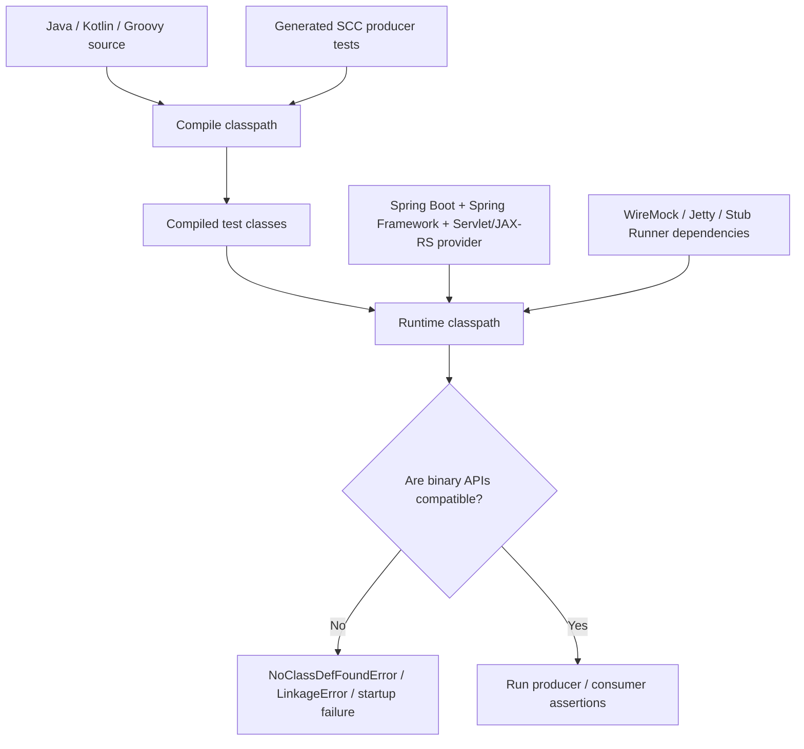
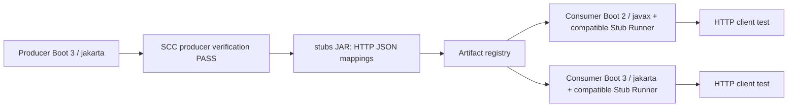
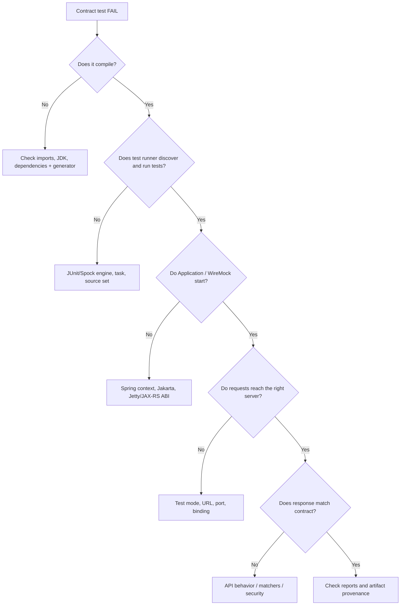
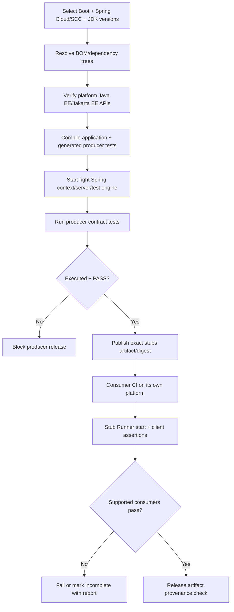

# Checking Library Namespace Transitions for the Active Platform

## 1. Why Does Namespace Affect Spring Cloud Contract?

**Spring Cloud Contract (SCC)** supports contract testing between a **producer** and **consumer**: teams describe HTTP or messaging behavior using the **Groovy/YAML DSL**, generate **producer verification tests**, publish a **stubs artifact**, run **Stub Runner** on the consumer, and integrate both sides into **CI** to catch incompatible API changes.

When upgrading the Java/Spring platform, an unchanged contract can suddenly cause tests to fail to compile or start. For example:

```text
Producer before upgrade:
  Spring Boot 2.7 + Spring Framework 5.3
  javax.servlet.http.HttpServletRequest

Producer after upgrade:
  Spring Boot 3.x + Spring Framework 6.x
  jakarta.servlet.http.HttpServletRequest

Meanwhile:
  Generated tests still import or depend on javax.* libraries
  Stub Runner still pulls an incompatible HTTP server / Jetty library
```

The outcome can be `package javax.servlet does not exist`, `NoClassDefFoundError`, `ClassCastException`, test context startup failures, or Stub Runner failing to load/start HTTP stubs. **This does not necessarily mean the producer violated the contract**: it may be a **binary, namespace, API, or dependency version compatibility error** in the testing toolchain.

Lesson goals:

1. Understand the boundary of the **Java EE `javax.*` → Jakarta EE `jakarta.*`** transition and which packages **must not be renamed**.
2. Select Spring Boot, Spring Framework, Spring Cloud/SCC, JDK, WireMock, JAX-RS, JMS, and test libraries **in compatible combinations**.
3. Inspect source imports, dependency trees, generated test code, runtime classpaths, and stubs JARs.
4. Diagnose **compile, class loading, test engine, server startup, and consumer runtime** failures without corrupting the contract DSL.
5. Design a reproducible upgrade process and CI compatibility matrix.

**Core principle:** **Platform library** namespaces must match the **runtime and APIs the code actually uses**. Never rename every package containing `javax`, never override versions outside the BOM arbitrarily, and never edit HTTP contracts merely to fix Java linkage errors.

## 2. Java EE to Jakarta EE: Package Renaming Does Not Mean Changing All of Java

In modern Jakarta EE generations, many APIs formerly under `javax` moved to `jakarta`. For example:

| Area | Legacy API (Java EE) | Modern API (Jakarta EE) | Additional checks |
| --- | --- | --- | --- |
| Servlet | `javax.servlet.http.HttpServletRequest` | `jakarta.servlet.http.HttpServletRequest` | Servlet container, filters, test mocks |
| Validation | `javax.validation.constraints.NotNull` | `jakarta.validation.constraints.NotNull` | Validator provider, Spring binding |
| Persistence | `javax.persistence.Entity` | `jakarta.persistence.Entity` | JPA provider/Hibernate, entity scanning |
| Lifecycle annotations | `javax.annotation.PostConstruct` | `jakarta.annotation.PostConstruct` | Bean lifecycle, transitive dependencies |
| JAX-RS | `javax.ws.rs.Path` | `jakarta.ws.rs.Path` | Compatible Jersey/CXF version |
| JMS | `javax.jms.Message` | `jakarta.jms.Message` | JMS provider/client and integration |
| WebSocket | `javax.websocket.Session` | `jakarta.websocket.Session` | Server/client runtime |
| Transactions | `javax.transaction.Transactional` | `jakarta.transaction.Transactional` | Distinguish from Spring's transaction annotation |

These are the **Jakarta EE API families that changed namespaces**, not an instruction to replace every `javax.*` wholesale. Packages such as `javax.crypto`, `javax.net`, `javax.sql`, `javax.naming`, `javax.xml.parsers`, and `javax.annotation.processing` belong to Java SE/JDK and **must not be changed mechanically**.

### Examples to Keep Unchanged

```java
import javax.crypto.Cipher;
import javax.net.ssl.SSLContext;
import javax.sql.DataSource;
import javax.xml.parsers.DocumentBuilderFactory;
import javax.annotation.processing.Generated;
```

Examples that migrate under Jakarta EE:

```java
// Spring Boot 2 / Spring Framework 5:
import javax.servlet.http.HttpServletRequest;
import javax.validation.constraints.NotNull;
import javax.persistence.Entity;

// Spring Boot 3 / Spring Framework 6:
import jakarta.servlet.http.HttpServletRequest;
import jakarta.validation.constraints.NotNull;
import jakarta.persistence.Entity;
```

If a find-and-replace changes `javax.crypto.Cipher` to `jakarta.crypto.Cipher`, the project will fail to compile because no such API exists. **Classify by module/specification**, not by string prefix.

## 3. Distinguish Namespace, Maven Coordinates, Package, and Classpath

A common mistake is mixing up four concepts:

| Concept | Example | Meaning |
| --- | --- | --- |
| **Java package/import** | `jakarta.servlet.Filter` | Type name referenced by compiled Java source and bytecode |
| **Maven coordinates** | `jakarta.servlet:jakarta.servlet-api` | Artifact containing the API classes |
| **Runtime classpath** | Servlet, WireMock, Jetty, and test library JARs | What the JVM actually loads at runtime |
| **Contract DSL** | `request { method GET() }` | Describes HTTP/message behavior, not Servlet API imports |

Changing an import to `jakarta.servlet.Filter` while leaving an old `javax.servlet-api` dependency on the classpath does not make `jakarta.servlet.Filter` appear. Conversely, adding the Jakarta API JAR without updating source imports from `javax.servlet.Filter` can still cause compile errors.

Another detail to remember: **Maven groupId can change without the Java package changing**. For instance, different WireMock lines use different artifact coordinates while many Java APIs stay in the `com.github.tomakehurst.wiremock.*` namespace. Do not look for an `org.wiremock.*` or `jakarta.wiremock.*` package just because the JAR's groupId is `org.wiremock`.

### Binary Linkage Errors Are Not Just Import Errors

A library compiled against `javax.servlet.ServletRequest` does not become a `jakarta.servlet.ServletRequest` library merely because the application adds the Jakarta Servlet API. The two classes have **different binary names**. An adapter/filter must match the container's exact API version.



**Only when tests run in the right environment can you evaluate the contract.** If a test dies with `NoClassDefFoundError` before sending a request, that is a classpath/runtime error, not proof that the endpoint returns the wrong response.

## 4. Choose Platforms by Generation—Do Not Mix Majors Arbitrarily

Key milestones:

| Application platform | Spring Framework | Primary Servlet/JPA/Validation namespace | Real-world context |
| --- | --- | --- | --- |
| **Spring Boot 2.x** | **Spring Framework 5.x** | `javax.*` for many Java EE APIs | Legacy systems, typically Java 8/11/17 depending on release |
| **Spring Boot 3.x** | **Spring Framework 6.x** | `jakarta.*` for Jakarta EE APIs | Java 17+ upgrade, Spring Security 6, Jakarta Servlet |
| **Spring Boot 4.x** | **Spring Framework 7.x** | `jakarta.*` continues, plus other API/build changes | New generation; must re-verify the entire toolchain |

**Spring Boot 3 requires Java 17 or higher**; you cannot just rename `javax` to `jakarta` and stay on JDK 11. With Boot 4, do not assume a Boot 3 build is compatible simply because both use `jakarta`: dependencies, modules, and test APIs can change across releases.

### Spring Cloud Contract Cannot Be Upgraded in Isolation

Spring Cloud provides **release trains/BOMs** matched to Spring Boot generations. Historical pairing examples:

| Spring Boot | Corresponding Spring Cloud release train (for orientation) |
| --- | --- |
| 2.7.x | 2021.0.x |
| 3.2.x / 3.3.x | 2023.0.x (matching service release) |
| 3.4.x | 2024.0.x |
| 3.5.x | 2025.0.x |
| 4.0.x / 4.1.x | 2025.1.x (depending on service release) |

This table **illustrates relationships**; it is **not a claim that "all versions are still supported"** and does not replace the official page at deployment time. End-of-OSS-support release trains may still appear in legacy systems; plan upgrades and check support policies. Do not assume "SCC 4.x runs with every Boot 3.x" or "SCC 5.x runs with every Boot 4.x"; verify the **exact version inside the Spring Cloud BOM**.

Versioned references: [Spring Cloud release train / Spring Boot compatibility](https://spring.io/projects/spring-cloud/) and [Spring Boot 3 migration guide](https://github.com/spring-projects/spring-boot/wiki/Spring-Boot-3.0-Migration-Guide).

### Why Is a BOM Needed?

Consider a producer using Spring Boot starters and Spring Cloud Contract Verifier. A BOM coordinates tightly coupled dependencies, yet **a single manual dependency override can break dependency management**. Components needing alignment include Spring Boot, Spring Framework, Spring Cloud Contract, Rest Assured, JUnit, WireMock/Jetty, the JAX-RS implementation, and the validation provider.

**Do not pin Servlet API versions outside the BOM just because the compiler reports a missing class**. Understand which API version the runtime/container genuinely requires and why it is missing from the classpath.

## 5. Which Areas of Spring Cloud Contract Are Affected?

An SCC workflow spans multiple execution areas:

| Area | What runs? | Where namespace can go wrong |
| --- | --- | --- |
| **Producer source** | Controllers, validation, filters, JAX-RS endpoints, message handlers | Java imports and runtime dependencies |
| **SCC DSL parser/generator** | Groovy/YAML contract → tests/stubs | Plugin/core converter version, test framework API |
| **Generated producer tests** | MockMvc, Rest Assured, WebTestClient, JAX-RS/EXPLICIT tests | Imports, base class, test annotations, HTTP adapter |
| **Producer test runtime** | Spring test context, Servlet container, security filter chain | `javax`/`jakarta`, binary linkage, and dependency tree |
| **Stubs JAR** | HTTP mappings, response files, message contracts | Usually resources, though schemas/backend features are versioned |
| **Consumer Stub Runner runtime** | WireMock server, Jetty, message adapters, and Spring context | WireMock/Jetty/Servlet, JUnit, and Spring Boot generation |
| **Consumer client** | DTOs, HTTP clients, listeners | Package migration if consumer also upgrades; response schema must still hold |

**A key feature of SCC:** producer and consumer **can run different platform versions**. For example, a Boot 3 + Jakarta producer and a Boot 2 + Java EE consumer can still communicate over HTTP/JSON if the protocol remains stable. However, the **consumer Stub Runner library must be compatible with the consumer test JVM classpath**, and the stubs JAR must use mappings understood by that runtime. Do not force both services to upgrade simultaneously just because one side's Java namespace changed.

### HTTP Contract Differs from Java Binary APIs

`GET /api/orders/42`, HTTP `200`, `Content-Type: application/json`, and the JSON body form the **wire contract**; they contain neither `javax.servlet` nor `jakarta.servlet`. A producer that changes imports and its servlet container while preserving responses maintains compatibility with older consumers. Thus **translating Java namespaces ≠ forcing HTTP API versioning**.

## 6. Build an Inventory Before Editing Any Imports

For a producer preparing to upgrade from Boot 2 to Boot 3, inspect **multiple layers** instead of only searching `javax.servlet` in `src/main/java`:

```text
order-service/
  pom.xml / build.gradle
  src/main/java/...                # controllers, services, filters
  src/test/java/...                # test base classes, mocks, extensions
  src/test/resources/contracts/... # Groovy/YAML DSL
  build/ or target/                # generated tests & mappings
  CI: producer verifier, stubs packaging, consumer test pipeline
```

This directory layout is **illustrative**; not every project uses identical paths. Gradle may configure a custom `contractsDslDir`; Maven may pick a different source root. To check for namespace transition issues, build a table:

| Component | Current version | Target version | References Java EE APIs? | Plan |
| --- | --- | --- | --- | --- |
| JDK | 11 | 17+ | JVM/bytecode target | Upgrade toolchain first |
| Spring Boot/Framework | 2.7/5.3 | 3.x/6.x | Servlet, validation, JPA | Use compatible BOM |
| SCC Verifier & plugin | Per old Spring Cloud | Per new release train | Generated tests, mocks | Check plugin/test dependencies |
| JAX-RS implementation | Jersey 2/CXF 3 | Jakarta-compatible line | `javax.ws.rs` → `jakarta.ws.rs` | Upgrade provider and base class |
| WireMock | Legacy line | SCC-supported line | Servlet/Jetty internals | Inspect runtime classpath |
| Message broker client | Legacy JMS implementation | Jakarta JMS if needed | `javax.jms` → `jakarta.jms` | Test listener/serializer |
| Consumer Stub Runner | Per consumer runtime | Per new consumer runtime (if upgrading) | Server test classpath | Test stub startup |

**Do not turn this table into a mandatory rigid version list**. Every service has its own baseline; verify which Boot version, test framework, plugin, and transport type the system runs.

### Search Within the Right Scope

An inventory scan using `rg`:

```bash
# Search only; DO NOT perform bulk replace.
rg -n 'javax\.(servlet|validation|persistence|annotation|ws\.rs|jms|websocket)' src
rg -n 'jakarta\.(servlet|validation|persistence|annotation|ws\.rs|jms|websocket)' src
rg -n 'com\.github\.tomakehurst\.wiremock|org\.springframework\.cloud\.contract' src
```

Check Java, Kotlin, Groovy, test classes, custom extensions, configuration, and compiled generated sources. **Do not treat generated sources as files to edit permanently**: if they emit the wrong imports, fix the generator/plugin/test mode/base class or dependency versions and regenerate.

### Look for "Invisible" Imports Too

Source code may never import `javax.servlet` directly while a third-party dependency JAR uses it. Therefore **source scanning is necessary but insufficient**; inspect transitive dependencies and the runtime classpath.

## 7. Migrating a Filter/Validator Across Platforms

A common scenario in producer contract verification is a **filter** processing requests before the controller. With Boot 2:

```java
import javax.servlet.FilterChain;
import javax.servlet.ServletException;
import javax.servlet.http.HttpServletRequest;
import javax.servlet.http.HttpServletResponse;
import javax.validation.constraints.NotNull;
```

With Boot 3:

```java
import jakarta.servlet.FilterChain;
import jakarta.servlet.ServletException;
import jakarta.servlet.http.HttpServletRequest;
import jakarta.servlet.http.HttpServletResponse;
import jakarta.validation.constraints.NotNull;
```

If a custom filter was compiled against `javax.servlet.Filter` while the application runs a Jakarta servlet container, adding both API JARs will not make the Spring container accept the filter: **the interface signatures differ**, so the implementation and legacy dependencies must be upgraded.

### A Boot 3 Code Snippet to Verify a Real Filter

```java
import jakarta.servlet.FilterChain;
import jakarta.servlet.ServletException;
import jakarta.servlet.http.HttpServletRequest;
import jakarta.servlet.http.HttpServletResponse;
import org.springframework.web.filter.OncePerRequestFilter;

import java.io.IOException;

public class CorrelationHeaderFilter extends OncePerRequestFilter {
    @Override
    protected void doFilterInternal(
            HttpServletRequest request,
            HttpServletResponse response,
            FilterChain chain) throws ServletException, IOException {
        String trace = request.getHeader("X-Correlation-Id");
        if (trace != null && !trace.isBlank()) {
            response.setHeader("X-Correlation-Id", trace);
        }
        chain.doFilter(request, response);
    }
}
```

This is **illustrative filter logic**, omitting bean registration, trace ID validation, and security rules. When testing an API with contracts covering response headers, ensure producer verification **actually passes through the filter** in the right test mode. If `MockMvc` runs with filters disabled, contract tests may pass/fail differently than a real HTTP server.

### Do Not Rename Spring Annotations

`org.springframework.web.bind.annotation.GetMapping`, `@RestController`, `@SpringBootTest`, and `@AutoConfigureMockMvc` remain in Spring's namespace; they do not become `jakarta.RestController` or `jakarta.SpringBootTest`. For validation, distinguish `jakarta.validation.Valid`/`NotNull` from annotations provided by Spring.

## 8. JAX-RS: Migrating `javax.ws.rs` to `jakarta.ws.rs` Requires Matching the Provider

A producer may use **Jersey** or **Apache CXF** instead of Spring MVC. With legacy JAX-RS:

```java
import javax.ws.rs.GET;
import javax.ws.rs.Path;
import javax.ws.rs.PathParam;
import javax.ws.rs.Produces;
import javax.ws.rs.core.MediaType;

@Path("/api/orders")
public class OrderResource {
    @GET
    @Path("/{id}")
    @Produces(MediaType.APPLICATION_JSON)
    public OrderDto getOrder(@PathParam("id") String id) {
        return new OrderDto(id, "CONFIRMED");
    }
}
```

On a Jakarta-compatible platform:

```java
import jakarta.ws.rs.GET;
import jakarta.ws.rs.Path;
import jakarta.ws.rs.PathParam;
import jakarta.ws.rs.Produces;
import jakarta.ws.rs.core.MediaType;

@Path("/api/orders")
public class OrderResource {
    @GET
    @Path("/{id}")
    @Produces(MediaType.APPLICATION_JSON)
    public OrderDto getOrder(@PathParam("id") String id) {
        return new OrderDto(id, "CONFIRMED");
    }
}
```

Both snippets are **import and annotation examples**, omitting provider registration, constructors/DTOs, and exception mappers. If an application uses Jersey 2 or CXF 3 with `javax.ws.rs`, changing only `OrderResource` imports to Jakarta can prevent the **old provider from recognizing annotations/resources**. Upgrade the implementation accordingly—such as **Jersey 3** or **CXF 4+** depending on version—and verify the exact servlet/Jakarta API level.

**Note:** the Apache CXF 4.0 migration guide describes moving to Jakarta EE 9.1 and notes Jakarta EE 10 compatibility limits at release time. Therefore "JAX-RS 3.x" and "Spring Boot 3.x" do not guarantee every provider/Jakarta EE release works together. Check **exact dependencies**.

### Test Mode Does Not Automatically Switch from MVC to JAX-RS

Spring Cloud Contract supports several ways to execute generated HTTP tests. If the producer uses JAX-RS while the build still configures `MockMvc` and a Spring MVC base class, tests may return `404` or start the wrong context. Use a test mode/adapter **supported by your SCC version** and a server/test base class that actually serves JAX-RS endpoints.

A common approach to minimize MVC/JAX-RS differences is testing HTTP against a real server on a dynamic port paired with a base class configuring Rest Assured base URI/port. This is a **test environment choice**, not a `javax`/`jakarta` workaround.

## 9. Messaging: Distinguish Jakarta JMS APIs from Wire Contracts

A message contract might read:

```groovy
import org.springframework.cloud.contract.spec.Contract

Contract.make {
    description 'Order confirmed event'
    label 'order_confirmed'
    input {
        triggeredBy('confirmOrder()')
    }
    outputMessage {
        sentTo('orders.confirmed')
        headers {
            messagingContentType(applicationJson())
        }
        body([
            orderId: 'ord-42',
            status: 'CONFIRMED'
        ])
    }
}
```

A producer using legacy JMS may import `javax.jms.Message`; a Jakarta stack uses `jakarta.jms.Message`. **Changing the JMS namespace does not change the JSON message body, destination, or label**. Conversely, a message listener/test adapter using the wrong JMS API generation may fail to receive messages or fail before assertions.

| Component | What to preserve | What changes per platform |
| --- | --- | --- |
| Event contract | Destination, headers, payload, schema | Unchanged solely due to Java package shifts |
| JMS listener/producer | Communication behavior and ack/retry | `javax.jms`/`jakarta.jms` per API/runtime |
| Broker client | Connection, serializer, protocol | Driver/provider compatible with framework |
| SCC messaging test base | Trigger and output capture | Adapter/test binder/API per version |
| Consumer Stub Runner | Emit sample message and assert listener | Runtime dependencies compatible with consumer |

**Do not mechanically apply `javax.jms` changes to Kafka or AMQP**: those integrations have their own APIs like `org.apache.kafka.*` or Spring AMQP. Inspect the **actual transport library** before proposing namespace changes.

## 10. Dependency Management: Inspect with Maven and Gradle

When compilation reports missing `jakarta.servlet`, your first reaction should not be adding both `javax.servlet-api` and `jakarta.servlet-api`. Inspect the dependency tree and BOM.

### Maven — View Resolved Dependencies

```bash
./mvnw -B dependency:tree

# You can filter relevant groups; exact filter behavior depends on plugin version.
./mvnw -B dependency:tree -Dincludes=javax.servlet:javax.servlet-api
./mvnw -B dependency:tree -Dincludes=jakarta.servlet:jakarta.servlet-api
./mvnw -B dependency:tree -Dincludes=org.springframework.cloud:spring-cloud-contract-verifier
```

With Maven on Windows, you can run `mvnw.cmd` in PowerShell/CMD. `dependency:tree` reveals which dependency pulls in `javax.servlet` or `jakarta.servlet`, which version won, and which was omitted via mediation. Do not inspect `pom.xml` directly alone, as test dependencies can pull in legacy JARs.

### Gradle — Inspect Compile/Test Runtime Classpaths

```bash
./gradlew dependencies --configuration compileClasspath
./gradlew dependencies --configuration testRuntimeClasspath

./gradlew dependencyInsight \
  --dependency javax.servlet \
  --configuration testRuntimeClasspath

./gradlew dependencyInsight \
  --dependency wiremock \
  --configuration testRuntimeClasspath
```

Commands are **examples for learners to run in a project**, not outputs executed on this lesson's workspace. For multi-module builds, prepend the module path, e.g., `:order-service:dependencies`. A dedicated test configuration such as `contractTestRuntimeClasspath` may exist depending on plugin/source set; confirm actual tasks/configurations instead of guessing.

### Three Places to Check

1. **Main runtime:** controllers/filters/providers run with matching APIs.
2. **Producer test runtime:** SCC verifier, MockMvc/Rest Assured/JUnit, and test-only dependencies.
3. **Consumer Stub Runner runtime:** WireMock, Jetty, message integrations, and test frameworks on the **consumer classpath**.

If `main` sources are fully on `jakarta` while `testRuntimeClasspath` still holds an incompatible WireMock/Jetty/Servlet library, production may run while **contract tests fail to start**. That is a tool compatibility error, not proof of an API defect.

## 11. Generated Producer Tests: Do Not Edit Output Files to Change Namespaces

SCC may generate Java/Groovy tests in `build/...` or `target/...`. After upgrading Boot, if generated tests still import libraries from an incompatible generation, distinguish:

1. **SCC generator/plugin too old:** emits source or patterns incompatible with the new API.
2. **Test base class still old:** project-authored class imports `javax.servlet` or uses an incompatible adapter.
3. **Test dependencies mismatched:** generated imports are valid, but the JAR containing the class is missing.
4. **Test mode mismatches runtime:** producer uses JAX-RS/WebFlux, yet tests are configured for MockMvc.
5. **Wrong JUnit runner generation:** generated tests use JUnit Jupiter, yet the task only runs JUnit 4 (or vice versa).

Do not assume every `package ... does not exist` is caused by Java EE namespaces. For instance, `org.junit.jupiter.api.Test` is a **JUnit 5** package, not `jakarta.junit.Test`. Likewise, `io.restassured.module.mockmvc.RestAssuredMockMvc` **does not become `jakarta.restassured...`** under Boot 3.

### Reference Spring MVC Test Base Class (Boot 3)

```java
package com.example.orders.contract;

import io.restassured.module.mockmvc.RestAssuredMockMvc;
import org.junit.jupiter.api.BeforeEach;
import org.springframework.beans.factory.annotation.Autowired;
import org.springframework.boot.test.autoconfigure.web.servlet.AutoConfigureMockMvc;
import org.springframework.boot.test.context.SpringBootTest;
import org.springframework.test.web.servlet.MockMvc;

@SpringBootTest
@AutoConfigureMockMvc
public abstract class OrderContractBase {

    @Autowired
    MockMvc mvc;

    @BeforeEach
    void setUp() {
        RestAssuredMockMvc.mockMvc(mvc);
    }
}
```

This base class illustrates Spring MVC + JUnit 5 + Rest Assured MockMvc in a matching version set. **No Servlet API import is needed in this base class**, yet Spring MVC/filters underneath still use the namespace dictated by Spring Framework and the Servlet container.

If the project uses a live HTTP server, the base class can configure Rest Assured HTTP and `@LocalServerPort`; if using WebFlux, a different test adapter is needed. Do not copy the `MockMvc` pattern into a JAX-RS or non-Servlet producer expecting the context to pick up controllers.

### Where Failures Surface

| Stage | Typical error | What to inspect |
| --- | --- | --- |
| Generate | Contract DSL parse/generator error | SCC plugin and DSL syntax/version |
| Compile generated tests | `cannot find symbol` / missing package | Imports + `testCompileClasspath` + base class |
| Test discovery | `0 tests` or `No tests found` | JUnit engine, source sets, task filters |
| Spring context startup | `NoClassDefFoundError`, bean mismatch | Runtime tree, Servlet/JAX-RS implementations |
| HTTP assertion | `404`, `500`, wrong body | Actual request/response and contract semantics |

**Stop at the failing layer:** if generated tests do not compile, do not edit response contracts to fix it; if HTTP tests run and return the wrong body, do not abuse namespace changes as a catch-all explanation.

## 12. JUnit 4, JUnit 5, and Groovy/Spock: Namespace Differs from Engine Issues

A Boot/SCC upgrade often brings **test framework** changes that are easily mistaken for Java EE namespace errors.

```java
// JUnit 4
import org.junit.Test;
import org.junit.Before;

// JUnit Jupiter (JUnit 5)
import org.junit.jupiter.api.Test;
import org.junit.jupiter.api.BeforeEach;
```

JUnit 5 **does not change to `jakarta.junit`**. Similarly, Spock's `spock.lang.Specification` is not part of Jakarta EE. However, generated tests need the right runner/test engine, and the plugin allows selecting `JUNIT`, `JUNIT5`, or `SPOCK` per supported version.

### Gradle JUnit Jupiter Example

```groovy
plugins {
    id 'java'
}

dependencies {
    testImplementation 'org.springframework.boot:spring-boot-starter-test'
}

tasks.named('test', Test) {
    useJUnitPlatform()
}
```

This is a **condensed test config** omitting the Spring Boot plugin/BOM/SCC Verifier; for a separate `contractTest` task, configure JUnit Platform on the **task executing generated contract tests**, not just `test`. Check test reports to verify **executed > 0**.

### If Generated Tests Target JUnit 4

Having only the JUnit Jupiter engine does not guarantee JUnit 4 classes will run. You may need the JUnit Vintage engine if running both side by side during transition, or switch the generator/test base to Jupiter. **Do not add every engine unconditionally**: that increases complexity and can hide framework misconfiguration.

### Spock Also Has Groovy Dependencies

When switching SCC plugin/test frameworks, **Spock/Groovy** and compiler versions must be compatible with Java, Spring, and JUnit Platform. A `NoClassDefFoundError` for Groovy/Spock may be completely unrelated to `javax.servlet`, even if it surfaces during the same upgrade.

## 13. WireMock 2/3, Jetty, and Commonly Misunderstood Packages

WireMock typically serves HTTP stubs for SCC. When upgrading, distinguish **Maven coordinates**, **Java packages**, and **server transport**:

| Topic | Legacy example | Modern example | Do not infer |
| --- | --- | --- | --- |
| WireMock artifact | `com.github.tomakehurst:wiremock-jre8:2.x` | `org.wiremock:wiremock:3.x` | `org.wiremock` does not mean all Java imports changed |
| Java helper class | `com.github.tomakehurst.wiremock.client.WireMock` | Many APIs retain similar packages | Do not rename to `jakarta.wiremock.*` |
| WireMock server | Artifact-selected Jetty/libs | Jetty 11 or appropriate Jetty 12 module | Do not assume every server library supports one Servlet API |
| SCC WireMock integration | Per old SCC/Boot release train | Per new SCC/Boot release train | Do not force WireMock major outside integration support |

WireMock 3 also provides the `org.wiremock:wiremock-jetty12` module for scenarios requiring Jetty 12 per WireMock documentation. **It is not a mandatory dependency for every SCC project**, and adding the JAR does not automatically fix every Jetty error. Align the SCC WireMock module, Boot-managed dependencies, and extension/server startup behavior.

### Why Does `NoClassDefFoundError` Appear at WireMock Startup?

A Spring Boot/Jakarta test may pull in one Jetty generation while the WireMock artifact on the test classpath uses another. The JVM loads duplicate classes or misses dependencies at runtime, causing `NoSuchMethodError`, `ClassNotFoundException`, or `LinkageError`. Identify the **specific failing class**, which JAR provides it, and which dependency pulls that version in.

**What not to do:** add Jetty 9, 11, 12 and both `javax`/`jakarta` servlet APIs "just to have everything" until compilation passes. That creates an unpredictable classpath. The right approach is selecting compatible WireMock/SCC/Jetty versions or isolating WireMock standalone where appropriate.

### Standalone/Shaded Can Help Isolate, But Is Not a Complete Guarantee

The WireMock standalone JAR bundles and **shades** part of its dependencies to reduce collisions. In appropriate projects, running WireMock as a separate process/container can **decouple the server classpath from the consumer Spring test JVM**. Even then, verify stub JSON schemas, extensions, and runtime API versions.

Technical references: [WireMock Download and Installation](https://wiremock.org/docs/download-and-installation/), [WireMock with Spring Boot](https://wiremock.org/docs/solutions/spring-boot-integration/), [WireMock with Jetty 12](https://wiremock.org/docs/jetty-12/).

## 14. Stub Runner: The Consumer Can Use a Different Platform Than the Producer

This is a key strength of contract testing:



**A Boot 3 producer and a Boot 2 consumer can still communicate** as long as HTTP/message schemas, methods, endpoints, headers, and encodings remain compatible. What to verify:

1. The stubs JAR was built from a verified producer revision with a **known version/digest**.
2. Mapping JSON/message contracts use features supported by Stub Runner/WireMock **in the consumer runtime**.
3. The SCC Stub Runner dependency/BOM matches the **consumer's Spring Boot**, rather than copying all producer dependencies.
4. The real consumer client calls the right HTTP stub/destination and runs assertions.
5. If custom WireMock transformers or messaging adapters are used, the consumer runtime has matching extensions/backends.

A Stub Runner library version **does not need** to share the exact version number of the producer JAR; what matters is that it is supported on the **consumer's platform** and can read the published stubs artifact. If the artifact uses newer WireMock features that older Stub Runner cannot understand, test compatibility or use an agreed format/backend.

### Consumer Test Example

```java
import org.junit.jupiter.api.Test;
import org.springframework.beans.factory.annotation.Autowired;
import org.springframework.boot.test.context.SpringBootTest;
import org.springframework.cloud.contract.stubrunner.StubRunnerProperties;
import org.springframework.cloud.contract.stubrunner.spring.AutoConfigureStubRunner;

import static org.assertj.core.api.Assertions.assertThat;

@SpringBootTest(properties =
    "clients.orders.base-url=http://localhost:9090")
@AutoConfigureStubRunner(
    ids = "com.example:order-service:2.0.0:stubs:9090",
    stubsMode = StubRunnerProperties.StubsMode.LOCAL
)
class CheckoutContractTest {

    @Autowired
    OrderClient orderClient;

    @Test
    void readsStatusFromStub() {
        OrderDto order = orderClient.findById("42");
        assertThat(order.status()).isEqualTo("CONFIRMED");
    }
}
```

`OrderClient`/`OrderDto` and `clients.orders.base-url` are application examples, **not generated by SCC**. This requires JUnit 5, a compatible Stub Runner dependency, stubs JAR 2.0.0 in local Maven, and an HTTP client actually targeting port 9090. With `REMOTE`, use a controlled repository and read-only credentials. **Do not copy version 2.0.0 as a hardcoded default for every test**; CI should pass the target producer version from a manifest.

### When Consumer Tests Fail, Inspect the Right Area

| Symptom | Question |
| --- | --- |
| Stub Runner context fails to start | Are Boot/Cloud/WireMock/Jetty dependencies on the right generation? |
| Cannot resolve stubs artifact | Are group/artifact/version/classifier/repository accurate? |
| Stub server runs but returns 404 | Do request matchers, URL, headers, and body align? |
| Valid HTTP response yet consumer deserialization fails | Are consumer DTO/JSON shape/strictness compatible? |
| Fails only when WireMock extension is present | Are extension binary/runtime/configurer compatible? |

**Do not alter `request`/`response` DSL just because consumer Stub Runner throws `NoSuchMethodError` on startup**. Class-loading issues must be fixed via dependency alignment and runtime isolation.

## 15. Does the Namespace in Spring Cloud Contract DSL Change?

A Groovy HTTP contract:

```groovy
import org.springframework.cloud.contract.spec.Contract

Contract.make {
    request {
        method GET()
        url '/api/orders/42'
    }
    response {
        status OK()
        headers {
            contentType(applicationJson())
        }
        body([
            orderId: 'ord-42',
            status: 'CONFIRMED'
        ])
    }
}
```

An equivalent YAML contract:

```yaml
request:
  method: GET
  url: /api/orders/42
response:
  status: 200
  headers:
    Content-Type: application/json
  body:
    orderId: "ord-42"
    status: "CONFIRMED"
```

**You do not change `GET` to `jakarta.GET` or add `jakarta.servlet` into HTTP DSL**. Contracts describe HTTP behavior, not Java Servlet class names. If a contract source embeds Java code, executable Groovy helpers, or custom matchers referencing Java EE classes, **that custom code** may need compatibility upgrades; do not confuse it with standard `request/response` DSL.

### Watch Imports in Custom Test-Base DSL Helpers

A helper containing `import javax.validation.Validator` or `import javax.ws.rs.core.Response` must be reviewed because it runs inside the new producer test environment. Likewise, a custom WireMock extension may need rebuilding against a different runtime API. However, `org.springframework.cloud.contract.spec.Contract` is an SCC package, **not a Java EE package to rename to `jakarta`**.

## 16. Path from Generated Producer Test to HTTP Server

The easiest place to confuse namespaces is usually **not inside the contract source**, but inside the test runtime adapter:

```text
Groovy/YAML contract
    ↓
SCC generator (compatible version)
    ↓
Generated test class
    ↓
JUnit / Rest Assured / MockMvc adapter
    ↓
Spring Test context + Filter chain
    ↓
Servlet API (javax or jakarta) / JAX-RS server / WebFlux
    ↓
Real Controller or Resource
    ↓
HTTP status, headers, body
```

When upgrading Boot 2 to Boot 3 and generated tests return `404`, do not immediately conclude a namespace was renamed incorrectly; the controller might not be component-scanned, the URL context path changed, the base class uses `MockMvc` on a JAX-RS app, or a security filter returned 401.

### Three Questions to Separate Causes

1. **Do tests compile and does the context start?** If not, prioritize dependencies/namespaces/linkage.
2. **Do tests send HTTP requests through the right adapter/server?** If not, fix the test mode/base class.
3. **What response does the producer return compared to the contract?** Only conclude behavior after requests actually run.

When testing JAX-RS/live HTTP, going over a network port can reduce direct MockMvc coupling, yet it **does not replace** upgrading the provider from `javax.ws.rs` to `jakarta.ws.rs` once the application runtime has switched.

## 17. Checking Artifact Names Alone Is Not Enough: Jakarta EE 8 Is a Historical Trap

An easy detail to miss when reading Maven/Gradle dependency trees: **a Maven groupId starting with `jakarta` does not always guarantee the Java classes inside use the `jakarta.*` namespace**.

When Jakarta EE 8 was released, many specifications kept **`javax.*` Java packages** even though the project/spec moved under the Jakarta name. **The mass namespace shift began in Jakarta EE 9**, so you must inspect **specification versions and actual class files**, not just group names.

Illustrative distinction:

```text
Dependency coordinates may start with jakarta.*
         |
         +--> Jakarta EE 8 API version: classes remain under javax.*
         |
         +--> Jakarta EE 9+ API version: classes move to jakarta.*
```

If a developer sees `jakarta.servlet:jakarta.servlet-api` and assumes it contains `jakarta.servlet.Filter`, they can be misled by an **older artifact version**. Conversely, a Java EE provider artifact pinned to an old version can pull `javax.*` even when Boot 3's primary dependency management selects Jakarta.

### Inspecting JAR Contents When Truly Needed

```bash
# Example using the JDK jar tool on a JAR resolved from the build.
jar tf path/to/servlet-api.jar

# Look for package entries:
# javax/servlet/Filter.class  or  jakarta/servlet/Filter.class
```

`jar tf` only lists classes inside an artifact; it does not prove **that exact JAR is what the JVM loads** in every classloader. For complex runtime errors, inspect JDK/test JVM dependency resolution/class-loading diagnostics and class origins.

### Adding a Dependency Does Not Fix ABI Automatically

A `legacy-security-filter.jar` library compiled against `javax.servlet.Filter` remains incompatible with Boot 3 even when `jakarta.servlet-api` is present. You need a **library build targeting Jakarta** or a replacement integration; never assume Maven groupId relocation transforms bytecode automatically.

## 18. Controlled BOM and Plugin Version Management

To keep test dependencies from drifting off the platform, let **Spring Boot manage Spring/Servlet/Test dependencies** and **Spring Cloud BOM manage Spring Cloud modules** in a verified combination.

### Maven — Dependency Management Pattern

```xml
<!-- Illustrative POM excerpt, not a complete POM -->
<properties>
    <java.version>17</java.version>
    <spring-cloud.version>REPLACE_WITH_COMPATIBLE_RELEASE_TRAIN</spring-cloud.version>
</properties>

<dependencyManagement>
    <dependencies>
        <dependency>
            <groupId>org.springframework.cloud</groupId>
            <artifactId>spring-cloud-dependencies</artifactId>
            <version>${spring-cloud.version}</version>
            <type>pom</type>
            <scope>import</scope>
        </dependency>
    </dependencies>
</dependencyManagement>

<dependencies>
    <dependency>
        <groupId>org.springframework.cloud</groupId>
        <artifactId>spring-cloud-starter-contract-verifier</artifactId>
        <scope>test</scope>
    </dependency>
</dependencies>
```

A real combination also needs the Spring Boot parent/BOM, Maven compiler/test plugins, the compatible SCC Maven plugin version, repositories, and application dependencies. When a plugin is declared independently, it is **not automatically versioned by `dependencyManagement` for dependencies**; verify the plugin version/goals separately.

### Gradle — Selecting Test Runtime Without Arbitrarily Pinning Servlet APIs

```groovy
plugins {
    id 'java'
    id 'org.springframework.boot' version 'REPLACE_WITH_COMPATIBLE_BOOT_VERSION'
    id 'io.spring.dependency-management' version 'REPLACE_WITH_PLUGIN_VERSION'
    id 'org.springframework.cloud.contract' version 'REPLACE_WITH_COMPATIBLE_SCC_VERSION'
}

dependencyManagement {
    imports {
        mavenBom 'org.springframework.cloud:spring-cloud-dependencies:REPLACE_WITH_COMPATIBLE_TRAIN'
    }
}

dependencies {
    testImplementation 'org.springframework.cloud:spring-cloud-starter-contract-verifier'
}
```

The `REPLACE_...` strings are intentional: **no single set of version numbers works for every era**. With Boot 4 or newer SCC lines, plugin APIs/dependency management may differ; consult branch-specific docs instead of just bumping major digits.

### What to Avoid When Managing Versions

- Pairing Spring Boot 3 with an SCC plugin/generator from the Boot 2 era without checking compatibility.
- Deliberately adding `javax.servlet:javax.servlet-api` to "fix" `jakarta.servlet` sources.
- Overriding Spring Framework/Jetty/Rest Assured versions outside the BOM due to an unanalyzed import error.
- Leaving two different WireMock versions on `testRuntimeClasspath` without isolation.
- Skipping JUnit Platform/test engine verification, leaving generated tests present with **0 tests executed**.
- Pulling dependencies from ambiguous/untrusted registries or replacing artifact checksums just to "get PASS."

### Verify the Exact Running Versions

Record an **environment record** for the build:

```yaml
# Manifest collected by CI itself; not a default SCC config.
javaRuntime: "17"
springBoot: "3.x.y"
springFramework: "6.x.y"
springCloudTrain: "compatible-service-release"
springCloudContract: "4.x.y"
junitEngine: "Jupiter"
httpTestMode: "MockMvc"
wireMockRuntime: "version-resolved-from-dependency-tree"
servletNamespace: "jakarta.servlet"
producerRevision: "P-542"
```

The `4.x.y` field is only a **historical family example** corresponding to Boot 3; in real CI, populate exact resolved versions instead of guessing from the family. Likewise, if using Boot 4, record the exact Framework/SCC family and JDK per supported versions.

## 19. Namespace and Tool Compatibility Triage Matrix

| Symptom | Suspect area | First check |
| --- | --- | --- |
| `package javax.servlet does not exist` after Boot 3 upgrade | Legacy source imports | Inspect failing file; migrate applicable Jakarta EE APIs |
| `package jakarta.servlet does not exist` | Wrong dependencies/compile classpath | Check BOM and exact `jakarta.servlet-api` version |
| `NoClassDefFoundError: javax/servlet/Filter` | JAR compiled for old Java EE running in Jakarta runtime | Inspect transitive test/runtime dependencies |
| `NoClassDefFoundError: jakarta/servlet/Servlet` | Missing/wrong-generation Servlet API | Check servlet container/Jetty/Boot dependency alignment |
| `ClassCastException` between filter/Servlet APIs | Binary types from two namespaces | Check which JARs contain interface vs. implementation |
| `NoSuchMethodError` on Jetty startup | API/ABI clash across conflicting Jetty versions | `dependencyInsight` for Jetty and WireMock |
| `ClassNotFoundException` in WireMock startup | Wrong WireMock/Jetty/server classpath | Check exact artifact/Java version and stack trace |
| JAX-RS endpoint returns 404 after migration | Provider ignores resource or wrong base class/test mode | Jersey/CXF version, `@Path`, context path, test server |
| `@NotNull` validation does not fire | Mismatched validator/API or validation inactive | `jakarta.validation`, provider, and integration |
| Generated tests lack `org.junit.jupiter` | JUnit Jupiter dependency/engine mismatch | `testCompileClasspath`, plugin, and `useJUnitPlatform` |
| 0 generated tests executed | Test source set/runner/filters | Test reports, `contractTest` task, or Maven test lifecycle |
| Producer test gets 401/403 instead of 200 | Security filter/fixture | Separate auth config from namespace/classpath |
| Consumer Stub Runner fails to start | Consumer Boot/Cloud/Jetty mismatch | Inspect consumer `testRuntimeClasspath`, not just producer |
| WireMock default 404 mapping | Method/path/headers/body mismatch | Inspect request journal and exact stub artifact |
| Messaging listener misses event | Transport adapter/JMS namespace/binding | `jakarta.jms` vs. client provider, destination, headers |
| Producer PASS, consumer FAIL | Contract version/DTO/Stub Runner runtime | Compare binaries/mappings on both sides |
| Sources free of `javax.*` yet still failing | Transitive JAR or generated test code | Runtime dependency tree and generated classes |

### Distinguishing Library Compatibility Errors from Contract Errors



Never loosen contract matchers to bypass a `NoClassDefFoundError`; and never add a `jakarta.*` JAR to mask an invalid response body once tests are actually running.

## 20. Boot 2 → Boot 3 Migration Workflow for Producers Using SCC

A safe plan has clear verification checkpoints:

1. **Lock the baseline:** run producer verification and consumer Stub Runner before upgrading; save contract inventory, test counts, and the current stubs artifact.
2. **Inventory dependency/tool versions:** Java, Boot, Framework, Spring Cloud/SCC, JUnit/Spock, Rest Assured, WireMock, Jetty, JAX-RS/JMS providers.
3. **Upgrade JDK/toolchain first:** Boot 3 requires Java 17+; verify IDE, CI runners, compiler target, and test JVM.
4. **Pick the Spring Cloud release train matching target Boot:** use verified BOM/plugin versions; avoid upgrading SCC independently.
5. **Classify `javax.*` imports:** migrate only relevant Jakarta EE APIs; keep Java SE `javax.*` such as crypto/sql/net.
6. **Upgrade providers/runtimes:** JAX-RS, Hibernate/JPA, validation, Servlet container, JMS if the project actually uses them.
7. **Align main and test classpaths:** hunt down old transitive artifacts, WireMock/Jetty, and Spring test libraries.
8. **Regenerate SCC producer tests:** never edit generated files; check imports, base class, test mode, and JUnit engine.
9. **Run full-scenario producer verification:** confirm tests **executed > 0**, comparing HTTP status/headers/body and message contracts against baseline.
10. **Build new stubs artifact** from the same passing contracts and producer revision; pin version/digest.
11. **Run the consumer matrix** across supported consumer versions, including consumers still on pre-Boot 3 releases.
12. **Run integration/security tests** whenever filter chains, JAX-RS resource configs, validation, or broker adapters changed.
13. **Verify deploy/rollback:** the deployed artifact shares the same provenance and remains compatible with supported consumers.

### A Migration Decision to Avoid

Suppose `order-service` migrates from Boot 2 → 3 and producer tests report a `javax.servlet.Filter` failure. The team must not change the contract response from `200` to `500` so tests pass under the broken state. **Contracts specify what the API must do; toolchain migration determines whether tests can run**. The two must be fixed independently.

### Preserving the Producer–Consumer Contract Across the Upgrade

```text
Before:
  Producer Boot 2 (javax)
  GET /api/orders/42 -> {orderId,status}
  Consumer Boot 2 / legacy Stub Runner

After:
  Producer Boot 3 (jakarta)
  GET /api/orders/42 -> {orderId,status}
  Consumer Boot 2 or Boot 3, on its own schedule

Requirements:
  Producer verification PASSES against supported legacy contracts
  Consumer tests PASS against stubs generated from the new producer
```

If the HTTP body stays unchanged, changing Java namespaces does not force consumers to alter DTOs. Conversely, if a serializer/filter upgrade changes `status` to `state`, that is an **independent breaking change** requiring contract review and versioning.

## 21. Practice Exercise A — Classifying Valid and Invalid Imports

### Context

A team is upgrading producer `order-service` from Spring Boot 2.7 to 3.x. A developer ran a global replace of `javax.` to `jakarta.`. Afterward, the code contains:

```java
import jakarta.servlet.http.HttpServletRequest;
import jakarta.validation.constraints.NotNull;
import jakarta.persistence.Entity;

import jakarta.crypto.Cipher;
import jakarta.net.ssl.SSLContext;
import jakarta.sql.DataSource;
import jakarta.annotation.processing.Generated;
```

**Task:** mark which imports are valid in Boot 3 and which must be reverted.

| Import | Valid or invalid after migration? | How to fix |
| --- | --- | --- |
| `jakarta.servlet.http.HttpServletRequest` | Valid under Jakarta Servlet | Verify API/container version |
| `jakarta.validation.constraints.NotNull` | Valid under Jakarta Validation | Verify validation provider |
| `jakarta.persistence.Entity` | Valid under Jakarta Persistence | Verify JPA/Hibernate |
| `jakarta.crypto.Cipher` | **Invalid** | Keep `javax.crypto.Cipher` |
| `jakarta.net.ssl.SSLContext` | **Invalid** | Keep `javax.net.ssl.SSLContext` |
| `jakarta.sql.DataSource` | **Invalid** | Keep `javax.sql.DataSource` |
| `jakarta.annotation.processing.Generated` | **Invalid** | Keep `javax.annotation.processing.Generated` |

**Explanation:** the last four packages belong to Java SE/JDK, not migrated Jakarta EE APIs. Even when using IDE or OpenRewrite migration recipes, review diffs carefully to avoid altering packages used by code generators or other tools.

### Extension: Same Annotation Name with Different Semantics

Compare:

```java
import jakarta.transaction.Transactional;

// Or using Spring's abstraction:
import org.springframework.transaction.annotation.Transactional;
```

You cannot import both `Transactional` annotations into the same Java file and use `@Transactional` ambiguously. Choose the one matching your framework/semantics and test transaction behavior. Migrating `javax.transaction.Transactional` to `jakarta.transaction.Transactional` for Jakarta APIs **does not require** replacing every Spring `@Transactional`.

## 22. Practice Exercise B — Fixing Producer Contract Tests After Upgrade

### Prompt

The producer uses Spring MVC, Boot 3, JUnit 5, and SCC Verifier. The original contract remains:

```groovy
import org.springframework.cloud.contract.spec.Contract

Contract.make {
    description 'Read order status'
    request {
        method GET()
        url '/api/orders/42'
    }
    response {
        status OK()
        headers {
            contentType(applicationJson())
        }
        body([
            orderId: 'ord-42',
            status: 'CONFIRMED'
        ])
    }
}
```

After migration, CI reports:

```text
error: package javax.servlet.http does not exist
error: cannot find symbol HttpServletRequest

.../src/test/java/.../OldRequestFilter.java
import javax.servlet.http.HttpServletRequest;
```

### Repair Process

1. Identify `OldRequestFilter` as project-managed **test source**, not contract DSL.
2. Compare `javax.servlet` imports in the filter against Spring Boot 3's Jakarta Servlet API; switch to `jakarta.servlet` where appropriate.
3. Inspect `testCompileClasspath`/`testRuntimeClasspath`: is a legacy dependency pulling in Java EE Servlet?
4. Ensure SCC plugin/Verifier and Rest Assured MockMvc are Boot 3-compatible.
5. Regenerate tests; inspect generated Java imports and the base class.
6. Run the exact task/lifecycle that **executes** producer contract tests, not just source generation.
7. Check reports: `GET /api/orders/42` executed and returned `200` with `status=CONFIRMED`.

**Do not edit the contract `response` just because filter code failed to compile.** If fixing namespaces yields 401 instead, investigate filter/security config and test fixtures. Only if it returns 200 with a missing `status` field is there reason to investigate producer compatibility.

### A Harder Follow-Up Failure

Suppose the filter now uses `jakarta.servlet`, yet running tests throws:

```text
java.lang.NoClassDefFoundError: javax/servlet/Filter
    at ... LegacySecurityAdapter ...
```

**Guidance:** check whether the `LegacySecurityAdapter` JAR was compiled against `javax.servlet.Filter` and whether a Jakarta-compatible release exists. Merely adding `javax.servlet-api` may silence the initial missing-class error without making the adapter work with the new Servlet container. Upgrade/replace the adapter or isolate the incompatible component.

## 23. Practice Exercise C — Boot 3 Producer, Boot 2 Consumer, and Stub Runner

### Context

`order-service` (producer) upgraded to Boot 3.5/Jakarta and published its stubs artifact:

```text
com.example:order-service:2.0.0:stubs
```

`checkout-service` stays on Boot 2.7 and uses a Stub Runner **compatible with Boot 2.7**. HTTP contract:

```yaml
request:
  method: GET
  url: /api/orders/42
response:
  status: 200
  headers:
    Content-Type: application/json
  body:
    orderId: "ord-42"
    status: "CONFIRMED"
```

### Question 1 — Must the Consumer Switch `javax` to `jakarta` Immediately?

**No**, if the consumer remains on Boot 2.7 and only calls the producer over HTTP/JSON. Two separate JVMs do not exchange Java `HttpServletRequest` objects; they exchange HTTP bytes. A namespace change **on the producer** does not force the consumer to upgrade its application libraries simultaneously.

### Question 2 — Can It Use Stub Runner Version 2.0.0 Matching the Producer?

**Do not infer that from the producer version.** `2.0.0` is the **`order-service` artifact** version, not an SCC version. The consumer should use the SCC Stub Runner library compatible with the **consumer's own Boot 2.7**, while verifying it can read mappings inside stubs artifact 2.0.0. If the mappings use new WireMock features unsupported by older Stub Runner, adjust strategy or plan a consumer toolchain upgrade.

### Question 3 — What If Consumer Tests Fail on Jetty Classes Before Any Request?

Investigate:

```text
Consumer Boot 2.7 testRuntimeClasspath
    → Compatible Spring Cloud Contract Stub Runner?
    → WireMock artifact version?
    → Jetty dependency family?
    → Presence of javax.servlet / jakarta.servlet?
    → JUnit engine / test runner?
```

Do not modify contract response `status` or `Content-Type` when WireMock has not even started. Running Stub Runner/WireMock standalone in a separate process/container is possible if architecture and versions permit, provided API/mapping compatibility is verified.

### Question 4 — Which Version Should Be Tested?

The consumer must download **exact stub version 2.0.0** if verifying the new 2.0.0 producer; passing with `1.9.0:stubs` only proves compatibility with the old stub. Record version/digest in CI and assert the real client deserializes `status`.

### Question 5 — What About JMS Message Contracts?

If the producer uses Jakarta JMS and the consumer uses an older JMS provider, interoperability depends on **broker protocols/client libraries and payloads**, not Java namespaces alone. Run integration tests with a real broker/consumer client and messaging contract tests with the proper adapters.

## 24. CI Compatibility Gates: Source, Bytecode, and Contract Behavior

During platform upgrades, a CI pipeline can enforce these gates:



### Minimum Quality Gates

| Gate | What to check | Fail when |
| --- | --- | --- |
| **Compatibility matrix** | Boot/Cloud/SCC/JDK combo is a supported combination | Unclear versions or mixed majors |
| **Classpath/API** | Required Java EE/Jakarta EE classes are actually present | Missing/wrong binary API |
| **Generated test compilation** | Base class/runner and code generator align | Missing imports, test source errors |
| **Producer test execution** | Tests actually run, counts/required IDs valid, passing | 0 tests, skipped required, assertion failures |
| **Stubs packaging** | Artifact built from verified contract revision | Missing mappings/wrong format/version |
| **Consumer Stub Runner** | Runtime fits consumer, loads right stub | Classpath error, stale artifact, startup failure |
| **Consumer behavior** | Real client/listener runs and asserts scenarios | Wrong response/deserialization/listener failure |
| **Release provenance** | Deployed executable/image matches tested code | Unverified new artifact |

### Example Team-Designed CI Report

```yaml
# Sample data; CI must capture real versions and counts.
producer:
  service: order-service
  boot: 3.5.x
  springFramework: 6.x
  servletNamespace: jakarta.servlet
  sourceRevision: P-542
  contractTest:
    generated: 8
    executed: 8
    failed: 0
stubs:
  coordinates: "com.example:order-service:2.0.0:stubs"
  sha256: "<computed-by-CI>"
consumer:
  service: checkout-service
  boot: 2.7.x
  servletNamespace: javax.servlet
  stubRunnerCompatibility: PASS
  contractTestsExecuted: 3
  result: PASS
```

This is an **illustrative schema**, not a default Spring Cloud Contract file. Never mark `PASS` by guessing versions; collect data from real jobs. Likewise, if consumers have not run against the new stubs artifact yet, mark `NOT_RUN`/`INCOMPLETE` rather than `PASS` just because producer verification is green.

### Security Note After Upgrading

Spring Security/filter dispatch behavior can also change when moving from Boot 2 to 3. A producer contract test using MockMvc with security disabled does not prove JWT, authorization, or gateway rules work. Add appropriate **security integration tests** instead of loosening contract matchers to mask unexpected 401/403 responses.

## 25. Cases Invisible in Import Lists

A project can contain zero `javax.servlet` references in its source yet still fail at runtime because references live inside **bytecode, reflection strings, ServiceLoader configs, or library metadata files**.

### Bytecode of a Third-Party JAR

```bash
# JDK tool example; replace path with a known JAR from the dependency tree.
jdeps -verbose:class path/to/legacy-adapter.jar

# Inspect signatures/public methods of a known class only:
javap -classpath path/to/legacy-adapter.jar \
  com.example.legacy.LegacyFilter
```

`jdeps` identifies class-level dependencies referenced in bytecode; `javap` reveals method signatures that may expose `javax.servlet` or `jakarta.servlet`. No static tool catches **every reflection/dynamic class load**; when unclear, combine stack traces, dependency resolution, live test runs, and library documentation.

### Class Names Configured as Strings

A codebase may instantiate objects via reflection:

```java
// Illustrates legacy code to inspect, not a recommended configuration:
Class.forName("javax.servlet.http.HttpServletRequest");
```

Updating imports in other files will not update string literals; check what reflection is doing and which provider API is active. Similarly, registries/custom extensions or class names in YAML, XML, and properties may hold old class names.

### ServiceLoader, Container Initializers, and Extensions

A library may register implementations via `META-INF/services/...` or Spring metadata keyed by class/interface name. If a provider still declares a `javax.servlet` service interface while the runtime expects `jakarta.servlet`, the application may fail to register the extension. **Never hand-edit ServiceLoader files inside third-party JARs** as a release fix; upgrade the dependency or rebuild the extension for the target API.

### Java EE 8 `javax` and Jakarta EE 9+ `jakarta` Are Not Aliases

Sometimes teams have two versions of a library on the test classpath simultaneously, one using `javax` and one using `jakarta`. Both can exist as **two independent types**, yet an object implementing the old interface **cannot be cast** to the new interface. If an adapter supports bridging, that requires a **deliberately designed and tested compatibility mechanism**, not default JVM behavior.

## 26. Namespace Transition Checklist Before Release

### Platform and Dependencies

- [ ] Recorded exact JDKs for build/test and production runtime.
- [ ] Spring Boot, Spring Framework, Spring Cloud release train, and SCC plugin/runtime belong to a **documented compatible combination**.
- [ ] If upgrading to Boot 3, Java 17+ requirement is satisfied.
- [ ] Repository-wide blind string replacement `javax.` → `jakarta.` was not used without classification.
- [ ] Java EE APIs (Servlet, Validation, JPA, JAX-RS, JMS) use the platform-appropriate namespace.
- [ ] Java SE packages (`javax.crypto`, `javax.net`, `javax.sql`, `javax.xml.parsers`, `javax.annotation.processing`) remain intact.
- [ ] Verified **actual artifact versions/classes**, not just the `jakarta.*` Maven groupId.
- [ ] Inspected compile/test/runtime dependency trees, including transitive JARs.
- [ ] No legacy adapters/filters/JAX-RS/JMS providers using `javax` remain where runtime requires `jakarta`.
- [ ] No Servlet/Jetty/Framework versions overridden outside the BOM without compatibility review.
- [ ] Custom extensions, generated sources, reflection strings, and ServiceLoader entries checked where relevant.

### Spring Cloud Contract and Generated Producer Tests

- [ ] Groovy/YAML contract DSL still accurately describes **HTTP/message behavior**, without changing status/body just to bypass missing classes.
- [ ] SCC Maven/Gradle plugin and verifier versions match the producer Boot/platform.
- [ ] Generated producer tests were regenerated from the **exact contract revision**.
- [ ] Source imports, test base classes, and test mode (MockMvc/EXPLICIT/WebTestClient/JAX-RS as appropriate) have been verified.
- [ ] JUnit 4/JUnit 5/Spock engine matches generated tests; the test runner actually discovers them.
- [ ] Real producer HTTP or messaging implementations are invoked, not just mocked responses.
- [ ] Test reports confirm **required scenarios executed and passed**, not 0 tests executed.
- [ ] When producer tests fail, **compile/runtime/toolchain** errors are distinguished from **contract assertion** failures.
- [ ] JAX-RS resources, Servlet filters, validation/security, or JMS adapters have matching integration tests when runtimes change.

### Stub Runner and Consumer

- [ ] `group:artifact:version:stubs` artifact was built from verified producer code/contract revision.
- [ ] Consumer Stub Runner dependency fits the **consumer's platform**, without blindly copying the producer's classpath.
- [ ] WireMock/Jetty/test containers are compatible on the consumer runtime with no uncontrolled conflicting major versions.
- [ ] Consumer downloads the exact stubs artifact/version/digest, not stale caches when evaluating a new candidate.
- [ ] WireMock mappings/version-specific features are understood by the consumer runtime.
- [ ] Real HTTP client or message listener runs against the right port/destination and asserts responses/side effects.
- [ ] When producer and consumer are on different Boot generations, actual **wire contract** compatibility was verified rather than assuming both must match `javax` or `jakarta`.
- [ ] Supported consumers have a test matrix and clear deprecation/rollback rules.
- [ ] Deployed artifacts trace their revision/digest back to producer verification and published stubs.

### CI and Security

- [ ] CI records resolved JDK, Boot, Cloud/SCC, WireMock/Jetty versions, and source revisions.
- [ ] Dependency caches/artifacts are pinned/verified to prevent environment drift between builds.
- [ ] Registry credentials are securely managed and never hard-coded into contracts/test logs.
- [ ] Real security tests (JWT, roles, gateway, Servlet filters) are also executed after framework/security upgrades.
- [ ] Builds FAIL when required contract tests, test engines, or artifacts are missing; never treat "BUILD SUCCESS" without evidence as PASS.

## 27. Version-Specific References and Conclusion

Do not rely on a version table copied from another project. For real projects, consult **documentation matching your locked dependencies/BOM**:

- [Spring Boot 3.0 Migration Guide](https://github.com/spring-projects/spring-boot/wiki/Spring-Boot-3.0-Migration-Guide): Java 17, Spring Framework 6, Jakarta EE migration, and dependency review.
- [Spring Cloud — Supported release train / Boot compatibility](https://spring.io/projects/spring-cloud/): choosing a release train per Spring Boot and support policy.
- [Spring Cloud Contract Reference](https://docs.spring.io/spring-cloud-contract/reference/): DSL, producer verification, Stub Runner, test frameworks, and build integration.
- [Apache CXF 4 Migration Guide](https://cxf.apache.org/docs/40-migration-guide.html): JAX-RS `javax` → `jakarta`, limitations, and runtime dependency considerations.
- [WireMock Documentation](https://wiremock.org/docs/): dependency coordinates, WireMock/Jetty runtimes, and stub JSON format.
- [WireMock Jetty 12 Integration](https://wiremock.org/docs/jetty-12/): dedicated module for Jetty 12 and known limitations.

Linked documentation can evolve over time; a release train once paired with an older Boot version may now be past OSS support. **Check documentation matching the major/minor versions and support policy on the date of your upgrade**, rather than assuming every version listed in examples is currently recommended.

### Final Summary Table

| What are you changing? | Does the namespace change? | Required evidence |
| --- | --- | --- |
| `javax.servlet` → `jakarta.servlet` | **Yes** when moving to a Jakarta Servlet runtime | Imports + compatible Servlet API/container |
| `javax.validation`/`persistence` → `jakarta.*` | **Yes** per Jakarta EE stack | API + matching provider/Hibernate version |
| `javax.ws.rs` → `jakarta.ws.rs` | **Yes** alongside a new JAX-RS provider | Resources and live HTTP tests |
| `javax.jms` → `jakarta.jms` | **Yes** when using Jakarta JMS APIs | Client/broker adapters and messaging tests |
| `javax.crypto`/`sql`/`net` | **No** | Preserve Java SE/JDK packages |
| `org.springframework.cloud.contract.spec.Contract` | **Does not change to Jakarta** | Compatible SCC plugin/generator |
| WireMock Maven groupId | May vary by artifact/version | Inspect groupId **and** Java packages/Jetty dependencies |
| JUnit 4 → JUnit Jupiter | Changes test API/engine, **not Jakarta** | Generated tests execute |
| Producer Boot 2 → 3 with unchanged HTTP schema | Java namespace changes; wire contract can stay | Producer + consumer tests on exact artifacts |

**Remember:** Renaming `javax.*` to `jakarta.*` is only valid when **it is a migrated Jakarta EE API** and **the active runtime actually uses the new API**. With Spring Cloud Contract, you must also verify the JDK, Boot/Framework, release train, plugin/generator, test base, JUnit engine, JAX-RS/JMS providers, WireMock/Jetty, and Stub Runner runtime on **each side**. Only when the producer generates, runs, and passes tests from source contracts, and the consumer loads the right stubs artifact and passes assertions, does the team have proof that the library upgrade **did not break any verified API commitments**.
