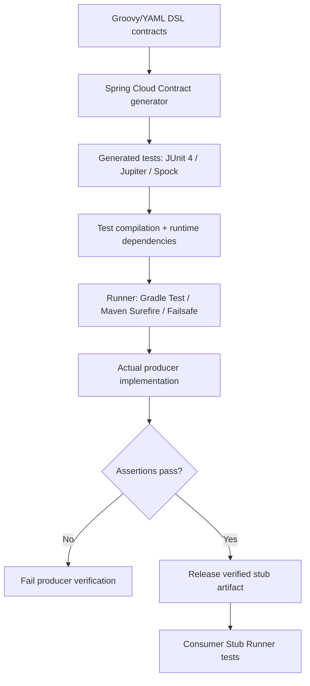
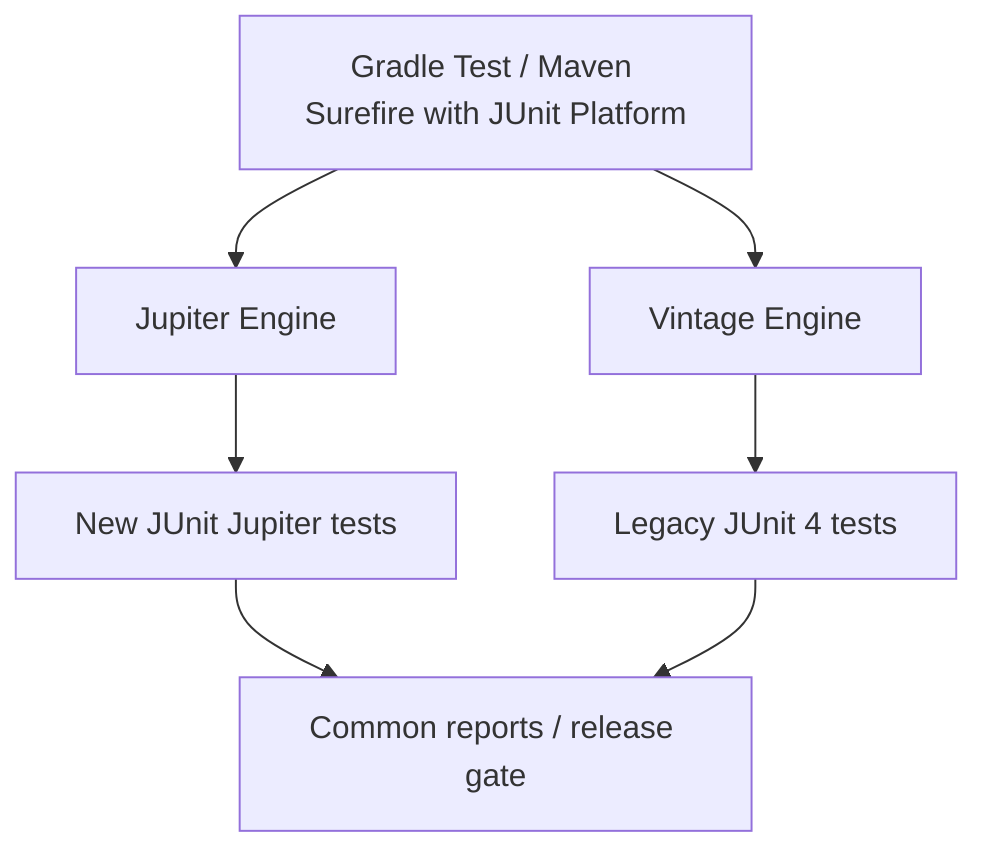
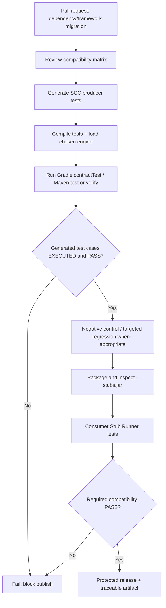

# Migrating Legacy Tests to JUnit or Appropriate Modern Tools

## 1. The Problem: Unchanged Contracts, Outdated Test Runners

Suppose **Payment Service** is the producer and **Checkout Service** is the consumer. Both services agree on HTTP and messaging behavior via **Spring Cloud Contract**: **Groovy/YAML DSL** files are processed by the plugin into producer verification tests, stub mappings, or message stubs. The producer must verify the real implementation before releasing `payment-service-1.2.0-stubs.jar`; the consumer uses **Stub Runner** to run integration tests.

A legacy project may still have:

- Generated tests using **JUnit 4** `org.junit.Test` and `@RunWith(SpringRunner.class)`.
- Base classes using `@Before`, `@Rule`, `@ClassRule`, or legacy MockMvc/Rest Assured libraries.
- Contract test suites written in **Spock 1.x**, running via a JUnit 4 runner.
- Maven Surefire/Gradle pipelines supporting only one engine and missing classes generated under Spring Cloud Contract conventions.
- Spring Boot, Spring Cloud Contract, Groovy, Spock, JUnit Platform, Java toolchain, and WireMock dependencies that drifted out of alignment after upgrading one library.

During upgrades, failures surface in two ways: generated tests **fail to compile**, or even more dangerously, **the build turns green without running any generated tests**. Some teams try editing the generated Java code directly, switching frameworks without updating the runner, or deleting matchers to silence errors. None of those are sustainable fixes.

This lesson belongs to the **Tool Compatibility** chapter of the **Spring Cloud Contract** module. Its focus is **migrating legacy tests to JUnit or appropriate modern tools** while preserving contract semantics and ensuring producer verification actually executes.

After this lesson, you can:

1. Distinguish **contract DSL**, **generated test framework**, **test runner/engine**, **test base class**, and **consumer stub tests**.
2. Choose between **JUnit Jupiter**, a transitional phase with **JUnit Vintage**, or a **JUnit Platform-compatible Spock version**.
3. Migrate base classes from JUnit 4 to Jupiter without losing Spring/MockMvc setup.
4. Configure **Gradle `contractTest`** and **Maven Surefire/Failsafe** to run generated tests.
5. Identify Java/Spring Boot/Spring Cloud Contract/Groovy/Spock/WireMock version compatibility issues.
6. Evaluate a migration using test reports, negative controls, contract coverage, and CI publication gates.

## 2. Five Layers to Keep Separate



| Layer | Role | How does a JUnit migration affect it? |
| --- | --- | --- |
| **Groovy/YAML DSL** | Describes request/response or `input`/`outputMessage` | **Usually keeps obligation content unchanged** |
| **Generator / SCC plugin** | Emits Java/JUnit or Groovy/Spock tests and mappings | Needs `testFramework` configured accurately |
| **Base class and fixtures** | Boots Spring context, MockMvc, mocks, data, message triggers | May need updated annotations, hooks, and setup |
| **Runner/engine** | Discovers and runs test methods | Must have matching Jupiter/Vintage/Spock engine |
| **Consumer test / Stub Runner** | Verifies HTTP client or message subscriber against stubs | Can upgrade JUnit independently of the DSL |

**Changing the test framework does not mean changing the API contract.** If an expectation flips from `status: PAID` to `PENDING` just to make generated tests pass, that is a business/API change, not a framework migration.

### 2.1. Three Terms Easily Confused: Platform, Jupiter, Vintage

- **JUnit Platform**: the infrastructure that discovers and executes `TestEngine`s.
- **JUnit Jupiter**: the API and engine for writing/running JUnit 5-style tests, e.g., `org.junit.jupiter.api.Test`.
- **JUnit Vintage**: the engine that runs JUnit 3/4 tests on JUnit Platform, useful during transition phases.

Therefore, `useJUnitPlatform()` in Gradle **does not automatically convert** JUnit 4's `org.junit.Test` annotation to Jupiter. If generated tests still target JUnit 4, you need a valid way to run JUnit 4—such as Vintage on Platform—or **switch the generator to JUnit 5 and regenerate**.

## 3. Inventory Before Touching Configuration

Do not start by randomly changing versions in `pom.xml` or `build.gradle`. Record:

| Component | Mandatory question |
| --- | --- |
| Java/JDK | Which JDK runs the build? Are toolchain and CI runner identical to local? |
| Spring Boot/Cloud | Which release train is supported by the organization? |
| Spring Cloud Contract | Do Maven/Gradle plugin, verifier, Stub Runner, and BOM share a compatible version line? |
| Generated tests | Are they generating `org.junit.Test`, `org.junit.jupiter.api.Test`, or `spock.lang.Specification`? |
| Base class | Does it use `@RunWith`, `@Before`, Rules, Spring context, or Groovy `setup()`? |
| Test mode | `MOCKMVC`, `EXPLICIT`, reactive/WebTestClient, or messaging adapter? |
| Build tool | Gradle `contractTest` or Maven `test`/`verify`/`Failsafe`? |
| Test engine | Which Jupiter/Vintage/Spock engine is present on the runtime classpath? |
| Executed tests | How many generated cases are currently executed, skipped, or failed in reports? |
| Consumer | Must JUnit 4/Spock clients upgrade at the same time as the producer? |

### 3.1. Do Not Guess Versions from Framework Names

An older Spring Cloud Contract release might default to JUnit 4, whereas another plugin release configures or defaults to JUnit 5. Documentation across releases may also state different defaults.

**Rule:** Choose versions from the **compatibility matrix for your exact Spring Boot/Spring Cloud Contract release**, pin BOM/plugin/test libraries, and **read the actual generated sources**. Never rely on "the new version surely generates JUnit 5" or copy default values from another version's docs.

### 3.2. Establish a Comparable Baseline

Before migrating:

1. Pin the producer commit, contract source revision, and dependency/plugin versions.
2. Run the legacy contract verification suite in a working environment.
3. Record the count of generated contract methods, pass/fail/skipped tests, and execution duration.
4. List covered consumer groups, HTTP endpoints, and message contracts.
5. Record the stub artifact GAV/classifier, e.g., `com.example:payment-service:1.2.0:stubs`.

After migration, **the number of generated files may differ** and still be valid, provided all key obligations remain verified. Do not compare `*.java` file counts alone, because one generated class can hold multiple test methods.

## 4. Which Migration Path Should You Choose?

| Path | Suitable when | Pros | Risks/limitations |
| --- | --- | --- | --- |
| **Keep JUnit 4 temporarily** | New tooling is not ready yet | Minimal immediate disruption | Accumulates framework debt; may clash with new JDK/Boot |
| **JUnit 4 via Vintage** | Running legacy tests on JUnit Platform while migrating gradually | Can run JUnit 4 and Jupiter side by side | Vintage is a bridge; requires compatible JUnit 4 runtime |
| **Generate JUnit 5 Jupiter** | Team primarily writes Java/Spring tests and wants unification | Consistent lifecycle/extension APIs aligned with modern test platform | Must update base classes, engines, test tasks, and dependencies |
| **Keep/upgrade Spock onto Platform** | Team relies heavily on Groovy specs, data tables, Spock mocking | Preserves BDD style while running on JUnit Platform | Must align Spock–Groovy–JDK–Spring versions |
| **Pick another framework for manual tests** | Consumers have specific needs, e.g., TestNG/Kotest | Fits existing codebase | Not a built-in `testFramework` target for the SCC generator by default |

**With Spring Cloud Contract, not every JVM framework is a built-in code generation target.** Plugin docs mention Spock, JUnit 4 (`JUNIT`), and JUnit 5 (`JUNIT5`); TestNG/Kotest can be used for **hand-written tests** with an appropriate runner, but never type an arbitrary name into `contracts.testFramework` expecting the generator to understand it.

## 5. Low-Risk Roadmap: Go Layer by Layer


A sensible sequence:

1. **Inventory** all generated tests and test utilities.
2. **Standardize engine/runner** before generating new tests: can Maven Surefire/Gradle run JUnit Platform?
3. **Migrate base classes and lifecycle hooks** to JUnit Jupiter or prepare compatible Spock bases.
4. **Configure the generator** for the new framework; never edit files directly under `build/` or `target/`.
5. **Run the right test task** and compare reports.
6. **Negative control:** intentionally make the producer violate a contract and verify tests fail.
7. **Run consumer Stub Runner tests** and confirm the stub artifact still captures the right behavior.
8. **Clean up legacy dependencies** once no JUnit 4 tests need Vintage.

Migration does not need to land in one massive PR. Modules/services can migrate incrementally to limit blast radius, provided CI never drops verification during the hybrid phase.

## 6. JUnit 4 → Jupiter: Annotation and Lifecycle Changes

| JUnit 4 | JUnit Jupiter | Notes |
| --- | --- | --- |
| `org.junit.Test` | `org.junit.jupiter.api.Test` | Not just an import swap; different engine |
| `@RunWith(SpringRunner.class)` | `@ExtendWith(SpringExtension.class)` | `@SpringBootTest` typically already includes `SpringExtension` via meta-annotation; avoid redundant config |
| `@Before` | `@BeforeEach` | Runs before each test method |
| `@After` | `@AfterEach` | Cleans up fixtures after each method |
| `@BeforeClass` | `@BeforeAll` | Typically static unless using `PER_CLASS` lifecycle |
| `@AfterClass` | `@AfterAll` | Similar to `@BeforeAll` |
| `@Ignore` | `@Disabled` | Never leave disabled indefinitely |
| `@Category` | `@Tag` | Update CI filters/tags as well |
| `@Test(expected = X.class)` | `assertThrows(X.class, () -> ...)` | Verify the exact throwing statement |
| `@Rule`/`@ClassRule` | Extension model, `@RegisterExtension`, or custom utilities | No 1:1 replacement for every Rule |
| `Assert.assertEquals(...)` | `Assertions.assertEquals(...)` | AssertJ/Hamcrest can remain if appropriate |

**Do not blindly find-and-replace `@RunWith` → `@ExtendWith` codebase-wide**: custom JUnit 4 runners like `Parameterized` and `Suite` need separate evaluation. JUnit Jupiter provides `@ParameterizedTest`, `@MethodSource`, and rich extension points, yet no mechanical transformation fits every runner.

### 6.1. Hand-Written Test Example Before Migration

```java
import org.junit.Before;
import org.junit.Test;
import org.junit.runner.RunWith;
import org.springframework.beans.factory.annotation.Autowired;
import org.springframework.boot.test.context.SpringBootTest;
import org.springframework.test.context.junit4.SpringRunner;
import org.springframework.test.web.servlet.MockMvc;
import org.springframework.boot.test.autoconfigure.web.servlet.AutoConfigureMockMvc;

import static org.junit.Assert.assertEquals;

@RunWith(SpringRunner.class)
@SpringBootTest
@AutoConfigureMockMvc
public class PaymentMappingLegacyTest {
    @Autowired
    private MockMvc mockMvc;

    @Before
    public void prepare() {
        // Prepare fixture compatible with paymentId=42 state.
    }

    @Test
    public void mapsPaidState() {
        String actual = "PAID"; // Replace with real client/producer call.
        assertEquals("PAID", actual);
    }
}
```

The test above **only illustrates imports and lifecycle**, not full producer verification: asserting a constant does not test a controller. In a real project, generated tests must call the implementation and check responses/bodies per the contract.

### 6.2. Example After Migration to Jupiter

```java
import org.junit.jupiter.api.BeforeEach;
import org.junit.jupiter.api.Test;
import org.junit.jupiter.api.extension.ExtendWith;
import org.springframework.beans.factory.annotation.Autowired;
import org.springframework.boot.test.autoconfigure.web.servlet.AutoConfigureMockMvc;
import org.springframework.boot.test.context.SpringBootTest;
import org.springframework.test.context.junit.jupiter.SpringExtension;
import org.springframework.test.web.servlet.MockMvc;

import static org.junit.jupiter.api.Assertions.assertEquals;

@ExtendWith(SpringExtension.class)
@SpringBootTest
@AutoConfigureMockMvc
class PaymentMappingJupiterTest {
    @Autowired
    MockMvc mockMvc;

    @BeforeEach
    void prepare() {
        // Prepare the same fixture as the JUnit 4 version.
    }

    @Test
    void mapsPaidState() {
        String actual = "PAID"; // Replace with real client/producer call.
        assertEquals("PAID", actual);
    }
}
```

**Business verification logic must stay intact.** This example compares test syntax only and does not encourage mocking results to make migration pass. With Spring Boot, `@SpringBootTest` often includes `SpringExtension`, so an explicit `@ExtendWith` is optional to make intent explicit rather than always mandatory.

## 7. Migrating SCC Generated Tests: Edit Config Source, Not Output

The contract remains the input:

```groovy
import org.springframework.cloud.contract.spec.Contract

Contract.make {
    description 'Payment completed'
    request {
        method GET()
        url '/api/payments/42'
        headers {
            header('Accept', 'application/json')
        }
    }
    response {
        status OK()
        headers {
            contentType(applicationJson())
        }
        body(paymentId: 42, status: 'PAID')
    }
}
```

What changes is the **generator target framework**. In supported Spring Cloud Contract configurations, `testFramework` typically offers:

```text
JUNIT   -> JUnit 4-style generated tests
JUNIT5  -> JUnit Jupiter-style generated tests
SPOCK   -> Groovy Spock specifications
```

**Exact enum names and support must be verified against your active Spring Cloud Contract version**. Plugin defaults must not be assumed identical across major releases. Preserve contract bodies, request matchers, response matchers, consumer/producer values, and `outputMessage` semantics while switching frameworks.

### 7.1. What Should Generated Sources Look Like?

After selecting JUnit 5, a generated method typically carries an annotation from `org.junit.jupiter.api`:

```java
// PSEUDOCODE: class/package and method names depend on DSL path/plugin.
public class Payment extends PaymentContractBase {
    @org.junit.jupiter.api.Test
    void validatesPaymentPaid() {
        // Spring Cloud Contract generated request/assertions.
    }
}
```

When targeting JUnit 4, the annotation may be `org.junit.Test`. When targeting Spock, the output will be Groovy `Specification`/features instead of Java/Jupiter.

**Read generated output only to verify the framework**, never edit it manually: the next build overwrites it. If changing `testFramework` leaves output unchanged, check the plugin version, task inputs, caching, and source-set paths.

## 8. Migrating the Producer Base Class Without Losing MockMvc Setup

Base classes connect generated tests to real controllers, Spring contexts, authentication fixtures, database fixtures, message verifiers, or HTTP clients. Migrating a base class improperly can break compilation, or worse, **cause tests to pass against mocks/stubs instead of the real producer**.

### 8.1. JUnit 4 Base Class Skeleton

```java
import io.restassured.module.mockmvc.RestAssuredMockMvc;
import org.junit.Before;
import org.junit.runner.RunWith;
import org.springframework.beans.factory.annotation.Autowired;
import org.springframework.boot.test.autoconfigure.web.servlet.AutoConfigureMockMvc;
import org.springframework.boot.test.context.SpringBootTest;
import org.springframework.test.context.junit4.SpringRunner;
import org.springframework.test.web.servlet.MockMvc;

@RunWith(SpringRunner.class)
@SpringBootTest
@AutoConfigureMockMvc
public abstract class PaymentContractBase {
    @Autowired
    protected MockMvc mockMvc;

    @Before
    public void setUpContractClient() {
        RestAssuredMockMvc.mockMvc(mockMvc);
    }
}
```

This is a **sample base class** for versions/test modes that generate tests using Rest Assured MockMvc. Running it requires a compatible `rest-assured-spring-mock-mvc` dependency, Spring Boot test setup, and a real controller. **Do not use this sample if the generator uses `EXPLICIT` or WebTestClient mode** without adapting it.

### 8.2. Jupiter Base Class Skeleton

```java
import io.restassured.module.mockmvc.RestAssuredMockMvc;
import org.junit.jupiter.api.BeforeEach;
import org.springframework.beans.factory.annotation.Autowired;
import org.springframework.boot.test.autoconfigure.web.servlet.AutoConfigureMockMvc;
import org.springframework.boot.test.context.SpringBootTest;
import org.springframework.test.web.servlet.MockMvc;

@SpringBootTest
@AutoConfigureMockMvc
public abstract class PaymentContractBase {
    @Autowired
    protected MockMvc mockMvc;

    @BeforeEach
    void setUpContractClient() {
        RestAssuredMockMvc.mockMvc(mockMvc);
    }
}
```

In a Jupiter base class, `@SpringBootTest` usually activates `SpringExtension` via meta-annotation. If the project requires it, you can add explicit `@ExtendWith(SpringExtension.class)` after verifying the Spring Test version. **Keep methods non-`private` and ensure generated subclasses inherit lifecycle hooks under Jupiter rules.**

For unit/slice tests, `@WebMvcTest` with `@AutoConfigureMockMvc` or standalone MockMvc setup can be faster than `@SpringBootTest`, **provided** it still exercises the implementation being protected; choose based on test mode, dependencies, and security filters.

### 8.3. Migrating Rules, TemporaryFolder, and Fixture Data

Do not assume every JUnit 4 `@Rule` has a direct Jupiter annotation drop-in. For example:

- `TemporaryFolder` can migrate to `@TempDir`.
- `ExpectedException` usually migrates to `assertThrows`.
- Custom `TestRule`/runners require migrating to Jupiter extensions or staying on Vintage during transition.
- `@BeforeClass` relying on static state may need redesigning for `@BeforeAll`.

After migrating hooks, compare critical test data: `paymentId=42`, status `PAID`, user permissions, and transaction state. Changing lifecycle hooks while forgetting fixture initialization can cause false assertion failures or passes against wrong data.

## 9. Gradle: `contractTest` Is the Task to Watch

The Spring Cloud Contract Gradle plugin typically creates a dedicated `contractTest` source set. Per plugin docs, DSL contracts are read from:

```text
src/contractTest/resources/contracts/
```

and Java/Groovy base classes usually live under:

```text
src/contractTest/java/
src/contractTest/groovy/
```

In some legacy projects, DSL files sit in `src/test/resources/contracts`, whereas newer plugin releases recommend the dedicated `contractTest` structure. **Do not move directories without checking `sourceSet` configuration and Gradle plugin version**.

### 9.1. Gradle Fragment to Generate JUnit 5

```groovy
plugins {
    id 'java'
    id 'org.springframework.cloud.contract' version '<supported-scc-version>'
}

contracts {
    testFramework = 'JUNIT5'
    testMode = 'MOCKMVC'
    contractsDslDir = file('src/contractTest/resources/contracts')
    baseClassForTests = 'com.example.payment.contract.PaymentContractBase'
}

tasks.named('contractTest', Test) {
    useJUnitPlatform()
    testLogging {
        events 'passed', 'skipped', 'failed'
    }
}
```

**This is an illustrative fragment, not a complete `build.gradle`.** Replace `<supported-scc-version>` with a real plugin version aligned with your BOM/Spring Boot. The project still needs Spring Cloud Contract Verifier, Spring Boot Test, and JUnit Jupiter/JUnit Platform runtime dependencies **on the `contractTest` classpath**. Some plugin releases configure the test task automatically; avoid redundant duplicate config.

### 9.2. Why `tasks.named('test')` Is Not Enough

```groovy
tasks.named('test', Test) {
    useJUnitPlatform()
}
```

configures the **`test`** task, not `contractTest` automatically. If generated JUnit 5 classes live in a separate source set, `contractTest` is the runner needing the Jupiter engine.

If the entire project has migrated to JUnit Platform and all tasks are compatible:

```groovy
tasks.withType(Test).configureEach {
    useJUnitPlatform()
}
```

However, **do not force every task onto Platform while specialized TestNG/JUnit 4 runners remain** without suitable engines/adapters. Migrating task by task makes missing or skipped test cases visible.

### 9.3. Load the Right Dependencies for the Source Set

A Gradle project may have complete JUnit Jupiter dependencies in `testImplementation` yet `contractTest` misses them due to source-set setup:

```groovy
// Illustrative only if the build defines the contractTestImplementation configuration.
dependencies {
    contractTestImplementation 'org.springframework.boot:spring-boot-starter-test'
    contractTestImplementation 'org.springframework.cloud:spring-cloud-starter-contract-verifier'
    contractTestRuntimeOnly 'org.junit.platform:junit-platform-launcher'
}
```

Do not declare separate versions when the project manages versions via a compatible Spring Boot/Cloud BOM. Inspect dependencies on **`contractTestCompileClasspath` and `contractTestRuntimeClasspath`**, not just `testRuntimeClasspath`.

Depending on plugin version or source-set wiring, a project may already share dependencies between `test` and `contractTest`. If so, do not blindly copy every dependency to the new source set; inspect the dependency graph and add only what is missing.

### 9.4. Diagnostic Commands and Running the Right Task

```bash
./gradlew :payment-service:tasks --all --console=plain
./gradlew :payment-service:check --dry-run
./gradlew :payment-service:contractTest --info --console=plain
```

In a single-module project, drop the `:payment-service:` prefix. `--dry-run` only simulates the task graph without running tests. If `check` does not depend on `contractTest` due to custom setup, consider wiring it after verification:

```groovy
tasks.named('check') {
    dependsOn tasks.named('contractTest')
}
```

Per Spring Cloud Contract Gradle docs, the plugin usually wires verification to `check` automatically; **do not assume you must add manual task dependencies when the plugin already handles it**. The goal is protecting CI, not creating an unnecessarily complex task graph.

## 10. Maven: Combining the Spring Cloud Contract Plugin with Surefire

A producer `pom.xml` fragment to select generated JUnit 5 tests:

```xml
<plugin>
    <groupId>org.springframework.cloud</groupId>
    <artifactId>spring-cloud-contract-maven-plugin</artifactId>
    <version>${spring-cloud-contract.version}</version>
    <extensions>true</extensions>
    <configuration>
        <testFramework>JUNIT5</testFramework>
        <testMode>MOCKMVC</testMode>
        <baseClassForTests>com.example.payment.contract.PaymentContractBase</baseClassForTests>
    </configuration>
</plugin>
```

This is only a **fragment**. The project still needs compatible plugin/dependency management, test dependencies, a base class, and contract sources. With Maven, the DSL location is typically `src/test/resources/contracts`, differing from Gradle's `contractTest` source set in many modern setups.

### 10.1. Maven Lifecycle Must Reach the Test Execution Phase

```bash
# Running the generator goal alone is not complete producer verification.
./mvnw -B -ntp spring-cloud-contract:generateTests

# Runs generate -> test-compile -> Surefire lifecycle.
./mvnw -B -ntp clean test

# If the project also uses Failsafe integration tests, run through verify.
./mvnw -B -ntp clean verify
```

`generateTests` creates Java/Groovy sources; **Surefire/Failsafe are the runners**. Calling only the generator goal can leave a green pipeline that never executed a single assertion.

### 10.2. Maven Surefire and SCC Class Naming

A generated class from `contracts/payment/` may be named `Payment` rather than `PaymentTest`. Surefire's default patterns recognize common naming conventions:

```text
Test*.java
*Test.java
*Tests.java
*TestCase.java
```

A class named `Payment` does not match those patterns. You may need `<includes>` based on the **actual generated package** (not guesswork):

```xml
<plugin>
    <groupId>org.apache.maven.plugins</groupId>
    <artifactId>maven-surefire-plugin</artifactId>
    <version>${maven-surefire-plugin.version}</version>
    <configuration>
        <includes>
            <include>**/Test*.java</include>
            <include>**/*Test.java</include>
            <include>**/*Tests.java</include>
            <include>**/*TestCase.java</include>
            <include>**/org/springframework/cloud/contract/verifier/tests/**/*.java</include>
        </includes>
        <failIfNoTests>true</failIfNoTests>
    </configuration>
</plugin>
```

`${maven-surefire-plugin.version}` must resolve to a real version; package `org/springframework/cloud/contract/verifier/tests` **is only an example**. If `basePackage` or package mapping changed, use the actual path from `target/test-classes`.

`failIfNoTests=true` **cannot specifically detect missing generated contract tests** when the module still has other unit tests. CI must verify generated case counts and report names, not just total `Tests run > 0`.

### 10.3. Jupiter Runtime and Surefire Version

A typical group of test dependencies in a Maven project with a BOM:

```xml
<dependencies>
<dependency>
    <groupId>org.springframework.boot</groupId>
    <artifactId>spring-boot-starter-test</artifactId>
    <scope>test</scope>
</dependency>
<dependency>
    <groupId>org.springframework.cloud</groupId>
    <artifactId>spring-cloud-starter-contract-verifier</artifactId>
    <scope>test</scope>
</dependency>
</dependencies>
```

Dependency management must select compatible JUnit Jupiter API/engine, JUnit Platform, and Spring Cloud artifacts. If Surefire is too old, it may fail to run Jupiter properly; choose a version supported by the BOM/project.

In **Surefire 3.6.0+**, JUnit Platform is the unified execution direction: JUnit 4 runs via the Vintage engine and Jupiter via the Jupiter engine. In older Surefire releases, provider selection and JUnit integration may differ. **Do not upgrade Surefire in isolation from Java/JUnit Platform/Boot compatibility**.

### 10.4. If Using Failsafe

Maven **Failsafe** typically handles integration tests in `integration-test` and `verify` phases. If a project names producer contract tests `*IT` or places them in a source path targeted by Failsafe, `mvn test` may not run them.

```xml
<!-- Fragment if the project INTENTIONALLY uses Failsafe. -->
<plugin>
    <groupId>org.apache.maven.plugins</groupId>
    <artifactId>maven-failsafe-plugin</artifactId>
    <version>${maven-failsafe-plugin.version}</version>
    <executions>
        <execution>
            <goals>
                <goal>integration-test</goal>
                <goal>verify</goal>
            </goals>
        </execution>
    </executions>
</plugin>
```

Do not let Surefire and Failsafe run **the same generated class** twice unintentionally. Decide clearly which framework runs in which phase, and verify naming patterns, assertions, and corresponding test reports.

## 11. The Vintage Bridge: Running Legacy JUnit 4 While Moving to Jupiter

A large codebase may not finish migrating all test bases and custom Rules at once. With JUnit Platform, **Vintage** can run existing JUnit 4 tests alongside Jupiter. This is a temporary strategy, not a one-step migration to JUnit 5.



Maven dependency example **when the BOM manages compatible versions**:

```xml
<dependency>
    <groupId>org.junit.vintage</groupId>
    <artifactId>junit-vintage-engine</artifactId>
    <scope>test</scope>
</dependency>
```

And the corresponding Gradle runtime in a project with a `contractTest` source set:

```groovy
// Temporary bridge, only for the source set currently running JUnit 4 tests.
dependencies {
    contractTestRuntimeOnly 'org.junit.vintage:junit-vintage-engine'
}
```

**Note:** With Surefire 3.6.x+, there is automatic engine selection for JUnit 4 when the right artifacts are present; still, **verify the actually resolved engine and reports**. Never assume Vintage is automatically pulled onto the right classpath in every Maven/Gradle version.

### 11.1. When to Remove Vintage?

Remove it only after:

1. No generated tests target JUnit 4 in migrated source sets.
2. No hand-written tests or JUnit 4 `@RunWith`/`@Rule` constructs need Vintage.
3. The Jupiter/Spock engine still picks up all expected classes.
4. Test counts and negative controls confirm no coverage was lost.

**Removing Vintage too early can leave a green build that silently drops legacy tests** if CI does not check explicit test names/cases.

## 12. Migrating Spock 1 to Spock 2: More Than a Dependency Bump

Spock 1.x integrated with the JUnit 4 runner; Spock 2.x moved to a **JUnit Platform TestEngine**. Thus migration affects both the runner and Groovy:

- Requires `useJUnitPlatform()` on Gradle test tasks running Spock 2.
- Maven requires Surefire with JUnit Platform support and matching test engines.
- `spock-core` and `spock-spring` must match each other.
- **The Spock variant must match the Groovy line** used by the project (e.g., `groovy-4.0` for Groovy 4.x); never mix Groovy majors arbitrarily.
- Generated Groovy specifications require **Groovy compilation** before Surefire/Failsafe/Gradle can execute them.

### 12.1. Legacy Spock Specification Example

```groovy
import spock.lang.Specification

class PaymentStatusSpec extends Specification {
    def "payment 42 has PAID status"() {
        given:
        String status = 'PAID'

        expect:
        status == 'PAID'
    }
}
```

This example only illustrates Spock syntax; contract verification must replace constants with code sending real requests/triggering the producer. With Spring Cloud Contract, selecting `testFramework='SPOCK'` generates specifications from the DSL—there is no reason to manually port every generated output to Java.

### 12.2. Reference Gradle Spock 2 Configuration

```groovy
plugins {
    id 'groovy'
    id 'org.springframework.cloud.contract' version '<supported-scc-version>'
}

contracts {
    testFramework = 'SPOCK'
    baseClassForTests = 'com.example.payment.contract.PaymentSpecBase'
}

dependencies {
    // Choose spock-core/spock-spring variants compatible with your active Groovy.
    contractTestImplementation 'org.spockframework:spock-core:<spock-version>-groovy-<groovy-line>'
    contractTestImplementation 'org.spockframework:spock-spring:<spock-version>-groovy-<groovy-line>'
}

tasks.named('contractTest', Test) {
    useJUnitPlatform()
}
```

Versions inside `<...>` are **placeholders**. Verify real coordinates for the Spock variant, Groovy compiler, Spring Boot/Spring Cloud dependencies, and Gradle version. The snippet above is not a complete build and **does not guarantee every Spring Cloud Contract release shares identical `SPOCK` support or source-set layout**.

### 12.3. Spock Base Class and Setup

Spock uses its own `setup()` / `cleanup()` methods rather than JUnit's `@BeforeEach`. A base specification can look like:

```groovy
import spock.lang.Specification

abstract class PaymentSpecBase extends Specification {
    def setup() {
        // Set up fixtures/transport so generated specs call Payment Service.
    }
}
```

If a project used JUnit 4 `@Rule` in Spock 1, do not assume Spock 2 core continues supporting it. Depending on needs, use `spock-junit4` (if compatible) during transition or switch to Spock/JUnit Platform extensions.

### 12.4. When Should You Migrate Spock Completely to Jupiter?

Consider it if the team wants to:

- Reduce Groovy/Spock dependencies in pure Java modules.
- Standardize on shared JUnit Jupiter extensions for base classes/security/data setup.
- Reduce cross-version complexity across Groovy majors, Spring Boot, and build plugins.

However, if the team heavily uses `where:` data tables, Spock mocks/stubs, and well-maintained specs, **upgrading Spock onto a compatible Platform release may be lower risk than rewriting dozens of tests**. Base the decision on cost and compatibility, not a slogan like "the new framework must be JUnit."

## 13. When Spring Boot/Cloud/JDK Changes, Do Not Look Only at JUnit

A framework migration often accompanies a Spring Boot/Spring Cloud or Java upgrade, producing failures unrelated to JUnit itself:

| Change | Symptom | How to distinguish from a JUnit issue |
| --- | --- | --- |
| New Java toolchain | `Unsupported class file major version`, source/target mismatch | Compile/runtime JDK happens before engine |
| Spring Boot/Spring Framework major | Incompatible beans/context/test annotations | Context loading fails after tests already launched |
| `javax.*` → `jakarta.*` in migrated stacks | Import/servlet filter/security type mismatch | Underlying framework API migration |
| Spring Cloud Contract plugin version | Unexpected generated output/test framework | Check plugin/BOM and generated sources |
| Rest Assured/MockMvc version | `NoSuchMethodError`, changed imports, broken mock setup | Dependencies or bindings, not DSL |
| WireMock dependency/Jetty | Server startup/linkage errors | Stub runner/test transport |
| Groovy/Spock variant | `IncompatibleGroovyVersionException`, spec compile failure | Groovy major version and Spock binary |
| JUnit Platform/Jupiter API vs. Engine | Tests compile but `0 tests` or missing engine | Discovery/runtime classpath |

**Do not prescribe a fixed version matrix for every project.** Choose the active supported Spring Boot/Spring Cloud Contract line, verify minimum Java and Gradle/Maven versions, and lock versions via BOM/dependency management/lockfiles before scaling the migration.

### 13.1. Avoid Accidentally Mixing Old and New Dependencies

Warning signs:

- Two Groovy majors present simultaneously from Spock and the application.
- JUnit Jupiter API upgraded while the test engine stays old or missing.
- Spring Cloud Contract plugin version differs from `spring-cloud-starter-contract-verifier`.
- `junit-vintage-engine` sits on the regular test classpath but is **missing from `contractTest` runtime**.
- An older Maven Surefire tries to run JUnit Jupiter as JUnit 4.
- A test base still holds RestAssured classes from an old version while the generator uses a new package.

To fix, inspect the **resolved dependency graph** of the exact task/module running contract tests, not just direct declarations in POM/Gradle.

## 14. Test Mode Is Not the Same as Test Framework

In Spring Cloud Contract, `testFramework` specifies **whether test code is generated for JUnit or Spock**; `testMode` specifies **how generated tests interact with the producer**.

| Setting | Question |
| --- | --- |
| `testFramework=JUNIT5` | Generate test methods targeting JUnit Jupiter? |
| `testMode=MOCKMVC` | Use MockMvc-style HTTP setup to test the producer? |
| `testMode=EXPLICIT` | Use an HTTP client against a started server/port? |
| Reactive/WebTestClient mode (when supported by plugin) | How does the generator test a reactive stack? |
| Messaging verification | Are base triggers, message verifier/adapter, and binder/broker wired? |

Moving from JUnit 4 to Jupiter **does not require** switching from MockMvc to live HTTP. Conversely, if changing test mode at the same time, treat it as a **separate change**, because setup, headers, security filters, ports, and fixture timing may differ.

### 14.1. HTTP `MOCKMVC` vs. `EXPLICIT`

- `MOCKMVC` tests controllers, Spring MVC mappings, validation, and filters inside a suitable test context without opening a network port.
- `EXPLICIT` requires a live running test server with generated tests targeting the right host/port. If the app hasn't started or the base class only sets up MockMvc, tests fail with connection errors.

Do not fix `Connection refused` by annotating all tests `@Disabled`. Check the **active `testMode`**, server setup, and how the generator builds requests.

### 14.2. Messaging When Changing Frameworks

Illustrative messaging contract:

```groovy
import org.springframework.cloud.contract.spec.Contract

Contract.make {
    label 'payment_completed'
    input {
        triggeredBy('completePaymentAndPublish()')
    }
    outputMessage {
        sentTo('payments.completed')
        body(
            eventType: 'PaymentCompleted',
            eventId: 'evt-payment-42',
            paymentId: 42
        )
        headers {
            header('eventType', 'PaymentCompleted')
        }
    }
}
```

If the JUnit 4 base class provided `completePaymentAndPublish()`, the new Jupiter or Spock base must still:

1. Implement the trigger method with the exact name/signature expected by generated tests.
2. Invoke the **real publisher** rather than sending a mock message via Stub Runner.
3. Have a compatible `MessageVerifier`/adapter/binder or message-capturing mechanism.
4. Synchronize fixtures and asynchronous message wait times.

Migrating frameworks while forgetting message trigger hooks leads to compile/runtime failures; disabling messaging tests for a green build forfeits producer obligations.

## 15. Consumer Stub Runner Tests Can Upgrade Independently

The consumer might currently use JUnit 4:

```java
import org.junit.Test;
import org.junit.runner.RunWith;
import org.springframework.boot.test.context.SpringBootTest;
import org.springframework.cloud.contract.stubrunner.spring.AutoConfigureStubRunner;
import org.springframework.cloud.contract.stubrunner.spring.StubRunnerProperties;
import org.springframework.test.context.junit4.SpringRunner;

@RunWith(SpringRunner.class)
@SpringBootTest
@AutoConfigureStubRunner(
    ids = "com.example:payment-service:1.2.0:stubs:8091",
    stubsMode = StubRunnerProperties.StubsMode.LOCAL
)
public class CheckoutClientLegacyTest {
    @Test
    public void readsPaidPayment() {
        // Call real PaymentClient against WireMock and assert result.
    }
}
```

After migrating to Jupiter:

```java
import org.junit.jupiter.api.Test;
import org.springframework.boot.test.context.SpringBootTest;
import org.springframework.cloud.contract.stubrunner.spring.AutoConfigureStubRunner;
import org.springframework.cloud.contract.stubrunner.spring.StubRunnerProperties;

@SpringBootTest
@AutoConfigureStubRunner(
    ids = "com.example:payment-service:1.2.0:stubs:8091",
    stubsMode = StubRunnerProperties.StubsMode.LOCAL
)
class CheckoutClientJupiterTest {
    @Test
    void readsPaidPayment() {
        // Call real PaymentClient against http://localhost:8091.
        // Assert status=PAID in DTO/business behavior.
    }
}
```

Both snippets above are **test skeletons**: the bodies lack actual calls/assertions, so they must not be treated as proof of passing tests. In a real project, configure `PaymentClient`'s base URL to point to the stub server, include Stub Runner/test engine dependencies, and assert on real outputs.

**Important:** `@AutoConfigureStubRunner` does not necessarily change when migrating from JUnit 4 to Jupiter, yet Spring Boot Test/JUnit Platform, the application context, and test annotation discovery must all remain compatible.

### 15.1. The Stub Artifact Does Not Directly Depend on Consumer JUnit

`payment-service-1.2.0-stubs.jar` holds mappings/metadata of producer-packaged behavior, **not Checkout's JUnit suite**. Checkout upgrading JUnit 4 → Jupiter can keep using the same stub version as long as the API contract has not changed.

Conversely, the producer switching JUnit 4 → Jupiter does not alter HTTP mapping contents if Groovy/YAML contracts remain unchanged and the generator produces equivalent behavior. Still, verify the artifact retains the right mappings after a plugin upgrade; an SCC/WireMock version change can affect layout/runtime.

## 16. Avoiding "False Success" During Migration

A pipeline may show clean logs:

```text
> Task :payment-service:generateContractTests
> Task :payment-service:test
BUILD SUCCESSFUL
```

yet **`contractTest` is absent** from the task graph. Or Maven `surefire:test` reports `Tests run: 30` from unit tests while the generated `Payment` class is skipped due to naming patterns.

### 16.1. Chain of Proof

```text
1. Source contract exists
2. Generated Jupiter/Spock test is created
3. Generated test compiles to a class
4. Gradle contractTest or Surefire/Failsafe discovers the class
5. Test case EXECUTES, not skipped
6. Assertions exercise the real producer implementation
7. Reports record results and CI gates block failures
```

If any link is missing, you cannot claim the migration preserved producer verification.

### 16.2. Reading Gradle Task Outcomes Accurately

| Outcome | Actual meaning | What to check |
| --- | --- | --- |
| `NO-SOURCE` | No matching inputs/sources for the task | Contract path, generated classes, source set |
| `SKIPPED` | Skipped by condition/flag/disabled | `onlyIf`, `enabled=false`, `-x` |
| `UP-TO-DATE` | Inputs/outputs unchanged per Gradle | Are the right sources/versions included in the cache key? |
| `FROM-CACHE` | Task output restored from build cache | Cache provenance/inputs and reports |
| Task absent | Not part of the invoked graph | Run `--dry-run`, inspect `check` wiring |
| `0 tests` | Runner executes but discovers no cases | Engine, includes, classpath, tags |

`UP-TO-DATE` or `FROM-CACHE` **is not an error by itself**. When debugging or seeking direct negative-control evidence, use `--rerun-tasks --no-build-cache` on the targeted task rather than wiping caches unnecessarily.

### 16.3. Test Reports Matter More Than Overall Build Status

Common report paths:

```text
Gradle:
  build/test-results/contractTest/
  build/reports/tests/contractTest/

Maven:
  target/surefire-reports/
  target/failsafe-reports/
```

An example XML report:

```xml
<testsuite name="com.example.PaymentContract"
           tests="2" failures="1" errors="0" skipped="0">
    <testcase name="shouldReturnPaid" classname="com.example.PaymentContract">
        <failure message="Expected PAID but was PENDING"/>
    </testcase>
    <testcase name="shouldReturn404" classname="com.example.PaymentContract"/>
</testsuite>
```

This example report illustrates the metrics. A solid CI gate verifies that **expected generated contract cases appear**, not merely `tests>0` across the whole application.

## 17. Negative Control: Verify the Migration Truly Protects the API

A worthwhile test on a non-publishing experiment branch:

1. Run producer contract verification on the controller returning `PAID` per contract → **PASS**.
2. Deliberately modify the implementation/fixture so `GET /api/payments/42` returns `PENDING`.
3. Run `contractTest` or Maven verification using the new runner/engine.
4. Require the generated assertion to **FAIL**, with the test report naming the `status` field.
5. Revert the experimental change.
6. Confirm the release pipeline **blocks publishing the stub artifact** when step 4 FAILS.

If step 4 stays green, possible causes include:

- The test runner did not select the generated class.
- The test is disabled/skipped.
- The base class invokes WireMock/stubs or a different controller instead of the real producer implementation.
- The fixture never reaches the modified code branch.
- The matcher was loosened too far (`status` is no longer strictly asserted).
- CI is running a different code/contract revision than the test branch.

**Negative controls do not replace full QA**, yet they expose "false-green tests" right after switching engines/frameworks.

## 18. Pre- and Post-Migration Compatibility Matrix

| Pair to verify | Test/action needed | Evidence |
| --- | --- | --- |
| Current DSL × Legacy JUnit 4 | Run baseline producer verification | Legacy test report |
| Current DSL × New Jupiter | Regenerate and run right task/goal | Jupiter test report |
| Current DSL × New Spock 2 (if chosen) | Compile Groovy and run Spock engine | Spec report |
| New producer code × Old contract | Ensure accepted obligations remain intact | Contract verification results |
| Old consumer × Current stub artifact | Prevent unintended client behavior changes | Consumer Stub Runner test |
| New Jupiter consumer × Same stub artifact | Confirm test framework migration is independent of API | Consumer assertions |
| Old vs. new stub artifacts | Compare critical mapping behaviors | JAR inspection/consumer test |
| Local vs. container CI | Identical versions/engines/Java toolchain | Build environment metadata |

**Do not use "new class count equals old class count" as the sole criterion.** The generator may group multiple methods into one class. Compare **protected obligations, executed method counts, and assertion outcomes**.

### 18.1. Version Matrix for Traceability

An internal report should record:

```text
Producer commit          = <actual commit SHA>
Contracts revision       = <actual Git/Maven revision>
Spring Boot              = <resolved version>
Spring Cloud Contract    = <resolved plugin + verifier version>
Build tool               = <Maven/Gradle version>
Java                     = <toolchain/runtime version>
Generated framework      = JUNIT5 / SPOCK
JUnit Platform engines   = <resolved Jupiter/Vintage/Spock>
Test runner              = contractTest / Surefire / Failsafe
Generated test count     = <executed count>
Stub artifact            = com.example:payment-service:1.2.0:stubs
Consumer test result     = <linked report>
```

CI must populate those placeholders from **actual resolved values**, never by guessing or hardcoding `PASS` when a task did not run.

## 19. CI: Switching Frameworks Without Opening the Door to Unverified Stubs



### 19.1. Suggested Gradle CI

```bash
# When targeting the producer module in a multi-project build:
./gradlew :payment-service:check --info --console=plain
./gradlew :payment-service:contractTest --info --console=plain

# Only after verification passes and versions are confirmed:
./gradlew :payment-service:verifierStubsJar
```

If `check` already depends on `contractTest`, invoking both directly is redundant for an optimized pipeline though useful for debugging. In the final CI setup, pick one clear graph and ensure **contract tests execute or restore valid cached outputs** with inspected reports.

### 19.2. Suggested Maven CI

```bash
# Run on the exact producer module and required upstream dependencies.
./mvnw -B -ntp -pl payment-service -am clean verify

# Publish inside a protected job on the exact verified commit.
# Configure credentials and deploy per artifact repository policy.
```

Never allow `-DskipTests`, `-Dmaven.test.skip=true`, `-Dtest=SomeUnitTest`, or Gradle `-x contractTest` on the release path. If a step filters tests for speed, protect the generated contract suite in a dedicated gate.

### 19.3. Gate Against Zero Test Counts

Verify:

- Expected generated test cases exist for **each active contract group**.
- No bulk test skipping occurred after changing engines.
- JUnit 4 cases still using Vintage appear in reports while still supported.
- Spock specs appear after upgrading Spock/JUnit Platform.
- Every test invokes the real producer implementation, not a stub server.
- Published stub artifacts link to the **producer commit and verification result**.

A test report containing only ordinary unit tests does not prove contract verification. These checks can be implemented by parsing XML test reports in CI per project policy, yet **no single Spring Cloud Contract command guarantees all of them automatically**.

## 20. Post-Migration Troubleshooting

| Symptom | Common cause | Investigation / fix |
| --- | --- | --- |
| Generated Java tests still import `org.junit.Test` | Unchanged `testFramework`, plugin version, or stale cache | Check effective extension/POM config and regenerate |
| Generated Jupiter tests compile but `0 tests` | Missing Jupiter engine, Gradle task skips Platform, Surefire misses class | Inspect runtime classpath/test runner includes |
| Gradle `test` green, no generated tests seen | SCC uses separate `contractTest` source set/task | Run `contractTest` and check `check` graph |
| Maven `Tests run: 0` for class `Payment` | Surefire defaults do not match naming | Inspect actual package, add appropriate include |
| `NoClassDefFoundError` JUnit/Vintage | Engine/API/runtime version mismatch | Use BOM, inspect resolved classpath |
| `NoSuchMethodError` in Spring test | Incompatible Spring Boot/Framework/SCC versions | Align dependency release train |
| `Unsupported class file major version` | JDK/compiler/runtime mismatch | Check toolchain/Gradle/Maven runtime |
| Spock specs fail to compile | Groovy variant mismatches Spock/Java | Use matching Spock–Groovy artifacts |
| Spock 2 specifications do not run | Task/Surefire not using JUnit Platform | Enable Platform and Spock engine |
| Base class complains missing `@Before`/Rule | JUnit 4 hooks remain under Jupiter | Intentionally port hooks/extensions |
| Tests run but MockMvc is `null` | Base setup/annotations mismatch context | Check `SpringExtension`, injection, and test mode |
| `Connection refused` | `EXPLICIT` mode without running server/port | Check test mode and HTTP base URL |
| Messaging tests receive no output | Unwired trigger/MessageVerifier/binder | Check real method, destination, and adapter |
| Consumer tests pass, producer verification skipped | Stub Runner mistakenly substitutes for producer tests | Add producer verification gate |
| `FROM-CACHE` despite changing plugin/version | Input tracking/cache issue needing investigation | Check cache keys, run `--rerun-tasks` when debugging |
| `Unknown test engine` or engine conflict | Duplicate/mismatched engine JARs | Check resolved dependencies, drop duplicates |
| JUnit 4 tests vanish after removing Vintage | Legacy JUnit 4 suites not fully migrated | Restore bridge, track, and finish migration |
| Stub JAR loses mappings after upgrade | Generator/packaging/repository layout changed | Inspect artifact, test Stub Runner on exact version |

### 20.1. Layer-by-Layer Investigation Order

1. **Source DSL**: right contract files and plugin source path?
2. **Generator**: generating `JUNIT` or `JUNIT5`/`SPOCK`?
3. **Compile**: are generated classes present in the task's test output?
4. **Discover**: does the runner/engine pick up classes by name/package/tags?
5. **Execute**: do XML reports list the cases without skipping?
6. **Assert**: do tests invoke the real implementation and check promised behavior?
7. **Package**: does `-stubs.jar` contain the right mappings/metadata?
8. **Consume**: do Stub Runner and the real client use the exact artifact/version?

If step 3 fails, do not waste time tweaking JUnit `@Tag`. If step 5 passes while step 6 fails, the problem sits in the **test base/setup**, not engine discovery.

## 21. Practice Exercise: Upgrading Payment Service from JUnit 4 to Jupiter

**Context:** Payment Service uses the Spring Cloud Contract Groovy DSL:

```text
src/contractTest/resources/contracts/payment/
  shouldGetPaidPayment.groovy
  shouldReturnNotFound.yml
```

Contract `shouldGetPaidPayment.groovy`:

```groovy
import org.springframework.cloud.contract.spec.Contract

Contract.make {
    request {
        method GET()
        url '/api/payments/42'
    }
    response {
        status OK()
        headers {
            contentType(applicationJson())
        }
        body(paymentId: 42, status: 'PAID')
    }
}
```

Contract `shouldReturnNotFound.yml`:

```yaml
description: Payment does not exist
request:
  method: GET
  url: /api/payments/999
response:
  status: 404
  headers:
    Content-Type: application/json
  body:
    code: PAYMENT_NOT_FOUND
```

The team observes:

```text
Generated source:
  build/generated-test-sources/contractTest/java/.../Payment.java

Gradle command:
  ./gradlew test

Result:
  BUILD SUCCESSFUL, contractTest report does not exist
```

### 21.1. Requirements

1. Why does `./gradlew test` not prove the generated `Payment` test ran?
2. Write `contracts { ... }` selecting `JUNIT5` and a valid base class.
3. Configure `contractTest` to use JUnit Platform.
4. Migrate `PaymentContractBase` from `@RunWith`/`@Before` to Jupiter.
5. While manual JUnit 4 tests remain, do you pick temporary Vintage or rewrite everything at once? Why?
6. Pick Gradle commands to inspect the task graph, run tests, and read reports.
7. Run a negative control for `status: PENDING` (in an experimental environment) and state the expected outcome.
8. Design a release gate blocking stub publication whenever generated tests did not run.
9. If replacing Gradle with Maven, what extra Surefire/Failsafe details must you check?
10. If the project used Spock 1, what additional factors matter when upgrading to Spock 2?

### 21.2. Answer Hints

| Question | Key answer |
| --- | --- |
| 1 | `test` is typically not SCC's dedicated `contractTest` task |
| 2 | Set `testFramework='JUNIT5'`, `baseClassForTests` pointing to the Java base |
| 3 | `tasks.named('contractTest', Test) { useJUnitPlatform() }` if the plugin doesn't configure it |
| 4 | Use `@BeforeEach`, Spring Test integration; keep MockMvc/fixtures intact |
| 5 | Vintage supports incremental migration; remove once legacy tests are gone |
| 6 | `tasks --all`, `check --dry-run`, `contractTest --info`, test reports |
| 7 | Generated assertion **must fail** on a contract-violating response |
| 8 | Verify generated cases executed + passed before packaging/publishing |
| 9 | Surefire includes, test class naming, Jupiter engine, `test` vs. `verify` |
| 10 | Spock 2 runs on JUnit Platform and needs matching Groovy variant and Groovy compilation |

### 21.3. Try a Second Negative Check

After switching the generator to `JUNIT5`, deliberately remove the Jupiter engine from the `contractTest` runtime classpath on an experimental branch. Expected outcome: **test discovery/execution must fail the gate** or clearly fail the build, never allowing a successful release with `0 generated tests`.

Similarly, if Vintage is removed while JUnit 4 classes remain, CI must detect their disappearance from reports. Never trust `BUILD SUCCESSFUL` alone.

## 22. Pre-Merge Framework Migration Checklist

- Have Spring Boot, Spring Cloud Contract plugin/BOM, Java, Gradle/Maven, and test framework versions been pinned per compatibility matrix?
- Did you separate **Groovy/YAML contracts** from the **generator's target test framework**?
- Do generated sources actually use Jupiter/Spock per desired `testFramework`, with no unintended JUnit 4 Java remaining?
- Have base classes migrated `@RunWith`, `@Before`, and `@Rule` cleanly to Jupiter/extensions or Spock equivalents?
- Do fixtures, auth setup, MockMvc/test mode, and messaging triggers still exercise the real producer implementation?
- For Gradle, does `contractTest` use `useJUnitPlatform()` with the right runtime test engine/classpath?
- For Maven, have source roots, Surefire/Failsafe versions, naming patterns, and `test`/`verify` phases been verified?
- If JUnit 4 tests remain, is Vintage configured and do **test reports list their cases**?
- If using Spock 2, are the Spock–Groovy variant, compiler, and JUnit Platform aligned?
- Have you avoided mixing incompatible Spring Boot/Cloud/SCC versions, Groovy majors, and Rest Assured dependencies?
- Are there no unintended `skipTests`, `maven.test.skip`, `-x contractTest`, filters, or disabled tests?
- Do reports confirm generated contract test cases **executed**, not just other unit tests?
- Did a negative control prove an invalid producer change causes generated tests to **FAIL**?
- Does the new stub artifact retain accurate HTTP mappings/message metadata with deterministic version/provenance?
- Do consumer Stub Runner tests still pass with real clients/subscribers, without using stubs in place of producer verification?
- Does CI block publication when generated tests fail to run, fail assertions, or lack commit/contract revision traceability?
- Is there a plan to remove Vintage/legacy dependencies and roll back/roll forward if the new test infrastructure hits issues?

**Official documentation to consult for your active versions:**

- [Spring Cloud Contract — Gradle Project](https://docs.spring.io/spring-cloud-contract/reference/gradle-project.html) — `testFramework`, `contractTest`, source sets.
- [Spring Cloud Contract — Maven Project](https://docs.spring.io/spring-cloud-contract/reference/maven-project.html) — Maven plugin, generated tests, base classes.
- [Spring Cloud Contract — Maven generateTests goal](https://docs.spring.io/spring-cloud-contract/docs/current/spring-cloud-contract-maven-plugin/generateTests-mojo.html) — plugin parameters per release.
- [JUnit — Migration from JUnit 4](https://docs.junit.org/5.14.2/migrating-from-junit4) — annotations, Rules, and Jupiter.
- [Maven Surefire — Using JUnit Platform](https://maven.apache.org/surefire/maven-surefire-plugin/examples/junit-platform.html) — engines and Maven runner.
- [Maven Surefire — Test Inclusion/Exclusion](https://maven.apache.org/surefire/maven-surefire-plugin/examples/inclusion-exclusion.html) — class naming.
- [Spock — Reference Documentation](https://spockframework.org/spock/docs/current/) — JUnit Platform, Groovy compatibility, and migration.
- [Gradle — Testing in Java & JVM Projects](https://docs.gradle.org/current/userguide/java_testing.html) — `Test` task, filters, reports, and runtime classpath.

**Remember:** **Migrating from JUnit 4 to Jupiter or upgrading Spock never starts by editing the DSL**—it starts with **tool versions, generator targets, base classes, source sets, and test runners**. Keep HTTP/message obligations intact in Groovy/YAML; regenerate tests for the target framework; verify they are **compiled, discovered, executed, and asserted against the real producer**. Use Vintage as a bridge when needed, with a plan to retire it. Finally, consumer Stub Runner tests and CI release gates must prove the new artifact actually came from a verified producer build, not merely a passing code-generation command.
