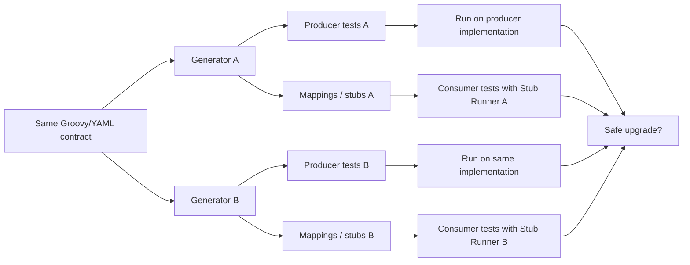
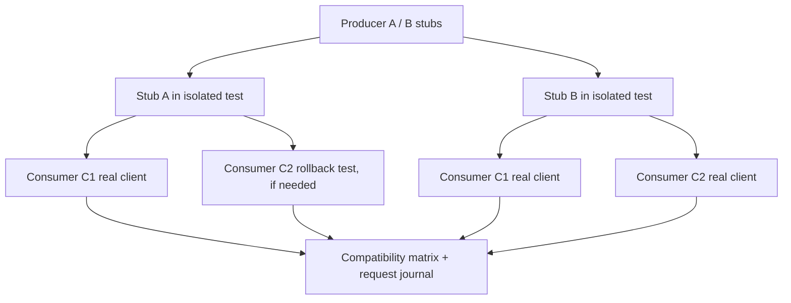
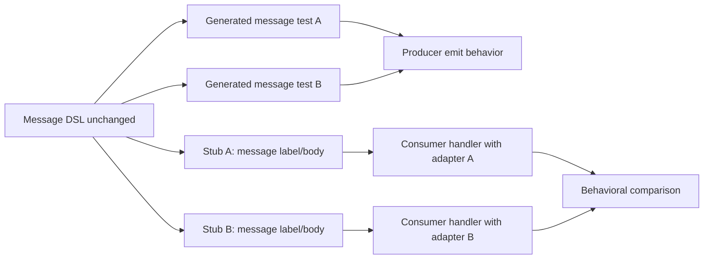
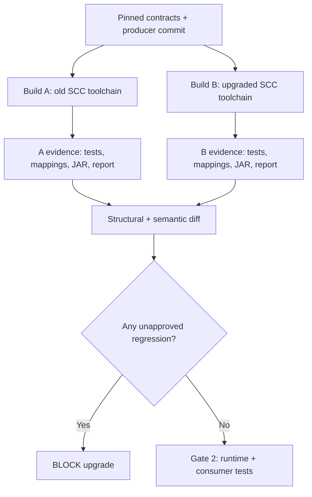
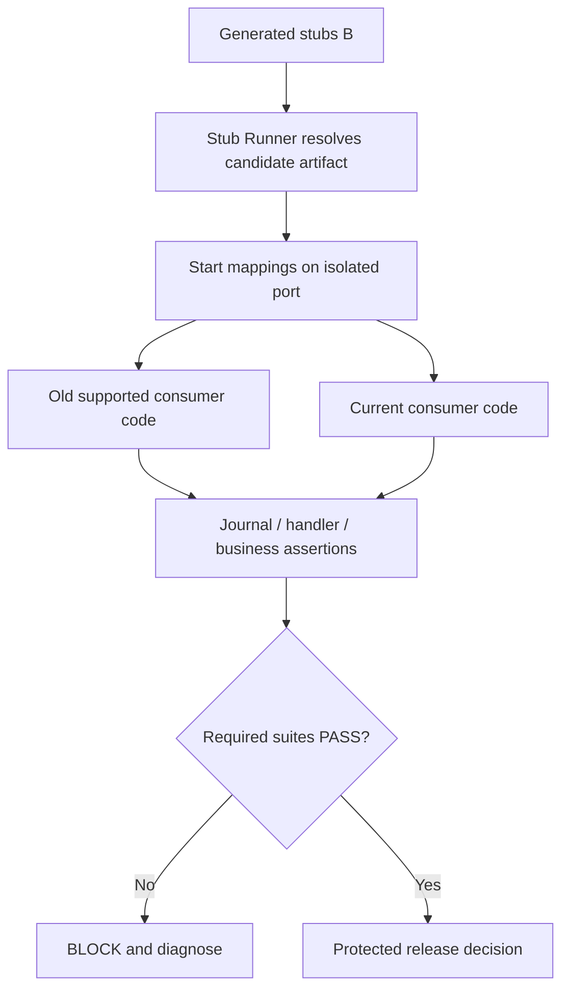

# Comparing Generated Tests and Stubs Before and After Upgrades

## 1. Why Must You Compare *Outputs* When Upgrading Spring Cloud Contract?

In the **SPRING_CLOUD_CONTRACT** module, the producer and consumer agree on HTTP or messaging behavior using the **Groovy/YAML DSL**. **Spring Cloud Contract (SCC)** uses that contract to:

1. **Generate producer verification tests** and execute them against the producer's implementation.
2. **Convert contracts into stub mappings**, typically for WireMock during HTTP testing.
3. **Package a stub artifact** with a classifier such as `stubs` for consumers to use via Stub Runner.
4. **Integrate with Maven/Gradle and CI** to catch incompatible API changes before release.

When upgrading SCC, Spring Boot, Java, Maven/Gradle, JUnit, Groovy, WireMock, or related plugins, **the tool itself that interprets the contract** may change. The YAML/Groovy sources look identical, yet generated Java/Groovy tests and stub JSON can differ:

- Package/test class names, imports, test annotations, or generated code differ.
- The test framework switches from JUnit 4 to JUnit 5, or test mode shifts from MockMvc to WebTestClient/EXPLICIT.
- Generated test assertions become stricter or looser.
- WireMock mappings change `url`/`urlPath`, query/header matchers, or JSON body matching.
- The stub JAR misses a contract, changes `META-INF` layout, classifier, or attach/publication behavior.
- The artifact still exists, yet a newer Stub Runner fails to load mappings properly, or consumer tests get skipped.

Therefore, the question is not simply **"is the post-upgrade build green?"**—it must be:

> **Given the exact same contracts and the same producer behavior to protect, do post-upgrade generated tests preserve all critical assertions and do the new stubs simulate the same interface observed by consumers?**

This topic belongs to the **Tool Compatibility** chapter. This lesson focuses on **comparing generated tests and stubs before and after upgrades**, rather than merely bumping a version number in a POM and running a single build.

### 1.1. Learning Objectives

After this lesson, you can:

1. Distinguish **DSL source**, **generated producer tests**, **WireMock mappings**, and the **stub JAR**.
2. Create two traceable A/B baselines from the **exact same set of contracts**.
3. Compare generated code by **verification semantics** rather than counting diff lines.
4. Normalize non-behavioral generated metadata without accidentally stripping critical matchers.
5. Run producer verification for both output sets and detect **0 tests/skipped** failures.
6. Inspect the stub JAR, classifier, paths, consumer-specific mappings, and Stub Runner resolution.
7. Separate **harmless formatting changes**, **technical changes requiring migration**, and **contract-breaking behavior changes**.
8. Design test matrices, CI gates, release, and rollback plans for tooling upgrades.
9. Diagnose common failures: JUnit engine, base classes, WireMock versions, dependency graphs, stale build caches, and artifact layouts.

**Scope note:** This lesson uses illustrative examples and **does not claim they represent actual output from a specific pair of SCC versions**. Real-project upgrades must select compatible versions and run comparison commands on that actual codebase.

## 2. "Unchanged Contracts" Can Still Change Testing Behavior

Suppose a contract is committed in Git:

```yaml
name: payment_captured
request:
  method: GET
  urlPath: /api/payments/PAY-42
  headers:
    Accept: application/json
response:
  status: 200
  headers:
    Content-Type: application/json
  body:
    paymentId: "PAY-42"
    state: CAPTURED
    amount: 150000
    currency: VND
```

For producer `payment-service`, two SCC generator versions read this contract.

**Before upgrade (A):**

```text
Contract source
  ├── generated producer test A
  ├── generated WireMock mapping A
  └── payment-service-X-stubs.jar A
```

**After upgrade (B):**

```text
Same contract source
  ├── generated producer test B
  ├── generated WireMock mapping B
  └── payment-service-X-stubs.jar B
```

If B turns `urlPath` into an overly broad `urlPattern` or drops the `state=CAPTURED` check, consumer tests may **pass even though requests/responses are no longer strictly checked**. If B only changes import order or a generated UUID, semantics may remain intact.

### 2.1. Both Protection Directions Must Hold



**Generated producer tests** ask "does the producer implementation respond according to the contract?". **Stub Runner consumer tests** ask "does consumer code properly handle this simulated interface?". A/B outputs must be compared along **both branches**.

### 2.2. A PASSing Build Can Still Lose Protection

Examples:

- A has 12 tests, while B generates only 8 tests due to wrong contracts paths or `ignoredFiles`.
- B generates 12 tests, yet Surefire/Gradle skips running them because the JUnit engine is incompatible.
- B builds only the stub JAR without running producer verification.
- B generates mappings for `GET /api/payments` but drops the `Authorization` matcher.
- Consumer test B loads stub A from `~/.m2` due to caching.
- Producer test B PASSES on new code, yet you changed the implementation simultaneously, making it impossible to attribute changes to the generator.

**Conclusion:** Never infer from exit code `0` or `BUILD SUCCESS` that the semantics of the entire contract suite were preserved.

## 3. Components to "Freeze" for a Fair Comparison

When building baseline A and candidate B, know **what changed**. An inventory table might look like:

| Component | Baseline A | Candidate B | Keep unchanged when comparing generators? |
|---|---|---|---|
| Git commit of contracts | `c0ffee1` | `c0ffee1` | **Yes** |
| DSL files and test data | SHA/checksum A | Identical checksums | **Yes** |
| Producer implementation commit | `beef123` | `beef123` | **Yes**, if feasible |
| SCC plugin/Verifier | `OLD_SCC_VERSION` | `NEW_SCC_VERSION` | **No** — variable under evaluation |
| Spring Boot/Spring Cloud BOM | Recorded | Recorded | Keep if supported; if changed, document explicitly |
| JDK/Gradle/Maven | Recorded | Recorded | Keep if possible; otherwise mark as secondary variable |
| JUnit/Spock/Groovy/WireMock | Resolved versions | Resolved versions | Record; may shift via transitive dependencies |
| `testFramework` and `testMode` | JUNIT5/MOCKMVC | JUNIT5/MOCKMVC | Try to keep identical for direct comparison |
| `baseClassForTests` | Same class | Same class if it compiles | **Yes**, or document migration explicitly |
| Plugin contract filters | `includedFiles`/`ignoredFiles` | Same config | **Yes** |
| Stub classifier/repository | `stubs`, repo X | `stubs`, repo X | Keep identical when measuring parity |

Commits/checksums in the table are **examples**. Never assume two SCC versions support the exact same Spring Boot or JDK version. When a major upgrade **forces** Spring Boot/JDK/test framework changes, separate two kinds of evidence:

1. **Generated output diff** on the same source contracts and policy.
2. **Integration behavior diff** on each version's supported runtime stack.

### 3.1. Do Not Mix Tool Upgrades with Business Contract Edits

A PR that changes the SCC version, deletes `payment_not_found.yml`, and flips HTTP status from `404` to `200` produces a diff where attribution is nearly impossible. Better approach:

- Prepare a commit holding the reviewed contracts.
- Run baseline A and save outputs/reports.
- Run candidate B on the **exact same inputs**.
- Only after evaluating compatibility, open a separate PR for business contract changes if needed.

If DSL edits are mandatory because legacy syntax is no longer supported, document the **migration transformation**, build a contract-by-contract before/after comparison, and check behavioral equivalence; never silently treat modified DSL as "identical input."

### 3.2. Prepare a Clean Environment

Incremental builds and caches can preserve stale outputs or skip regenerating tests. In the SCC Maven plugin, some goals involve **incrementalContractTests**, **incrementalContractStubs**, and **incrementalContractStubsJar**. In Gradle, task up-to-date checks and build caches also affect when outputs regenerate.

**A valid baseline should run in a clean build directory with full source-version logs recorded**:

```bash
# On each isolated checkout with pinned versions:
./mvnw clean verify

# Or with a Gradle producer configured for SCC:
./gradlew clean contractTest verifierStubsJar
```

Commands here are **sample commands for learners to run**, not commands executed while authoring this lesson. Output paths and task bindings must be verified for your SCC/Gradle version; `clean` does not automatically clear the local Maven repository `~/.m2`.

### 3.3. Two Runs in the Same Directory Is a Trap

If build A outputs `target/stubs`, then you change the plugin version and run `generateTests` B without cleaning, you could accidentally compare:

```text
tests B + mappings A + JAR A
```

That is a **contaminated** baseline. Use two separate checkouts or two isolated CI workspaces, clean outputs, and archive snapshots outside the build directory **for each run**. Never overwrite A's outputs with B before capturing evidence.

## 4. Artifact Chain to Capture per Version

Save the following outputs:

| Observed artifact | Typical Maven producer | Typical Gradle producer | Purpose |
|---|---|---|---|
| Source contracts | `src/test/resources/contracts` | `src/contractTest/resources/contracts` | Compare inputs |
| Generated test sources | `target/generated-test-sources/contracts` | `build/generated-test-sources/contractTest/...` | Compare code/annotations/assertions |
| Generated test resources | `target/generated-test-resources/contracts` | `build/generated-test-resources/contractTest` | Compare fixtures, resources |
| Generated stub mappings | `target/stubs` | `build/stubs` | Compare WireMock JSON/DSL |
| Stub JAR | `target/*-stubs.jar` | `verifierStubsJar` task | Compare classifier, entries, behavior |
| Test reports | `target/surefire-reports` (or Failsafe) | `build/test-results/contractTest` | Count actually executed tests |
| Build resolved deps | Maven `dependency:tree`/effective POM | Gradle dependencies/tasks | Identify runtime library versions |
| Publication metadata | POM, checksums, CI run | Maven publication/checksums | Verify consumer resolution |

**These are reference conventions, not fixed paths across all SCC releases.** For instance, the SCC plugin may configure `generatedTestSourcesDir`, `stubsDirectory`, `contractsDslDir`, or custom source sets.

If the output directory moves during an upgrade, **do not report "B has no tests" before checking the new path**. Equally, never create dummy paths in CI just to pass checks; identify the actual task/goal emitting outputs.

### 4.1. Two Roles of the Stub JAR in Comparison

A JAR might contain:

```text
META-INF/
  com.acme.billing/
    payment-service/
      <artifact-version>/
        contracts/
          payments/payment-captured.yml
        mappings/
          ...payment-captured.json
```

This path reflects a **common SCC layout**, which can differ if customized. Compare:

- Does the `META-INF/<group>/<artifact>/<version>/...` folder exist properly?
- Do contract and mapping counts match?
- Is `classifier=stubs` attached or published properly?
- Are response body files (`__files`) included in the JAR?
- Does the target Stub Runner version understand this layout?

**Comparing ZIP/JAR binary hashes alone is insufficient** because timestamps, entry ordering, compression, or generated IDs can differ even when behavior is identical. However, **exact checksums of published artifacts** remain essential for provenance tracking and preventing post-release tampering.

## 5. Contract Example to Compare Both Producer Tests and Stubs

Use an HTTP `GET /api/payments/{id}` example that intentionally includes **query/header** conditions so upgrades expose more observable criteria:

```yaml
name: find_captured_payment
description: "Consumer looks up a captured payment"
request:
  method: GET
  urlPath: /api/payments/PAY-42
  queryParameters:
    includeDetails: "true"
  headers:
    Accept: application/json
    X-Client-Id: checkout-demo
response:
  status: 200
  headers:
    Content-Type: application/json
  body:
    paymentId: "PAY-42"
    state: CAPTURED
    amount: 150000
    currency: VND
```

### 5.1. Behavioral Invariants to Protect

A post-upgrade build **must not weaken the following points** when the contract is unchanged:

1. HTTP method must be `GET`.
2. Path must be `/api/payments/PAY-42`.
3. Query param `includeDetails=true` must be checked.
4. Request must include `Accept=application/json` and `X-Client-Id=checkout-demo` per the contract.
5. Producer must return status `200`.
6. Response `Content-Type` must be JSON per agreed matching rules.
7. Body must contain `paymentId`, `state=CAPTURED`, `amount=150000`, and `currency=VND` with accurate types/values.

If generated Java differs in style yet still asserts these invariants, the change may be **benign**. If stub B stops checking the query param or generated test B stops asserting `state`, that is a **serious regression suspect**.

### 5.2. Illustrative Generated Test Output

SCC might generate a JUnit 5 test using Rest Assured MockMvc:

```java
// Pseudocode illustrating assertion structure, not
// byte-for-byte generated Java of a specific SCC release.
@Test
void validate_find_captured_payment() {
    var response = given()
        .header("Accept", "application/json")
        .header("X-Client-Id", "checkout-demo")
        .queryParam("includeDetails", "true")
        .when()
        .get("/api/payments/PAY-42");

    then(response)
        .statusCode(200)
        .header("Content-Type", containsString("application/json"))
        .body("paymentId", equalTo("PAY-42"))
        .body("state", equalTo("CAPTURED"))
        .body("amount", equalTo(150000))
        .body("currency", equalTo("VND"));
}
```

The goal is **reading the intent** of a generated test. Helper API `then(response)` is **pseudocode**, not a complete compilable class and certainly not a guarantee that SCC generates those exact expressions.

### 5.3. Illustrative WireMock Mapping Output

```json
{
  "request": {
    "method": "GET",
    "urlPath": "/api/payments/PAY-42",
    "queryParameters": {
      "includeDetails": {"equalTo": "true"}
    },
    "headers": {
      "Accept": {"equalTo": "application/json"},
      "X-Client-Id": {"equalTo": "checkout-demo"}
    }
  },
  "response": {
    "status": 200,
    "headers": {
      "Content-Type": "application/json"
    },
    "jsonBody": {
      "paymentId": "PAY-42",
      "state": "CAPTURED",
      "amount": 150000,
      "currency": "VND"
    }
  }
}
```

This is an **illustrative WireMock JSON**, not a promise that the plugin emits `jsonBody`/`body` or field ordering identically. What matters is **method/path/query/headers/response semantics**.

## 6. Define a "Comparison Contract" Before Running Diffs

An **invariant table** per contract keeps diff reviews focused rather than distracted by formatting:

| ID | Property | Expectation to preserve | If changed |
|---|---|---|---|
| HTTP-01 | Request method | GET | BLOCK or explain breaking change |
| HTTP-02 | Request path | `/api/payments/PAY-42` | BLOCK unless approved API migration |
| HTTP-03 | Query `includeDetails` | Equal `true` | BLOCK if dropped/altered |
| HTTP-04 | Header `X-Client-Id` | Equal `checkout-demo` | BLOCK if dropped without approval |
| HTTP-05 | Response status | 200 | BLOCK if changed |
| HTTP-06 | Response content type | JSON | Check exact vs. semantic matching |
| HTTP-07 | Body `state` | String `CAPTURED` | BLOCK if missing/changed |
| HTTP-08 | Body `amount` | Number `150000` | BLOCK if type/semantics changed |
| HTTP-09 | Body `currency` | String `VND` | BLOCK if missing/changed |
| TEST-01 | Generated tests | Tests exist for every active contract and execute | BLOCK if 0 or missing |
| STUB-01 | JAR mappings | Consumers can still load the contract | BLOCK if mapping missing |
| STUB-02 | Artifact classifier | `stubs` per release policy | BLOCK if consumers cannot resolve |

This table is a **review template**, not test results. It can be extended for messaging: destination, headers, label, body matchers, trigger method, serializer, and consumer handler behavior.

If *business requirements* also change in the same wave, explicitly mark approved cells with owner sign-off; **never silently treat a dropped assertion as a harmless generator change**.


## 7. Practical A/B Comparison Workflow

Work in **two isolated workspaces or two CI jobs**, never stacking builds inside one directory. Example:

```text
compare-scc/
  baseline-A/
    source/              # same contract revision
    evidence/
      toolchain.txt
      generated-tests/
      generated-test-resources/
      mappings/
      stubs-extracted/
      manifest.txt
      producer-test-report/
  candidate-B/
    source/              # same contract revision
    evidence/
      toolchain.txt
      generated-tests/
      generated-test-resources/
      mappings/
      stubs-extracted/
      manifest.txt
      producer-test-report/
  review/
    generated-tests.diff
    mappings.diff
    jar-entry-list.diff
    semantic-diff.md
    release-decision.md
```

This is an **illustrative workspace structure learners can create independently**, not directories this worker is permitted to write in the repository. The current STEP 4 only creates this Markdown lesson file.

### 7.1. Preparation Step: Identify Inputs

Before running:

- Pick the **same commit** containing Groovy/YAML contracts and producer code.
- Record SHAs of DSL files, test fixtures, and `baseClassForTests`.
- Lock the list of in-scope contracts, including `ignored` or `inProgress` files.
- Record `testFramework`, `testMode`, `contractsDirectory`/`contractsDslDir`, `baseClassMappings`, `includedFiles`, and `excludedFiles`.
- Lock artifact `groupId`, `artifactId`, and `stubs` classifier.
- Record JDK, Maven/Gradle wrapper versions, OS, and locale/timezone if they affect generated outputs.

If two SCC versions require two different Spring Boot runtimes, **document that variable in the report** instead of attributing the entire diff to "the SCC generator."

### 7.2. Step A: Run Baseline in a Clean Environment

In isolated checkout A, keep the exact old SCC/plugin/dependency versions:

```bash
# Maven producer: generate tests, stubs, and run through verify.
./mvnw clean verify

# Gradle producer: use the tasks configured by the project.
./gradlew clean contractTest verifierStubsJar
```

Once finished, **copy A's evidence out to storage** without deleting contract sources. Capture:

- Generated sources and resources.
- WireMock mappings in the output folder.
- Stub JAR/classifier and list of JAR entries.
- Test reports showing executed, passed, failed, and skipped counts.
- Logs of resolved dependency/tool versions and invocation commands.
- Manifest of processed contract IDs.

**Do not run B first and look for A's outputs afterward**: `clean` or task caches may delete/overwrite A's outputs.

### 7.3. Step B: Run Candidate on the Exact Same Inputs

In checkout B, change only **the minimum versions and build config needed by the new toolchain**, recording every mandatory difference:

```bash
# Maven candidate: wrapper and build model locked to branch B.
./mvnw clean verify

# Gradle candidate: wrapper, plugins, dependencies per branch B.
./gradlew clean contractTest verifierStubsJar
```

Collect the **same set of evidence**. If candidate B fails to compile or produce a JAR, record `BLOCKED_BY_TOOL_COMPATIBILITY` — **never** substitute artifact A to report success.

### 7.4. Step C: Compare Both Diff Layers

**Mechanical diff**:

- File/class/test-method counts.
- Generated Java/Groovy source diff.
- Mappings JSON diff.
- Stub JAR entries/digest.
- Test reports and build logs.

**Semantic diff**:

- Does test B still execute the contract-protecting assertions?
- Which requests does stub B accept—did matchers loosen or tighten?
- Does stub B return the same status/headers/body/triggers as A on key scenarios?
- Does real consumer code remain compatible with B?
- Were all behavioral changes approved by owners?

**Rule:** A mechanical diff is a **signal to investigate**, never an automatic PASS/FAIL verdict. Semantic diffs and live tests determine compatibility.

### 7.5. Step D: Release Decision

Publish new toolchain outputs only after:

1. Generated producer tests B actually run and PASS.
2. Test coverage does not drop outside approved scope.
3. Stub mappings B preserve committed semantics.
4. Stub Runner loads JAR B.
5. Consumer regression suites run against that exact JAR B.
6. A rollback path exists for both plugin/toolchain and artifact versions if errors arise.

Never reuse an already published release GAV to "test-publish" package B with different bytes; release artifacts should remain **immutable**.

## 8. Maven: Know What Each Goal Produces to Avoid Comparing the Wrong Things

Per the Spring Cloud Contract Maven plugin documentation, goals have distinct duties:

| Goal | Role during upgrades | Outputs to inspect |
|---|---|---|
| `generateTests` | Generates producer tests from DSL | Test sources, imports, assertions, test framework |
| `convert` | Converts contracts into WireMock stub mappings | Mapping JSON and contract-related resources |
| `generateStubs` | Builds stub JAR from converted mappings | Attached JAR classifier `stubs`, JAR entries |
| Maven `test`/`verify` | Executes generated producer tests via test runner | Actual executed count, failures, skips |
| Maven `install` | Installs artifacts into local repo | Are both main JAR and stubs JAR present? |
| Maven `deploy` | Publishes artifacts to remote repo | GAV/classifier/source accuracy |

Plugin docs note `generateTests` binds by default to phase `generate-test-sources` and `generateStubs` binds to `package`, requiring `convert` to run earlier. **Yet execution plans can vary by configuration and release**; when comparing A/B, read actual goal execution logs instead of assuming from memory.

### 8.1. Deliberately Version-Pinned Maven POM Excerpt

```xml
<properties>
    <!-- Fill in an SCC version compatible with branch A or B's
         Spring Boot/Cloud. Never use an ambiguous "latest". -->
    <spring-cloud-contract.version>REPLACE_WITH_PINNED_VERSION</spring-cloud-contract.version>
</properties>

<build>
    <plugins>
        <plugin>
            <groupId>org.springframework.cloud</groupId>
            <artifactId>spring-cloud-contract-maven-plugin</artifactId>
            <version>${spring-cloud-contract.version}</version>
            <extensions>true</extensions>
            <executions>
                <execution>
                    <goals>
                        <goal>convert</goal>
                        <goal>generateStubs</goal>
                        <goal>generateTests</goal>
                    </goals>
                </execution>
            </executions>
            <configuration>
                <testFramework>JUNIT5</testFramework>
                <testMode>MOCKMVC</testMode>
                <baseClassForTests>
                    com.acme.payment.contract.ContractTestBase
                </baseClassForTests>
            </configuration>
        </plugin>
    </plugins>
</build>
```

This is a **POM configuration excerpt**, not a complete POM; real projects need Spring Cloud BOM/Verifier test dependencies, Surefire/JUnit setup, and the actual producer implementation.

### 8.2. Record Effective Dependency Versions, Not Just POM Source

When changing the SCC plugin, libraries like Groovy, Rest Assured, JUnit, Jackson, or WireMock may resolve differently via BOM/dependency graphs:

```bash
./mvnw help:effective-pom
./mvnw dependency:tree
```

These commands can produce large output; run in CI and **archive redacted artifacts/logs** if needed. Never expose tokens or repository credentials in output.

If dependencies changed, verify why. Never force an incompatible WireMock version onto the new SCC's classpath merely to make generated JSON match A byte-for-byte.

### 8.3. Do Not Run a Single Goal and Assume Release-Ready Stubs

```bash
./mvnw spring-cloud-contract:generateTests
./mvnw spring-cloud-contract:generateStubs
```

Running individual goals does not guarantee `convert` updated mappings, generated tests compiled/executed, or the attached JAR publishes properly. For release comparisons, prefer the **full lifecycle** with an explicit execution plan.

### 8.4. When Upgrades Alter Plugin Executions

If A manually declared `<goals>` while B relies on plugin defaults, there is a risk of **running goals twice or skipping a goal**. In the A/B report, record:

- How many times did `generateTests` appear in logs?
- Did `convert` run before `generateStubs`?
- Were stale files left behind in `target`?
- Did the build compile the generated source directory?
- With which actual classifier was the stub JAR attached?

Never conclude B "changed the contract" when the real cause is a plugin goal unbound from the lifecycle.

## 9. Gradle: Compare Generated Sources, Task Graphs, and Publication

In the Spring Cloud Contract Gradle plugin, common tasks include:

| Task | Role |
|---|---|
| `generateContractTests` | Generates producer tests |
| `contractTest` | Compiles/runs generated producer tests |
| `generateClientStubs` | Generates stub mappings for consumers |
| `verifierStubsJar` | Packages stubs into a JAR |
| `check` | May integrate `contractTest` per plugin/build config |
| `publish`/`publishToMavenLocal` | Publishes/installs Maven publications if configured |

Task names and graphs must be **verified against the active Gradle plugin version**, not scripted from old names of another plugin release.

### 9.1. Illustrative Gradle Configuration

```groovy
plugins {
    id 'java'
    id 'org.springframework.cloud.contract' version 'REPLACE_WITH_PINNED_VERSION'
    id 'maven-publish'
}

contracts {
    testFramework = 'JUNIT5'
    testMode = 'MockMvc'
    baseClassForTests =
        'com.acme.payment.contract.ContractTestBase'
}

publishing {
    publications {
        mavenJava(MavenPublication) {
            from components.java
            artifact tasks.named('verifierStubsJar')
        }
    }
}
```

This is a **configuration excerpt**, requiring Spring Cloud/Verifier dependency management and a real application project. In older Gradle plugin releases, property/task syntax or Gradle config differs; check docs for the **actual version** instead of copy-pasting across release lines.

Notably, SCC docs state that **since 3.0.0, built-in stubs publication was deprecated and disabled by default**: projects must explicitly declare `verifierStubsJar` in their publication when publishing to a Maven repository. If post-upgrade builds emit only the main JAR without `-stubs.jar`, it may be a **publication regression**, not a broken contract DSL.

### 9.2. Run Tasks and Inspect Outputs

```bash
# Outputs from the exact locked contract sources:
./gradlew clean generateContractTests generateClientStubs verifierStubsJar

# Then execute actual producer verification:
./gradlew contractTest
```

Standalone generation tasks let you inspect outputs, yet **only producer test reports after `contractTest`** verify the implementation. In release CI, keep test execution mandatory prior to publication.

### 9.3. Be Careful with Gradle Caches and Source Sets

If B reports `UP-TO-DATE` or `FROM-CACHE`, the task may not have regenerated under the conditions you expect. `clean` reduces stale output risk, yet **remote build caches and dependency caches can still interfere**.

When diagnosing, run deliberately with:

```bash
./gradlew clean contractTest verifierStubsJar --rerun-tasks
```

Use `--rerun-tasks` only in comparison/debug jobs, not necessarily across all long-term CI runs. If A/B tests/reports differ, inspect the `contractTest` source set and test runtime classpath, not just sources under `src/test`.

### 9.4. Verify Publication via Consumer-Like Resolution

After A/B builds the stub JAR, consumer tests must attempt to download the new JAR with the right classifier/version. A passing `verifierStubsJar` **does not prove `publish` includes that artifact**; inspect publication metadata and actual repository listings.

**Never publish B overwriting released GAV A**. Use an isolated staging repository or a distinct candidate version, record internal JAR paths generated from each artifact version, and evaluate equivalence by behavior.

## 10. Comparing Generated Producer Tests: What to Read?

Generated test files can differ by hundreds of lines even with identical logic. Inspect along **three layers**.

### 10.1. Test Discovery and Framework Layer

| Component | Question to ask |
|---|---|
| Package/class/method names | Does the test runner discover the tests? |
| `@Test` annotation | JUnit 4 or JUnit 5, with a matching engine? |
| Base class | Does `ContractTestBase` compile with the right fixtures and setup? |
| `@BeforeEach`/`@Before` | Does setup still run under the new test framework? |
| Source directory/source set | Are test sources compiled and executed? |
| Test mode | Does MockMvc/WebTestClient/EXPLICIT match the producer architecture? |
| Imports/libraries | Are Rest Assured, JSONPath, and Hamcrest versions aligned? |
| Skipped/ignored/in-progress | Are any contracts no longer verified? |

A clean-looking generated test whose `@Test` is ignored by the runner **provides zero protection**. Never diff source text alone; read test reports for both A and B.

### 10.2. Layer of Requests Sent to the Producer

Verify:

- Accurate method (GET/POST/…).
- URL path, query params, and body.
- Required headers, cookies, and form params.
- Proper application of producer vs. consumer regex/variables.
- Are test data setups/fixtures invoked before sending requests?
- Does the HTTP client test mode use the right server context, basePath, context-path, and port?

For example, if source A calls `GET /api/payments/PAY-42?includeDetails=true` while B drops `includeDetails`, **that is not a cosmetic diff**, even if B still PASSES against a permissive endpoint.

### 10.3. Response Assertions Layer

Verify:

- HTTP status and headers.
- JSONPath/regex matchers and type constraints.
- Null/absent/empty semantics.
- Number vs. string, boolean vs. string, array order/size.
- Error bodies/codes and optional fields.
- 4xx/5xx cases and messaging headers/destinations.

If A asserts `body("amount", equalTo(150000))` while B only asserts `body("$", notNullValue())`, B **weakens protection**. If B changes assertion syntax while checking the exact same condition, it may be compatible.

### 10.4. Example of a Purely Formal Diff

**A:**

```java
assertThat(response.statusCode()).isEqualTo(200);
assertThat(json.get("state").asText()).isEqualTo("CAPTURED");
```

**B:**

```java
assertEquals(200, response.statusCode());
assertEquals("CAPTURED", json.get("state").asText());
```

Both snippets are **illustrative examples of two assertion styles**, not observed output of two specific SCC releases. When they verify the exact same response path/type/expected value under the same test setup, the diff may reflect an **assertion framework/format migration**.

### 10.5. Example of a Contract-Weakening Diff

**A:**

```java
assertEquals("CAPTURED", json.get("state").asText());
```

**B:**

```java
assertNotNull(json.get("state"));
```

B accepts `PENDING` or `FAILED` even though the source contract still promises `CAPTURED`. This is a semantic regression; **never auto-approve simply because the build still PASSES**.

### 10.6. Test Framework Migrations May Require Base Class Updates

When upgrading JUnit 4 → JUnit 5:

- `@Before`/`@Rule`/`@RunWith` do not automatically translate to `@BeforeEach`/extensions.
- Generated tests need the matching JUnit engine/test runner.
- Test bases may require updated imports/annotations/fixture lifecycles.
- Generated `@Test` methods may preserve intent while the base class fails to configure the context.
- If the new toolchain changes package namespaces, follow release notes instead of forcing legacy JARs onto the classpath.

For instance, SCC 5.0.0 documentation notes **it no longer supports `javax.inject` for injecting SCC-autoconfigured components** and recommends `@Autowired`. That is an **example of a documented tool compatibility change**, not a claim that every upgrade requires changing injection.

**Official docs:** [Spring Cloud Contract reference — 5.0.0 change notes](https://docs.spring.io/spring-cloud-contract/reference/). When upgrading other versions, read their corresponding release notes and compatibility matrices.


## 11. Comparing WireMock Mappings: Preserving Request/Response Semantics

Unlike generated Java tests, WireMock mappings are the **actual input Stub Runner uses to serve HTTP responses** to consumers. During upgrades, compare each mapping by **contract identity**, not by generated filename or UUID.

### 11.1. Properties You Must Not Drop from Comparison

| Component | Meaning to consumer | Risk if ignored |
|---|---|---|
| `request.method` | GET vs. POST | Requests with wrong HTTP method get served |
| `request.url`/`urlPath`/`urlPattern` | Path and matching rules | Route widens or drops query matching |
| `queryParameters` | Filter/pagination/version | Client sends wrong query yet test passes |
| `headers` | Accept, Content-Type, tenant, auth | Wrong version/content negotiation still matches |
| `bodyPatterns` | JSONPath, regex, equality | Invalid request bodies get accepted |
| `cookies`, `formParameters` | Session/form contracts | Constraints silently dropped |
| `priority` | Which mapping wins on overlap | Wrong response returned despite matching mapping |
| `response.status` | HTTP success/error | Alters consumer error/success flow |
| `response.headers` | Content-Type, caching, location | Client decoding/routing breaks |
| `response.body`/`jsonBody`/`bodyFileName` | Payload/fixture | Data altered or missing |
| `response.transformers`/`fixedDelayMilliseconds` | Response templating, simulated latency | Behavioral/resilience tests shift |
| `metadata` meaningful to custom extensions | Traceability/processors | Custom WireMock extensions alter behavior |

A few fields may be **generated metadata** (e.g., `id`/`uuid`), whereas fields in the table govern actual matching and responses. Normalize only fields verified to have **no semantic impact**.

### 11.2. Semantically Insignificant Diff

For example, two mappings differing only in object key order:

**Mapping A:**

```json
{
  "request": {"method": "GET", "urlPath": "/api/payments/PAY-42"},
  "response": {"status": 200, "body": "{\"state\":\"CAPTURED\"}"}
}
```

**Mapping B:**

```json
{
  "response": {"body": "{\"state\":\"CAPTURED\"}", "status": 200},
  "request": {"urlPath": "/api/payments/PAY-42", "method": "GET"}
}
```

JSON object key order carries no meaning in WireMock. This is a **cosmetic diff example** unless custom code inspects raw text ordering.

### 11.3. Very Significant Diff: `url` Becomes `urlPath`

**A:**

```json
{
  "request": {
    "method": "GET",
    "url": "/api/payments/PAY-42?includeDetails=true"
  },
  "response": {"status": 200}
}
```

**B:**

```json
{
  "request": {
    "method": "GET",
    "urlPath": "/api/payments/PAY-42"
  },
  "response": {"status": 200}
}
```

B **no longer enforces `includeDetails=true`**. A queryless `GET /api/payments/PAY-42` request can now match, making consumer tests false-green.

If B additionally adds `queryParameters.includeDetails.equalTo=true` properly, switching from full URL to path + query matchers **may** be equivalent or even cleaner as required, though you must check **query order, encoding, duplicate parameters, and extra parameters** per API rules.

### 11.4. Significant Diff: Response Matcher Weakened

Suppose the source contract requires:

```text
state = CAPTURED
amount = 150000 (number)
```

A emits a response body with the exact types. B accidentally emits:

```json
{"state": "CAPTURED", "amount": "150000"}
```

B returns `amount` as a **string** instead of a number; consumer DTOs using numeric mapping may fail even though UI displays `150000` identically. Compare semantic JSON types, not display strings.

### 11.5. Significant Diff: Regex or Header Condition Altered

**A:**

```json
{
  "headers": {
    "X-Client-Id": {"equalTo": "checkout-demo"}
  }
}
```

**B:**

```json
{
  "headers": {
    "X-Client-Id": {"matches": ".*"}
  }
}
```

B permits arbitrary client IDs outside the contract. That is a **relaxation** requiring investigation, especially for authorization, tenant, or security-related headers.

### 11.6. Diff When Same-Request Mapping Priority Changes

Two overlapping mappings can return different responses. WireMock prefers the mapping with the **lower numerical priority** when declared. If an upgrade changes generated priorities or selection rules, a consumer might receive `PENDING` instead of `CAPTURED`.

For requests with multiple adjacent mappings, check:

- Mapping IDs/names and request conditions.
- `priority` or registration order when priority is omitted.
- Which response the new WireMock runtime actually selects.
- Exact path vs. generic regex cases.
- Cases distinguished by headers/query params.

**Do not drop priority from semantic diffs just because it "didn't appear in the original DSL"** if extensions, metadata, or default behavior affect runtime selection.

## 12. Normalizing JSON Diffs: What Helps and What Not to Do

Normalization **reduces noise** from formatting or random metadata.

### 12.1. Sample `jq` Commands When Installed

Assuming you have matched the **exact mapping pair for one contract**:

```bash
# Strip ID metadata only after verifying nothing references it.
jq -S 'del(.id, .uuid)' baseline-mapping.json > baseline.normalized.json
jq -S 'del(.id, .uuid)' candidate-mapping.json > candidate.normalized.json

diff -u baseline.normalized.json candidate.normalized.json
```

`jq -S` sorts **object keys** on output, enabling comparison regardless of key order. Never automatically sort **arrays**: in many JSON responses, element order **is significant**.

**Warning:** Even root `id`/`uuid` fields can matter if tests or extensions reference mapping IDs. With stateful scenarios or ID-bound custom extensions, verify policy before stripping them. Use normalized diffs solely as a **review aid**, never replacing raw sources or artifact provenance.

### 12.2. Do Not Normalize These Fields Just Because They Create Diffs

Never strip or alter:

```text
.request.method
.request.url
.request.urlPath
.request.urlPattern
.request.queryParameters
.request.headers
.request.bodyPatterns
.priority
.response.status
.response.headers
.response.body
.response.jsonBody
.response.bodyFileName
.response.transformers
.response.fixedDelayMilliseconds
```

These fields govern matching and response behavior. If new policy requires changing them, obtain **semantic review and passing verification tests**.

### 12.3. Comparing String `body` vs. Object `jsonBody`

One generator may represent a JSON response as:

```json
{"response":{"body":"{\"state\":\"CAPTURED\",\"amount\":150000}"}}
```

Another generator may use:

```json
{"response":{"jsonBody":{"state":"CAPTURED","amount":150000}}}
```

**You cannot conclude equivalence by sight alone**:

- Verify HTTP `Content-Type` and actual bytes received by consumers.
- JSON whitespace/object key order may not matter to JSON parsers, yet **raw string/signature clients** can depend on exact bytes.
- Check numbers, nulls, missing vs. empty fields, and escaped Unicode.
- Confirm the active WireMock runtime handles both representations.
- Run consumer tests to prove parsers and behavior stay unchanged.

If an API commits to **exact raw body bytes** (e.g., cryptographic signing), whitespace or encoding changes can still be breaking changes.

### 12.4. Diff by Identity, Not Generated UUID

A mapping may be emitted with a different filename and a new UUID. Build a table:

| Logical identity | Mapping A | Mapping B | Verdict |
|---|---|---|---|
| `payment_captured` | `uuid-a12.json` | `uuid-b98.json` | Compare semantics |
| `payment_not_found` | `uuid-a13.json` | `uuid-b99.json` | Compare semantics |
| `payment_pending` | Present | Missing | **BLOCK/Investigate** |

When multiple mappings share similar request patterns, use **contract ID, response body, and source path** to pair them accurately. Never pair mappings by file index or alphabetical order.

### 12.5. Raw ZIP Diffs and Checksums Still Matter

**Raw byte diff:** tells you whether the artifact actually changed.

**Normalized semantic diff:** tells you whether behavior/matchers changed.

**Checksum/provenance:** proves consumer tests downloaded the **exact specific artifact**.

These are three distinct perspectives; never let one metric replace all three.

## 13. Comparing Stub JARs: Entry Lists, Layout, and Classifiers

A common A/B upgrade bug is "tests generated, yet consumers cannot find stubs" because publish layouts or attached artifacts changed.

### 13.1. Inspecting Entry Lists

With the JDK `jar` tool in an **isolated comparison workspace**:

```bash
jar tf payment-service-A-stubs.jar > jar-A.entries.txt
jar tf payment-service-B-stubs.jar > jar-B.entries.txt
```

If folder paths include differing artifact versions, account for the release version change; **never ignore uncontrolled version shifts**. Compare:

- Is `META-INF/<group>/<artifact>/<version>/contracts` present?
- Is `META-INF/<group>/<artifact>/<version>/mappings` present?
- Are body files referenced by `response.bodyFileName` included?
- Are any contracts or mappings missing?
- Is the `stubs` classifier accurate in Maven publication?
- Are there duplicate ZIP entries or path collisions?

**Do not merely count total entries.** Two JARs can have identical file counts while a key mapping's contents changed.

### 13.2. Do Not Confuse JAR Metadata with Behavior

ZIP timestamps, compression ratios, or entry ordering can shift across Java/Gradle/Maven plugin upgrades. That changes SHA-256 digests without **necessarily** changing consumer HTTP behavior.

Conversely, changing **a single matcher inside one JSON mapping** can flip consumer tests from pass to fail. Inspect both **raw identity and semantic contents**.

### 13.3. Distinguish Source Files from Attached Artifacts

SCC YAML sources may sit in the repository yet **never enter the JAR** if `copyContracts`, `contractsDirectory`, or `generateStubs` config changed. A passing Maven/Gradle build does not prove consumers have mappings.

With Gradle especially, `verifierStubsJar` must be wired into the Maven publication. Seeing a file under `build/libs` does not prove the remote repository received the `stubs` classifier artifact.

### 13.4. Avoid Overwriting Released GAVs During Experiments

Suppose both A and B use:

```text
com.acme.billing:payment-service:1.4.2:stubs
```

**Never publish B into a release repository overwriting A** just to test behavior. Use:

- Isolated local Maven repositories for A and B.
- Separate staging repositories.
- Distinct candidate/rc versions, if build conventions allow.
- CI artifact stores with checksums and trusted provenance.

If the artifact version changes during comparison, separate **layout path shifts caused by version changes** from **generated behavior changes**; maintain a mapping manifest between A and B.

## 14. Verify Behavior with Stub Runner, Not Just by Reading JSON

Claiming "two mappings are equivalent" requires **runtime verification** with consumer use cases. Run:

- Consumer `C1` against stub A.
- The same consumer `C1` against stub B.
- Current consumer `C2` against stub B.
- If rollback matters, `C2` against stub A.



### 14.1. `REMOTE` Configuration Pinning the Artifact Version

```java
@SpringBootTest
@AutoConfigureStubRunner(
    ids = "com.acme.billing:payment-service:1.5.0-rc.1:stubs",
    stubsMode = StubRunnerProperties.StubsMode.REMOTE,
    repositoryRoot =
        "https://repo.example.org/repository/maven-staging/",
    failOnNoStubs = true
)
class PaymentConsumerCompatibilityTest {
    // Test must invoke the real CheckoutService/PaymentHttpClient.
}
```

This is an **illustrative consumer test configuration** requiring JUnit, SCC Stub Runner dependencies, and application test config. `rc.1` is only an **example candidate version**, not an existing artifact.

Do not assume `@AutoConfigureStubRunner` injects URLs into every HTTP client automatically: use `@StubRunnerPort`/`StubFinder` or appropriate Spring Cloud discovery integration so the client **calls the right stub port**.

### 14.2. Check Request Journals and Near Misses

When testing consumers against B:

- Verify Stub Runner loaded exact artifact **B**, not cached `A`.
- Verify WireMock's actual port/URL.
- Invoke the consumer's **production HTTP client**.
- Inspect `/__admin/requests` journal: expected requests appear with `wasMatched=true`.
- For HTTP `404`, distinguish a **contract-defined 404** from WireMock's unmatched 404.
- Test success, error, auth, query, and dynamic data paths the consumer relies on.

**A consumer test that only asserts status 200** without invoking the real client is insufficient evidence of compatibility.

### 14.3. Post-Upgrade Negative Controls

To catch loosened mappings:

| Control | How A must react | How B must react |
|---|---|---|
| Omit `includeDetails` | Mismatch or contract-defined error | **Same policy**, not suddenly 200 |
| Change `GET` to `POST` | Unmatched | Unmatched |
| Send wrong `X-Client-Id` | Unmatched/contract error | Unmatched/contract error |
| Change `Accept` | Per contract condition | Must not unexpectedly allow wrong media type |
| Body `state=PENDING` when `CAPTURED` expected | Consumer does not treat as success | Consumer still catches mismatch |
| Call nonexistent path | Stub unmatched 404 | Stub unmatched 404 |

Intentional, approved changes can occur, yet **never label them a tool-only upgrade**. Run negative controls in **test isolation**, without altering published release artifacts.

## 15. Test Mode Can Make Generated Tests "Change" by Architecture

SCC supports multiple HTTP producer verification modes. During upgrades, retain or intentionally update the mode per architecture:

| Mode | Test target | Upgrade notes |
|---|---|---|
| `MOCKMVC` | Spring MVC via MockMvc | Base class, RestAssuredMockMvc setup, controller context |
| `WEBTESTCLIENT` | WebFlux/reactive HTTP tests | Reactive test context, WebTestClient bindings |
| `EXPLICIT` | Real HTTP against producer test server | Host/port, base URI, TLS/auth, startup/teardown |
| `JAXRSCLIENT` | JAX-RS test client (when supported by version) | JAX-RS dependencies and transport |

**Do not expect a new test using `EXPLICIT` to have Java code resembling an old test using `MOCKMVC`**. That is a change in **test transport**, not just the SCC generator. You must still verify contract assertions and side effects.

### 15.1. Distinguish Test Mode from Test Framework

- **Test mode**: MockMvc, WebTestClient, explicit HTTP, or JAX-RS.
- **Test framework**: JUnit 5, JUnit 4, or Spock (per SCC release).

For example, switching B from JUnit 4 → JUnit 5 **does not automatically require** switching MockMvc → WebTestClient. Verify both configuration axes independently.

### 15.2. Fixture/Base Class Can Cause A to PASS and B to FAIL

Suppose the base class previously called `RestAssuredMockMvc.standaloneSetup(controller)` inside `@Before`; after upgrading, the JUnit 5 runner ignores that JUnit 4 annotation. Generated tests B throw `NullPointerException` or run uninitialized.

**Root cause:** incompatible base class lifecycle, not necessarily a broken DSL contract.

**Fix:** migrate setup to `@BeforeEach` or a suitable extension; verify context/fixtures; re-run producer verification after fixing. Record the base class update as a **tool-driven migration**, never marking outputs equivalent before tests actually run.

## 16. Upgrading WireMock: Check Parser and Stubs Runtime

Even when mapping JSON A and B look nearly identical, the WireMock version loaded by Stub Runner may differ. Evaluate:

- Does the parser still support all mapping JSON schemas/attributes?
- Are custom `response-template`/transformers/extensions affected?
- Do regexp, JSONPath, XPath, and multipart body matchers keep identical semantics?
- Do response body files and classpath resolution still work?
- Do WireMock request journals, priorities, and scenario state machines behave as expected?
- If Java tests rely on WireMock client APIs, are imports/packages compatible?

**Never force an old WireMock library onto the new SCC's classpath** solely to eliminate diffs without checking BOM/transitive dependencies. Passing tests against the wrong runtime library do not validate the new release stack.

### 16.1. Matrix of Stub Packages vs. Stub Runner Runtimes

Check not only **who creates stubs**, but also **who reads and executes them**. If a consumer runs an older Stub Runner runtime, a JAR B generated by a newer SCC may hit parsing or mapping issues despite identical consumer logic.

| Stub JAR | Stub Runner runtime | When to run? |
|---|---|---|
| A | A | Current baseline |
| A | B | Verify the new runtime still reads legacy stubs |
| B | B | Primary upgrade target |
| B | A | Mandatory if older consumer toolchains must read JAR B |

Mark unsupported cells as **UNSUPPORTED with rationale**, never assuming PASS. For each executed cell, record resolved GAV/classifier and source repository, registered mapping count, request journal or message handler results, classpath/JSON parsing errors, and test reports. Never mix two Stub Runner runtimes on the same classpath to run this matrix; use isolated jobs or profiles with locked dependency sets.

### 16.2. Testing Custom Stub Transformations

If contracts include WireMock metadata such as:

```yaml
metadata:
  wiremock:
    response:
      fixedDelayMilliseconds: 150
      transformers:
        - response-template
```

check how the generator merges metadata and how the WireMock runtime executes it. This is a **metadata structure sample to test against your active SCC version**, with no guarantee that every nested field is supported by custom processors exactly as illustrated.

Never strip `fixedDelayMilliseconds`/`transformers` during normalization just because HTTP status tests still PASS: consumer resilience tests or response templating may rely on them.

### 16.3. Multiple Mappings Can Match One Request

When both an exact mapping and a regex mapping match `/api/payments/PAY-42`, WireMock priority/registration order picks the response. Producer generated tests do not necessarily catch **stub-to-stub collisions**; consumer runtime test B must verify **which mapping actually served**.

**Especially with stubs-per-consumer**, mappings are filtered by `consumerName`; compare **the specific consumer's registered mappings**, not just all files inside the JAR.


## 17. For Messaging, Comparing Generated Tests and Stubs Cannot Rely Only on WireMock

SCC also supports contracts for **message producers/consumers**. When tooling is upgraded, compare:

- Contract `input.triggeredBy` or `input.messageFrom`.
- `outputMessage.sentTo`, `label`, headers, body, and matchers.
- Generated producer message verification tests.
- `@AutoConfigureMessageVerifier` or message-specific test support config.
- Stub Runner/messaging adapter used by consumer tests.
- Consumer's **real** message handler, including deserialization and business side effects.

### 17.1. Sample YAML Message Contract

```yaml
description: "Payment captured"
label: payment_captured
input:
  triggeredBy: emitPaymentCaptured()
outputMessage:
  sentTo: payments.events
  headers:
    eventType: PAYMENT_CAPTURED
    contentType: application/json
  body:
    paymentId: "PAY-42"
    amount: 150000
    currency: VND
```

Across baselines A/B, verify:

| Comparison point | A | B | Risk |
|---|---|---|---|
| `triggeredBy` | `emitPaymentCaptured()` | Same method | Lost trigger or wrong fixture called |
| `label` | `payment_captured` | Same label | Consumer test fails to trigger message |
| `sentTo` | `payments.events` | Same destination | Wrong route/topic |
| `eventType` | `PAYMENT_CAPTURED` | Same | Consumer ignores event |
| `amount` | Number 150000 | Number 150000 | Number → string shift |
| `currency` | VND | VND | Missing/altered semantics |
| Generated producer test | Present and executed | Present and executed | Lost verification |
| Consumer handler test | Receives message A | Receives message B | Adapter/binder incompatibility |

A message contract can use `@AutoConfigureMessageVerifier` and Spring Cloud Contract's message verification support in the producer base class, yet **exact setup depends on framework/binder/broker**. Never assume the same generated tests work identically across Kafka, Spring Cloud Stream, and Spring Integration when upgrading stacks.

### 17.2. Messaging Migration Diagram



**WireMock's HTTP request journal does not prove Kafka/RabbitMQ messages reached a handler**. Assert message receipt, ack, and handler outcomes via the test adapter; if the upgrade touches partitions, retries, DLQs, retention, schema registries, or replay, add dedicated **broker integration tests**.

### 17.3. When Serializers Change

Suppose A sends:

```json
{"paymentId":"PAY-42","amount":150000}
```

and B sends:

```json
{"paymentId":"PAY-42","amount":"150000"}
```

Java `BigDecimal`/`long` consumers or schema registries may behave differently. Never claim equivalence merely because the string characters look numeric.

**Beyond JSON:** Avro/Protobuf schema IDs, field tags, defaults, and compatibility modes carry strict semantics. SCC message contracts are part of the evidence, not a replacement for dedicated schema compatibility checks.

## 18. Classify A/B Diffs Before Making a Decision

Teams should label every difference to avoid both extremes: "every diff is dangerous" and "we upgraded the plugin so every diff is normal."

| Label | Example | Decision approach |
|---|---|---|
| **COSMETIC** | Import order, whitespace, JSON object key order | Allow if semantics/test execution remain identical |
| **GENERATED_METADATA** | Different mapping `uuid`/timestamps | May normalize after confirming nothing references them |
| **TEST_FRAMEWORK_MIGRATION** | JUnit 4 → JUnit 5 | Check engine, base class, test counts, and assertions |
| **TEST_MODE_MIGRATION** | MOCKMVC → WEBTESTCLIENT/EXPLICIT | Run verification in new context; inspect transport |
| **MATCHER_STRICTER** | B requires header previously optional | Confirm with consumer/producer; may be breaking |
| **MATCHER_WEAKER** | B drops query/header condition | BLOCK unless approved |
| **RESPONSE_CHANGED** | Different status/body/type/headers | BLOCK without approved contract change |
| **MAPPING_MISSING** | B lacks `payment_not_found` | BLOCK |
| **TEST_MISSING** | B misses generated tests or runs 0 tests | BLOCK |
| **PUBLISHING_CHANGED** | `verifierStubsJar` no longer attaches to publication | BLOCK or fix build |
| **ARTIFACT_LAYOUT_CHANGED** | Metadata path/classifier unrecognized by resolver | Test resolution and migrate deliberately |
| **RUNTIME_DIFFERENCE** | Different WireMock/parser/serializer | Behavioral tests; document explicit compatibility policy |

### 18.1. "Stricter" Does Not Automatically Mean Better

If B demands `Accept: application/json` while a valid legacy consumer sends `*/*`, a stricter matcher **can break the consumer** even while producer generator tests stay green. Conversely, if the contract already mandated exact JSON, a stricter matcher may fix an A that was overly permissive.

Therefore, **source contracts and real consumer commitments** are the standard — not blindly picking the strictest or loosest mapping.

### 18.2. Explain Test Count Differences per Contract

Suppose A has 14 generated test methods and B has 12. Never write "2 fewer tests due to upgrade"; identify:

- Which contract IDs no longer have test methods?
- Were they caught by `ignored`/`inProgress`/`excludedFiles`?
- Did the generator change how multiple contracts merge into one test class?
- Does test runner B discover the new methods?
- Do generated tests B hold equivalent assertions?

Likewise, B generating **16 methods instead of 14** is not automatically better: the generator might duplicate tests from the same DSL, or add tests while dropping critical matchers.

## 19. Pre/Post-Upgrade CI Comparison: Two Clear Gates

### 19.1. Gate 1 — Generation Parity



**Gate 1** should verify:

1. Contract inputs for A and B match (or migration diffs are approved).
2. Generated tests contain full expectations.
3. The test runner executes all tests without abnormal skips.
4. WireMock mappings preserve request/response semantics.
5. The stub JAR has the expected layout, classifier, and required entries.
6. Any remaining diffs have a reviewer verdict.

### 19.2. Gate 2 — Behavioral Compatibility



**Gate 2** should verify:

- Consumer tests run against the **actually resolved JAR B**.
- Real HTTP clients call the **Stub Runner URL**, not producer staging.
- Request journals record matched events and accurate error responses.
- Still-supported consumer versions suffer no breaking changes.
- For messaging, handlers receive/decode messages properly and broker-specific risks are checked separately.

### 19.3. Sample Release Gate Result Table

| Check | A | B | Assessment | Decision |
|---|---|---|---|---|
| DSL source checksum | `abc...` | `abc...` | Identical inputs | PASS |
| Generated tests | 14 | 14 | All test IDs present | PASS after review |
| Executed producer tests | 14 | 14 | None skipped | PASS |
| WireMock mappings | 14 | 14 | 2 JSON formatting diffs | REVIEW |
| HTTP invariant table | 14/14 | 14/14 | Behavior preserved | PASS |
| Stub JAR classifier | `stubs` | `stubs` | Unchanged | PASS |
| Consumer C1 / stub B | N/A | PASS | Protects C1 | PASS |
| Consumer C2 / stub B | N/A | PASS | Protects C2 | PASS |
| Unapproved changes | 0 | 0 | None | PASS |

Numbers and PASS statuses are **hypothetical data illustrating reporting format**, not real test results. Any `REVIEW` row requires a decision before release.

### 19.4. Reproducible CI Artifacts

```text
scc-upgrade-report/
  input-checksums.txt
  toolchain-A.txt
  toolchain-B.txt
  contract-ids-A.txt
  contract-ids-B.txt
  generated-test-manifest-A.txt
  generated-test-manifest-B.txt
  producer-test-report-A/
  producer-test-report-B/
  mappings-normalized-diff.txt
  jar-entry-diff.txt
  artifact-sha256-A.txt
  artifact-sha256-B.txt
  consumer-matrix-results.txt
  reviewed-exceptions.md
```

**Never expose sensitive data** in contract sources, mappings, headers, CI logs, or reports. Run secret scanning/redaction before archiving long-term evidence.

### 19.5. Prevent Caching from Invalidating A/B Comparisons

- Both A and B must use **clean workspaces**.
- If using Gradle remote build cache, verify cache keys include plugin/dependency versions; use `--rerun-tasks` when diagnosing.
- With Maven, inspect incremental generation options and stale outputs.
- Separate local Maven `~/.m2` repos for A and B if artifact GAVs match while bytes differ.
- Prevent Stub Runner B from falling back to loading A from classpath or local cache.
- Record actually resolved versions and checksums.

**Never allow `-DskipTests` or `-Dmaven.test.skip=true` on the producer release gate**, and never treat a JAR's existence as proof the producer was verified.

## 20. Troubleshooting: Issues Frequently Misattributed to Contracts

| Post-upgrade symptom | Possible cause | What to inspect |
|---|---|---|
| Generated tests B missing | Changed source path/goal binding, cache, contract filters | Task logs, generated dir, contract IDs |
| B has tests yet reports `0 tests` | Wrong JUnit engine/Spock runner/source set | Surefire/Gradle test reports |
| Generated tests B fail to compile | JUnit API, imports, javax/jakarta, base class | Compiler errors, release notes |
| Generated tests B fail setup | `@Before` vs. `@BeforeEach`/test context | Base fixture lifecycle |
| Producer tests PASS but no stub JAR | Missing `generateStubs`/`verifierStubsJar`/publication | Task graph, JAR entries |
| Maven `generateStubs` fails standalone | `convert` did not run | Maven lifecycle/plugin goals |
| B JAR exists yet Stub Runner says no stubs | Wrong classifier/layout/repository/consumerName | JAR entries, resolver logs |
| Consumer B gets default 404 | Mapping mismatches path/query/headers | WireMock journal/unmatched/near misses |
| Consumer B hits unintended mapping | Overbroad regex/priority/registration order | Mapping ID/response details |
| Consumer B deserialization fails | Changed body type/headers/serializer | Semantic JSON diff and DTO tests |
| A/B JAR SHAs differ yet behavior looks identical | ZIP timestamps/ordering/UUID changes | Extract mappings, semantic comparison |
| A/B JSON diff spans hundreds of lines | JSON object formatting/ordering | Canonical object-key diff |
| B drops an assertion yet tests stay green | Generator/config regression | Invariant checklist/mutation tests |
| Test B passes only after running A | Stale cache/output/fixture | Clean isolated B run |
| B builds with Gradle yet publishes no stubs | `verifierStubsJar` missing from publication | Inspect publication/repository |
| `REMOTE` test pulls wrong version | `+` version/SNAPSHOT/mirror/cache | Pin GAV, resolved version, digest |
| Messaging test B misses events | Different label, binder, message adapter/destination | Stub registration/handler receipt |
| WebFlux test fails after mode switch | WebTestClient/reactive context unconfigured | Base class/testMode/deps |
| Maven parallel build flaky | Non-thread-safe goal/output/shared state | Test sequentially, check plugin docs |
| Release job has artifact yet empty test report | Skip flags or test discovery failure | CI gate test count |
| `inProgress` contracts fail build | `failOnInProgress` policy | Inspect contract status; do not disable lightly |
| `ignored` contracts vanish from expected set | Ignore filters/metadata | Audit contract manifests and support policy |

### 20.1. Diagnosis in Causal Order

**A. Input:** identical YAML/Groovy contracts and fixtures?

**B. Generation:** all generated tests, mappings, and stub files produced?

**C. Test execution:** tests B discovered and executed by the runner?

**D. Behavior:** request/response matchers preserve semantics?

**E. Distribution:** JAR B attached and Stub Runner B downloads the exact build?

**F. Consumer:** real client code remains compatible?

If A fails, do not compare semantics yet; if D fails, do not publish; if E fails, do not modify DTOs to compensate for a missing JAR.

## 21. Complete Practice Exercise: Upgrading SCC for `payment-service`

### 21.1. Prompt

A `payment-service` project has active contracts:

```text
contracts/
  payments/payment-captured.yml
  payments/payment-pending.yml
  payments/payment-not-found.yml
  events/payment-captured-message.yml
```

Consumers include:

- `checkout-service 2.8.0` using `payment_captured` and `payment_not_found` responses.
- `reporting-service 1.9.0` using `amount`/`currency`.
- `notification-service 4.2.0` consuming the `PAYMENT_CAPTURED` message.

The team wants to upgrade the SCC/Gradle or Maven plugin **without changing business behavior**.

Baseline A is the released toolchain. Candidate B is the new toolchain. Running B reveals:

1. Generated Java uses different imports and JUnit annotations.
2. Mapping `payment_captured` changes object key order.
3. One mapping in B lacks `queryParameters.includeDetails`.
4. Stub JAR B contains 3 HTTP mappings while the input has 4 contract files (3 HTTP and 1 messaging), yet a mechanical check warns of 1 missing mapping.
5. Consumer test `checkout C1` runs with `+` and still PASSES.
6. Message stub B emits `amount` as a string instead of a number.
7. Maven/Gradle prints `BUILD SUCCESS` while the generated producer test report shows `0 tests`.

### 21.2. Tasks

1. Lock the list of variables allowed to differ between A and B; record contract/producer source commits.
2. Design two isolated build workspaces and the evidence to archive.
3. Write Maven or Gradle commands to regenerate and run producer tests on each baseline.
4. Document how to extract generated tests, mappings, JAR entry lists, and test reports.
5. Build invariant tables for HTTP `payment_captured` and messaging `PAYMENT_CAPTURED`.
6. Classify the seven diffs in the prompt into cosmetic, runtime migration, regression, or insufficient evidence.
7. Propose a `jq -S` canonical diff **without stripping** request/query/headers/response fields.
8. Explain why `0 tests` must BLOCK even when the build reports SUCCESS.
9. Design a consumer test with Stub Runner pinning **candidate B's artifact version** and checking the HTTP request journal.
10. If the candidate fails to publish `-stubs.jar`, locate the issue in Maven `generateStubs` or Gradle `verifierStubsJar`/publication.
11. If JAR SHAs differ, explain why you cannot yet conclude behavior changed.
12. For message `amount` shifting from number to string, propose consumer handler/serializer tests.
13. Design negative controls to test whether B's header/query matchers weakened.
14. Draft a release decision report with PASS/FAIL/REVIEW and reviewer owners.
15. Propose a rollback plan if SCC B merges and consumer CI later fails.

### 21.3. Classification Hints for the Seven Findings

| Finding | Suggested classification | Rationale |
|---|---|---|
| Imports/JUnit annotations changed | **TEST_FRAMEWORK_MIGRATION** | Check engine/base class and actual executed tests |
| JSON object key order changed | **COSMETIC** | Does not alter JSON object semantics |
| `includeDetails` matcher vanished | **MATCHER_WEAKER** | Lets invalid requests match; must BLOCK |
| Three HTTP mappings from four contract files | **MISCOUNT / REVIEW**, insufficient to claim missing | Messaging contracts do not necessarily emit WireMock HTTP mappings; audit manifests by contract type, label, and corresponding outputs |
| Consumer uses `+` and PASSES | **INSUFFICIENT_EVIDENCE** | Unknown whether B or A was resolved |
| Message `amount` became string | **RESPONSE_CHANGED** | Potential schema/serializer break |
| `0 tests` with build SUCCESS | **TEST_MISSING** | No producer verification executed |

### 21.4. Counter-Example Exercise

In an isolated test workspace, deliberately:

- Flip producer response `state` from `CAPTURED` to `PENDING`.
- Omit `X-Client-Id` in the HTTP client test.
- Omit query `includeDetails`.
- Change `amount` from number to string in the message fixture.
- Reference a nonexistent artifact version.

A sound test suite must **fail or report unsupported for the exact right reason** on contract violations. **Never run mutations on a release repository or production environment**.

## 22. Pre-Merge/Publish Upgrade Checklist

- [ ] Identified exact old and new SCC versions; never used uncontrolled `latest`.
- [ ] Read compatibility matrix/release notes across Spring Boot, Cloud, Java, JUnit, and Gradle/Maven.
- [ ] A and B use identical contract revisions and producer commits, or every mandatory edit is documented.
- [ ] `testFramework`/`testMode` and base class are locked or migrations are explained.
- [ ] Builds ran in clean workspaces free of stale outputs.
- [ ] Actual generated source paths and task/goal execution are verified.
- [ ] Inventoried **every individual contract ID** across inputs and outputs.
- [ ] Generated producer tests contain full status/body/header/query assertions.
- [ ] JUnit/Spock runner actually executes tests; no `0 tests`.
- [ ] `ignored`/`inProgress`/`excludedFiles` did not silently drop coverage.
- [ ] Generated test code A/B reviewed for both framework and assertion logic.
- [ ] WireMock mappings A/B compared semantically, not solely by raw file diff.
- [ ] Did not normalize away `queryParameters`, `headers`, `bodyPatterns`, `priority`, or responses.
- [ ] JSON object order/UUID differences classified separately once proven semantically neutral.
- [ ] Checked overlapping mappings and which stub mapping is selected.
- [ ] Stub JAR contains complete `META-INF` entries, mappings, contracts, and body files.
- [ ] Verified Maven `convert` → `generateStubs` or Gradle `verifierStubsJar`/publication.
- [ ] Verified `stubs` classifier and artifact GAV/repository resolution.
- [ ] Candidate B never overwrites an already published release GAV.
- [ ] Stub Runner loads exact artifact B and consumer tests use the real client.
- [ ] Request journal/handler tests prove HTTP/message behavior.
- [ ] Every still-supported consumer version tested per release policy.
- [ ] Negative controls for method/path/query/headers/body behave accurately.
- [ ] Messaging destination/label/header/body types verified if applicable.
- [ ] CI stores A/B reports, artifact checksums, output manifests, and reviewer verdicts.
- [ ] Any unapproved behavioral diff BLOCKS release.
- [ ] Release and rollback plan documented for both toolchain and candidate artifact.

## 23. Key Takeaways and References

**Comparing generated tests and stubs before and after upgrades** verifies **continuity of contract evidence**, rather than forcing every generated file to match byte-for-byte.

- **Generated tests A/B:** compare test discovery, setup, requests, and response assertions; tests must actually execute against the producer.
- **Generated mappings A/B:** compare method/path/query/header/body conditions, priorities, and response semantics; never ignore key fields just to shrink diffs.
- **Stub JAR A/B:** compare layout, contracts/mappings, classifier, publication, and resolved artifacts; differing ZIP hashes may reflect metadata only.
- **Stub Runner + consumer:** run the exact candidate JAR against real HTTP/message clients, verifying matched requests and business outcomes.
- **CI:** build two clean baselines, record contract/toolchain sources, classify diffs, block coverage loss or behavioral regressions, and keep released artifacts immutable.

### Official Documentation

- [Spring Cloud Contract — Reference Documentation and release notes](https://docs.spring.io/spring-cloud-contract/reference/).
- [Spring Cloud Contract — Maven Project](https://docs.spring.io/spring-cloud-contract/reference/maven-project.html).
- [Spring Cloud Contract — Gradle Project: tasks, output directories, verifierStubsJar](https://docs.spring.io/spring-cloud-contract/reference/gradle-project.html).
- [Spring Cloud Contract Maven Plugin — Goals (convert, generateTests, generateStubs)](https://docs.spring.io/spring-cloud-contract/docs/current/spring-cloud-contract-maven-plugin/plugin-info.html).
- [Spring Cloud Contract Maven Plugin — generateTests goal](https://docs.spring.io/spring-cloud-contract/docs/current/spring-cloud-contract-maven-plugin/generateTests-mojo.html).
- [Spring Cloud Contract Maven Plugin — generateStubs goal](https://docs.spring.io/spring-cloud-contract/docs/current/spring-cloud-contract-maven-plugin/generateStubs-mojo.html).
- [Spring Cloud Contract — Stub Runner Core](https://docs.spring.io/spring-cloud-contract/reference/project-features-stubrunner/stub-runner-core.html).
- [Spring Cloud Contract — WireMock Customization](https://docs.spring.io/spring-cloud-contract/reference/customization/wiremock-customization.html).
- [Spring Cloud Contract — Contract DSL](https://docs.spring.io/spring-cloud-contract/reference/project-features-contract.html).
- [WireMock — Request Matching](https://wiremock.org/docs/request-matching/).
- [WireMock — Verifying Requests, Journal, Near Misses](https://wiremock.org/docs/verifying/).
- [Gradle — Maven Publish Plugin](https://docs.gradle.org/current/userguide/publishing_maven.html).
- [Apache Maven — Build Lifecycle](https://maven.apache.org/guides/introduction/introduction-to-the-lifecycle.html).

**Conclusion:** Tooling upgrades can alter generated code and JSON **without** changing contract semantics; they can also silently drop a crucial matcher or test while reporting `BUILD SUCCESS`. Approve an upgrade only with **semantic comparison, real producer tests, accurate stub resolution, and passing consumer behavior tests**.
