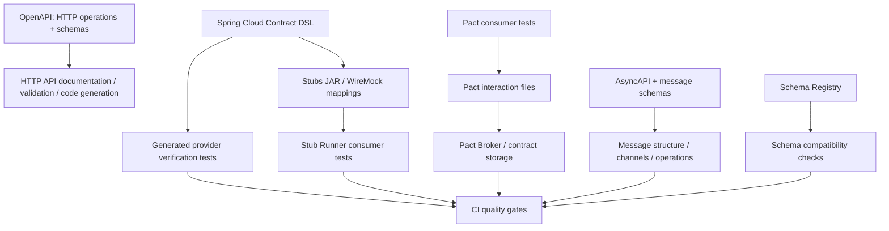
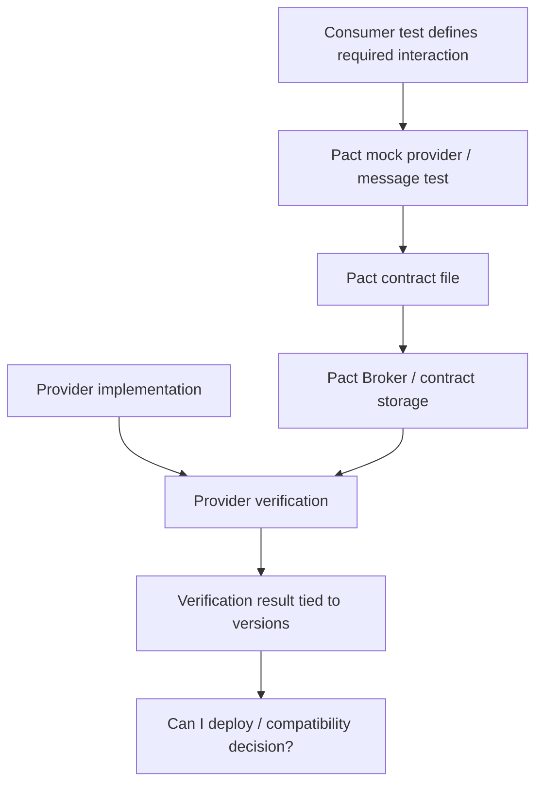
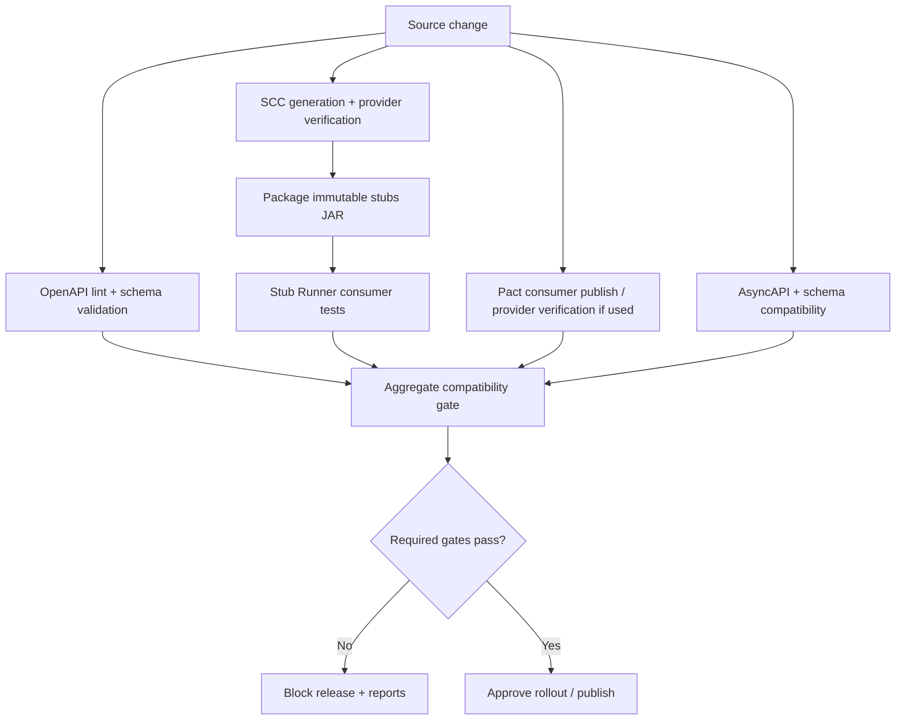

# Integration Limits with OpenAPI, Pact, and Other Contract Tools

In a microservices system, the same interface may be described in several places: **OpenAPI** for HTTP APIs, **Spring Cloud Contract (SCC)** for provider verification and stubs, **Pact** for consumer-driven contract testing, **AsyncAPI** for event-driven communication, or a **schema registry** to manage message structures. These tools solve related parts of the problem, yet they are not synonymous. Converting a file from one tool to another does not automatically preserve all rules, business semantics, and verification evidence.

SCC lets a producer define HTTP or messaging behavior using the **Groovy/YAML DSL**, generate **provider verification tests**, package a **stubs JAR**, and help consumers test with **Stub Runner**. OpenAPI focuses on describing the HTTP surface, operations, parameters, schemas, and security schemes. Pact focuses on recording the interactions consumers rely on and verifying that providers satisfy them. AsyncAPI and schema registries address other aspects of event/message interfaces.

This lesson belongs to the **Tool Compatibility** chapter, focusing on **integration limits with OpenAPI, Pact, and other contract tools**. The goal is to understand **overlaps, what cannot be converted directly, risks of multiple sources of truth, and how to coordinate them in CI**. Examples throughout use `order-producer` providing `GET /api/orders/{id}` and the `OrderCreated` event to `checkout-consumer`.

**Key principle:** never choose a tool merely because it carries the word "contract" and expect it to replace all the others. Identify whether each tool protects **schemas, interactions, provider behavior, consumer compatibility, or message transport operations**.

## 1. Overview: Different Tools Protect Different Layers



The diagram shows **streams that can participate in the same pipeline**, though not every arrow is a built-in automatic feature of SCC. CI orchestration, converters, or adapters may require custom configuration.

| Tool | Focus | Typical outputs/evidence | What it does not prove alone |
| --- | --- | --- | --- |
| Spring Cloud Contract | Producer/consumer contract cases, provider tests, and stubs | Generated tests, stubs JAR, Stub Runner results | Full API schema, all consumer expectations, or production ops |
| OpenAPI | Describing HTTP APIs, operations, parameters, request/response schemas | OpenAPI document, generated docs/client/server code, lint/validation results | Provider implementation enforces all business rules or consumer handles real interactions |
| Pact | Consumer-driven interactions and provider verification | Pact files, verification results, Broker compatibility records | Unconsumed parts of the schema/API or full operational behavior |
| AsyncAPI | Describing message-driven APIs: channels, operations, messages, and bindings | AsyncAPI document, generated docs/code, validation | Broker delivery guarantees or business side effects |
| JSON Schema / Avro / Protobuf | Data structure and constraints | Schema artifacts, validation/compatibility results | HTTP methods/statuses, consumer workflows, or message delivery |
| Standalone WireMock | HTTP request/response simulation | JSON mappings, request journal | Correct producer implementation without provider verification |
| Postman collections | Request/response examples and scripted API checks | Collections, test results | Contract ownership and full cross-version compatibility matrix |

**No single tool covers every row above.** The right approach is pairing tools around the boundaries to protect while avoiding duplicating the same rules across multiple places without synchronization.

## 2. Spring Cloud Contract: Executable Contract Source for Producer and Consumer

A Groovy HTTP contract:

```groovy
import org.springframework.cloud.contract.spec.Contract

Contract.make {
    description 'Read order by ID'

    request {
        method GET()
        url '/api/orders/1001'
        headers {
            header('Accept', 'application/json')
        }
    }

    response {
        status OK()
        headers {
            contentType(applicationJson())
        }
        body(
            id: 1001,
            status: 'CREATED',
            currency: 'VND'
        )
    }
}
```

Equivalent YAML contract:

```yaml
description: "Read order by ID"
request:
  method: GET
  url: /api/orders/1001
  headers:
    Accept: application/json
response:
  status: 200
  headers:
    Content-Type: application/json
  body:
    id: 1001
    status: CREATED
    currency: VND
```

In a typical producer-side workflow:

1. The producer team owns or reviews the contracts.
2. SCC reads Groovy/YAML and generates provider verification tests.
3. The producer runs tests against the real implementation/test context.
4. SCC packages stubs, usually under classifier `stubs`.
5. Consumers use Stub Runner to load stubs and invoke their real clients/listeners.

### 2.1. SCC Combines DSL and Runtime Behavior

Contracts can express concrete requests/responses, headers, bodies, matchers, and message interactions per the active SCC version's capabilities. Base test classes prepare the producer test context; custom matchers/helpers add checks; WireMock mappings serve consumer HTTP tests.

SCC's strength is **tying a single contract source to both provider verification and the stub artifact**. However, a few contract cases do not constitute a complete description of every operation/schema across an entire API. For comprehensive API documentation, OpenAPI is usually better suited.

### 2.2. A Stub Is Not a Server Implementation

Stub Runner/WireMock simulates declared interactions. It does not run the producer's controllers, databases, gateways, authorization servers, brokers, or network policies. Provider verification and dedicated integration/security tests remain necessary.

## 3. OpenAPI: Describing the HTTP Surface, Not a Copy of SCC DSL

OpenAPI describes HTTP APIs using concepts such as:

- Paths and operations: `GET`, `POST`, `PUT`, `DELETE`.
- Parameters: path, query, header, cookie.
- Request bodies and response content.
- Schemas for JSON/XML/form data.
- Status codes, headers, and media types.
- Security schemes and security requirements.
- Tags, descriptions, examples, servers, and metadata.

Condensed OpenAPI 3.x example:

```yaml
openapi: 3.1.0
info:
  title: Order API
  version: 1.0.0
paths:
  /api/orders/{id}:
    get:
      operationId: getOrder
      parameters:
        - name: id
          in: path
          required: true
          schema:
            type: integer
        - name: Accept
          in: header
          required: false
          schema:
            type: string
      responses:
        "200":
          description: Order found
          content:
            application/json:
              schema:
                type: object
                required: [id, status, currency]
                properties:
                  id:
                    type: integer
                  status:
                    type: string
                    enum: [CREATED, PAID, CANCELLED]
                  currency:
                    type: string
        "404":
          description: Order not found
```

This is an API specification example, not SCC YAML DSL. An OpenAPI operation describes **a broader class of information than a contract fixture**: the schema applies across many IDs and response instances. Conversely, an SCC contract describes a specific scenario and produces both a provider test and a stub mapping.

### 3.1. Differences in Purpose

| Question | OpenAPI | Spring Cloud Contract |
| --- | --- | --- |
| Which endpoints does the API expose? | Ideal fit | Can represent contract cases, not comprehensive documentation |
| What are the request/response schemas? | Ideal fit | Has bodies/matchers for declared cases |
| Does the producer implement a specific case properly? | Needs additional validators/test tooling | Generated provider verification tests are core |
| Does the consumer handle sample responses? | Can use generated clients/validators; needs appropriate tests | Stub Runner supports consumer tests with stubs |
| Multi-step/stateful business rules? | Not the focus of operation schemas | Can model contract cases; complex state still needs integration tests |
| Stubs JAR for consumer CI download? | Not a default OpenAPI output | Standard SCC output |

**A valid OpenAPI document does not mean the producer implementation is verified.** A file specifying `201` can be syntactically valid while the controller still returns `200` or omits the `Location` header.

### 3.2. OpenAPI Security Schemes Are Not Real Token Validation

OpenAPI can describe bearer authentication:

```yaml
components:
  securitySchemes:
    bearerAuth:
      type: http
      scheme: bearer
      bearerFormat: JWT
security:
  - bearerAuth: []
```

That specifies how clients should supply credentials per the API spec. It does not verify JWT signatures, issuers, audiences, expirations, scopes, or producer order ownership. Those require security integration tests and proper runtime configuration.

## 4. Why Cannot OpenAPI ↔ SCC Be Converted Completely?

You can build a converter or use tooling for a **subset** of specifications, yet you must never assume general conversion is lossless.

### 4.1. OpenAPI → SCC: Information Can Be Lost

An OpenAPI document may contain hundreds of operations, schema compositions, references, callbacks, webhooks, security requirements, examples, and vendor extensions. An SCC contract typically expresses one or several concrete **interaction cases**.

| OpenAPI information | Mappable to SCC? | Limitations |
| --- | --- | --- |
| HTTP method/path | Usually yes | Path templating and parameterization need handling |
| Header/query parameters | Possible | Required/optional, style/explode, and serialization must stay accurate |
| Request/response examples | Usually yes | Examples are single fixtures, not full schema coverage |
| JSON object schemas | Partial | Composition, recursion, discriminators, and dialects are hard to convert |
| Required fields | Possible with matchers/tests | Verify generated assertions and missing/null semantics |
| Regex/patterns | Partial | Regex dialects/flags and converter semantics may differ |
| Numeric ranges/formats | Partial | Formats like date-time/decimal need runtime behavior checks |
| Multiple responses/statuses | Can generate multiple contracts | Must pick distinguishing request conditions to avoid mapping overlap |
| Security schemes | Does not convert into full auth verification | Header matchers do not validate tokens/permissions |
| Callbacks/webhooks | Require separate design | Not standard request-response flows |
| Links/operation relationships | Do not become workflow tests automatically | Require integration/consumer workflows |
| Vendor extensions | Only if custom converter understands them | Lost completely if ignored |

### 4.2. SCC → OpenAPI: Semantics Are Also Lost

An SCC DSL file may contain:

- A concrete case with sample body and dynamic matchers.
- Custom commands/helpers invoked inside generated provider tests.
- Producer-specific base test classes or setup.
- Trigger methods for message contracts.
- Message destinations/headers/bodies.
- Build, packaging, and stub generation configuration.
- Test rules that are not part of a public API schema.

OpenAPI has no direct equivalent to **generated provider tests extending a base class**, **Stub Runner**, or **WireMock scenario state**. You can convert portions of method/path/schema/status into OpenAPI, yet you cannot turn an entire test setup into an API description without losing intent.

### 4.3. Valid Schema Does Not Mean Compatible Behavior

Suppose OpenAPI allows:

```json
{
  "id": 1001,
  "status": "CREATED",
  "currency": "VND"
}
```

Yet the consumer requires an extra rule: when `status` is `CANCELLED`, `cancelReason` must be present. If a general schema only declares `status` as a string without expressing conditional rules, OpenAPI validation can pass while business behavior fails expectations. Additional schema constraints or `oneOf`/conditional schemas can help depending on spec version, yet **provider/consumer interaction tests must still verify critical business scenarios**.

## 5. Pact: Consumer-Driven Contract Testing Differs from Producer-Owned SCC Workflows

Pact centers on **interactions consumers actually need**. Consumers write tests against a mock provider or message provider; test execution emits Pact contract files recording those interactions. The provider then runs provider verification to confirm it satisfies them. A Pact Broker can store Pact versions, provider verification results, and support compatibility queries across consumer/provider versions.

High-level flow:



This is Pact's signature consumer-driven model. By contrast, SCC in its common usage starts from producer-managed contract sources, generating provider tests and stubs for consumers. **Both verify producer/consumer contracts, yet ownership, artifacts, and workflows differ.**

### 5.1. Differences in Source of Truth

| Aspect | Typical SCC | Typical Pact |
| --- | --- | --- |
| Who proposes interactions? | Producer contracts describe provided behavior | Consumer tests describe depended-on behavior |
| Primary artifacts | Contract sources, generated provider tests, stubs JAR | Pact interaction files |
| Provider verification | Generated from SCC contracts | Runs verifier against Pact files |
| Consumer tests | Stub Runner downloads stubs | Pact mock provider/message provider |
| Distribution | Typically Maven/Gradle artifact repositories | Pact Broker or Pact storage mechanism |
| Compatibility matrix | Organized via artifact/CI orchestration | Broker offers version-aware compatibility workflows |
| Scope | HTTP and messaging per SCC support/config | HTTP and async messages per Pact language/runtime support |

These descriptions reflect **typical workflows**, not rigid boundaries. SCC can be organized under consumer ownership; Pact can pair with provider-side tooling. Always verify the exact versions and plugins/runtimes in your project.

### 5.2. A Pact File Is Not a Stubs JAR

A Pact file records interactions verified by a consumer. An SCC stubs JAR packages mappings/resources for Stub Runner to launch a stub server or message stubs. Both artifacts may carry similar HTTP details in simple cases, yet they **do not share the same format, lifecycle, or semantics**.

Never drop Pact JSON into a Maven repository expecting Stub Runner to understand it; and never push a stubs JAR to a Pact Broker expecting the Pact verifier to execute it directly as a Pact file.

## 6. Comparing One Interaction from Three Perspectives

Requirement: `checkout-consumer` calls `GET /api/orders/1001`, sends `Accept: application/json`, and reads `id`, `status`, and `currency`.

### 6.1. OpenAPI Describes Operation/Schema

```yaml
paths:
  /api/orders/{id}:
    get:
      operationId: getOrder
      parameters:
        - name: id
          in: path
          required: true
          schema:
            type: integer
      responses:
        "200":
          description: Order response
          content:
            application/json:
              schema:
                type: object
                required: [id, status, currency]
                properties:
                  id:
                    type: integer
                  status:
                    type: string
                  currency:
                    type: string
```

### 6.2. SCC Describes a Provider/Consumer Test Case

```groovy
import org.springframework.cloud.contract.spec.Contract

Contract.make {
    description 'GET order 1001'
    request {
        method GET()
        url '/api/orders/1001'
        headers {
            header('Accept', 'application/json')
        }
    }
    response {
        status OK()
        headers {
            contentType(applicationJson())
        }
        body(
            id: 1001,
            status: 'CREATED',
            currency: 'VND'
        )
    }
}
```

### 6.3. Pact Describes the Consumer's Required Interaction

A consumer Pact test declares **provider state**, request method/path/headers, and expected response; the Pact mock provider serves that response during the consumer test and writes the interaction to a Pact file.

Conceptual pseudocode:

```text
given provider state "order 1001 exists"
upon receiving "a request for order 1001" from checkout-consumer
with:
  method = GET
  path = /api/orders/1001
  Accept = application/json
will respond with:
  status = 200
  Content-Type = application/json
  body.id = 1001
  body.status = CREATED
  body.currency = VND
```

This is **pseudocode illustrating interaction intent**, not language-specific Pact DSL syntax. Pact defines distinct DSLs/APIs across Java, JVM, JavaScript, .NET, Go, and other ecosystems.

### 6.4. Similarities and Differences

All three can express a sample request/response. However:

- OpenAPI describes the broad operation/schema.
- SCC uses the case to generate provider verification tests and stub mappings.
- Pact records the interaction the consumer relies on and verifies the provider satisfies it.

**A matching example does not turn three artifacts into one artifact.** Clarify who owns, updates, and executes each file.

## 7. When Should SCC and OpenAPI Coexist?

An organization may choose:

- **OpenAPI as public/API design source:** documenting all operations, parameters, schemas, and security schemes.
- **SCC as executable provider contract suite:** verifying critical cases against the producer implementation and creating stubs for consumer CI.

This combination works well when both artifacts have **distinct responsibilities and controlled synchronization**.

### 7.1. Sample Division of Responsibilities

| Content | Authoritative owner | Verification tool |
| --- | --- | --- |
| Public endpoint list and operation descriptions | OpenAPI | Linter, OpenAPI validator |
| General request/response schemas | OpenAPI/schema | Schema validation, code generation tests |
| Critical provider behavior cases | SCC contracts | Generated provider tests |
| Consumer client behavior against stubs | SCC stubs | Stub Runner consumer tests |
| Real JWT signatures/permissions | Security config/code | Security integration tests |
| p95 latency/availability | SLO documents | Load/observability tests |
| Message payload compatibility | AsyncAPI/schema registry per architecture | Schema compatibility + message integration |
| Event retries/DLQ/ordering | Broker/consumer operational policy | Broker integration tests |

### 7.2. Avoid Maintaining Two Sources of Truth for the Same Field Without Rules

If `currency` is a string in OpenAPI while SCC contracts use a number, establish clear answers:

1. Is OpenAPI or SCC authoritative for schema fields?
2. Does a converter or sync check catch drift?
3. Who is responsible for updating both when a field changes?
4. If one document updates without the other, does CI block merging?

Without answers, two files easily remain **syntactically valid while contradicting each other on the API**.

## 8. When Should Pact and SCC Coexist?

Valid reasons an organization might use both include:

- Some services use SCC in a producer-owned workflow.
- Another group needs Pact Broker to manage consumer/provider version compatibility matrices.
- A legacy system already has Pact interactions while a new producer publishes SCC stubs for consumer tests.
- The organization uses SCC for message contracts while a consumer stack/SDK standardized on Pact.

However, avoid **managing the same interaction independently in two places with no clear owner**.

### 8.1. Practical Coordination Strategies

| Strategy | Description | Conditions |
| --- | --- | --- |
| SCC primary, Pact for another boundary | Use SCC for SCC-adopted services; Pact for independent consumer-driven groups | Clear ownership and scope separation |
| Pact primary, SCC for other producer stubs | Pact governs interactions; SCC serves unmigrated producers/consumers | Never let two suites compete over the same API |
| Coexistence during migration | Run both suites on key interactions | End date, ID/version mapping, and drift gate |
| One-way converter | Generate a secondary artifact from a canonical source | Support a strict subset only; report unconvertible parts |
| Two independent sources with review | Each tool governs a separate set of interactions | Partition endpoints/consumers and ownership |

### 8.2. Do Not Assume a Complete SCC ↔ Pact Converter Exists

Custom libraries or tooling may exist for specific versions/languages, yet never assume SCC DSL exports cleanly to Pact files or Pact files import into Groovy/YAML contracts while preserving:

- Provider state setup.
- Dynamic matchers and matching rules.
- Header/body matching semantics.
- Message metadata and trigger behavior.
- Test helpers/custom assertions.
- Versioning and ownership.
- Stubs JAR packaging/Stub Runner behavior.
- Pact Broker deployment compatibility metadata.

If a project writes a converter, publish **its supported subset, ignored constructs, and lossiness warnings**. Never let a converter report success merely because JSON/YAML parsed.

## 9. Pact Broker and Maven Artifact Repositories Solve Different Problems

SCC stubs are typically stored in a Maven/Gradle-compatible repository, e.g.:

```text
com.example:order-producer:2.4.0:jar:stubs
```

Pact Broker stores Pact contracts and verification results, linking consumer/provider versions and build metadata.

| Question | Maven/Gradle artifact repository | Pact Broker |
| --- | --- | --- |
| Download stubs JAR by GAV/classifier | Yes | Not core functionality |
| Store Pact interactions | Not core format/lifecycle | Yes |
| Store provider verification results per Pact | Not automatic | Supported via Broker workflows |
| Consumer/provider version compatibility matrix | Needs CI/metadata orchestration | Supported via Broker features |
| No-redeploy / immutable artifacts | Per repository policy | Per Pact storage/versioning policy |
| Stub Runner resolves stubs | Can use this repository | Not a direct replacement |

**Never swap one repository for the other merely because both hold "contract artifacts."** Check the data formats and actions required by consumer/provider CI.

## 10. AsyncAPI: Describes Message APIs, Does Not Replace Message Delivery Tests

AsyncAPI describes event/message-driven interfaces such as channels, operations, messages, headers, payload schemas, and bindings per supported protocol.

Condensed AsyncAPI example:

```yaml
asyncapi: 3.0.0
info:
  title: Order Events
  version: 1.0.0
channels:
  ordersCreated:
    address: orders.created
    messages:
      orderCreated:
        $ref: '#/components/messages/OrderCreated'
operations:
  receiveOrderCreated:
    action: receive
    channel:
      $ref: '#/channels/ordersCreated'
    messages:
      - $ref: '#/channels/ordersCreated/messages/orderCreated'
components:
  messages:
    OrderCreated:
      name: OrderCreated
      contentType: application/json
      payload:
        type: object
        required: [eventId, eventType, schemaVersion, orderId]
        properties:
          eventId:
            type: string
          eventType:
            type: string
          schemaVersion:
            type: integer
          orderId:
            type: string
```

This illustrates AsyncAPI 3.x structure; exact references/operations/bindings must follow the specification version used by your project.

### 10.1. SCC Message Contracts Have a Different Purpose

An SCC message contract describes an event emitted by a producer when a trigger fires, with label, destination, headers, and body. Provider verification checks that the producer emits the message per contract; Stub Runner/StubTrigger lets consumers test listeners against message fixtures.

Groovy example:

```groovy
import org.springframework.cloud.contract.spec.Contract

Contract.make {
    description 'Emit OrderCreated v1'
    label 'order_created_v1'

    input {
        triggeredBy('publishOrderCreated()')
    }

    outputMessage {
        sentTo('orders.created')
        headers {
            messagingContentType(applicationJson())
        }
        body(
            eventId: 'EVT-1001',
            eventType: 'OrderCreated',
            schemaVersion: 1,
            orderId: 'ORD-1001'
        )
    }
}
```

### 10.2. AsyncAPI ↔ SCC Conversion Limits

| Component | AsyncAPI | SCC message contract |
| --- | --- | --- |
| Channel/destination | Describes channel/address | Can describe destination in message contract |
| Message payload schema | Describes payload structure | Has body fixtures and matchers per case |
| Message headers | Defines message headers | Can define headers per contract DSL |
| Send/receive operations | Describes communication | Contract uses trigger/output or input per scenario |
| Protocol bindings | Models protocol bindings | Not every binding has a direct equivalent |
| Broker ack/retry/DLQ | Not executed automatically | Not proven by message stubs alone |
| Provider trigger/setup | Not test setup code | Uses trigger methods/base tests |
| Consumer side effects | Not verified automatically | Consumer listener tests must assert separately |

A valid AsyncAPI document does not prove consumers commit offsets properly, avoid duplicates, or handle DLQs. Passing SCC message stubs also does not prove every protocol binding in AsyncAPI is implemented correctly.

## 11. Schema Registry: Structural Compatibility Does Not Mean Business Compatibility

A schema registry (for example, for Avro, Protobuf, or JSON Schema) manages schema versions and checks compatibility under policies like backward, forward, or full compatibility, depending on registry/format/configuration.

Example event schema:

```json
{
  "type": "object",
  "required": [
    "eventId",
    "eventType",
    "schemaVersion",
    "orderId"
  ],
  "properties": {
    "eventId": {"type": "string"},
    "eventType": {"type": "string"},
    "schemaVersion": {"type": "integer"},
    "orderId": {"type": "string"},
    "campaignId": {"type": ["string", "null"]}
  }
}
```

This is an illustrative JSON Schema, not Avro or Protobuf. A schema registry compatibility check catches structural violations banned by policy, yet **it has no idea what business meaning every consumer assigns to each field**.

### 11.1. Examples Where Schema Passes Yet Business Behavior Fails

- `totalMinor` remains an integer, yet the producer switches calculation from VND minor units to major units.
- `status` remains a string, yet the producer emits `CANCELLED` before consumers support it.
- `eventId` remains a string, yet each retry mints a new ID, breaking consumer deduplication.
- `campaignId` stays optional, yet the producer repurposes it from campaign ID to promotion label.

Schema types stayed identical while semantics shifted. Contract cases, consumer tests, and domain reviews are needed to catch these.

### 11.2. Examples Where Business Tests Pass Yet Schema Evolution Has Risks

An SCC message contract has only a fixture with `schemaVersion=1` and `orderId`. The producer adds a new required field. Provider verification on that single fixture might pass once test data updates, yet older consumers fail to parse the new message.

Run both a **schema compatibility gate** and consumer tests against candidate schemas/messages, not just the producer's own tests.

## 12. JSON Schema and OpenAPI Schema Are Not Always Interchangeable

OpenAPI 3.0 defines a Schema Object with its own capabilities and rules; OpenAPI 3.1 aligns its Schema Object with JSON Schema vocabularies/dialects. Even though they are closer now, **never assume any JSON Schema file drops straight into any OpenAPI version without adjustment**.

When integrating a schema validator with SCC:

- Identify the schema dialect/version.
- Check `$ref` resolution and base URIs.
- Check `nullable`/null semantics per version.
- Verify whether `format` is purely an annotation or enforced by the validator.
- Check `oneOf`/`anyOf`/`allOf`, discriminators, and recursive refs.
- Verify date/time/number serialization.
- Decide whether validation runs on the provider, consumer, or both.

**Schema validation complements contract interaction tests**. It does not replace provider verification or Stub Runner consumer behavior tests.

## 13. WireMock: Shared Stub Format Does Not Make Contract Tools Equivalent

SCC HTTP stubs typically rely on WireMock mappings. Teams can also author standalone WireMock JSON mappings manually.

Mapping example:

```json
{
  "request": {
    "method": "GET",
    "urlPath": "/api/orders/1001",
    "headers": {
      "Accept": {
        "contains": "application/json"
      }
    }
  },
  "response": {
    "status": 200,
    "headers": {
      "Content-Type": "application/json"
    },
    "jsonBody": {
      "id": 1001,
      "status": "CREATED",
      "currency": "VND"
    }
  }
}
```

A JSON mapping can run in standalone WireMock. However, if that mapping never went through SCC generation/provider verification, **there is no evidence the producer implementation was ever verified against it**.

### 13.1. SCC-Generated Mappings vs. Hand-Written Mappings

| Aspect | SCC-generated | Hand-written WireMock |
| --- | --- | --- |
| Source | Groovy/YAML contracts | JSON/Java mappings |
| Linked provider verification | Present in configured SCC workflow | Not built in |
| Consumer HTTP simulation | WireMock mappings via stubs | Direct WireMock |
| Ownership | Usually producer contract repo | Test/consumer/platform repo per team |
| Custom behavior | SCC/WireMock matchers/config/extensions | Full WireMock capabilities per version |
| Drift risk | DSL and generated output can diverge if unchecked | Mappings and producer implementation drift apart easily |

Using WireMock without SCC is fine for mocking external third-party dependencies. For internal service boundaries needing contract verification, preserve traceable **mapping provenance and provider evidence**.

### 13.2. A Pact Mock Server Is Also Not a WireMock Mapping

The Pact mock provider is driven by Pact interactions and Pact matching rules. Even though both Pact and WireMock accept HTTP requests and return responses, you cannot blindly import a JSON mapping from one to the other and retain matching semantics, provider states, or lifecycles.

## 14. Other API Testing Tools: Postman, Dredd, Schemathesis, and Code Generators

An ecosystem may employ supporting tools:

- **Postman/Newman:** stores request collections and executes scripted response checks.
- **OpenAPI validators/fuzzers:** verify requests/responses against schemas or generate request variations.
- **Code generators:** emit API client/server interfaces from OpenAPI.
- **Mock server generators:** serve responses from examples/schemas.
- **Consumer integration tests:** call real services over HTTP in a test environment.
- **WireMock/Testcontainers:** simulate dependencies or spin up test infrastructure.

None of these automatically serve as a shared contract source of truth. A Postman collection may hold login, create-order, and cancel-order examples without capturing ownership, versioning, or compatibility the way Pact or SCC does.

### 14.1. What Do Fuzz/Schema Tests Add?

OpenAPI-based fuzzing probes boundary inputs derived from schemas. It catches parser/validation bugs, yet it lacks awareness of business rules or consumer expectations without extra assertions.

SCC contract cases protect agreed-upon interactions, without exhaustively fuzzing every input permutation across the whole schema. Combining both works well: **schema fuzzing for input breadth, contract tests for concrete behavior**.

### 14.2. Code Generation Is Not Verification

Generating a Java client from OpenAPI does not prove the client handles auth, retries, idempotency, or error statuses properly. Generating a server interface does not prove the implementation satisfies the schema. Compilation, validation, provider tests, and consumer tests are all still required.

## 15. gRPC and Non-HTTP-JSON Protocols

SCC focuses on HTTP and messaging via supported integrations. When services use **gRPC/Protocol Buffers**, traits like service/method descriptors, protobuf field numbers, streaming, deadlines, status codes, and metadata cannot be mapped losslessly into a simple HTTP JSON contract.

Consider using:

- `.proto` files as schema/API sources.
- Descriptor/reflection tooling to check service shapes.
- Protobuf compatibility checks.
- gRPC integration tests with test servers/clients.
- Specialized consumer-driven contract tools if supported by your ecosystem.

**Never disguise a gRPC method as `POST /rpc` in SCC and claim you verified full gRPC semantics.** If a gateway translates gRPC to HTTP/JSON, the gateway contract and the gRPC backend contract are two distinct boundaries.

## 16. Hard-to-Convert Semantics: Matchers, Dynamic Values, and Provider States

A primary reason converters are not lossless is **matching semantics**.

| Concept | SCC | OpenAPI | Pact |
| --- | --- | --- | --- |
| Concrete example | Request/response body fixture | `example`/`examples` | Interaction body |
| Pattern/regex matcher | Matchers per DSL/version | Schema `pattern` for strings | Matching rules per Pact implementation |
| Optional fields | Body/matcher/schema behavior | `required`/schema rules | Consumer interaction/matching rules |
| Dynamic response values | Producer/consumer-side matchers or helpers per DSL | Schema describes shape, does not generate runtime values | Provider states/generators per implementation |
| Provider state/setup | Base class/triggers/config | Not a core concept | Provider states are central |
| Custom assertions | Helpers/commands in generated tests | Not part of API doc | Possible in provider/consumer test code |
| Stateful scenarios | Configurable via WireMock/custom test setup | Does not model full runtime sequence | Interactions/provider states follow dedicated workflows |

### 16.1. Non-Equivalent Matcher Example

SCC might apply a regex to order IDs:

```groovy
bodyMatchers {
    jsonPath('$.id', byRegex('^ORD-[0-9]{4}$'))
}
```

OpenAPI schema might write:

```yaml
id:
  type: string
  pattern: '^ORD-[0-9]{4}$'
```

Both expressions express the same format intent, yet you must check:

- Does the JSONPath exist and how are null/missing values handled?
- Do regex engines/flags share the same semantics?
- Does the pattern apply only to provider tests or also to stub request matching?
- Does the schema validator actually enforce `pattern`?
- Do consumer/Pact matchers treat optional fields identically?

**Identical regex text does not guarantee identical outcomes across toolchains.**

### 16.2. Provider State Is Not a Response Example

Pact provider states prepare provider-side data or preconditions before verifying an interaction. OpenAPI examples are sample payloads; SCC base tests/triggers set up producer test fixtures. Never convert a provider state into a static JSON example and assume the test prepared the corresponding database, identity, or session.

## 17. Error Semantics: Matching Status Codes Is Not Enough

A `404` response can mean several things:

- The resource does not exist.
- The resource exists, but the caller lacks permission to see it.
- The stub request failed to match any mapping.
- The gateway found no matching route.
- The consumer called the wrong host/port.

OpenAPI describes response statuses and error schemas; SCC builds contract cases and provider tests; Pact records consumer-required interactions. Yet **business semantics and security policies require explicit agreement across teams**.

Example OpenAPI response:

```yaml
responses:
  "404":
    description: Order not found
    content:
      application/json:
        schema:
          type: object
          required: [code]
          properties:
            code:
              type: string
              enum: [ORDER_NOT_FOUND]
```

Corresponding SCC contract case:

```groovy
Contract.make {
    request {
        method GET()
        url '/api/orders/9999'
    }
    response {
        status NOT_FOUND()
        headers {
            contentType(applicationJson())
        }
        body(
            code: 'ORDER_NOT_FOUND'
        )
    }
}
```

Both artifacts describe the same error shape, yet provider verification must prove the implementation returns that error under real fixture conditions. Consumer tests must assert error handling branches. WireMock's unmatched 404 must never count as equivalent proof.

## 18. Contract Ownership: Avoid Multiple Unowned Sources of Truth

When the same endpoint appears in OpenAPI, SCC, and Pact, define an ownership table:

| Asset | Owner | Change process |
| --- | --- | --- |
| OpenAPI document | API/producer team or API governance | Review schema/operations and publish docs |
| SCC contract source | Producer team or designated contract owner | Provider verification and stubs publication |
| Pact consumer contract | Created by consumer team; verified by provider team | Publish Pact, verify, and record version results |
| AsyncAPI document | Event/API owner | Review channels/messages/bindings |
| Schema Registry schema | Data/event owner | Register schema and run compatibility gate |
| Shared mappings/converters | Platform/tooling team | Versioning, compatibility tests, release notes |

### 18.1. Every Rule Needs One Authoritative Source

Example `Order.status`:

- OpenAPI defines the published type and enum.
- SCC holds cases for `CREATED`, `PAID`, and error behavior.
- Pact records the interactions required by the checkout consumer.
- Consumer code implements fallback handling for unknown enum values if policy requires.

All four can be valid assets, provided there is **one authoritative place deciding canonical semantics** and a drift detection mechanism. If every repo edits the enum independently, the files stop describing the same API.

### 18.2. Do Not Turn Public Docs into the Sole Test Suite

OpenAPI excels as an API source, yet if CI only lints OpenAPI without running provider verification/consumer tests, the implementation can still drift. Conversely, having only SCC contracts without comprehensive operation/schema docs makes API discovery harder for external consumers.

Choose tools based on the audience and purpose of each asset.

## 19. Synchronization Strategies: Generate, Validate, or Manual Review

There are three coordination patterns:

### 19.1. One Source Generates Secondary Artifacts

For example, OpenAPI is the canonical schema, and the pipeline generates clients/docs plus selected SCC contracts from curated examples. The converter must:

- Accept only a documented supported subset.
- Report unconvertible fields/constructs.
- Preserve data types, required/null semantics, headers, and response statuses.
- Produce deterministic output.
- Have converter regression fixtures.
- Refuse to publish silently when constructs are dropped.

### 19.2. Two Separate Sources with Drift Validation

OpenAPI and SCC are maintained separately; CI reads both and compares a critical subset: path, method, status, media type, schema field names/types. On divergence, CI requires review. This provides **drift detection**, not full semantic equivalence.

### 19.3. Manual Mapping Review

When provider states, custom matchers, extensions, or complex message triggers exist, parts of the semantics cannot be represented in another tool. Document what is shared, what is verified separately, and who owns each piece.

**Never use "auto-generated file" as an excuse to skip review.** Converters can emit syntactically valid output that silently drops security checks, dynamic matchers, or business semantics.

## 20. An Integrated Matrix in CI/CD

A pipeline can enforce multiple quality gates:



Example gates:

| Gate | Pass condition | Fail condition |
| --- | --- | --- |
| OpenAPI lint | Spec parses and governance rules pass | Invalid refs, missing required metadata |
| OpenAPI schema validation | Request/response examples match schema | Type/required/response mismatch |
| SCC generation | Contracts discovered and generated | Parse errors or unexpected zero contracts |
| SCC provider verification | Generated tests actually execute/pass | Assertion failures, skipped tests |
| Stubs packaging | JAR classifier/version and mappings valid | Missing mappings or stale artifact |
| Stub Runner consumer tests | Real consumer client passes against candidate | Request/response mismatch |
| Pact verification (if used) | Required Pact interactions verified | Provider verification fails or results missing |
| AsyncAPI/schema gate | Schemas/bindings and compatibility policy pass | Breaking schema change |
| Release gate | All mandatory gates have results | Missing/failed/incomplete evidence |

### 20.1. Do Not Collapse Results into a Pass Percentage

If 9/10 consumer tests pass while one required consumer fails, the release may still need blocking. Compatibility decisions depend on the **required consumer list and policy**, not an aggregate green percentage.

### 20.2. Preserve Artifact Identity in Every Report

For SCC, consumer reports should record:

- Producer commit and contract revision.
- Stubs JAR GAV/type/classifier.
- Repository/source and resolved version.
- SHA-256 of the downloaded artifact.
- Stub Runner mode and runtime version.
- Consumer commit and test report.

For Pact, keep consumer/provider versions and Pact verification results per Broker workflow. For OpenAPI, keep the validated spec revision/digest. For schema registries, keep schema ID/version and compatibility outcomes.

Never attach a consumer pass to another candidate simply because both share the same service name.

## 21. Common Integration Anti-Patterns

| Anti-pattern | Why it is dangerous | How to fix |
| --- | --- | --- |
| Auto-converting all of OpenAPI to SCC without review | Converter may drop semantics | Convert only a subset, report losses, and test output |
| Maintaining OpenAPI and SCC independently with no owner | Schema drift | Define canonical source/ownership and drift gates |
| Treating a Pact file as a stubs JAR | Different artifact format/lifecycle | Use each tool's native artifact or verified adapters |
| Writing the same interaction independently in Pact and SCC | Duplicate sources of truth | Partition scopes or define a migration window |
| Treating OpenAPI lint pass as sufficient | Implementation unverified | Add provider verification and consumer tests |
| Treating Pact Broker publish as proof the API works | Pact files may carry wrong assumptions or lack verification | Check verification results and consumer ownership |
| Treating Schema Registry pass as sufficient | Misses business semantics and delivery behavior | Add contract/message integration tests |
| Hand-writing WireMock mappings without provider tests | Stubs drift from real implementation | Tie mappings to provider verification or mark as external mocks |
| Using examples as the entire schema | Misses value ranges, optional fields, and errors | Combine schema validation with matcher cases |
| Testing only the happy path | Misses error handling, security, and compatibility | Add negative interactions and error contracts |
| Conflating HTTP and broker semantics | Wrong tool for delivery guarantees | Add dedicated broker/DB integration tests |
| Consumer tests pinned to `latest` | Non-reproducible | Pin versions and digests |

## 22. Tool Selection Process for a New API

Before creating any files, answer:

1. Is the interface HTTP request/response, messaging/events, or RPC?
2. Do you need **full API documentation** for developers/external users or targeted interaction verification?
3. Does the producer team or consumer team propose interactions?
4. Do you need provider verification, consumer stub testing, or both?
5. Do multiple consumers require a versioned compatibility matrix?
6. Is a schema registry or AsyncAPI already the canonical source?
7. Are custom matchers or stateful behaviors involved?
8. Does the tool support the service's language, build system, and runtime?
9. Who owns converters or drift checks if multiple tools coexist?
10. What evidence does the release gate require?

### 22.1. Decision Guide

| Primary need | Typical suitable choice |
| --- | --- |
| Public HTTP API docs/schemas | OpenAPI |
| Producer-owned HTTP/message contracts, provider tests, and stubs | Spring Cloud Contract |
| Consumer-driven interactions and version compatibility workflows | Pact |
| Message channels/operations/schema docs | AsyncAPI |
| Schema evolution for Avro/Protobuf/JSON Schema | Schema Registry + compatibility policy |
| Stateful HTTP dependency simulation | WireMock or properly configured SCC stubs |
| Broker delivery, ordering, retries, DLQ | Broker integration tests |
| RPC/gRPC method/schema compatibility | Protobuf/gRPC-specific tooling |

You can choose **more than one tool** when each has a clear role and CI connects the evidence.

## 23. Migrating from One Tool to Another

Never migrate an entire service using a one-shot file-conversion script.

Step-by-step process:

1. **Inventory:** list existing OpenAPI/Pact/SCC/AsyncAPI/schema artifacts.
2. **Ownership:** identify the team and source of truth for each interface.
3. **Coverage:** list currently tested interactions, required consumers, and error paths.
4. **Gap analysis:** map convertible constructs vs. unconvertible ones.
5. **Pilot:** pick a low-risk endpoint/event with rich matchers and error cases.
6. **Time-boxed dual-run:** run old and new tools against the same candidate and compare behavior.
7. **Drift gate:** block whenever the two sources diverge on canonical rules.
8. **Consumer rollout:** update consumers per the compatibility matrix.
9. **Deprecation:** announce retirement dates for the legacy artifact/tool.
10. **Cleanup:** delete legacy sources only after required consumers and release workflows have migrated.

### 23.1. Never Drop Provider Verification During Migration

If migrating from SCC to Pact, decide how provider behavior stays verified once generated SCC tests stop running. If migrating from Pact to SCC, ensure consumer-driven requirements continue to be captured rather than lost under producer-owned contracts.

A successful migration **preserves coverage and ownership**, not merely converting file formats.

### 23.2. Can Two Tools Stay Permanently?

Yes, when scopes are clear: OpenAPI for documentation, SCC for provider/consumer stubs, Pact for another consumer-driven boundary, AsyncAPI/schema registry for events. However, if two tools define the same response field independently, establish a sync workflow. **Intentional coexistence differs from uncontrolled duplication.**

## 24. Exercise: Building a Compatibility Matrix for Order Service

Set up a producer `order-producer`, consumer `checkout-consumer`, and a simple API/event. Practice:

1. Write an OpenAPI document for `GET /api/orders/{id}` with response schemas and 200/404 statuses.
2. Write an SCC Groovy contract for `GET /api/orders/1001`.
3. Generate provider verification tests and confirm the producer implementation passes.
4. Package the stubs JAR and run consumer tests via Stub Runner with the real client.
5. Write a Pact consumer interaction for the same endpoint in a separate experimental project/branch.
6. Run Pact provider verification using the project's Pact toolchain.
7. Compare the OpenAPI example, SCC fixture, and Pact interaction: which methods/paths/headers/bodies/statuses match?
8. Add an optional `campaignId` to OpenAPI without updating SCC/Pact; build a drift check to catch it.
9. Change `currency` from string to number in one artifact; check which gate catches the contradiction.
10. Add `403` for unauthorized tenants; identify which schema, SCC case, and consumer interaction need updates.
11. Write an AsyncAPI document for the `OrderCreated` event.
12. Write an SCC message contract with label `order_created_v1`.
13. Define the schema registry compatibility policy if the event uses Avro/Protobuf/JSON Schema.
14. Experiment with changing `schemaVersion` or removing a required field; record schema gate and message consumer test results.
15. Write a small converter for the method/path/status/body-example subset if needed; emit a clear report of skipped constructs.
16. Add converter tests covering nested objects, arrays, null/absent fields, and regexes.
17. Try feeding Pact JSON into Stub Runner or a stubs JAR into the Pact verifier in a disposable environment; document why artifacts are not directly interchangeable.
18. Build a CI pipeline combining OpenAPI validation, SCC provider verification, Stub Runner consumer tests, and Pact verification if used.
19. Record commit/version/digest for each artifact.
20. Write an ownership matrix: who edits OpenAPI, SCC contracts, Pact files, AsyncAPI, and the schema registry?
21. Add a release gate that blocks whenever a required consumer or schema compatibility gate fails.
22. Write a migration plan in case the team later retires one of the tools.

### 24.1. Self-Assessment Rubric

| Competency | Evidence achieved |
| --- | --- |
| Distinguishing goals | Explains what SCC, OpenAPI, Pact, and AsyncAPI each solve |
| OpenAPI | Reads operations/schemas/security without confusing them with runtime verification |
| SCC | Understands generated provider tests, stubs JAR, and Stub Runner |
| Pact | Explains consumer interactions, provider verification, and Broker workflows |
| Conversion | Pinpoints constructs that lose semantics during conversion |
| Schema Registry | Separates structural compatibility from business behavior |
| WireMock | Does not confuse mapping simulation with producer correctness |
| Messaging | Distinguishes AsyncAPI/schemas from broker delivery semantics |
| Ownership | Establishes canonical sources and accountable owners |
| CI | Implements separate gates and preserves artifact identity |
| Migration | Plans pilots, dual-runs, compatibility windows, and deprecation |

## 25. Conclusion: Integrate Tools by Clear Boundaries and Evidence

**Spring Cloud Contract, OpenAPI, Pact, AsyncAPI, and schema registries complement each other, yet they are not drop-in interchangeable formats.**

- **OpenAPI** describes HTTP APIs and schemas broadly.
- **Spring Cloud Contract** connects contract cases to generated provider tests, stubs JARs, and Stub Runner.
- **Pact** captures consumer-required interactions and supports provider verification/version compatibility workflows.
- **AsyncAPI** describes message-driven interfaces.
- **Schema Registry** manages schema versions and compatibility policies.
- **WireMock** simulates HTTP requests/responses; it does not verify producer implementations by itself.

When combining them, uphold five principles:

1. **One authoritative source per rule:** prevent multiple files from governing the same field without a drift gate.
2. **Never expect lossless converters:** list the supported subset, ignored semantics, and warnings.
3. **Test at the right layer:** schema validation, provider verification, consumer interactions, security, and broker integration serve distinct goals.
4. **Preserve ownership and versions:** know which team updates each artifact and which version consumers test against.
5. **Release on evidence:** never treat a parseable spec or a 200 stub response as full proof of compatibility.

With crisp boundaries, teams can use **OpenAPI for documentation**, **SCC for producer verification and stub distribution**, **Pact for protecting consumer-driven interactions**, and messaging/schema tools for their proper scopes. What matters most is ensuring every CI signal speaks about **the same interface, the same revision, and a traceable compatibility decision**.
