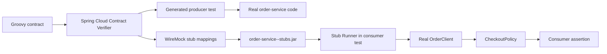
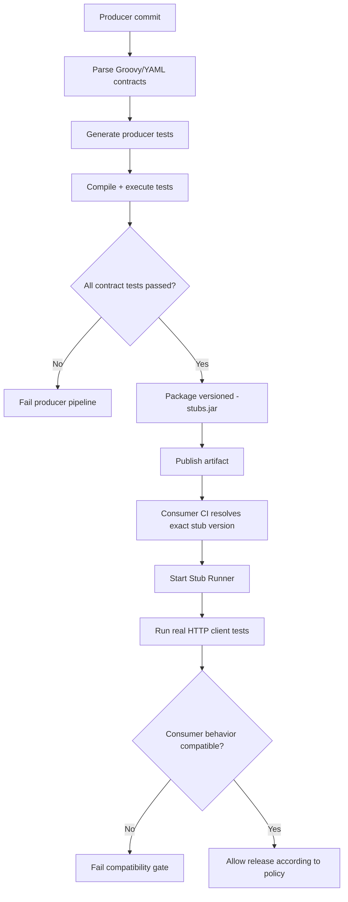
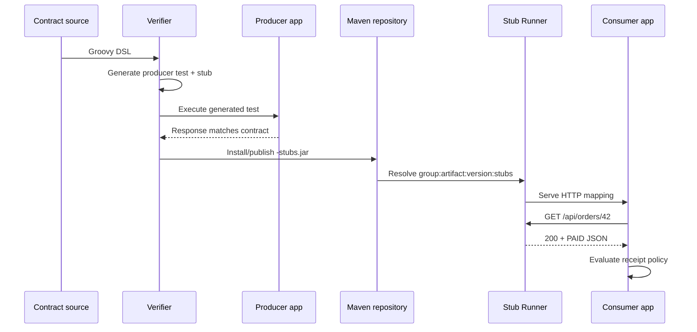

# Building an HTTP Producer and Consumer with Your First Contract

## 1. Project Goals

In this comprehensive hands-on lab, you will build two independent Spring Boot applications to test an HTTP contract using **Spring Cloud Contract**:

- **`order-service` — producer:** exposes an API to read orders, defines the contract using the Groovy DSL, uses Verifier to generate tests, and publishes a stub artifact.
- **`checkout-service` — consumer:** uses a real HTTP client to call the order API, loads the stub with **Stub Runner**, and verifies business behavior based on the response.

When finished, you will be able to run the entire flow:



**Expected outcome to prove:** the real producer satisfies the declared contract, the stub is packaged from the verified contract, and the consumer uses its own HTTP client to verify behavior when receiving the response from the stub.

### 1.1. Deliverables

| Deliverable | Where created | Completion criteria |
|---|---|---|
| Producer REST API | `order-service` | `GET /api/orders/42` returns valid JSON |
| Contract source | Producer test resources | Groovy DSL describing request/response |
| Producer base test | Producer test source | Fixture is created before generated tests |
| Generated producer test | Maven build output | Test is generated, compiled, executed, and passes |
| Stub artifact | Maven local repository | `order-service:<version>:stubs` contains mappings |
| Consumer HTTP client | `checkout-service` | Calls API via configured base URL |
| Consumer contract test | Consumer test source | Stub Runner starts stub, real client reads response |
| Consumer business assertion | Consumer test | A `PAID` order allows issuing a receipt |

## 2. Prerequisites and Required Tools

You should be familiar with:

- Basic Java and Maven.
- Spring Boot REST controllers, dependency injection, and JUnit 5.
- JSON request/response payloads, HTTP status codes, and headers.
- How to read build logs and test reports.

Lab environment:

| Component | Role |
|---|---|
| JDK compatible with the chosen Spring Boot version | Compiles and runs both applications |
| Maven Wrapper or pre-installed Maven | Builds the producer and consumer |
| Spring Boot | Provides the HTTP API and consumer client |
| Spring Cloud Contract Verifier | Generates producer contract tests and stubs |
| Spring Cloud Contract Stub Runner | Loads the stub artifact in consumer tests |
| JUnit 5 + AssertJ | Asserts results |
| Maven local repository | Shares the stub artifact between both projects on the same machine |

**Versioning:** choose a compatible Spring Boot and Spring Cloud Release Train pair, then use the matching Spring Cloud Contract version for both the Verifier plugin and Stub Runner. Plugin and dependency versions must be managed consistently via the project BOM or properties. Do not arbitrarily mix a 4.x plugin with a starter from a different release line.

The examples below use Maven and modern Java. Version placeholders must be replaced with a version set verified as compatible by your team; there is no single version number that works for every Spring Boot release.

## 3. Designing the Two Projects

Create a workspace directory:

```text
spring-cloud-contract-lab/
├── order-service/
│   ├── pom.xml
│   └── src/
│       ├── main/java/com/example/orders/
│       │   ├── OrderApplication.java
│       │   ├── OrderController.java
│       │   ├── OrderStore.java
│       │   ├── OrderService.java
│       │   └── OrderResponse.java
│       └── test/
│           ├── java/com/example/orders/contract/
│           │   └── OrderContractBase.java
│           └── resources/contracts/
│               └── order/
│                   └── get-paid-order.groovy
└── checkout-service/
    ├── pom.xml
    └── src/
        ├── main/java/com/example/checkout/
        │   ├── OrderClient.java
        │   ├── OrderResponse.java
        │   └── CheckoutPolicy.java
        └── test/java/com/example/checkout/
            └── CheckoutContractTest.java
```

In practice, the two projects can live in **two separate repositories**. This lab places them side by side for convenience; the producer installs its stub into the Maven local repository before the consumer runs.

### 3.1. Workflow

1. Declare the contract in the producer.
2. Write the base test to prepare the state for order `42`.
3. Run Maven so Verifier generates and executes producer tests.
4. Install the `-stubs.jar` artifact into the local repository.
5. Declare the exact stub coordinates in the consumer and start Stub Runner.
6. Have the consumer client call the stub's runtime port.
7. Assert the DTO and business decision.

## 4. Creating the `order-service` Producer

### 4.1. Creating the Maven Project and Configuring Dependencies

The `order-service/pom.xml` file below is a minimal example configuration. Replace the placeholders with versions matching your environment's Spring Boot/Spring Cloud Release Train:

```xml
<project xmlns="http://maven.apache.org/POM/4.0.0"
         xmlns:xsi="http://www.w3.org/2001/XMLSchema-instance"
         xsi:schemaLocation="http://maven.apache.org/POM/4.0.0
         https://maven.apache.org/xsd/maven-4.0.0.xsd">
    <modelVersion>4.0.0</modelVersion>

    <groupId>com.example</groupId>
    <artifactId>order-service</artifactId>
    <version>1.0.0-SNAPSHOT</version>
    <name>order-service</name>

    <properties>
        <java.version>17</java.version>
        <spring-boot.version>REPLACE_WITH_COMPATIBLE_VERSION</spring-boot.version>
        <spring-cloud.version>REPLACE_WITH_COMPATIBLE_RELEASE_TRAIN</spring-cloud.version>
        <spring-cloud-contract.version>
            REPLACE_WITH_COMPATIBLE_CONTRACT_VERSION
        </spring-cloud-contract.version>
    </properties>

    <dependencyManagement>
        <dependencies>
            <dependency>
                <groupId>org.springframework.boot</groupId>
                <artifactId>spring-boot-dependencies</artifactId>
                <version>${spring-boot.version}</version>
                <type>pom</type>
                <scope>import</scope>
            </dependency>
            <dependency>
                <groupId>org.springframework.cloud</groupId>
                <artifactId>spring-cloud-dependencies</artifactId>
                <version>${spring-cloud.version}</version>
                <type>pom</type>
                <scope>import</scope>
            </dependency>
        </dependencies>
    </dependencyManagement>

    <dependencies>
        <dependency>
            <groupId>org.springframework.boot</groupId>
            <artifactId>spring-boot-starter-web</artifactId>
        </dependency>
        <dependency>
            <groupId>org.springframework.boot</groupId>
            <artifactId>spring-boot-starter-test</artifactId>
            <scope>test</scope>
        </dependency>
        <dependency>
            <groupId>org.springframework.cloud</groupId>
            <artifactId>spring-cloud-starter-contract-verifier</artifactId>
            <scope>test</scope>
        </dependency>
    </dependencies>

    <build>
        <plugins>
            <plugin>
                <groupId>org.apache.maven.plugins</groupId>
                <artifactId>maven-compiler-plugin</artifactId>
                <version>REPLACE_WITH_COMPATIBLE_MAVEN_COMPILER_PLUGIN_VERSION</version>
                <configuration>
                    <release>${java.version}</release>
                </configuration>
            </plugin>
            <plugin>
                <groupId>org.apache.maven.plugins</groupId>
                <artifactId>maven-surefire-plugin</artifactId>
                <version>REPLACE_WITH_JUNIT5_COMPATIBLE_SUREFIRE_VERSION</version>
            </plugin>
            <plugin>
                <groupId>org.springframework.boot</groupId>
                <artifactId>spring-boot-maven-plugin</artifactId>
                <version>${spring-boot.version}</version>
            </plugin>
            <plugin>
                <groupId>org.springframework.cloud</groupId>
                <artifactId>spring-cloud-contract-maven-plugin</artifactId>
                <version>${spring-cloud-contract.version}</version>
                <extensions>true</extensions>
                <configuration>
                    <baseClassForTests>
                        com.example.orders.contract.OrderContractBase
                    </baseClassForTests>
                    <testFramework>JUNIT5</testFramework>
                    <testMode>MockMvc</testMode>
                </configuration>
            </plugin>
        </plugins>
    </build>
</project>
```

**Explanation:**

- `spring-boot-starter-web` provides Spring MVC and JSON serialization.
- `spring-cloud-starter-contract-verifier` provides the contract testing libraries in test scope.
- `spring-cloud-contract-maven-plugin` discovers contract sources, generates tests, and supports creating the stub artifact.
- `baseClassForTests` links generated tests with shared fixtures and setup.
- `testFramework` and `testMode` must use values supported by the selected plugin version. If the plugin does not recognize those values, consult the documentation for your exact version instead of guessing enum names.

If the project already uses the Spring Cloud BOM to manage the Contract version, avoid declaring separate standalone versions that can mismatch plugin and runtime dependencies.

The POM above imports the BOM via `dependencyManagement` instead of inheriting from the Spring Boot parent, so **Maven plugin versions are not automatically managed as they are with the parent**. The Compiler and Surefire plugins are declared explicitly to compile Java 17 and discover JUnit 5 tests; replace the placeholders with versions approved by your build team.

### 4.2. Creating the Spring Boot Application

File `OrderApplication.java`:

```java
package com.example.orders;

import org.springframework.boot.SpringApplication;
import org.springframework.boot.autoconfigure.SpringBootApplication;

@SpringBootApplication
public class OrderApplication {
    public static void main(String[] args) {
        SpringApplication.run(OrderApplication.class, args);
    }
}
```

### 4.3. Creating the Response DTO

File `OrderResponse.java`:

```java
package com.example.orders;

public record OrderResponse(
    long id,
    String state,
    String currency
) {}
```

This record represents a simple order response. In a real system, the DTO may have more fields, but the contract should lock only the fields and semantics that the API commits to.

### 4.4. Creating the Store and Service

To keep the lab focused on contracts, we use an in-memory store instead of a database. The store is seeded by a test fixture before the generated test invokes the controller.

File `OrderStore.java`:

```java
package com.example.orders;

import java.util.Map;
import java.util.Optional;
import java.util.concurrent.ConcurrentHashMap;
import org.springframework.stereotype.Component;

@Component
public class OrderStore {
    private final Map<Long, OrderResponse> orders =
        new ConcurrentHashMap<>();

    public Optional<OrderResponse> findById(long id) {
        return Optional.ofNullable(orders.get(id));
    }

    public void save(OrderResponse order) {
        orders.put(order.id(), order);
    }

    public void clear() {
        orders.clear();
    }
}
```

File `OrderService.java`:

```java
package com.example.orders;

import java.util.Optional;
import org.springframework.stereotype.Service;

@Service
public class OrderService {
    private final OrderStore store;

    public OrderService(OrderStore store) {
        this.store = store;
    }

    public Optional<OrderResponse> findById(long id) {
        return store.findById(id);
    }
}
```

**Note:** an in-memory store is only suitable for a lab. When running multiple test classes in parallel or sharing a Spring context, seed and reset state in a controlled manner. Do not share a mutable store across unisolated tests.

### 4.5. Creating the HTTP Controller

File `OrderController.java`:

```java
package com.example.orders;

import org.springframework.http.MediaType;
import org.springframework.http.ResponseEntity;
import org.springframework.web.bind.annotation.GetMapping;
import org.springframework.web.bind.annotation.PathVariable;
import org.springframework.web.bind.annotation.RequestMapping;
import org.springframework.web.bind.annotation.RestController;

@RestController
@RequestMapping(
    path = "/api/orders",
    produces = MediaType.APPLICATION_JSON_VALUE
)
public class OrderController {
    private final OrderService orderService;

    public OrderController(OrderService orderService) {
        this.orderService = orderService;
    }

    @GetMapping("/{id}")
    public ResponseEntity<?> getById(@PathVariable long id) {
        return orderService.findById(id)
            .<ResponseEntity<?>>map(ResponseEntity::ok)
            .orElseGet(() -> ResponseEntity.notFound().build());
    }
}
```

In the initial version, we only need the success path to test the first contract. The `404` branch will be added in the extension section. The API uses a JSON response and a `long` path variable.

## 5. Writing Your First Groovy Contract

Create the file:

```text
order-service/src/test/resources/contracts/order/get-paid-order.groovy
```

Contents:

```groovy
import org.springframework.cloud.contract.spec.Contract

Contract.make {
    description 'Get paid order by ID'

    request {
        method GET()
        url '/api/orders/42'
        headers {
            header 'Accept', 'application/json'
        }
    }

    response {
        status OK()
        headers {
            contentType(applicationJson())
        }
        body(
            id: 42,
            state: 'PAID',
            currency: 'VND'
        )
    }
}
```

### 5.1. Reading the Contract Section by Section

| Block | Content | Meaning |
|---|---|---|
| `description` | Get paid order by ID | Human-readable name for reviews |
| `request.method` | `GET` | Consumer reads data |
| `request.url` | `/api/orders/42` | Path that must be served by the producer |
| `request.headers` | `Accept: application/json` | Consumer requests JSON |
| `response.status` | `200 OK` | Request is valid and the order exists |
| `response.headers` | `Content-Type: application/json` | Client selects JSON decoder |
| `response.body` | `id/state/currency` | Data the consumer is allowed to depend on |

This contract does **not** describe the producer's port, database, Java classes, or how the service stores orders. It describes externally observable HTTP behavior.

### 5.2. Why Use a Fixed ID `42`?

A concrete value makes the example easy to reproduce:

- The producer base test creates order `42` with state `PAID`.
- The generated test calls the exact path `GET /api/orders/42`.
- Stub Runner creates the corresponding mapping for the consumer.
- The consumer test calls the same path and checks the response.

Later, if the API uses dynamic IDs, you can use a matcher for the path parameter. However, this first lab fixes the ID so it is easy to follow the entire path before introducing matchers.

## 6. Writing the Producer Base Class and Fixture

Generated tests need to know **how to bootstrap the producer application** and **what data state** must exist before each contract interaction.

Create the file:

```text
order-service/src/test/java/com/example/orders/contract/OrderContractBase.java
```

Contents:

```java
package com.example.orders.contract;

import com.example.orders.OrderResponse;
import com.example.orders.OrderStore;
import io.restassured.module.mockmvc.RestAssuredMockMvc;
import org.junit.jupiter.api.BeforeEach;
import org.springframework.beans.factory.annotation.Autowired;
import org.springframework.boot.test.context.SpringBootTest;
import org.springframework.boot.test.autoconfigure.web.servlet.AutoConfigureMockMvc;
import org.springframework.web.context.WebApplicationContext;

@SpringBootTest(webEnvironment = SpringBootTest.WebEnvironment.MOCK)
@AutoConfigureMockMvc
public abstract class OrderContractBase {

    @Autowired
    protected WebApplicationContext context;

    @Autowired
    protected OrderStore orderStore;

    @BeforeEach
    public void setUp() {
        orderStore.clear();
        orderStore.save(new OrderResponse(42L, "PAID", "VND"));

        RestAssuredMockMvc.webAppContextSetup(context);
    }
}
```

### 6.1. What Does the Base Class Do?

1. `@SpringBootTest` starts the producer's Spring application context.
2. `@AutoConfigureMockMvc` prepares the MockMvc environment.
3. `OrderStore` is injected to create fixture data.
4. Before each generated test, the store is cleared and order `42` is re-created.
5. `RestAssuredMockMvc.webAppContextSetup(context)` wires generated HTTP assertions to the web application context.

Generated tests are configured via `baseClassForTests` so they inherit this setup. **The package and class name must match the POM**, and the base class must reside in the test sources.

### 6.2. Why Seed Before Each Test?

The contract expects `GET /api/orders/42` to return a paid order. If the fixture does not exist, the controller returns `404` and the generated test fails. This is a test setup failure even if the producer logic is correct, because the base class did not establish the required state.

Seeding before each test keeps scenarios reproducible. If multiple contract scenarios rely on different states, each scenario needs its corresponding fixture; never depend on an earlier test to create data.

**Scaling note:** `OrderStore` is a mutable singleton in the Spring context. If you enable parallel execution for generated tests, two tests can clear/seed the store concurrently and cause race conditions. The initial lab runs sequentially; when adding parallelism, isolate contexts/stores or manage test state appropriately.

## 7. Running Producer Verification

From the `order-service` directory, run:

```bash
mvn clean verify
```

Goals of this step:

1. Maven compiles the producer code.
2. The Spring Cloud Contract plugin reads the Groovy file.
3. Verifier generates test sources from the contract.
4. The generated test runs via the base class and calls the real controller through MockMvc.
5. Assertions verify status, headers, and response body.

### 7.1. Reading the Build Output

Do not look only at the `BUILD SUCCESS` line. Check that:

- Logs show the plugin detected `get-paid-order.groovy`.
- The generated test class was created in the plugin's build output directory.
- The generated test compiled.
- The Surefire report lists the corresponding test with status **executed/passed**.
- No generated contract test was skipped or missed by test discovery.

The exact location of generated sources and reports may vary by plugin version and Maven configuration. Look inside `target/generated-test-sources` and `target/surefire-reports`, or check the paths printed in the plugin log.

### 7.2. Triaging Test Failures by Layer

| Failure | Common cause | Resolution |
|---|---|---|
| Contract not detected | Wrong directory or suffix | Check `src/test/resources/contracts` and plugin config |
| Base class not found | Wrong FQN in POM or package mismatch | Fix `baseClassForTests` / class path |
| HTTP status 404 | Order 42 fixture was not seeded | Check `OrderContractBase` |
| Missing JSON body field | DTO/serialization or controller returned wrong data | Inspect actual response |
| Test compilation failure | Mismatched generated test framework/config | Align plugin, JUnit, and dependency versions |
| Green build but no generated test seen | Incorrect goal/filter/skip configuration | Inspect logs and Surefire reports |

### 7.3. Intentionally Breaking the Producer

Temporarily modify the controller:

```java
// Used only for mutation testing in the lab branch:
return orderService.findById(id)
    .<ResponseEntity<?>>map(order ->
        ResponseEntity.status(202).body(order))
    .orElseGet(() -> ResponseEntity.notFound().build());
```

Re-run `mvn clean verify`. The generated contract test must fail because the contract expects `200`. After observing the failure, **restore the controller to return `200 OK`**.

This experiment proves that producer verification runs against real production code. If the build remains green, verify whether the generated test is actually being executed.

## 8. Generating and Inspecting the Stub Artifact

After producer verification passes, install the artifact into the Maven local repository:

```bash
mvn clean install
```

In this lab workflow, `install` allows the consumer project on the same machine to resolve the stub. A properly configured Spring Cloud Contract plugin attaches an artifact with the `stubs` classifier during the package/install lifecycle.

**Do not assume** the main application JAR and the stub JAR are the same file. The consumer's Stub Runner specifically requires the stub artifact by its classifier.

### 8.1. Stub Coordinates

With the example POM:

```text
groupId    = com.example
artifactId = order-service
version    = 1.0.0-SNAPSHOT
classifier = stubs
```

Consumer coordinates to use:

```text
com.example:order-service:1.0.0-SNAPSHOT:stubs
```

The JAR filename typically looks like:

```text
order-service-1.0.0-SNAPSHOT-stubs.jar
```

### 8.2. Inspecting the Artifact Contents

If the artifact is installed in the default Maven local repository on a Unix-like system:

```bash
jar tf "$HOME/.m2/repository/com/example/order-service/1.0.0-SNAPSHOT/order-service-1.0.0-SNAPSHOT-stubs.jar"
```

If your machine uses a custom `localRepository`, check the configured directory path instead. Verify that the JAR contains a mapping for `GET /api/orders/42` with a body containing:

```json
{
  "id": 42,
  "state": "PAID",
  "currency": "VND"
}
```

The internal directory layout inside the JAR depends on plugin packaging and version; **list the actual contents** rather than assuming the mapping always lives at one fixed path.

### 8.3. If the `stubs` Classifier Is Missing

Check the following:

1. Is the plugin version compatible with the Spring Cloud BOM?
2. Were the contract sources discovered by the plugin?
3. Did the producer tests execute and pass?
4. Did the goal/package lifecycle create and attach the stubs?
5. Was `mvn clean install` run in the right producer module?

Do not switch the consumer dependency to the main application JAR to work around a missing stub artifact. Fix the producer build so it publishes the proper classifier.

## 9. Creating the `checkout-service` Consumer

### 9.1. Consumer POM

File `checkout-service/pom.xml`:

```xml
<project xmlns="http://maven.apache.org/POM/4.0.0"
         xmlns:xsi="http://www.w3.org/2001/XMLSchema-instance"
         xsi:schemaLocation="http://maven.apache.org/POM/4.0.0
         https://maven.apache.org/xsd/maven-4.0.0.xsd">
    <modelVersion>4.0.0</modelVersion>

    <groupId>com.example</groupId>
    <artifactId>checkout-service</artifactId>
    <version>1.0.0-SNAPSHOT</version>

    <properties>
        <java.version>17</java.version>
        <spring-boot.version>REPLACE_WITH_COMPATIBLE_VERSION</spring-boot.version>
        <spring-cloud.version>REPLACE_WITH_COMPATIBLE_RELEASE_TRAIN</spring-cloud.version>
        <spring-cloud-contract.version>
            REPLACE_WITH_COMPATIBLE_CONTRACT_VERSION
        </spring-cloud-contract.version>
    </properties>

    <dependencyManagement>
        <dependencies>
            <dependency>
                <groupId>org.springframework.boot</groupId>
                <artifactId>spring-boot-dependencies</artifactId>
                <version>${spring-boot.version}</version>
                <type>pom</type>
                <scope>import</scope>
            </dependency>
            <dependency>
                <groupId>org.springframework.cloud</groupId>
                <artifactId>spring-cloud-dependencies</artifactId>
                <version>${spring-cloud.version}</version>
                <type>pom</type>
                <scope>import</scope>
            </dependency>
        </dependencies>
    </dependencyManagement>

    <dependencies>
        <dependency>
            <groupId>org.springframework.boot</groupId>
            <artifactId>spring-boot-starter-web</artifactId>
        </dependency>
        <dependency>
            <groupId>org.springframework.boot</groupId>
            <artifactId>spring-boot-starter-test</artifactId>
            <scope>test</scope>
        </dependency>
        <dependency>
            <groupId>org.springframework.cloud</groupId>
            <artifactId>spring-cloud-starter-contract-stub-runner</artifactId>
            <scope>test</scope>
        </dependency>
    </dependencies>
    <build>
        <plugins>
            <plugin>
                <groupId>org.apache.maven.plugins</groupId>
                <artifactId>maven-compiler-plugin</artifactId>
                <version>REPLACE_WITH_COMPATIBLE_MAVEN_COMPILER_PLUGIN_VERSION</version>
                <configuration>
                    <release>${java.version}</release>
                </configuration>
            </plugin>
            <plugin>
                <groupId>org.apache.maven.plugins</groupId>
                <artifactId>maven-surefire-plugin</artifactId>
                <version>REPLACE_WITH_JUNIT5_COMPATIBLE_SUREFIRE_VERSION</version>
            </plugin>
        </plugins>
    </build>
</project>
```

The consumer needs the Stub Runner starter in test scope; it does not need the Verifier plugin in this project if the consumer only downloads stubs and tests its client. Compiler and Surefire versions must be compatible with your JDK and JUnit 5; if the project inherits from the Spring Boot parent, you can rely on the parent's plugin management and omit the repeated version declarations.

### 9.2. Creating the Spring Boot Application

File `CheckoutApplication.java`:

```java
package com.example.checkout;

import org.springframework.boot.SpringApplication;
import org.springframework.boot.autoconfigure.SpringBootApplication;

@SpringBootApplication
public class CheckoutApplication {
    public static void main(String[] args) {
        SpringApplication.run(CheckoutApplication.class, args);
    }
}
```

## 10. Writing the Real HTTP Client in the Consumer

The consumer should test the actual client code used in production rather than writing a separate test-only client just to call WireMock.

### 10.1. Response DTO

File `OrderResponse.java` in the consumer:

```java
package com.example.checkout;

public record OrderResponse(
    long id,
    String state,
    String currency
) {}
```

The consumer's DTO is independent of the producer's DTO. The two classes can have different packages and lifecycles; the **HTTP contract** is the bridge between them.

### 10.2. OrderClient Using Spring RestClient

File `OrderClient.java`:

```java
package com.example.checkout;

import org.springframework.http.MediaType;
import org.springframework.web.client.RestClient;

public class OrderClient {
    private final RestClient http;

    public OrderClient(RestClient.Builder builder, String baseUrl) {
        this.http = builder
            .baseUrl(baseUrl)
            .build();
    }

    public OrderResponse findById(long id) {
        return http.get()
            .uri("/api/orders/{id}", id)
            .accept(MediaType.APPLICATION_JSON)
            .retrieve()
            .body(OrderResponse.class);
    }
}
```

`RestClient` is available in Spring Framework 6.1 and later; if the Spring Boot version used in your lab does not provide this API yet, choose whichever HTTP client the real application uses (such as WebClient or RestTemplate) and preserve the principle of **testing through the production client**.

### 10.3. Checkout Business Policy

File `CheckoutPolicy.java`:

```java
package com.example.checkout;

public class CheckoutPolicy {
    private final OrderClient orderClient;

    public CheckoutPolicy(OrderClient orderClient) {
        this.orderClient = orderClient;
    }

    public boolean canIssueReceipt(long orderId) {
        OrderResponse order = orderClient.findById(orderId);
        return order.id() == orderId
            && "PAID".equals(order.state());
    }
}
```

This policy is an illustrative business rule: allow issuing a receipt only when the ID matches and the order state is `PAID`. In a real system, the decision might also check authorization, currency, payment confirmation, or other conditions.

## 11. Writing the Consumer Contract Test with Stub Runner

Create:

```text
checkout-service/src/test/java/com/example/checkout/CheckoutContractTest.java
```

Contents:

```java
package com.example.checkout;

import org.junit.jupiter.api.Test;
import org.springframework.beans.factory.annotation.Autowired;
import org.springframework.boot.test.context.SpringBootTest;
import org.springframework.cloud.contract.stubrunner.StubRunnerProperties;
import org.springframework.cloud.contract.stubrunner.spring.AutoConfigureStubRunner;
import org.springframework.cloud.contract.stubrunner.spring.StubRunnerPort;
import org.springframework.web.client.RestClient;

import static org.assertj.core.api.Assertions.assertThat;

@SpringBootTest
@AutoConfigureStubRunner(
    ids = "com.example:order-service:1.0.0-SNAPSHOT:stubs",
    stubsMode = StubRunnerProperties.StubsMode.LOCAL
)
class CheckoutContractTest {

    @Autowired
    RestClient.Builder restClientBuilder;

    @StubRunnerPort("order-service")
    int orderStubPort;

    @Test
    void paidOrderAllowsReceipt() {
        String baseUrl = "http://localhost:" + orderStubPort;
        OrderClient client = new OrderClient(restClientBuilder, baseUrl);
        CheckoutPolicy policy = new CheckoutPolicy(client);

        boolean allowed = policy.canIssueReceipt(42L);

        assertThat(allowed).isTrue();
    }
}
```

### 11.1. What Do the Stub Runner Annotations Do?

| Component | Role |
|---|---|
| `@SpringBootTest` | Creates the Spring context for the consumer test |
| `@AutoConfigureStubRunner` | Starts Stub Runner and resolves the stub artifact |
| `ids` | Specifies group, artifact, version, and classifier |
| `StubsMode.LOCAL` | Resolves stubs from the local Maven repository |
| `@StubRunnerPort("order-service")` | Injects the runtime port of the matching stub |
| `OrderClient` | Sends HTTP calls to the stub port |
| `CheckoutPolicy` | Executes the consumer's real business behavior |

**Note:** the value inside `@StubRunnerPort` is the artifact ID `order-service`. Do not take the producer application's port or hardcode `8080`; Stub Runner can pick a different runtime port.

### 11.2. Why Instantiate OrderClient Inside the Test Method?

The lab passes the URL after Stub Runner has started and injected the port. That way, the client is constructed with the exact base URL:

```text
http://localhost:<runtime-port-of-order-service-stub>
```

This keeps the illustration simple. In a real application, the client may be a Spring bean; in that case, design your test configuration so that **the dynamic port is wired in before the bean is instantiated**, rather than creating the client early with a default port and trying to mutate the property afterward.

### 11.3. What Is the Consumer Verifying?

1. Stub Runner resolves `com.example:order-service:1.0.0-SNAPSHOT:stubs`.
2. The WireMock stub starts.
3. The test receives the runtime port.
4. `OrderClient` sends `GET /api/orders/42` with header `Accept: application/json`.
5. The response deserializes into `OrderResponse`.
6. `CheckoutPolicy` evaluates `state=PAID`.
7. The assertion confirms checkout allows issuing a receipt.

If you only call WireMock directly and assert status `200`, you bypass the HTTP client, DTO mapping, and business policy. This lab tests **the consumer's real execution path**.
## 12. Running the Full Lab End to End

Assume the `order-service` and `checkout-service` directories sit side by side and share the same Maven local repository.

### 12.1. Step A — Install the Producer and Stub

Open a terminal in `order-service`:

```bash
mvn clean install
```

Move on to the consumer only after the producer build succeeds, the generated test for `get-paid-order` executes and passes, and the artifact with the `stubs` classifier is installed in the local repository. If the plugin does not run in the expected lifecycle phase, inspect the logs and execution configuration; **do not** skip generated tests and merely package the JAR.

### 12.2. Step B — Run the Consumer Contract Test

Open a terminal in `checkout-service`:

```bash
mvn test
```

The test boots the Spring context, Stub Runner resolves `com.example:order-service:1.0.0-SNAPSHOT:stubs`, starts WireMock, injects the runtime port, constructs `OrderClient` with the stub's base URL, calls `GET /api/orders/42`, and verifies that `CheckoutPolicy.canIssueReceipt(42)` returns `true`.

### 12.3. Expected Evidence

| Location | Result |
|---|---|
| Producer Maven log | Contract discovered, generated test executed |
| Producer Surefire report | Generated contract test passed |
| Producer local repository | Contains `order-service-1.0.0-SNAPSHOT-stubs.jar` |
| Consumer test log | Stub Runner resolved the exact artifact |
| Consumer test report | `paidOrderAllowsReceipt` passed |

**A green build is only part of the evidence.** Inspect the reports to confirm the contract tests actually ran rather than only regular unit tests.

## 13. Testing Incompatible Consumer/Producer Changes

One goal of contract testing is to catch producer changes that could break consumers before deployment.

### 13.1. Experimenting with a Producer Change

In `OrderController`, temporarily change the response to:

```java
// Mutation test: used only to verify the generated contract test.
return orderService.findById(id)
    .<ResponseEntity<?>>map(order ->
        ResponseEntity.status(202).body(order))
    .orElseGet(() -> ResponseEntity.notFound().build());
```

Re-run `mvn clean verify`. The generated producer test must fail because the contract expects `200`. After observing the failure, **restore the correct code**.

### 13.2. Making the Consumer Send the Wrong Path

In `OrderClient`, temporarily change:

```java
.uri("/api/order/{id}", id)
```

instead of `/api/orders/{id}`. Run the consumer test with `mvn test`. The stub should return an unmatched `404` because the request does not match any mapping. The test should fail when the client cannot deserialize the response or receives an unexpected status. Afterward, **restore the correct path**.

This experiment demonstrates that the consumer sends requests through its real client; if the test had called WireMock directly with the hardcoded path, a client path bug would go undetected.

### 13.3. Testing an Extra Response Field

The producer might add:

```json
{
  "id": 42,
  "state": "PAID",
  "currency": "VND",
  "estimatedDeliveryDate": "2026-12-01"
}
```

The C1 DTO currently has only three fields. With default Jackson and typical Spring Boot settings, unknown properties are usually handled according to the mapper configuration; however, never assume every consumer is lenient. If a consumer enables strict deserialization or a schema validator with `additionalProperties: false`, tests may fail. Run **the real client** against the new stub and evaluate compatibility according to consumer policy.

## 14. Extending the Contract: Adding an HTTP 404 Branch

Once the happy path works, extend the producer to return a clear error body when an order does not exist.

### 14.1. Creating an Error DTO

File `ApiError.java`:

```java
package com.example.orders;

public record ApiError(String code, String message) {}
```

### 14.2. Updating the Controller

Replace the `getById` method with:

```java
@GetMapping("/{id}")
public ResponseEntity<?> getById(@PathVariable long id) {
    return orderService.findById(id)
        .<ResponseEntity<?>>map(ResponseEntity::ok)
        .orElseGet(() -> ResponseEntity
            .status(404)
            .body(new ApiError(
                "ORDER_NOT_FOUND",
                "Order does not exist"
            )));
}
```

Order `42` still exists in the fixture; `9999` is not seeded and will return `404`.

### 14.3. Adding a Groovy Contract for the Error Branch

Create the file `src/test/resources/contracts/order/get-order-not-found.groovy`:

```groovy
import org.springframework.cloud.contract.spec.Contract

Contract.make {
    description 'Return ORDER_NOT_FOUND when order does not exist'
    request {
        method GET()
        url '/api/orders/9999'
        headers {
            header 'Accept', 'application/json'
        }
    }
    response {
        status NOT_FOUND()
        headers {
            contentType(applicationJson())
        }
        body(
            code: 'ORDER_NOT_FOUND',
            message: 'Order does not exist'
        )
    }
}
```

### 14.4. Re-running Producer Tests

```bash
mvn clean verify
```

Both the generated test for `42` and the test for `9999` must pass. Then re-install the stub artifact:

```bash
mvn clean install
```

The consumer must be re-run against the new artifact. When both projects use the same SNAPSHOT version, ensure Stub Runner resolves the newly installed JAR and starts a **fresh server** rather than reusing a context with cached old mappings.

### 14.5. Adding 404 Handling in the Consumer

Create the exception:

```java
package com.example.checkout;

public class OrderNotFoundException extends RuntimeException {
    public OrderNotFoundException() {
        super("Order does not exist");
    }
}
```

In `OrderClient`, map HTTP 404:

```java
public OrderResponse findById(long id) {
    return http.get()
        .uri("/api/orders/{id}", id)
        .accept(MediaType.APPLICATION_JSON)
        .retrieve()
        .onStatus(
            status -> status.value() == 404,
            (request, response) -> {
                throw new OrderNotFoundException();
            }
        )
        .body(OrderResponse.class);
}
```

The snippet above illustrates mapping status 404 to a consumer exception. In production, if the consumer needs to distinguish error codes, read and inspect the error body instead of relying solely on the status code. Ensure the callback signature matches the Spring Framework version in use.

### 14.6. Testing Error Mapping

Add a test in `CheckoutContractTest`:

```java
@Test
void missingOrderIsMappedToNotFound() {
    String baseUrl = "http://localhost:" + orderStubPort;
    OrderClient client = new OrderClient(restClientBuilder, baseUrl);

    assertThatThrownBy(() -> client.findById(9999L))
        .isInstanceOf(OrderNotFoundException.class);
}
```

Import the assertion:

```java
import static org.assertj.core.api.Assertions.assertThatThrownBy;
```

This test verifies **client error mapping**. If `CheckoutPolicy` needs to return a decision rather than throwing an exception, catch the exception in the policy layer and write an assertion for that business outcome.
## 15. Using Stub Runner REMOTE When Producer and Consumer Have Separate Repositories/CI

In the lab above, producer `mvn clean install` places the stub in the local Maven repository. In organizations with separate repositories, the producer typically deploys the stub artifact to a shared repository and the consumer resolves it from there.

### 15.1. Producer Flow

```bash
mvn clean deploy
```

This command requires distribution management and credentials configured for the repository. Deploy the artifact only after contract tests have executed and passed; never publish stubs if generated tests were skipped or not discovered.

### 15.2. Consumer REMOTE Configuration

Illustrative annotation example:

```java
@AutoConfigureStubRunner(
    ids = "com.example:order-service:1.0.0-SNAPSHOT:stubs",
    stubsMode = StubRunnerProperties.StubsMode.REMOTE,
    repositoryRoot = "https://artifacts.example.invalid/repository/snapshots"
)
```

`artifacts.example.invalid` is a placeholder address. Configure a real repository, secure credentials, and your organization's snapshot policy. Property names and repository configuration options can vary by version; consult the documentation for your Stub Runner version.

### 15.3. Do Not Confuse LOCAL with REMOTE

| Mode | Where stubs are resolved | When appropriate |
|---|---|---|
| `LOCAL` | Local Maven repository of the test environment | Same-machine lab or CI where artifact was already installed |
| `REMOTE` | Remote repository per downloader configuration | Separate producer and consumer pipelines |

`mvn -U` does not turn `LOCAL` mode into `REMOTE` mode. If using SNAPSHOTs, record the resolved version/checksum and start a fresh Stub Runner when the artifact changes.

## 16. Integrating into CI/CD

The pipeline should enforce two distinct sets of gates:



### 16.1. Producer CI Gate

- Contract sources are discovered in the expected directory.
- Generated test classes are produced.
- Test sources compile.
- Generated tests **actually execute and pass**.
- No critical contract is skipped or silently missing.
- The stub artifact with classifier `stubs` is packaged and published after verification.

### 16.2. Consumer CI Gate

- Resolves the exact group/artifact/version/classifier.
- Stub Runner starts and binds a runtime port.
- The real HTTP client targets that port.
- Assertions check both the response DTO and business decision.
- Tests cover critical error branches if the consumer handles them.
- Reports record the artifact coordinates and test evidence.

### 16.3. Do Not Rely on a Mutable Version as Sole Release Evidence

With `1.0.0-SNAPSHOT`, contents can change across deployments. In a release gate, prefer immutable candidate or release versions; record the commit, checksum, and resolved artifact. If SNAPSHOTs are still used in development CI, ensure you know the exact build the consumer verified.

## 17. Quick Troubleshooting When the Lab Fails

| Symptom | Possible cause | Resolution |
|---|---|---|
| No generated tests | Plugin did not detect contracts or misconfiguration | Check source folder and plugin logs |
| Generated test returns 404 for ID 42 | Base class did not seed fixture | Inspect `OrderContractBase` |
| Generated test cannot find base class | Wrong FQN/package | Compare POM with class |
| `mvn clean install` produces no stub JAR | Plugin/package attachment misconfigured | Check version, lifecycle, output |
| Consumer fails to resolve stub | Wrong coordinates/version/classifier or artifact not installed | Verify `group:artifact:version:stubs` |
| Stub Runner starts but port is wrong | Client hardcoded a port | Use `@StubRunnerPort` |
| Consumer receives unmatched 404 | Request path/header does not match mapping | Compare actual request with mapping |
| Consumer test still sees old payload | Stale stub artifact or cached context | Verify JAR and restart Stub Runner |
| JSON deserialization fails | Incompatible DTO/JSON fields or types | Check response and client mapper |
| Green build but contract tests never ran | Test filter/skip/plugin binding issue | Inspect Surefire reports |
| LOCAL works but REMOTE fails | Repository/credentials/metadata issue | Check remote `repositoryRoot` and permissions |

### 17.1. Short Debugging Checklist

1. Did the plugin detect the producer contract?
2. Did the generated test actually run?
3. Did the base class seed the expected fixture?
4. Does the stub JAR contain the expected response?
5. Is the consumer using the exact version/classifier?
6. Which active port is Stub Runner listening on?
7. Is the client calling the right port, path, and headers?
8. Did the assertion fail at deserialization, status check, or business policy?

Do not start by wiping the entire Maven cache. First verify you are testing the exact right artifact and runtime server.
## 18. Team Extensions to the Lab

Once the happy path and 404 branch are working, you can split into advanced tasks:

| Extension area | Task | Required evidence |
|---|---|---|
| Request validation | Add `POST /api/orders` and a `400` contract for invalid quantity | Producer generated test + consumer error handling |
| Path matchers | Replace fixed ID with a path variable matcher | Tests with multiple IDs and data types |
| JSON matchers | Use matchers for dynamic timestamps or UUIDs | Generated assertions and stub keeping a sample body |
| API versioning | Add a new response field | Old consumer running against new stub |
| Messaging | Publish `OrderPaid` via a message contract | Producer message verification + listener test |
| CI/CD | Publish stubs to a staging repository | Consumer resolving the exact artifact version |
| Compatibility | Intentionally change `state=PAID` to `PENDING` | Producer or consumer test fails for the right reason |
| Observability | Record stub version/checksum in test reports | Traceability to the resolved artifact |

### 18.1. Adding Request Validation

Extend the API with `POST /api/orders`:

```json
{
  "sku": "BOOK-1",
  "quantity": 0
}
```

If the producer commits to returning `400` with `code=INVALID_QUANTITY`, write a separate contract with an explicit request body and error response. The consumer test must run the real client and verify the error is mapped properly. Do not just hand-write a WireMock mapping in the consumer, because that does not prove the producer fulfills the error contract.

### 18.2. Adding Matchers for Dynamic Data

If a response contains dynamically generated `createdAt` or `eventId`, choose a matcher matching the type and format the real consumer needs. The stub needs a deterministic sample so the consumer can deserialize and test business behavior; the generated producer test must verify that runtime values satisfy the matcher. Do not use a `.*` wildcard on a business field like `state` just to keep tests from failing.

### 18.3. Adding a Messaging Contract

If the Order Team emits `OrderPaid`:

```groovy
import org.springframework.cloud.contract.spec.Contract

Contract.make {
    description 'Publish OrderPaid event after payment'
    label 'order_paid'

    input {
        triggeredBy('publishPaidOrderForContract()')
    }

    outputMessage {
        sentTo('orders.paid')
        headers {
            header('eventType', 'OrderPaid')
        }
        body(
            eventId: 'EVT-42',
            orderId: 42,
            state: 'PAID'
        )
    }
}
```

The producer base test must provide `publishPaidOrderForContract()` to trigger the real business flow. Appropriate message verifier, test binder, or broker adapters are required. The notification consumer must test its listener and behavior; **HTTP Stub Runner does not turn into Kafka or RabbitMQ on its own**.

## 19. Summary of the Lab Flow and Design Principles

### 19.1. Two-Sided Sequence Diagram



### 19.2. Principles to Remember

1. **Contracts describe observable behavior**, not internal implementation.
2. **Producer base tests establish the right state** so generated tests run against real code.
3. **Generated producer tests must actually execute**, not just be generated as source files.
4. **Stub artifacts carry the `stubs` classifier** and their versions must be traceable.
5. **Consumers use their real HTTP client**, not direct calls to WireMock.
6. **Stub Runner's runtime port** must be injected into the client.
7. **The stub version must match the build under test**, especially with SNAPSHOTs.
8. **Producer verification and consumer compatibility** are separate pieces of evidence; both are required.
9. When extending, add error/message branches using real dependencies and keep fixtures reproducible.

## 20. Project Completion Checklist

### Producer

- [ ] Project `order-service` builds with a compatible Spring Boot/Spring Cloud set.
- [ ] REST endpoint `GET /api/orders/{id}` works.
- [ ] Fixture for order `42` is created in the producer base class.
- [ ] Groovy contract accurately specifies method/path/header/status/body.
- [ ] Maven plugin points to the right base class and contract sources.
- [ ] Generated producer test is generated, compiled, executed, and passes.
- [ ] Mutating status/body makes the generated test fail.
- [ ] Stub JAR with classifier `stubs` is built and installed.
- [ ] Mapping inside the JAR contains the contracted response.

### Consumer

- [ ] Project `checkout-service` has the Stub Runner dependency in test scope.
- [ ] `OrderClient` uses production HTTP client code.
- [ ] `CheckoutPolicy` checks `state` is `PAID` before allowing receipt issuance.
- [ ] `@AutoConfigureStubRunner` points to the exact group/artifact/version/classifier.
- [ ] `@StubRunnerPort` receives the runtime port.
- [ ] Consumer test calls the real client through the stub.
- [ ] Assertions verify business behavior, not just status `200`.
- [ ] Consumer test passes against the exact artifact installed by the producer.

### Extensions and CI

- [ ] Contract exists for the 404 branch if the consumer handles it.
- [ ] Corresponding error mapping and consumer assertion exist.
- [ ] Producer pipeline blocks publishing if generated tests fail or are skipped.
- [ ] Consumer pipeline pins the stub version and archives test reports.
- [ ] REMOTE repository and credentials are securely configured for separate CI.
- [ ] SNAPSHOT/candidate artifacts include provenance to avoid testing stale builds.
- [ ] No hand-written stub mappings replace producer verification.

### Final Outcome

You have completed the lab when you can demonstrate and prove:

- Contract sources are owned and reviewed by the producer.
- Verifier generates tests for the real producer, and those tests catch breaking changes.
- Stubs are packaged with the exact version and classifier.
- Stub Runner loads that artifact and exposes a runtime port.
- The real consumer HTTP client calls the stub and makes the right business decision.
- CI can reproduce the result using artifact coordinates and test reports.

**Remember:** Spring Cloud Contract delivers value when both sides verify a single traceable agreement. The producer proves its code fulfills the contract; the consumer proves its client and business logic handle the response properly. **Groovy/YAML DSL → generated producer tests → versioned stubs → Stub Runner → consumer behavior tests** is the core workflow to master before scaling to multiple endpoints, multiple consumers, messaging, and CI/CD.
