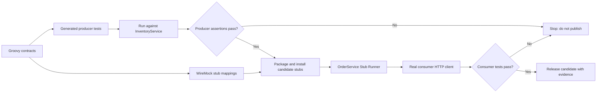

# Generating Producer Tests, Publishing Stubs, and Running Consumer Tests

In this hands-on lab, you will build a complete **Spring Cloud Contract (SCC)** workflow for two small services: `InventoryService` as the **producer** exposing a stock reservation API, and `OrderService` as the **consumer** calling that API during checkout. You will define behavior using the **Groovy DSL**, let the producer generate and run contract tests, package the stub artifact, and use **Stub Runner** to start an HTTP stub and test real consumer code.

The required outcome is more than just producing a `*-stubs.jar` file. You must prove the entire chain:



This is the capstone lab for the **SPRING_CLOUD_CONTRACT** module: learning contract testing between producer and consumer, defining HTTP/message behavior with Groovy/YAML DSL, generating producer-side tests, publishing stubs, using Stub Runner, and integrating with CI to detect breaking API changes. You will build an HTTP project first; the end of the lab includes messaging extensions and intentional failure experiments to validate your pipeline.

Upon completion, you will be able to:

- Create two HTTP contracts: `201` success and `409` insufficient stock error.
- Write a Spring MVC producer that fulfills those contracts.
- Configure the Maven Contract Verifier and base class for generated JUnit 5 tests.
- Run producer verification, inspect test reports, and confirm how many generated tests executed.
- Package and install a stubs artifact with the proper version and classifier.
- Configure a consumer HTTP client to point at the exact Stub Runner port.
- Use Stub Runner in `LOCAL` mode to run consumer integration tests.
- Prove that requests emitted by **real consumer code** actually reached the stub.
- Distinguish producer contract errors, artifact resolution errors, port errors, request matching errors, and consumer parsing errors.
- Design a CI pipeline that allows release only when all mandatory gates pass.

## 1. Scenario and Architecture

`OrderService` needs to reserve stock before confirming an order. It sends `sku` and `quantity` to `InventoryService`:

| Component | Role | Responsibility |
| --- | --- | --- |
| `InventoryService` | Producer | Handles reservation requests, returns reservation or business error |
| `OrderService` | Consumer | Calls the reservation API and converts results into checkout data |
| Contract files | Source of truth | Describes request/response agreed upon by both sides |
| Contract Verifier | Producer test generator | Generates tests from contracts and runs them against the producer |
| Stubs JAR | Shared artifact | Packages WireMock mappings and contracts |
| Stub Runner | Consumer test infrastructure | Downloads stubs and starts an HTTP stub server |
| CI pipeline | Release gate | Verifies producer, artifact, and consumer before publishing |

### Two Business Scenarios

**Scenario 1 — In Stock**

```http
POST /api/v1/reservations HTTP/1.1
Content-Type: application/json

{"sku":"SKU-001","quantity":2}
```

```http
HTTP/1.1 201 Created
Content-Type: application/json

{"reservationId":"RES-1001","status":"HELD"}
```

**Scenario 2 — Out of Stock**

```http
POST /api/v1/reservations HTTP/1.1
Content-Type: application/json

{"sku":"SKU-EMPTY","quantity":2}
```

```http
HTTP/1.1 409 Conflict
Content-Type: application/json

{"code":"INSUFFICIENT_STOCK"}
```

The consumer needs explicit contracts for both success and business errors. If only `201` is specified, a change causing the producer to return `500` or `409` with the wrong body would go undetected within the current contract scope.

## 2. Technical Scope and Prerequisites

This lab uses **Java 17+**, Spring Boot 3.x, Spring Cloud Contract from a compatible release train, Maven, and JUnit 5. Specific versions of Spring Boot, the Spring Cloud BOM, and plugins must be pinned according to your project compatibility matrix. Do not arbitrarily mix the latest Spring Cloud Contract version with an older Spring Boot release.

| Tool | What is it used for? |
| --- | --- |
| JDK | Compiles and runs both services |
| Maven Wrapper or Maven | Builds, generates tests, packages, and installs local artifacts |
| Spring Boot Web | Provides the REST API and consumer client |
| Spring Cloud Contract Maven Plugin | Generates producer tests and stubs |
| JUnit 5 | Runs generated tests and consumer tests |
| Stub Runner | Resolves the stub artifact and starts WireMock |
| AssertJ | Writes assertions in consumer tests |

### Checking the Environment

```bash
java -version
mvn -version
```

The expected result is a JDK version supported by your project and Maven running on that JDK. If the repository includes Maven Wrapper, prefer `./mvnw` on Linux/macOS or `mvnw.cmd` on Windows so you use the project's pinned Maven version.

### Version Rules

- Use a **Spring Cloud BOM/release train** compatible with your chosen Spring Boot version.
- The SCC plugin and starter dependencies should belong to the same consistently managed release line.
- WireMock is typically pulled in transitively by SCC; only override it after verifying compatibility.
- Record the JDK, Maven Wrapper, Spring Boot, Spring Cloud, and SCC versions in your build.
- Do not use dynamic dependency versions or `latest` for reproducible release pipelines.

Example placeholder in POM:

```xml
<properties>
    <java.version>17</java.version>
    <spring-cloud-contract.version>PINNED_COMPATIBLE_VERSION</spring-cloud-contract.version>
</properties>
```

`PINNED_COMPATIBLE_VERSION` is a placeholder to replace with an actual version selected by your project; do not copy the placeholder literally to build.

## 3. Creating the Project Structure

Create two independent Maven projects so the artifact boundary is clear:

```text
spring-cloud-contract-lab/
├── inventory-service/
│   ├── pom.xml
│   └── src/
│       ├── main/java/com/example/inventory/
│       │   ├── InventoryApplication.java
│       │   ├── ReservationController.java
│       │   ├── ReservationService.java
│       │   └── dto/
│       │       ├── ReservationRequest.java
│       │       ├── ReservationResponse.java
│       │       └── ErrorResponse.java
│       └── test/
│           ├── java/com/example/inventory/ContractVerifierBase.java
│           └── resources/contracts/
│               ├── create-reservation-success.groovy
│               └── create-reservation-insufficient-stock.groovy
└── order-service/
    ├── pom.xml
    └── src/
        ├── main/java/com/example/order/
        │   ├── OrderApplication.java
        │   ├── InventoryClientConfiguration.java
        │   ├── InventoryHttpClient.java
        │   ├── OrderCheckoutService.java
        │   └── dto/
        │       ├── ReservationRequest.java
        │       └── ReservationResponse.java
        └── test/java/com/example/order/
            └── OrderServiceInventoryContractTest.java
```

Class and package names are examples. If your project uses multi-module Maven, you can group both services under a parent reactor; this lab uses two standalone directories to highlight the **producer install → consumer resolve** step.

### Creating Directories

```bash
mkdir -p inventory-service/src/main/java/com/example/inventory/dto
mkdir -p inventory-service/src/test/java/com/example/inventory
mkdir -p inventory-service/src/test/resources/contracts
mkdir -p order-service/src/main/java/com/example/order/dto
mkdir -p order-service/src/test/java/com/example/order
```

On Windows PowerShell, you can create directories with `New-Item -ItemType Directory -Force` or use your IDE. You do not need separate Git repositories for each service in this lab; what matters is keeping source and artifact versions clear.

## 4. Defining the Success Contract with Groovy DSL

Create the file:

`inventory-service/src/test/resources/contracts/create-reservation-success.groovy`

```groovy
import org.springframework.cloud.contract.spec.Contract

Contract.make {
    name 'create_reservation_success'
    description '''
        OrderService creates a reservation for an in-stock SKU.
        Producer returns a reservation ID and HELD status.
    '''

    request {
        method 'POST'
        url '/api/v1/reservations'
        headers {
            contentType(applicationJson())
        }
        body([
            sku: 'SKU-001',
            quantity: 2
        ])
    }

    response {
        status 201
        headers {
            contentType(applicationJson())
        }
        body([
            reservationId: $(consumer('RES-1001'),
                             producer(regex('RES-[0-9]+'))),
            status: 'HELD'
        ])
    }
}
```

### Reading the Contract from Both Sides

- The request body is the input the consumer sends. The producer test must invoke the endpoint with `SKU-001` and `quantity=2`.
- Response `201` and `status=HELD` are literal commitments.
- `consumer('RES-1001')` is the deterministic sample response the consumer stub serves.
- `producer(regex('RES-[0-9]+'))` lets the producer generate dynamic IDs while still validating the ID format.

This regex **does not prove uniqueness or database persistence**. If your business rules require uniqueness, additional integration/domain tests are needed.

## 5. Defining the Insufficient-Stock Error Contract

Create the file:

`inventory-service/src/test/resources/contracts/create-reservation-insufficient-stock.groovy`

```groovy
import org.springframework.cloud.contract.spec.Contract

Contract.make {
    name 'create_reservation_insufficient_stock'
    description '''
        When SKU is out of stock, producer returns business error 409.
        Consumer must not treat this as a successful reservation.
    '''

    request {
        method 'POST'
        url '/api/v1/reservations'
        headers {
            contentType(applicationJson())
        }
        body([
            sku: 'SKU-EMPTY',
            quantity: 2
        ])
    }

    response {
        status 409
        headers {
            contentType(applicationJson())
        }
        body([
            code: 'INSUFFICIENT_STOCK'
        ])
    }
}
```

Here the body and status are literal because this is a fixed business error. A separate contract ensures generated tests exercise the error branch and generates a separate mapping for the consumer. Do not write an overly broad matcher like `regex('.*')` for `code`, because then the producer could return the wrong error code and still pass.

### When to Add YAML DSL?

If your team prefers a YAML contract, you can express the equivalent literal request/response like this:

```yaml
name: create_reservation_insufficient_stock
request:
  method: POST
  url: /api/v1/reservations
  headers:
    Content-Type: application/json
  body:
    sku: SKU-EMPTY
    quantity: 2
response:
  status: 409
  headers:
    Content-Type: application/json
  body:
    code: INSUFFICIENT_STOCK
```

Do not place both Groovy and YAML contracts for the same scenario in the contracts directory unless you intentionally want two contracts. For dynamic matchers, use the YAML matcher syntax for your exact SCC version; do not copy Groovy's `$(consumer(...), producer(...))` expression into YAML.

## 6. Writing the InventoryService Producer

Create the request DTO:

`inventory-service/src/main/java/com/example/inventory/dto/ReservationRequest.java`

```java
package com.example.inventory.dto;

public record ReservationRequest(String sku, int quantity) {
}
```

Response DTO:

`ReservationResponse.java`

```java
package com.example.inventory.dto;

public record ReservationResponse(
    String reservationId,
    String status
) {
}
```

Error DTO:

`ErrorResponse.java`

```java
package com.example.inventory.dto;

public record ErrorResponse(String code) {
}
```

### Service

`inventory-service/src/main/java/com/example/inventory/ReservationService.java`

```java
package com.example.inventory;

import com.example.inventory.dto.ReservationResponse;
import java.util.concurrent.atomic.AtomicLong;
import org.springframework.stereotype.Service;

@Service
public class ReservationService {

    private final AtomicLong sequence = new AtomicLong(1000);

    public ReservationResponse reserve(String sku, int quantity) {
        long id = sequence.incrementAndGet();
        String reservationId = "RES-" + id;
        return new ReservationResponse(reservationId, "HELD");
    }
}
```

In this lab, the service generates incrementing IDs to illustrate dynamic data. It is **not** a real inventory system: it does not decrement stock, persist to a database, handle idempotency, or guarantee cross-instance uniqueness. The goal is testing the producer HTTP contract.

### Controller

`inventory-service/src/main/java/com/example/inventory/ReservationController.java`

```java
package com.example.inventory;

import com.example.inventory.dto.ErrorResponse;
import com.example.inventory.dto.ReservationRequest;
import com.example.inventory.dto.ReservationResponse;
import org.springframework.http.HttpStatus;
import org.springframework.http.ResponseEntity;
import org.springframework.web.bind.annotation.*;

@RestController
@RequestMapping("/api/v1/reservations")
public class ReservationController {

    private final ReservationService reservationService;

    public ReservationController(ReservationService reservationService) {
        this.reservationService = reservationService;
    }

    @PostMapping
    public ResponseEntity<?> create(
            @RequestBody ReservationRequest request) {

        if (request.quantity() <= 0) {
            return ResponseEntity.badRequest()
                .body(new ErrorResponse("INVALID_QUANTITY"));
        }

        if ("SKU-EMPTY".equals(request.sku())) {
            return ResponseEntity.status(HttpStatus.CONFLICT)
                .body(new ErrorResponse("INSUFFICIENT_STOCK"));
        }

        ReservationResponse response =
            reservationService.reserve(request.sku(), request.quantity());

        return ResponseEntity.status(HttpStatus.CREATED).body(response);
    }
}
```

The controller has three branches: invalid quantity returns `400`, out-of-stock SKU returns `409`, and everything else returns `201`. The two current contracts verify success and insufficient stock. The `400` branch is not yet covered by a contract; if that behavior is a producer commitment to consumers, add a dedicated contract and consumer test.

### Application Entry Point

`InventoryApplication.java`

```java
package com.example.inventory;

import org.springframework.boot.SpringApplication;
import org.springframework.boot.autoconfigure.SpringBootApplication;

@SpringBootApplication
public class InventoryApplication {
    public static void main(String[] args) {
        SpringApplication.run(InventoryApplication.class, args);
    }
}
```

## 7. Creating the Producer Test Base Class

Contract Verifier generates producer tests from the Groovy contracts. The base class provides the Spring application context and the mechanism to dispatch HTTP requests into the controller. With Spring MVC, we use `MockMvc`:

`inventory-service/src/test/java/com/example/inventory/ContractVerifierBase.java`

```java
package com.example.inventory;

import io.restassured.module.mockmvc.RestAssuredMockMvc;
import org.junit.jupiter.api.BeforeEach;
import org.springframework.beans.factory.annotation.Autowired;
import org.springframework.boot.test.context.SpringBootTest;
import org.springframework.web.context.WebApplicationContext;

@SpringBootTest
public abstract class ContractVerifierBase {

    @Autowired
    WebApplicationContext context;

    @BeforeEach
    void setUp() {
        RestAssuredMockMvc.webAppContextSetup(context);
    }
}
```

This base class loads the **InventoryService application context**, so generated tests traverse the producer's controller, request mapping, Jackson serialization, and service beans. Do not replace the controller with a mock that always returns a canned fixture, because then generated tests no longer verify the real implementation.

If your project uses WebFlux, choose the appropriate test mode and base class; do not use MockMvc for a reactive controller simply because this example uses Spring MVC.

## 8. Configuring Maven for the Producer

A minimal POM requires:

- Spring Boot Web to run the REST API.
- Spring Cloud Contract Verifier in test scope.
- The SCC Maven plugin to read contracts, generate tests, and produce the stub artifact.
- Compatible JUnit 5 / test engine dependencies.

`dependencies` snippet:

```xml
<dependencies>
    <dependency>
        <groupId>org.springframework.boot</groupId>
        <artifactId>spring-boot-starter-web</artifactId>
    </dependency>

    <dependency>
        <groupId>org.springframework.cloud</groupId>
        <artifactId>spring-cloud-starter-contract-verifier</artifactId>
        <scope>test</scope>
    </dependency>

    <dependency>
        <groupId>org.springframework.boot</groupId>
        <artifactId>spring-boot-starter-test</artifactId>
        <scope>test</scope>
    </dependency>
</dependencies>
```

Maven plugin:

```xml
<build>
    <plugins>
        <plugin>
            <groupId>org.springframework.cloud</groupId>
            <artifactId>spring-cloud-contract-maven-plugin</artifactId>
            <version>${spring-cloud-contract.version}</version>
            <extensions>true</extensions>
            <configuration>
                <testFramework>JUNIT5</testFramework>
                <testMode>MOCKMVC</testMode>
                <baseClassForTests>
                    com.example.inventory.ContractVerifierBase
                </baseClassForTests>
                <contractsDirectory>
                    ${project.basedir}/src/test/resources/contracts
                </contractsDirectory>
            </configuration>
        </plugin>
    </plugins>
</build>
```

This is a **POM snippet**. A real project needs a parent or dependency management section managing Spring Boot and Spring Cloud versions. `contractsDirectory` explicitly points to where contracts live; if you use the plugin's default location, you can omit that setting. Confirm exact parameter names against your selected Maven plugin version.

### POM with Managed Versions

In a real project, import the Spring Cloud BOM matching Spring Boot:

```xml
<dependencyManagement>
    <dependencies>
        <dependency>
            <groupId>org.springframework.cloud</groupId>
            <artifactId>spring-cloud-dependencies</artifactId>
            <version>PINNED_COMPATIBLE_RELEASE_TRAIN</version>
            <type>pom</type>
            <scope>import</scope>
        </dependency>
    </dependencies>
</dependencyManagement>
```

`PINNED_COMPATIBLE_RELEASE_TRAIN` is a placeholder. Use the official Spring Cloud compatibility matrix to select a release train, then verify that the SCC plugin and starter resolve matching versions. Do not guess versions from release dates or copy them randomly from online snippets.

### Suggested Artifact Coordinates

Ensure the producer has consistent coordinates, for example:

```xml
<groupId>com.example</groupId>
<artifactId>inventory-service</artifactId>
<version>1.0.0-SNAPSHOT</version>
<packaging>jar</packaging>
```

The consumer will resolve these exact group, artifact, version, and classifier values for the stubs JAR. If you change the producer version, you must update the version the consumer resolves or use a distinctly versioned release candidate.

## 9. Generating and Running Producer Tests

From the lab root directory:

```bash
cd inventory-service
mvn -B -ntp clean verify
```

`verify` runs the preceding lifecycle phases, including compile, test, and package per Maven configuration. The Spring Cloud Contract plugin generates test sources; Surefire/Failsafe or the configured test runner executes them.

### What to Observe

- Contract files are detected by the plugin.
- Generated test sources appear in the build directory configured by the plugin.
- Generated test sources compile cleanly.
- Test reports exist for this exact build run.
- Generated tests run and pass against the producer application context.
- There are neither `0 tests` nor unintended skipped tests.

The exact directory name for generated sources can vary by plugin version and configuration. Check Maven logs and build output rather than relying on a hardcoded path.

### Inspecting Test Reports

Maven Surefire normally writes reports under `target/surefire-reports`; Failsafe uses `target/failsafe-reports` if integration tests are configured there.

```powershell
Get-ChildItem target/surefire-reports
```

On Linux/macOS:

```bash
find target/surefire-reports -maxdepth 1 -type f
```

An expected report shows executed test counts greater than 0, with zero failures and no policy-violating skips. **Do not declare success from the `BUILD SUCCESS` line alone**: the plugin might not have found contracts or test execution might have been skipped.

### The Producer Must Fail on Implementation Violations

Temporarily change the response to:

```java
return ResponseEntity.ok(response);
```

While the contract requires `201`. Re-run `mvn clean verify`. The generated success test must fail on the status assertion. After verifying, restore `HttpStatus.CREATED` and re-run.

This is a **negative control**: it proves the contract test can catch regressions rather than merely sitting on disk.

## 10. Packaging and Installing the Stubs JAR to Maven Local

Once producer verification passes, the Maven plugin generates stub mappings and can package them as an artifact with the `stubs` classifier. For this lab, install the artifact into the local repository so the consumer's Stub Runner can resolve it:

```bash
mvn -B -ntp clean install
```

This runs the full build lifecycle and installs the producer artifact along with configured attached artifacts. Next, inspect the `target` directory:

```powershell
Get-ChildItem target/*stubs*.jar
```

On Linux/macOS:

```bash
find target -maxdepth 1 -name '*stubs*.jar'
```

The filename may look like:

```text
inventory-service-1.0.0-SNAPSHOT-stubs.jar
```

This is an example name. Confirm the actual classifier in your plugin configuration and build output. Do not rename the JAR manually to make the consumer resolve it; fix the coordinates, version, or classifier properly.

### Inspecting JAR Contents

```bash
jar tf target/inventory-service-1.0.0-SNAPSHOT-stubs.jar
```

Look for the mappings corresponding to both the success and insufficient-stock contracts. The exact layout depends on the SCC version and packaging configuration; typically there is a `mappings` directory, potentially along with `contracts` and body files.

If a mapping references a body file, verify that the body file is also present inside the JAR. A JAR that exists on disk but lacks mappings or body files does not prove a usable artifact.

### Recording the Candidate Checksum

```powershell
Get-FileHash target/inventory-service-1.0.0-SNAPSHOT-stubs.jar -Algorithm SHA256
```

Or:

```bash
sha256sum target/inventory-service-1.0.0-SNAPSHOT-stubs.jar
```

Record the checksum in CI logs or artifact metadata so it can be cross-checked during consumer testing and release. For this lab, the local Maven repository is sufficient; production requires an immutable repository and provenance.

## 11. Creating the `OrderService` Consumer

The consumer needs the Stub Runner starter in test scope:

```xml
<dependencies>
    <dependency>
        <groupId>org.springframework.boot</groupId>
        <artifactId>spring-boot-starter-web</artifactId>
    </dependency>

    <dependency>
        <groupId>org.springframework.cloud</groupId>
        <artifactId>spring-cloud-starter-contract-stub-runner</artifactId>
        <scope>test</scope>
    </dependency>

    <dependency>
        <groupId>org.springframework.boot</groupId>
        <artifactId>spring-boot-starter-test</artifactId>
        <scope>test</scope>
    </dependency>
</dependencies>
```

The consumer does not need the Contract Verifier plugin if it only loads stubs to test its client. The Verifier plugin/starter belongs to the producer side; Stub Runner belongs to the consumer test side. A single service can act as both producer and consumer, in which case it may need both.

The consumer POM must use the same Spring Cloud release train and SCC compatibility matrix as the producer in this lab. If using a BOM, import it under `dependencyManagement`; do not manually add an incompatible WireMock version.

### Application Entry Point

`order-service/src/main/java/com/example/order/OrderApplication.java`

```java
package com.example.order;

import org.springframework.boot.SpringApplication;
import org.springframework.boot.autoconfigure.SpringBootApplication;

@SpringBootApplication
public class OrderApplication {
    public static void main(String[] args) {
        SpringApplication.run(OrderApplication.class, args);
    }
}
```

### Consumer-Side DTOs

The consumer only needs the fields it actually uses:

`ReservationRequest.java`

```java
package com.example.order.dto;

public record ReservationRequest(String sku, int quantity) {
}
```

`ReservationResponse.java`

```java
package com.example.order.dto;

public record ReservationResponse(
    String reservationId,
    String status
) {
}
```

There is no need to copy the producer's entire domain model into the consumer. Both services can maintain separate DTOs as long as the wire format is agreed upon in the contract.

## 12. Configuring the HTTP Client to Read Base URL from Properties

Create the configuration:

`order-service/src/main/java/com/example/order/InventoryClientConfiguration.java`

```java
package com.example.order;

import org.springframework.beans.factory.annotation.Value;
import org.springframework.context.annotation.Bean;
import org.springframework.context.annotation.Configuration;
import org.springframework.web.client.RestClient;

@Configuration
public class InventoryClientConfiguration {

    @Bean
    RestClient inventoryRestClient(
            @Value("${inventory.base-url}") String baseUrl) {
        return RestClient.builder()
            .baseUrl(baseUrl)
            .build();
    }
}
```

`inventory.base-url` is an application property defined by `OrderService`. It is **not automatically rewritten by Stub Runner**. The test must supply this value before Spring instantiates the bean.

Example default production configuration:

`order-service/src/main/resources/application.yml`

```yaml
inventory:
  base-url: http://inventory-service:8080
```

The address above is a service hostname in an illustrative deployment environment. In the consumer contract test, it will be overridden to `http://127.0.0.1:8090` to point at Stub Runner.

### Writing `InventoryHttpClient`

`order-service/src/main/java/com/example/order/InventoryHttpClient.java`

```java
package com.example.order;

import com.example.order.dto.ReservationRequest;
import com.example.order.dto.ReservationResponse;
import org.springframework.http.MediaType;
import org.springframework.stereotype.Component;
import org.springframework.web.client.RestClient;

@Component
public class InventoryHttpClient {

    private final RestClient restClient;

    public InventoryHttpClient(RestClient inventoryRestClient) {
        this.restClient = inventoryRestClient;
    }

    public ReservationResponse reserve(String sku, int quantity) {
        ReservationRequest request =
            new ReservationRequest(sku, quantity);

        return restClient.post()
            .uri("/api/v1/reservations")
            .contentType(MediaType.APPLICATION_JSON)
            .body(request)
            .retrieve()
            .body(ReservationResponse.class);
    }
}
```

`RestClient` was introduced in Spring Framework 6.1. If your project uses an older Spring Framework version, you can substitute `RestTemplate` or `WebClient`, keeping the same design where **the client reads its base URL from configuration**.

### Creating the Consumer Service

`order-service/src/main/java/com/example/order/OrderCheckoutService.java`

```java
package com.example.order;

import com.example.order.dto.ReservationResponse;
import org.springframework.stereotype.Service;

@Service
public class OrderCheckoutService {

    private final InventoryHttpClient inventoryClient;

    public OrderCheckoutService(InventoryHttpClient inventoryClient) {
        this.inventoryClient = inventoryClient;
    }

    public ReservationResponse prepareReservation(
            String sku,
            int quantity) {
        return inventoryClient.reserve(sku, quantity);
    }
}
```

This is a minimal business facade so the test flows through **service → HTTP client → stub**. Do not call WireMock directly inside the test method instead of `InventoryHttpClient`.

## 13. Configuring Stub Runner in the Consumer Test

For this lab, choose a **static port `8090`** so the property is available before Spring creates the `RestClient` bean. Create:

`order-service/src/test/java/com/example/order/OrderServiceInventoryContractTest.java`

```java
package com.example.order;

import static org.assertj.core.api.Assertions.assertThat;
import static org.assertj.core.api.Assertions.assertThatThrownBy;

import com.example.order.dto.ReservationResponse;
import org.junit.jupiter.api.Test;
import org.springframework.beans.factory.annotation.Autowired;
import org.springframework.boot.test.context.SpringBootTest;
import org.springframework.cloud.contract.stubrunner.spring.AutoConfigureStubRunner;
import org.springframework.cloud.contract.stubrunner.spring.StubRunnerProperties;
import org.springframework.web.client.HttpClientErrorException;

@SpringBootTest(properties = {
    "inventory.base-url=http://127.0.0.1:8090"
})
@AutoConfigureStubRunner(
    ids = "com.example:inventory-service:1.0.0-SNAPSHOT:stubs:8090",
    stubsMode = StubRunnerProperties.StubsMode.LOCAL
)
class OrderServiceInventoryContractTest {

    @Autowired
    OrderCheckoutService checkoutService;

    @Test
    void shouldCreateReservationFromInventoryStub() {
        ReservationResponse response =
            checkoutService.prepareReservation("SKU-001", 2);

        assertThat(response.reservationId()).matches("RES-[0-9]+");
        assertThat(response.status()).isEqualTo("HELD");
    }

    @Test
    void shouldReceiveConflictWhenStockIsInsufficient() {
        assertThatThrownBy(() ->
            checkoutService.prepareReservation("SKU-EMPTY", 2)
        ).isInstanceOf(HttpClientErrorException.Conflict.class);
    }
}
```

### Explaining the Configuration

- `ids` specifies the producer artifact in the format `groupId:artifactId:version:classifier:port` in this example.
- `1.0.0-SNAPSHOT` must match the version installed via `mvn install` in the producer.
- `stubs` is the classifier of the stub JAR.
- `8090` is the WireMock stub server port.
- `stubsMode=LOCAL` tells Stub Runner to resolve the artifact from the local Maven repository.
- `inventory.base-url` is overridden before the application context creates the HTTP client bean.

**Port `8090` in `ids` and the base URL must match.** If you change one side and forget the other, the test may fail with `Connection refused` or call the wrong server.

### What the Test Proves

The success test calls `OrderCheckoutService`, which delegates to `InventoryHttpClient` to send an HTTP request to WireMock. The response deserializes into `ReservationResponse`. The error test confirms that HTTP `409` turns into `HttpClientErrorException.Conflict` per `RestClient.retrieve()`'s default behavior.

This test does not yet verify how `OrderService` translates a business error into an API response for its own callers. If that is a consumer responsibility, add a separate test for error translation.

### Why Not Just Use curl?

`curl` against `127.0.0.1:8090` only proves the stub server can return a response. It does not prove:

- `InventoryHttpClient` reads the right property.
- `OrderCheckoutService` uses the right client bean.
- Consumer DTOs deserialize properly.
- The request body and headers sent by the real client match the contract.
- The consumer handles errors properly.

That is why the lab must run tests through the real service and client.

## 14. Running Consumer Tests After Installing Producer Stubs

Local sequence:

```bash
cd inventory-service
mvn -B -ntp clean install

cd ../order-service
mvn -B -ntp clean verify
```

In PowerShell, you can run the two commands in separate directory steps; avoid `&&` syntax if running Windows PowerShell 5.1.

### If Stub Runner Reports Stub Not Found

Check in order:

1. Did the producer complete `mvn clean install` successfully?
2. Was the stubs JAR created and installed?
3. Do the consumer's `groupId`/`artifactId`/`version`/`classifier` match?
4. Is the consumer using `StubsMode.LOCAL`?
5. Is the Maven local repository path the same one the consumer build uses?
6. Is a profile or `settings.xml` overriding the local repository path?

Never add the producer's main JAR as a consumer dependency just to work around a missing stub error. Stub Runner requires the proper **stub artifact and classifier**.

## 15. Inspecting Mappings and Port Before Running the Consumer

When Stub Runner starts, its logs typically indicate that the stub was resolved and the HTTP server started. Confirm that port `8090` bound successfully.

In a terminal on the same host:

```bash
curl -v http://127.0.0.1:8090/__admin/mappings
```

If the admin endpoint returns the list of mappings, verify both the success and insufficient-stock mappings are present. The WireMock Admin API is for test-local use only; never expose this port to an external network.

Try a direct request:

```bash
curl -i \
  -H "Content-Type: application/json" \
  -d '{"sku":"SKU-001","quantity":2}' \
  http://127.0.0.1:8090/api/v1/reservations
```

Expected response is `201` with sample ID `RES-1001` and `status=HELD`. Test the error branch:

```bash
curl -i \
  -H "Content-Type: application/json" \
  -d '{"sku":"SKU-EMPTY","quantity":2}' \
  http://127.0.0.1:8090/api/v1/reservations
```

Expected response is `409` with `code=INSUFFICIENT_STOCK`. If curl fails to match, inspect the request method, path, `Content-Type`, JSON body, and loaded mappings.

**Note:** direct `curl` is a diagnostic aid. Consumer tests must still invoke real `OrderService` code and assert the outcome.

## 16. Proving Real Requests Reached WireMock

The earlier consumer test already calls the real service and client. To increase confidence, you can inspect the request journal of that exact WireMock server.

In a test using static port `8090`, the pattern is:

```java
// Illustrative example using a WireMock client compatible with your project dependencies.
import static com.github.tomakehurst.wiremock.client.WireMock.*;

@BeforeEach
void resetWireMockJournal() {
    configureFor("127.0.0.1", 8090);
    resetAllRequests();
}

@Test
void consumerMustSendPostToInventoryStub() {
    ReservationResponse response =
        checkoutService.prepareReservation("SKU-001", 2);

    assertThat(response.status()).isEqualTo("HELD");

    verify(1, postRequestedFor(
            urlPathEqualTo("/api/v1/reservations"))
        .withHeader("Content-Type", containing("application/json"))
        .withRequestBody(
            matchingJsonPath("$.sku", equalTo("SKU-001"))));
}
```

`com.github.tomakehurst.wiremock.client.WireMock` is the common package in WireMock 2; WireMock 3 uses different packages in some artifacts/APIs. Use the WireMock package resolved by your SCC/Stub Runner version instead of overriding dependencies just to match an example.

If you prefer not to pull WireMock client APIs into test code, you can query `GET /__admin/requests` after the test runs. Either way, what must be proven is that **requests emitted by `OrderCheckoutService` reached the intended stub instance**.

### Avoiding Checking the Wrong Server

When multiple Stub Runner servers are running, `configureFor` must target the exact host/port of the Inventory stub. A request recorded on a Pricing stub does not prove the Inventory client routed correctly. Static WireMock client methods also rely on global state; if tests run in parallel, isolate servers/ports or use dedicated admin client instances.

### Consumer Negative Control

On an experimental branch:

1. Change `inventory.base-url` to `http://127.0.0.1:8080` when nothing is listening there.
2. Re-run the consumer test.
3. The test must fail because it cannot connect or because the journal at `8090` records zero requests.
4. Restore `8090`.

If the test still passes when Stub Runner receives zero requests, your code may be using a mock, cache, hardcoded response, or fallback. Re-check the test boundary before concluding the consumer is contract-tested.

## 17. Dynamic Ports: When Should You Use Them?

A static port keeps the lab easy to follow and ensures the property is ready before Spring constructs the client bean. In CI with multiple suites running concurrently, a static port can collide. In that case, Stub Runner can allocate a dynamic port; SCC versions support the `@StubRunnerPort` annotation so tests can receive a stub's allocated port.

Example that only retrieves the port:

```java
@SpringBootTest
@AutoConfigureStubRunner(
    ids = "com.example:inventory-service:1.0.0-SNAPSHOT:stubs",
    stubsMode = StubRunnerProperties.StubsMode.LOCAL
)
class InventoryStubPortTest {

    @StubRunnerPort("inventory-service")
    int inventoryStubPort;

    @Test
    void stubPortIsAvailable() {
        assertThat(inventoryStubPort).isBetween(1, 65535);
    }
}
```

This example **only proves a port was assigned**; it does not prove the consumer's HTTP client used that port.

### Lifecycle Pitfall

If `RestClient` is instantiated in the Spring context with a pre-existing `inventory.base-url`, and only afterward does the test receive `@StubRunnerPort` into a field, then:

- The `inventoryStubPort` field has a value.
- The existing `RestClient` bean does not automatically change its base URL.
- Calling `System.setProperty` inside `@BeforeEach` does not recreate the bean either.

For applications that need to verify wiring of a Spring-managed client, this lab uses a static port. If dynamic ports are mandatory, you must design test infrastructure that starts the stub **before** the context/client bean is created and registers the property at the right lifecycle phase. `@DynamicPropertySource` only helps when the port is already known at the moment Spring resolves the supplier; it does not wait for a `@StubRunnerPort` test field to be injected later.

## 18. Layer-by-Layer Troubleshooting

| Symptom | Possible cause | How to check |
| --- | --- | --- |
| Stub Runner cannot find artifact | Not installed, wrong version/classifier, or different local repo | Check producer `mvn install`, consumer POM, and Maven settings |
| Stub Runner fails to bind port | Port already in use, server startup failure | Read bind/startup logs and check listening processes |
| `Connection refused` on `8080` | Client still using default URL | Print resolved `inventory.base-url` and actual request URI |
| `Connection refused` on `8090` | Stub not listening or wrong network namespace | Check Stub Runner logs, Admin API, and host/container |
| HTTP `404` from WireMock | Request reached right server but failed mapping match | Inspect method/path/header/body and Admin mappings |
| Consumer receives unexpected response | Stale artifact or different mapping matched | Check resolved version, mapping priority, and request journal |
| Consumer test passes even with stub off | Mock/cache/fallback/hardcoded result | Check journal count and perform negative control |
| `@StubRunnerPort` is right but client hits old port | Client bean created before port was supplied | Inspect Spring lifecycle and where HTTP client is built |
| Tests fail when run in parallel | Static port collision or static WireMock client state | Isolate tests and use dynamic ports with proper lifecycle |
| Local passes, CI fails | Different profile, Maven repo, host, or network | Compare resolved artifacts, properties, host, and proxy |

### 8-Step Diagnostic Workflow

1. **Artifact:** Did Stub Runner resolve the exact `groupId:artifactId:version:classifier`?
2. **Server:** Did WireMock start and bind successfully?
3. **Port:** What is the actual bound port?
4. **Network:** Can the consumer process reach that host and port?
5. **Property:** Did the HTTP client receive the right base URL before bean creation?
6. **Request:** Does the request journal show the consumer's request?
7. **Mapping:** Do method, path, headers, and body match the intended mapping?
8. **Consumer behavior:** Do the DTO, status handler, and business logic process the response properly?

Do not tweak matchers when failure occurs before the TCP connection. Do not change ports when the request already reached WireMock but the body failed to match. Diagnosing the right layer avoids weakening contracts.

## 19. Verifying the Local End-to-End Execution Order

Once both services are complete:

```text
1. Build InventoryService
2. Run producer generated contract tests
3. Package and install inventory-service stubs JAR
4. Confirm stub JAR coordinates and mappings
5. Build OrderService
6. Start Stub Runner from LOCAL artifact
7. Call InventoryHttpClient through OrderCheckoutService
8. Assert 201 success and 409 business error
9. Verify request reached expected WireMock port
10. Save test reports and candidate checksum
```

### Combined Commands

Run from the lab root:

```bash
cd inventory-service
mvn -B -ntp clean install

cd ../order-service
mvn -B -ntp clean verify
```

If any step fails, **stop there and fix it before moving on**. Never run the consumer against an older stubs JAR sitting in local Maven and claim the current producer build is verified.

### Evidence to Archive

| Evidence | Contents |
| --- | --- |
| Producer commit | Git SHA of `InventoryService` |
| Contract revision | Commit/version of Groovy/YAML contracts |
| Producer test report | Executed, failed, skipped counts and test suites |
| Producer artifact | Producer JAR coordinates |
| Stub artifact | Coordinates, classifier, and SHA-256 |
| Consumer test report | Test suite exercising real consumer code |
| Stub port/URL | Resolved Stub Runner port and base URL |
| Request evidence | Request journal / verification result if enabled |

This evidence enables others to reproduce results and investigate when contracts change. Recording `BUILD SUCCESS` alone is not enough.

## 20. Integrating Producer and Consumer in CI

In this lab, both projects live in the same workspace and share a local Maven repository. A sequential CI job can:

1. Check out the exact commit.
2. Build, verify, and install `InventoryService` and the candidate stub.
3. Run `OrderService` tests with `StubsMode.LOCAL`.
4. Archive test reports, candidate JAR, and checksum.

GitHub Actions example:

```yaml
name: Spring Cloud Contract lab

on:
  pull_request:
  push:
    branches: [main]

permissions:
  contents: read

jobs:
  contract-integration:
    runs-on: ubuntu-latest
    steps:
      - uses: actions/checkout@v4

      - uses: actions/setup-java@v4
        with:
          distribution: temurin
          java-version: '17'
          cache: maven

      - name: Verify producer and install candidate stubs
        working-directory: inventory-service
        run: mvn -B -ntp clean install

      - name: Verify consumer with local Stub Runner
        working-directory: order-service
        run: mvn -B -ntp clean verify

      - name: Upload candidate stub artifact
        if: success()
        uses: actions/upload-artifact@v4
        with:
          name: inventory-service-stubs-candidate
          path: inventory-service/target/*-stubs.jar
          if-no-files-found: error

      - name: Retain producer and consumer test reports
        if: always()
        uses: actions/upload-artifact@v4
        with:
          name: contract-test-reports
          path: |
            inventory-service/target/surefire-reports/
            inventory-service/target/failsafe-reports/
            order-service/target/surefire-reports/
            order-service/target/failsafe-reports/
          if-no-files-found: warn
```

The workflow above illustrates **a single job on one runner**. The local Maven repository is shared between the two steps so the consumer can resolve the installed stub. If you split producer and consumer into separate jobs on separate runners, the local Maven repository is not shared automatically; you must use an artifact handoff or staging repository and install the candidate into the consumer job's local repository.

### Why Upload the Candidate Only After Consumer Tests?

The candidate JAR can be built earlier, but the upload step above (`if: success()`) only runs when all prior steps in the job succeed. This is an **internal CI artifact**, not an official publication to a Maven release repository.

The report-retention step uses `if: always()` so failures can be investigated. That does not authorize publishing a broken stub; the release candidate is uploaded only when the job succeeds.

### Test Count Enforcement Gate

A real workflow should add a script or report gate confirming:

- Contract sources were discovered.
- Generated producer tests were created.
- Executed test count is greater than 0 and matches the contract set.
- Failures and errors equal 0.
- Skipped tests do not exceed policy.
- The consumer compatibility suite ran and passed.

Do not rely on an old report file left in the workspace as evidence. A clean build, the report from that exact run, and test suite identities must match.

## 21. Candidate Stubs vs. Official Releases

A candidate stub produced by a producer build can be used in CI to test consumers. However, **official release publication** requires additional conditions:

| Stage | Artifact | Who uses it? |
| --- | --- | --- |
| Producer build | Candidate JAR in workspace | Producer pipeline |
| Consumer integration | Same candidate JAR/digest | Consumer test job |
| Release approval | Candidate that passed gates | Release owner/workflow |
| Official repository | Immutable promoted version | Consumer builds and downstream environments |

Do not publish a stable stub immediately after producer tests if policy requires consumer compatibility checks before release. Conversely, do not require the consumer to download a stable release if stable is only published after consumer tests; use a **candidate handoff** or staging repository.

### Two Implementation Approaches

**Approach A — Same runner/workspace**

- Producer runs `mvn clean install`.
- Consumer runs `mvn clean verify` with `StubsMode.LOCAL`.
- After all gates pass, the release job promotes the stored candidate artifact.

**Approach B — Separate jobs/repositories**

- Producer creates the candidate and uploads it as a workflow or staging artifact.
- Consumer job downloads the exact candidate, verifies its checksum, and installs it locally or resolves it from staging.
- Consumer tests run against that exact version/digest.
- Release job promotes **the exact verified bytes**, without rebuilding a different candidate while reusing old evidence.

If the release job runs `mvn deploy` and rebuilds from source, treat it as a new build: either re-run all required gates on that build or use a repository promotion mechanism that guarantees identical contents.

### Version Coordinates

Candidate example:

```text
com.example:inventory-service:1.0.0-SNAPSHOT:stubs
```

Release example:

```text
com.example:inventory-service:1.0.0:stubs
```

These are examples. A release repository should be immutable and never overwrite `1.0.0` with different bytes. If the contract or producer behavior changes, publish a new version according to your versioning policy.

## 22. Compatibility Control: Producer Passing Is Not Enough

When `InventoryService` changes, understand what evidence each test provides:

| Test | Detects | Does not prove on its own |
| --- | --- | --- |
| Producer generated tests | Producer satisfies requests and response assertions in contracts | Every real consumer can parse the response |
| Consumer Stub Runner tests | Consumer code handles stub samples and sends valid requests | Real producer runtime is deployed at the right version |
| Producer + consumer CI | Both sides satisfy checked cases | Security, load, concurrency, or all version pairs |
| Integration/E2E | Real paths exercised in that environment | Compatibility across all environments and times |

For example, suppose the producer adds a `riskScore` field to the response. Old contracts may still pass if assertions do not forbid extra fields, yet a strict consumer deserializer might fail. Add tests of old consumers against the new response if consumer backward compatibility is required.

### Version Matrix

If your organization supports multiple versions:

| Consumer | Producer 1.0.0 | Producer 1.1.0 candidate |
| --- | --- | --- |
| OrderService 2.4 | Baseline to confirm | Check backward compatibility |
| OrderService 2.5 | Check if consumer deploys first | Target pair |

Never mark a cell `PASS` unless the corresponding suite actually ran. Select pairs that can genuinely coexist during rolling upgrades, and explicitly mark untested pairs.

## 23. Practicing Contract Changes and Observing the Pipeline

A contract-driven project must react when producer behavior or contracts change. Perform these experiments on a lab branch.

### Experiment 1 — Producer Returns Wrong HTTP Status

Temporarily change the controller:

```java
return ResponseEntity.ok(response);
```

The success contract requires `201`. Expected result:

- Generated producer test fails.
- Maven `verify` exits non-zero.
- Stubs JAR is not treated as a verified release candidate.
- CI does not run official publication.

Restore `ResponseEntity.status(HttpStatus.CREATED)`.

### Experiment 2 — Producer Returns Wrong Business Error

Change the error code:

```java
return ResponseEntity.status(HttpStatus.CONFLICT)
    .body(new ErrorResponse("OUT_OF_STOCK"));
```

The contract requires `INSUFFICIENT_STOCK`. The generated error test must fail on the body assertion. Restore the correct code.

### Experiment 3 — Consumer Targets Wrong Port

Change the test property:

```text
inventory.base-url=http://127.0.0.1:8080
```

While Stub Runner binds `8090`. Expected result is a connection failure or zero requests recorded at the stub. Restore `8090`; do not weaken contract matchers to bypass it.

### Experiment 4 — Consumer Sends Wrong Body Type

Change request quantity to a JSON string:

```json
{"sku":"SKU-001","quantity":"2"}
```

The contract sample uses JSON number `2`. If matchers enforce type/equality, the request may fail to match. Inspect the WireMock request journal and default response rather than glancing at a single status code.

### Experiment 5 — Consumer Test Skips the Real HTTP Client

Temporarily mock `InventoryHttpClient` or return a hardcoded `ReservationResponse` from the service. Business assertions may pass, yet the stub's request journal will be empty. Add verification so the routing check catches this.

### Experiment 6 — Stale Stub Version

Build candidate `1.0.1-SNAPSHOT` while leaving the consumer test pointing to `1.0.0-SNAPSHOT`. Observe which artifact Stub Runner resolves and how response mappings differ. Then pin the exact version and record the checksum.

## 24. Extended Exercises

Once the happy and error paths work, extend as needed:

| Extension | Test to add |
| --- | --- |
| Zero/negative quantity | Producer `400` contract and consumer validation/error handling |
| Missing `sku` | Request validation and error response |
| Correlation ID header | Request matcher + consumer client header propagation |
| Authorization | Appropriate contract headers/status and security integration |
| Idempotency key | Producer state/integration test and consumer retry test |
| Response with `expiresAt` | Timestamp matcher + consumer deserialization |
| Producer adds a new enum value | Test tolerant vs. strict consumer deserialization |
| Two consumers with different APIs | Per-consumer contracts and `stubsPerConsumer` where appropriate |
| Reservation confirmed event | Messaging contract and message verifier adapter |
| Retry/DLQ | Broker integration test, duplicate handling, and consumer side effects |
| Slow stub response | WireMock delay metadata and consumer timeout behavior |
| Multiple producer stubs | Separate base URL/port and separate request journal per client |

### Messaging Contract Extension

If `InventoryService` emits an event when a reservation is confirmed, you can define a Groovy contract:

```groovy
import org.springframework.cloud.contract.spec.Contract

Contract.make {
    name 'reservation_confirmed_event'
    label 'reservation_confirmed'

    input {
        triggeredBy('publishReservationConfirmed()')
    }

    outputMessage {
        sentTo('reservationEvents')
        body([
            reservationId: 'RES-1001',
            status: 'CONFIRMED'
        ])
        headers {
            messagingContentType(applicationJson())
            header('eventType', 'reservation.confirmed')
        }
    }
}
```

`publishReservationConfirmed()` must be implemented in the producer test base class, and destination `reservationEvents` must be resolved by the messaging adapter. This is an extension; it **does not automatically create Kafka topics or RabbitMQ bindings** or prove a production broker received the event. Corresponding adapters and broker integration tests are required.

## 25. Organizing Contracts for Multiple Consumers

Suppose `InventoryService` serves both `OrderService` and `FulfillmentService`. If each consumer requires its own set of HTTP mappings, you can organize them like this:

```text
contracts/
└── inventory-service/
    ├── order-service/
    │   ├── create-reservation-success.groovy
    │   └── create-reservation-insufficient-stock.groovy
    └── fulfillment-service/
        └── get-reservation.groovy
```

When configuring `stubsPerConsumer` and `consumerName`, Stub Runner can filter mappings by consumer folder matching your layout and plugin version. Inspect the JAR contents and active mappings; if the folder name does not match `consumerName`, the stub server may start without loading the expected mappings.

Do not split contracts per consumer if both consumers genuinely share the same behavior and ownership policy allows sharing. Avoid copying the same contract across multiple folders and letting the copies drift.

## 26. Security and Test Data

Contract sources and stub artifacts are part of your software supply chain:

- Groovy DSL scripts can be evaluated; review them like source code.
- Never commit tokens, passwords, private keys, or real customer data in contracts.
- Use deterministic synthetic data such as `SKU-001` and `RES-1001`.
- Pin versions of plugins, dependencies, and stub artifacts.
- Never allow untrusted pull requests to run with publishing credentials.
- Never expose the WireMock Admin API on public networks.
- Never publish a stable stub when generated tests did not run or have an `UNKNOWN` outcome.
- Archive the producer commit, contract revision, test reports, and checksum.

### Why Passing Tests Alone Do Not Prove Artifact Safety?

Contract tests verify declared behavior. They do not automatically verify the provenance of Groovy extensions, dependency supply chains, CI runner permissions, or repository immutability. Code review, sandboxing, least privilege, and provenance are needed alongside functional tests.

## 27. Project Completion Checklist

### Producer

- [ ] `InventoryService` boots with Spring Boot.
- [ ] `POST /api/v1/reservations` handles requests properly.
- [ ] Success branch returns `201` with JSON `reservationId` and `status=HELD`.
- [ ] Out-of-stock branch returns `409` and `code=INSUFFICIENT_STOCK`.
- [ ] Groovy contracts live in the exact directory the plugin reads.
- [ ] `ContractVerifierBase` initializes the Spring MVC context properly.
- [ ] Maven SCC plugin is configured with a compatible version and JUnit 5.
- [ ] Generated producer tests are generated, compiled, and **executed**.
- [ ] Test reports show executed count > 0, with no failures or policy-violating skips.
- [ ] Negative control changing status/body causes generated tests to fail.
- [ ] Stub JAR is packaged/installed with expected coordinates and classifier.
- [ ] Success and error mappings are present in the JAR; body files (if any) are not missing.
- [ ] Candidate checksum is recorded.

### Consumer

- [ ] `OrderService` has `InventoryHttpClient` using a base URL from properties.
- [ ] `OrderCheckoutService` calls the real client.
- [ ] Consumer tests include the Stub Runner dependency in test scope.
- [ ] `ids` points to the exact producer coordinates, version, classifier, and port.
- [ ] `StubsMode.LOCAL` resolves the installed producer artifact.
- [ ] `inventory.base-url` points to the Stub Runner port **before the bean is constructed**.
- [ ] Success test receives `201/HELD` and a valid reservation ID.
- [ ] Insufficient-stock test receives `409`.
- [ ] Evidence shows consumer requests reached the expected WireMock instance.
- [ ] Negative control with the wrong port fails the routing test.
- [ ] No mock, cache, or fallback causes tests to pass when the client skips the stub.

### CI and Release

- [ ] Producer gate runs before the consumer gate.
- [ ] Consumer uses the exact candidate stub artifact, not `latest`.
- [ ] All required suites execute, not just a green build message.
- [ ] Test reports and candidate artifacts are archived.
- [ ] Release job runs only after all required gates pass.
- [ ] Publishing credentials are absent from untrusted PR jobs.
- [ ] Release artifacts cannot be overwritten.
- [ ] Release record links producer SHA, contract revision, test results, and stub checksum.

## 28. Troubleshooting Matrix

| Error | Common cause | Resolution |
| --- | --- | --- |
| Maven cannot find SCC plugin | Wrong version/property or repository | Check BOM, plugin version, and Maven settings |
| Groovy contract fails to parse | Incompatible DSL syntax/import/matcher for version | Read generation error and check DSL reference |
| No generated tests | Wrong contracts directory or plugin not activated | Inspect plugin configuration and discovery logs |
| Generated tests fail to compile | Base class missing dependency/method or wrong test framework | Check classpath, JUnit version, and base class |
| Producer test returns 404 | Wrong controller mapping or MockMvc setup | Check request path/context and application context |
| Producer status test fails | Implementation does not return contracted status | Fix producer or review contract change |
| Stubs JAR not created | Generation/packaging plugin error or skipped | Inspect Maven lifecycle output and classifier config |
| Consumer cannot find stub | Not installed, wrong coordinates, or wrong mode | Check LOCAL repo and `stubs` classifier |
| Consumer connection refused | Client base URL does not match port | Check property and Stub Runner startup log |
| Consumer gets WireMock 404 | Request does not match mapping | Check method/path/headers/body and mappings |
| Consumer test passes with empty journal | Mock/cache/fallback or wrong server | Call real client and check the right instance's journal |
| Port already in use | Parallel tests sharing the same port | Isolate jobs or design dynamic port wiring |
| Local passes, CI fails | Different local repo/profile/network | Record resolved coordinates, properties, host, and proxy |
| Test report has 0 tests | Generated sources not discovered or task skipped | Fail the gate when test execution is missing |
| Stale stub mapping | Consumer resolved a version different from candidate | Pin version and compare checksums |

## 29. Required Deliverables

A completed project should include these deliverables:

| Deliverable | Minimum contents |
| --- | --- |
| Producer source | Controller, service, and DTOs |
| Contracts | Groovy success and insufficient-stock contracts |
| Producer test setup | Base class + Maven plugin config |
| Producer test evidence | Generated test report and build log |
| Stub artifact | `stubs`-classifier JAR and checksum |
| Consumer source | HTTP client + service using the client |
| Consumer tests | Stub Runner LOCAL, success, and error scenarios |
| Routing evidence | Stub port, base URL, and request journal/verification |
| CI workflow | Producer gate → consumer gate → candidate retention |
| Release record | Commit, contract revision, test counts, artifact coordinates/digest |

### Sample Release Record

```yaml
producer:
  artifact: com.example:inventory-service:1.0.0-SNAPSHOT
  gitCommit: REPLACE_WITH_PRODUCER_SHA
contracts:
  revision: REPLACE_WITH_CONTRACT_SHA
verification:
  generatedTests: 2
  executedTests: 2
  failed: 0
  skipped: 0
consumer:
  artifact: com.example:order-service
  stubMode: LOCAL
  stubCoordinates: com.example:inventory-service:1.0.0-SNAPSHOT:stubs
  testsExecuted: 2
  failed: 0
stub:
  sha256: REPLACE_WITH_ACTUAL_SHA256
  candidateOnly: true
decision: VERIFIED_IN_SCOPE
```

This is an **illustrative manifest**, not a Spring Cloud Contract schema. Test counts will vary depending on generator and configuration; record only real counts from reports. `candidateOnly: true` indicates the artifact was verified in lab/CI but is not yet an official public stable release.

## 30. Evaluation Rubric

| Criterion | Passing | Needs work |
| --- | --- | --- |
| Contract design | Covers success and business error with meaningful matchers | Only happy path or overly broad matchers |
| Producer verification | Generated tests run against real application context | Only generated files or mocked implementation |
| Stub packaging | Correct artifact/version/classifier, complete mappings | Empty JAR, missing mappings, or wrong version |
| Consumer wiring | Real client calls the right Stub Runner port | Only direct curl or mocks |
| Consumer behavior | Verifies success and business error | Only asserts HTTP server started |
| CI | Producer/consumer gates have clear dependencies and fail closed | Publishes when tests are skipped or did not run |
| Traceability | Saves SHA, contract revision, reports, and checksum | Only `BUILD SUCCESS` line |
| Troubleshooting | Distinguishes artifact, port, network, and mapping issues | Fixes every error by loosening matchers |

Self-assessment tip: someone else should be able to clone the project, re-run the commands, inspect the reports, and understand why the producer and consumer are deemed compatible **within the scope of the two tested scenarios**.

## 31. Advanced Exercises

Once the basic lab is complete, extend it with these tasks:

1. Add a `400 INVALID_QUANTITY` contract and corresponding consumer test.
2. Add a `Location` header to the success response; have the consumer verify the reservation URL if used.
3. Add a correlation ID request header and ensure the client propagates it.
4. Add an `expiresAt` timestamp field and an appropriate matcher.
5. Write a consumer test for an unknown enum value to decide between strict and tolerant deserialization.
6. Create two consumers with separate mappings and test `stubsPerConsumer`/`consumerName`.
7. Switch the producer to WebFlux and select the matching test mode/base class.
8. Replace the consumer's `RestClient` with `WebClient`; ensure the publisher is subscribed and inspect the request journal after completion.
9. Add a Testcontainers DB to verify transactions/state that an HTTP contract alone cannot prove.
10. Add a `reservation.confirmed` messaging contract with an appropriate adapter.
11. Add a broker integration test for routing, duplicate delivery, and retry.
12. Use dynamic ports for Stub Runner and design a mechanism to supply the URL to the client **before bean creation**; document the lifecycle.
13. Run producer and consumer jobs separately, hand off the candidate JAR as a CI artifact, and verify its digest.
14. Create a compatibility matrix for older/newer `OrderService` versions against the `InventoryService` candidate.
15. Design release promotion without rebuilding the artifact after consumer tests.
16. Run a negative control that breaks the producer generated test and verify publication is blocked.
17. Run a negative control where the consumer skips calling the stub and verify the journal gate fails.

## 32. Self-Check Questions

1. Why doesn't a passing producer generated test prove the consumer code can deserialize every response?
2. What do `consumer('RES-1001')` and `producer(regex(...))` mean on each side?
3. Why should there be a separate contract for `409 INSUFFICIENT_STOCK`?
4. Why must the producer stubs JAR be installed before the consumer runs with `StubsMode.LOCAL`?
5. What problem does `@AutoConfigureStubRunner` with a fixed port in `ids` solve?
6. If WireMock is listening on `8090` but the client calls `8080`, at which layer does the failure occur?
7. Why doesn't calling WireMock via `curl` prove `OrderService` uses its HTTP client properly?
8. When do you need to inspect the WireMock request journal?
9. Why might `@StubRunnerPort` receiving a dynamic port fail to update an already-created `RestClient`?
10. Why is `BUILD SUCCESS` insufficient if generated tests equal 0?
11. Why must consumer CI use the exact candidate stub version/digest?
12. Why should publishing a stable release happen only after all mandatory gates?
13. When are integration/E2E tests needed in addition to contract verification?
14. If a producer adds a response field, what issue can a strict consumer deserializer hit?
15. If a release artifact at the same coordinates can be overwritten, how is prior test evidence affected?

## References

- [Spring Cloud Contract — Reference](https://docs.spring.io/spring-cloud-contract/reference/): overview of Contract Verifier, Groovy/YAML DSL, Stub Runner, and CI.
- [Spring Cloud Contract — Maven Project](https://docs.spring.io/spring-cloud-contract/reference/maven-project.html): Maven plugin configuration, generated tests, and stub artifacts.
- [Spring Cloud Contract — HTTP Contracts](https://docs.spring.io/spring-cloud-contract/reference/project-features-contract/http.html): HTTP request/response DSL and matchers.
- [Spring Cloud Contract — Stub Runner](https://docs.spring.io/spring-cloud-contract/reference/project-features-stubrunner.html): consumer-side stub resolution and WireMock server.
- [Spring Cloud Contract — Stub Runner Core](https://docs.spring.io/spring-cloud-contract/reference/project-features-stubrunner/stub-runner-core.html): CLASSPATH/LOCAL/REMOTE and stub configuration.
- [Spring Cloud Contract — Messaging](https://docs.spring.io/spring-cloud-contract/reference/project-features-messaging.html): messaging contracts and verifier adapters.
- [Spring Boot — Testing](https://docs.spring.io/spring-boot/reference/testing/index.html): Spring application context and test configuration.
- [Spring Framework — REST Clients](https://docs.spring.io/spring-framework/reference/integration/rest-clients.html): RestClient and RestTemplate.
- [WireMock — Request Matching](https://wiremock.org/docs/request-matching/): matching request method, URL, headers, and body.
- [WireMock — Verifying Requests](https://wiremock.org/docs/verifying/): request journal and verifying calls.
- [Maven — Introduction to the Build Lifecycle](https://maven.apache.org/guides/introduction/introduction-to-the-lifecycle.html): test, verify, install, and deploy.
- [GitHub Actions — Workflow Syntax](https://docs.github.com/en/actions/reference/workflows-and-actions/workflow-syntax): job dependencies, conditions, and artifact workflows.
