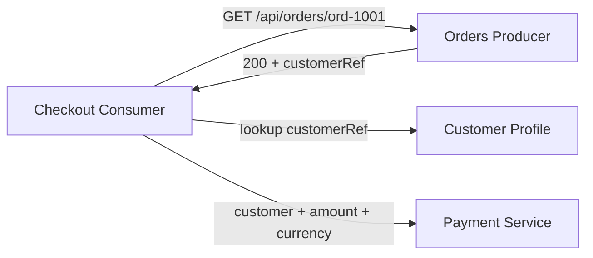
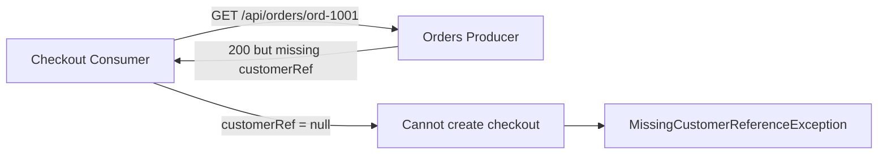
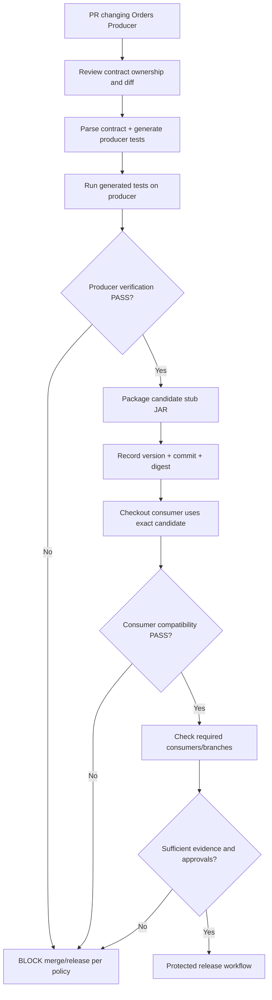

# Detecting Breaking Changes When Removing a Field Used by Consumers

## 1. Hands-On Project Goals

In **Spring Cloud Contract** (the `SPRING_CLOUD_CONTRACT` module), producer and consumer agree on HTTP or messaging behavior using the **Groovy/YAML DSL**. Contract Verifier generates producer-side tests; the producer packages versioned stubs; and the consumer uses **Stub Runner** to test its own client and handlers. CI ties these steps together to catch incompatible API changes before release.

In this project, you will build a very common scenario:

- **Orders Producer** exposes `GET /api/orders/{orderId}`.
- **Checkout Consumer** reads the `customerRef` field to look up customer information and prepare payment.
- The producer wants to remove `customerRef`, assuming the consumer no longer needs it.
- The producer may still compile cleanly, yet Checkout will break when receiving the new response.

You will prove the breakage with **two independent verification layers**:

1. **Producer verification:** the Checkout-proposed contract requires `customerRef`. If the implementation removes the field while the contract remains intact, the generated producer test fails.
2. **Consumer compatibility:** Checkout runs its real client code against the candidate stub built from the new version. When the candidate no longer has `customerRef`, Checkout's business test fails.

The two layers protect both sides. If the producer simultaneously edits the contract to drop `customerRef`, the new producer test may pass because the expectation was altered. Independent consumer tests still catch the incompatibility. That is why **contract ownership and consumer review** are also part of this project.

### Target Outcomes

You have completed this lab when you can:

- Set up producer and consumer with pinned stub versions.
- Write a Groovy contract describing a response containing `customerRef`.
- Generate and run producer verification tests against the real implementation.
- Run Checkout tests via Stub Runner against the baseline stub and observe PASS.
- Remove the `customerRef` field in the producer and reproduce the breakage.
- Distinguish producer test failures from consumer test failures.
- Build a new candidate stub and prove consumer incompatibility.
- Choose a remediation strategy: keep the field during transition, time-boxed migration, or API versioning.
- Configure CI to block releases when required consumers are still FAIL or NOT_TESTED.

## 2. Business Context and Initial Contract

### 2.1. Initial API

Orders Producer returns:

```http
GET /api/orders/ord-1001
Accept: application/json

HTTP/1.1 200 OK
Content-Type: application/json

{
  "id": "ord-1001",
  "status": "CREATED",
  "customerRef": "cust-1001",
  "totalAmount": 125000,
  "currency": "VND"
}
```

Checkout uses:

| Field | Type | Purpose |
| --- | --- | --- |
| `id` | String | Identifies the order |
| `status` | String/enum | Determines order status |
| `customerRef` | String | Looks up customer profile and checks payment eligibility |
| `totalAmount` | Number | Computes payment amount |
| `currency` | String | Selects currency for payment request |

Within this exercise, `customerRef` is a **required field** for Checkout. Removing it prevents Checkout from identifying which customer to process for the order.

### 2.2. System Flow



If the producer deletes `customerRef`:



This is a **breaking change** because a supported consumer depends on the removed field. The producer may view the field as obsolete internally, but only the consumer owner can confirm the dependency has ended.

## 3. Lab Architecture and Project Layout

To model two independent teams, use two Maven projects or two repositories:

```text
contract-breaking-field-lab/
  orders-producer/
    pom.xml
    src/main/java/com/example/orders/
      OrderController.java
      OrderService.java
      OrderResponse.java
    src/test/java/com/example/orders/contract/
      OrdersContractBase.java
      OrdersContractFixtures.java
    src/test/resources/contracts/checkout/
      checkout_get_order.groovy

  checkout-consumer/
    pom.xml
    src/main/java/com/example/checkout/
      OrdersClient.java
      OrderResponse.java
      CheckoutService.java
      CheckoutView.java
    src/test/java/com/example/checkout/
      CheckoutCustomerReferenceContractTest.java
```

In a real organization:

- Contracts may be proposed by consumers via PRs in the producer repository so the producer generates verification tests.
- Consumers maintain their own integration and compatibility tests.
- Producer candidate JARs flow to consumer CI through an artifact store or Maven candidate repository.

**Ownership matters:** Checkout owns the `customerRef` expectation. The producer must not silently modify or delete a consumer-owned contract just to make its build green. Changing expectations requires consumer-owner review.

### 3.1. Versions Used in This Lab

| Artifact | Version | Role |
| --- | --- | --- |
| Orders Producer baseline | `1.4.2` | Includes `customerRef` |
| Orders Producer candidate | `1.5.0-pr123` | Experimental version with field removed |
| Checkout Consumer | `2.3.0` | Still requires `customerRef` |
| Stub classifier | `stubs` | Packaged mappings and contracts |

These are **illustrative lab versions**, not Spring Cloud Contract or Spring Boot versions. Choose Spring Boot, the Spring Cloud release train, and the Contract plugin per your project's compatibility matrix; manage versions through a BOM or version catalog. Do not copy illustrative version numbers into production configs.

### 3.2. Prerequisites

- JDK and Maven Wrapper compatible with your selected Spring Boot/Cloud versions.
- Orders Producer with Spring MVC and test dependencies.
- Producer using the Spring Cloud Contract Maven plugin.
- Checkout Consumer with an HTTP client and Spring Cloud Contract Stub Runner in test scope.
- Local Maven repository or candidate repository able to serve stubs to the consumer.
- Synthetic test fixtures only—never real customer data.
- CI capable of running `clean verify` and archiving test reports.

## 4. Step 1 — Identify Consumer Behavior and Dependencies

Before writing the contract, inspect consumer behavior and document which fields are used.

### 4.1. Dependency Table

| Consumer behavior | Data needed from Orders API | If field is missing |
| --- | --- | --- |
| Load order details | `id` | Cannot identify order |
| Check order state | `status` | Cannot tell if order is payable |
| Look up customer | `customerRef` | Cannot fetch customer profile |
| Compute charge | `totalAmount` | Cannot calculate payment |
| Select currency | `currency` | Cannot create transaction with proper currency |

This inventory feeds contract review. You do not need to copy the entire production response; keep only the fields that genuinely form the interface the consumer depends on.

### 4.2. Consumer-Owned Expectation

Checkout requires:

```text
For GET /api/orders/ord-1001:
  - HTTP status is 200
  - Content-Type is application/json
  - id is ord-1001
  - status is CREATED
  - customerRef is cust-1001
  - totalAmount is a JSON number
  - currency is VND
```

If a required field is removed, the consumer must have a test showing how behavior breaks. **Do not just document the dependency in prose**; encode it into an executable contract or consumer test assertion.

## 5. Step 2 — Write the Checkout-Proposed Groovy Contract

Create the file:

`orders-producer/src/test/resources/contracts/checkout/checkout_get_order.groovy`

```groovy
import org.springframework.cloud.contract.spec.Contract

Contract.make {
    name 'checkout_get_order'
    description 'Checkout needs customerRef to identify the order customer'

    request {
        method GET()
        urlPath '/api/orders/ord-1001'
        headers {
            header 'Accept': 'application/json'
        }
    }

    response {
        status 200
        headers {
            contentType(applicationJson())
        }
        body([
            id         : 'ord-1001',
            status     : 'CREATED',
            customerRef: 'cust-1001',
            totalAmount: 125000,
            currency   : 'VND'
        ])
    }
}
```

### 5.1. Why Must the Contract Explicitly State `customerRef`?

The generated producer test must verify that the real response includes:

- The `customerRef` field.
- A value or matcher matching the fixture.
- A string data type per the agreed schema.

If the producer deletes the field, the contract-generated assertion catches the missing data. Checking only HTTP status `200` will never catch this breaking change.

### 5.2. Equivalent YAML DSL

If your project uses YAML DSL, the equivalent contract looks like:

```yaml
name: checkout_get_order
description: Checkout needs customerRef to identify the order customer
request:
  method: GET
  urlPath: /api/orders/ord-1001
  headers:
    Accept: application/json
response:
  status: 200
  headers:
    Content-Type: application/json
  body:
    id: ord-1001
    status: CREATED
    customerRef: cust-1001
    totalAmount: 125000
    currency: VND
```

Pick **one** representation for the scenario in the producer build. Do not add both duplicate Groovy and YAML files for the same request just to demonstrate both syntaxes.

### 5.3. What the Contract Does Not Assert

This contract describes one specific branch. It does not prove:

- Every order has a valid customer profile.
- Checkout is permitted to pay every order status.
- Customer Profile service is always available.
- Production authentication/authorization is configured properly.
- Production databases or brokers are healthy.

Out-of-scope behavior must be tested at the appropriate layer. Never bloat a contract into a mirror of the full implementation.

## 6. Step 3 — Configure Producer Verification

### 6.1. Dependencies and Maven Plugin

In `orders-producer/pom.xml`, the producer needs compatible test dependencies and plugin configuration:

```xml
<dependencies>
  <dependency>
    <groupId>org.springframework.boot</groupId>
    <artifactId>spring-boot-starter-test</artifactId>
    <scope>test</scope>
  </dependency>
  <dependency>
    <groupId>org.springframework.cloud</groupId>
    <artifactId>spring-cloud-starter-contract-verifier</artifactId>
    <scope>test</scope>
  </dependency>
</dependencies>

<build>
  <plugins>
    <plugin>
      <groupId>org.springframework.cloud</groupId>
      <artifactId>spring-cloud-contract-maven-plugin</artifactId>
      <version>${spring-cloud-contract.version}</version>
      <extensions>true</extensions>
      <configuration>
        <testFramework>JUNIT5</testFramework>
        <testMode>MOCKMVC</testMode>
        <baseClassForTests>
          com.example.orders.contract.OrdersContractBase
        </baseClassForTests>
        <failOnNoContracts>true</failOnNoContracts>
        <failOnInProgress>true</failOnInProgress>
      </configuration>
    </plugin>
  </plugins>
</build>
```

`spring-cloud-contract.version` should be managed in the parent POM or version catalog per your selected release train. The snippet above is a **POM fragment**, not a complete project; the producer still needs its core dependencies and compiler/test runner plugins.

### 6.2. Producer Base Test

Create:

`orders-producer/src/test/java/com/example/orders/contract/OrdersContractBase.java`

```java
package com.example.orders.contract;

import io.restassured.module.mockmvc.RestAssuredMockMvc;
import org.junit.jupiter.api.BeforeEach;
import org.springframework.beans.factory.annotation.Autowired;
import org.springframework.boot.test.autoconfigure.web.servlet.AutoConfigureMockMvc;
import org.springframework.boot.test.context.SpringBootTest;
import org.springframework.test.web.servlet.MockMvc;

@SpringBootTest
@AutoConfigureMockMvc
public abstract class OrdersContractBase {

    @Autowired
    private MockMvc mockMvc;

    @Autowired
    private OrdersContractFixtures fixtures;

    @BeforeEach
    protected void prepareContractData() {
        fixtures.reset();
        fixtures.createOrder(
            "ord-1001",
            "CREATED",
            "cust-1001",
            125000L,
            "VND"
        );
        RestAssuredMockMvc.mockMvc(mockMvc);
    }
}
```

`OrdersContractFixtures` is a helper **implemented by the lab**, not a Spring Cloud Contract API. It must insert data into the test database or repository used by the real controller/service. Never mock out the controller's response and claim that proves the implementation supports the field.

### 6.3. Fixture Data

A fixture can expose an interface:

```java
package com.example.orders.contract;

public interface OrdersContractFixtures {
    void reset();

    void createOrder(
        String orderId,
        String status,
        String customerRef,
        long totalAmount,
        String currency
    );
}
```

The implementation may use a test database, repository, or Testcontainers depending on the project. Mandatory requirements:

- Every test starts from a deterministic state.
- `ord-1001` exists with `customerRef=cust-1001`.
- Tests do not depend on execution order.
- Never use production customer data.
- Generated tests invoke the real controller/service at the chosen boundary.

### 6.4. What Must the Generated Producer Test Verify?

When the generator runs, a test is created from `checkout_get_order.groovy`. That test must:

1. Send `GET /api/orders/ord-1001` to MockMvc.
2. Assert response status `200`.
3. Assert the response body contains `id`, `status`, `customerRef`, `totalAmount`, and `currency` per the contract.
4. Fail if `customerRef` is omitted from the JSON.

You do not need to write a duplicate hand-coded test identical to the generated test just to inflate test counts. Inspect the generated sources and reports to ensure **the contract-generated test actually ran**.

## 7. Step 4 — Build the Baseline Producer API

Initial response DTO:

```java
package com.example.orders;

import java.math.BigDecimal;

public record OrderResponse(
    String id,
    String status,
    String customerRef,
    BigDecimal totalAmount,
    String currency
) {}
```

Illustrative controller:

```java
package com.example.orders;

import org.springframework.web.bind.annotation.GetMapping;
import org.springframework.web.bind.annotation.PathVariable;
import org.springframework.web.bind.annotation.RequestMapping;
import org.springframework.web.bind.annotation.RestController;

@RestController
@RequestMapping("/api/orders")
public class OrderController {

    private final OrderService orderService;

    public OrderController(OrderService orderService) {
        this.orderService = orderService;
    }

    @GetMapping("/{orderId}")
    public OrderResponse getOrder(@PathVariable String orderId) {
        return orderService.getOrder(orderId);
    }
}
```

`OrderService` is the producer's business service. The lab does not mandate a specific persistence technology; what matters is that test fixtures feed data through the real service and controller so JSON responses are serialized by the actual application.

### 7.1. Baseline Response

When calling:

```bash
curl -i -H "Accept: application/json" \
  http://localhost:8080/api/orders/ord-1001
```

the response must return:

```json
{
  "id": "ord-1001",
  "status": "CREATED",
  "customerRef": "cust-1001",
  "totalAmount": 125000,
  "currency": "VND"
}
```

This is synthetic lab data. In a real application, numeric formatting during serialization can vary with configuration; the contract must reflect the exact JSON type the consumer expects.

## 8. Step 5 — Run Baseline Producer Verification

From the `orders-producer` directory:

```bash
./mvnw -B -ntp clean verify
```

The command should:

- Discover the contract under the configured contracts root.
- Generate the producer test.
- Compile the generated test.
- Execute the test via Surefire/test runner.
- Convert the HTTP contract into a WireMock mapping.
- Package the stub artifact per plugin configuration.

### 8.1. Inspecting the Evidence

| Evidence | Baseline expectation |
| --- | --- |
| Contract discovery | Found `checkout_get_order` |
| Generated test | Test exists for `GET` response |
| Test report | Test ran and PASSED |
| `customerRef` assertion | Value `cust-1001` verified |
| Stub mapping | Mapping exists for request path |
| Stub JAR | Contains contract and mapping for exact version |

**Do not stop at the `BUILD SUCCESS` line.** If generated tests were missed by Surefire or skipped, a green build does not prove the producer satisfies the contract.

### 8.2. Maven Lifecycle Phases to Remember

Key stages in Maven's default lifecycle once the plugin is bound:

```text
generate-test-sources
  -> Contract Verifier generateTests

process-test-resources
  -> convert contracts into HTTP mappings

test-compile
  -> compile generated producer tests

test
  -> Surefire executes generated tests

package
  -> generateStubs and package stubs classifier

verify
  -> configured quality gates/integration tests

install / deploy
  -> only after mandatory gates pass
```

`convert` runs before `test`; `generateStubs` binds to `package`. Generating sources or mappings **never substitutes** for executing the tests.

## 9. Step 6 — Build the Checkout Consumer Using the Field

Checkout declares its DTO:

```java
package com.example.checkout;

import java.math.BigDecimal;

public record OrderResponse(
    String id,
    String status,
    String customerRef,
    BigDecimal totalAmount,
    String currency
) {}
```

### 9.1. HTTP Client

```java
package com.example.checkout;

import org.springframework.beans.factory.annotation.Value;
import org.springframework.stereotype.Component;
import org.springframework.web.client.RestTemplate;

@Component
public class OrdersClient {

    private final RestTemplate restTemplate;
    private final String baseUrl;

    public OrdersClient(
        RestTemplate restTemplate,
        @Value("${orders.base-url}") String baseUrl
    ) {
        this.restTemplate = restTemplate;
        this.baseUrl = baseUrl;
    }

    public OrderResponse getOrder(String orderId) {
        return restTemplate.getForObject(
            baseUrl + "/api/orders/{orderId}",
            OrderResponse.class,
            orderId
        );
    }
}
```

For constructor injection above to work, Checkout must provide a `RestTemplate` bean. Configuration example:

```java
package com.example.checkout;

import org.springframework.boot.web.client.RestTemplateBuilder;
import org.springframework.context.annotation.Bean;
import org.springframework.context.annotation.Configuration;
import org.springframework.web.client.RestTemplate;

@Configuration
public class CheckoutHttpClientConfiguration {

    @Bean
    RestTemplate ordersRestTemplate(RestTemplateBuilder builder) {
        return builder.build();
    }
}
```

`RestTemplate` is used here to illustrate a synchronous HTTP client; real projects may use `RestClient`, `WebClient`, or another HTTP client. Regardless of client choice, consumer tests must go through **the application's real client**.

### 9.2. Consumer Service Using `customerRef`

```java
package com.example.checkout;

import org.springframework.stereotype.Service;

@Service
public class CheckoutService {

    private final OrdersClient ordersClient;
    private final CustomerDirectory customerDirectory;

    public CheckoutService(
        OrdersClient ordersClient,
        CustomerDirectory customerDirectory
    ) {
        this.ordersClient = ordersClient;
        this.customerDirectory = customerDirectory;
    }

    public CheckoutView prepare(String orderId) {
        OrderResponse order = ordersClient.getOrder(orderId);

        if (order.customerRef() == null || order.customerRef().isBlank()) {
            throw new MissingCustomerReferenceException(order.id());
        }

        CustomerSummary customer =
            customerDirectory.find(order.customerRef());

        return new CheckoutView(
            order.id(),
            order.status(),
            customer.customerRef(),
            order.totalAmount(),
            order.currency()
        );
    }
}
```

`CustomerDirectory` and `CustomerSummary` are illustrative internal Checkout APIs. They can use a test double in consumer tests to isolate the Customer Profile dependency; **the Orders HTTP client must remain real** to verify responses from the stub.

Illustrative internal types:

```java
package com.example.checkout;

public interface CustomerDirectory {
    CustomerSummary find(String customerRef);
}

public record CustomerSummary(String customerRef) {}

public record CheckoutView(
    String orderId,
    String status,
    String customerRef,
    java.math.BigDecimal totalAmount,
    String currency
) {}
```

Exception:

```java
package com.example.checkout;

public class MissingCustomerReferenceException
    extends RuntimeException {

    public MissingCustomerReferenceException(String orderId) {
        super("Order has no customer reference: " + orderId);
    }
}
```

### 9.3. Consumer Test with Baseline Stub

```java
package com.example.checkout;

import org.junit.jupiter.api.Test;
import org.springframework.beans.factory.annotation.Autowired;
import org.springframework.boot.test.context.SpringBootTest;
import org.springframework.context.annotation.Bean;
import org.springframework.context.annotation.Import;
import org.springframework.boot.test.context.TestConfiguration;
import org.springframework.cloud.contract.stubrunner.StubRunnerProperties;
import org.springframework.cloud.contract.stubrunner.spring.AutoConfigureStubRunner;
import org.springframework.context.annotation.Primary;

import static org.assertj.core.api.Assertions.assertThat;

@SpringBootTest(properties = {
    "orders.base-url=http://localhost:8090"
})
@Import(CheckoutCustomerReferenceContractTest.CheckoutTestConfiguration.class)
@AutoConfigureStubRunner(
    ids = "com.example:orders-producer:1.4.2:stubs:8090",
    stubsMode = StubRunnerProperties.StubsMode.LOCAL
)
class CheckoutCustomerReferenceContractTest {

    @Autowired
    private CheckoutService checkoutService;

    @Test
    void preparesCheckoutUsingCustomerReference() {
        CheckoutView result = checkoutService.prepare("ord-1001");

        assertThat(result.orderId()).isEqualTo("ord-1001");
        assertThat(result.customerRef()).isEqualTo("cust-1001");
        assertThat(result.totalAmount()).isEqualByComparingTo("125000");
        assertThat(result.currency()).isEqualTo("VND");
    }

    @TestConfiguration
    static class CheckoutTestConfiguration {

        @Bean
        @Primary
        CustomerDirectory testCustomerDirectory() {
            return customerRef -> new CustomerSummary(customerRef);
        }
    }
}
```

`CheckoutView`, `CustomerDirectory`, and `CustomerSummary` are types defined by the consumer project. The test configuration provides a fake customer for `cust-1001`. Do not mock `OrdersClient`, because the goal of this exercise is verifying that the Orders stub response flows through the real HTTP client.

### 9.4. Consumer Dependency

The consumer needs Stub Runner in test scope, with its version managed via the Spring Cloud BOM:

```xml
<dependency>
  <groupId>org.springframework.cloud</groupId>
  <artifactId>spring-cloud-starter-contract-stub-runner</artifactId>
  <scope>test</scope>
</dependency>
```

Artifact names and annotation configuration must match your project's release train and plugin version. Never mix major versions arbitrarily.

### 9.5. Running the Baseline Consumer

First install the baseline stub into the local Maven repository from the producer:

```bash
# In orders-producer, after clean verify PASS:
./mvnw -B -ntp install
```

Then run the consumer:

```bash
# In checkout-consumer, sharing the Maven local repository:
./mvnw -B -ntp clean verify
```

Expected output:

```text
Orders producer 1.4.2 generated contract tests: PASS
Orders stub 1.4.2: RESOLVED
Checkout HTTP client test: PASS
customerRef: cust-1001
```

If producer and consumer run on separate CI jobs or repositories, do not assume they share `~/.m2`. Transfer **the exact verified stub JAR** via CI artifact or candidate repository, verify its checksum, and target that exact version.

## 10. Step 7 — Reproduce the Breaking Change: Removing `customerRef`

Create a producer branch:

`feature/remove-customer-ref`

### 10.1. Changing the Implementation

The producer modifies its DTO:

```java
package com.example.orders;

import java.math.BigDecimal;

// CANDIDATE VERSION: customerRef removed.
public record OrderResponse(
    String id,
    String status,
    BigDecimal totalAmount,
    String currency
) {}
```

The controller/service now serializes:

```json
{
  "id": "ord-1001",
  "status": "CREATED",
  "totalAmount": 125000,
  "currency": "VND"
}
```

### 10.2. What Happens If the Checkout-Owned Contract Remains?

Run:

```bash
./mvnw -B -ntp clean verify
```

The generated producer test still expects:

```json
{
  "customerRef": "cust-1001"
}
```

The producer returns JSON without this field. **Producer verification must FAIL** at the corresponding body/JSONPath assertion.

This is the right outcome: the implementation no longer satisfies an agreed consumer behavior. Never hand-edit generated tests to force a pass.

### 10.3. Reading the Error and Pinpointing the Cause

Exact error messages depend on the generated test framework version, but they typically show:

- The request was sent successfully.
- The HTTP status may still be `200`.
- The JSON response is missing or fails to match `customerRef`.
- The Contract Verifier-generated assertion failed.

Do not confuse this failure with:

- Contract not discovered.
- Order missing from fixture.
- MockMvc not initialized.
- Test runner failing to execute generated tests.

Always inspect the actual response and test report to confirm this is a **missing API field**.

### 10.4. What If the Producer Edits the Contract to Drop the Field Too?

Suppose the producer changes the contract to:

```groovy
response {
    status 200
    headers {
        contentType(applicationJson())
    }
    body([
        id         : 'ord-1001',
        status     : 'CREATED',
        totalAmount: 125000,
        currency   : 'VND'
    ])
}
```

Producer generated tests can now **PASS** because the new contract no longer asks for `customerRef`. Yet that does not prove the change is compatible. If a Checkout consumer-owned contract was deleted or altered without Checkout owner review, contract governance has been bypassed.

Proceed to build the candidate stub and run the **independent consumer test** in the next step. Checkout's test still requires `customerRef` and must detect the breakage.

## 11. Step 8 — Testing the Consumer with the New Candidate Stub

To test the scenario where the producer updated both contract and implementation:

1. Keep the consumer expectation inside the Checkout repository.
2. Producer builds a distinct candidate version, e.g. `1.5.0-pr123`.
3. Producer verification runs against the contract approved by producer/consumer owners.
4. Build and package the candidate stub.
5. Checkout tests use **that exact candidate version** instead of baseline `1.4.2`.

### 11.1. Candidate Version

Example producer version:

```xml
<version>1.5.0-pr123</version>
```

The consumer test updates the Stub Runner ID:

```java
@AutoConfigureStubRunner(
    ids = "com.example:orders-producer:1.5.0-pr123:stubs:8090",
    stubsMode = StubRunnerProperties.StubsMode.LOCAL
)
```

`1.5.0-pr123` is an illustrative candidate; it must exactly match the version the producer built and installed/published. Never use `LATEST` or dynamic versions for release gates.

### 11.2. Installing the Candidate Stub

In the producer candidate, once producer checks pass:

```bash
./mvnw -B -ntp clean install
```

In the Checkout consumer, sharing the runner/local Maven repository:

```bash
./mvnw -B -ntp clean verify
```

If the consumer runs on a different runner, pass the candidate JAR via CI artifact or candidate repository and verify its digest. Do not copy an older JAR with the same name into a cache and pretend it is the freshly built candidate.

### 11.3. Expected Outcome When the Stub Lacks `customerRef`

The Orders stub returns:

```json
{
  "id": "ord-1001",
  "status": "CREATED",
  "totalAmount": 125000,
  "currency": "VND"
}
```

Checkout's HTTP client deserializes the payload into the DTO with `customerRef` set to `null` (under standard Jackson/record defaults when the field is absent). `CheckoutService` detects the missing customer reference and throws:

```text
MissingCustomerReferenceException:
Order has no customer reference: ord-1001
```

The consumer compatibility test **FAILS**. This provides independent evidence that the producer candidate no longer satisfies the current consumer.

### 11.4. Two Layers of Defense for the Same Scenario

| Scenario | Producer generated test | Checkout candidate test |
| --- | --- | --- |
| Removed field in implementation only, contract kept | **FAIL** | May not even need to run since producer gate failed |
| Removed field in both implementation and producer contract | May PASS against new contract | **FAILS** with candidate stub |
| Kept field and behavior matching baseline | PASS | PASS |
| Consumer migrated and no longer uses field | Depends on owner-approved new contract | PASS after updating client/test |

**Never rely on producer tests alone to prove backward compatibility.** Producer tests verify the producer against whichever contract ran; consumer tests verify the real consumer against the candidate stub.

## 12. Step 9 — Reading the Failure to See What the Consumer Depends On

### 12.1. Did the Error Happen in the HTTP Client or Business Logic?

In this example:

- WireMock returned HTTP `200`.
- JSON deserialization succeeded.
- `customerRef` became `null`.
- `CheckoutService` checked the field and threw an exception.

Therefore, the failure lies in the **business contract / response schema**, not networking or ports.

If the DTO enforces strict validation annotations or constructor checks, the error may surface directly during deserialization. Either way, the consumer rejects the candidate response.

### 12.2. Weak Consumer Tests Can Miss Breaking Changes

Weak test:

```java
// Insufficient: only confirms the API returns a response.
OrderResponse order = ordersClient.getOrder("ord-1001");
assertThat(order).isNotNull();
```

This test still PASSES if `customerRef` disappears and Jackson assigns `null`.

Strong test:

```java
OrderResponse order = ordersClient.getOrder("ord-1001");

assertThat(order.customerRef()).isEqualTo("cust-1001");
```

Or a test going through the business service:

```java
CheckoutView result = checkoutService.prepare("ord-1001");

assertThat(result.customerRef()).isEqualTo("cust-1001");
```

The second test also proves Checkout uses the data properly in its business flow. You can keep both if each protects a distinct boundary, without adding redundant assertions.

### 12.3. Do Not Confuse WireMock No-Match with an API Error

If a test only asserts `404`, WireMock might return `404` because no mapping matched. Here, the response missing a field may still return `200`. Always inspect:

- Stub Runner loaded the exact artifact version.
- The request URL is right.
- The actual response body.
- Business assertions on `customerRef`.
- Test reports linked to the candidate version.

## 13. Step 10 — Choosing How to Resolve the Breaking Change

The producer wants to remove `customerRef`. The consumer still needs it. Three common options exist.

### 13.1. Option A: Keep the Field and Add a New Field

The producer keeps `customerRef` during a transition period and adds a new field if the API needs a new name or semantics:

```json
{
  "id": "ord-1001",
  "status": "CREATED",
  "customerRef": "cust-1001",
  "customerReference": "cust-1001",
  "totalAmount": 125000,
  "currency": "VND"
}
```

Plan:

1. Producer adds the new field while keeping the old field.
2. Contracts are updated with consumer owners' consent.
3. Producer generated tests verify both old and new fields during the transition.
4. Newer consumers migrate to the new field.
5. Older/LTS consumers are tested and rolled out.
6. Monitor old field usage via appropriate telemetry.
7. Propose deleting the old field only when no supported consumer depends on it.

**Note:** adding a new field can also break consumers using strict schemas or fail-on-unknown-properties. Candidate stubs and consumer tests must still run before release.

### 13.2. Option B: Version the API

If semantics change incompatibly, introduce a new endpoint version:

```text
V1:
GET /api/v1/orders/ord-1001
  -> customerRef is still provided

V2:
GET /api/v2/orders/ord-1001
  -> new schema without customerRef
```

Or use media-type/header versioning if that is your organization's API standard. Never create a "version" solely by changing URLs in docs without real routing and rollout.

Plan:

- Keep V1 for supported consumers.
- Consumer owners choose when to move to V2.
- V1 and V2 contracts have separate tests.
- Producer tracks migration and announces deprecation.
- Retire V1 only after the support window closes and approvals are granted.

### 13.3. Option C: Migrate the Consumer First, Then Remove the Field

If customer references can be fetched from another source:

1. Checkout designs and tests the alternative source.
2. The consumer releases a version that no longer depends on `customerRef`.
3. The producer inventories all remaining supported consumers.
4. The producer marks the field deprecated and tracks usage.
5. Delete the field only after mandatory consumers have migrated.

This requires cross-team coordination; **never delete a field just because one newer consumer stopped using it**.

### 13.4. Comparing Options

| Option | Pros | Costs / Risks |
| --- | --- | --- |
| Keep old + add new field | Usually more compatible, gradual rollout | Larger payload; strict consumers need testing |
| Version the API | Clean new schema, consumers control timing | Must maintain multiple versions |
| Migrate consumers first | Cleanly removes field once dependency ends | Requires inventory, rollout coordination, and telemetry |

No single option is automatically right for every API. Producer/API owners and consumer owners must agree on semantics, support windows, and rollback plans.

## 14. Step 11 — Designing CI So Field Removal Cannot Slip Through

The pipeline must execute steps in order and pass **the exact same candidate artifact** across producer and consumer jobs.

### 14.1. Pipeline Diagram



### 14.2. Producer CI Gate

Example command:

```bash
./mvnw -B -ntp clean verify
```

The producer gate must verify:

- Consumer-owned contracts are discovered.
- No `inProgress` or `ignored` contracts violate policy.
- Generated producer tests compile and actually execute.
- The `customerRef` assertion passes.
- No tests were skipped to hide failures.
- HTTP mappings and the stub JAR were created.
- Artifact version and classifier match the candidate.

### 14.3. Consumer CI Gate

Consumer tests must:

- Resolve the exact `com.example:orders-producer:1.5.0-pr123:stubs`.
- Use Stub Runner in test scope.
- Call the Orders API through the real client.
- Assert `customerRef` or behavior relying on it.
- Archive reports linked to the producer candidate commit/version.
- Never consume a stale baseline stub from cache.

### 14.4. Cross-Repository CI Pseudocode

```text
Producer PR job:
  checkout exact producer commit
  validate contract ownership/review
  ./mvnw clean verify
  confirm generated tests executed
  package candidate -stubs.jar
  compute SHA-256
  upload exact JAR + provenance metadata

Checkout compatibility job:
  checkout supported Checkout revision
  download exact candidate JAR
  verify checksum
  install into isolated Maven local repository
  configure Stub Runner with exact candidate GAV/classifier
  run Checkout compatibility tests
  report PASS/FAIL against producer commit

Release job:
  require producer verification PASS
  require all required consumer results PASS or approved waiver
  require security/provenance checks
  publish immutable release artifact
```

This is a **pipeline model**, not a copy-paste script. Configure artifact transfer, checksums, test report parsing, and repository permissions for your CI platform.

### 14.5. Never Use Dynamic Versions

Wrong:

```text
com.example:orders-producer:latest:stubs
```

Right for candidate testing:

```text
com.example:orders-producer:1.5.0-pr123:stubs
```

A dynamic version can resolve to a different artifact between runs. When that happens, a PASS result no longer proves the candidate under review is compatible.

## 15. Step 12 — Interpreting Outcomes to Make Decisions

| Producer tests | Consumer tests | Meaning | Decision |
| --- | --- | --- | --- |
| PASS | PASS | Candidate meets producer contract and consumer passed | Eligible for release |
| FAIL | Not run | Producer violates approved contract | BLOCK |
| PASS | FAIL | Producer contract may hold, but consumer is incompatible with candidate | BLOCK or migrate |
| PASS | NOT_TESTED | Insufficient evidence for a mandatory consumer | BLOCK per policy |
| SKIPPED | PASS | Consumer ran a stub, but producer was never verified | BLOCK |
| PASS | PASS against old baseline stub | Does not prove compatibility with new candidate | Re-run against exact candidate |

**Never treat a single aggregate green badge** as a substitute for per-gate outcomes. In particular, `NOT_TESTED` is not `PASS`.

### 15.1. If Producer Tests PASS but Consumer Tests FAIL

This can occur when:

- The producer contract was altered, removing the `customerRef` assertion.
- The consumer still keeps DTOs/logic depending on the field.
- The new candidate stub omits the field.
- The consumer uses strict schemas or deserializers.

This is a genuine breaking change that owners must resolve. Do not delete consumer assertions to turn the pipeline green while the business dependency still exists.

### 15.2. If Producer Tests FAIL but Consumer Tests PASS

The consumer test may be running against the **old baseline stub**, or producer verification may be running a newer contract. Check versions, commits, and digests before concluding anything. Both jobs must tie to the same producer candidate.

## 16. Common Pitfalls in Practice

| Symptom | Cause | Resolution |
| --- | --- | --- |
| Producer build stays green despite removed field | Contract not discovered, tests skipped, or contract edited | Check contracts root, generated test reports, and owner review |
| Generated tests fail to compile | JUnit/base class/dependency mismatch | Inspect plugin config and test framework |
| Producer test fails on a different field | Unexpected fixture or schema change | Read actual response and assertion |
| Checkout test still PASSES after field removal | Consumer test mocks `OrdersClient` or only asserts non-null response | Use real HTTP client and assert `customerRef` |
| Checkout resolves stale stub | Local Maven cache or wrong ID | Clean/isolate local repository, pin candidate GAV |
| Stub Runner fails to download JAR | Artifact not installed/published or wrong classifier | Check GAV and repository |
| Unexplained HTTP 404 | WireMock no-match or business error | Assert error code and inspect mappings |
| JSON parse error | Content-Type, JSON type, or deserializer | Compare actual response with DTO |
| Order-dependent tests | Fixture not reset | Seed/reset before each test |
| Producer PASS, LTS consumer not run | Matrix missing branch | Record `NOT_TESTED` and block/waive per policy |

### 16.1. Verifying Which Candidate Is Actually Used

When suspecting stale cache:

1. Log the Stub Runner ID in the test report.
2. Confirm version and classifier match the candidate.
3. Verify the artifact digest.
4. Use an isolated local Maven repository or clean CI runner.
5. Re-run the consumer test and retain sanitized logs.

Do not wipe the whole team's cache to fix one job; reproduce cleanly with an isolated repository.

## 17. Extension — Multiple Consumers Using the Same Field

Orders Producer also serves:

| Consumer | Uses `customerRef` for | Support status |
| --- | --- | --- |
| Checkout | Customer lookup and payment creation | `main`, `release/lts` |
| Invoice | Printing customer reference on invoices | `main` |
| Analytics | Grouping revenue by customer | `main` |
| Mobile Gateway | Forwarding order info to mobile apps | `release/lts` |

Even if Checkout migrates, the producer still cannot drop the field while Invoice, Analytics, or Mobile Gateway depend on it.

### 17.1. Compatibility Matrix

| Consumer | Branch/version | Candidate without field | Illustrative outcome |
| --- | --- | --- | --- |
| Checkout | `main` | Test run | FAIL |
| Checkout | `release/lts` | Test run | FAIL |
| Invoice | `main` | Test run | FAIL |
| Analytics | `main` | Test run | NOT_TESTED |
| Mobile Gateway | `release/lts` | Test run | FAIL |

These are illustrative results for practice. The release gate must check **every supported consumer**. Never treat Checkout `main` migrating as permission to drop a field from all consumers.

### 17.2. Consumer Inventory and Deprecation

Before removing a field:

- List all consumer owners and supported branches.
- Identify which consumer version moves to the new schema.
- Mark the field deprecated via documentation and metadata.
- Monitor usage with privacy-safe telemetry.
- Announce deadlines and migration guides.
- Run consumer compatibility tests before removing the field.
- Publish the breaking version only with an approved decision and rollout plan.

## 18. Extension — Message Contracts Can Break Too

If `customerRef` is carried in the `ORDER_CREATED` event, deleting the field from the message body also breaks consumers.

### 18.1. Messaging Contract Baseline

```groovy
import org.springframework.cloud.contract.spec.Contract

Contract.make {
    name 'order_created_event'
    label 'order_created'

    input {
        triggeredBy('publishOrderCreated()')
    }

    outputMessage {
        sentTo('orders.events')
        body([
            eventType  : 'ORDER_CREATED',
            orderId    : 'ord-1001',
            customerRef: 'cust-1001',
            totalAmount: 125000,
            currency   : 'VND'
        ])
        headers {
            header('eventType', 'ORDER_CREATED')
            messagingContentType(applicationJson())
        }
    }
}
```

`publishOrderCreated()` is implemented in the producer base test and must trigger the real publishing flow. Message contracts must verify the right body, headers, and destination.

### 18.2. Consumer Handler Test

The consumer can use Stub Runner triggers:

```java
// Illustrative snippet: Stub Runner, message binder, and Awaitility configured.
readModel.deleteByOrderId("ord-1001");
assertThat(readModel.hasOrder("ord-1001")).isFalse();

assertThat(stubTrigger.trigger("order_created")).isTrue();

await().atMost(Duration.ofSeconds(5)).untilAsserted(() -> {
    var order = readModel.findByOrderId("ord-1001");
    assertThat(order).isPresent();
    assertThat(order.get().customerRef()).isEqualTo("cust-1001");
});
```

`readModel` is an illustrative consumer API. Tests must verify that the real handler mutates state—never pre-seed the expected outcome and assert it exists.

### 18.3. Do Not Confuse Triggers with Delivery Guarantees

Message stubs let consumers test payloads and handlers. They do not prove:

- Exactly-once delivery.
- Cross-event ordering.
- Retry/dead-letter policies.
- Broker ACLs and availability.
- Message durability during broker failures.

Those guarantees require dedicated integration and resilience tests.

## 19. Lab Completion Criteria

### A. Baseline

- [ ] Checkout-owned contract specifies `customerRef`.
- [ ] Producer base fixture deterministically creates order `ord-1001`.
- [ ] Producer generated test PASSES against the baseline implementation.
- [ ] Stub `1.4.2` is packaged and resolved accurately.
- [ ] Checkout consumer test invokes the real HTTP client.
- [ ] Checkout assertion proves `customerRef=cust-1001` is consumed.

### B. Breaking Change

- [ ] Producer DTO/response removed `customerRef` on the candidate branch.
- [ ] With the consumer-owned contract kept, producer verification FAILS on the field assertion.
- [ ] If the producer contract is also edited, consumer owner review is enforced.
- [ ] New candidate stub omits `customerRef`.
- [ ] Checkout test runs against the exact candidate version and FAILS.
- [ ] Failure is diagnosed as missing contract data, not stub cache or no-match.

### C. Remediation and Release

- [ ] Chosen strategy: keep field, migrate consumers, or version API.
- [ ] Supported consumers and branches inventoried.
- [ ] Producer tests PASS against the owner-approved contract.
- [ ] Consumer tests PASS against the exact candidate artifact.
- [ ] Candidate records version, commit, and checksum.
- [ ] No required consumer remains FAIL/NOT_TESTED without an approved waiver.
- [ ] Only the protected release workflow publishes the artifact.

## 20. Self-Directed Practice Exercise

### 20.1. Change Request

The producer wants to change:

```json
{
  "id": "ord-1001",
  "status": "CREATED",
  "customerRef": "cust-1001",
  "totalAmount": 125000,
  "currency": "VND"
}
```

to:

```json
{
  "id": "ord-1001",
  "status": "CREATED",
  "totalAmount": 125000,
  "currency": "VND"
}
```

Checkout has an existing consumer test verifying `customerRef`, yet the producer wants to edit the contract to remove the field alongside the DTO.

### 20.2. Tasks

1. Explain why producer verification can PASS after the contract is edited.
2. Propose how to enforce consumer ownership so the producer cannot unilaterally drop expectations.
3. Build a candidate stub missing the field.
4. Run Checkout's test against the candidate and capture the failure.
5. Write a migration plan where the producer retains the old field for one additional release.
6. Add a new `customerReference` field and define how the consumer migrates.
7. Design a compatibility matrix covering Checkout `main`/LTS, Invoice, and Mobile Gateway.
8. Define exit criteria for deleting the old field.
9. Design a CI gate preventing dynamic versions and stale stub caches.
10. Write a release decision when one LTS consumer has not yet been tested.

### 20.3. Discussion Questions

**Q1.** Why can removing a field still preserve HTTP status `200`?

**Hint:** HTTP status describes request outcome; it does not guarantee every field in the JSON body remains intact.

**Q2.** Why don't producer generated tests always catch field removal?

**Hint:** If the contract is altered to stop requiring the field, new generated tests verify the new expectation. That is why protecting ownership and running independent consumer compatibility tests are essential.

**Q3.** Why does a consumer test that mocks `OrdersClient` miss breaking changes?

**Hint:** The test never receives responses from the candidate stub, so it never observes the field-less schema.

**Q4.** Why must a distinct candidate version be used?

**Hint:** To prove the exact artifact from the producer commit under review is tested; dynamic versions or caches can return stale stubs.

**Q5.** If Checkout `main` PASSES while Checkout LTS FAILS, should you publish?

**Hint:** If LTS is still within its support window and lacks an approved migration or waiver, you must block.

## 21. Reference Answers and Review Criteria

| Question | Conclusion |
| --- | --- |
| Producer removes field, keeps contract | Generated producer test must FAIL |
| Producer removes field and edits contract | Producer test may PASS; consumer-owned expectations and consumer tests must protect |
| Consumer test mocks HTTP client | Insufficient to test candidate stubs |
| Consumer test calls real client against baseline | PASS |
| Consumer test calls real client against candidate missing field | FAIL |
| Stub Runner uses dynamic version | No reproducible evidence |
| LTS consumer still FAILS | BLOCK or migrate/waive per policy |
| Producer adds new field while keeping old field | Usually easier to migrate; strict consumers must still be tested |

### 21.1. Sample Review Decision

> **REQUEST CHANGES:** `customerRef` is used by Checkout to look up the customer profile before creating payment. The producer candidate removes the field while Checkout LTS remains within its support window. Keep the field in responses during the migration period, or introduce a new API version. Re-run producer verification and Checkout main/LTS tests against the exact candidate stub before releasing.

This comment states **the consumer dependency, impact scope, required action, and required evidence**. It tells the producer precisely what to fix without guessing.

## 22. References

- [Spring Cloud Contract — Consumer-Driven Contracts](https://docs.spring.io/spring-cloud-contract/reference/getting-started/cdc.html): consumer-proposed, producer-verified contract flow.
- [Spring Cloud Contract — Maven Project](https://docs.spring.io/spring-cloud-contract/reference/maven-project.html): producer plugin config, base class, and generated tests.
- [Spring Cloud Contract — HTTP Contracts](https://docs.spring.io/spring-cloud-contract/reference/project-features-contract/http.html): request/response body, headers, and matchers.
- [Spring Cloud Contract — Stub Runner Core](https://docs.spring.io/spring-cloud-contract/reference/project-features-stubrunner/stub-runner-core.html): artifact coordinates and consumer test setup.
- [Spring Cloud Contract — Messaging](https://docs.spring.io/spring-cloud-contract/reference/project-features-messaging.html): message contracts, triggers, destinations, and headers.
- [Apache Maven — Introduction to the Build Lifecycle](https://maven.apache.org/guides/introduction/introduction-to-the-lifecycle.html): lifecycle ordering of `generate-test-sources`, `process-test-resources`, `test`, `package`, `verify`, `install`.

**Remember:** removing a field might not break producer compilation or change the HTTP status code, yet it still breaks consumers. Protect consumer expectations with clear contract ownership, run generated producer tests against the real implementation, and run real consumer clients/handlers against **the exact candidate stub version**. Publish only once supported consumers are compatible or have an approved migration/waiver plan—turning schema changes into evidence-backed decisions instead of post-release outages.
