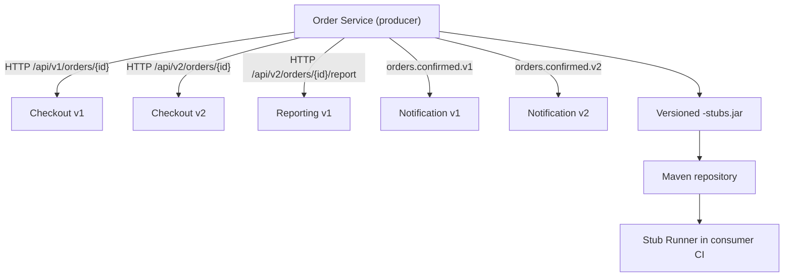
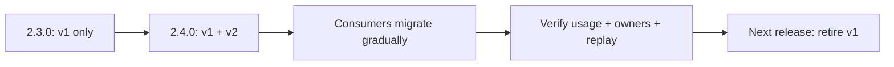
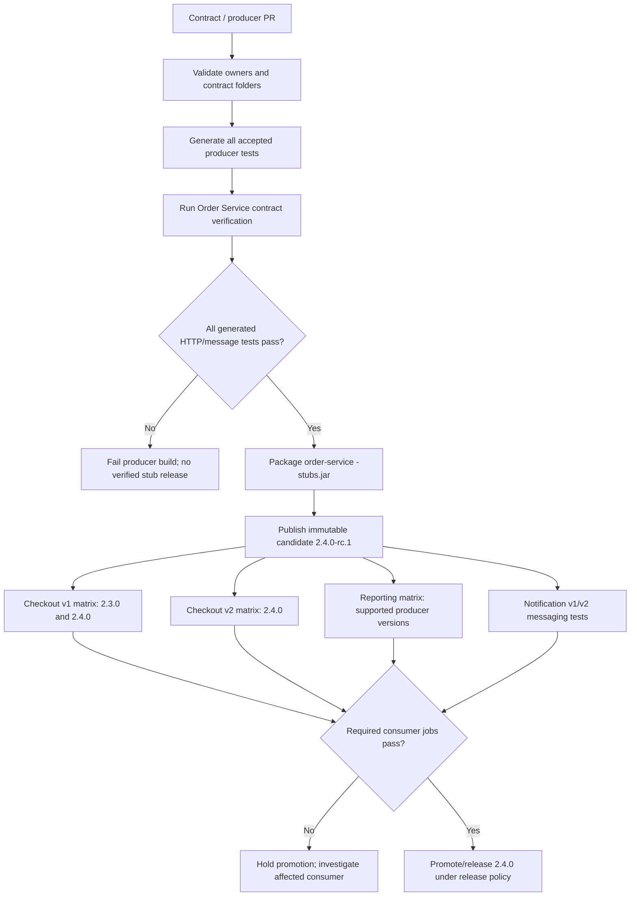

# Hands-On: Supporting Multiple Consumers and Multiple Contract Versions Simultaneously

## 1. Project Goals

In this comprehensive lab, you will build **Order Service** as the producer and three consumer groups: **Checkout**, **Reporting**, and **Notification**. These teams do not upgrade on the same schedule. Legacy Checkout still needs API v1; newer Checkout wants API v2; Reporting needs financial data; and Notification has one subscriber reading event schema v1 while a newer subscriber has moved to v2.

You will use **Spring Cloud Contract** to specify HTTP and messaging behavior via **Groovy/YAML DSL**, generate producer verification tests, publish a stub artifact, and test each consumer with **Stub Runner**. At the end of the lab, the CI pipeline runs a compatibility matrix to catch changes that break any supported consumer version.

This hands-on project can be implemented in a multi-module repository. The service names, versions, and sample data below are consistent illustrative examples throughout the lab; substitute coordinates and versions aligned with your project's Spring Boot / Spring Cloud Contract release train.

Upon completion, you will be able to:

1. Organize contracts by **consumer and consumer version**.
2. Keep API v1 and v2 running concurrently during a transition window.
3. Dual-publish two event versions while subscribers upgrade asynchronously.
4. Use `stubsPerConsumer` so each consumer loads only its own group's mappings.
5. Distinguish API version, consumer version, producer artifact version, and contract revision.
6. Run producer verification across all accepted contracts.
7. Use Stub Runner with pinned artifact versions in consumer CI.
8. Plan expand–migrate–contract rollouts, rollbacks, and evidence-backed retirement of legacy versions.

## 2. Scenario and Architecture

**Producer:** `order-service`

**Consumers:**

- `checkout-service-v1`: legacy Checkout app calling `GET /api/v1/orders/{id}`.
- `checkout-service-v2`: new Checkout app calling `GET /api/v2/orders/{id}`.
- `reporting-service-v1`: retrieves reporting data from Order Service.
- `notification-service-v1`: subscriber consuming `OrderConfirmed` event schema v1.
- `notification-service-v2`: new subscriber consuming event schema v2.



The producer preserves legacy interfaces during migration. API v1 and v2 are separated by **URL path**, and events v1 and v2 by **destination/schema version**. That way, a single request never needs to return two conflicting responses depending on consumer name.

## 3. Distinguishing Four Types of Versions

This is the most critical distinction before starting:

| Version type | Example | Meaning |
| --- | --- | --- |
| **API/event schema version** | HTTP v1/v2, `schemaVersion: 1/2` | Shape and semantics of the interface used by consumers |
| **Consumer application version** | Checkout 1.8.0, Checkout 2.0.0 | Deployed version of the consumer application |
| **Producer artifact version** | `order-service:2.4.0` | Version of the published producer artifact and stub JAR |
| **Contract source revision** | Git commit SHA `a1b2c3...` | Groovy/YAML revision used by producer to generate and verify tests |

**Producer artifact version 2.4.0 does not mean the API only supports v2.** One artifact can carry both v1 and v2 contracts simultaneously. Likewise, consumer app version 2.0.0 is not forced onto API v2 if the team has not migrated yet.

In this lab, we use:

- Producer `order-service:2.3.0`: earlier release supporting legacy consumers.
- Producer `order-service:2.4.0`: newer release preserving HTTP v1 while adding HTTP v2 and event v2.
- Consumer Checkout v1 runs against both producer 2.3.0 and 2.4.0.
- Consumer Checkout v2 deploys only once producer 2.4.0 exposes API v2.

## 4. Preparing the Lab Repository

An illustrative Maven multi-module layout:

```text
spring-cloud-contract-lab/
  pom.xml
  order-service/
    pom.xml
    src/main/java/com/example/order/
      OrderApplication.java
      OrderController.java
      OrderService.java
    src/test/java/com/example/order/contract/
      OrderContractBase.java
    src/test/resources/contracts/
      checkout-service-v1/
        get_order_v1.groovy
      checkout-service-v2/
        get_order_v2.yml
      reporting-service-v1/
        get_order_report.yml
      notification-service-v1/
        order_confirmed_v1.groovy
      notification-service-v2/
        order_confirmed_v2.groovy
  checkout-service-v1/
    pom.xml
    src/main/java/...
    src/test/java/...
  checkout-service-v2/
    pom.xml
    src/main/java/...
    src/test/java/...
  reporting-service-v1/
    pom.xml
    src/main/java/...
    src/test/java/...
  notification-service-v1/
    pom.xml
    src/main/java/...
    src/test/java/...
  notification-service-v2/
    pom.xml
    src/main/java/...
    src/test/java/...
```

In real projects, consumers may live in separate repositories. The multi-module layout simply makes this lab easy to run and follow.

### 4.1. Why Must Consumer Folder Names Stay Stable?

With `stubsPerConsumer=true`, Stub Runner filters mappings by paths containing the consumer name. Therefore:

- Folder `checkout-service-v1/` corresponds to `consumerName = "checkout-service-v1"`.
- Folder `checkout-service-v2/` corresponds to `consumerName = "checkout-service-v2"`.
- `spring.application.name` is used as the default consumer name if not overridden.

In this lab, we set `consumerName` explicitly so the mapping is obvious. Never name the folder `checkout-team` while configuring the consumer name as `checkout-service-v1`.

**Consumer versions are represented via distinct consumer group names.** If you put both v1 and v2 inside a single `checkout-service/` folder, enabling `stubsPerConsumer` loads both contract groups under that folder; it cannot automatically infer that you want only one specific API version.

## 5. Defining the HTTP Contract for Checkout v1

Legacy Checkout expects these fields:

```json
{
  "orderId": 42,
  "status": "CONFIRMED",
  "customerName": "Lan"
}
```

Create the file:

```text
order-service/src/test/resources/contracts/checkout-service-v1/get_order_v1.groovy
```

```groovy
import org.springframework.cloud.contract.spec.Contract

Contract.make {
    description 'Checkout v1 reads order using legacy interface'
    request {
        method GET()
        url '/api/v1/orders/42'
        headers {
            header('Accept', 'application/json')
        }
    }
    response {
        status OK()
        headers {
            contentType(applicationJson())
        }
        body(
            orderId: 42,
            status: 'CONFIRMED',
            customerName: 'Lan'
        )
    }
}
```

This contract preserves `customerName` because consumer v1 depends on it. Do not rename the field to `buyerName` inside the legacy contract merely because the producer adopted a newer internal model.

## 6. Defining the HTTP Contract for Checkout v2 Using YAML

New Checkout expects `buyerName`, plus total amount and currency:

```json
{
  "orderId": 42,
  "status": "CONFIRMED",
  "buyerName": "Lan",
  "totalAmount": 125000,
  "currency": "VND"
}
```

Create the file:

```text
order-service/src/test/resources/contracts/checkout-service-v2/get_order_v2.yml
```

```yaml
description: Checkout v2 reads order using new interface
request:
  method: GET
  url: /api/v2/orders/42
  headers:
    Accept: application/json
response:
  status: 200
  headers:
    Content-Type: application/json
  body:
    orderId: 42
    status: CONFIRMED
    buyerName: Lan
    totalAmount: 125000
    currency: VND
```

The two contracts differ in both **consumer group** and **API path**. The producer can serve both structures side by side without guessing which consumer sent the request.

### 6.1. Independent Reporting Contract

Reporting needs settlement data and should not overload `status` with a different meaning. Create:

```text
order-service/src/test/resources/contracts/reporting-service-v1/get_order_report.yml
```

```yaml
description: Reporting reads order financial data
request:
  method: GET
  url: /api/v2/orders/42/report
  headers:
    Accept: application/json
response:
  status: 200
  headers:
    Content-Type: application/json
  body:
    orderId: 42
    totalAmount: 125000
    currency: VND
    settlementStatus: NOT_SETTLED
```

Here, order `status` and settlement `settlementStatus` are separate concepts. Reporting can upgrade its application version independently of the API path; the name `reporting-service-v1` is the lab's consumer identity, not a mandate that its endpoint be HTTP v1.

## 7. Defining Messaging Contracts for Two Generations of Notification

### 7.1. Event Schema v1

Legacy Notification consumes events on destination:

```text
orders.confirmed.v1
```

Payload:

```json
{
  "eventType": "OrderConfirmed",
  "schemaVersion": 1,
  "eventId": "evt-order-42",
  "orderId": 42,
  "customerName": "Lan"
}
```

Create:

```text
order-service/src/test/resources/contracts/notification-service-v1/order_confirmed_v1.groovy
```

```groovy
import org.springframework.cloud.contract.spec.Contract

Contract.make {
    description 'Notification v1 receives OrderConfirmed event schema 1'
    label 'order_confirmed_v1'

    input {
        triggeredBy('publishOrderConfirmedV1()')
    }

    outputMessage {
        sentTo('orders.confirmed.v1')
        body(
            eventType: 'OrderConfirmed',
            schemaVersion: 1,
            eventId: 'evt-order-42',
            orderId: 42,
            customerName: 'Lan'
        )
        headers {
            header('eventType', 'OrderConfirmed')
        }
    }
}
```

### 7.2. Event Schema v2

New Notification uses:

```text
orders.confirmed.v2
```

Payload:

```json
{
  "eventType": "OrderConfirmed",
  "schemaVersion": 2,
  "eventId": "evt-order-42",
  "orderId": 42,
  "buyer": {
    "id": 7,
    "displayName": "Lan"
  },
  "totalAmount": 125000,
  "currency": "VND"
}
```

Create:

```text
order-service/src/test/resources/contracts/notification-service-v2/order_confirmed_v2.groovy
```

```groovy
import org.springframework.cloud.contract.spec.Contract

Contract.make {
    description 'Notification v2 receives OrderConfirmed event schema 2'
    label 'order_confirmed_v2'

    input {
        triggeredBy('publishOrderConfirmedV2()')
    }

    outputMessage {
        sentTo('orders.confirmed.v2')
        body(
            eventType: 'OrderConfirmed',
            schemaVersion: 2,
            eventId: 'evt-order-42',
            orderId: 42,
            buyer: [
                id: 7,
                displayName: 'Lan'
            ],
            totalAmount: 125000,
            currency: 'VND'
        )
        headers {
            header('eventType', 'OrderConfirmed')
        }
    }
}
```

The two events use separate destinations so legacy subscribers do not unexpectedly receive v2 payloads. During migration, the producer can dual-publish both events from the same order-confirmation business flow.

**Note on message verification:** `publishOrderConfirmedV1()` and `publishOrderConfirmedV2()` are producer test triggers. The base class must wire them to the real publisher/adapter and configure the message verifier matching your project's broker/binder. Writing DSL alone does not start Kafka/RabbitMQ or publish messages automatically.

## 8. Implementing a Producer Supporting Both Legacy and New APIs

Illustrative controller:

```java
@RestController
public class OrderController {
    private final OrderService orderService;

    public OrderController(OrderService orderService) {
        this.orderService = orderService;
    }

    @GetMapping("/api/v1/orders/{id}")
    public OrderV1Response getV1(@PathVariable long id) {
        return orderService.getV1(id);
    }

    @GetMapping("/api/v2/orders/{id}")
    public OrderV2Response getV2(@PathVariable long id) {
        return orderService.getV2(id);
    }

    @GetMapping("/api/v2/orders/{id}/report")
    public OrderReportResponse getReport(@PathVariable long id) {
        return orderService.getReport(id);
    }
}
```

This is a routing-focused skeleton; DTO and service implementations must be added. Both v1 and v2 responses can be mapped from the same domain model:

```java
public record OrderV1Response(
    long orderId,
    String status,
    String customerName
) {}

public record OrderV2Response(
    long orderId,
    String status,
    String buyerName,
    long totalAmount,
    String currency
) {}

public record OrderReportResponse(
    long orderId,
    long totalAmount,
    String currency,
    String settlementStatus
) {}
```

The producer does not need to store two separate copies of order data. It maintains one domain model and projects version-compatible responses per API version. Crucially, **do not alter the semantics of legacy fields** just to reuse newer DTO logic.

### 8.1. Base Class for HTTP Producer Tests

A JUnit 5 base class using MockMvc may look like:

```java
package com.example.order.contract;

import io.restassured.module.mockmvc.RestAssuredMockMvc;
import org.junit.jupiter.api.BeforeEach;
import org.springframework.beans.factory.annotation.Autowired;
import org.springframework.boot.test.autoconfigure.web.servlet.AutoConfigureMockMvc;
import org.springframework.boot.test.context.SpringBootTest;
import org.springframework.cloud.contract.verifier.messaging.boot.AutoConfigureMessageVerifier;
import org.springframework.test.web.servlet.MockMvc;

@SpringBootTest
@AutoConfigureMockMvc
@AutoConfigureMessageVerifier
public abstract class OrderContractBase {
    @Autowired
    protected MockMvc mockMvc;

    @BeforeEach
    protected void setUp() {
        RestAssuredMockMvc.mockMvc(mockMvc);
        // Prepare fixture orderId=42, customer/buyer Lan,
        // status CONFIRMED, totalAmount=125000, currency VND.
    }

    public void publishOrderConfirmedV1() {
        // Trigger real v1 publisher in test context.
    }

    public void publishOrderConfirmedV2() {
        // Trigger real v2 publisher in test context.
    }
}
```

This is a **base class skeleton**, not a complete messaging setup. The project needs compatible Rest Assured MockMvc dependencies and a real message verifier/binder. If using `MOCKMVC` for HTTP, generated tests must traverse the Spring MVC context; if using `EXPLICIT`, start the server and configure the port. Messaging triggers must invoke the real publisher rather than mocking an output just to pass tests.

## 9. Configuring Producer Maven to Generate and Verify All Contracts

In `order-service/pom.xml`, a plugin fragment:

```xml
<plugin>
    <groupId>org.springframework.cloud</groupId>
    <artifactId>spring-cloud-contract-maven-plugin</artifactId>
    <version>${spring-cloud-contract.version}</version>
    <extensions>true</extensions>
    <configuration>
        <contractsDirectory>
            ${project.basedir}/src/test/resources/contracts
        </contractsDirectory>
        <testFramework>JUNIT5</testFramework>
        <testMode>MOCKMVC</testMode>
        <baseClassForTests>
            com.example.order.contract.OrderContractBase
        </baseClassForTests>
        <failOnNoContracts>true</failOnNoContracts>
    </configuration>
</plugin>
```

Also manage Spring Boot and Spring Cloud Contract versions through a compatible BOM or dependency management section. The plugin fragment above assumes all HTTP and messaging generated tests can share one base class; if your project needs distinct base classes, map base classes per package/consumer group or split configuration/modules accordingly.

### 9.1. Verifying Producer Execution

From the multi-module root:

```bash
./mvnw -pl order-service -am clean verify
```

Expected results:

- The plugin reads contracts across all five consumer folders.
- Generated producer tests compile.
- Surefire executes generated tests.
- Every HTTP contract tests its corresponding endpoint and response.
- Message contracts invoke the right triggers and verify output messages.
- The build fails if the producer violates any active contract.

Do not inspect only generated files. Open Surefire reports and confirm test cases ran for `checkout-service-v1`, `checkout-service-v2`, `reporting-service-v1`, `notification-service-v1`, and `notification-service-v2`.

## 10. Packaging the Versioned Stub Artifact

First producer release of this lab:

```text
groupId    = com.example
artifactId = order-service
version    = 2.4.0
classifier = stubs
```

Coordinates:

```text
com.example:order-service:2.4.0:stubs
```

After producer verification, the pipeline builds/publishes:

```text
order-service-2.4.0-stubs.jar
```

This artifact must contain the mappings and metadata corresponding to the processed contracts, including all required consumer folders. You can inspect the JAR with:

```bash
jar tf order-service/target/order-service-2.4.0-stubs.jar
```

Exact paths depend on Maven build and classifier settings. Inspect the actual layout rather than assuming every plugin version places resources in the exact same directory. Never publish stubs from a build where generated tests were skipped or did not run.

## 11. Consumer Using Stub Runner by Consumer Name

Each consumer declares the test dependency:

```xml
<dependency>
    <groupId>org.springframework.cloud</groupId>
    <artifactId>spring-cloud-starter-contract-stub-runner</artifactId>
    <scope>test</scope>
</dependency>
```

Versions are managed via compatible Spring Cloud dependency management.

### 11.1. Checkout v1: Load Only Checkout v1 Contracts

```java
import org.junit.jupiter.api.Test;
import org.springframework.beans.factory.annotation.Autowired;
import org.springframework.boot.test.context.SpringBootTest;
import org.springframework.cloud.contract.stubrunner.spring.AutoConfigureStubRunner;
import org.springframework.cloud.contract.stubrunner.spring.StubRunnerProperties;

import static org.junit.jupiter.api.Assertions.assertEquals;

@SpringBootTest(properties = {
    "order.client.base-url=http://localhost:8091"
})
@AutoConfigureStubRunner(
    ids = "com.example:order-service:2.4.0:stubs:8091",
    stubsMode = StubRunnerProperties.StubsMode.LOCAL,
    stubsPerConsumer = true,
    consumerName = "checkout-service-v1"
)
class CheckoutV1OrderClientTest {
    @Autowired
    OrderClient orderClient;

    @Test
    void readsLegacyOrderShape() {
        OrderV1 order = orderClient.getV1(42);
        assertEquals("CONFIRMED", order.status());
        assertEquals("Lan", order.customerName());
    }
}
```

This is a skeleton needing constructor injection/configuration tailored to your application's test context. `OrderClient` must genuinely read `order.client.base-url` and call `http://localhost:8091`. `LOCAL` assumes the producer stub artifact was already installed into the Maven local repository of **the same test environment**.

### 11.2. Checkout v2: Load Its Own Group

```java
@SpringBootTest(properties = {
    "order.client.base-url=http://localhost:8092"
})
@AutoConfigureStubRunner(
    ids = "com.example:order-service:2.4.0:stubs:8092",
    stubsMode = StubRunnerProperties.StubsMode.LOCAL,
    stubsPerConsumer = true,
    consumerName = "checkout-service-v2"
)
class CheckoutV2OrderClientTest {
    // Call v2 client and assert buyerName, totalAmount, currency.
}
```

Both tests can run in separate consumer modules/jobs to avoid port conflicts. If using random ports, retrieve the port from the Stub Runner API and wire it into the client; do not hardcode `localhost:8091` when the server runs on another port.

### 11.3. Reporting v1

Reporting sets:

```text
consumerName = reporting-service-v1
```

and tests only the reporting endpoint. Consumer configuration:

```java
@SpringBootTest(properties = {
    "report.client.base-url=http://localhost:8093"
})
@AutoConfigureStubRunner(
    ids = "com.example:order-service:2.4.0:stubs:8093",
    stubsMode = StubRunnerProperties.StubsMode.LOCAL,
    stubsPerConsumer = true,
    consumerName = "reporting-service-v1"
)
class ReportingOrderClientTest {
    @Autowired
    ReportingClient reportingClient;

    @Test
    void readsOrderFinancialData() {
        OrderReport report = reportingClient.getOrderReport(42);
        assertEquals(125000, report.totalAmount());
        assertEquals("VND", report.currency());
        assertEquals("NOT_SETTLED", report.settlementStatus());
    }
}
```

The consumer must configure `ReportingClient` to read `report.client.base-url`.

The test snippets above are integration skeletons: add application config, constructor/field injection, DTOs, and client implementations. What matters is that **the consumer's real client sends requests to the WireMock stub** and asserts deserialized fields.

## 12. Moving from LOCAL to REMOTE in CI

Locally, `LOCAL` is convenient after the producer runs `install`. In CI or containers, use `REMOTE` to fetch artifacts from Nexus/Artifactory:

```yaml
spring:
  application:
    name: checkout-service-v1
  cloud:
    contract:
      stubrunner:
        stubs-mode: REMOTE
        repository-root: "https://repo.example.test/repository/maven-releases/"
        ids:
          - "com.example:order-service:2.4.0:stubs:8091"
        stubs-per-consumer: true
        consumer-name: checkout-service-v1
        username: ${STUB_REPO_READ_USER}
        password: ${STUB_REPO_READ_TOKEN}
```

`STUB_REPO_READ_USER` and `STUB_REPO_READ_TOKEN` are CI environment variables/secrets, never committed values. Consumers only need artifact read permissions. Never use publisher or admin credentials.

**Two distinct settings:**

- `repository-root`: where Stub Runner downloads the JAR from.
- `order.client.base-url`: address where the HTTP client sends requests to WireMock.

Inside Docker, `localhost` within a consumer container does not automatically route to another Stub Runner container; configure container networking/hostnames accordingly.

### 12.1. Testing Consumer Messaging with StubTrigger

For message contracts, Stub Runner can read contract definitions from the stub JAR and emit messages by **label**. Consumer tests use `StubFinder` (which extends `StubTrigger`) to trigger a message and verify the real subscriber handled it.

Example test dependency for the Spring Cloud Stream test binder:

```xml
<dependency>
    <groupId>org.springframework.cloud</groupId>
    <artifactId>spring-cloud-stream</artifactId>
    <type>test-jar</type>
    <scope>test</scope>
    <classifier>test-binder</classifier>
</dependency>
```

Use the test binder only if the consumer integrates with Spring Cloud Stream; for real JMS/Kafka/RabbitMQ, configure the corresponding adapter and broker. If multiple messaging integrations exist on the classpath, select the intended one and disable unrelated integrations per Stub Runner configuration.

Example test for Notification v1:

```java
import org.junit.jupiter.api.Test;
import org.springframework.beans.factory.annotation.Autowired;
import org.springframework.boot.test.context.SpringBootTest;
import org.springframework.cloud.contract.stubrunner.StubFinder;
import org.springframework.cloud.contract.stubrunner.spring.AutoConfigureStubRunner;
import org.springframework.cloud.contract.stubrunner.spring.StubRunnerProperties;

import static org.junit.jupiter.api.Assertions.assertTrue;

@SpringBootTest
@AutoConfigureStubRunner(
    ids = "com.example:order-service:2.4.0:stubs",
    stubsMode = StubRunnerProperties.StubsMode.LOCAL
)
class NotificationV1MessageTest {
    @Autowired
    StubFinder stubFinder;

    @Autowired
    NotificationHandler notificationHandler;

    @Test
    void handlesOrderConfirmedV1() {
        assertTrue(stubFinder.trigger("order_confirmed_v1"));
        // For async consumers, wait with Awaitility or
        // test-binder output then assert eventId/orderId/schemaVersion.
        // Example: await().untilAsserted(() ->
        //     assertEquals(1, notificationHandler.lastHandledEvent().schemaVersion()));
        // Verify the real handler receives schemaVersion=1 and customerName.
    }
}
```

Notification v2 uses the same artifact and trigger label `order_confirmed_v2`. Both tests should run independently to prove v1 and v2 subscribers understand their respective payloads.

In this lab, `stubsPerConsumer` is explicitly used to select **HTTP mappings** by consumer folder. Messaging consumer tests select messages by **label** and destination; do not rely on `stubsPerConsumer` assuming every messaging integration filters message definitions identically to HTTP mappings. Keep labels unique and v1/v2 destinations separate; if stricter messaging artifact isolation is needed, verify your integration/binder behavior or publish separate artifacts.

This is a skeleton: `NotificationHandler` and how you wait for or inspect outcomes depend on your binder, queue, and consumer architecture. `StubFinder.trigger(...)` only fires the message stub; assertions must still prove **the consumer's real handler** deserialized and processed the message. Producer-side generated messaging tests need `@AutoConfigureMessageVerifier` on the base class and trigger methods wired to the real publisher.

**Distinguish the two layers:** producer messaging verification checks that Order Service emits the right event; consumer Stub Runner messaging tests check that Notification processes the sample event properly. Neither replaces the other.

## 13. Compatibility Matrix Across Multiple Consumers and Producer Versions

We do not blindly test every consumer against every producer version. The matrix only covers pairs that can coexist during rollout:

| Consumer release | Consumer name | Interface | Producer stub versions to test | Expected result |
| --- | --- | --- | --- | --- |
| Checkout 1.8.x | `checkout-service-v1` | HTTP v1 | 2.3.0, 2.4.0 | PASS on both |
| Checkout 2.0.x | `checkout-service-v2` | HTTP v2 | 2.4.0 | PASS |
| Reporting 1.3.x | `reporting-service-v1` | Report API | 2.3.0, 2.4.0 | PASS on both |
| Notification 1.7.x | `notification-service-v1` | Event v1 | 2.3.0, 2.4.0 | PASS during dual-publish |
| Notification 2.0.x | `notification-service-v2` | Event v2 | 2.4.0 | PASS |

Producer stub version 2.3.0 can only be tested if that artifact genuinely contains the corresponding v1 mappings. If an older artifact no longer exists or is out of support, do not list that pair in the matrix as verified.

### 13.1. Running a Single Version Pair

Each compatibility job pins **one fixed producer artifact version**:

```text
CONSUMER_NAME=checkout-service-v1
ORDER_STUB_VERSION=2.4.0
STUBS_MODE=REMOTE
```

The Checkout v1 job can also run with `ORDER_STUB_VERSION=2.3.0`. Never use a dynamic `+` version in a release compatibility gate, because results shift whenever a newer artifact is published.

### 13.2. Why Not Cram Every Version into One Test Context?

Running two producer stub versions on the same port or with overlapping mappings inside one test context causes conflicts. It is cleaner to split into matrix jobs or separate test contexts, recording GAV and consumer name per job. If running concurrently, assign distinct ports or obtain dynamic ports from Stub Runner for each client.

## 14. Migration: Expand → Migrate → Contract

### Phase A — Baseline

Producer 2.3.0 supports:

- `GET /api/v1/orders/{id}`.
- Event `orders.confirmed.v1`.

Checkout v1, Reporting v1, and Notification v1 run steadily. Record producer/consumer versions and contract revisions.

### Phase B — Expand

Producer 2.4.0:

- Continues supporting API v1.
- Adds API v2.
- Publishes v1 and v2 events on separate destinations.
- Keeps all five contract groups active.

At this stage, no legacy fields or destinations are removed yet.

### Phase C — Migrate

1. Deploy Checkout v2 once consumer Stub Runner tests against producer 2.4.0 pass.
2. Deploy Notification v2 and confirm the subscriber processes v2 events.
3. Keep Checkout v1 and Notification v1 supported while legacy instances/consumers remain active.
4. Re-run Reporting against producer 2.4.0 to confirm the reporting endpoint is unaffected.

### Phase D — Verify Retirement

Propose retiring v1 only when:

- Owners confirm consumers have migrated or reached end-of-support.
- API gateway/telemetry shows zero v1 traffic over an appropriate observation window.
- Broker consumer groups and replay policies no longer require v1 events.
- Partner/mobile support windows have closed, if applicable.
- The compatibility matrix and rollback plan are updated.

### Phase E — Contract

In a subsequent release, the producer may remove v1 routes/events after approval. Remove v1 contracts from active producer contracts **only after** the obligation is genuinely retired; retain deprecation history and decisions per organizational policy.



## 15. Rollback and Scenarios to Handle

| Scenario | Response |
| --- | --- |
| Checkout v2 fails after deployment | Roll back the consumer to v1; producer still preserves v1/v2 |
| Notification v2 mishandles schema | Keep subscriber v1 running and continue publishing v1 events |
| Producer 2.4.0 regresses on v1 | Block rollout, stay on verified producer release; do not delete v1 contract |
| Stub Runner downloads wrong artifact | Check GAV, classifier, resolved version, checksum, and repository |
| Consumer tests pass but production fails | Check producer verification, real data, security, broker, and deployment config |
| One contract folder is never loaded | Compare folder name with `consumerName` / `spring.application.name` |
| v1 events replayed after producer stops publishing | Keep deserialization/handling for historical events in consumer per retention policy |

**Consumer rollback and producer rollback are independent.** When consumer v2 fails, producer 2.4.0 may remain compatible with consumer v1. You do not need to roll back the entire producer if the defect lives only in the new consumer and the producer still preserves the legacy API.

## 16. CI Pipeline for the Capstone Project



### 16.1. Mandatory Gates

**Producer CI**

1. Verify every consumer folder has an owner and a stable name.
2. Confirm the generator reads both HTTP and messaging contracts.
3. Run generated tests against the real Order Service implementation.
4. Confirm no tests were skipped and no contract group was accidentally excluded.
5. Package/publish stubs only after verification PASSES.
6. Link the artifact to producer commit, contract revision, plugin version, and test reports.

**Consumer CI**

1. Pin a specific producer stub version.
2. Set `consumerName` to match the contract folder.
3. Exercise the real client/subscriber via Stub Runner.
4. Verify success and critical error paths.
5. Record producer GAV, consumer release, and matrix results.

**Release CI**

- Never grant publishing credentials to untrusted PRs.
- Never overwrite already-published release artifacts.
- Keep versions immutable with full provenance.
- Promote candidates only after mandatory consumer compatibility jobs pass.

## 17. Sequential Hands-On Steps

Execute on a dedicated lab branch:

| Step | Task | Completion evidence |
| --- | --- | --- |
| 1 | Create Order Service and the three consumer groups | Modules boot cleanly |
| 2 | Add Checkout v1/v2 contracts | Two producer tests generated |
| 3 | Add Reporting contract | Producer test verifies report endpoint |
| 4 | Add Notification v1/v2 message contracts | Triggers and output messages verified |
| 5 | Configure base class and Maven plugin | `mvn verify` runs all producer tests |
| 6 | Package stub artifact 2.4.0 | JAR contains expected mappings/metadata |
| 7 | Install stub locally | Checkout v1/v2 resolve their respective groups |
| 8 | Enable `stubsPerConsumer` | Each consumer loads only its own mappings |
| 9 | Run remote consumer jobs | CI resolves exact versions and passes |
| 10 | Run compatibility matrix | Reports exist per producer/consumer pair |
| 11 | Deliberately break a contract | Producer build fails and blocks publishing |
| 12 | Walk through migration/rollback tabletop | Evidence-backed decision to keep/retire v1 |

### 17.1. Reference Commands

From the Maven multi-module root:

```bash
# Verify the producer and required modules.
./mvnw -pl order-service -am clean verify

# Install the stub artifact into local Maven for LOCAL consumer tests.
./mvnw -pl order-service -am install

# Run a consumer module.
./mvnw -pl checkout-service-v1 test
./mvnw -pl checkout-service-v2 test
./mvnw -pl reporting-service-v1 test
```

Exact commands depend on your Maven reactor and Stub Runner config. If consumer modules live in separate repositories, run the wrapper inside each repository. With `REMOTE`, the producer must publish the candidate to a test/staging repository before consumer jobs resolve it.

### 17.2. Expected Outcomes

- Producer verification includes test cases for HTTP v1/v2, Reporting, and messaging v1/v2.
- A change removing `customerName` from response v1 breaks producer verification.
- A change removing `customerName` from event v1 breaks message contract verification.
- Checkout v1 receives only mappings under `checkout-service-v1`.
- Checkout v2 receives only mappings under `checkout-service-v2`.
- Checkout v1 runs against both producer stubs 2.3.0 and 2.4.0 if both artifacts preserve v1 contracts.
- Checkout v2 runs only against producer stub versions exposing API v2.
- Reporting and Notification report independent outcomes, never masked by Checkout tests.

## 18. Extended Exercises

### Exercise A — Add a Fourth Consumer

Add `partner-portal-v1`, calling only `GET /api/v1/orders/{id}`.

Requirements:

1. Create folder `partner-portal-v1/`.
2. Write a Groovy or YAML contract.
3. Configure `consumerName = "partner-portal-v1"`.
4. Run Stub Runner with `stubsPerConsumer=true`.
5. Prove Checkout v1 does not load Partner Portal's mappings.

### Exercise B — Upgrade Consumer v1 While Producer Is Dual-Versioned

Create Checkout 1.9.0, still using API v1 while beginning to tolerate additional optional fields.

Requirements:

- Write contracts reflecting fields the consumer genuinely relies on.
- Verify producer v2.4.0 still satisfies consumer 1.8.x.
- Do not change the consumer name if it remains the same application/contract group and policy requires no version split; if you split a versioned folder, update `consumerName` to match.

### Exercise C — Event Schema v3

Notification v3 needs `traceId` added and `buyer.displayName` changed to `buyer.name`.

Requirements:

- Decide whether a new destination/event version is needed or whether schema compatibility rules allow additive fields.
- Keep v1/v2 subscribers working during migration.
- Verify event replay, idempotency, and dual-publish behavior.
- Never alter the v2 payload used by consumer v2 without a versioning plan.

### Exercise D — Catching Breaking Changes via Negative Control

On an experimental branch:

1. Remove `customerName` from API v1.
2. Run producer verification.
3. Confirm the build fails.
4. Restore the implementation.
5. Delete contract v1 **without** updating the consumer inventory, and check whether ownership/CI policies block the retirement.

Expected result: producer verification catches the behavioral break; policy review catches unapproved contract deletion. A sound system protects both layers.

## 19. Project Troubleshooting

| Symptom | Common cause | Resolution |
| --- | --- | --- |
| Checkout v1 receives v2 response | `stubsPerConsumer` disabled or wrong consumer name | Check folder and `consumerName` |
| No stub loaded for Checkout v2 | Folder lacks matching consumer name | Check JAR layout and configuration |
| Producer tests find no contracts | Wrong `contractsDirectory` or layout | Check source path and generator logs |
| Producer build green yet v2 tests did not run | Test generation/source/runner skipped | Check Surefire reports and generated test counts |
| Stub Runner reports artifact not found | Wrong GAV/classifier/version or repository | Check `ids`, repository metadata, and read permissions |
| WireMock returns unmatched 404 | Request fails method/path/header/body match | Inspect request journal and mapping |
| HTTP v1 fails after adding v2 | Producer accidentally altered legacy behavior | Run v1 contracts and restore compatibility |
| Notification v1 fails when adding v2 | Producer stopped dual-publishing early or altered v1 schema | Check destination, publisher, and message verifier |
| Consumer v2 fails with producer 2.3.0 | Older producer lacks API/event v2 | Do not put this pair in the matrix without compatibility promises |
| Same stub version yields different results | Release artifact overwritten or mutable snapshot | Pin release versions, verify digests/provenance |
| Consumer test calls wrong localhost | Stub Runner runs in a separate container | Use the right hostname/network or dynamic port |
| Consumer job passes yet producer contract fails | Only Stub Runner tests ran | Add producer verification gate |

### 19.1. Distinguishing Three 404 Errors

1. **Artifact repository 404:** `order-service-2.4.0-stubs.jar` cannot be found; check Maven coordinates and repository.
2. **WireMock unmatched 404:** JAR loaded, but the request failed to match any mapping; check method, URL, headers, query, and body.
3. **Business 404:** a contract intentionally specifies a non-existent order; check response body `ORDER_NOT_FOUND`.

Never alter repository credentials when the actual bug is a wrong request URL.

## 20. Project Completion Criteria

You have completed the lab when you can prove:

- [ ] Producer simultaneously supports HTTP API v1 and v2.
- [ ] Producer emits v1 and v2 events per dual-publish policy.
- [ ] Contract sources are grouped under stable consumer identities.
- [ ] Generated producer tests verify all active contracts.
- [ ] Stub artifact carries a fixed producer version and contains expected mappings/metadata.
- [ ] Checkout v1, Checkout v2, Reporting, and Notification run independent tests.
- [ ] `stubsPerConsumer` loads the exact group matching `consumerName`.
- [ ] Consumer CI uses exact artifact versions and least-privilege read access.
- [ ] Compatibility matrix includes only producer/consumer pairs that can coexist.
- [ ] Producer CI blocks publishing when generated tests do not run or fail.
- [ ] Consumer CI blocks rollout when clients/subscribers are incompatible.
- [ ] Migration, deprecation, and rollback plans exist for API/event v1.
- [ ] Legacy contracts are never deleted merely because v2 exists or usage appears low.

## 21. References

- [Spring Cloud Contract — Reference](https://docs.spring.io/spring-cloud-contract/reference/).
- [Spring Cloud Contract — Stubs Per Consumer](https://docs.spring.io/spring-cloud-contract/reference/project-features-stubrunner/stub-runner-stubs-per-consumer.html).
- [Spring Cloud Contract — Stub Runner Common Properties](https://docs.spring.io/spring-cloud-contract/reference/project-features-stubrunner/stub-runner-common.html).
- [Spring Cloud Contract — Contract DSL](https://docs.spring.io/spring-cloud-contract/reference/project-features-contract.html).
- [Spring Cloud Contract — Messaging](https://docs.spring.io/spring-cloud-contract/reference/project-features-messaging.html).
- [Spring Cloud Contract — Maven Project](https://docs.spring.io/spring-cloud-contract/reference/maven-project.html).

**Final takeaway:** multiple consumers and multiple versions can coexist safely when every expectation is explicitly identified, verified, and published. **Producer verification** protects the full set of accepted contracts; **Stub Runner** lets each consumer test against its exact mapping group and producer version; and the **compatibility matrix** defines which version pairs truly need support. Retire legacy APIs/events only once owners, consumer deployments, telemetry, and replay policies all confirm it is safe.
