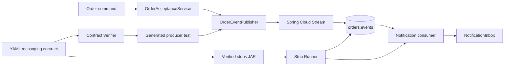
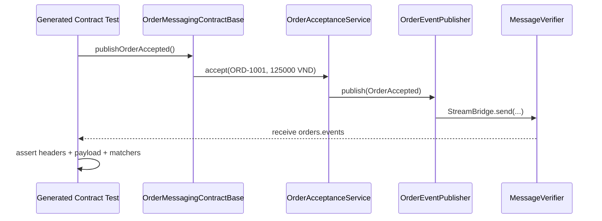
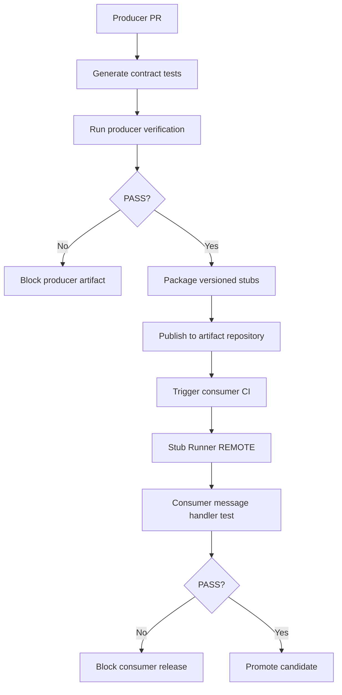
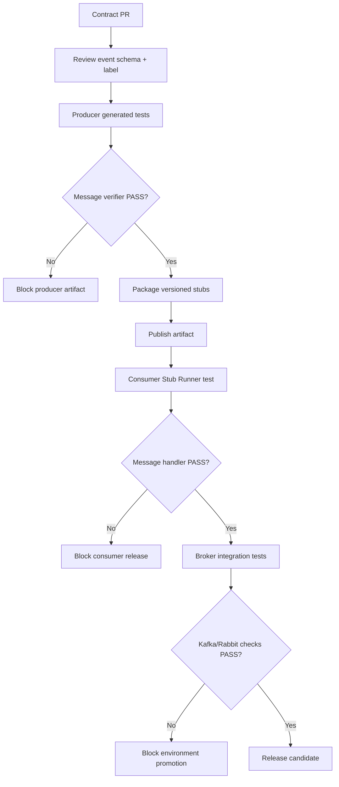

# Building a Message Publishing and Consuming Flow

> **Chapter:** Hands-On Project  
> **Module:** `SPRING_CLOUD_CONTRACT` — learn contract testing between producer and consumer with Groovy/YAML DSL for HTTP or messaging; generate producer tests, publish stubs, use Stub Runner, and integrate CI to catch breaking APIs.

## Project Goals

In this hands-on lab, you will build an event-driven flow consisting of two standalone Spring Boot applications:

- **`order-producer`** accepts an order-approval command, creates an `OrderAccepted` event, and publishes it to destination `orders.events`.
- **`notification-consumer`** receives the event, validates the payload, and records a notification.
- **Spring Cloud Contract Verifier** generates producer tests from a YAML messaging contract and verifies the event the producer actually emits.
- **Stub Runner** downloads stubs from the producer artifact, triggers the event by label, and feeds that event into the consumer test.
- **Spring Cloud Stream Test Binder** provides an in-memory message channel so tests run without a live Kafka broker.

Upon completion, you will be able to prove both directions:

1. The producer publishes the exact event it committed to.
2. The consumer receives and handles the event specified in the contract.

You will also be able to distinguish contract tests from broker integration tests, handle duplicate events, manage schema versioning, and wire both producer verification and consumer compatibility tests into CI.

## 1. Business Scenario and Architecture

A customer places an order. When the order is accepted, `order-producer` emits an `OrderAccepted` event. `notification-consumer` listens for the event to create a confirmation notification.



During contract tests, destination `orders.events` connects to an in-JVM test binder. In production, this destination maps to a Kafka topic or whichever broker your team chooses.

| Component | Responsibility | Verification evidence |
| --- | --- | --- |
| `OrderAcceptanceService` | Accepts order command and creates event | Producer test triggers real method |
| `OrderEventPublisher` | Attaches headers and sends event | Verifier receives message at expected destination |
| YAML contract | Defines body, headers, label, and trigger | Both generated test and stub derive from one source |
| Producer base class | Exposes trigger method | Generated test invokes the trigger method |
| Spring Cloud Stream Test Binder | Simulates binder in-JVM | No broker required to run contract tests |
| Stub Runner | Downloads contract stub and triggers label | Consumer receives exact sample message |
| `NotificationInbox` | Records side effect of handling event | Consumer test asserts side effect |

### 1.1. Lab Scope and Boundaries

We use **Spring Cloud Contract 5.0.3** with the `org.springframework.cloud.contract` APIs/packages to illustrate a system running SCC. YAML contracts, setting `label`, `input.triggeredBy`, and `outputMessage` are the core focus.

**Project lifecycle note:** starting in 2026, Spring Cloud Contract transitioned to its official successor project **Stubborn Contract**, maintained by one of the original authors. Stubborn Contract stays compatible with SCC contracts and stubs, while changing Maven coordinates, Java packages, and some property prefixes. Therefore:

- If you maintain an existing SCC system, this lab helps you understand and test your active messaging flows.
- If you are starting a new project or planning an upgrade cadence, evaluate Stubborn Contract and its official migration guide.
- Do not mix dependencies, annotations, and properties from both ecosystems in the same module without an intentional migration.

The lab below retains SCC syntax so you understand existing codebases. The migration section at the end highlights what changes when moving to the successor project.

## 2. Defining Event Conventions Before Writing Code

An event represents a fact that has happened, not a command asking a consumer to perform work. `OrderAccepted` means an order has been accepted.

### 2.1. Event Schema

Lab JSON payload:

```json
{
  "eventId": "b7f3b18b-2d8e-4b44-8f54-0a9d3a2a1001",
  "orderId": "ORD-1001",
  "total": 125000.00,
  "currency": "VND",
  "occurredAt": "2026-11-24T10:15:30Z"
}
```

Message headers:

| Header | Example value | Purpose |
| --- | --- | --- |
| `contentType` | `application/json` | Indicates payload format |
| `eventType` | `OrderAccepted` | Classifies event type |
| `schemaVersion` | `1` | Event schema version |

Body fields:

- `eventId`: unique UUID letting consumers identify a specific event emission.
- `orderId`: business order identifier.
- `total`: total amount as a JSON number.
- `currency`: currency code.
- `occurredAt`: timestamp when the event was created, in ISO-8601 format.

### 2.2. Why Do Events Need `eventId` and `schemaVersion`?

Message brokers provide at-least-once delivery semantics in many configurations. A consumer may receive the same event again after retries, consumer group rebalances, or crashes between processing and offset commits.

`eventId` helps consumers deduplicate deliveries. `schemaVersion` helps teams manage payload evolution when adding fields or changing rules.

Never use `orderId` as the event ID in general: one order can emit multiple distinct events, such as `OrderAccepted`, `OrderPaid`, and `OrderCancelled`. You must identify **a single event occurrence**, not merely the aggregate.

### 2.3. Schema Compatibility Rules

In version 1 of the lab:

- `eventId`, `orderId`, `total`, `currency`, and `occurredAt` are mandatory fields.
- `total` must be a non-negative JSON number.
- `currency` uses a three-letter code per team convention.
- `eventType` and `schemaVersion` live in message headers.
- Consumers may ignore extra fields they do not yet use, provided JSON converters and schema policies allow it.

Do not rename `orderId` to `id` or change `total` from number to string within a compatible release without a migration plan. For breaking changes, introduce a new schema version or design a transition period.

## 3. Preparing the Environment and Versions

You need:

- A JDK compatible with your chosen Spring Boot version (this lab uses Java 21).
- Maven 3.9+ or Maven Wrapper.
- An IDE supporting Spring Boot and Maven.
- Familiarity with Java records, Spring Boot, Spring Cloud Stream, and JUnit 5.
- A shared local Maven repository for the two applications during the lab.

**Do not grab Spring Boot, Spring Cloud, and Spring Cloud Contract versions from three unrelated snippets and glue them together.** Choose Spring Boot and a Spring Cloud release train from the compatibility matrix, then import the dedicated Spring Cloud Contract BOM if SCC is no longer managed by the release train.

An illustrative version set for the SCC 5.x line can start from:

```xml
<properties>
    <java.version>21</java.version>
    <spring-cloud.version>2025.1.0</spring-cloud.version>
    <spring-cloud-contract.version>5.0.3</spring-cloud-contract.version>
</properties>
```

These are **illustrative configuration anchors**, not a guarantee that every future Spring Boot/Cloud patch works interchangeably. Select the Spring Boot patch matching that release train and inspect release notes before running. If your stack is already on Spring Cloud 2026.0 / Spring Boot 4.2, evaluate Stubborn Contract or explicitly confirm SCC 5.x compatibility.

### 3.1. Importing BOMs in the Parent POM

In the parent POM shared by both modules:

```xml
<dependencyManagement>
    <dependencies>
        <dependency>
            <groupId>org.springframework.cloud</groupId>
            <artifactId>spring-cloud-dependencies</artifactId>
            <version>${spring-cloud.version}</version>
            <type>pom</type>
            <scope>import</scope>
        </dependency>

        <dependency>
            <groupId>org.springframework.cloud</groupId>
            <artifactId>spring-cloud-contract-dependencies</artifactId>
            <version>${spring-cloud-contract.version}</version>
            <type>pom</type>
            <scope>import</scope>
        </dependency>
    </dependencies>
</dependencyManagement>
```

The Spring Cloud BOM manages release train libraries. The Contract BOM manages SCC artifacts for the chosen version. Because SCC decoupled from the Spring Cloud release train during the transition period, **do not assume the Cloud BOM manages SCC 5.x automatically**.

If your organization already uses an internal parent/BOM, inspect `effective-pom` and the dependency tree to make sure two BOMs do not override each other.

### 3.2. Project Structure

Create a Maven multi-module project:

```text
order-events-lab/
├── pom.xml
├── order-producer/
│   ├── pom.xml
│   └── src/
│       ├── main/
│       │   ├── java/com/example/orders/
│       │   │   ├── OrderProducerApplication.java
│       │   │   ├── OrderAcceptanceService.java
│       │   │   ├── OrderEventPublisher.java
│       │   │   └── OrderAccepted.java
│       │   └── resources/application.yml
│       └── test/
│           ├── java/com/example/orders/contract/
│           │   └── OrderMessagingContractBase.java
│           └── resources/contracts/orders/
│               └── order_accepted.yml
└── notification-consumer/
    ├── pom.xml
    └── src/
        ├── main/
        │   ├── java/com/example/notifications/
        │   │   ├── NotificationConsumerApplication.java
        │   │   ├── OrderAccepted.java
        │   │   └── NotificationInbox.java
        │   └── resources/application.yml
        └── test/
            └── java/com/example/notifications/
                └── OrderAcceptedStubRunnerTest.java
```

Both applications define their own independent `OrderAccepted` class. This is deliberate: the consumer owns the model it reads and does not need to compile against the producer's internal classes. The contract defines the wire agreement between them.

Parent `pom.xml` declares both modules:

```xml
<packaging>pom</packaging>

<modules>
    <module>order-producer</module>
    <module>notification-consumer</module>
</modules>
```

## 4. Writing the Messaging Contract

Create the file:

```text
order-producer/src/test/resources/contracts/orders/order_accepted.yml
```

Contents:

```yaml
description: "Order producer publishes an accepted order event"
name: order_accepted
label: order_accepted

input:
  triggeredBy: publishOrderAccepted()

outputMessage:
  sentTo: orders.events
  headers:
    contentType: application/json
    eventType: OrderAccepted
    schemaVersion: 1
  body:
    eventId: b7f3b18b-2d8e-4b44-8f54-0a9d3a2a1001
    orderId: ORD-1001
    total: 125000.00
    currency: VND
    occurredAt: "2026-11-24T10:15:30Z"
  matchers:
    body:
      - path: $.eventId
        type: by_regex
        predefined: uuid
      - path: $.occurredAt
        type: by_regex
        predefined: iso_8601_with_offset
```

### 4.1. Reading Each Contract Section

| Section | Meaning |
| --- | --- |
| `name` | Contract name shown in generated tests and reports |
| `label` | Label name used by consumers to trigger the message stub |
| `input.triggeredBy` | Method invoked by the generated producer test on the base class |
| `outputMessage.sentTo` | Destination where the producer must publish the message |
| `outputMessage.headers` | Message envelope headers |
| `outputMessage.body` | Committed JSON payload |
| `outputMessage.matchers` | Rules for verifying dynamic fields in the output message |

**Two easily confused concepts:**

- `triggeredBy` is the trigger method for producer-side verification. The generated test calls this method to make the application emit the message.
- `label` is the consumer-side identifier used via `StubTrigger`/`StubFinder` to fire the message stub.

Without `label`, the producer test may still resolve the trigger method, but the consumer lacks an explicit handle to trigger the event scenario.

### 4.2. Why Use Matchers for `eventId` and `occurredAt`?

The producer generates a fresh UUID and timestamp for every event. The contract should not force the implementation to always emit the same hardcoded UUID or sample timestamp.

The `by_regex` matcher with `predefined: uuid` validates UUID format. The `iso_8601_with_offset` matcher validates ISO-8601 timestamps with offsets. Business-significant fields like `orderId`, `total`, and `currency` remain checked against their sample values.

**Do not loosen every field with broad regexes.** If `total` turns into a string or reports the wrong amount, producer verification must catch it.

### 4.3. Why Must the Destination Match Binder Configuration?

The contract specifies `sentTo: orders.events`. Both the producer binding and consumer binding must map to this destination.

```text
Contract sentTo:
  orders.events

Producer output binding:
  ordersAccepted-out-0 -> orders.events

Consumer input binding:
  orderAccepted-in-0 -> orders.events
```

Internal binding names (`ordersAccepted-out-0` or `orderAccepted-in-0`) can differ. **The destination is the shared communication channel** between applications.

## 5. Building the Producer

### 5.1. Maven Dependencies

In `order-producer/pom.xml`, add the required dependencies:

```xml
<dependencies>
    <dependency>
        <groupId>org.springframework.boot</groupId>
        <artifactId>spring-boot-starter</artifactId>
    </dependency>

    <dependency>
        <groupId>org.springframework.cloud</groupId>
        <artifactId>spring-cloud-starter-stream-kafka</artifactId>
    </dependency>

    <dependency>
        <groupId>org.springframework.cloud</groupId>
        <artifactId>spring-cloud-starter-contract-verifier</artifactId>
        <scope>test</scope>
    </dependency>

    <dependency>
        <groupId>org.springframework.cloud</groupId>
        <artifactId>spring-cloud-stream-test-binder</artifactId>
        <scope>test</scope>
    </dependency>

    <dependency>
        <groupId>org.springframework.boot</groupId>
        <artifactId>spring-boot-starter-test</artifactId>
        <scope>test</scope>
    </dependency>
</dependencies>
```

`spring-cloud-starter-stream-kafka` is the runtime binder when deployed. `spring-cloud-stream-test-binder` is the in-memory test binder. The test binder lets you verify that the producer emits messages without requiring a running Kafka cluster.

### 5.2. Configuring the Maven Verifier

Add the plugin to `order-producer/pom.xml`:

```xml
<build>
    <plugins>
        <plugin>
            <groupId>org.springframework.cloud</groupId>
            <artifactId>spring-cloud-contract-maven-plugin</artifactId>
            <version>${spring-cloud-contract.version}</version>
            <extensions>true</extensions>
            <configuration>
                <testFramework>JUNIT5</testFramework>
                <baseClassForTests>
                    com.example.orders.contract.OrderMessagingContractBase
                </baseClassForTests>
                <basePackageForTests>
                    com.example.orders.contract.generated
                </basePackageForTests>
                <failOnNoContracts>true</failOnNoContracts>
                <failOnInProgress>true</failOnInProgress>
            </configuration>
        </plugin>
    </plugins>
</build>
```

`baseClassForTests` points to the class holding setup and trigger methods. `testFramework` is explicitly set to `JUNIT5` so generated tests and the base class share the same lifecycle. `failOnNoContracts` prevents a green build when no contracts are discovered.

### 5.3. Producer Application

`OrderProducerApplication.java`:

```java
package com.example.orders;

import java.time.Clock;

import org.springframework.boot.SpringApplication;
import org.springframework.boot.autoconfigure.SpringBootApplication;
import org.springframework.context.annotation.Bean;

@SpringBootApplication
public class OrderProducerApplication {

    public static void main(String[] args) {
        SpringApplication.run(OrderProducerApplication.class, args);
    }

    @Bean
    Clock clock() {
        return Clock.systemUTC();
    }
}
```

Injecting `Clock` makes time handling easy to test. Production apps can configure the clock per business timezone; events should explicitly include offsets or standardize on UTC.

### 5.4. Event Model

`OrderAccepted.java`:

```java
package com.example.orders;

import java.math.BigDecimal;
import java.time.OffsetDateTime;

public record OrderAccepted(
    String eventId,
    String orderId,
    BigDecimal total,
    String currency,
    OffsetDateTime occurredAt
) {}
```

This record holds only event data. Never place JPA entities, passwords, sensitive payment details, or entire internal object graphs inside messages.

### 5.5. Publisher Using StreamBridge

`OrderEventPublisher.java`:

```java
package com.example.orders;

import org.springframework.cloud.stream.function.StreamBridge;
import org.springframework.messaging.Message;
import org.springframework.messaging.support.MessageBuilder;
import org.springframework.stereotype.Component;

@Component
public class OrderEventPublisher {

    private final StreamBridge streamBridge;

    public OrderEventPublisher(StreamBridge streamBridge) {
        this.streamBridge = streamBridge;
    }

    public void publish(OrderAccepted event) {
        Message<OrderAccepted> message =
            MessageBuilder.withPayload(event)
                .setHeader("eventType", "OrderAccepted")
                .setHeader("schemaVersion", 1)
                .build();

        boolean sent = streamBridge.send(
            "ordersAccepted-out-0",
            message
        );

        if (!sent) {
            throw new IllegalStateException(
                "Could not publish OrderAccepted event"
            );
        }
    }
}
```

`StreamBridge` lets the service send messages to a configured output binding. `ordersAccepted-out-0` is the internal binding name; its destination maps to `orders.events`.

Content type `application/json` is set in binding configuration. There is no need to serialize the object to a JSON string manually; Spring Cloud Stream's converter transforms the payload according to the content type.

### 5.6. Business Service Publishing the Event

`OrderAcceptanceService.java`:

```java
package com.example.orders;

import java.math.BigDecimal;
import java.time.Clock;
import java.time.OffsetDateTime;
import java.util.UUID;

import org.springframework.stereotype.Service;

@Service
public class OrderAcceptanceService {

    private final OrderEventPublisher publisher;
    private final Clock clock;

    public OrderAcceptanceService(
            OrderEventPublisher publisher,
            Clock clock) {
        this.publisher = publisher;
        this.clock = clock;
    }

    public OrderAccepted accept(AcceptOrder command) {
        if (command.total() == null
                || command.total().signum() <= 0) {
            throw new IllegalArgumentException(
                "Order total must be positive"
            );
        }

        if (command.orderId() == null
                || command.orderId().isBlank()) {
            throw new IllegalArgumentException(
                "Order ID is required"
            );
        }

        OrderAccepted event = new OrderAccepted(
            UUID.randomUUID().toString(),
            command.orderId(),
            command.total(),
            command.currency(),
            OffsetDateTime.now(clock)
        );

        publisher.publish(event);
        return event;
    }

    public record AcceptOrder(
        String orderId,
        BigDecimal total,
        String currency
    ) {}
}
```

The service builds and publishes the event after validating the command. In database-backed systems, transaction boundaries and the outbox pattern must be designed so DB commits cannot succeed while message publishing fails (or vice versa). Contract tests in this lab verify the **message contract**; they do not prove DB-to-broker atomicity.

### 5.7. Configuring the Output Binding

`order-producer/src/main/resources/application.yml`:

```yaml
spring:
  cloud:
    stream:
      output-bindings: ordersAccepted-out-0
      bindings:
        ordersAccepted-out-0:
          destination: orders.events
          content-type: application/json
      kafka:
        binder:
          brokers: ${KAFKA_BROKERS:localhost:9092}
```

`output-bindings` declares the explicit output binding for `StreamBridge`. When running with the Kafka binder, `orders.events` maps to the corresponding topic.

During producer contract tests, the test binder on the test classpath provides an in-memory channel. In live environments, `KAFKA_BROKERS` points to the provisioned cluster. Never commit Kafka usernames or passwords in YAML.

## 6. Base Class for Generated Producer Tests

Spring Cloud Contract generates tests from `input.triggeredBy`. The named method must exist on the base class inherited by generated tests.

`OrderMessagingContractBase.java`:

```java
package com.example.orders.contract;

import java.math.BigDecimal;

import com.example.orders.OrderAcceptanceService;
import org.springframework.beans.factory.annotation.Autowired;
import org.springframework.boot.test.context.SpringBootTest;
import org.springframework.cloud.contract.verifier.messaging.boot.AutoConfigureMessageVerifier;

@SpringBootTest(classes = com.example.orders.OrderProducerApplication.class)
@AutoConfigureMessageVerifier
public abstract class OrderMessagingContractBase {

    @Autowired
    private OrderAcceptanceService orderAcceptanceService;

    public void publishOrderAccepted() {
        orderAcceptanceService.accept(
            new OrderAcceptanceService.AcceptOrder(
                "ORD-1001",
                new BigDecimal("125000.00"),
                "VND"
            )
        );
    }
}
```

Key points:

- `@AutoConfigureMessageVerifier` wires the message verifier for generated tests.
- `@SpringBootTest` boots the producer application context.
- `publishOrderAccepted()` is the trigger method referenced by the contract.
- The base method calls the **real service**, which calls the **real publisher**.
- The test binder captures the message at destination `orders.events` so Verifier can compare it against the contract.

Do not mock `OrderEventPublisher` or `OrderAcceptanceService` in this base class. Mocking the publisher so no real message is sent defeats verification of the publishing flow.

### 6.1. Execution Flow of the Generated Test



The generated test does not connect to a real Kafka broker in this lab configuration. It calls the trigger method, and the message verifier reads the emitted message from the test binder.

## 7. Running Producer Verification and Packaging the Stub Artifact

From the multi-module root directory:

```bash
./mvnw -pl order-producer -am clean install
```

Maven runs contract discovery, generates tests, compiles, and executes generated producer tests. Once verification passes, the stub JAR is installed into the local Maven repository.

### 7.1. What You Should See After the Build

| Result | Meaning |
| --- | --- |
| Generated test for `order_accepted` | Contract was discovered by the plugin |
| Producer contract test PASSES | Service actually emitted an event matching the contract |
| JUnit report shows executed test | Generated test ran, not merely generated |
| Stub JAR with classifier `stubs` | Consumer can resolve the contract stub |
| Artifact installed in `~/.m2/repository` | Local consumer tests can resolve stubs |

Exact directory names for generated tests and reports can vary by Maven plugin version and project configuration. Inspect actual JUnit XML reports and artifacts instead of stopping at `BUILD SUCCESS`.

### 7.2. If Producer Tests Fail

Common errors:

- **No message received:** trigger method failed to invoke publisher, wrong output binding, or test binder not configured.
- **Wrong destination:** `sentTo` differs from binding destination.
- **Header mismatch:** `eventType`, `schemaVersion`, or `contentType` missing or wrong type.
- **Body mismatch:** wrong JSON field name, type, or `total` value.
- **Matcher failure:** event ID or timestamp does not match promised format.
- **Base class not found:** wrong `baseClassForTests` FQN or source root.

Inspect the generated test to confirm which trigger method and destination the plugin expects. Never loosen matchers or change contracts just to hide a wiring bug.

## 8. Building the Event Consumer

The consumer defines its own model, keeping only the fields it needs.

### 8.1. Consumer Event Model

`notification-consumer/src/main/java/com/example/notifications/OrderAccepted.java`:

```java
package com.example.notifications;

import java.math.BigDecimal;
import java.time.OffsetDateTime;

public record OrderAccepted(
    String eventId,
    String orderId,
    BigDecimal total,
    String currency,
    OffsetDateTime occurredAt
) {}
```

If the consumer does not need every field, its model can hold only the business fields it processes. However, the consumer must align with the contract on field names and types it reads.

### 8.2. Notification Inbox for the Lab

`NotificationInbox.java`:

```java
package com.example.notifications;

import java.math.BigDecimal;
import java.time.OffsetDateTime;
import java.util.Optional;
import java.util.concurrent.ConcurrentHashMap;
import java.util.concurrent.ConcurrentMap;
import java.util.concurrent.atomic.AtomicInteger;

import org.springframework.stereotype.Component;

@Component
public class NotificationInbox {

    private final ConcurrentMap<String, Notification> notifications =
        new ConcurrentHashMap<>();
    private final AtomicInteger deliveries = new AtomicInteger();

    public void record(OrderAccepted event) {
        deliveries.incrementAndGet();
        notifications.putIfAbsent(
            event.eventId(),
            new Notification(
                event.eventId(),
                event.orderId(),
                event.total(),
                event.currency(),
                event.occurredAt()
            )
        );
    }

    public Optional<Notification> findByOrderId(String orderId) {
        return notifications.values()
            .stream()
            .filter(item -> item.orderId().equals(orderId))
            .findFirst();
    }

    public int size() {
        return notifications.size();
    }

    public int deliveryCount() {
        return deliveries.get();
    }

    public record Notification(
        String eventId,
        String orderId,
        BigDecimal total,
        String currency,
        OffsetDateTime occurredAt
    ) {}
}
```

`NotificationInbox` is an in-memory adapter so the lab needs no database. The map uses `eventId` as key and `putIfAbsent` to illustrate single-process idempotency.

In real applications, record processed event IDs in durable storage (such as a database unique constraint) and design appropriate transactions. An in-memory map loses state on restart and does not enforce idempotency across multiple instances.

### 8.3. Consumer Function

`NotificationConsumerApplication.java`:

```java
package com.example.notifications;

import java.util.function.Consumer;

import org.springframework.boot.SpringApplication;
import org.springframework.boot.autoconfigure.SpringBootApplication;
import org.springframework.context.annotation.Bean;

@SpringBootApplication
public class NotificationConsumerApplication {

    public static void main(String[] args) {
        SpringApplication.run(
            NotificationConsumerApplication.class,
            args
        );
    }

    @Bean
    Consumer<OrderAccepted> orderAccepted(
            NotificationInbox inbox) {
        return inbox::record;
    }
}
```

Spring Cloud Stream discovers the `Consumer<OrderAccepted>` bean via its functional programming model. Its default input binding is named `orderAccepted-in-0`.

### 8.4. Configuring the Input Binding

`notification-consumer/src/main/resources/application.yml`:

```yaml
spring:
  cloud:
    function:
      definition: orderAccepted
    stream:
      bindings:
        orderAccepted-in-0:
          destination: orders.events
          group: notification-service
          content-type: application/json
      kafka:
        binder:
          brokers: ${KAFKA_BROKERS:localhost:9092}
```

`destination` must match the contract's `sentTo` and the producer's output destination. `group` sets the consumer group; in Kafka, instances sharing a group distribute partitions/messages according to broker semantics.

Do not invent a different group just to "make tests receive messages." Consumer groups are part of production event distribution design.

## 9. Consumer Test with Stub Runner

### 9.1. Maven Dependencies

In `notification-consumer/pom.xml`:

```xml
<dependencies>
    <dependency>
        <groupId>org.springframework.boot</groupId>
        <artifactId>spring-boot-starter</artifactId>
    </dependency>

    <dependency>
        <groupId>org.springframework.cloud</groupId>
        <artifactId>spring-cloud-starter-stream-kafka</artifactId>
    </dependency>

    <dependency>
        <groupId>org.springframework.cloud</groupId>
        <artifactId>spring-cloud-starter-contract-stub-runner</artifactId>
        <scope>test</scope>
    </dependency>

    <dependency>
        <groupId>org.springframework.cloud</groupId>
        <artifactId>spring-cloud-stream-test-binder</artifactId>
        <scope>test</scope>
    </dependency>

    <dependency>
        <groupId>org.springframework.boot</groupId>
        <artifactId>spring-boot-starter-test</artifactId>
        <scope>test</scope>
    </dependency>
</dependencies>
```

Stub Runner downloads contract stubs from the producer artifact. The test binder provides an in-memory destination so messages route into the consumer function.

### 9.2. Writing the Consumer Compatibility Test

`OrderAcceptedStubRunnerTest.java`:

```java
package com.example.notifications;

import java.math.BigDecimal;
import java.time.Duration;

import org.junit.jupiter.api.Test;
import org.springframework.beans.factory.annotation.Autowired;
import org.springframework.boot.test.context.SpringBootTest;
import org.springframework.cloud.contract.stubrunner.StubFinder;
import org.springframework.cloud.contract.stubrunner.spring.AutoConfigureStubRunner;
import org.springframework.cloud.contract.stubrunner.spring.StubRunnerProperties;

import static org.awaitility.Awaitility.await;
import static org.junit.jupiter.api.Assertions.*;

@SpringBootTest
@AutoConfigureStubRunner(
    ids = "com.example:order-producer:1.0.0:stubs",
    stubsMode = StubRunnerProperties.StubsMode.LOCAL
)
class OrderAcceptedStubRunnerTest {

    @Autowired
    StubFinder stubFinder;

    @Autowired
    NotificationInbox inbox;

    @Test
    void receivesAndProcessesOrderAcceptedEvent() {
        assertTrue(
            stubFinder.trigger("order_accepted"),
            "The order_accepted label should be available"
        );

        await()
            .atMost(Duration.ofSeconds(5))
            .untilAsserted(() -> {
                NotificationInbox.Notification notification =
                    inbox.findByOrderId("ORD-1001").orElseThrow();

                assertEquals("ORD-1001", notification.orderId());
                assertEquals(
                    new BigDecimal("125000.00"),
                    notification.total()
                );
                assertEquals("VND", notification.currency());
                assertNotNull(notification.eventId());
                assertNotNull(notification.occurredAt());
            });
    }
}
```

Replace `com.example:order-producer:1.0.0:stubs` with the actual artifact coordinates in `order-producer/pom.xml`. `LOCAL` instructs Stub Runner to locate stubs in the local Maven repository on the machine running consumer tests.

`StubFinder` extends messaging trigger capabilities. Calling `trigger("order_accepted")` tells Stub Runner to locate the matching contract label and send the message to the destination declared in `outputMessage`.

### 9.3. Why Doesn't the Consumer Test Call the Publisher Directly?

The consumer should never depend on the producer's `OrderEventPublisher` class. It depends solely on the message contract.

Stub Runner uses the producer's stub artifact to emit a sample message. This preserves the boundary between the two applications: the producer owns publishing code, the consumer owns receiving code, and the contract is the shared agreement.

### 9.4. Testing Idempotency with Duplicate Events

You can extend the test to trigger the same label twice:

```java
@Test
void ignoresDuplicateEventId() {
    assertTrue(stubFinder.trigger("order_accepted"));
    assertTrue(stubFinder.trigger("order_accepted"));

    await()
        .atMost(Duration.ofSeconds(5))
        .untilAsserted(() -> {
            assertEquals(2, inbox.deliveryCount());
        });
    assertEquals(1, inbox.size());
}
```

The contract sample uses the same fixed `eventId` in the stub, so triggering twice simulates redelivery of the same event occurrence. `putIfAbsent` in `NotificationInbox` retains only one record.

This test verifies the in-memory adapter's behavior. In a real system, test database unique constraints and transactions to ensure two instances cannot both record duplicate side effects.

## 10. Running the End-to-End Lab Flow

Run from the project root.

### Step 1 — Verify and Install the Producer

```bash
./mvnw -pl order-producer -am clean install
```

Expected:

- Maven discovers `order_accepted.yml`.
- Contract Verifier generates the producer test.
- The test calls `publishOrderAccepted()`.
- The service builds the event and the publisher sends it to `orders.events`.
- The message verifier receives the event and asserts headers, body, and matchers.
- The stub JAR is packaged and installed in the local Maven repository.

### Step 2 — Run the Consumer Stub Runner Test

```bash
./mvnw -pl notification-consumer clean test
```

Expected:

1. Spring Boot starts the consumer context.
2. Stub Runner locates `com.example:order-producer:1.0.0:stubs` in the local repository.
3. Stub Runner reads the contract and registers label `order_accepted`.
4. The test calls `stubFinder.trigger("order_accepted")`.
5. The message routes to destination `orders.events` in the test binder.
6. The `orderAccepted` function receives the event and calls `NotificationInbox.record`.
7. Awaitility confirms the notification was recorded.

### Step 3 — Inspect Test Reports

With Maven, inspect reports under:

```text
order-producer/target/surefire-reports/
notification-consumer/target/surefire-reports/
```

Generated test class names and paths may differ based on plugin configuration. Read the reports to confirm the tests actually executed and no required tests were skipped.

### Step 4 — Intentionally Break the Contract

On a practice branch, change the producer header:

```java
.setHeader("eventType", "OrderAcceptedV2")
```

while leaving `eventType: OrderAccepted` in the contract. The generated producer test must FAIL because the header no longer matches.

After observing the failure, restore the code. Never edit a contract just to turn a build green unless producer and consumer teams have agreed on a schema/version change.

## 11. Running with a Remote Repository in CI

Locally, Stub Runner uses `LOCAL` because the producer already ran `mvn install`. In CI, the two applications usually have separate pipelines:



Consumer tests can use:

```java
@AutoConfigureStubRunner(
    ids = "com.example:order-producer:1.0.0:stubs",
    stubsMode = StubRunnerProperties.StubsMode.REMOTE,
    repositoryRoot =
        "https://repo.example.org/repository/maven-releases/"
)
```

`repositoryRoot` is an illustrative dummy URL. Configure credentials via Maven settings, secret stores, or appropriate properties; never hardcode usernames or passwords in source files.

### 11.1. Artifact Versions vs. Schema Versions

- `1.0.0` in GAV identifies the **producer artifact/stub release**.
- `schemaVersion: 1` identifies the **event payload version**.
- `eventType: OrderAccepted` identifies the **event type**.

Never collapse all three concepts into a single field. A producer release `1.2.0` can continue emitting event schema version 1 if it only contains bug fixes that do not alter the wire format.

### 11.2. Never Use SNAPSHOTs as Final Release Evidence

On development branches, snapshot stubs can be helpful. However, pre-release consumer compatibility gates should record the GAV and checksum of the exact stub JAR tested. For reproducibility, prefer immutable artifact versions rather than recording only a mutable SNAPSHOT base version.

## 12. Test Binder vs. a Real Kafka Broker

The Spring Cloud Stream Test Binder is an **in-memory message broker** built on Spring Integration. It lets you test functions, basic serialization/conversion, and publish/consume flows without installing Kafka.

It does not prove:

- The Kafka topic exists with the right partition count and replication factor.
- Broker ACLs, SASL/TLS, and network policies are configured properly.
- Consumer group rebalancing behaves as expected.
- Offsets are committed at the right time.
- Retries, dead-letter topics, and replay work properly against the broker.
- Message key and partition ordering hold on a real cluster.

### 12.1. Adding Separate Kafka Integration Tests

When you need to verify broker behavior, create a dedicated test module or profile using the real Kafka binder and embedded Kafka or Testcontainers. Keep `spring-cloud-stream-test-binder` off the classpath of tests intended to exercise the real Kafka binder, because the test binder can override the real binder across the module.

A dedicated integration test can verify:

- The producer delivers events to topic `orders.events`.
- The consumer group reads events from the broker.
- Serialization and headers survive Kafka wire framing.
- Commit, retry, and DLQ settings behave as configured.
- Restarts and rebalances do not lose events per your delivery guarantees.

**Contract tests and broker integration tests complement each other.** You do not need Kafka for every contract test, nor should you treat test binder passes as proof of production broker wiring.

## 13. Handling Invalid Messages, Retries, and DLQs

A real consumer can hit errors when payloads are malformed or downstream dependencies are unavailable.

| Error type | Example | Handling strategy |
| --- | --- | --- |
| Invalid event | Missing `orderId` or wrong type for `total` | Reject/quarantine; do not retry infinitely |
| Transient failure | Database timeout | Bounded retries with backoff |
| Duplicate delivery | Same `eventId` redelivered | Idempotent handling |
| Poison message | Payload consistently crashes consumer | Route to DLQ, alert, and investigate |
| Unknown schema | Newer `schemaVersion` unsupported by consumer | Compatibility policy, routing/versioning strategy |

### 13.1. Retries Must Be Bounded

Unbounded retries can stall a partition/queue and block newer events behind it. For transient failures, configure bounded retry counts, backoff intervals, and timeouts. For unrecoverable payload errors, route events to a DLQ or quarantine per policy.

### 13.2. Dead Letter Queues Are Not Part of the Success Contract

The `order_accepted` contract specifies the success event. DLQ routing is an operational consumer/broker behavior needing its own integration tests. Never add an `error` field to a success event just to represent a failed processing attempt.

### 13.3. Idempotency Requires Durable Storage

In this lab, `ConcurrentHashMap.putIfAbsent` models deduplication by `eventId`. In production, consumers typically need to:

1. Check whether `eventId` was already recorded in an inbox table.
2. Persist the event ID and business side effect atomically in the same transaction or appropriate transactional pattern.
3. Commit offsets / acks after processing succeeds.
4. On duplicate delivery, skip the duplicate side effect while still completing acknowledgment.

Duplicate delivery cannot be solved by contract matchers alone.

## 14. Evolving Event Schemas

Suppose version 2 wants to add `shippingMethod`:

```json
{
  "eventId": "b7f3b18b-2d8e-4b44-8f54-0a9d3a2a1001",
  "orderId": "ORD-1001",
  "total": 125000.00,
  "currency": "VND",
  "occurredAt": "2026-11-24T10:15:30Z",
  "shippingMethod": "STANDARD"
}
```

If legacy consumers ignore unknown fields, this change can be compatible. However, if a consumer enforces strict deserialization rejecting unknown properties, the new message can break legacy consumers.

Higher-risk breaking changes include:

- Deleting `orderId`.
- Changing `total` from a number to a string.
- Renaming `currency`.
- Changing the semantics of `occurredAt`.
- Changing `eventType` without a transition period.
- Turning an optional field into a required one that older producers do not emit.

### 14.1. Safe Change Workflow

1. Consumer states the fields and behaviors it needs.
2. Producer and consumer agree on semantics and versioning.
3. Add or update contract scenarios after review.
4. Producer verification proves the new implementation emits the right payload.
5. Consumer compatibility tests run against the new candidate stub.
6. Test all remaining supported consumers.
7. Promote only once every required consumer PASSES.

For incompatible changes, consider a new topic/version, a new event type, or a dual-publish/dual-read transition. Never modify an event actively consumed by legacy consumers without a migration plan.

## 15. Adding an `OrderRejected` Error Event

Once the happy path works, you can add a separate event for rejected orders:

```yaml
description: "Order producer publishes a rejected order event"
name: order_rejected
label: order_rejected

input:
  triggeredBy: publishOrderRejected()

outputMessage:
  sentTo: orders.events
  headers:
    contentType: application/json
    eventType: OrderRejected
    schemaVersion: 1
  body:
    eventId: 13f8e8b5-5f3b-4e72-9c7d-31d8c8b51002
    orderId: ORD-1002
    code: INVALID_ORDER
    reason: TOTAL_MUST_BE_POSITIVE
    occurredAt: "2026-11-24T10:16:00Z"
  matchers:
    body:
      - path: $.eventId
        type: by_regex
        predefined: uuid
      - path: $.occurredAt
        type: by_regex
        predefined: iso_8601_with_offset
```

This is an **extension contract** requiring a matching implementation and trigger method. If you add this file, the producer base class must implement `publishOrderRejected()` and the service must implement the real publishing flow. The consumer also needs an `OrderRejected` handler if it is responsible for handling rejections.

Do not add YAML files merely to inflate contract counts; every scenario must reflect behavior the producer genuinely commits to.

## 16. Troubleshooting

| Symptom | Possible cause | Resolution |
| --- | --- | --- |
| `No message received` | Trigger method did not run or publisher did not send | Inspect generated test, base method, and `StreamBridge` |
| `NoSuchMethodException` on trigger | Method name in `triggeredBy` does not match | Align method signature in base class |
| No message at destination | `sentTo` differs from binding destination | Compare contract and `application.yml` in both apps |
| Producer test fails on content type | Binding lacks JSON content type | Configure `content-type: application/json` |
| Producer test fails on custom header | Publisher omitted `eventType`/`schemaVersion` | Set headers in message builder |
| Consumer test cannot find label | Stale stub artifact or wrong label | Check GAV/classifier and `labels()` |
| Stub Runner fails to download artifact | Producer did not run `install`/`deploy` | Install locally or publish remotely first |
| Consumer function never receives event | Wrong `spring.cloud.function.definition` or binding name | Check `orderAccepted-in-0` |
| Payload arrives as `byte[]` instead of record | Mismatched content type or converter | Check `contentType` header and function signature |
| Consumer test times out | Function unbound or message routed elsewhere | Check destination, test binder, and function logs |
| Event processed twice | Consumer lacks idempotency | Deduplicate durably by event ID |
| Kafka test fails to connect | Real binder selected or broker not running | Separate test binder and broker integration tests |
| Test binder passes but Kafka fails | Broker/serializer/partition/ACL differences | Add tests against real Kafka |
| `BUILD SUCCESS` with 0 generated tests | Plugin found no contracts or tests skipped | Check contracts directory, test reports, and `failOnNoContracts` |

### 16.1. Inspecting Generated Tests

If producer verification fails to receive a message, open the generated test and look for:

- Which method is invoked before receiving.
- Which destination the verifier reads from.
- The contract filename.
- Header and body assertions.

Compare the generated test with `OrderMessagingContractBase` and the publisher. Never just glance at YAML and guess the plugin generated the right test.

### 16.2. Inspecting Stub Runner Labels

In a consumer test, you can inspect the labels known to Stub Runner:

```java
Map<String, Collection<String>> labels = stubFinder.labels();
assertTrue(
    labels.values().stream()
        .anyMatch(values -> values.contains("order_accepted"))
);
```

This snippet distinguishes **missing label** from **label exists but consumer missed the message**. When the label is missing, inspect the stub artifact; when the label exists, inspect destination, binder, and consumer function wiring.

## 17. CI Pipeline for Producer and Consumer

An appropriate pipeline:



### 17.1. Producer Pipeline

- Contract sources are reviewed.
- `failOnNoContracts` is enabled.
- Generated test count > 0.
- Message verifier checks destination, headers, and payload.
- No required tests are skipped.
- Stub JAR is published only after producer verification PASSES.
- Artifacts carry immutable versions and checksums/provenance.

### 17.2. Consumer Pipeline

- Consumer pins the exact producer stub GAV.
- Stub Runner downloads the artifact and exposes the needed label.
- Consumer test fires the trigger label.
- Consumer function receives the properly typed payload and triggers side effects.
- Duplicate events are handled per policy.
- Test reports record executed cases with no unintended skips.

### 17.3. Broker Integration Pipeline

Run a dedicated suite against a real broker verifying topics/queues, ACLs, SASL/TLS, serialization, retries, DLQs, consumer groups, partitions, and offsets. Never substitute test binder results for this suite.

### 17.4. Illustrative Quality Gate Manifest

```yaml
producer: order-producer
stubArtifact: com.example:order-producer:1.0.0:stubs

requiredMessages:
  - order_accepted

producerGate:
  generatedTestsRequired: true
  executedTestsMinimum: 1
  failedTests: 0
  skippedRequiredTests: 0

consumerGate:
  stubRunnerMode: LOCAL
  requiredLabels:
    - order_accepted
  requiredConsumerTests: 1
  failedTests: 0
```

This is a team-authored policy manifest, not an SCC configuration file. CI must verify GAVs and labels against actual artifacts and JUnit reports; never hardcode `PASS`.

## 18. Migration Note: Spring Cloud Contract to Stubborn Contract

Spring Cloud Contract transitioned to its official successor, Stubborn Contract. The lab's YAML contracts retain their structure, while Java and build settings require updates.

| SCC component | Transition path to Stubborn Contract |
| --- | --- |
| `org.springframework.cloud:spring-cloud-starter-contract-verifier` | `sh.stubborn:stubborn-contract-starter-verifier` |
| `org.springframework.cloud:spring-cloud-starter-contract-stub-runner` | `sh.stubborn:stubborn-contract-starter-stub-runner` |
| `org.springframework.cloud:spring-cloud-contract-maven-plugin` | `sh.stubborn:stubborn-contract-maven-plugin` |
| `org.springframework.cloud.contract.*` | `sh.stubborn.contract.*` |
| `spring.cloud.contract.stubrunner.*` | `stubborn.contract.stubrunner.*` |
| `spring-cloud-contract-dependencies` BOM | `stubborn-contract-dependencies` BOM |

For messaging, Stubborn Contract provides dedicated building blocks for Kafka/Rabbit/JMS plus Spring Cloud Stream integration. Verify the right module/backend in the migration guide; do not assume changing `groupId` alone makes every legacy test binder dependency compatible automatically.

The migration guide offers OpenRewrite recipes to update Maven/Gradle dependencies, Java imports, and property prefixes. Before running migration in a real project, create a dedicated branch, inspect the diff, run producer verification and consumer Stub Runner tests, and only then publish new artifacts.

## 19. Extended Exercises

**Exercise 1 — Contract headers.** Remove the `schemaVersion` header from the publisher while keeping the contract intact. Predict where the producer verifier fails and explain why.

**Exercise 2 — Wrong destination.** Change the producer binding destination to `orders.accepted` while keeping `sentTo: orders.events`. Why does the message verifier fail to receive the event?

**Exercise 3 — Consumer groups.** Run two consumer instances sharing group `notification-service`. Does every instance receive every event? Explain the relationship between consumer groups and partitions.

**Exercise 4 — Duplicate delivery.** Call `stubFinder.trigger("order_accepted")` twice. Why must `eventId` in the stub sample stay identical to test idempotency?

**Exercise 5 — Schema evolution.** Add an optional `shippingMethod` field. State the conditions required for older consumers to continue reading the new payload.

**Exercise 6 — Event versioning.** The producer emits `schemaVersion: 2` while a consumer handles only version 1. Design how to detect and handle compatibility.

**Exercise 7 — Real broker.** Test binder PASSES while Kafka Testcontainers FAILS because the topic does not exist. Why aren't these two results contradictory?

**Exercise 8 — DLQ.** An event missing `orderId` repeatedly crashes the consumer. Design a retry limit and DLQ policy.

**Exercise 9 — Producer base.** Delete `publishOrderAccepted()` from the base class. What failure will the generated test hit? Why isn't it a contract body failure?

**Exercise 10 — CI.** Design a pipeline where the producer publishes stubs and the consumer downloads them with `REMOTE`. Which quality gates must pass before promotion?

### Answer Hints

1. The generated producer test asserts the `schemaVersion` header and fails because the message no longer carries the committed value.
2. The verifier listens on `orders.events`, while the publisher sends elsewhere; this is a wiring/binding error.
3. Within one consumer group over multiple partitions, the broker distributes partitions/messages across instances; each instance does not automatically receive every event.
4. The same label emits the same sample event, so identical `eventId` simulates redelivery of a single event occurrence.
5. Older consumers must ignore unknown fields or schema policies must allow additive fields; verify actual converter/`ObjectMapper` settings.
6. Use version-aware handlers, reject/quarantine unsupported versions, or deploy dual-read consumers before the producer switches over.
7. The test binder does not verify real Kafka topics, partitions, or ACLs; broker integration tests verify infrastructure.
8. Bound retries for transient failures; unrecoverable schema errors should go to quarantine/DLQ with alerts.
9. The generated test fails to compile or resolve the trigger method; align the base class and contract reference.
10. Producer verification, generated test counts, stub artifact/version/checksum, consumer Stub Runner tests, broker integration, reports, and provenance.

## 20. Project Completion Checklist

**Producer:**

- [ ] `order_accepted` contract defines `label` and `triggeredBy` method?
- [ ] `sentTo` matches the output binding destination?
- [ ] `contentType`, `eventType`, and `schemaVersion` headers are accurate?
- [ ] Payload preserves exact field names, types, and semantics?
- [ ] UUID/timestamp matchers loosen only genuinely dynamic fields?
- [ ] Base class carries `@AutoConfigureMessageVerifier`?
- [ ] Generated producer tests run against the real service and publisher?
- [ ] Stub JAR is published only after verification PASSES?

**Consumer:**

- [ ] Consumer defines an independent model/schema?
- [ ] `orderAccepted-in-0` points to `orders.events`?
- [ ] Test uses `@AutoConfigureStubRunner` with exact GAV?
- [ ] `StubFinder.trigger` finds the label?
- [ ] Test binder is on the test classpath?
- [ ] Consumer handler receives the properly typed payload?
- [ ] Side effects are asserted after event arrival?
- [ ] Duplicate events are handled by `eventId`?

**Integration and release:**

- [ ] Test binder is distinguished from a real Kafka broker?
- [ ] Broker integration tests verify topics, groups, partitions, and ACLs?
- [ ] Retry/DLQ and idempotency policies are explicit?
- [ ] Schema evolution includes versioning and consumer compatibility review?
- [ ] CI enforces test counts, skipped tests, and artifact versions?
- [ ] Candidate stubs carry checksums and provenance?
- [ ] If using SCC 5.x, is there a plan to evaluate Stubborn Contract?

## 21. Summary

This project built a complete messaging flow from producer to consumer: **OrderAcceptanceService → StreamBridge → orders.events → NotificationInbox**. Spring Cloud Contract specifies the event in YAML, generated producer tests invoke the trigger method to verify real messages reach the expected destination with valid headers and payload. Stub Runner uses the `order_accepted` label to fire the sample message in consumer tests, while Spring Cloud Stream Test Binder provides a fast in-memory environment without requiring a live broker.

The key achievement is not merely green producer and consumer tests. Both sides must rely on **the same versioned contract artifact**, messages must have explicit schemas, consumers must deduplicate by event ID, and CI must block publishing until producer verification passes. While the test binder verifies application-level message flows, Kafka/Rabbit integration tests remain essential for topics, groups, partitions, offsets, security, retries, and DLQs.

When applying this in production, replace the in-memory `NotificationInbox` with durable storage, design outbox/inbox transactions properly, manage schema versions, and test real brokers according to risk. For existing Spring Cloud Contract systems, this lab provides the foundation to understand and maintain them. For new projects, evaluate Stubborn Contract—the official successor—and use its migration guide to preserve contracts while updating dependencies, packages, and configuration.

## References

- [Spring Cloud Contract — Messaging](https://docs.spring.io/spring-cloud-contract/reference/project-features-messaging.html) — `input.triggeredBy`, `outputMessage`, producer-side messaging test generation, `StubTrigger`/`StubFinder`, and Spring Cloud Stream integration.
- [Spring Cloud Contract — Maven Project](https://docs.spring.io/spring-cloud-contract/reference/maven-project.html) — BOM, Maven plugin, generated tests, base classes, and stub artifacts.
- [Spring Cloud Contract — YAML Schema](https://docs.spring.io/spring-cloud-contract/reference/yml-schema.html) — YAML messaging contract structure and output message matchers.
- [Spring Cloud Contract — Dynamic Properties](https://docs.spring.io/spring-cloud-contract/reference/project-features-contract/dsl-dynamic-properties.html) — matchers for UUIDs, timestamps, and dynamic payload fields.
- [Spring Cloud Stream — Testing](https://docs.spring.io/spring-cloud-stream/reference/spring-cloud-stream.html#testing) — Spring Integration Test Binder, `InputDestination`, and `OutputDestination`.
- [Spring Cloud Stream — StreamBridge and Dynamic Destinations](https://docs.spring.io/spring-cloud-stream/reference/spring-cloud-stream/producing-and-consuming-messages.html) — sending messages via `StreamBridge` and configuring output bindings.
- [Spring Cloud Stream — Kafka Binder](https://docs.spring.io/spring-cloud-stream/reference/kafka/kafka-binder/overview.html) — destination/topic mapping, consumer groups, and Kafka binder configuration.
- [Spring Kafka — Testing Applications](https://docs.spring.io/spring-kafka/reference/testing.html) — embedded broker and Kafka integration testing.
- [Spring Cloud — Release Train Compatibility](https://spring.io/projects/spring-cloud) — relationship between Spring Boot and Spring Cloud release trains.
- [Spring Cloud Contract Transition Announcement](https://spring.io/blog/2026/07/06/spring-cloud-contract-transition-to-stubbornsh/) — project transition to Stubborn.
- [Stubborn Contract — Migration from Spring Cloud Contract](https://docs.stubborn.sh/contract/migration/from-spring-cloud-contract.html) — migrating Maven coordinates, packages, and property prefixes.
- [Stubborn Contract — Messaging Contracts](https://docs.stubborn.sh/contract/reference/messaging-contracts.html) — messaging backends, `StubTrigger`, and Spring Cloud Stream successor integration.
