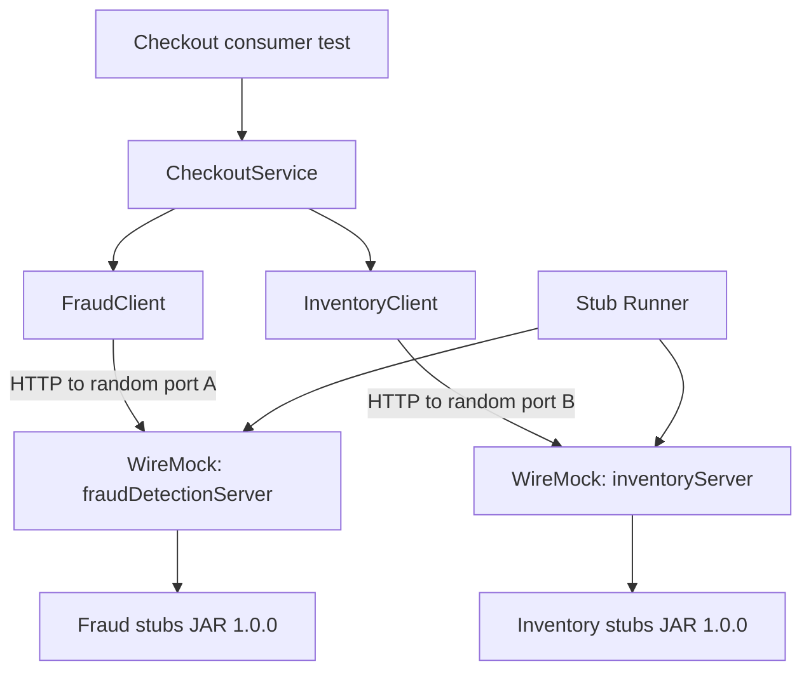
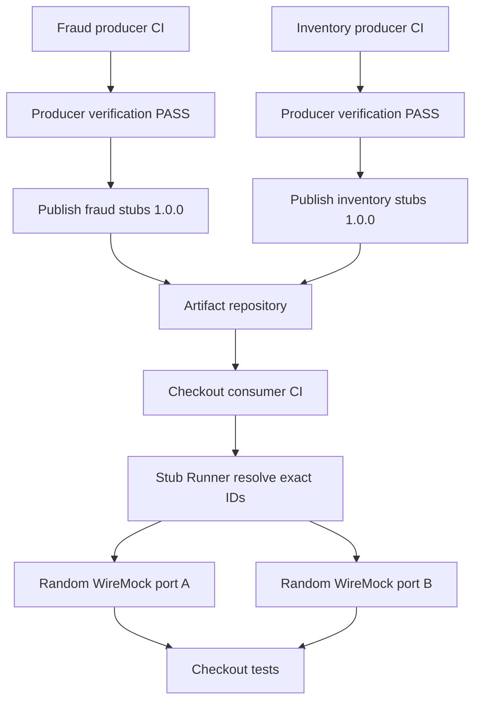

# Running Multiple Stubs on Random Ports

## 1. Hands-On Problem: One Consumer Depending on Multiple Producers

In a microservices architecture, a single service often calls multiple downstream services in one business flow. For example, **checkout-service** needs to check fraud via **fraud-detection-service**, check stock availability via **inventory-service**, and only then confirm an order.

During consumer testing, if teams manually spin up WireMock servers on fixed ports for each producer, they frequently run into:

- A port is already occupied by another process.
- Two parallel test suites both want `localhost:8080`.
- One test starts the first stub, another starts the second stub, and a client accidentally calls the wrong URL.
- Every new dependency forces edits to port settings, client base URLs, and CI configs.
- Tests pass on a developer laptop yet fail in CI because a port is already bound.

**Spring Cloud Contract Stub Runner** handles starting and managing HTTP stubs from producer-published artifacts. When you omit the **port** from a stub ID, Stub Runner picks a **random port** within a configured range. Each stub runs in its own WireMock server; the consumer retrieves the exact URL/port using **`@StubRunnerPort`**, **`StubFinder`**, or properties registered in the Spring `Environment`.

> **Project goal:** run at least two HTTP stubs concurrently—Fraud Detection and Inventory—on distinct random ports; configure `checkout-service` clients to use their respective ports; and test the full flow without hardcoding stub ports.

Upon completion, you will be able to:

1. Define stub IDs with explicit versions and classifiers while **omitting the port**.
2. Configure a port range using `minPort` and `maxPort`.
3. Start multiple WireMock servers within the same consumer test context.
4. Retrieve dynamic ports via `@StubRunnerPort` and URLs via `StubFinder.findStubUrl(...)`.
5. Wire dynamic base URLs into application HTTP clients.
6. Run positive and negative scenarios, debug mappings, and resolve port conflicts.
7. Integrate tests into CI with immutable artifact versions and proper test isolation.

## 2. Scenario and Project Architecture

### Business Flow

Checkout receives an order request, then:

1. Calls `fraud-detection-service` to evaluate the customer.
2. Calls `inventory-service` to verify SKU stock.
3. Returns `APPROVED` only when fraud is `CLEAR` and inventory is sufficient.

In this lab, two producers have published stub artifacts:

| Producer | Maven artifact | Stubbed HTTP endpoint | Sample response |
| --- | --- | --- | --- |
| Fraud Detection | `com.example:fraudDetectionServer:1.0.0:stubs` | `GET /api/fraud-check?customerId=cust-42` | `{"customerId":"cust-42","decision":"CLEAR"}` |
| Inventory | `com.example:inventoryServer:1.0.0:stubs` | `GET /api/inventory/SKU-100` | `{"sku":"SKU-100","available":5}` |

Coordinates and sample payloads are **illustrative for this lab**. In a real project, use the `groupId`, `artifactId`, `version`, and classifier published by producer CI.

### Flow Diagram



Both WireMock servers are managed within the same Stub Runner lifecycle. They bind to **separate ports**; checkout clients do not need to know those ports ahead of time. On every test run, Stub Runner picks ports and exposes them for the Spring test context to consume.

### Illustrative Module Structure

```text
contract-multi-stub-lab/
├── fraud-detection-producer/
│   ├── src/main/java/...
│   ├── src/test/java/...
│   └── src/test/resources/contracts/...
├── inventory-producer/
│   ├── src/main/java/...
│   ├── src/test/java/...
│   └── src/test/resources/contracts/...
└── checkout-consumer/
    ├── src/main/java/...
    │   ├── client/FraudClient.java
    │   ├── client/InventoryClient.java
    │   └── service/CheckoutService.java
    └── src/test/
        ├── java/.../CheckoutMultiStubTest.java
        └── resources/
            └── application-contract-test.yml
```

You can place all three modules in a single multi-module build or in three standalone repositories. What matters is that **producer stub artifacts are generated and installed into the local Maven repository or published to a registry** before consumer tests execute.

## 3. Stub Runner's Random Port Mechanism

### Structured Stub IDs

Stub Runner uses Ivy/Maven coordinates:

```text
groupId:artifactId:version:classifier:port
```

Where:

| Segment | Example | Role |
| --- | --- | --- |
| `groupId` | `com.example` | Producer namespace |
| `artifactId` | `fraudDetectionServer` | Producer artifact name |
| `version` | `1.0.0` | Stub version to run |
| `classifier` | `stubs` | Selects the stubs JAR |
| `port` | Omitted | Stub Runner picks a random port |

Examples:

```text
com.example:fraudDetectionServer:1.0.0:stubs
com.example:inventoryServer:1.0.0:stubs
```

**Key takeaway:** both IDs above have four segments; the `port` segment is omitted. Without a port, Stub Runner selects a random port for each WireMock server. Appending `:9090` requests a fixed port and opts out of dynamic port allocation.

### Port Range

Spring Cloud Contract exposes these properties:

| Property | Documented default | Meaning |
| --- | ---: | --- |
| `minPort` | `10000` | Lower bound of the port range |
| `maxPort` | `15000` | Upper bound of the port range |

In current releases, Spring Boot configuration typically uses the `spring.cloud.contract.stubrunner` prefix with kebab-case property names:

```yaml
spring:
  cloud:
    contract:
      stubrunner:
        min-port: 12000
        max-port: 12100
```

**Random port here means a port chosen within the configured range**, rather than binding port `0` by default for OS assignment. Prefixes and property names can differ across older SCC lines; check the configuration properties reference for your exact dependency version.

### One Stub Runner, Multiple WireMock Servers

When configured with two artifacts, Stub Runner downloads and starts a separate HTTP stub server for each artifact. For example:

```text
Stub Runner starts:
  fraudDetectionServer  -> http://localhost:<random-port-A>
  inventoryServer       -> http://localhost:<random-port-B>

Required:
  port-A != port-B
  both ports are reachable by checkout test
  each server serves mappings from its own artifact
```

Actual ports must be **looked up after Stub Runner starts**. Never predict them by adding 1 to the first port, and never rely on download order or ID declaration order.

## 4. Preparing Two Producer Contracts and Stub Artifacts

In this lab, producer verification must run before the consumer uses the stubs. Each producer maintains its own contracts.

### 4.1. Fraud Detection Contract

Illustrative Groovy contract file:

```groovy
import org.springframework.cloud.contract.spec.Contract

Contract.make {
    description 'Check customer fraud risk'

    request {
        method GET()
        url('/api/fraud-check?customerId=cust-42')
        headers {
            accept(applicationJson())
        }
    }

    response {
        status OK()
        headers {
            contentType(applicationJson())
        }
        body([
            customerId: 'cust-42',
            decision: 'CLEAR'
        ])
    }
}
```

Producer verification invokes the Fraud Detection implementation and checks the response. The generated stub returns this sample response to consumers.

### 4.2. Inventory Contract

```groovy
import org.springframework.cloud.contract.spec.Contract

Contract.make {
    description 'Look up SKU inventory quantity'

    request {
        method GET()
        url('/api/inventory/SKU-100')
        headers {
            accept(applicationJson())
        }
    }

    response {
        status OK()
        headers {
            contentType(applicationJson())
        }
        body([
            sku: 'SKU-100',
            available: 5
        ])
    }
}
```

This contract protects the Inventory producer's endpoint and response. The lab uses a concrete SKU to keep the test flow deterministic.

### 4.3. Building and Installing Stubs Locally

In each producer project configured with the Spring Cloud Contract Maven Plugin and producer test base class:

```bash
./mvnw -B clean verify
./mvnw -B install
```

These commands are illustrative for Maven producer projects. In practice, `verify` must execute generated producer tests, and `install` places the built artifacts into the local Maven repository. You can run a single lifecycle command suited to your project to avoid redundant builds, but **never publish stubs before producer verification passes**.

Expected output:

```text
~/.m2/repository/com/example/fraudDetectionServer/1.0.0/
  fraudDetectionServer-1.0.0-stubs.jar

~/.m2/repository/com/example/inventoryServer/1.0.0/
  inventoryServer-1.0.0-stubs.jar
```

These paths assume the standard local Maven repository layout. If your project uses a custom repository path, inspect the actual coordinates in your artifact repository. Do not rely solely on JAR existence: verify it came from **verified contract revisions and producer builds**.

### 4.4. Running the Consumer in CI

- Use `LOCAL` when stub artifacts have already been installed into the job/runner's local Maven repository.
- Use `REMOTE` when stubs are fetched from Nexus, Artifactory, or another Maven-compatible registry.
- Use `CLASSPATH` when fixture stubs are packaged on the test classpath and managed intentionally that way.

In release gates, pin exact versions; avoid `+` or `latest` when reproducible builds are required.

## 5. Configuring the Consumer to Run Two Stubs on Random Ports

### 5.1. Stub Runner Dependency

The consumer project needs the Stub Runner dependency in test scope. Maven example:

```xml
<dependency>
    <groupId>org.springframework.cloud</groupId>
    <artifactId>spring-cloud-starter-contract-stub-runner</artifactId>
    <scope>test</scope>
</dependency>
```

Manage its version using the **Spring Cloud BOM compatible with the consumer's Spring Boot version**. Do not pick an SCC version arbitrarily just because a producer happens to use a similar version number.

### 5.2. Creating `application-contract-test.yml`

Create `src/test/resources/application-contract-test.yml`:

```yaml
spring:
  cloud:
    contract:
      stubrunner:
        ids:
          - "com.example:fraudDetectionServer:1.0.0:stubs"
          - "com.example:inventoryServer:1.0.0:stubs"
        stubs-mode: LOCAL
        min-port: 12000
        max-port: 12100

clients:
  fraud:
    base-url: "http://localhost:${spring.cloud.contract.stubrunner.runningstubs.fraudDetectionServer.port}"
  inventory:
    base-url: "http://localhost:${spring.cloud.contract.stubrunner.runningstubs.inventoryServer.port}"
```

Reading the config:

- There are **two stub IDs**, each specifying group, artifact, version, and classifier.
- **No port segment** appears at the end of either ID, so Stub Runner picks dynamic ports.
- `stubs-mode: LOCAL` expects the artifacts in the local Maven repository.
- `min-port`/`max-port` bounds the range from which Stub Runner allocates ports.
- Both client base URLs reference **ports registered by Stub Runner in the Spring `Environment`**.

Property names used to reference ports must match your SCC version. Newer versions may use the full prefix `spring.cloud.contract.stubrunner.runningstubs...`; older versions or docs may use the shorter `stubrunner.runningstubs...`. If a placeholder fails to resolve, inspect **configuration properties for your exact version** and verify values using `StubFinder` or `@StubRunnerPort`.

### 5.3. Enabling Stub Runner in the Test Context

```java
package com.example.checkout;

import org.springframework.boot.test.context.SpringBootTest;
import org.springframework.cloud.contract.stubrunner.spring.AutoConfigureStubRunner;
import org.springframework.test.context.ActiveProfiles;

@SpringBootTest
@ActiveProfiles("contract-test")
@AutoConfigureStubRunner(
    mappingsOutputFolder = "target/stub-mappings"
)
class CheckoutMultiStubTest {
    // Test cases will be added in later sections.
}
```

`@AutoConfigureStubRunner` enables Spring integration for Stub Runner. The ID list and port range come from the `contract-test` profile. `mappingsOutputFolder` writes registered mappings to disk to aid debugging.

If a project prefers configuring directly on the annotation, you can pass `ids` and `stubsMode` there instead. **Choose one clear configuration source** so the annotation and profile do not accidentally specify two conflicting stub sets.

### 5.4. Retrieving Each Port with `@StubRunnerPort`

Stub Runner supports injecting ports by artifact ID:

```java
import org.springframework.cloud.contract.stubrunner.spring.StubRunnerPort;

@StubRunnerPort("fraudDetectionServer")
int fraudDetectionPort;

@StubRunnerPort("inventoryServer")
int inventoryPort;
```

These fields receive the **actual port** of each WireMock server after Stub Runner starts. You can include `groupId` alongside `artifactId` for disambiguation if duplicate artifact IDs exist.

### 5.5. Retrieving URLs with `StubFinder`

Beyond annotations, you can inject `StubFinder`:

```java
import java.net.URL;

import org.springframework.beans.factory.annotation.Autowired;
import org.springframework.cloud.contract.stubrunner.StubFinder;

@Autowired
StubFinder stubFinder;

URL fraudUrl =
    stubFinder.findStubUrl("com.example", "fraudDetectionServer");

URL inventoryUrl =
    stubFinder.findStubUrl("com.example", "inventoryServer");
```

`findStubUrl(groupId, artifactId)` returns the running stub's URL or fails if not found. You can also use `findStubUrl(ivyNotation)` to look up by Ivy/Maven coordinates, or `findAllRunningStubs()` to inspect every registered stub.

**Pick the lookup style that fits:**

| Approach | Best when |
| --- | --- |
| `@StubRunnerPort` | Spring test needs direct port injection |
| `StubFinder.findStubUrl(...)` | Test needs the full URL or wants to verify server startup |
| `stubrunner.runningstubs.<artifactId>.port` | Configuring base URLs via Spring property placeholders |

Never hardcode `localhost:12000` simply because you set `min-port: 12000`. `min-port` is a lower bound, **not a guarantee for the first stub's port**.

## 6. Building Two HTTP Clients and `CheckoutService`

In this example, the checkout consumer uses two independent clients. Each reads its base URL from configuration so the test profile can swap production endpoints for random stub ports.

### 6.1. `FraudClient`

```java
package com.example.checkout.client;

import org.springframework.beans.factory.annotation.Value;
import org.springframework.boot.web.client.RestTemplateBuilder;
import org.springframework.stereotype.Component;
import org.springframework.web.client.RestTemplate;

@Component
public class FraudClient {

    private final RestTemplate restTemplate;
    private final String baseUrl;

    public FraudClient(
            RestTemplateBuilder builder,
            @Value("${clients.fraud.base-url}") String baseUrl) {
        this.restTemplate = builder.build();
        this.baseUrl = baseUrl;
    }

    public FraudResult check(String customerId) {
        return restTemplate.getForObject(
                baseUrl + "/api/fraud-check?customerId={customerId}",
                FraudResult.class,
                customerId
        );
    }
}
```

DTO:

```java
package com.example.checkout.client;

public record FraudResult(String customerId, String decision) {
}
```

### 6.2. `InventoryClient`

```java
package com.example.checkout.client;

import org.springframework.beans.factory.annotation.Value;
import org.springframework.boot.web.client.RestTemplateBuilder;
import org.springframework.stereotype.Component;
import org.springframework.web.client.RestTemplate;

@Component
public class InventoryClient {

    private final RestTemplate restTemplate;
    private final String baseUrl;

    public InventoryClient(
            RestTemplateBuilder builder,
            @Value("${clients.inventory.base-url}") String baseUrl) {
        this.restTemplate = builder.build();
        this.baseUrl = baseUrl;
    }

    public InventoryResult findBySku(String sku) {
        return restTemplate.getForObject(
                baseUrl + "/api/inventory/{sku}",
                InventoryResult.class,
                sku
        );
    }
}
```

DTO:

```java
package com.example.checkout.client;

public record InventoryResult(String sku, int available) {
}
```

### 6.3. `CheckoutService`

```java
package com.example.checkout.service;

import com.example.checkout.client.FraudClient;
import com.example.checkout.client.FraudResult;
import com.example.checkout.client.InventoryClient;
import com.example.checkout.client.InventoryResult;
import org.springframework.stereotype.Service;

@Service
public class CheckoutService {

    private final FraudClient fraudClient;
    private final InventoryClient inventoryClient;

    public CheckoutService(
            FraudClient fraudClient,
            InventoryClient inventoryClient) {
        this.fraudClient = fraudClient;
        this.inventoryClient = inventoryClient;
    }

    public CheckoutResult evaluate(String customerId, String sku) {
        FraudResult fraud = fraudClient.check(customerId);
        InventoryResult inventory = inventoryClient.findBySku(sku);

        if (!"CLEAR".equals(fraud.decision())) {
            return new CheckoutResult("DECLINED", fraud.decision(),
                    inventory.available());
        }

        if (inventory.available() <= 0) {
            return new CheckoutResult("OUT_OF_STOCK", fraud.decision(),
                    inventory.available());
        }

        return new CheckoutResult("APPROVED", fraud.decision(),
                inventory.available());
    }
}
```

`CheckoutService` response:

```java
package com.example.checkout.service;

public record CheckoutResult(
        String status,
        String fraudDecision,
        int available
) {
}
```

These classes are **illustrative application code**, not classes generated by Spring Cloud Contract. For example, `RestTemplateBuilder` requires the Spring Boot web starter, and `record` types require Java 16+ (Spring Boot 3 requires Java 17+). If your project uses `WebClient`, Feign, or HTTP interfaces, keep the production client unchanged and swap only the base URL in the test profile.

### 6.4. Why Must There Be Two Separate Base URLs?

| Client | Base URL in tests | Stub receiving requests |
| --- | --- | --- |
| `FraudClient` | `http://localhost:<fraud-port>` | `fraudDetectionServer` |
| `InventoryClient` | `http://localhost:<inventory-port>` | `inventoryServer` |

If both clients point to the same port, Inventory requests hit the Fraud WireMock server and receive unmatched 404s. **Running two servers via Stub Runner does not automatically reconfigure every HTTP client in your app**; you must bind each client to its proper URL or use Stub Runner's Spring Cloud service discovery integration.

## 7. Writing the Consumer Integration Test for Multiple Stubs

### 7.1. Test Starting Both WireMock Servers

```java
package com.example.checkout;

import com.example.checkout.service.CheckoutResult;
import com.example.checkout.service.CheckoutService;
import org.junit.jupiter.api.Test;
import org.springframework.beans.factory.annotation.Autowired;
import org.springframework.boot.test.context.SpringBootTest;
import org.springframework.cloud.contract.stubrunner.StubFinder;
import org.springframework.cloud.contract.stubrunner.spring.StubRunnerPort;
import org.springframework.cloud.contract.stubrunner.spring.AutoConfigureStubRunner;
import org.springframework.test.context.ActiveProfiles;

import static org.assertj.core.api.Assertions.assertThat;

@SpringBootTest
@ActiveProfiles("contract-test")
@AutoConfigureStubRunner(
    mappingsOutputFolder = "target/stub-mappings"
)
class CheckoutMultiStubTest {

    @Autowired
    CheckoutService checkoutService;

    @Autowired
    StubFinder stubFinder;

    @StubRunnerPort("fraudDetectionServer")
    int fraudPort;

    @StubRunnerPort("inventoryServer")
    int inventoryPort;

    @Test
    void startsTwoStubsOnDifferentRandomPorts() throws Exception {
        assertThat(fraudPort).isPositive();
        assertThat(inventoryPort).isPositive();
        assertThat(fraudPort).isNotEqualTo(inventoryPort);

        assertThat(stubFinder.findStubUrl(
                "com.example", "fraudDetectionServer").getPort())
                .isEqualTo(fraudPort);

        assertThat(stubFinder.findStubUrl(
                "com.example", "inventoryServer").getPort())
                .isEqualTo(inventoryPort);
    }

    @Test
    void approvesCheckoutUsingBothProducerStubs() {
        CheckoutResult result =
                checkoutService.evaluate("cust-42", "SKU-100");

        assertThat(result.status()).isEqualTo("APPROVED");
        assertThat(result.fraudDecision()).isEqualTo("CLEAR");
        assertThat(result.available()).isEqualTo(5);
    }
}
```

This is a Java/JUnit 5 example with Spring Test. Key Stub Runner imports:

- `AutoConfigureStubRunner`: starts and manages stubs in the test context.
- `StubRunnerPort`: injects the port for a specific artifact.
- `StubFinder`: looks up URLs and running stubs.

### 7.2. What Is Being Verified?

The first test verifies:

1. The Fraud Detection stub started.
2. The Inventory stub started.
3. Both servers bound distinct ports.
4. Ports injected via annotations match the URLs returned by `StubFinder`.

The second test verifies **both `checkout-service` HTTP clients call their respective stubs**:

```text
checkoutService.evaluate("cust-42", "SKU-100")
       |
       +--> FraudClient
       |      GET http://localhost:<fraudPort>/api/fraud-check?customerId=cust-42
       |      <-- 200 {"customerId":"cust-42","decision":"CLEAR"}
       |
       +--> InventoryClient
              GET http://localhost:<inventoryPort>/api/inventory/SKU-100
              <-- 200 {"sku":"SKU-100","available":5}

Expected CheckoutResult:
  status = APPROVED
  fraudDecision = CLEAR
  available = 5
```

Ports in the diagram are **values assigned by Stub Runner at runtime**, not numbers to hardcode in source code.

### 7.3. Expected Output

A run might display:

```text
fraudDetectionServer -> http://localhost:12034
inventoryServer      -> http://localhost:12087

CheckoutMultiStubTest:
  startsTwoStubsOnDifferentRandomPorts ........ PASSED
  approvesCheckoutUsingBothProducerStubs ...... PASSED

Tests run: 2, Failures: 0, Errors: 0
```

This is an **illustrative example**. Port numbers vary across runs; never write assertions expecting exact ports like `12034` or `12087`.

### 7.4. Running the Test

With Maven/Surefire:

```bash
./mvnw -B -Dtest=CheckoutMultiStubTest test
```

With Gradle:

```bash
./gradlew test --tests 'com.example.checkout.CheckoutMultiStubTest'
```

Exact task names and test filters depend on your build setup. If SCC tests live in a dedicated source set or task, invoke that task. **Never stop after compilation or generation** and claim multiple stubs started.

## 8. Observing Dynamic Ports and Loaded Mappings

### 8.1. Inspecting via `StubFinder`

```java
import org.springframework.cloud.contract.stubrunner.RunningStubs;

RunningStubs runningStubs = stubFinder.findAllRunningStubs();

int fraudPortFromRegistry =
        runningStubs.getPort("fraudDetectionServer");

int inventoryPortFromRegistry =
        runningStubs.getPort("inventoryServer");
```

`RunningStubs` lets you inspect running stubs and retrieve ports by artifact ID. For stronger disambiguation, pass `groupId` with `artifactId` or full Ivy notation.

### 8.2. Inspecting Properties Registered by Stub Runner

Spring Stub Runner registers ports in the `Environment`. For the lab's artifact IDs:

```text
spring.cloud.contract.stubrunner.runningstubs.fraudDetectionServer.port
spring.cloud.contract.stubrunner.runningstubs.inventoryServer.port
```

Some versions also support group-qualified keys:

```text
spring.cloud.contract.stubrunner.runningstubs.com.example.fraudDetectionServer.port
spring.cloud.contract.stubrunner.runningstubs.com.example.inventoryServer.port
```

Full vs. short key forms depend on version and property binding. Use `Environment.getProperty(...)` or `@Value` when debugging instead of guessing property keys.

### 8.3. Exporting Mappings to a Directory

Configured annotation:

```java
@AutoConfigureStubRunner(
    mappingsOutputFolder = "target/stub-mappings"
)
```

Stub Runner can write registered mappings to disk grouped by artifact and port. After running tests, inspect:

```text
target/stub-mappings/
  fraudDetectionServer_<actual-port>/
  inventoryServer_<actual-port>/
```

Exact folder naming depends on implementation and version. The goal is seeing **which mappings belong to which artifact** and comparing them against consumer requests. This is invaluable when a stub returns 404 due to an unmatched request.

### 8.4. Directly Checking Each Stub's Endpoint

While tests run, you can query URLs retrieved from `StubFinder`:

```java
URL fraudUrl =
        stubFinder.findStubUrl("com.example", "fraudDetectionServer");

URL inventoryUrl =
        stubFinder.findStubUrl("com.example", "inventoryServer");

// These URLs contain the dynamic ports of their respective artifacts.
```

To smoke-test over HTTP directly, use `fraudUrl` for `/api/fraud-check?customerId=cust-42` and `inventoryUrl` for `/api/inventory/SKU-100`. **Never reuse one port across both URLs or assume Stub Runner allocates ports in a fixed order.**

## 9. Random Ports vs. Fixed Ports

Stub Runner supports both modes. Pick based on test goals:

| Mode | Stub ID | When appropriate? | Things to remember |
| --- | --- | --- | --- |
| **Random port** | `com.example:fraudDetectionServer:1.0.0:stubs` | Consumer integration tests, multiple stubs, parallel execution | Retrieve ports via `StubRunnerPort` / `StubFinder` |
| **Fixed port** | `com.example:fraudDetectionServer:1.0.0:stubs:9090` | External tools needing a stable endpoint or local debugging | Prone to collisions if ports are busy |

### Fixed-Port Comparison Example

```java
@AutoConfigureStubRunner(
    ids = {
        "com.example:fraudDetectionServer:1.0.0:stubs:9090",
        "com.example:inventoryServer:1.0.0:stubs:9091"
    },
    stubsMode = StubRunnerProperties.StubsMode.LOCAL
)
```

Both servers are instructed to bind `9090` and `9091`. If another process occupies either port, startup fails. When multiple test classes or CI jobs share a host, fixed ports easily introduce flakiness.

### Switching Back to Random

```java
@AutoConfigureStubRunner(
    ids = {
        "com.example:fraudDetectionServer:1.0.0:stubs",
        "com.example:inventoryServer:1.0.0:stubs"
    },
    stubsMode = StubRunnerProperties.StubsMode.LOCAL
)
```

Simply drop the trailing port segment. **Do not change versions or classifiers in the same edit** if your goal is verifying port allocation; keep other variables constant so results remain comparable.

### Never Treat `min-port` as a Fixed Port

`min-port: 12000` and `max-port: 12100` tell Stub Runner to select ports within that range. It **does not mean Fraud always gets 12000 and Inventory always gets 12001**. Startup order can vary, and ports can differ between runs.

## 10. Ways to Supply Dynamic URLs to HTTP Clients

### Option A — Spring Property Placeholders

This is the approach used in the lab:

```yaml
clients:
  fraud:
    base-url: "http://localhost:${spring.cloud.contract.stubrunner.runningstubs.fraudDetectionServer.port}"
  inventory:
    base-url: "http://localhost:${spring.cloud.contract.stubrunner.runningstubs.inventoryServer.port}"
```

Advantages:

- The application keeps using **base URL configuration** just like production.
- Tests swap only config sources, leaving business code untouched.
- Both clients are configured independently and explicitly.

Verify that placeholders resolve **after Stub Runner registers the servers**. If the application context fails with an unresolved placeholder, check the version-specific prefix, active profiles, and bean instantiation order.

### Option B — `@StubRunnerPort` Inside the Test

When a test calls stubs directly or constructs clients manually:

```java
@StubRunnerPort("fraudDetectionServer")
int fraudPort;

@StubRunnerPort("inventoryServer")
int inventoryPort;

String fraudBaseUrl = "http://localhost:" + fraudPort;
String inventoryBaseUrl = "http://localhost:" + inventoryPort;
```

This is readable and avoids property placeholders. However, if the application already constructed HTTP client beans from configuration before the test method runs, **you cannot simply build two URL strings in the test and expect existing beans to switch endpoints**. Wire client URLs from test properties or dedicated test configurations from the start.

### Option C — `StubFinder` URL Lookup

```java
URL fraudUrl =
        stubFinder.findStubUrl("com.example", "fraudDetectionServer");
URL inventoryUrl =
        stubFinder.findStubUrl("com.example", "inventoryServer");

String fraudBaseUrl = fraudUrl.toString();
String inventoryBaseUrl = inventoryUrl.toString();
```

Useful when you need the full `URL` or must honor runtime schemes and ports. If a stub serves HTTPS via `HttpServerStubConfigurer`, `URL` includes the scheme; never manually concatenate `http://localhost` when the stub runs over HTTPS.

### Option D — Spring Cloud Service Discovery Integration

If the consumer uses Feign, load-balanced `RestTemplate`/`WebClient`, or `DiscoveryClient`, Stub Runner can integrate with Spring Cloud to **register stubs as service instances**. Consumers can then call service IDs instead of assembling ports. Map `artifactId ↔ serviceId` if names differ, and verify discovery behavior for your Spring Cloud version.

**Do not enable service discovery integration just to obtain a port.** For simple labs, property placeholders or `@StubRunnerPort` are clearer and involve fewer moving parts.

## 11. Parallel Execution and Port Range Management

### 11.1. Two Distinct Types of Parallelism

| Scenario | Risk | Mitigation |
| --- | --- | --- |
| Two stubs inside **one Stub Runner context** | Both servers need distinct ports | Avoid duplicate fixed ports; use random ports |
| Multiple test methods sharing **one Spring context** | Shared server, mappings, and state | Avoid resetting/mutating global mappings between tests |
| Multiple Spring contexts in one JVM | Each context may restart stubs | Use random ports and manage context cache/lifecycle |
| Multiple Maven/Gradle test JVMs on one host | JVMs allocate from the same range | Widen the port range or isolate network namespaces/workers |
| Multiple CI workers on one host | Port contention if range is narrow | Isolate containers/workers and size the range appropriately |

### 11.2. Sizing the Port Range

If one consumer test context runs 8 HTTP stubs, a 5-port range will obviously fail. When sizing:

1. Estimate concurrent WireMock servers inside one JVM.
2. Account for concurrent test contexts/workers sharing a host.
3. Set `min-port`/`max-port` wide enough for peak concurrency.
4. Check firewalls, container port exposure, and CI runner policies.
5. Keep ports internal to tests; no need to publish to the host network when consumers share the container/namespace.

A wider port range lowers exhaustion risk, but **it is not a cross-process global lock**. When multiple CI workers share a host, give each worker a disjoint range or run each in its own container/network namespace.

### 11.3. Avoiding Shared Mutable State

Random ports prevent **listener collisions**; they do not fix race conditions in WireMock mappings or scenarios. If Test A resets mappings or advances scenario state on a server Test B is using, tests can still flake.

- Prefer read-only stubs and one Stub Runner context per suite.
- If a test must mutate mappings or scenarios, give it an isolated server/context.
- Never run test methods concurrently if they share mutable scenario state without isolation.
- Clean up contexts and ports after suites finish; never leave background servers leaking past their lifecycle.

### 11.4. When Should One Context Serve the Whole Suite?

If 30 test methods share two immutable stubs, reusing one Spring context saves startup time and artifact loading. If tests require different versions or mappings, split contexts or test profiles by group. **Never cram conflicting producer versions under one artifact ID/port just to save a few seconds**, as it obscures which stub served which response.

## 12. Running in CI and Moving from LOCAL to REMOTE

### 12.1. Producer → Artifact Repository → Consumer Flow



In real CI:

1. Producer pipelines run generated contract tests and publish stubs only after passing.
2. Consumer pipelines receive **exact pinned versions** of each producer stub artifact.
3. Stub Runner downloads both artifacts from the registry and starts two WireMock servers on dynamic ports.
4. Checkout tests resolve dynamic ports and target each producer stub.
5. CI archives test reports and artifact identities for reproducibility.

### 12.2. REMOTE Configuration

Once artifacts are published to a Maven-compatible registry, switch the profile to:

```yaml
spring:
  cloud:
    contract:
      stubrunner:
        ids:
          - "com.example:fraudDetectionServer:1.0.0:stubs"
          - "com.example:inventoryServer:1.0.0:stubs"
        stubs-mode: REMOTE
        repository-root: "https://repo.example.org/maven-releases"
        min-port: 12000
        max-port: 12100
```

Registries require read-only credentials supplied via CI secret stores or Maven settings per project policy. **Never commit usernames or passwords in contracts or YAML files.**

Keep ports omitted from IDs when switching `LOCAL → REMOTE`. Only the artifact download source changes; port allocation stays random.

### 12.3. Pinning Versions and Classifiers

An ID like `com.example:fraudDetectionServer:1.0.0:stubs` identifies an exact artifact. Avoid:

```text
com.example:fraudDetectionServer
```

in release gates without a strict version-resolution policy: omitting the version lets Stub Runner resolve `+`/latest depending on settings. Tests today and tomorrow could load different stubs.

**This lab omits only the port, never the version.** That separates two concerns: stub versions stay pinned for reproducibility, while ports stay dynamic to prevent collisions.

### 12.4. Example Consumer Test Commands

If the profile is enabled via `@ActiveProfiles("contract-test")`, run:

```bash
./mvnw -B -Dtest=CheckoutMultiStubTest test
```

If the profile is activated via a JVM property:

```bash
./mvnw -B -Dspring.profiles.active=contract-test -Dtest=CheckoutMultiStubTest test
```

You do not need both mechanisms at once. Pick one consistent profile activation mechanism per project.

### 12.5. What to Record in CI Reports

| Field | Example |
| --- | --- |
| Producer 1 | `com.example:fraudDetectionServer:1.0.0:stubs` |
| Producer 2 | `com.example:inventoryServer:1.0.0:stubs` |
| Stub Runner mode | `REMOTE` |
| Port range | `12000–12100` |
| Actual Fraud port | Value from `@StubRunnerPort` |
| Actual Inventory port | Value from `@StubRunnerPort` |
| Consumer revision | Commit SHA of `checkout-service` |
| Test results | Executed / failed / skipped |
| Artifact digest | SHA-256 or registry provenance |

Ports are helpful runtime diagnostics, yet **never treat a port as artifact identity**. When reproducing failures, rely on producer versions/digests and consumer revisions; ports may differ on the next run.

## 13. Troubleshooting Common Multi-Stub Errors

| Symptom | Possible cause | How to investigate |
| --- | --- | --- |
| `StubNotFoundException` | Wrong `groupId`/`artifactId`/`version`/`classifier` or unpublished artifact | Compare exact coordinates with registry / local repository |
| `Connection refused` in Fraud client | Wrong placeholder/port or stub failed to start | Compare `@StubRunnerPort` with `StubFinder.findStubUrl` |
| `Connection refused` in Inventory client | Inventory base URL accidentally points to fraud port | Inspect each property and client independently |
| Fraud request returns 404 | Method/path/query/header/body fails Fraud mapping | Inspect Fraud artifact mappings and actual request |
| Inventory request returns 404 | URL or SKU fails Inventory mapping | Inspect Inventory mappings and request journal |
| Both clients get identical responses | Both base URLs accidentally target the same server | Log each client's resolved URL/port in tests |
| Fixed port already in use | Port occupied by another process | Drop port from ID or assign a dedicated range |
| Port placeholder unresolved | Wrong property prefix or profile not active | Check `Environment`/configprops for exact SCC version |
| Port outside expected range | Min/max properties failed to bind | Verify property names and active profiles |
| No mappings output written | Annotation/output path not picked up or unwritable | Check `mappingsOutputFolder`, filesystem, and test reports |
| Passes locally, fails in CI | Unpublished stubs, bad credentials/repo, blocked port range | Check registry access and CI port policies |
| Flaky when run in parallel | Shared mutable mappings/scenarios or narrow port range | Isolate contexts/state, widen range, control parallelism |
| Consumer tests pass against stale stub | Unpinned version or stale cache | Verify exact artifact version and digest |
| Stub Runner starts yet consumer skips stub | Client still uses production base URL | Inspect effective client configuration |

### 13.1. 404 from Unmatched Mappings

When WireMock returns 404, distinguish:

- **Unmatched 404:** the request matched no mapping on that stub server.
- **Business 404:** a contract explicitly models a missing resource.

Never assert only `status == 404` when a test must prove a business error. In this lab, valid requests must return 200. On a 404, check **which server received the request**, along with method, path, query, and mappings in that artifact.

### 13.2. Debugging Base URLs Without Leaking Secrets

In test profiles, you may log:

```text
fraud.base-url=http://localhost:<port-A>
inventory.base-url=http://localhost:<port-B>
```

Log only hosts, ports, and artifact IDs; never log registry credentials, `Authorization` headers, or sensitive payloads. Never record random ports in test reports as expected constants.

### 13.3. Inspecting Mappings

Read the dumped files inside `target/stub-mappings` to confirm:

1. The Fraud artifact has a mapping for `GET /api/fraud-check`.
2. The Inventory artifact has a mapping for `GET /api/inventory/SKU-100`.
3. Response bodies match their respective producers.
4. No mapping landed in the wrong artifact or created conflicting duplicate matches.

If mappings look right yet the client still gets 404, capture the actual URL sent by the client and compare it against the server's URL/port. **Never alter source contracts before confirming requests reached the intended stub.**

## 14. Project Extensions

### 14.1. Adding a Third Producer

Suppose checkout also calls `tax-service`. Add another stub ID:

```yaml
spring:
  cloud:
    contract:
      stubrunner:
        ids:
          - "com.example:fraudDetectionServer:1.0.0:stubs"
          - "com.example:inventoryServer:1.0.0:stubs"
          - "com.example:taxServer:1.0.0:stubs"
```

Omit the port for `taxServer`. Inject:

```java
@StubRunnerPort("taxServer")
int taxPort;
```

Then add `TaxClient` and its corresponding base URL. **Never reuse the Fraud or Inventory port for Tax**; every artifact gets its own server and port.

### 14.2. Two Artifacts Sharing an `artifactId`

An organization might have two different `groupId`s sharing the same `artifactId`. In that case:

- Use `@StubRunnerPort("groupId:artifactId")` to disambiguate.
- Use `StubFinder.findStubUrl(groupId, artifactId)` or full Ivy notation.
- Avoid looking up by `artifactId` alone when ambiguity is possible.

When running two versions of **the same artifact**, qualify lookups with version/classifier per your SCC version's API. Verify `findStubUrl(...)` returns the exact version's URL rather than relying on `ids` list order.

### 14.3. Service Discovery Integration

For consumers using Spring Cloud LoadBalancer or Feign, Stub Runner Spring Cloud integration lets service discovery resolve stub instances. The flow becomes:

```text
CheckoutService
    -> FraudClient calls service ID "fraudDetectionServer"
    -> Stub Runner discovery integration selects Fraud WireMock port

CheckoutService
    -> InventoryClient calls service ID "inventoryServer"
    -> Stub Runner discovery integration selects Inventory WireMock port
```

With this setup, localhost base URLs in test profiles may be unnecessary. Still, verify:

1. The consumer uses a Spring Cloud-integrated client/load balancer.
2. Stub Runner Cloud integration is enabled for your version.
3. Artifact IDs map to service IDs when names differ.
4. Tests do not accidentally query a live Eureka, Consul, or Config Server.
5. Discovery results resolve to the started stubs.

This is an **optional extension**, not required to complete the lab. For clients configured via static URLs, dynamic property/port injection is simpler to trace.

### 14.4. HTTPS for a Stub

If a producer requires HTTPS in contract tests, Stub Runner supports customizing WireMock via `HttpServerStubConfigurer` in compatible versions. URLs then use scheme `https` and a separate HTTPS port. **Never assume HTTP and HTTPS share the same port**; use the stub's actual URL/settings and appropriate test trust material.

Do not convert every stub to HTTPS just while practicing random ports. Nail down the two HTTP stubs first, then add TLS as an advanced exercise.

### 14.5. Messaging Stubs Are Not WireMock Servers

Stub Runner also supports messaging routes and triggers via adapters. Those routes **are not looked up by HTTP random ports like WireMock** in this example. When adding Kafka, AMQP, or Spring Integration:

- Configure the right transport adapter.
- Use `StubTrigger` / message verifiers to emit or consume messages.
- Verify destinations, labels, headers, and payloads.
- Manage broker / test binder lifecycles separately.

Never use `@StubRunnerPort` to guess a Kafka broker or queue address. WireMock HTTP server ports and message broker ports are completely distinct concepts.

## 15. Guided Lab Walkthrough: Completing Multi-Stub Checkout

### Task A — Prepare Artifacts

1. Create or use the Fraud Detection and Inventory producer projects.
2. Define both Groovy contracts from Section 4.
3. Configure Contract Verifier in each producer.
4. Write test base classes so generated tests invoke real implementations.
5. Run producer verification and confirm test reports show executed scenarios.
6. Build stub artifacts and install locally or publish to a registry.
7. Confirm exact coordinates: `com.example:fraudDetectionServer:1.0.0:stubs` and `com.example:inventoryServer:1.0.0:stubs`.

**Target result:** two properly versioned stub artifacts produced from verified producer contracts.

### Task B — Configure Stub Runner

1. Add `spring-cloud-starter-contract-stub-runner` to the checkout consumer's test scope.
2. Create `application-contract-test.yml`.
3. Declare both stub IDs **without ports**.
4. Choose `LOCAL` to run the lab offline.
5. Set `min-port: 12000` and `max-port: 12100`.
6. Define both client base URLs referencing port properties.
7. Enable `@AutoConfigureStubRunner` in the test context.

**Target result:** Stub Runner downloads both artifacts and starts two WireMock servers.

### Task C — Wire Clients

1. Create `FraudClient` reading `clients.fraud.base-url`.
2. Create `InventoryClient` reading `clients.inventory.base-url`.
3. Create `CheckoutService` calling both clients.
4. Keep base URLs independent.
5. Never hardcode port numbers in Java source or profiles.

**Target result:** both clients reach their respective producer stubs within one test.

### Task D — Write Assertions

1. Inject both ports with `@StubRunnerPort`.
2. Retrieve URLs via `StubFinder` using `groupId`/`artifactId`.
3. Assert both ports are positive and unequal.
4. Assert injected ports match the ports in the discovered URLs.
5. Call `checkoutService.evaluate("cust-42", "SKU-100")`.
6. Assert `APPROVED`, `CLEAR`, and available `5`.

**Target result:** tests prove both stubs are running and the business flow called both.

### Task E — Re-run Multiple Times

1. Run the test suite at least three times.
2. Record both ports on each run.
3. Confirm tests do not depend on specific port numbers.
4. If ports collide or servers fail to start, inspect the range and Stub Runner logs.
5. Run two test suites concurrently in a sandbox if CI supports it.

**Target result:** tests pass even as ports change; zero hardcoded fixed ports exist.

### Task F — Switch to REMOTE

1. Publish both stub artifacts to a Maven-compatible registry.
2. Change `stubs-mode` to `REMOTE`.
3. Configure `repository-root`.
4. Supply read-only credentials via a secret store.
5. Keep stub IDs unchanged without ports.
6. Run consumer tests and verify artifact versions and digests.

**Target result:** the consumer downloads the same artifacts from the registry and continues allocating random ports.

## 16. Intentional Fault Injection to Verify the Lab Works

| Experimental change | Expected result | What it proves |
| --- | --- | --- |
| Append `:9090` to Fraud ID | Fraud uses a fixed port | Trailing port segment controls binding |
| Omit ports on both IDs | Both WireMock servers receive random ports | Dynamic port allocation works |
| Assign the same fixed port to both IDs | One server fails to start or collides | Multiple listeners cannot share one port |
| Delete Fraud stubs JAR from local repo | Stub Runner reports artifact not found | Version, classifier, and repo must match |
| Point Fraud client base URL to Inventory port | Fraud request hits wrong mapping and fails | Each client needs its own base URL |
| Change Inventory path to `/api/inventory/item` | Stub fails to match, returning unmatched 404 | Contract mappings enforce paths |
| Keep `inventoryServer` in `@StubRunnerPort` with wrong `artifactId` | Fails to resolve port | Annotation must name the real artifact |
| Shrink range to 1 port while starting 2 stubs | Insufficient ports to bind both servers | Port range must cover concurrency |
| Switch `LOCAL` to `REMOTE` without repository | Fails to resolve artifacts | Download mode requires valid source |
| Use `+` instead of pinned version | Risks pulling newer artifacts when registry updates | Pinned versions ensure reproducibility |
| Compile tests without running them | Zero evidence of Stub Runner startup | Integration tests must execute |
| Point both base URLs to Fraud port | Inventory calls fail or hit wrong mapping | Stub Runner does not auto-fix client configs |

### Analyzing a Sample Failure

Log:

```text
GET http://localhost:12034/api/inventory/SKU-100
404 Not Found
```

Suppose `12034` is `fraudDetectionServer`'s port. The root cause is not an Inventory producer 404; the request hit the **Fraud WireMock** server. Fix it by:

1. Retrieving Inventory's port with `@StubRunnerPort("inventoryServer")` or `StubFinder`.
2. Inspecting `clients.inventory.base-url`.
3. Re-running the test and logging resolved URLs.
4. Never changing the Inventory contract path when the client called the wrong server.

## 17. Project Completion Checklist

### Producer Artifacts

- [ ] Fraud Detection has an HTTP contract for `GET /api/fraud-check`.
- [ ] Inventory has an HTTP contract for `GET /api/inventory/SKU-100`.
- [ ] Producer verification tests actually ran and passed.
- [ ] Stub artifacts derive from verified contract revisions.
- [ ] Artifact coordinates, versions, and classifiers are explicit.
- [ ] Local repository or remote registry hosts the exact artifacts.

### Stub Runner

- [ ] Consumer has the Stub Runner dependency in test scope.
- [ ] Both stub IDs omit the port segment.
- [ ] Versions of both stubs are pinned explicitly.
- [ ] `stubs-mode` matches the artifact source.
- [ ] `min-port`/`max-port` accommodates all concurrent HTTP stubs.
- [ ] `@AutoConfigureStubRunner` starts the stubs.
- [ ] `@StubRunnerPort` or `StubFinder` resolves each server accurately.
- [ ] Both servers run on distinct ports in the same test context.
- [ ] No assigned ports are hardcoded into production code.

### Consumer Integration

- [ ] `FraudClient` uses the Fraud base URL.
- [ ] `InventoryClient` uses the Inventory base URL.
- [ ] `CheckoutService` invokes both clients.
- [ ] Responses deserialize into matching DTOs.
- [ ] Test verifies the `APPROVED` outcome.
- [ ] At least one positive and one negative test exist when extending the lab.
- [ ] WireMock unmatched 404s are never mistaken for business 404s.
- [ ] Tests execute in CI rather than just compiling.

### Parallelism and CI

- [ ] Port range is sized safely.
- [ ] No duplicate fixed ports exist across test suites.
- [ ] Tests do not race to reset or mutate shared mappings/scenarios.
- [ ] Artifact versions and digests appear in CI reports.
- [ ] Registry credentials are read-only and securely managed.
- [ ] Test contexts and Stub Runner lifecycles shut down cleanly after suites.
- [ ] In containers, clients and stubs use reachable network addresses/ports.

## 18. References and Conclusion

Consult Spring Cloud Contract documentation for your **exact version**:

- [Stub Runner — Common Properties](https://docs.spring.io/spring-cloud-contract/reference/project-features-stubrunner/stub-runner-common.html): stub ID formats, random ports, min/max ports, and artifact resolution.
- [Stub Runner — JUnit Rule and JUnit 5 Extension / Spring integration](https://docs.spring.io/spring-cloud-contract/reference/project-features-stubrunner/stub-runner-junit.html): `StubFinder`, `@StubRunnerPort`, environment properties, mappings output folder, and multiple WireMock servers.
- [Spring Cloud Contract — Reference](https://docs.spring.io/spring-cloud-contract/reference/): producer verification, stub generation, Stub Runner, and messaging integration.
- [Spring Cloud Contract — Configuration Properties](https://docs.spring.io/spring-cloud-contract/reference/configprops.html): version-specific property names and defaults.

### Key Takeaway

When running multiple producer stubs concurrently, **never pick a fixed list of ports upfront and hardcode them into tests**. Declare each artifact with an explicit version and classifier, omit the port from the stub ID so Stub Runner allocates random ports, and look up each port via `@StubRunnerPort` or URL via `StubFinder`. Configure each HTTP client with the URL of its matching producer.

**Random ports prevent listener collisions; contracts and assertions still govern communication correctness.** Producer verification must pass before publishing stubs; consumer tests must load exact artifacts, hit the right server per client, and assert business outcomes. Done right, a consumer depending on many producers can run fast, isolated, reliable integration tests locally and in CI.
