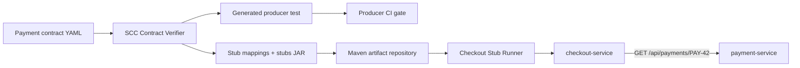
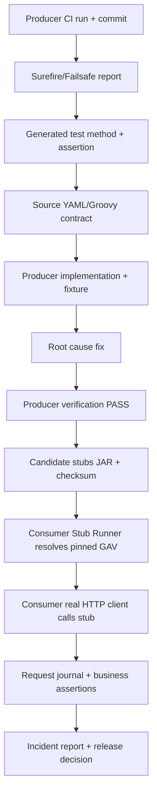

# Investigating a Failure from CI Results Back to the Source Contract

## 1. Hands-On Project Goals

This project simulates an incident in a system using **Spring Cloud Contract (SCC)**. The producer exposes an HTTP API, declares behavior via **Groovy/YAML DSL**, generates producer verification tests, and publishes a stub artifact; the consumer uses **Stub Runner** to test its HTTP client and business logic. CI runs these steps to catch incompatible changes before release.

The scenario begins with a familiar failure message:

```text
BUILD FAILURE

PaymentContractVerifierTest
  validate_payment_captured

Expected:
  $.state == "CAPTURED"

Actual:
  $.state == "PENDING"

Tests run: 8, Failures: 1, Errors: 0, Skipped: 0
```

Your task is to **trace backward from the CI failure to the exact source contract**, pinpoint the root cause, fix the right source, re-run producer verification, build a stub candidate, and prove the consumer remains compatible.

Evidence-driven investigation workflow:

1. Read build/run metadata and test reports to identify the **failing job, module, test, and assertion**.
2. Locate the generated test and identify the corresponding **contract ID / source contract**.
3. Read the YAML/Groovy DSL to understand the committed producer expectation.
4. Compare the implementation, fixtures, and test environment against the contract.
5. Classify the failure: implementation, contract source, test fixture, generator/toolchain, or CI wiring.
6. Fix the **authoritative source**, regenerate, and re-run producer verification.
7. Package the stub candidate, inspect mappings, and run consumer tests via Stub Runner.
8. Save an incident report detailed enough for a reviewer to reproduce your conclusion.

This is a capstone project in the **SPRING_CLOUD_CONTRACT** module: learning how to specify HTTP/message behavior, generate producer tests, publish stubs, use Stub Runner, and wire contract testing into CI.

### Target Outcomes

Upon completion, you will be able to:

- Trace from a CI test failure back to the relevant contract DSL file.
- Distinguish **generated tests** from **source tests** and **source contracts**.
- Read assertions to identify which commitment the producer violated.
- Never edit generated tests just to make a build green.
- Distinguish an implementation bug from an outdated contract expectation.
- Inspect test fixtures, base classes, and toolchains when outputs mismatch.
- Run producer verification and confirm executed test counts.
- Verify the stubs JAR contains mappings matching the contract.
- Run consumer tests against a **pinned artifact version**.
- Write a root-cause report with evidence and a release decision.

> **Investigation rule:** A `BUILD FAILURE` line is only the starting point. Draw conclusions only after linking **CI result → generated test → source contract → producer behavior → consumer evidence**.

## 2. System Scenario: Payment and Checkout

We have two services:

- **payment-service** is the producer, exposing a payment-status lookup endpoint.
- **checkout-service** is the consumer, calling that endpoint to decide whether an order can complete or must wait.



**Agreed behavior:**

- Captured payments return `200` with `state=CAPTURED`.
- Pending payments return `200` with `state=PENDING`.
- Non-existent payments return `404` with error code `PAYMENT_NOT_FOUND`.
- Checkout accepts a payment only when the ID matches and `state` is `CAPTURED`.

In this incident, the source contract still requires `CAPTURED`, yet the producer returns `PENDING` for `PAY-42`. We will determine whether this is a code bug, bad test data, or an unapproved business change.

### 2.1. Lab Project Scope

| Component | Role in this lab |
|---|---|
| Groovy/YAML contract | Source defining HTTP behavior |
| Contract Verifier | Generates producer tests from contracts |
| Producer implementation | Controller/service returning real responses |
| Producer test base class | Initializes test context and fixtures |
| Generated test report | Evidence showing which assertion failed |
| WireMock stub mapping | Behavior simulated for the consumer |
| Stub JAR | Artifact downloaded by the consumer |
| Stub Runner | Starts stub server for the consumer |
| Consumer HTTP client | Sends requests to the stub server |
| CI pipeline | Archives logs, reports, artifacts, and gate decisions |

This lab primarily uses **Maven-style paths**; Gradle notes appear near the end. Task names, generated directories, and settings can vary by plugin version or custom project setup. In a real repository, rely on your actual build logs and effective configuration.

## 3. Preparing the Project and Capturing Inputs

Assume the Maven producer has this structure:

```text
payment-service/
  pom.xml
  src/
    main/
      java/
        com/acme/payment/
          PaymentController.java
          PaymentService.java
          PaymentResponse.java
    test/
      java/
        com/acme/payment/contract/
          ContractTestBase.java
      resources/
        contracts/
          payment-captured.yml
          payment-pending.yml
          payment-not-found.yml
  target/
    generated-test-sources/
      contracts/
    generated-test-resources/
      contracts/
    stubs/
    surefire-reports/
    payment-service-1.5.1-SNAPSHOT-stubs.jar
```

This is a **reference layout**. The Maven SCC plugin normally reads contracts from `src/test/resources/contracts` and writes generated test sources/resources and stub outputs under `target`, though paths may be customized.

The consumer layout:

```text
checkout-service/
  pom.xml
  src/
    main/java/com/acme/checkout/
      PaymentHttpClient.java
      CheckoutService.java
    test/java/com/acme/checkout/
      CheckoutPaymentContractTest.java
    test/resources/
      application-contract.yml
```

### 3.1. Inputs to Record Before Editing Any File

Before opening source files, capture these CI details:

| Item | Illustrative example | Why it is needed |
|---|---|---|
| CI run/build ID | `payment-service #1842` | Links to exact logs and reports |
| Commit | `a1b2c3d` | Identifies source revision |
| Branch/tag | `feature/payment-state` | Shows pipeline context and trust level |
| Producer module | `payment-service` | Prevents inspecting the wrong module |
| Toolchain | SCC/Maven/JDK versions | Surfaces environment differences |
| Failing test | `validate_payment_captured` | Locates generated test |
| Test report | Surefire XML/HTML | Assertion, expected/actual, stack trace |
| Contract inventory | IDs/paths processed by generator | Traces back to source DSL |
| Candidate artifact | GAV/classifier if already built | Identifies stub version in use |

Table values are illustrative for practice. During a real investigation, **never guess commits or artifact versions from branch names**; extract them from CI runs and publication metadata.

### 3.2. Do Not Start by Editing Whatever File Looks Related

A test class named `PaymentContractVerifierTest` can be generated from multiple contract files. One generated Java file may hold many test methods, or method names may be normalized by the generator. Therefore:

- Do not assume the generated class name matches a single YAML filename.
- Do not open and edit generated Java inside `target`.
- Do not change response YAML just because an assertion reported `expected CAPTURED`.
- Do not delete or skip tests to unblock CI.
- First record **the test report path, method name, failing assertion, and build commit**.

## 4. Reproducing the CI Failure and Initial Error Triage

Illustrative CI output:

```text
[INFO] --- maven-surefire-plugin:test ---
[ERROR] Tests run: 8, Failures: 1, Errors: 0, Skipped: 0

[ERROR] validate_payment_captured
  PaymentContractVerifierTest

org.opentest4j.AssertionFailedError:
Expected: CAPTURED
Actual:   PENDING

at PaymentContractVerifierTest.validate_payment_captured(...)
```

Read this piece by piece:

1. **Tests run = 8:** the test runner executed 8 tests, not `0 tests`.
2. **Failures = 1:** one assertion failed; this is not a compilation or test-discovery failure.
3. **Errors = 0:** per this report, no setup or infrastructure exceptions were classified as errors.
4. **Skipped = 0:** no tests were skipped in this report.
5. **Expected/Actual:** generated verification expected `CAPTURED`, while the real response returned `PENDING`.
6. **Method name:** `validate_payment_captured` is the clue to locate the generated test method and contract.

### 4.1. Choosing the Investigation Branch by Failure Type

| CI output | First area to check |
|---|---|
| `Tests run: 0` | Test discovery, source sets, JUnit engine, skip flags |
| `Compilation failure` | Generated sources, imports, base class, dependency versions |
| `Errors > 0` due to connection refused | Test server, port, application context, fixtures |
| `Failures > 0` due to expected/actual | Compare assertion with contract and implementation |
| `No stubs found` | Artifact GAV/classifier/repository/mode |
| `WireMock 404` | Request mismatch, unloaded mappings, or wrong URL |
| Build finds no contracts | DSL source path, filters, plugin execution |
| JAR not created/attached | `convert`, `generateStubs`, publication settings |

This incident falls into the **assertion failure** branch. We must trace from the test method back to the contract before evaluating producer code.

## 5. Reading the Test Report Before Opening Generated Source

With Maven Surefire, reports normally live under:

```text
target/surefire-reports/
  TEST-com.acme.payment.contract.PaymentContractVerifierTest.xml
  com.acme.payment.contract.PaymentContractVerifierTest.txt
```

Filenames depend on project package/class naming and plugin settings. Failsafe reports may also exist if tests run in `integration-test`/`verify`.

### 5.1. Fields to Extract from the Report

Abbreviated XML example:

```xml
<testsuite
    name="com.acme.payment.contract.PaymentContractVerifierTest"
    tests="8"
    errors="0"
    skipped="0"
    failures="1">
  <testcase
      classname="com.acme.payment.contract.PaymentContractVerifierTest"
      name="validate_payment_captured">
    <failure
        message="expected CAPTURED but was PENDING"
        type="org.opentest4j.AssertionFailedError">
      ...
    </failure>
  </testcase>
</testsuite>
```

From the report, build a **failure record**:

```text
CI run:           payment-service #1842
Commit:           a1b2c3d
Test class:       PaymentContractVerifierTest
Test method:      validate_payment_captured
Failure type:     AssertionFailedError
Expected value:   CAPTURED
Actual value:     PENDING
Tests executed:   8
Failures:         1
Errors:           0
Skipped:          0
```

You do not need to paste thousands of log lines into a ticket. Keep **the report path and relevant assertion excerpt**, plus the build ID so reviewers can open the exact artifact.

### 5.2. Confirming Tests Actually Executed

Cross-check three sources:

- The summary at the end of the Maven/Gradle test task.
- The XML/HTML test reports.
- The list of generated test methods.

If build logs print `BUILD SUCCESS` while the report shows `tests=0`, there is no evidence of producer contract verification. When the report shows 8 tests and 1 failure, we know a test genuinely executed and an assertion failed.

## 6. Tracing from the Test Method to the Generated Source

In Maven projects, generated test sources typically live under:

```text
target/generated-test-sources/contracts/
```

Locate method `validate_payment_captured` or the class named in the report. **Illustrative** generated source example:

```java
@Test
public void validate_payment_captured() throws Exception {
    given()
        .header("Accept", "application/json")
        .get("/api/payments/PAY-42")
    .then()
        .statusCode(200)
        .body("paymentId", equalTo("PAY-42"))
        .body("state", equalTo("CAPTURED"))
        .body("amount", equalTo(150000))
        .body("currency", equalTo("VND"));
}
```

This snippet illustrates **the semantics of generated assertions**, not a promise that every SCC release generates these exact classes, helpers, annotations, or API chains. Generated tests may use `RestAssuredMockMvc`, `WebTestClient`, JUnit 4/5, or another test mode depending on settings.

### 6.1. Reading Assertions as a Contract Summary

In this example:

| Assertion | Contract clause checked |
|---|---|
| `.get("/api/payments/PAY-42")` | HTTP method/path |
| `.statusCode(200)` | HTTP status |
| `paymentId == PAY-42` | Response identity |
| `state == CAPTURED` | Payment state |
| `amount == 150000` | Value and data type |
| `currency == VND` | Currency unit |

**An assertion failure on `state` does not by itself prove the source contract is wrong.** It only proves the producer's response failed to satisfy the expected value checked by the generated test.

### 6.2. Generated Tests May Not Include Direct Source Paths

Not every SCC version emits comments naming the exact YAML/Groovy file path or line number inside generated tests. Trace back to the source by combining:

1. Test method / contract name (if preserved by the generator).
2. The build's source contract inventory.
3. Exact generated test assertions.
4. Corresponding generated stub mapping request/response.
5. Build logs from convert/generate goals or tasks.
6. Contract revision and commit from the CI run.

If multiple contracts share an endpoint or have similar test method names, compare both **request matchers and response bodies**, not just the name `payment_captured`.

### 6.3. Never Edit Generated Sources

Generated sources are build outputs. Editing `target/generated-test-sources/contracts/...` directly causes three problems:

- The next `clean` deletes your edit.
- The next generation step overwrites it.
- The source contract still holds the old expectation, so the next CI run regenerates the old assertion.

**Every lasting fix must target the responsible source contract, producer implementation, base class/fixture, or build configuration.**
## 7. Tracing Further Back to the YAML Source Contract

Suppose the source contract is at:

```text
src/test/resources/contracts/payment-captured.yml
```

Contents:

```yaml
name: payment_captured
description: "Look up captured payment PAY-42"
request:
  method: GET
  urlPath: /api/payments/PAY-42
  headers:
    Accept: application/json
response:
  status: 200
  headers:
    Content-Type: application/json
  body:
    paymentId: "PAY-42"
    state: CAPTURED
    amount: 150000
    currency: VND
```

Read the file in four sections:

| Section | Source contract requirement |
|---|---|
| Request | `GET /api/payments/PAY-42` |
| Request headers | `Accept: application/json` |
| Response status/headers | `200`, `Content-Type: application/json` |
| Response body | `paymentId=PAY-42`, `state=CAPTURED`, `amount=150000`, `currency=VND` |

Here, the source DSL **explicitly specifies** a captured payment. The generated test assertion `state=CAPTURED` matches the source contract.

### 7.1. Verify the Exact Contract, Not Just a Matching Filename

If the project contains:

```text
contracts/
  checkout-service/payment-captured.yml
  reporting-service/payment-captured.yml
  payment-captured.yml
```

there may be multiple contracts with similar names or endpoints for different consumers. Check:

- `name` inside the DSL.
- Consumer folder / `stubsPerConsumer` if enabled.
- Request path and headers.
- Response fields and values.
- Contract inventory for that exact build.
- Corresponding generated mapping.

Never pick a similarly named file and assume you found the source. **Request + response assertions** are a far more reliable fingerprint than filenames alone.

### 7.2. If the Source Uses Groovy DSL

A Groovy contract can express the same behavior:

```groovy
import org.springframework.cloud.contract.spec.Contract

Contract.make {
    name('payment_captured')
    description('Look up captured payment PAY-42')
    request {
        method GET()
        urlPath('/api/payments/PAY-42')
        headers {
            header('Accept', 'application/json')
        }
    }
    response {
        status OK()
        headers {
            contentType(applicationJson())
        }
        body(
            paymentId: 'PAY-42',
            state: 'CAPTURED',
            amount: 150000,
            currency: 'VND'
        )
    }
}
```

This is an illustrative Groovy DSL example. **Do not create duplicate YAML and Groovy files in a project "just to be safe"**; maintain one canonical source or clear organization rules to avoid generating duplicate mappings and tests.

### 7.3. Checking Matchers and Data Types

Subtle differences can alter contract meaning:

- `amount: 150000` is a number; `"150000"` is a string.
- `state: CAPTURED` is a string scalar in YAML; quote it if you want to avoid ambiguity.
- An omitted field differs from a field with value `null`.
- `url` and `urlPath` handle query strings differently.
- Exact equality matchers differ from regex/dynamic matchers.
- Request headers are declared separately from response headers.

Compare **both the DSL and the generated assertions** to spot cases where the generator or toolchain interpreted something unexpectedly.

## 8. Reading the Stub Mapping to Connect Contract and Consumer

Producer verification tests are one output; consumer stubs are the other. An illustrative WireMock mapping generated from the contract looks like:

```json
{
  "request": {
    "method": "GET",
    "urlPath": "/api/payments/PAY-42",
    "headers": {
      "Accept": {
        "equalTo": "application/json"
      }
    }
  },
  "response": {
    "status": 200,
    "headers": {
      "Content-Type": "application/json"
    },
    "jsonBody": {
      "paymentId": "PAY-42",
      "state": "CAPTURED",
      "amount": 150000,
      "currency": "VND"
    }
  }
}
```

The JSON above **illustrates the meaning** of the mapping; actual output can vary in `body`/`jsonBody`, metadata, file references, IDs, and key ordering by SCC/WireMock version.

### 8.1. What Does the Mapping Verify?

- Does the stub have the right method, path, and headers?
- Is the response status `200`?
- Does the response body have `state=CAPTURED`?
- Is `amount` a numeric type?
- Is the mapping packaged inside the stubs JAR?
- Does the consumer's Stub Runner load this mapping?

### 8.2. Three Symptoms to Distinguish

| Observation | Meaning |
|---|---|
| Generated test fails, mapping still matches contract | Producer implementation or test fixture may be wrong |
| Generated test PASSES, mapping missing or differs | Investigate generator, plugin goals, or stub packaging |
| Mapping is right, consumer test fails | Consumer client/request/DTO or Stub Runner runtime may be wrong |

**Never use stub mappings in place of producer verification.** Stubs respond per the DSL; they never call the producer implementation. Only producer verification tests the real producer API in the test context.

## 9. Comparing Against the Producer Implementation

Suppose the controller is:

```java
@RestController
@RequestMapping("/api/payments")
public class PaymentController {

    private final PaymentService paymentService;

    public PaymentController(PaymentService paymentService) {
        this.paymentService = paymentService;
    }

    @GetMapping("/{paymentId}")
    public PaymentResponse getPayment(
            @PathVariable String paymentId) {
        return paymentService.findPayment(paymentId);
    }
}
```

The controller route matches the contract: `GET /api/payments/{paymentId}`. Since the assertion failed on `state`, inspect `PaymentService` and its response mapping.

Example implementation containing the bug:

```java
@Service
public class PaymentService {

    public PaymentResponse findPayment(String paymentId) {
        Payment payment = repository.findById(paymentId)
            .orElseThrow(PaymentNotFoundException::new);

        // BUG: captured status was mistakenly mapped to PENDING.
        String state = payment.status() == PaymentStatus.CAPTURED
            ? "PENDING"
            : payment.status().name();

        return new PaymentResponse(
            payment.id(),
            state,
            payment.amount(),
            payment.currency()
        );
    }
}
```

In this example, the bug sits in the domain-status-to-API-response mapping. For a captured payment, the code returns `PENDING`, matching `Actual` in CI.

### 9.1. Comparing the Three Value Layers

| Layer | Value for PAY-42 |
|---|---|
| Contract source | `CAPTURED` |
| Generated test expected | `CAPTURED` |
| Producer implementation actual | `PENDING` |

These three values show **the source contract and generated test agree**, while the implementation violates the contract.

Even so, check fixtures in Section 10 before drawing a final conclusion: if the test database seeded `PAY-42` as `PENDING`, the implementation could simply be reflecting input data rather than mapping wrong.

### 9.2. Do Not Infer a Bug from Status Names Alone

`PAY-42` could refer to different fixtures across tests. Verify:

- Does the fixture have ID `PAY-42`?
- Is the fixture's status `CAPTURED` or `PENDING`?
- Does the test base class load fixtures under the right profile?
- Does the repository return another record due to shared database/state leakage?
- Does mapping code transform the enum properly?
- Is there any timezone or async event logic leaving the payment uncaptured during the test?

**Expected/Actual only identifies the discrepancy; root cause requires evidence of both inputs and code paths.**

## 10. Checking Test Fixtures and `ContractTestBase`

A producer generated test typically relies on a base class to bootstrap the application context, MockMvc/WebTestClient or HTTP test server, and fixture data. Illustrative example:

```java
@SpringBootTest
@AutoConfigureMockMvc
public abstract class ContractTestBase {

    @Autowired
    PaymentRepository repository;

    @BeforeEach
    void setUp() {
        repository.deleteAll();
        repository.save(new Payment(
            "PAY-42",
            PaymentStatus.CAPTURED,
            150000,
            "VND"
        ));
    }
}
```

This is an illustrative setup; real constructors, entities, and repositories depend on your project. Generated tests may use base classes with different test modes and lifecycles.

### 10.1. Common Fixture Failures

| Error | Symptom |
|---|---|
| Seeded wrong state | `PAY-42` is `PENDING` instead of `CAPTURED` |
| Fixture never ran | Empty repository or leftover data from prior test |
| Setup annotation mismatches JUnit version | `@BeforeEach`/`@Before` never executed |
| Test uses wrong profile | Unexpected database connection or configuration |
| Shared database across tests | State leakage, order-dependent tests |
| Time-dependent state | Scheduled job alters payment status |
| Mock service returns different response | Controller bypasses real implementation |
| Base class changed yet generated test compiles | Setup behavior lost silently while test runner runs |

### 10.2. Separating Fixture Bugs from Implementation Bugs

Run a focused check inside the producer test context:

```java
@Test
void fixtureForCapturedPaymentHasExpectedState() {
    Payment payment = repository.findById("PAY-42").orElseThrow();

    assertEquals(PaymentStatus.CAPTURED, payment.status());
}
```

This is an **illustrative diagnostic test**, not generated automatically by SCC. If the fixture assertion fails, fix the fixture/setup. If the fixture is right yet the API response is wrong, inspect service/controller mapping.

Do not keep this test as a workaround to avoid generated tests. It simply proves **the test input matches the scenario**.

### 10.3. Checking Source Fixtures and Data Builders

If the project uses SQL scripts, Testcontainers, data builders, repository mocks, or custom profiles, trace the real setup. Never assume `@BeforeEach` is the only place creating data.

During JUnit 4/5 migrations, lifecycle annotations can change. If fixture setup fails to run due to a runner mismatch, the failure stems from toolchain/test-base wiring rather than contract or service logic.

## 11. Classifying Root Cause Before Fixing

Use this decision table:

| Evidence | Classification | Action |
|---|---|---|
| Contract and generated assertion expect `CAPTURED`; fixture right; implementation returns `PENDING` | **Producer implementation bug** | Fix service/controller mapping |
| Contract expects `CAPTURED` but new business agreement specifies `PENDING` | **Stale contract source** | Review change with consumers, update DSL with approval |
| Fixture `PAY-42` is actually `PENDING` in test | **Test data / setup bug** | Fix fixture / base class |
| Generated assertion does not match DSL | **Generator / toolchain / config issue** | Inspect SCC version, plugin config, generated outputs |
| Tests did not run or ran wrong module | **CI wiring / test discovery issue** | Fix lifecycle, source sets, runner |
| Stub JAR lacks mapping even though generated test exists | **Stub generation / publication issue** | Check `convert`, `generateStubs`, packaging |
| Producer test PASSES but consumer uses stale stub | **Artifact resolution / cache issue** | Pin version, verify resolved GAV/checksum |
| Consumer request misses mapping | **Consumer request / config issue** | Check method, path, query, headers, base URL |

### 11.1. Decision in the Main Scenario

In our lab data:

- Source contract expects `CAPTURED`.
- Generated test assertion expects `CAPTURED`.
- Fixture `PAY-42` is seeded as `CAPTURED`.
- Service mapping returns `PENDING`.

Thus the root cause is a **producer implementation bug**.

**Do not edit the source contract to `PENDING`** if product/API owners have not changed the business commitment. Doing so turns producer tests green by lowering the contract consumers rely on.

### 11.2. When Should You Fix the Contract Instead of Code?

If owners confirm the business rule genuinely changed—for instance, a new API intentionally returns `PENDING` during a settlement phase—then the old contract may be stale. In that case:

1. Identify every consumer depending on `CAPTURED`.
2. Align on the new behavior with producer and consumer owners.
3. Design versioning/migration or backward-compatible responses if needed.
4. Update source DSL and consumer expectations with formal review.
5. Run producer verification and consumer Stub Runner tests on the candidate.
6. Document the breaking/compatible change decision in the PR/release.

That is an **intentional contract change**, not patching a test failure just to pass CI.

## 12. Fixing the Right Source: Correcting the Producer Implementation

With the root cause proven, fix the status mapping:

```java
@Service
public class PaymentService {

    public PaymentResponse findPayment(String paymentId) {
        Payment payment = repository.findById(paymentId)
            .orElseThrow(PaymentNotFoundException::new);

        String state = payment.status().name();

        return new PaymentResponse(
            payment.id(),
            state,
            payment.amount(),
            payment.currency()
        );
    }
}
```

Or use a centralized mapper/domain enum mapping if API responses use different enum names. The snippet above holds only when domain and API enum values align; otherwise, write explicit mappings for every state.

### 12.1. Ensuring Other States Do Not Break

Do not run only the `payment_captured` contract. The producer also maintains:

- `payment_pending`: `PENDING` payments still return `PENDING`.
- `payment_not_found`: non-existent IDs return `404` and `PAYMENT_NOT_FOUND`.
- Any other states (`FAILED`, `REFUNDED`, `CANCELLED`) must keep their committed mappings.

Switching to `payment.status().name()` might fix `CAPTURED` while breaking other states if domain enums and API vocabulary diverge. Run the **entire producer verification suite**, not just the single failing method.

### 12.2. Adding Unit Tests for Domain Mapping When Appropriate

Generated contract tests guard the API boundary. Unit tests can guard service mapping logic:

```java
@Test
void capturedPaymentIsExposedAsCaptured() {
    Payment payment = new Payment(
        "PAY-42",
        PaymentStatus.CAPTURED,
        150000,
        "VND"
    );

    when(repository.findById("PAY-42"))
        .thenReturn(Optional.of(payment));

    PaymentResponse response = service.findPayment("PAY-42");

    assertEquals("CAPTURED", response.state());
}
```

This is a unit test example using a mock repository. It **supplements** generated producer verification; it never replaces HTTP contract tests.

### 12.3. Never Edit Generated Tests or Stub Mappings Directly

Never do any of the following:

- Change an assertion in `generated-test-sources` from `CAPTURED` to `PENDING`.
- Edit JSON mappings in `target/stubs` to return `CAPTURED` while source DSL or producer remains broken.
- Delete contracts from the source directory.
- Add `@Disabled`, `@Ignore`, or skip flags to turn the build green.
- Republish the same release GAV with altered bytes.

After fixing valid source code or DSL, let the plugin **regenerate outputs from source**. The stub JAR must come from a traceable build.

## 13. Re-running Producer Verification

### 13.1. Maven Producer

In the fixed producer checkout:

```bash
./mvnw clean verify
```

The full command normally executes the lifecycle needed to compile, generate, run tests, and package per plugin config. Verify the actual build executes the expected SCC goals and Surefire/Failsafe tasks.

When inspecting closely, you can run:

```bash
./mvnw -DskipTests=false clean verify
```

Never allow `skipTests`, `maven.test.skip=true`, or profiles that disable Contract Verifier in release gates.

### 13.2. Gradle Producer

For projects using the SCC Gradle plugin, common tasks depending on version include:

```bash
./gradlew clean contractTest
```

Or when the project splits test generation and stub packaging:

```bash
./gradlew generateContractTests generateClientStubs verifierStubsJar
```

Verify exact task names and dependency graphs with:

```bash
./gradlew tasks --all
```

Never assume identical task names across all SCC Gradle plugin versions. `verifierStubsJar` packages stubs; **it does not substitute for running producer verification tests**. Publication must attach the stub JAR per your project's Maven Publish config.

### 13.3. Reading Results After the Fix

Expected lab result:

```text
Tests run: 8, Failures: 0, Errors: 0, Skipped: 0
BUILD SUCCESS
```

This is an **illustrative target outcome**, not a build run during authoring. In practice, record actual executed counts, skipped counts, and report paths.

If the build PASSES with `tests=0`, you are not done. If 8 tests ran but 1 was skipped, investigate why. If a contract was not generated, compare the contract inventory before and after.

### 13.4. Verifying Generated Outputs Were Regenerated

After `clean verify`, check:

- Generated test sources contain the test for `payment_captured`.
- Generated test assertions still require `CAPTURED`.
- Test reports list that method as `PASS`.
- Stub mappings still return `CAPTURED`.
- The stub JAR carries classifier `stubs` and the corresponding mapping.
- Build logs confirm generation goals/tasks executed.

Never reuse stale output files from an earlier build as proof for a new build.

## 14. Inspecting the Stub Candidate Before Handing Off to the Consumer

Suppose the producer builds candidate version:

```text
com.acme.billing:payment-service:1.5.1-SNAPSHOT:stubs
```

These are illustrative coordinates. In a real project, versions and classifiers come from Maven/Gradle publication settings.

### 14.1. Inspecting JAR Contents

List entries with the JDK tool:

```bash
jar tf target/payment-service-1.5.1-SNAPSHOT-stubs.jar
```

Look for:

- Contracts/mappings corresponding to `payment_captured`.
- Response body containing `state=CAPTURED`.
- Mappings for `payment_pending` and `payment_not_found`.
- Accurate `META-INF` path matching `groupId`/`artifactId`/`version`.
- Referenced body files, if any.

Never edit the JAR directly to change a response. If a mapping is wrong, trace back to the DSL or generator configuration.

### 14.2. Inspecting the Generated Mapping

The illustrative mapping must preserve:

```text
request:
  method = GET
  urlPath = /api/payments/PAY-42

response:
  status = 200
  body.state = CAPTURED
```

Compare the generated mapping with the source contract. If the source is right yet the mapping differs, stop here to investigate plugin/version/configuration issues before publishing.

### 14.3. Never Overwrite a Release with a Candidate

Use snapshot or release-candidate versions and appropriate staging repositories. Never publish different bytes to an already-published release GAV. Record producer commit, contract revision, verification report, artifact GAV/classifier, and checksum so consumer CI can trace provenance.

## 15. Consumer: Verifying the Stub Candidate with Stub Runner

Producer verification PASSING proves the producer implementation satisfies the source contract in the test context. The consumer must still be tested against **the newly built stub artifact**, because the consumer could have bugs in URLs, headers, JSON mapping, or response handling.

### 15.1. Consumer HTTP Client

Illustrative checkout production class:

```java
@Component
public class PaymentHttpClient {

    private final RestClient client;

    public PaymentHttpClient(
            RestClient.Builder builder,
            @Value("${payment.api.base-url}") String baseUrl) {
        this.client = builder.baseUrl(baseUrl).build();
    }

    public PaymentResponse getPayment(String paymentId) {
        return client.get()
            .uri("/api/payments/{id}", paymentId)
            .accept(MediaType.APPLICATION_JSON)
            .retrieve()
            .body(PaymentResponse.class);
    }
}
```

### 15.2. Consumer Use Case

```java
@Service
public class CheckoutService {

    private final PaymentHttpClient payments;

    public CheckoutService(PaymentHttpClient payments) {
        this.payments = payments;
    }

    public CheckoutDecision evaluate(String paymentId) {
        PaymentResponse payment = payments.getPayment(paymentId);

        if (payment != null
                && paymentId.equals(payment.paymentId())
                && "CAPTURED".equals(payment.state())) {
            return new CheckoutDecision(true, "READY");
        }

        return new CheckoutDecision(false, "PAYMENT_PENDING");
    }

    public record CheckoutDecision(boolean accepted, String reason) {}
}
```

This is illustrative consumer code. Real applications may map 404s, timeouts, and auth failures to dedicated exceptions and retry policies; do not collapse every HTTP error into a `PENDING` status.

### 15.3. Installing the Candidate into Local Maven Repository

If Stub Runner uses `LOCAL` mode, the producer must install artifacts into the local Maven repository:

```bash
./mvnw clean install
```

This executes the lifecycle through `install` per project setup. Confirm both the main artifact and `stubs` classifier exist. If CI separates producer and consumer into different jobs, the local Maven repository is not shared automatically; pass the JAR/POM via an artifact store or use a staging repository.

### 15.4. Pinning the Version in the Consumer Test

Example consumer targeting the exact candidate version:

```java
@SpringBootTest(
    properties = {
        "payment.api.base-url=http://localhost:18081"
    }
)
@AutoConfigureStubRunner(
    ids = "com.acme.billing:payment-service:1.5.1-SNAPSHOT:stubs:18081",
    stubsMode = StubRunnerProperties.StubsMode.LOCAL,
    failOnNoStubs = true
)
class CheckoutPaymentContractTest {

    @Autowired
    CheckoutService checkoutService;

    @Test
    void capturedPaymentAllowsCheckout() {
        var result = checkoutService.evaluate("PAY-42");

        assertTrue(result.accepted());
        assertEquals("READY", result.reason());
    }
}
```

This is an **illustrative configuration**: it requires the SCC Stub Runner dependency, Spring Boot test setup, production beans, and the stub artifact in the local Maven repository. The ID uses syntax `groupId:artifactId:version:classifier:port`; verify annotation attributes and property names against your project's SCC version.

Fixed ports are easy to read in lab projects, yet can collide when CI runs in parallel. For parallel pipelines, use dynamic ports via Stub Runner and inject client base URLs only after the port is ready; do not read test fields too early in the Spring context lifecycle.

### 15.5. Asserting the Request Journal to Prove the Client Called the Stub

For stronger verification, a test can reset WireMock's request journal **before** calling checkout and inspect it afterward. Illustrative fixed-port example:

```java
@Test
void checkoutCallsTheStubbedPaymentEndpoint() {
    RestClient admin = RestClient.create("http://localhost:18081");

    admin.delete()
        .uri("/__admin/requests")
        .retrieve()
        .toBodilessEntity();

    var result = checkoutService.evaluate("PAY-42");

    assertTrue(result.accepted());
    assertEquals("READY", result.reason());

    JsonNode journal = admin.get()
        .uri("/__admin/requests")
        .retrieve()
        .body(JsonNode.class);

    assertNotNull(journal);
    boolean matched = StreamSupport.stream(
        journal.path("requests").spliterator(), false
    ).anyMatch(event ->
        event.path("wasMatched").asBoolean(false)
        && "GET".equals(
            event.path("request").path("method").asText())
        && "/api/payments/PAY-42".equals(
            event.path("request").path("url").asText())
    );

    assertTrue(matched);
}
```

This snippet requires Jackson `JsonNode`, `StreamSupport`, and corresponding imports. WireMock's request journal may be disabled in some setups; enable it in your test profile. If tests share a server and run concurrently, never reset the global journal between tests.

### 15.6. Testing All Three Outcomes

The consumer suite should verify at a minimum:

| Input | Stub response | Checkout outcome |
|---|---|---|
| `PAY-42` | 200, `CAPTURED` | `READY` |
| `PAY-17` | 200, `PENDING` | `PAYMENT_PENDING` |
| `PAY-404` | 404, `PAYMENT_NOT_FOUND` | `PAYMENT_NOT_FOUND` or specified exception |

Do not test only the happy path. Consumers must exhibit well-defined behavior when producers return errors or incomplete states.

## 16. Connecting the Full Evidence Chain from CI to Consumer

Once the producer fix is complete and consumer tests pass, assemble an evidence chain:



### 16.1. Every Arrow Needs Evidence

| Link | Evidence |
|---|---|
| CI → report | Run ID, commit, report artifact path |
| Report → generated test | Test class, method, assertion, stack trace |
| Generated test → DSL | Contract name, request/response matchers, source inventory |
| DSL → implementation | Expected behavior and endpoint/service code path |
| Implementation → fixture | Actual test data/setup, profile, base class |
| Fix → verification | Source diff and post-fix producer test report |
| Verification → stub JAR | Build metadata, classifier, mapping entries, checksum |
| Stub JAR → Stub Runner | Resolved GAV, mode, repository, running port |
| Stub Runner → consumer | Client base URL, request journal, matched mapping |
| Consumer → decision | Consumer test report, compatibility result, reviewer approval |

No arrow may be replaced with "ran the build and it's green." Every step needs an artifact, log, or code reference others can verify.

### 16.2. Sample Evidence Record

```text
INCIDENT: SCC-1842
Producer: payment-service
Consumer: checkout-service

CI:
  run: payment-service #1842
  commit: a1b2c3d
  result: FAILED
  test: PaymentContractVerifierTest.validate_payment_captured

SOURCE:
  contract: src/test/resources/contracts/payment-captured.yml
  expected: HTTP 200, state CAPTURED
  generated assertion: state == CAPTURED

ROOT CAUSE:
  fixture: PAY-42 seeded as CAPTURED
  implementation: CAPTURED mapped to PENDING
  classification: producer implementation bug

FIX:
  source file: PaymentService.java
  change: correct status mapping

VERIFICATION:
  producer tests: 8 executed, 0 failures, 0 errors, 0 skipped
  stub artifact: com.acme.billing:payment-service:1.5.1-SNAPSHOT:stubs
  mapping: payment_captured present

CONSUMER:
  Stub Runner mode: LOCAL
  resolved GAV: exact candidate above
  request: GET /api/payments/PAY-42
  mapping matched: true
  outcome: READY
```

This is a **sample report with illustrative target outcomes**, not an executed log. In practice, replace all placeholder values with reproducible run IDs, commits, artifact coordinates, and test results.

## 17. Other Investigation Branches: Not Every CI Failure Is an Implementation Bug

The main project resolves a `CAPTURED`/`PENDING` response mismatch. When triaging other CI incidents, know which branch to pick.

### 17.1. Stale Contract Source

Signs:

- Generated test matches source DSL accurately.
- Producer implementation returns new behavior approved by the API owner.
- Consumer owners also agreed to the change or have a migration plan.

Actions:

1. Never edit the generated test.
2. Update the source contract with review.
3. Update consumer expectations/versions if needed.
4. Run producer verification.
5. Build a new stub candidate.
6. Run the consumer matrix against the candidate artifact.
7. Document the behavior change and compatibility impact.

### 17.2. Wrong Fixture or Base Class

Signs:

- Source DSL and generated assertions make sense.
- Producer code handles domain inputs properly.
- Test data does not match the scenario or setup never ran.

Actions:

- Check profile, database, Testcontainers, or data builders.
- Check JUnit lifecycle and base class.
- Make test setup deterministic and isolated across tests.
- Re-run all generated tests.
- Never alter a contract to match mis-seeded test data.

### 17.3. Incompatible Generator or Toolchain

Signs:

- Generated assertions do not reflect the DSL.
- Test sources fail to compile or JUnit fails to discover tests.
- Tasks/goals fail to generate all expected tests/mappings.
- Outputs changed for identical inputs after upgrading SCC, plugins, or WireMock.

Actions:

- Record resolved versions of SCC, Spring Boot/Cloud, JDK, Maven/Gradle, JUnit, and WireMock.
- Compare generated outputs and build logs before vs. after.
- Verify tasks/goals, contract filters, and output directories.
- Run a clean isolated build.
- Consult release notes and compatibility matrices.
- Upgrade only after both producer and consumer regression suites pass.

### 17.4. Wrong Stub Artifact or Stub Runner Setup

Signs:

- Producer verification PASSES yet consumer reports no stubs.
- Consumer receives old mappings even after producer published a candidate.
- Wrong GAV, classifier, version, or `repositoryRoot`.
- JAR lacks mappings even though source contracts exist.

Actions:

- Inspect stub JAR entries and classifier.
- Check publication/attachment settings.
- Pin versions; never use `+` in release gates.
- Verify repositories and resolved artifacts.
- Never fall back to local caches or production endpoints just to pass tests.

### 17.5. Consumer Request Fails to Match Stub

Signs:

- Stub Runner starts and mappings load.
- Request journal records the request as unmatched.
- Method, path, query, headers, or body differ from the mapping.

Actions:

- Capture the actual request from the journal.
- Compare method, path, query, headers, and body.
- Check base URL/port, service discovery, and proxies.
- Fix the client or contract matcher per agreed semantics.
- Assert both mapping match and business outcome.

## 18. Designing CI Pipelines So Failures Trace Back Cleanly

A minimal producer pipeline should execute in this order:

```text
Checkout source
  ↓
Resolve pinned toolchain/dependencies
  ↓
Generate Contract Verifier tests
  ↓
Compile generated tests
  ↓
Run producer verification
  ↓
Generate/convert stub mappings
  ↓
Package stubs JAR
  ↓
Inspect artifact metadata / classifier
  ↓
Publish candidate to staging
  ↓
Consumer CI resolves exact candidate GAV
  ↓
Stub Runner + consumer tests
  ↓
Release decision
```

### 18.1. Never Publish Before Producer Verification Passes

A stubs JAR can be generated from DSL even when the producer implementation violates the contract. Therefore:

- Separate generation/packaging from **verification results** in reports.
- Mark artifacts verified/release-ready only when producer tests genuinely PASS.
- If publishing early stubs for parallel consumer development before the producer finishes, mark them explicitly as unverified per internal convention.
- Never allow consumer CI PASSES to substitute for producer verification.

### 18.2. CI Must Archive Reports and Artifacts

| Artifact | Producer job | Consumer job |
|---|---|---|
| Source commit / contract revision | Required | Record producer revision used |
| Generated test report | Required | Never replace with consumer report |
| Generated mappings / stub JAR | Required | Record resolved GAV |
| Checksum / provenance | Per policy | Cross-check downloaded artifact |
| Consumer test report | Not applicable | Required |
| Request journal / matched evidence | Diagnostic when needed | Helpful for matching errors |
| CI run IDs | Required | Required |

### 18.3. Fail Closed When Evidence Is Missing

The release gate must block if:

- Generated tests were not created or executed 0 tests.
- Test reports are missing or tests were unexpectedly skipped.
- The stub JAR lacks required classifiers or mappings.
- Consumer tests resolve the wrong version or fail to download stubs.
- Requests never reach the stub server or mappings fail to match.
- Tests stay green even when Stub Runner fails to start.
- Artifacts were published from a different commit than the one verified.

Never use `|| true`, skip flags, or fallback endpoints to mask pipeline failures.

## 19. Extended Exercises

### 19.1. Exercise A — Bug in Source Contract or Implementation?

CI reports:

```text
Expected: HTTP 200
Actual:   HTTP 202
Contract: payment-captured.yml
```

Determine:

1. Which status does the source contract require?
2. Did the producer API owner intentionally change semantics to asynchronous acceptance?
3. Does the consumer understand 202 and polling flows?
4. Is this an implementation bug or a contract migration?
5. Which tests and approvals are needed before updating the contract?

### 19.2. Exercise B — Test Report Shows 0 Tests

CI prints:

```text
BUILD SUCCESS
Tests run: 0
```

Build a checklist covering:

- Did the SCC goal/task execute?
- Is the generated source directory right?
- Does Surefire/Gradle Test include the generated source set?
- Is the JUnit engine compatible?
- Are any skip properties/profiles enabled?
- Are reports under Failsafe instead of Surefire?
- Were tests generated but never compiled/executed?

The correct conclusion is **zero verification evidence**, not that the contract passed.

### 19.3. Exercise C — Producer PASSES, Consumer Fails

Producer verification PASSED. Consumer Stub Runner tests report WireMock 404.

Check:

- Artifact GAV/classifier/version.
- Stub Runner mode and repository.
- Whether the mapping exists in the JAR and was registered.
- Whether the client calls the right stub port.
- Actual method, path, query, headers, and body.
- Whether 404 is default unmatched or a contract-defined response.
- Whether the consumer test mocked its HTTP client.

### 19.4. Exercise D — Same Contract Name, Multiple Consumers

Two contracts exist:

```text
contracts/checkout-service/payment-captured.yml
contracts/reporting-service/payment-captured.yml
```

They hit the same endpoint yet return different response fields. Explain:

- Why filenames alone cannot trace the source.
- The role of consumer folders and `stubsPerConsumer`.
- Which `consumerName` to check in Stub Runner.
- Which mappings are packaged and registered per consumer.
- How to record contract identity in CI reports.

## 20. Deliverables and Project Completion Criteria

When completing the lab, create the following evidence in **your practice workspace/project** (not inside lesson files):

| Deliverable | Contents |
|---|---|
| Failure record | CI run, commit, test class/method, expected/actual |
| Contract trace | Generated test → source YAML/Groovy path |
| Root cause note | Implementation/contract/fixture/toolchain/CI classification |
| Fix diff | Changes in the right source file |
| Producer verification report | Tests executed, failures/errors/skipped |
| Stub artifact manifest | GAV, classifier, repository, checksum if applicable |
| Mapping evidence | Contract mapping inside candidate stub |
| Consumer test report | Stub Runner resolved version and result |
| Request evidence | Matched method/path/mapping if HTTP |
| Incident report | Root cause, corrective action, residual risks, release decision |

### 20.1. Self-Assessment Rubric

| Criterion | Passing when |
|---|---|
| Tracing errors from CI | Located the exact test report and assertion |
| Tracing to source contract | Proved the matching DSL file via request/response semantics |
| Classifying root cause | Backed by evidence for implementation/fixture/contract/toolchain |
| Fixing the right source | Never edited generated outputs or deleted tests |
| Producer verification | All required tests genuinely ran and PASSED |
| Stub artifact | Correct GAV/classifier and complete mappings |
| Consumer verification | Stub Runner downloaded exact candidate and tested real client |
| CI evidence | Run IDs, reports, artifacts, commit, and decision recorded |
| Conclusion | Clearly separates fixed bugs from unverified areas |

### 20.2. Sample Incident Report

```markdown
# Incident SCC-1842 — payment-captured verification failure

## Impact
Producer CI blocked the payment-service candidate; consumers are not permitted to use this artifact as release proof.

## Evidence
- CI run/commit: <link and SHA>
- Failing test: <class.method>
- Source contract: <path + revision>
- Expected/actual: <values>
- Fixture state: <values>
- Producer source path: <controller/service>

## Root cause
<Implementation bug / stale contract / fixture / toolchain / CI wiring>

## Corrective action
<File and reviewed change>

## Verification
- Producer tests: <executed/pass/fail/skip>
- Stub GAV/classifier: <coordinates>
- Mapping inspection: <result>
- Consumer Stub Runner: <resolved version>
- Consumer tests: <result>
- Request matched evidence: <result>

## Release decision
<Blocked / Candidate approved / Released by authorized owner>

## Follow-up
<Monitoring, rollback, contract review, or CI improvement>
```

Values in angle brackets are placeholders. Never place secrets, tokens, customer payloads, or sensitive production data into incident reports.

## 21. Checklist for Tracing from CI Back to the Source Contract

- [ ] Record CI run ID, commit, branch, module, and toolchain versions.
- [ ] Locate the exact Surefire/Failsafe/Gradle test report.
- [ ] Read executed, failure, error, and skipped counts; never stop at `BUILD SUCCESS`/`FAILURE`.
- [ ] Identify generated test class, method, and failing assertion.
- [ ] Locate the exact source contract via name, request matchers, response, and contract inventory.
- [ ] Read source YAML/Groovy; never edit generated sources.
- [ ] Compare HTTP method/path/query/headers/status/body or message destination/headers/body.
- [ ] Inspect producer controller, service, serializer, and response mapping.
- [ ] Inspect test fixtures, database state, profiles, base class, and lifecycle.
- [ ] Classify as implementation, contract, fixture, generator/toolchain, artifact, or CI wiring.
- [ ] Obtain owner approval if contract behavior truly needs to change.
- [ ] Edit the right source file and review the diff.
- [ ] Run clean producer verification without skipping generated tests.
- [ ] Confirm executed count, failures/errors/skipped, and report path.
- [ ] Verify generated tests and mappings were regenerated from source.
- [ ] Inspect stub JAR entries, classifier, GAV, and provenance.
- [ ] Never overwrite an already-published release artifact.
- [ ] Ensure consumer Stub Runner pins the exact candidate version.
- [ ] Ensure consumer tests invoke the real production HTTP/message client.
- [ ] Check request journal/mapping or message handler evidence.
- [ ] Assert both success and error paths the consumer relies on.
- [ ] Archive producer/consumer CI reports and the incident decision.
- [ ] Release only when mandatory gates pass and authorized owners approve.

## 22. Takeaways and References

Investigating a failure from CI results back to the source contract is a process of **following the evidence**, not guessing a file and hacking the build green.

1. **CI reports** tell you which test failed, which assertion broke, and which build produced the result.
2. **Generated tests** show how SCC translated the DSL into executable checks.
3. **Source contracts** define what behavior the producer committed to.
4. **Producer implementations and fixtures** reveal whether actual responses came from code or test data.
5. **Producer verification** proves the implementation satisfies the contract in the test context.
6. **Stub artifacts and Stub Runner** carry declared behavior into consumer tests.
7. **Consumer tests** prove clients and business logic handle stubbed behavior as expected.

In this lab's main incident, the contract, generated assertion, and fixture all expected `CAPTURED`, while the implementation returned `PENDING`. Therefore, we fixed the producer mapping, regenerated outputs, ran the full producer suite, inspected the stub candidate, and ran consumer tests.

### Official Documentation

- [Spring Cloud Contract — Reference Documentation](https://docs.spring.io/spring-cloud-contract/reference/).
- [Spring Cloud Contract — Contract DSL](https://docs.spring.io/spring-cloud-contract/reference/project-features-contract.html).
- [Spring Cloud Contract — Maven Project](https://docs.spring.io/spring-cloud-contract/reference/maven-project.html).
- [Spring Cloud Contract — Gradle Project](https://docs.spring.io/spring-cloud-contract/reference/gradle-project.html).
- [Spring Cloud Contract — Stub Runner Core](https://docs.spring.io/spring-cloud-contract/reference/project-features-stubrunner/stub-runner-core.html).
- [Spring Cloud Contract — Stub Runner JUnit and Spring](https://docs.spring.io/spring-cloud-contract/reference/project-features-stubrunner/stub-runner-junit.html).
- [Spring Cloud Contract — Fail On No Stubs](https://docs.spring.io/spring-cloud-contract/reference/project-features-stubrunner/stub-runner-fail-on-no-stubs.html).
- [Spring Cloud Contract — Stubs Per Consumer](https://docs.spring.io/spring-cloud-contract/reference/project-features-stubrunner/stub-runner-stubs-per-consumer.html).
- [WireMock — Request Matching](https://wiremock.org/docs/request-matching/).
- [WireMock — Verifying Requests and Request Journal](https://wiremock.org/docs/verifying/).
- [Apache Maven — Introduction to the Build Lifecycle](https://maven.apache.org/guides/introduction/introduction-to-the-lifecycle.html).
- [Gradle — Testing in Java & JVM projects](https://docs.gradle.org/current/userguide/java_testing.html).

**Scope note:** Content and build outputs in this article represent a hands-on lab scenario. Completing the project in a real repository requires running your project's actual toolchain, archiving test reports/artifacts, and undergoing review per CI/release policy. Examples do not replace compatibility matrices or documentation for your exact SCC version.
