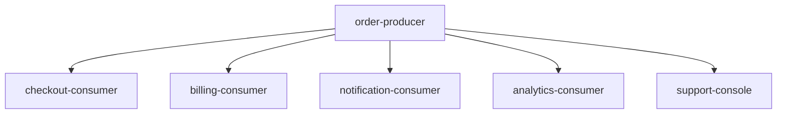
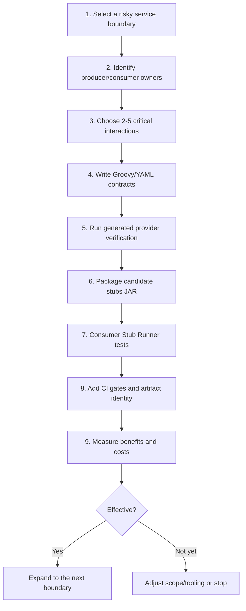

# When to Apply Spring Cloud Contract

**Spring Cloud Contract (SCC)** is suitable when producers and consumers can change or deploy independently, communication boundaries are critical, and API incompatibility errors are often only discovered late. SCC enables producers to describe HTTP or messaging behavior using **Groovy/YAML DSL**, generate **provider verification tests**, package **stubs**, and help consumers test their clients/listeners via **Stub Runner**.

However, not every endpoint, every Spring application, or every test needs SCC. If an application has only one consumer, teams release together, and existing integration tests are already fast and clear enough, adding contract sources, stubs publication, and CI gates can create more overhead than benefit. If the main goal is publishing the entire API for developers, **OpenAPI** is often more appropriate; if consumers are the ones defining the exact interactions they need, **Pact** may be a more natural choice.

This article belongs to the **Strategy Selection** chapter, with the topic **When to Apply Spring Cloud Contract**. It helps evaluate architecture, ownership, change frequency, consumer count, automation capability, maintenance cost, and cases where another solution should be chosen. The running example is **order-producer** providing **GET /api/orders/{id}** and the **OrderCreated** event to **checkout-consumer**, **billing-consumer**, and related services.

**The right decision is not to apply SCC everywhere. It is to choose the service boundaries where the benefits of provider verification and consumer stubs are large enough to outweigh operating costs.**

## 1. The first question: what problem needs to be solved?

Before adding a plugin or writing contracts, describe the current problem with a concrete scenario.

For example:

- The producer renames a response field from **amountMinor** to **amount** without knowing an older consumer still reads the previous field.
- A consumer deploys earlier than the producer and needs to test its client against the expected response.
- The producer changes an HTTP status or header, only to discover it after deploying to an integration environment.
- The **OrderCreated** event changes a field data type, causing a consumer's listener to fail deserialization.
- A team publishes stubs without evidence that the producer implementation actually satisfies the stub content.
- Teams need to know **which producer version has been tested by which consumer version** before releasing.

If the problem is **“we lack endpoint documentation”**, starting with API documentation like OpenAPI may make more sense. If the problem is **“the service fails when the database is down”**, integration/resilience tests are needed. SCC does not automatically solve all of the problems above.

### 1.1. What should a contract test protect?

SCC fits the question:

> For a request or message belonging to an agreed interface, does the producer provide a response/message that the consumer can use under the committed conditions?

Example for HTTP:

```http
GET /api/orders/1001 HTTP/1.1
Accept: application/json
```

The producer returns:

```http
HTTP/1.1 200 OK
Content-Type: application/json

{"id":1001,"status":"CREATED","currency":"VND"}
```

A contract can protect the declared method, path, headers, status, body, and matchers. It does not by itself prove that all other requests are valid, that the database is available, that the endpoint has good p95 latency, or that the authorization server is operating properly.

### 1.2. Do not start with the question “are we using Spring?”

Spring Boot/Spring Cloud is a favorable sign for integration, but **not sufficient by itself to justify SCC**. Start from service boundaries, deployment independence, the consequences of API drift, and contract maintainability.

## 2. Signs that SCC is worth considering

SCC is often valuable when several of the following conditions appear together:

1. Producers and consumers are services/modules that can change or deploy independently.
2. One producer serves multiple consumers, or a consumer depends on multiple producers.
3. API/message schemas change frequently and small changes easily break clients.
4. Compatibility errors are only discovered in an integration environment or after deployment.
5. The producer team can own contract sources and run provider verification.
6. The consumer team can run Stub Runner tests in CI.
7. There is a place to store and distribute stubs with clear versions.
8. Teams want to check compatibility before releasing, rather than waiting for an end-to-end environment.
9. The interactions to protect can be described as HTTP/message contract cases.
10. Coordination costs between teams currently exceed contract maintenance costs.

**Not every condition needs to be true**, but without ownership, CI, or artifact distribution, the value of SCC drops sharply.

### 2.1. Organizational signals

SCC can be especially useful when:

- Producers and consumers are owned by **two different teams**.
- Teams deploy on different schedules.
- A release train includes many services.
- An API is used by multiple consumers with different upgrade speeds.
- Teams need to know which changes are breaking changes before merging or releasing.
- Each team has its own pipeline and cannot run the entire system for every pull request.

Conversely, if teams always modify and deploy all services together, a fast and reliable integration suite may already be enough.

## 3. Decide by communication boundary, not by entire application

An application may have dozens of endpoints, yet only a few endpoints sit on **boundaries with high compatibility risk**.

For example, order-producer has:

| Interface | Consumer | Change risk | Should SCC be prioritized? |
| --- | --- | --- | --- |
| GET /api/orders/{id} | Checkout, Billing, Support | High if response changes | Possibly |
| POST /internal/rebuild-cache | Only one job in the same release | Low | Not yet needed |
| Health endpoint /actuator/health | Platform monitoring | Follows its own conventions | Can use health checks/monitoring |
| OrderCreated event | Billing, Notification, Analytics | High if payload/destination changes | Possibly |
| Private method in the same class | No consumer over the network | Not a service boundary | Do not use SCC |

SCC is not a tool to replace unit tests for private methods or to test every internal branch. Choose **the interactions that another team truly depends on**.

### 3.1. Start with a small set of contracts

A producer may only need 3–5 critical contract cases:

- Happy path for the core endpoint.
- One or two error cases that the consumer must handle.
- One case involving important headers/query parameters.
- The most important message event, if applicable.

There is no need to convert the entire endpoint catalogue into a contract suite on day one.

## 4. Main benefit: test early without booting the entire system

Suppose the checkout consumer needs to read an order. If tested only against a real producer in an end-to-end environment, the pipeline might have to start:

```text
checkout-consumer
order-producer
identity-service
database
message broker
gateway
configuration service
```

A consumer contract test with Stub Runner may only need:

```text
checkout-consumer test context
order-producer stubs JAR
Stub Runner / WireMock
test fixtures
```

This helps verify client behavior and response handling earlier, usually faster and more isolated than standing up a full environment.

**However, stubs do not replace integration tests** for the authentication server, gateway, database, broker, or network. They only narrow the setup scope needed for assertions belonging to the described interface.

### 4.1. Value when the producer changes

If the producer removes the currency field:

- Provider verification can fail when the implementation no longer satisfies the contract.
- Consumer tests can show that the consumer depends on that field.
- CI can block the candidate before release.

If the contract does not describe the currency field or consumer tests do not read it, SCC cannot automatically infer an undocumented dependency.

## 5. Benefit when one producer has many consumers

One producer with many consumers is a situation where SCC is often worth considering.



Producer response/event changes can affect different teams. With versioned stubs:

1. The producer updates the contract.
2. Provider verification runs against the implementation.
3. A candidate stubs JAR is built and published to the appropriate repository.
4. Consumer CIs resolve the exact candidate.
5. Each consumer runs its client/listener tests.
6. A release gate aggregates the required consumers.

### 5.1. Many consumers do not automatically mean SCC must be used

If a producer has 20 consumers but nobody maintains tests, nobody takes responsibility for updating contracts, and there is no pipeline checking stubs, a large consumer count only makes **coordination costs larger**.

SCC creates value when the organization turns those dependencies into **a testing workflow with clear ownership and traceable results**.

## 6. Benefit when producers and consumers deploy independently

A strong signal is that producers and consumers can be released at different times.

For example:

- Checkout deploys on Monday.
- Order producer deploys on Wednesday.
- Billing only upgrades its client over the weekend.
- Notification stays on an older version for a few more weeks.

In this situation, the producer needs to know which consumer versions still must be supported. Consumers also need to test new code against candidate stubs before the producer deploys.

SCC supports verifying contract cases and distributing stub artifacts, but **managing compatibility windows, required consumer lists, and release approvals remains a CI/organizational responsibility**.

### 6.1. When everything deploys together

If the system is a modular monolith or an application released as a single unit, modules are usually built and tested together. SCC can add ceremony without delivering clear benefit.

However, if a module has an independently deployed boundary or external consumers outside the organization, re-evaluate based on that boundary.

## 7. HTTP API: when is SCC a good fit?

SCC fits HTTP interactions where producer and consumer need to agree on:

- Method and path.
- Query parameters.
- Request headers.
- Request body.
- Response status and headers.
- Response body.
- Matchers for dynamic values or formats.
- Error responses that the consumer needs to handle.

Groovy contract example:

```groovy
import org.springframework.cloud.contract.spec.Contract

Contract.make {
    description 'Checkout reads order 1001'

    request {
        method GET()
        url '/api/orders/1001'
        headers {
            header('Accept', 'application/json')
        }
    }

    response {
        status OK()
        headers {
            contentType(applicationJson())
        }
        body(
            id: 1001,
            status: 'CREATED',
            currency: 'VND'
        )
    }
}
```

Equivalent YAML DSL:

```yaml
description: "Checkout reads order 1001"
request:
  method: GET
  url: /api/orders/1001
  headers:
    Accept: application/json
response:
  status: 200
  headers:
    Content-Type: application/json
  body:
    id: 1001
    status: CREATED
    currency: VND
```

In practice, choose one DSL for the same scenario to avoid generating unintended duplicate mappings.

### 7.1. When do HTTP contracts fit?

- The consumer needs to test serialization/deserialization.
- Headers/query parameters/paths have important rules.
- Status/error mapping affects the business flow.
- The producer wants to verify its implementation satisfies agreed behavior.
- The consumer needs to test without depending on a running producer.

### 7.2. HTTP contracts do not cover the entire HTTP stack

SCC does not automatically verify:

- TLS certificate trust or mTLS handshakes.
- JWT signature, issuer, audience, and token expiry.
- Gateway routing, rate limiting, or WAF.
- Database transactions and concurrency.
- Latency, throughput, and availability.
- Browser cookie/SameSite behavior.

These concerns require appropriate security, transport, integration, or performance tests.

## 8. Messaging: when is SCC a good fit?

If services communicate via messages/events, SCC can describe certain message contracts depending on the integrations and binders supported by the project.

Example of order-producer publishing an event:

```groovy
import org.springframework.cloud.contract.spec.Contract

Contract.make {
    description 'Publish OrderCreated v1'
    label 'order_created_v1'

    input {
        triggeredBy('publishOrderCreated()')
    }

    outputMessage {
        sentTo('orders.created')
        headers {
            messagingContentType(applicationJson())
        }
        body(
            eventId: 'EVT-1001',
            eventType: 'OrderCreated',
            schemaVersion: 1,
            orderId: 'ORD-1001'
        )
    }
}
```

This contract helps verify that the producer emits payload/headers/destination according to the described scenario, and helps the consumer test its listener with message fixtures through the corresponding Stub Runner/trigger mechanism.

### 8.1. Message contracts are suitable for

- Event schemas that consumers depend on.
- Important destinations/channels and message headers.
- Producers needing to verify emitted payloads.
- Consumers needing to test event deserialization and handling.
- Independently deploying teams needing early detection of schema drift.

### 8.2. Message contracts do not prove delivery semantics on their own

A passing message stub does not by itself prove:

- Correct Kafka offset commits.
- Correct RabbitMQ ack/nack or redelivery.
- Partition ordering.
- Dead-letter queues.
- Broker retry/backoff.
- Outbox transactions.
- Duplicate delivery and idempotency.
- Exactly-once business effects.

If those semantics matter, proper broker integration tests and infrastructure tests are required. Do not overload a message contract fixture with all broker operational requirements.

## 9. When should SCC NOT be applied?

There are cases where SCC is not a good first choice.

| Situation | Why SCC may not be worth it |
| --- | --- |
| Private methods or internal classes | No service boundary between producer/consumer |
| Monolith deployed as one artifact | Compile/unit/integration tests are usually simple enough |
| API with a single consumer and rare changes | Contract maintenance cost may outweigh benefits |
| Short-lived prototype | Interface is unstable, contracts get rewritten constantly |
| No contract owner | Files quickly go stale or nobody reviews them |
| CI does not run provider/consumer tests | Stubs exist without compatibility evidence |
| No artifact distribution mechanism | Consumers struggle to fetch the right stub version |
| Only API documentation is needed | OpenAPI is a better fit |
| Consumer-driven compatibility matrix is central | Pact may be a better fit |
| Protocol outside supported integrations | Specialized tooling or verified adapters are needed |
| Only database/query testing is needed | Repository/integration tests are a better fit |
| Primary need is end-to-end workflow | E2E tests are needed; SCC only complements boundaries |

### 9.1. Do not use SCC to replace unit tests

Unit tests are usually faster and test internal logic more accurately. Contract tests should not become a test suite for every business logic branch.

For example, tax calculation, rounding, discount eligibility, or inventory allocation typically need unit/domain tests. SCC only needs to test the communication outcomes that consumers depend on.

### 9.2. Do not use SCC to replace E2E tests

A system can pass provider verification and Stub Runner tests and still fail due to:

- DNS/service discovery.
- Gateway routes.
- Credentials/secret configuration.
- Broker permissions.
- Database schema mismatches.
- Network policies.
- Deployment configuration.

Keep a set of E2E smoke tests for critical flows.

## 10. Comparing SCC with OpenAPI, Pact, and schema tooling

| Need | SCC | OpenAPI | Pact | Schema Registry/AsyncAPI |
| --- | --- | --- | --- | --- |
| Describe the entire HTTP API | Not the primary focus | Very suitable | Not the main goal | Not suitable for overall HTTP APIs |
| Producer verification from contract source | Core workflow | Requires additional tooling/tests | Has provider verification for Pact interactions | Schema compatibility does not replace provider behavior tests |
| Consumer tests with stubs | Stub Runner | Other mock/server tooling available | Pact mock provider | Requires suitable message/schema tests |
| Consumer-driven interactions | Can be organized, though not the default workflow | Not the focus | Very suitable | Not the focus |
| Message schema/channel docs | Selected message contract cases | Not the main goal | Has message contract support depending on implementation | Very suitable |
| Schema evolution compatibility | Requires additional schema tooling | Has schema definitions | Matching rules/interactions | Very suitable via policy |
| Broker delivery semantics | Does not prove on its own | Does not prove on its own | Does not prove on its own | Does not enforce delivery on its own |

### 10.1. Choose OpenAPI when documentation and schemas are the goal

OpenAPI is often suitable if a team needs to:

- Publish APIs for external developers.
- Generate client/server interfaces.
- Describe all operations.
- Validate request/response schemas.
- Build an API portal and documentation.

A valid OpenAPI document does not automatically prove that the producer implementation satisfies all behaviors or that the consumer handles every error. OpenAPI can be combined with SCC when the two tools have clear responsibilities.

### 10.2. Choose Pact when consumers define interactions

Pact is often suitable when:

- Consumer teams want to record the exact interactions their clients need.
- There are many consumers and a compatibility workflow keyed by consumer/provider versions is needed.
- The organization uses Pact Broker to store contracts and verification results.
- Consumer-driven ownership fits the team topology.

SCC has a common producer-owned workflow: contract sources generate provider tests and stubs. Both tools can complement each other, but you should avoid creating two independent sources of truth for the same interaction without clear ownership.

### 10.3. Choose schema tooling when schema evolution is the problem

If the focus is Avro/Protobuf/JSON Schema versions, backward/forward compatibility, or schema IDs, a schema registry may be a better fit. SCC message contracts can still complement producer/consumer behavior testing, but schema compatibility does not replace delivery/integration tests.

## 11. Quick decision table by goal

| Question | If the answer is “yes” | Preferred direction |
| --- | --- | --- |
| Do producer and consumer deploy independently? | Risk of version skew | Consider SCC/Pact |
| Does the producer have many critical consumers? | Need to check many dependencies | Consider SCC + CI matrix |
| Does the producer want to manage provider behavior and publish stubs? | Producer-owned workflow | SCC fits well |
| Do consumers want to proactively define minimal required interactions? | Consumer-driven workflow | Consider Pact |
| Is public documentation needed for the whole API? | Need schemas/docs | OpenAPI |
| Is event schema compatibility checking needed? | Need schema version policy | Schema Registry/AsyncAPI |
| Is verifying broker retry/DLQ/ordering needed? | Need runtime semantics | Broker integration tests |
| No CI ownership/artifact repo? | Operational foundation not ready | Standardize process first |

**This table is a guide for choosing tools, not a rigid rule.** A system can use multiple tools if boundaries and ownership are clear.

## 12. Readiness required before adoption

SCC does not require an organization to have a large platform team, but it minimally needs:

| Capability | Required level |
| --- | --- |
| Producer ownership | Know which team is responsible for contracts |
| Consumer ownership | Know which consumers must run compatibility tests |
| Build pipeline | Able to generate and execute provider tests |
| Artifact repository | Able to publish/resolve versioned stubs |
| Consumer CI | Able to run Stub Runner or appropriate stub tests |
| Versioning | Do not use moving/dynamic versions for release gates |
| Test data | Stable fixtures, independent of production data |
| Failure ownership | Know who handles provider/consumer test failures |

### 12.1. What if there is no artifact repository yet?

You can start with CI artifact upload/download within the same workflow for experimentation. However, if producers and consumers have independent pipelines, a candidate distribution mechanism with clear versioning/identity is needed, such as a Maven-compatible repository or a managed artifact store.

Do not rely on a local directory on a runner or a shared cache without provenance.

### 12.2. What if consumers do not use the JVM?

Consumers do not have to use the same language as the producer to understand an HTTP API, though **Stub Runner is a common JVM integration**. For non-JVM consumers, the stubs artifact can be downloaded/extracted and WireMock or compatible tooling can be run via a custom workflow, but distribution/mapping behavior must be verified rather than assuming Java annotations work directly.

If most consumers run on other runtimes and want a unified consumer-driven workflow, compare SCC integration cost against Pact or other mock tooling.

## 13. Assessing costs and benefits

Adopting SCC adds maintenance work:

- Writing and reviewing contracts.
- Updating fixtures/matchers when APIs change.
- Managing generated provider tests and base classes.
- Publishing, versioning, and storing stubs.
- Configuring Stub Runner for consumers.
- Debugging mapping mismatches.
- Maintaining plugin/dependency compatibility.
- Protecting test data and artifact credentials.
- Managing required consumer lists and release gates.

In return, the organization can reduce:

- Compatibility errors discovered only after deployment.
- Time spent spinning up full integration environments for every change.
- Manual coordination between producers and consumers.
- Investigation time caused by missing request/response evidence.
- Risk of releasing candidates not yet verified by consumers.

### 13.1. Evaluation by change frequency and impact

| Change frequency | Impact of API drift | Initial assessment |
| --- | --- | --- |
| Low | Low | SCC may not be needed yet |
| High | Low | Pick a few critical interactions |
| Low | High | Consider contracts for critical boundaries |
| High | High | SCC/Pact and CI compatibility gates are worth investing in |

Do not count deployment frequency alone. An API that rarely changes but serves payments, inventory, or identity can carry high risk; an internal endpoint that changes often but is only used within the same release may not need standalone contracts.

## 14. A rough scoring rubric to prioritize pilots

For team discussions, each service boundary can be scored from 0 to 2:

| Criterion | 0 points | 1 point | 2 points |
| --- | --- | --- | --- |
| Deploy independence | Released together | Sometimes independent | Frequently independent |
| Consumer count | One consumer | A few consumers | Many critical consumers |
| Change frequency | Rare | Occasional | Frequent |
| Failure impact | Low | Medium | High |
| CI readiness | None | Partial | Producer and consumer CI ready |
| Artifact distribution | None | Manual | Repository/versioning available |
| Ownership | Unclear | One-sided owner | Clear producer and consumer owners |

The maximum total score is 14. This is an **internal heuristic for prioritizing pilots**, not an official Spring Cloud Contract formula.

- **0–4:** usually address unit/integration/docs and ownership first.
- **5–9:** pilot a few critical interactions.
- **10–14:** may be well-suited for investing in a full contract workflow.

### 14.1. Do not let scores replace engineering judgment

A service with a high score whose protocol is not well supported by SCC may need another tool. A low-scoring service that handles money or sensitive access rights may still need a specific contract case. Scores only help the team **surface assumptions for discussion**.

## 15. Worked example: order service with three consumers

Suppose the system is:

```text
order-producer
  ├── checkout-consumer
  ├── billing-consumer
  └── notification-consumer
```

### 15.1. Current state

- Checkout needs to read order status and currency.
- Billing needs amount and paid status.
- Notification consumes the OrderCreated event.
- The three consumers deploy independently.
- The producer changes response/event schemas several times a month.
- Starting the integration environment takes many minutes.
- Field mismatch errors are usually only detected when a consumer deploys.

This is a situation **worth piloting SCC**, because there are multiple boundaries, consumer ownership, and high cost of late bug detection.

### 15.2. Selecting initial interactions

| Boundary | Initial contract case | Consumer test |
| --- | --- | --- |
| Checkout → Order | GET order 1001 returns 200 JSON | Parse DTO and handle status |
| Billing → Order | GET paid order returns amount/currency | Compute invoice input |
| Order → Notification | Publish OrderCreated v1 | Listener deserializes and creates notification command |

There is no need to include every admin endpoint or health check in the pilot.

### 15.3. Expected outcomes

- Provider verification fails if the producer implementation diverges from the contract.
- A candidate stubs JAR is built from the exact source revision.
- Checkout/Billing run Stub Runner tests against the candidate.
- Notification runs a message contract test with the right label/destination.
- CI aggregates required consumers before release.

SCC does not automatically decide which consumers are mandatory to pass. That list must be managed by the team and release policy.

## 16. When are integration tests alone enough?

A small team may choose integration tests instead of SCC when:

- There is only one producer/consumer in the same repository.
- Both parts always build/deploy together.
- The test environment starts quickly.
- Existing tests verify sufficient behavior and are not flaky.
- Publishing stubs for independent consumers is unnecessary.
- Maintaining contract sources, artifacts, and compatibility gates is disproportionate.

For example, a Spring Boot application whose controller calls a service and repository, all within one deployment unit. Unit tests, MockMvc tests, and database integration tests can adequately protect all layers.

### 16.1. Signs that integration tests have become too heavy

If every small change requires starting dozens of services and multiple teams wait on a shared environment, contract tests can narrow the scope for critical boundaries. Still, measure actual execution time and flakiness rates before deciding.

## 17. When should Pact be chosen instead of SCC?

Pact may be more suitable when an organization wants **consumers to define the interactions they actually use** and has a workflow managing provider/consumer versions through Pact Broker.

For example:

- A platform API serving many consumers owned by independent teams.
- Consumers want to publish requirements before the producer implements them.
- Compatibility decisions need to know which consumer versions have passed provider verification.
- The organization already has Pact tooling and operational experience.

SCC may be more suitable when the producer wants to own contract cases, run generated provider verification tests, and distribute stubs through an artifact repository.

### 17.1. Do not turn tool selection into a tool war

Both tools can coexist if each boundary has clear ownership. However, do not force the same interaction to be written twice independently just because two teams prefer different tools. Compare:

- Who creates the contract?
- Who reviews changes?
- Where does provider verification run?
- How do consumers use mocks/stubs?
- Which artifacts are versioned?
- How does CI decide compatibility?

## 18. When should OpenAPI be used alongside SCC?

If an API needs public documentation or client generation, OpenAPI remains useful even when SCC is used for provider verification and consumer stubs.

One division of responsibilities:

| Asset | Purpose |
| --- | --- |
| OpenAPI | Describe operations, schemas, examples, and security schemes |
| SCC contracts | Select critical interaction cases and generate provider tests/stubs |
| Security tests | Verify JWTs, permissions, sessions |
| Integration tests | Verify gateway/database/broker/network |
| Consumer tests | Test real clients against candidate stubs |

A rule is needed to prevent drift: for fields described in both OpenAPI and SCC, which is the source of truth, which subset CI compares, and who is responsible for updating them.

**Passing OpenAPI lint does not replace provider verification; passing SCC does not replace overall API documentation.**

## 19. Boundaries that should not rely on SCC as the sole tool

| Boundary/concern | Testing to use |
| --- | --- |
| Internal class logic | Unit/domain tests |
| Controller and validation in one app | MVC/Web integration tests |
| Database queries/transactions | Repository/database integration tests |
| JWT signatures and role policies | Spring Security integration tests |
| TLS/mTLS handshakes | HTTPS client/server tests |
| Broker ack/nack, DLQ, ordering | Broker integration tests |
| Gateway routing/rate limiting | Gateway integration tests |
| Performance/throughput | Load/performance tests |
| End-to-end business journeys | E2E tests |
| Public API documentation | OpenAPI |
| Event schema compatibility | Schema Registry/AsyncAPI depending on architecture |

SCC can supplement some tests at these boundaries, but **should not be treated as the sole evidence**.

## 20. Conditions for successful adoption

An SCC program should establish these minimum conventions:

### 20.1. Ownership

- Producer owners maintain contract sources and generated provider verification.
- Consumer owners maintain tests for their clients/listeners.
- Platform/build owners maintain shared plugins, artifact repositories, and CI templates if used.
- API governance owners decide versioning and deprecation policies if needed by the organization.

### 20.2. Versioning and artifacts

- Stubs JARs have explicit versions.
- Release artifacts are never overwritten at the same coordinates.
- Consumers pin candidate versions.
- CI records GAV/classifier and artifact source.
- When reproducibility is required, record checksums/provenance.

### 20.3. Test quality

- Generated provider tests must actually execute.
- Do not treat zero tests or all-skipped tests as passing.
- Consumer tests must invoke real clients/listeners.
- Include important positive and negative cases.
- Unmatched 404 stub mappings are not confused with 404 error contracts.
- Test fixtures contain no real secrets/PII.

### 20.4. Release policy

- Define which consumers are required gates.
- Missing required results are INCOMPLETE, not automatically PASS.
- Have a process for handling breaking changes.
- Have compatibility windows and deprecation plans when needed.

## 21. Step-by-step adoption roadmap

Contract testing does not need to be rolled out across the entire system at once.



### 21.1. Phase 1: pilot

Choose one producer with two or three critical consumers. Avoid picking the most complex API at the very start, yet pick one representative enough of real HTTP/message cases.

### 21.2. Phase 2: connect producer and consumer ends

- Producer commits contracts.
- Generated provider tests run in the pipeline.
- Stubs JAR is built and stored.
- Consumer resolves the right artifact.
- Consumer tests invoke real clients/listeners.
- Failures have an assigned owner.

### 21.3. Phase 3: evaluate

Measure:

- Number of compatibility bugs caught before deployment.
- Contract pipeline execution time.
- How often contracts had to be updated.
- Number of flaky tests or false positives.
- Debugging time for mapping mismatches.
- Support overhead per consumer.
- Percentage of candidates with complete evidence before release.

Only expand when the pilot demonstrates **observable reductions in risk or coordination cost**.

## 22. Choose a sensible scope: important contracts, not every detail

A good contract should describe **the behavior consumers depend on**, with just enough detail.

For example, the consumer needs:

- id is a number.
- status is one of the agreed states.
- currency is a string.
- When the order is not found, the producer returns the committed error schema.

The consumer may not need to check every internal field or every header used for logging.

### 22.1. Overly broad contracts

If a producer contract specifies all implementation details, any internal refactor can force contract updates. That makes contracts brittle and causes teams to start ignoring tests.

### 22.2. Overly narrow contracts

If a contract only checks method/path and status 200, the consumer can receive a malformed body schema while tests still pass.

**Describe what consumers need and producers guarantee; do not lock down internal details that carry no communication meaning.**

## 23. Anti-patterns when adopting SCC

| Anti-pattern | Consequence | Mitigation |
| --- | --- | --- |
| Applying SCC to every endpoint immediately | Many low-value contracts, high review cost | Start with high-risk boundaries |
| No consumer owner | Stub tests do not reflect real clients | Assign ownership per service |
| Generate only, never run provider tests | No proof the implementation is correct | Gate on execution reports |
| Consumers do not use new candidates | Green tests against stale artifacts | Pin versions and verify artifact identity |
| Using stubs instead of all integration tests | Miss gateway/database/broker issues | Keep appropriate integration/E2E tests |
| Overly rigid contracts | Harmless changes cause failures | Use semantic matchers |
| Overly loose contracts | Breaking changes slip through | Add assertions and negative cases |
| No versioning/deprecation policy | Old consumers break unexpectedly | Compatibility windows and rollouts |
| Duplicating contracts across multiple tools | Drift and ownership disputes | Canonical source and drift checks |
| Using SCC just because “we use Spring” | Tool does not solve the actual problem | Start from risk/boundary |

### 23.1. Signs to revisit the decision

If after a few months:

- Contract tests catch nothing because they only assert status codes.
- Consumer teams do not run Stub Runner.
- Nobody downloads the stubs JARs.
- Every change requires editing duplicate files.
- The pipeline is slower than old integration tests.
- Nobody knows who should fix a failing contract.

then the program needs to **adjust scope, ownership, or consider other tools**. Do not continue solely because of the initial investment.

## 24. Practice exercise: deciding whether to apply SCC to the order service

Prepare three scenarios:

**Scenario A:** order-producer serves Checkout, Billing, and Notification; services deploy independently, the API changes frequently, and CI has Maven and an artifact repository.

**Scenario B:** A single Spring Boot application where controllers call services and repositories in the same deployment; there is only one team and everything releases together.

**Scenario C:** A public HTTP API used by many external developers; primary needs are documentation, client generation, and schema governance.

Tasks:

1. Draw the service boundaries for each scenario.
2. Identify the producer owner and consumer owners.
3. Record API change frequency and incompatibility impact.
4. Determine whether the current pipeline can run provider verification.
5. Check whether stubs can be published and resolved by version.
6. Select 2–5 critical interactions for Scenario A.
7. Write a Groovy contract for GET /api/orders/1001.
8. Generate the provider test and verify it actually executes.
9. Build the stubs JAR and pin the candidate version.
10. Run the consumer test via Stub Runner with the real OrderClient.
11. Try changing currency from string to number and observe the gate.
12. Try removing the status field and identify which consumers are affected.
13. Define a message contract for OrderCreated.
14. List the delivery semantics that require separate broker integration tests.
15. For Scenario B, compare SCC cost against unit/MVC/integration tests.
16. For Scenario C, compare OpenAPI with SCC and state the role of each tool.
17. Evaluate Pact if consumer ownership is central.
18. Score preliminarily using the table in section 14.
19. Propose a pilot, metrics, and stop criteria.
20. Write the technical decision: adopt, adopt with limited scope, or do not adopt SCC yet.

### 24.1. Decision record template

```text
Service boundary:
Producer owner:
Consumer owners:
Deployment independence:
Consumer count:
API/message change frequency:
Impact of incompatibility:

Current test coverage:
Provider verification readiness:
Consumer CI readiness:
Stub artifact distribution:
Versioning/deprecation policy:

Selected tool:
  [ ] Spring Cloud Contract
  [ ] OpenAPI
  [ ] Pact
  [ ] AsyncAPI / Schema Registry
  [ ] Integration tests only
  [ ] Combination with explicit ownership

Pilot interactions:
Required consumer gates:
Expected benefits:
Operating costs:
Risks / limitations:
Success metrics:
Review date:
Decision owner:
```

### 24.2. Pilot evaluation criteria

| Criterion | Expected outcome |
| --- | --- |
| Provider verification | Generated tests actually execute and catch implementation drift |
| Consumer verification | Real clients/listeners use the exact candidate stubs |
| Artifact traceability | GAV/classifier/version and digest are clear |
| CI integration | Required consumers are checked before release |
| Feedback time | Boundary errors are detected earlier |
| Ownership | Clear who fixes contracts and who handles failures |
| Maintenance cost | Update effort is reasonable relative to benefits |
| Scope | Only critical interactions are protected |

## 25. Conclusion: apply SCC when it solves a real communication risk

**Spring Cloud Contract is worth adopting when producers and consumers can change independently, communication boundaries are critical, compatibility errors are hard to catch early, and the organization can maintain both provider verification and consumer stub tests.** Its clearest value typically appears in microservices with multiple consumers, multiple release schedules, and CI needing to verify candidates before deployment.

Do not adopt it solely because services use Spring or because contract testing is trendy. For internal code, co-deployed monoliths, APIs needing only documentation, or organizations without ownership/CI/artifact workflows, choose simpler solutions or standardize the foundation first.

When making the decision, keep five principles in mind:

1. **Start from boundaries and risk:** select interactions where compatibility failures have real consequences.
2. **Have two-sided ownership:** producers maintain contracts/provider tests, consumers maintain client/listener tests.
3. **Keep the right scope:** SCC does not replace unit, security, broker, integration, performance, or E2E tests.
4. **Maintain reliable artifacts and CI:** consumers must test the exact stubs version, not ambiguous caches or dynamic versions.
5. **Measure before expanding:** the pilot must demonstrate enough reduction in risk or coordination cost to justify maintenance effort.

SCC is an architectural and testing-process choice, not a checkbox on a Spring project. **Apply it where provider verification and consumer stubs produce valuable compatibility evidence; expand only when practical benefits exceed operating costs.**
