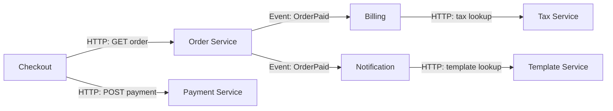
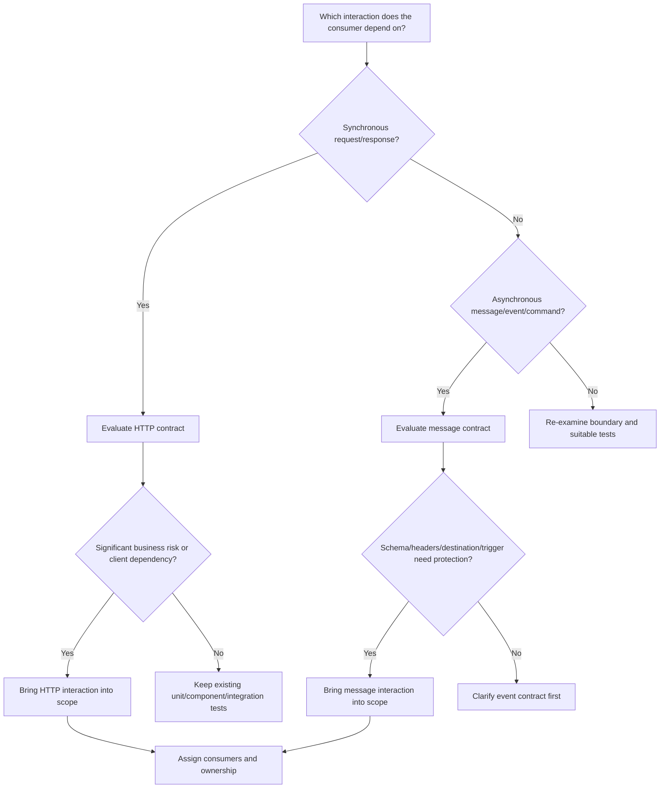
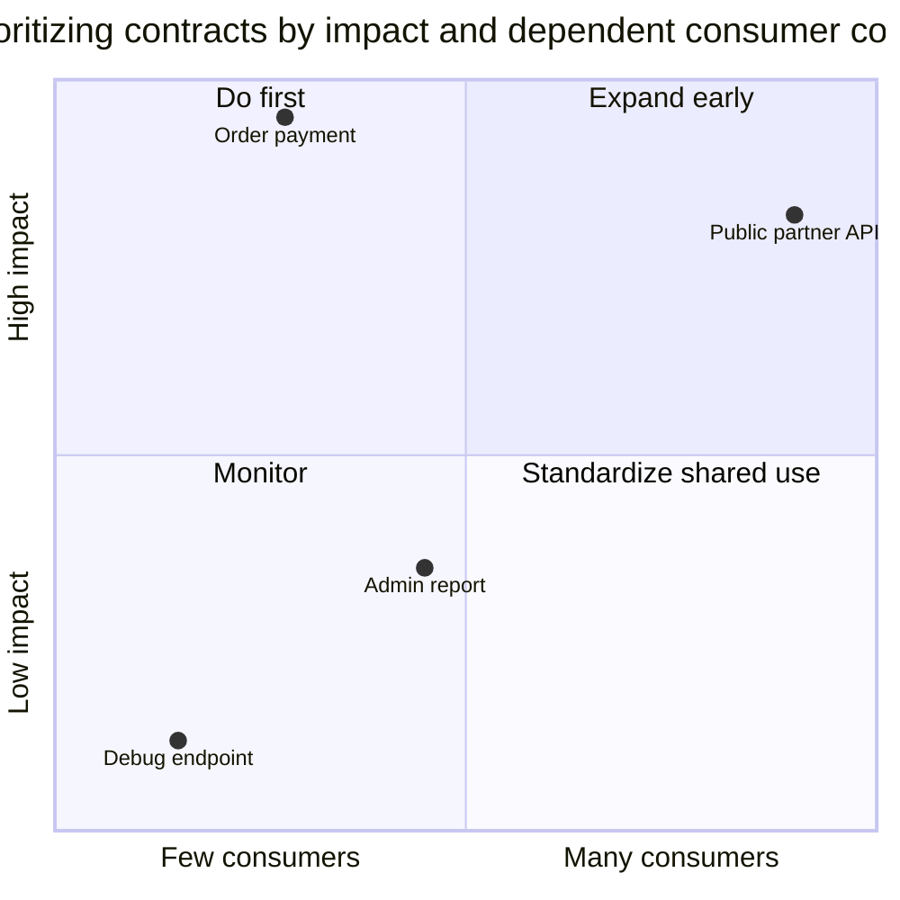
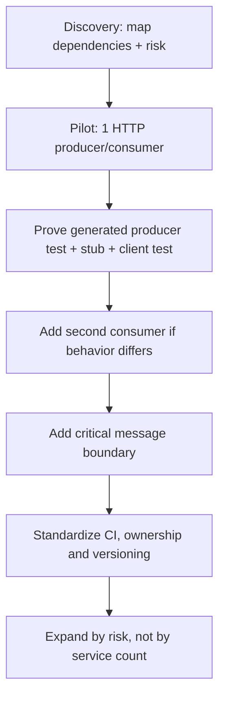
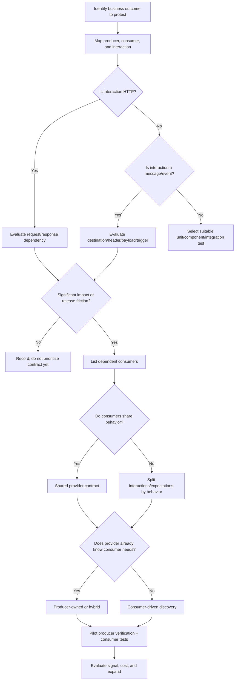

# Choosing Scope: HTTP, Messaging, and Supported Consumers

## 1. Why choose scope before writing contracts?

In **Spring Cloud Contract**, producers and consumers agree on the behaviors a service must provide over HTTP or messaging. Groovy DSL/YAML DSL describes requests, responses, messages, and matching conditions; **Contract Verifier** generates producer-side tests, while **Stub Runner** supplies stubs so consumers can test without starting every real service.

When adopting contract testing, the question is usually not “should we write contracts?” but rather:

- Should we start with **HTTP APIs**, **messaging**, or both?
- How many consumers should be included in the initial scope?
- Are contracts owned by the producer or proposed by consumers?
- Do we need one contract per consumer, or can multiple consumers share a contract?
- Which endpoints/messages should be tested first to reduce risk without creating too many hard-to-maintain tests?

Choosing too wide a scope upfront slows builds, increases fixture count, adds version synchronization effort, and makes it harder for teams to distinguish valuable contracts from contracts that merely mirror implementation details. Choosing too narrow a scope can leave critical interfaces unprotected: for example, HTTP APIs are tested while the `OrderPaid` event changes silently, breaking billing or notifications after deployment.

This lesson provides a **strategic selection framework** based on protocol, consumer dependency levels, change risk, contract ownership, and operating costs. The goal is to define a small but high-value scope, then expand intentionally.

## 2. Learning outcomes

After this lesson, you will be able to:

1. Distinguish when HTTP contracts, messaging contracts, or both protect the right testing boundary.
2. Assess the number and criticality of consumers instead of merely counting services.
3. Choose producer-owned or consumer-driven contracts based on how teams collaborate.
4. Identify which interactions should have contracts and which belong in integration/unit tests.
5. Choose the right granularity: per endpoint, business interaction, message type, or consumer journey.
6. Design a phased rollout with clear CI gates and versioning.
7. Recognize signs that scope is too broad, too narrow, or over-specified.

A good decision must answer three questions: **what are we protecting, who depends on it, and what evidence proves incompatible changes will be caught?**

## 3. Separate three decision axes

Do not merge “HTTP or messaging” and “how many consumers” into a single choice. They are independent axes:

| Axis | Question | Typical options |
|---|---|---|
| **Protocol** | How does the consumer communicate? | HTTP, message/event, or both |
| **Ownership model** | Who defines compatibility needs? | Producer-owned, consumer-driven, or hybrid |
| **Consumer scope** | Who needs protection in the first wave? | One representative consumer, critical consumer group, or all consumers |
| **Depth** | To what level should we test? | Critical interactions, error paths, schema/matchers, workflows |
| **Operations** | How are contracts run and distributed? | Same repository, contract repository, Maven artifacts, CI pipelines |

For example, a single service might:

- Expose an HTTP API to three consumers.
- Publish events over Kafka to two other consumers.
- Use producer-owned contracts for public APIs.
- Use consumer-driven contracts for an internal API with specialized requirements.
- Include only the checkout consumer in phase one because it is the critical revenue path.

This is not contradictory. A system can apply **different strategies per boundary**, provided ownership, contract source, and verification workflows are clearly documented.

## 4. Start from business risk, not from an endpoint list

A list of endpoints or topics tells you what the system has; it does not tell you which changes cause the greatest damage.

Start from business outcomes:

- Can Checkout complete payment?
- Does Billing record the right amount after receiving the event?
- Does Notification send the right confirmation once an order is paid?
- Can a partner continue calling its integrated API?
- Can consumers handle retries or duplicate messages?

Then trace backward to the interactions that produce those outcomes.

### 4.1. Example: a journey with multiple boundaries



If the goal is preventing checkout failures, you might prioritize:

1. An HTTP contract between Checkout and Order for reading order status.
2. An HTTP contract between Checkout and Payment for payment initialization results.
3. A message contract between Order and Billing for the `OrderPaid` event if billing depends on it.

There is no need to automatically pull Tax, Template, and all their endpoints into the first wave. Expand only when there is a business risk or dependency to protect.

### 4.2. Build a dependency map

Create a short table before selecting:

| Producer | Consumer | Interaction | Protocol | Business outcome |
|---|---|---|---|---|
| Order | Checkout | Read order state | HTTP | Allows checkout to proceed |
| Payment | Checkout | Create payment intent | HTTP | Completes payment |
| Order | Billing | OrderPaid | Messaging | Records accounts receivable |
| Order | Notification | OrderPaid | Messaging | Sends customer confirmation |

One consumer may call multiple endpoints or subscribe to multiple message types. One endpoint may serve multiple consumers. **Counting services is not enough to determine contract count**; identify specific interactions and dependencies.

## 5. HTTP decisions: when should it be included in scope?

HTTP contracts are usually appropriate when consumers send requests and depend on synchronous responses.

Signs to prioritize:

- Consumers need specific status codes, headers, or bodies to decide the next step.
- The API has multiple independent consumers or a release cadence different from the producer.
- Changes to paths, queries, request fields, response fields, or error semantics can break clients.
- Clients contain status/error mapping logic, JSON deserialization, or header-driven retries.
- The API is a boundary with mobile apps, partners, or external organizations.

### 5.1. What HTTP contracts should protect

| Element | Question to answer | Example |
|---|---|---|
| Method/path | Does the consumer call the right operation? | `GET /api/orders/42` |
| Query parameters | Are filters/pagination correct? | `?state=PAID&limit=20` |
| Request headers | Are required headers present? | `Accept`, tenant or version headers |
| Request body | Does the producer accept consumer payloads? | `POST` with `sku`, `quantity` |
| Status | Do success/error statuses match semantics? | `200`, `201`, `400`, `404`, `409` |
| Response headers | What metadata does the client need? | `Content-Type`, `Location`, `ETag` |
| Response body | Which fields/types do consumers depend on? | `id`, `state`, `currency` |
| Matchers | Does dynamic data follow expected types/formats? | UUID, timestamp |

Do not lock down every header or every field. Only describe conditions that matter to consumers and are guaranteed by the producer. If a consumer only needs `state`, there is no need for the contract to lock down a random `traceId`.

### 5.2. Selecting HTTP interactions by business dependency

For example, Checkout only needs:

```text
GET /api/orders/42
Response:
  200
  state = PAID
```

The consumer does not depend on JSON key ordering, internal database IDs, or tracing headers. The contract should keep the parts needed for the client to understand the response and make decisions.

If the consumer uses `Location` from a `201` response to query the resource next, that header is a dependency and must be described. If the client distinguishes `404 ORDER_NOT_FOUND` from `404 CUSTOMER_NOT_FOUND`, the error body/code is part of the contract.

### 5.3. When are HTTP contracts not needed yet?

- Consumer and producer are two modules inside the same application without a meaningful independent boundary; unit/component tests may suffice.
- The endpoint is used only by an internal test harness with no consumer behavior to protect.
- The interaction changes constantly without an API owner or stable semantics; clarify the API first.
- Existing integration tests already cover the boundary well, and contract setup cost does not yet yield additional useful signal.

These are not bans on contracts. Compare maintenance cost against the risk of undetected changes.

## 6. Messaging decisions: when is a message contract needed?

Messaging fits when producers emit messages/events and consumers process them asynchronously. There is no synchronous HTTP request per processing step; what matters is **where messages are sent, what headers/payloads they carry, and how consumers react**.

Signs to prioritize:

- Producers and consumers deploy independently.
- Multiple consumers subscribe to the same event.
- Payloads or headers drive routing, deserialization, or business logic.
- Event schema changes can prevent consumers from parsing or cause misinterpretation.
- Retries, duplicates, ordering, idempotency, or correlation are critical requirements.
- The event is an inter-team or cross-system commitment.

### 6.1. What to define in a message contract

| Element | Question | Example |
|---|---|---|
| Direction | Does the producer send or receive the message? | Output event `OrderPaid` |
| Destination | Where does the message go? | `orders.paid` |
| Headers | What metadata do consumers use? | `eventType`, correlation ID |
| Payload | Which fields/types are meaningful? | `orderId`, `state`, `currency` |
| Trigger/input | What condition produces the message? | Payment success |
| Serialization | What is the wire format? | JSON, Avro, or Protobuf |
| Delivery behavior | Must consumers handle retries/duplicates? | Idempotency key |
| Ordering/key | Is there a partition/key dependency? | `orderId` as message key |

Spring Cloud Contract supports message contracts, yet a single payload contract **does not prove** broker guarantees, exactly-once delivery, retry policies, or full consumer group behavior. Those operational properties require appropriate tests and infrastructure.

### 6.2. OrderPaid event example

```groovy
import org.springframework.cloud.contract.spec.Contract

Contract.make {
    description 'OrderPaid emitted after payment'
    label 'order_paid'

    input {
        triggeredBy('publishPaidOrderForContract()')
    }

    outputMessage {
        sentTo('orders.paid')
        headers {
            header('eventType', 'OrderPaid')
        }
        body(
            eventId: 'EVT-42',
            orderId: 42,
            state: 'PAID',
            currency: 'VND'
        )
    }
}
```

`triggeredBy(...)` must correspond to a method in the producer base test that triggers the message-emitting flow. Destinations, headers, and bodies must match the adapter/message verifier configured by the project. This DSL snippet is an illustrative example; binders, brokers, and serialization must match the actual runtime.

### 6.3. What should NOT be assumed from a message contract

- The message is delivered exactly once.
- Consumers process within a bounded time.
- The broker preserves ordering across all keys.
- Retries do not create duplicate side effects.
- Consumers commit offsets after processing.
- Every consumer follows the same schema evolution policy.

If these properties matter, add integration tests for the broker/adapter and consumer behavior. Contracts test **the agreed message boundary**, not distributed-system reliability.

## 7. HTTP, messaging, or both?

Select the protocol according to the **actual interaction**, not architectural trends.

| Situation | Appropriate scope | Reason |
|---|---|---|
| Checkout calls Order and needs an immediate response | HTTP contract | Synchronous; status/body decides flow |
| Order emits an event to Billing after payment | Message contract | Consumer receives event asynchronously |
| Producer receives a command on a queue then emits an event | Message contract for input/output | Must verify message direction and trigger |
| Mobile app calls a REST API | HTTP contract | Client releases separately from server |
| Service exposes both a REST API and emits events | Both, per boundary | The two protocols have different semantics |
| Direct database access between two modules | SCC contract may not fit | Not an HTTP/message boundary |

### 7.1. Quick decision matrix



If a workflow goes through HTTP and then emits an event, do not pick one protocol to represent the entire workflow. Protect **both boundaries** if both are independent commitments subject to change.

## 8. Hybrid model: APIs and events do not replace each other

For example:

- Checkout calls `POST /payments` and needs to know whether the payment intent is created or declined.
- Payment service emits `PaymentCaptured` after the transaction is confirmed.
- Billing subscribes to the event to recognize revenue.

The HTTP contract protects **the create-payment-intent request/response**. The message contract protects **the emitted event and what consumers receive**. Both contracts relate to the same business capability, yet they are not duplicates.

### 8.1. Placing contracts per boundary

| Boundary | Producer | Consumer | Contract protects |
|---|---|---|---|
| HTTP create payment | Payment | Checkout | Request, status, payment intent response |
| Event captured | Payment | Billing | Destination, headers, payload |
| Event captured | Payment | Analytics | Fields analytics actually uses |

If Billing and Analytics both subscribe to `PaymentCaptured` yet depend on different fields, a shared provider-level event contract can be used at the provider side with consumer-specific verification for each dependency. There is no need to duplicate the entire event definition just because there are two subscribers.
## 9. Choosing consumer count: not all are needed from day one

The number of consumers affects coordination and verification cost. Yet **raw count alone does not determine value**: one consumer processing critical transactions can matter more than ten rarely used consumers.

Evaluate each consumer by:

- **Business criticality:** if the consumer breaks, how severely are revenue, customers, or operational obligations affected?
- **Release independence:** can the consumer deploy before/after the producer?
- **Change sensitivity:** how many fields, statuses, headers, destinations, or message semantics does the consumer depend on?
- **Ownership:** is there a separate team and someone responsible for updating contracts?
- **Operational reach:** is the consumer internal, a partner, a mobile app, or a hard-to-upgrade system?
- **Failure detectability:** are bugs currently caught early enough by integration tests or production monitoring?

### 9.1. Prioritizing consumers with a score

An internal 1-to-5 scale can be used:

| Criterion | 1 point | 3 points | 5 points |
|---|---|---|---|
| Business impact | Low | Affects one workflow | Affects payments/orders/partners |
| Release independence | Deploys with producer | Occasionally skewed | Fully independent |
| Change sensitivity | Few dependencies | Depends on a few fields | Depends on many semantics/error paths |
| Upgrade difficulty | Same team, easy to upgrade | Requires coordination | Partner/mobile/legacy hard to upgrade |
| Current test gap | Already well tested | Some gaps remain | Almost no compatibility tests |

Scores are only **a tool to order discussion**, not a probabilistic formula or mandatory standard. Consumers with high total scores can be prioritized, though always evaluate any single severe risk even if the total score is low.

### 9.2. Selection matrix by consumer count

| Consumer scale | How to start | How to expand |
|---|---|---|
| **1 consumer** | Pick the most critical interaction, agree on owner, test real client | Add error paths or message boundaries as risk dictates |
| **2–3 consumers** | Start with the most critical consumer and one consumer with distinct behavior | Check whether remaining consumers share contracts or need separate expectations |
| **4–10 consumers** | Build a dependency inventory; pick representatives by business behavior/release cadence | Standardize artifacts/versions, consumer CI, and ownership |
| **Many consumers/partners** | Pick stable provider-level contracts, verify critical consumers, establish versioning policy | Expand verification by group instead of duplicating every scenario per client |

These numeric ranges are only organizational hints. A public API with two external consumers may need stricter control than an internal API with ten consumers on the same release train.

## 10. One contract per consumer or one shared contract?

**Do not create a copy of a contract per consumer by default.** When consumers genuinely depend on the same request/response behavior, they can share one provider contract and one stub artifact. When expectations differ, create separate interactions/contracts for distinct behaviors with clear ownership.

### 10.1. When to share a contract

- Consumers invoke the same operation and send requests with identical semantics.
- Checked fields/statuses/headers are shared guarantees of the producer.
- A provider change should be seen by all consumers as the same change.
- No per-client sample responses or custom matchers are required.

For example, Checkout, Admin, and Support all call `GET /api/orders/{id}` and need `id`, `state`, and `currency`. One provider-level contract can describe the shared response; each consumer can still write separate tests for its own business behavior.

### 10.2. When to have separate contract interactions

- Consumers send different payloads depending on workflow or permissions.
- One client needs different status/error semantics because of a different endpoint/operation.
- One consumer relies on headers, query parameters, or message metadata unused by others.
- There is a versioned API or behavior explicitly differentiated by protocol/version.
- A consumer-specific expectation is confirmed as a guarantee the producer must support.

For example:

| Consumer | Interaction | Meaningful difference |
|---|---|---|
| Checkout | `GET /api/orders/42` | Needs `state` to decide payment |
| Admin | `GET /api/orders/42?include=history` | Needs history as well |
| Partner | `GET /partner/v1/orders/42` | Has its own versioning and error format |

Do not cram these three behaviors into one giant contract just because they all read Order data.

### 10.3. Consumer-specific tests do not require consumer-specific stubs

A provider-level stub can be shared while:

- Checkout tests that `PAID` enables receipt generation.
- Admin tests reading history and rendering the right order.
- Partner tests mapping `404` to the committed error schema.

Each consumer test focuses on **the consumer's own behavior**. The stub supplies the response verified by the producer contract. If a different sample response is needed, create a separate interaction/stub mapping with an explicit request predicate; avoid leaving multiple mappings matching the same request with nondeterministic results.

## 11. Choosing ownership model: producer-owned or consumer-driven?

Consumer count and ownership are related but not identical. Having many consumers does not automatically require consumer-driven contracts; a well-designed provider-owned API can serve many clients when semantics are sufficiently shared.

### 11.1. Producer-owned contracts

The producer team defines the API/event behavior it commits to providing, writes Groovy/YAML contracts, and is responsible for:

1. Reviewing contract changes.
2. Generating producer tests with Verifier.
3. Running generated tests against the implementation.
4. Packaging and publishing stub artifacts.
5. Communicating versions/releases and deprecation policies.

Fits well when:

- The producer owns a canonical API with many consumers.
- The API is designed around a stable domain/provider contract.
- Consumers rely on shared behavior.
- One team has clear responsibility for schemas/compatibility.

**Risk:** the producer may describe the API from its own perspective and overlook real consumer dependencies. Mitigate with consumer reviews, usage inventories, and consumer tests.

### 11.2. Consumer-driven contracts

Consumer teams describe the requests and responses/messages their applications actually need; the producer verifies its implementation meets those expectations.

Fits well when:

- Consumers have specialized dependencies and are hard to upgrade.
- The producer does not fully know how clients use the API.
- Multiple independent teams need clear consumer-side feedback.
- Small status/error/header changes can break existing clients.

**Risk:** many consumers can submit overlapping or overly specific expectations. If the producer must satisfy every unnecessary detail, the contract suite becomes a burden and blocks refactoring.

### 11.3. Combining both models

A practical organizational setup:

- Producer-owned contracts describe **public capabilities** and standard behaviors.
- Consumer-driven interactions supplement truly specialized dependencies.
- Producer CI runs all approved contracts.
- Consumer CI uses appropriate stubs to verify client behavior.
- API owners resolve conflicts and retire unused expectations.

### 11.4. Ownership matrix

| Condition | Producer-owned | Consumer-driven | Hybrid |
|---|---|---|---|
| One canonical provider API | **Very suitable** | May be unnecessary | Suitable |
| Many independent consumers | Suitable if behavior is shared | Suitable when dependencies diverge | **Often useful** |
| Legacy consumers hard to upgrade | Needs careful consumer review | **Very suitable** | Suitable |
| Producer unaware of client usage | Needs discovery first | **Helps discover dependencies** | Suitable |
| Many consumers with overlapping expectations | **Easier to manage** | Prone to duplication | Suitable if normalized |
| Public/partner APIs | Provider contract as foundation | Consumer contracts supplement | **Usually sensible** |

You do not need one model for the entire company. Choose by **boundary, degree of independence, and how teams collaborate**.
## 12. Choose contracts by interaction, not by controller class

A controller may contain many operations, yet not every operation carries the same business risk. A message topic may carry multiple event types; an event type may have multiple business scenarios.

Define an **interaction unit** as a behavior that a consumer can call/receive and that has clear expectations.

Order API example:

| Interaction | Consumer dependency | Suggested priority |
|---|---|---|
| Fetch paid order | Checkout needs state | High |
| Fetch nonexistent order | Checkout handles `ORDER_NOT_FOUND` | High if error handling exists |
| Filter orders by status | Admin needs pagination/filters | Depends on frequency and impact |
| Internal debug-only endpoint | No business consumer | Low |

Event example:

| Message interaction | Dependency | Suggested priority |
|---|---|---|
| `OrderPaid` | Billing records revenue | High |
| `OrderPaid` | Notification sends confirmation | High if notification is committed |
| `OrderViewed` | Analytics statistics | Depends on data impact and tolerance for loss |
| Debug event | No business consumer | Low |

### 12.1. Do not write contracts for every method

Contract testing should protect **interfaces between processes/teams**, not replace all unit tests. Internal tax rules, service sorting algorithms, or repository queries usually belong in unit/integration tests. Bring them into contracts only if they alter observable behavior that consumers depend on.

## 13. Choose granularity: small enough to understand, large enough to be meaningful

A contract that is too small may check isolated fields without protecting the business scenario. A contract that is too large locks together unrelated behaviors and becomes hard to diagnose.

### 13.1. Granularity levels

| Level | Example | Pros | Risks |
|---|---|---|---|
| Field/schema | `state` is an enum | Easy to catch type/schema changes | Does not protect request/response flow |
| HTTP interaction | `GET /orders/{id}` | Clear request/response | May miss error paths |
| Business scenario | Order paid / not found | Tied to real dependencies | Needs clear fixtures |
| Message interaction | `OrderPaid` emitted | Protects event boundary | Does not cover broker reliability |
| End-to-end journey | Checkout → Payment → Order → Billing | Shows full workflow | Easily becomes a large integration test, hard to isolate |

### 13.2. Rules for choosing level

- Choose **HTTP interaction** when request/response is the boundary to protect.
- Choose **business scenario** when the same endpoint has multiple important outcomes.
- Choose **message interaction** when payload/destination/headers are an independent commitment.
- Use end-to-end tests for a few critical workflows rather than replicating the whole dependency graph in contracts.

## 14. Contract depth: success, error, and dynamic values

Not every interaction needs every status code or every data combination. Choose branches based on behavior consumers actually handle.

### 14.1. Selecting success paths

Most consumers have at least one success scenario. Start with the path carrying primary business value:

- `PAID` order so Checkout can proceed.
- Created payment intent so the client receives redirect/action details.
- `OrderPaid` event so Billing records revenue.

### 14.2. Selecting error paths

Add error contracts when consumers have distinct handling behavior:

- `400 INVALID_QUANTITY`: display validation error.
- `404 ORDER_NOT_FOUND`: end workflow or notify user.
- `409 ORDER_ALREADY_PAID`: prevent duplicate payment processing.
- `429`/`503`: retry or back off per policy.

There is no need to create contracts for every possible technical error if the consumer has no behavior to protect. However, if the consumer branches on an error code/status, describe it accurately.

### 14.3. Dynamic values and matchers

Use matchers for genuinely dynamic data such as UUIDs or timestamps; keep sample responses usable in stubs. Do not replace business fields like `state`, `currency`, or `error.code` with overly broad wildcards just to make producer tests pass easily.

### 14.4. Message variants

If an event has multiple variants, determine:

- Which event types/versions are public.
- Which fields are mandatory for every consumer.
- Which fields are optional and how consumers handle missing values.
- Whether consumers distinguish schema versions or event types.
- Whether variants can share a contract family or need separate interactions.

Do not treat a single sample payload as representative of all event variants when semantics differ.

## 15. Ranking interactions by risk

When the endpoint/topic list is long, rank **interactions**, not just services. A simple way is evaluating five factors:

1. **Impact:** if the interaction breaks, what is the business consequence?
2. **Likelihood:** does the contract/schema change often or is it already stable?
3. **Consumer exposure:** how many consumers and workflows depend on it?
4. **Upgrade friction:** can consumers upgrade together or must multiple versions be supported?
5. **Detection gap:** do current tests catch bugs before deployment?

A qualitative matrix can be used:

| Priority level | Signals | Recommended scope |
|---|---|---|
| **P0 — Critical** | Payments, order confirmation, compliance, partner APIs; failures lose transactions | HTTP/message contracts for success and critical error paths; producer + consumer verification |
| **P1 — High** | Key operational workflows, multiple independent consumers | Contracts for interactions with clear dependencies; test representative and divergent consumers |
| **P2 — Medium** | Supporting features, low risk, or existing integration coverage | Add when changing frequently or when failure evidence exists |
| **P3 — Low** | Rarely used internal debug/admin, no clear business dependency | Unit/component tests or monitoring; not a contract priority yet |

Priorities should be reviewed as business context changes. A rarely used endpoint today could become a critical partner integration next quarter.

### 15.1. Risk × consumer exposure matrix



This diagram only illustrates how to facilitate discussion, not metrics from a real system. **High impact with a single consumer can still be P0**; never delay solely because consumer count is low.

## 16. Phased scope rollout

Instead of bringing all services into the same release, stage adoption by maturity and feedback value.

### 16.1. Phase 0 — discovery

- Build a producer/consumer dependency map.
- Ask consumer teams which fields/statuses/headers/messages they actually read.
- Identify API/event owners and contract reviewers.
- Assess existing tests and past failure modes.
- Select one interaction with clear risk and stable fixtures.

**Output:** a dependency table and one interaction chosen for the pilot.

### 16.2. Phase 1 — pilot one HTTP boundary

Choose one producer and one consumer that collaborate well:

1. Write one HTTP contract for the critical happy path.
2. Generate producer tests with Verifier.
3. Run tests against the implementation.
4. Publish the stub artifact.
5. Consumer uses Stub Runner and its real HTTP client.
6. Intentionally alter status/body to prove tests catch regressions.

The goal is to prove **the entire workflow** before expanding contract count.

### 16.3. Phase 2 — add a divergent consumer

Add a second consumer if it has:

- A different release cadence.
- Different request shape or error handling.
- Legacy constraints.
- Business dependencies not yet represented by the first consumer.

If the second consumer uses the exact existing behavior, share the contract/stub and write consumer-specific behavior tests on the consumer side. Do not duplicate contracts just to increase file count.

### 16.4. Phase 3 — bring messaging into scope

Choose a critical event with independent consumers:

- Specify destination, headers, payload, and trigger.
- Use the appropriate message verifier/binder.
- Generate producer message tests.
- Test the consumer listener with message stubs or test adapters.
- Add broker integration tests if retries, duplicates, ordering, or offsets must be verified.

Do not move every topic into contract testing just because the HTTP pilot succeeded. Prioritize events with clear impact.

### 16.5. Phase 4 — standardize operations

- Standardize contract naming, ownership, and reviews.
- Version stub artifacts and pin dependencies in CI.
- Verify generated tests are not skipped.
- Store producer/consumer reports and resolved artifact coordinates.
- Establish a deprecation process for unused interactions.
- Track build cost and contract update time.

### 16.6. Illustrative roadmap



## 17. Scoping producer and consumer verification

A solid strategy clearly defines **who verifies what**:

| Test | Executed by | What it proves |
|---|---|---|
| Generated producer contract test | Producer CI | Implementation satisfies request/message and response/output contracts |
| Stub packaging check | Producer CI | Artifact contains valid mappings/message stubs and traceable version |
| Consumer stub test | Consumer CI | Real client/listener handles described interactions properly |
| Broker/transport integration test | Integration environment | Adapter, routing, serialization, and delivery behavior work properly |
| End-to-end test | System/release CI | Selected business journeys across multiple boundaries work |

Do not force consumer CI to boot the entire producer stack just to test contracts; that is a different goal with different costs. Likewise, do not run only consumer stub tests while skipping producer verification, because the stub may be right while the real producer implementation is broken.

## 18. Choosing how to distribute contracts and stubs

The wider the consumer scope, the more important artifact distribution becomes.

### 18.1. Same repository or same build

Suitable when:

- The pilot has few modules.
- Producers and consumers build in the same workspace.
- Teams want fast feedback and can share build artifacts.

Note: there must still be an explicit dependency between producer generated stubs and consumer tests. Do not let consumers read generated output files directly without going through a managed artifact/contract interface.

### 18.2. Maven artifact repository

Suitable when:

- Producers and consumers have independent repositories/CIs.
- Multiple consumers need the same stub.
- Versioning, retention, and traceability are needed.

Consumers declare group/artifact/version/classifier `stubs`; Stub Runner resolves the artifact according to mode and repository configuration. With mutable SNAPSHOTs, record resolved versions/checksums and avoid basing release decisions on indeterminate artifacts.

### 18.3. Contract repository or shared contract source

A dedicated repository can manage consumer-proposed or provider-owned contracts. Define:

- Who can merge contracts?
- Which revision does the producer build pull?
- Which producer version verified the contract?
- Which consumers still use an interaction?
- How are old contracts deprecated/removed?

Do not use a mutable branch as a release source without pinning the commit/revision.
## 19. Three sample scenarios and decision-making

### 19.1. Scenario A — one producer, one critical consumer

**Context:** Checkout is currently the sole consumer of the Order API. Checkout needs the `PAID` status to issue receipts; Order deploys independently and occasionally changes responses.

**Choices:**

- Start with an HTTP contract for `GET /api/orders/{id}`.
- Producer-owned contracts suffice if Checkout and Order review semantics together.
- Run generated producer tests and a consumer Stub Runner test.
- Add error interaction `404 ORDER_NOT_FOUND` if Checkout handles that branch.
- Do not pull all Admin endpoints into scope yet.

**Why:** high business impact and clear dependency; low consumer count does not diminish contract value.

### 19.2. Scenario B — one event, multiple independent consumers

**Context:** Order emits `OrderPaid`; Billing, Notification, and Analytics subscribe to the event. The three consumers have independent release cadences.

**Choices:**

- Create a provider-level message contract for the shared destination, headers, and payload.
- List the fields each consumer actually uses.
- Preserve `eventId`, `orderId`, `state`, and committed business fields.
- Consumer tests verify the distinct behaviors of Billing, Notification, and Analytics.
- Add broker integration tests for retries/idempotency if those are operational commitments.

**Why:** one event with multiple subscribers increases exposure; a shared provider contract prevents conflicting payload definitions, while separate consumer tests prove each subscriber handles it properly.

### 19.3. Scenario C — multiple HTTP consumers with differing needs

**Context:** Order API serves Checkout, Admin, Support, and a partner. Checkout only needs state; Admin needs history; Partner uses a separate API version and its own error schema.

**Choices:**

- Keep a provider-level contract for the shared API used by multiple consumers.
- Create separate interactions for query/history and the versioned partner API.
- Run consumer tests for Checkout and Partner first due to behavioral differences and upgrade friction.
- Do not duplicate the entire response contract for Support if it uses the exact already-protected behavior.
- Establish a deprecation/versioning policy for the Partner API.

**Why:** a large consumer count does not mean every consumer needs a copy of every contract. Split according to genuinely distinct behavior.

### 19.4. Scenario D — HTTP request followed by message event

**Context:** Checkout calls Payment to create an intent. Once payment succeeds, Payment emits `PaymentCaptured`; Billing and Notification process the event.

**Choices:**

- HTTP contract for creating a payment intent.
- Message contract for the `PaymentCaptured` event.
- Consumer contract tests for Checkout's HTTP client and Billing/Notification listeners.
- A few end-to-end tests verifying the complete payment workflow.

**Why:** two protocols protect two distinct boundaries within the same business flow.

## 20. Consolidated decision model

Use this table during design reviews:

| Question | If Yes | If No |
|---|---|---|
| Does the consumer send synchronous requests and rely on responses? | Evaluate HTTP contract | Move to messaging question |
| Does the consumer receive messages/events from the producer? | Evaluate message contract | Re-examine boundary |
| Does a change carry significant business impact or upgrade friction? | Shortlist the interaction | Can remain in existing tests |
| Do multiple consumers share the same behavior? | Provider-level contract can be shared | Evaluate separate interaction |
| Does a consumer have specific dependencies not yet described by provider? | Add reviewed consumer-driven expectations | Producer-owned may suffice |
| Must message delivery semantics be guaranteed? | Add broker integration tests | Contract payload may suffice for schema behavior |
| Can reproducible fixtures and tests be created? | Pilot immediately | Clarify state/trigger first |

### 20.1. Complete decision tree


## 21. Anti-patterns when choosing scope

| Anti-pattern | Consequence | Fix |
|---|---|---|
| Contracting every endpoint on day one | Slow builds, many fixtures, low signal | Start with critical interactions |
| HTTP-only contracts because the team knows REST | Message schemas change silently | Map events/topics too and select high-risk events |
| Contracting every message just because a broker exists | Test overload, unclear ownership | Choose events consumers genuinely depend on |
| One file/contract per consumer despite identical behavior | Duplication, drift | Use shared provider contracts, test consumers separately |
| One giant contract for an entire workflow | Hard to diagnose and modify | Split by boundary/interaction |
| Locking down every JSON field and header | Over-specification, blocks refactoring | Lock only dependencies and public guarantees |
| Using wildcards on business fields | Weak tests, breaking changes slip through | Exact values or semantic matchers |
| Testing only consumer stubs | Producer code can be wrong even when stubs look right | Run generated producer tests |
| Testing only producer tests | Consumer clients may deserialize/handle wrongly | Run real clients/listeners with stubs |
| Using one E2E test to replace all contracts | Slow, flaky, hard to attribute failures | Contracts at boundaries + few E2Es for critical journeys |
| Choosing representative consumers by count alone | Misses divergent legacy/partner clients | Choose by behavior and release friction |
| No owner/deprecation policy | Dead contracts live forever | Assign owners, consumer usage, and lifecycle |
| Publishing mutable SNAPSHOTs as release evidence | Non-reproducible results | Pin candidates/versions/checksums |
| Using contracts to prove exactly-once delivery | Wrong scope of evidence | Add broker/transport integration tests |

## 22. Governing ownership and contract lifecycle

As consumer count grows, the strategy needs a clear operating model.

### 22.1. Recommended roles

| Role | Responsibility |
|---|---|
| Producer/API owner | Defines public behavior, reviews contracts, and manages versioning |
| Consumer owner | Confirms real dependencies and maintains consumer tests |
| Contract reviewer | Checks matchers, scope, semantics, and compatibility |
| Platform/build owner | Supports Verifier, Stub Runner, repositories, and CI |
| Domain architect | Resolves conflicts between consumers and decides deprecations |

One person can wear multiple hats on a small team. What matters is that **each contract has an accountable person**, not having every job title.

### 22.2. Minimum metadata to track

Each interaction should trace:

- Contract ID and business description.
- Producer owner.
- Consuming consumer/team.
- Protocol and destination/endpoint.
- Source revision and artifact version.
- Creation/update date and lifecycle status.
- Error/compatibility notes.
- Links to producer and consumer CI evidence per internal process.

There is no need to embed all metadata inside Groovy DSL if the team keeps a separate manifest/catalog. However, the information must have a place to be queried and updated.

### 22.3. Deprecation and removal

Before deleting an interaction:

1. Identify which consumers still use it.
2. Check code, CI references, and runtime/usage evidence.
3. Announce the deprecation window and migration path.
4. Run consumer compatibility tests against the replacement version.
5. Remove only after relevant consumer owners confirm.

Unused contracts should be cleaned up intentionally; keeping dead contracts forever slows reviews and misleads teams into treating them as active commitments.

## 23. Measuring effectiveness of the chosen scope

Do not measure success solely by the number of contract files. Measure whether contracts catch bugs in the right places at an acceptable operating cost.

| Metric | What it tells you | How to interpret |
|---|---|---|
| Critical interactions covered | Level of protection for key dependencies | Measure against reviewed inventory, not all endpoints |
| Generated producer tests executed | Whether Verifier truly participates in CI | Check execution reports, not just source counts |
| Consumer tests using stubs | Whether key clients verify behavior | Break down by consumer/team |
| Breaking changes caught before release | Value signal of contracts | Record cases and impact |
| False-positive/maintenance rate | Are contracts too tight or missing owners? | Review matchers/fixtures |
| Build duration | Cost of feedback | Track trends and parallelization |
| Time to update contracts | Coordination cost | Identify ownership bottlenecks |
| Stale/unused contracts | Is scope bloating? | Clean up per lifecycle |

High coverage without critical consumer tests can create a false sense of security. Conversely, a small pilot that catches a breaking change before deployment is strong evidence to expand.

## 24. Exercise: choosing scope for the Commerce system

### 24.1. Context

A Commerce system has:

- Order Service exposing a REST API to Checkout, Admin, and Partner.
- Order Service emitting the `OrderPaid` event to Billing, Notification, and Analytics.
- Payment Service exposing an HTTP API to Checkout and emitting the `PaymentCaptured` event.
- Partner upgrades only on a monthly cycle.
- Billing processes revenue; misinterpreting the event can break reconciliation.
- Admin uses an internal API and already has integration tests.

### 24.2. Tasks

1. Build a table of producer/consumer/interaction/protocol/business impact.
2. Select the top three priority interactions and explain why.
3. Decide HTTP, messaging, or both for each interaction.
4. Select which consumers enter the pilot and which can share a provider contract.
5. Choose producer-owned, consumer-driven, or hybrid.
6. Identify success/error paths and message fields to protect.
7. Propose rollout phases and CI gates.
8. Name one anti-pattern that could happen if the entire system were scoped immediately.

### 24.3. One suggested approach

| Priority | Interaction | Consumer | Protocol | Reason |
|---|---|---|---|---|
| 1 | Payment create intent | Checkout | HTTP | Directly impacts payment flow |
| 2 | `OrderPaid` | Billing | Messaging | Impacts revenue/reconciliation |
| 3 | Partner order lookup | Partner | HTTP | Consumer is hard to upgrade, releases independently |

Producer-owned contracts can cover standard Order/Payment behaviors, while gathering consumer-driven input from Partner due to its independent upgrade cadence. Notification/Analytics enter the next phase if their field dependencies differ or carry risks worth protecting.

This is only **one sample option**. If the checkout flow is the biggest risk or the Partner API already has solid contract versioning, the order can change. Learners must justify decisions using impact and dependency evidence.

### 24.4. Exercise evaluation criteria

- Properly distinguishes HTTP and message boundaries.
- Does not equate service count with contract count.
- Selects consumers by impact, release independence, and upgrade friction.
- Avoids duplicating contracts for consumers with identical behavior.
- Includes both producer verification and consumer behavior tests.
- Recognizes message contract limits regarding broker delivery guarantees.
- Clearly defines ownership, versioning, and CI evidence.

## 25. Scope decision checklist

### Discovery and risk

- [ ] Identified business outcomes to protect.
- [ ] Built a producer/consumer dependency map by interaction.
- [ ] Distinguished HTTP request/response from message/event boundaries.
- [ ] Assessed business impact, release independence, and upgrade friction.
- [ ] Selected the highest-risk interactions for the pilot.

### Consumers and ownership

- [ ] Identified which consumers/teams truly depend on each interaction.
- [ ] Decided which behaviors can share a provider contract.
- [ ] Split consumer-specific expectations only when behavior/dependencies differ.
- [ ] Selected producer-owned, consumer-driven, or hybrid with clear rationale.
- [ ] Assigned an owner and reviewer for each contract.

### Contract scope

- [ ] HTTP contracts protect necessary method/path/query/headers/status/body.
- [ ] Message contracts define direction/destination/headers/payload/trigger.
- [ ] Success and critical error paths reflect behavior consumers actually handle.
- [ ] Dynamic matchers preserve types/formats without weakening business assertions.
- [ ] Unneeded metadata/fields are not locked down without reason.
- [ ] SCC contracts are not used to replace broker reliability or full E2E tests.

### Rollout and operations

- [ ] Pilot proves generated producer tests execute on real code.
- [ ] Stub artifacts have clear version/classifier and provenance.
- [ ] Consumer tests invoke real clients/listeners with Stub Runner.
- [ ] CI checks both producer verification and consumer compatibility.
- [ ] Version/SNAPSHOT policy supports reproducible builds.
- [ ] Deprecation/removal process and consumer inventory exist.
- [ ] Metrics exist for critical coverage, build duration, maintenance, and regressions caught.

**Key takeaway:** Scope Spring Cloud Contract by **each interaction's protocol, business risk, and the set of consumers that truly depend on it**. Start with the most critical boundary, share contracts when behavior is shared, separate expectations when dependencies differ, and add HTTP/messaging according to real needs. **A small scope with clear ownership, genuinely executed producer verification, and meaningful consumer tests beats a huge contract repo nobody maintains.**
