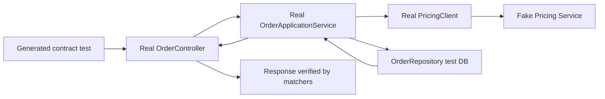

# Choosing Fixtures, Matchers, and Strictness Levels

A contract test can fail because the fixture does not reflect a valid producer state, or pass too easily because matchers accept almost any JSON. Conversely, a contract that locks down timestamps, UUIDs, and every array element can become brittle even though the consumer only cares about format and a few stable properties. Contract testing quality does not come from **making matchers as strict as possible** or **making fixtures identical to production**. Quality comes from choosing representative data, matching rules aligned with API guarantees, and a strictness level sufficient to catch incompatible changes.

**Spring Cloud Contract** uses Groovy/YAML DSL to describe HTTP or messaging behavior between producer and consumer. Contract Verifier generates producer tests; the plugin turns contracts into stubs; Stub Runner lets consumers test independently; CI checks compatibility before release. This lesson belongs to the **Strategy Selection** chapter, in the **SPRING_CLOUD_CONTRACT** module, directly covering **Choosing Fixtures, Matchers, and Strictness Levels**.

The article uses Order Service and Checkout Service as examples. Checkout sends a request to create an order; Order Service validates, calculates totals, persists the order, generates IDs and timestamps. You will learn how to choose fixtures for the producer, choose sample data for stubs, distinguish equality/type/regex/date/array matchers, decide when to assert exact values versus allow dynamic values, and prove those choices catch breaking changes.

## 1. Start from what the consumer actually depends on

Before creating fixtures or writing matchers, answer:

**Which guarantees does the consumer rely on to function properly?**

For example, Checkout sends:

```http
POST /api/orders
Content-Type: application/json
Accept: application/json

{
  "customerId": "CUS-000042",
  "clientRequestId": "A1B2C3D4E5F60708",
  "items": [
    {
      "sku": "SKU-42",
      "quantity": 2,
      "unitPrice": 62500
    }
  ]
}
```

Order Service returns:

```http
HTTP/1.1 201 Created
Content-Type: application/json
Location: /api/orders/ORD-100042

{
  "orderId": "ORD-100042",
  "clientRequestId": "A1B2C3D4E5F60708",
  "status": "CREATED",
  "createdAt": "2026-11-24T09:00:00Z",
  "totalAmount": 125000,
  "currency": "VND",
  "items": [
    {
      "sku": "SKU-42",
      "quantity": 2,
      "unitPrice": 62500
    }
  ]
}
```

Guarantees the consumer may depend on:

- The API uses `POST /api/orders` and returns `201 Created`.
- The response includes `orderId` so Checkout can proceed.
- `orderId` is a string matching an agreed format.
- `clientRequestId` is echoed for tracing or idempotency.
- `status` has the business value `CREATED`.
- `createdAt` is a parseable timestamp.
- `totalAmount` is a JSON number, not a string.
- `currency` is a currency code the consumer understands.
- `items` contains SKU, quantity, and unit price matching the published structure.
- `Location` points to the newly created resource.

Not every internal detail belongs in a contract. Consumers may not depend on database IDs, table names, implementation classes, or internal execution order. Protect the **observable behavior** the consumer needs, while keeping broader business invariants in appropriate unit/integration tests.

### 1.1. Distinguish API guarantees from implementation details

| Attribute | Should it be in the contract? | Reason |
|---|---|---|
| HTTP method/path | Yes | Consumer invokes directly |
| Status code | Yes | Drives control flow |
| Content-Type | Yes | Affects deserialization |
| Field `orderId` | Yes | Consumer needs to reference the order |
| JSON type of `totalAmount` | Yes | Consumer must parse the right type |
| Value of `status` | Yes if consumer branches on enum | Enum changes can break logic |
| Validly formatted timestamp | Yes if consumer parses timestamp | Protects format |
| Database table name | No | Internal detail |
| Repository method call order | No | Not an HTTP guarantee |
| Private method invocation count | No | Unobservable from consumer |
| Specific ID generation algorithm | Usually no | Consumers usually only need format/uniqueness |
| Total calculation formula | May need separate business assertions | Contract checks sample output; integration tests protect broader rules |

A contract that reaches too deeply into internal details makes refactoring difficult for the producer. A contract that only checks `201` fails to protect the response schema. Pick the right boundary between the two.

## 2. Three decisions that must be kept separate

**Fixtures**, **matchers**, and **strictness levels** relate to one another, yet do not replace one another.

| Decision | Question | Example |
|---|---|---|
| Fixture | What input state does the test need to run the behavior? | Customer exists, SKU has a price, clean database |
| Matcher | What condition is the actual value checked against? | `orderId` matches regex, `totalAmount` equals 125000 |
| Strictness level | How much variation does the contract allow? | Exact value, type, regex, occurrence bounds |

For example, the fixture creates customer `CUS-000042` and a SKU priced at `62500`. The response matcher can assert `totalAmount` equals `125000`. If the producer generates `orderId` dynamically, the fixture does not have to pin the ID generator; the matcher can check the `ORD-[0-9]{6}` format.

### 2.1. Do not use matchers to compensate for bad fixtures

If a test requires a valid customer but the fixture never created one, loosening the `customerId` matcher to `.*` will not fix the failure. Generated producer tests still send a request that the producer may reject because the data does not exist.

### 2.2. Do not use fixtures to dodge a guarantee that needs a matcher

If the API must return `status: CREATED`, a fixture may set up the right initial order, yet a response assertion is still needed. Seeding a `CREATED` object in the database does not prove the endpoint actually returns that status.

## 3. Choose fixtures according to the test's goal

A fixture is the data and environment state prepared to execute a scenario. In producer contract tests, fixtures usually live in the base test class extended by generated tests.

A useful fixture needs to:

1. Establish the minimal business conditions for a valid request.
2. Have stable values, reproducible across local and CI runs.
3. Be independent of test execution order.
4. Never share mutable state across tests running in parallel.
5. Control external boundaries that the contract does not need to verify.
6. Ensure key producer implementation code actually executes.
7. Be reset or cleaned up explicitly.

**A good fixture is minimal yet representative.** There is no need to import all production data just to test an order-creation API; nor should you use a mock returning canned responses to bypass the logic the contract is meant to protect.

## 4. Four common fixture strategies

### 4.1. Minimal valid fixture

Create only the mandatory data required for the scenario to run:

- One active customer.
- One valid SKU.
- A deterministic unit price.
- One request with one item.
- No order with a duplicate idempotency key.

Suitable for producer contract tests focusing on HTTP request/response and core business rules.

**Pros:** fast, readable, minimal dependencies, little extraneous data.

**Risks:** may miss behavior that only emerges with multiple items, multiple customer states, or boundary inputs. Add separate contract/integration cases for important branches.

### 4.2. Business-representative fixture

Use a dataset closer to real situations:

- Customer with `GOLD` tier.
- Two SKUs with different prices.
- An active discount rule.
- A valid shipping address.
- Selected optional fields.

Suitable when the response depends on interactions among multiple business rules. Keep the fixture small and well-named so reviewers see which conditions produce the output.

**Risks:** fixture bloat, making it hard to tell which data is truly necessary. When a test fails due to fixture drift, debugging the contract becomes harder.

### 4.3. Boundary and error fixtures

Prepare specifically for scenarios such as:

- Nonexistent customer.
- Discontinued SKU.
- Zero or negative quantity.
- Empty items array.
- Total amount exceeding limit.
- Idempotency key already used.
- User lacking permissions.

Do not cram everything into one multi-purpose fixture. Each contract case should express one condition and one meaningful outcome, such as `400 INVALID_QUANTITY` or `404 CUSTOMER_NOT_FOUND`.

### 4.4. Immutable fixtures and isolated data

An immutable fixture can be reused without being modified by other tests. For databases, create dedicated data per test or reset transactions according to the chosen strategy. For brokers, use dedicated topics/queues or correlation IDs in integration tests.

Never share a single customer/order with mutable state if tests run in parallel and can update it concurrently. That causes flakiness and order-dependent pass/fail results.

## 5. Choosing where to store fixture state

No single test database fits every contract. Choose according to the behavior under test.

| Setup approach | Best when | Limitations |
|---|---|---|
| In-memory repository/fake | Logic needs testing independently of database engine | Does not test real SQL, transactions, or mappings |
| H2/test database | Need to run repositories and business logic with a lightweight DB | May differ from production dialects/constraints |
| Testcontainers database | Need a production-like database engine | Slower startup and requires container management |
| `@Sql` scripts | Small, explicit SQL fixtures | Harder to reuse when schemas change |
| Fixture factory/builder | Many tests need to construct domain objects | Must avoid builders hiding business defaults |
| External fake/WireMock | Calling payment, identity, or shipping providers | Only tests adapter/request, not the real provider |

### 5.1. Fake at the right boundary

Suppose Order Service calls Pricing Service to fetch prices. If the contract protects the order-creation response, you can fake Pricing Service's HTTP response while keeping the rest real:



Controller, service, client adapter, mapper, and response serialization are all still tested. The external Pricing Service is controlled so results remain reproducible.

If you mock `OrderApplicationService` and return `OrderResponse` directly, the test stops verifying the business implementation you intended to protect. If the contract is purely a controller mapping slice and the service is already covered by another suite, mocking the service can make sense; state the scope accurately.

### 5.2. Avoid fixtures that return pre-baked answers

Anti-example:

```java
OrderApplicationService service =
    Mockito.mock(OrderApplicationService.class);

Mockito.when(service.create(any()))
    .thenReturn(new OrderResponse(
        "ORD-100042",
        "CREATED",
        125000
    ));
```

Generated producer tests may receive the exact JSON and pass, even though real pricing, ID generation, order persistence, and mapping never ran. This only proves the remaining adapter slice within test scope.

A good fixture provides **inputs**; the implementation produces **outputs**; matchers verify those outputs. Avoid having fixtures/mocks supply the exact answer the test is supposed to verify.

## 6. Stable data: what to fix, what to keep dynamic?

Not every value needs to be random, nor must every value be hard-coded.

| Data | Commonly suitable strategy | Reason |
|---|---|---|
| Customer ID in producer test request | Fixed value | Easy to seed and reproduce |
| Client request ID in producer test | Fixed value, valid format | Easy to trace request |
| Producer-generated Order ID | Dynamic + regex or fixed generator depending on goal | Consumers usually need format/uniqueness |
| Created timestamp | Fixed Clock if checking exact instant; timestamp matcher if format suffices | Avoids clock-dependent tests |
| Status enum | Equality | Enum changes can break consumers |
| Total amount | Equality when fixture is deterministic; type/range added if needed | Protects business data |
| Correlation header | Regex if ID varies, equality if echoing specific value | Depends on semantics |
| Array items | Sample fixture + occurrence bounds | Verifies structure/cardinality |
| Service-generated UUID | UUID regex or equality if generator is fixed | Decouples format from generation algorithm |

### 6.1. Fixed Clock or timestamp matcher?

Choose **Fixed Clock + equality** when the consumer needs an exact instant or business logic depends on time. For instance, a contract verifying an effective date starting at exactly `2026-11-24T09:00:00Z`.

Choose **timestamp matcher** when the consumer only needs a parseable timestamp in the committed format. The producer is allowed to return the real creation time.

Do not use a timestamp matcher to ignore timezone or time rules that the consumer genuinely relies on. If the API guarantees UTC, a generic ISO-8601-with-offset matcher may be too permissive; use a tighter matcher/assertion.

### 6.2. Fixed ID generator or regex?

Choose a fixed ID generator when the test needs to verify relationships across multiple resources or a specific identifier. For example, `Location` must end with the exact newly created ID and the DB must contain that same ID.

Choose regex when the contract only guarantees format, such as `ORD-` followed by six digits. Do not couple consumers to the producer's internal sequence/UUID algorithm.

## 7. What are matchers and where should they be placed?

Matchers specify how actual data is compared against contract data. In Spring Cloud Contract, matchers can be declared for requests and responses using Groovy DSL or YAML DSL.

- **Request matchers:** let stubs accept consumer requests under the committed conditions.
- **Response matchers:** let generated producer tests verify actual producer responses.
- **Message matchers:** protect message bodies/headers/destinations in messaging contracts.

A matcher should express **the exact level of commitment**: equality for stable fields; regex for dynamic fields with formats; type when only type matters; date/time matchers for timestamps; occurrence constraints for collections.

## 8. The strictness scale

Strictness can be visualized from looser to stricter:

```text
Broader                                                Stricter
   |                                                       |
   v                                                       v
Type only -> Format/regex -> Occurrence bounds -> Equality
   |              |                 |                |
JSON type       Format            Count         Exact value
```

This is a mental model for selection, not a mandatory framework order. A single contract typically combines multiple matcher types across different fields.

| Level | Checks | When to use |
|---|---|---|
| Type | String/number/boolean/object/array | Value varies while type is guaranteed |
| Format | Regex, date, timestamp, time | Consumer must parse/validate format |
| Occurrence | Min/max element count | Collection has specified cardinality |
| Equality | Exact value | Enums, codes, statuses, or business constants |
| Business assertion | Relationships across fields/side effects | Invariants beyond a single matcher |

### 8.1. Type matchers do not replace business validation

If `quantity` is an integer, `byType()` can verify its type. It does not ensure quantity is greater than 0, does not exceed stock, or does not push totals over a limit.

If a business rule requires positive quantities, an appropriate regex/typed matcher can guard the JSON format, yet service tests are still needed for stock/business state. Contract matchers should not be treated as an engine validating every business rule.

### 8.2. Regex does not verify existence

The matcher `ORD-[0-9]{6}` confirms the order ID format. It does not prove that order exists in the database or belongs to the current customer. Access rights and existence require separate business/security tests.

### 8.3. Equality can be too strict for dynamic data

If a contract response hard-codes an exact timestamp while the producer uses the system clock, generated producer tests will fail depending on run time. When the consumer only needs format, use a timestamp matcher. When the consumer needs a fixed value in the scenario, inject a Fixed Clock.

## 9. Rules for choosing matchers per field

| Field | Recommended default | When to tighten |
|---|---|---|
| `status` | Equality | Add contracts for every consumer-supported status |
| `orderId` | Regex with prefix/length | Equality when verifying resource identity |
| `customerId` | Regex or equality per request semantics | Equality if a specific fixture checks authorization |
| `clientRequestId` | Regex for format; equality when testing echo | Add response/reference matcher from request |
| `createdAt` | Timestamp matcher | Fixed Clock/equality when an exact time commitment exists |
| `totalAmount` | Equality with deterministic fixture | Type/range only when values genuinely vary |
| `currency` | Equality | Add separate contracts for other currencies |
| `items` | Type + min/max occurrence | Check item fields/ordering if consumer depends on them |
| `email` | Format regex | Equality if a specific fixture value is expected |
| `optionalNote` | Clear optional/null policy | Separate absent, null, and non-null scenarios |
| `Location` | Regex if ID is dynamic | Equality if response ID is fixed |

Do not treat this table as rigid law. Choose based on **consumer behavior**, API policy, and real data.

## 10. Groovy DSL: combining sample fixtures with dynamic matchers

Create the contract:

```text
src/test/resources/contracts/checkout/create_order_201.groovy
```

Example:

```groovy
import org.springframework.cloud.contract.spec.Contract

Contract.make {
    name 'checkout_create_order_201'
    description 'Create order with valid request and dynamic order ID'

    request {
        method POST()
        url '/api/orders'
        headers {
            contentType(applicationJson())
            accept(applicationJson())
        }

        body(
            customerId: $(
                consumer(regex('CUS-[0-9]{6}')),
                producer('CUS-000042')
            ),
            clientRequestId: $(
                consumer(regex('[A-F0-9]{16}')),
                producer('A1B2C3D4E5F60708')
            ),
            items: [
                [
                    sku: 'SKU-42',
                    quantity: 2,
                    unitPrice: 62500
                ]
            ]
        )

        bodyMatchers {
            jsonPath('$.items', byType {
                minOccurrence(1)
                maxOccurrence(5)
            })
        }
    }

    response {
        status CREATED()
        headers {
            contentType(applicationJson())
            header(
                'Location',
                $(
                    consumer('/api/orders/ORD-100042'),
                    producer(regex('/api/orders/ORD-[0-9]{6}'))
                )
            )
        }

        body(
            orderId: $(
                consumer('ORD-100042'),
                producer(regex('ORD-[0-9]{6}'))
            ),
            clientRequestId: fromRequest().body('$.clientRequestId'),
            status: 'CREATED',
            createdAt: $(
                consumer('2026-11-24T09:00:00Z'),
                producer(anyIso8601WithOffset())
            ),
            totalAmount: 125000,
            currency: 'VND',
            items: [
                [
                    sku: 'SKU-42',
                    quantity: 2,
                    unitPrice: 62500
                ]
            ]
        )

        bodyMatchers {
            jsonPath('$.totalAmount', byType())
            jsonPath('$.items', byType {
                minOccurrence(1)
                maxOccurrence(5)
            })
        }
    }
}
```

This is a learning example; DSL helpers should be verified against your plugin version. Key points:

- The request stub accepts customer IDs and client request IDs matching the formats.
- Generated producer tests send the fixed samples.
- The stub returns a fixed order ID.
- Generated producer tests validate the real order ID against the regex.
        - `status` and `currency` are protected by default equality on the sample body; `totalAmount` is type-checked via `byType()`.
- `createdAt` is validated against ISO-8601 with offset.
- `items` has element-count bounds.

**Avoid applying two conflicting matchers to the same field** without good reason. When mixing direct dynamic values and `bodyMatchers`, inspect generated tests to confirm which rule actually applies.

## 11. YAML DSL: separating sample bodies and matchers

YAML uses a sample body plus a `matchers` section. Equivalent alternative to Groovy:

```yaml
name: checkout_create_order_201
description: Create order with request matchers and response matchers

request:
  method: POST
  url: /api/orders
  headers:
    Content-Type: application/json
    Accept: application/json
  body:
    customerId: CUS-000042
    clientRequestId: A1B2C3D4E5F60708
    items:
      - sku: SKU-42
        quantity: 2
        unitPrice: 62500
  matchers:
    body:
      - path: $.customerId
        type: by_regex
        value: 'CUS-[0-9]{6}'
        regexType: as_string
      - path: $.clientRequestId
        type: by_regex
        value: '[A-F0-9]{16}'
        regexType: as_string
      - path: $.items
        type: by_type
        minOccurrence: 1
        maxOccurrence: 5

response:
  status: 201
  headers:
    Content-Type: application/json
  body:
    orderId: ORD-100042
    clientRequestId: A1B2C3D4E5F60708
    status: CREATED
    createdAt: '2026-11-24T09:00:00Z'
    totalAmount: 125000
    currency: VND
    items:
      - sku: SKU-42
        quantity: 2
        unitPrice: 62500
  matchers:
    body:
      - path: $.orderId
        type: by_regex
        value: 'ORD-[0-9]{6}'
        regexType: as_string
      - path: $.createdAt
        type: by_timestamp
      - path: $.totalAmount
        type: by_type
      - path: $.items
        type: by_type
        minOccurrence: 1
        maxOccurrence: 5
```

This is a standalone YAML contract. Do not place both Groovy and YAML versions representing the same scenario in the source directory unless you intend to generate two contracts/tests/mappings.

### 11.1. Request matchers and response matchers are not interchangeable

- `request.matchers.body` governs stub request matching.
- `response.matchers.body` governs generated producer assertions on responses.
- The sample body remains the source of sample data.
- JSONPath must point to fields present in the sample body.
- `regexType` preserves the right type when a regex describes a number or boolean.

### 11.2. YAML is not JSON Schema

YAML matchers support Spring Cloud Contract's matcher types; they do not replace full JSON Schema/OpenAPI or business validation. For conditions like total equaling the sum of items, or quantity not exceeding stock, add checks in implementation tests.

## 12. Equality: when should exact values be locked?

Use equality for values consumers rely on such as enums/statuses/error codes or values fixed by the contract.

For example:

```groovy
response {
    status CREATED()
    body(
        status: 'CREATED',
        currency: 'VND',
        errorCode: 'NONE'
    )
}
```

With a literal sample body and no other matchers, generated tests typically compare these values using equality semantics.

**Use equality when:**

- The consumer branches on an enum.
- The value comes from a finite set where changes break compatibility.
- The test fixture deterministically controls the value.
- The contract describes a specific error code or status.

**Avoid equality when:**

- Values come from a UUID generator.
- Timestamps reflect real wall-clock time while the consumer only needs parseability.
- Correlation IDs vary per request and the contract only guarantees format.
- Collections have validly varying element counts and the consumer does not depend on exact contents.

Equality is neither inherently good nor bad; it fits commitments with stable values.

## 13. Type matchers: when is type alone sufficient?

If the consumer simply deserializes a field into BigDecimal, String, Boolean, or a list, a type matcher can cover part of the guarantee.

Response example:

```json
{
  "orderId": "ORD-100042",
  "totalAmount": 125000,
  "confirmed": true
}
```

Groovy:

```groovy
bodyMatchers {
    jsonPath('$.orderId', byType())
    jsonPath('$.totalAmount', byType())
    jsonPath('$.confirmed', byType())
}
```

YAML:

```yaml
matchers:
  body:
    - path: $.orderId
      type: by_type
    - path: $.totalAmount
      type: by_type
    - path: $.confirmed
      type: by_type
```

Type matchers do not protect ID formats, status values, or business ranges. `totalAmount` could be a negative number and a type matcher would still see a valid number type. If non-negativity is needed, use an appropriate regex/typed matcher plus business tests; if the value is computed deterministically, equality is usually clearer.

## 14. Regex matchers: dynamic yet bounded formats

Use regex when data varies but must follow a stable pattern:

- Order ID: `ORD-[0-9]{6}`.
- Customer ID: `CUS-[0-9]{6}`.
- Correlation ID: `[A-F0-9]{16}`.
- UUID: predefined UUID matcher.
- Event code: `ORDER_[A-Z]+`.

Groovy:

```groovy
bodyMatchers {
    jsonPath('$.orderId', byRegex('ORD-[0-9]{6}').asString())
    jsonPath('$.clientRequestId', byRegex('[A-F0-9]{16}').asString())
}
```

YAML:

```yaml
matchers:
  body:
    - path: $.orderId
      type: by_regex
      value: 'ORD-[0-9]{6}'
      regexType: as_string
```

Regexes typically apply full-value matching semantics. `ORD-[0-9]{6}` matches `ORD-100042`, not `prefix-ORD-100042`.

Do not use `.*` to fix every failing test. Overly broad patterns let malformed values slip through. Nor does regex prove an ID exists, grants access, or correlates with the request.

### 14.1. Typed regex

YAML `regexType` can specify string, integer, long, double, float, short, or boolean depending on supported schema/version. Groovy DSL offers typed variants such as `.asString()` and `.asInteger()`.

For example:

```groovy
bodyMatchers {
    jsonPath('$.quantity', byRegex('[1-9][0-9]*').asInteger())
    jsonPath('$.active', byRegex('true|false').asBooleanType())
}
```

Ensure matchers protect the proper JSON type. JSON number `2` and JSON string `"2"` are not equivalent to a consumer deserializer.

## 15. Date, timestamp, and time matchers

Use temporal matchers matching the field type:

| Matcher | Data form | Example |
|---|---|---|
| `byDate()` / `by_date` | Date | `2026-11-24` |
| `byTimestamp()` / `by_timestamp` | Date and time | `2026-11-24T09:00:00Z` |
| `byTime()` / `by_time` | Time | `09:00:00` |

Groovy:

```groovy
bodyMatchers {
    jsonPath('$.effectiveDate', byDate())
    jsonPath('$.createdAt', byTimestamp())
    jsonPath('$.cutoffTime', byTime())
}
```

YAML:

```yaml
matchers:
  body:
    - path: $.effectiveDate
      type: by_date
    - path: $.createdAt
      type: by_timestamp
    - path: $.cutoffTime
      type: by_time
```

Format matchers do not by themselves verify timezones, expiration dates, chronological ordering, or business calendars. If the consumer requires UTC, constrain the timezone with an appropriate regex/assertion. If `createdAt < expiresAt` is required, add that relational check in business tests.

## 16. Array matchers and occurrence bounds

When consumers accept a variable item count, use a sample body with representative elements and set occurrence bounds.

Groovy:

```groovy
bodyMatchers {
    jsonPath('$.items', byType {
        minOccurrence(1)
        maxOccurrence(10)
    })
}
```

YAML:

```yaml
matchers:
  body:
    - path: $.items
      type: by_type
      minOccurrence: 1
      maxOccurrence: 10
```

Choose bounds based on API semantics:

- Array must contain at least one item: min 1.
- API caps at ten items: max 10.
- API permits empty arrays: min 0 or a separate scenario, depending on semantics.
- API requires exactly two items: min 2 and max 2, or equality when contents must be fixed.

If the consumer depends on `sku` or `quantity` on each element, checking only collection type is insufficient. Add matchers for needed fields and verify JSONPath wildcard support per plugin version.

## 17. Null, absent, and optional are three distinct states

```json
{"note": "Leave at reception"}
```

```json
{"note": null}
```

```json
{}
```

- Non-null: field is present with a value.
- Null: field is present with value null.
- Absent: field is missing from JSON.

Use `byNull()` when the contract requires a null field. Use optional behavior where supported by the DSL when a field may be omitted. Never use optional to mask a serializer bug that accidentally drops a mandatory field.

If the consumer handles all three states differently, provide clear scenarios/matchers for each behavior. Check optional syntax against your Spring Cloud Contract version.

## 18. Matchers on request or response?

A common mistake is picking the right matcher type on the wrong side.

| Location | Goal | Review question |
|---|---|---|
| Request method/path | Identify endpoint | Does the consumer call the right resource? |
| Request headers | Content negotiation/auth/correlation | Which headers must the consumer send? |
| Request body matchers | Stub accepts valid requests | Tight enough to avoid matching the wrong endpoint/scenario? |
| Response status | Drive consumer flow | Does it reflect success/error semantics? |
| Response headers | Content type, Location, cache/correlation | Does the consumer depend on the header? |
| Response body matchers | Generated producer tests verify output | Do they catch schema/type/format breaking changes? |
| Message destination/headers/body | Producer/consumer messaging contract | Are channel and event semantics accurate? |

Overly tight request matchers cause stubs to return 404 for valid requests just because an unimportant field differs from the sample. Overly loose request matchers let invalid requests match the stub mapping.

Overly tight response matchers lock the producer to incidental details. Overly loose response matchers let the producer change schemas incompatibly.

## 19. Fixture and matcher selection matrix

| Case | Fixture to choose | Matcher to choose | Why |
|---|---|---|---|
| Fixed status enum | Seed state yielding a clear status | Equality | Enum changes impact consumers |
| Auto-generated Order ID | No need to fix generator if only format matters | Regex | Allows IDs to vary |
| Current timestamp | Fixed Clock if exact time matters; otherwise do not seed clock | Timestamp matcher | Avoids run-time sensitivity |
| Total from fixed items | Fixed items/prices | Equality | Verifies calculation for scenario |
| Variable-length collection | A few representative sample items | Type + min/max | Protects structure/cardinality |
| Nonexistent customer | Do not seed that customer | Equality for status/error code | Tests not-found branch |
| External pricing | Deterministic fake response at boundary | Equality for scenario total | Business calculation still runs for real |
| Correlation ID | Fixed value in producer sample | Regex + echo assertion | Permits many valid IDs |
| Optional note | Fixtures producing present/absent cases | Separate optional/null scenarios | Avoids confusing absent with null |
| Authorization | Principals with/without permissions | Status equality + body fields | Protects 401/403 semantics |

This matrix is a guide, not a default configuration for every API. If consumers add dependencies, raise protection accordingly.

## 20. One fixture should not represent every scenario

Split contract cases by business outcome:

```text
create_order_201
create_order_invalid_quantity_400
create_order_customer_not_found_404
create_order_duplicate_request_409
create_order_forbidden_403
```

Each case has its own fixture and matchers:

| Scenario | Fixture | Response matchers |
|---|---|---|
| Successful order creation | Valid customer and SKU | 201, orderId format, status CREATED |
| Invalid quantity | Request quantity = 0 | 400, code INVALID_QUANTITY |
| Nonexistent customer | Customer not seeded | 404, code CUSTOMER_NOT_FOUND |
| Duplicate idempotency key | Seed/request already-used key | 409, code DUPLICATE_REQUEST |
| Missing permissions | Principal lacks scope | 403, error schema |

Do not write one broad regex matcher accepting every error body. Consumers need specific error codes to decide actions.

## 21. Avoiding over-matching and under-matching

### 21.1. Over-matching: matchers too broad

Example:

```groovy
bodyMatchers {
    jsonPath('$.orderId', byRegex('.*').asString())
    jsonPath('$.status', byType())
}
```

This contract accepts an order ID without a prefix or any string status. A breaking change from `CREATED` to `CANCELLED` could go undetected even if the consumer distinguishes the two states.

Fix:

```groovy
bodyMatchers {
    jsonPath('$.orderId', byRegex('ORD-[0-9]{6}').asString())
}
```

For `status`, use equality if the value must be `CREATED`.

### 21.2. Under-matching: matchers too strict

For example, the producer returns a real timestamp:

```json
{"createdAt": "2026-11-24T09:15:22Z"}
```

Yet the contract hard-codes:

```json
{"createdAt": "2026-11-24T09:00:00Z"}
```

Without a Fixed Clock, tests fail even though the timestamp is valid and the consumer does not depend on an exact value. Fix by using a Fixed Clock if exact time matters, or a timestamp matcher if only format is needed.

### 21.3. Choosing just-enough matchers

A good matcher has three traits:

1. Protects what the consumer relies on.
2. Permits variations the API genuinely allows.
3. Fails when the producer makes an incompatible behavioral change.

If you do not know what a consumer depends on, inspect client code and ask the consumer team; do not guess by defaulting every field to equality.

## 22. Verifying matchers with mutation tests

Matchers should be tested with deliberate faulty changes in the implementation on a test branch.

| Mutation | Matcher/test must catch |
|---|---|
| `orderId` changed to `BAD-42` | Regex `ORD-[0-9]{6}` |
| `status` changed from `CREATED` to `PENDING` | Equality |
| `totalAmount` changed from number to string | Type/equality |
| `createdAt` changed to `yesterday` | Timestamp matcher |
| `items` becomes an empty array | minOccurrence = 1 |
| `Location` omitted | Header assertion |
| `clientRequestId` not echoed properly | Request/response reference assertion |
| Error code changed `INVALID_QUANTITY` to `BAD_INPUT` | Equality for code |

Process:

1. Run baseline and confirm generated producer tests pass.
2. Change one contract-relevant behavior.
3. Run the exact generated test.
4. Confirm the test fails at the expected assertion.
5. Restore the implementation.
6. Re-run and confirm it passes.
7. Record which mutations were caught.

If a mutation does not break the test, inspect generated sources, matcher side, base class, test mode, test runner, and fixtures. A contract parsing cleanly does not prove its matchers work.

## 23. Inspect generated tests and stub mappings before trusting matchers

After running the Maven producer build, generated tests typically appear in a directory like:

```text
target/generated-test-sources/contracts/
```

Reports typically appear in:

```text
target/surefire-reports/
target/failsafe-reports/
```

Exact names and paths vary by plugin/version.

Check that:

- Generated producer tests send the right producer-side request samples.
- Response assertions reflect the intended matchers.
- Request stub mappings enforce the right regex/field conditions.
- Stub responses use stable consumer-side sample values.
- Status, headers, and body fields are protected.
- The test runner actually executes generated tests without skipping.
- The stubs artifact is built from the exact contracts revision.

Never edit generated files under `target/` directly. If a matcher is wrong, fix the contract DSL and regenerate.

## 24. Fixtures and matchers in the base test class

The base class can seed data before each generated test:

```java
@SpringBootTest
@AutoConfigureMockMvc
public abstract class OrderContractTestBase {

    @Autowired
    MockMvc mockMvc;

    @Autowired
    OrderContractFixture fixture;

    @BeforeEach
    void setUpContractFixture() {
        fixture.reset();
        fixture.insertCustomer("CUS-000042");
        fixture.insertSku("SKU-42", 62500);
        RestAssuredMockMvc.mockMvc(mockMvc);
    }
}
```

This is an illustrative skeleton. `OrderContractFixture` must be implemented by the project and wired to a test database/repository. If tests must verify services, mappers, security, or persistence, do not mock those components just to simplify fixtures.

### 24.1. Clock and ID generator

If a contract requires an exact timestamp, inject a fixed Clock in the test profile:

```java
@Bean
@Primary
Clock contractTestClock() {
    return Clock.fixed(
        Instant.parse("2026-11-24T09:00:00Z"),
        ZoneOffset.UTC
    );
}
```

If an exact order ID is needed for a scenario, inject a deterministic ID generator in the test profile. However, if the contract only guards format, let the producer generate real IDs and verify with a regex matcher. Only pin dependencies when doing so verifies a concrete commitment.

## 25. Maven/Gradle builds: verify the right phase

Maven producers typically configure the Spring Cloud Contract Maven plugin with `baseClassForTests`, `testMode`, and the corresponding test framework. Example fragment:

```xml
<plugin>
    <groupId>org.springframework.cloud</groupId>
    <artifactId>spring-cloud-contract-maven-plugin</artifactId>
    <version>APPROPRIATE_CONTRACT_VERSION</version>
    <extensions>true</extensions>
    <configuration>
        <baseClassForTests>
            com.example.order.contract.OrderContractTestBase
        </baseClassForTests>
        <testMode>MOCKMVC</testMode>
        <testFramework>JUNIT5</testFramework>
    </configuration>
</plugin>
```

Run producer:

```bash
./mvnw -B -ntp clean verify
```

`generateTests` generates sources; the test lifecycle must compile and execute the generated tests. Never conclude verification succeeded solely because files exist under `target/generated-test-sources/contracts/`.

With Gradle, task names and wiring depend on plugin versions; inspect the task graph and reports for `contractTest`/`check` rather than assuming every project configures them identically.

## 26. Consumer Stub Runner: sample fixtures must be stable

Consumer tests rely on stub responses with concrete values:

```java
@SpringBootTest
@AutoConfigureStubRunner(
    ids = "com.example:order-service:1.4.0:stubs:8085",
    stubsMode = StubRunnerProperties.StubsMode.LOCAL
)
class CheckoutOrderClientTest {
    // Calls real OrderClient via HTTP stub server.
}
```

This configuration example requires appropriate test dependencies and an installed/published artifact. Stub Runner does not run the real Order Service implementation.

Consumer fixtures should produce request data satisfying matchers:

- `customerId` valid per regex.
- Valid `clientRequestId`.
- `items` within occurrence bounds.
- Proper headers.
- Checkout data needed to build the request seeded deterministically.

Stub responses should preserve stable sample values so Checkout-side assertions stay readable. Consumers should not depend on an order ID generated by a real producer run if the contract only promises a format.

## 27. Consumer fixture strategy differs from producer

| Producer test | Consumer Stub Runner test |
|---|---|
| Needs database/domain state to invoke real implementation | Needs inputs causing consumer to build the right request |
| Can use test DB/fake external boundaries | Usually needs no producer database |
| Outputs are verified by matchers | Response/message samples come from stubs |
| Must verify producer logic within scope | Must verify consumer client/listener |
| Can use Fixed Clock/ID generator if exact values are needed | Uses fixed stub responses for reproducibility |

Never copy the producer fixture verbatim into the consumer. The two suites protect opposite sides.

## 28. Common bad matcher choices

| Bad choice | Consequence | Adjustment |
|---|---|---|
| Equality on live timestamps | Clock-dependent tests | Fixed Clock or timestamp matcher |
| `.*` regex on order ID | Format unprotected | Regex with prefix/length |
| Type matcher on status | Wrong enums still pass | Equality |
| Type matcher on total amount when exact math matters | Wrong totals still pass | Equality with deterministic fixture |
| Equality on random ID generator | Flaky tests | Regex or deterministic generator |
| Array matcher checking only array type | Cardinality unprotected | Min/max occurrence |
| Optional on required fields | Producer can omit field | Equality/type matcher |
| `byNull` for fields that may be absent | Confuses null with missing | Separate optional scenarios |
| Overly broad request matcher | Wrong requests match stub | Add method/path/header/body discriminators |
| Overly strict request matcher | Valid requests fail to match | Lock only fields consumer guarantees |
| Response matcher checking only status | Breaking schema changes slip past | Assert needed body/headers |
| Matcher placed on wrong request/response side | Desired side goes unprotected | Inspect generated tests/mappings |

## 29. Comprehensive practice exercise: choosing fixtures and matchers

**Goal:** build a contract for `POST /api/orders` where the producer is genuinely verified, the consumer uses stable stubs, and matchers catch incompatible changes.

### Phase A — identify guarantees

1. List request method/path/headers/body.
2. List response status/headers/body.
3. Mark fixed fields, dynamic fields, and optional fields.
4. Ask the consumer which fields drive branching.
5. Identify which invariants need supplemental integration tests.

### Phase B — choose producer fixtures

1. Create customer `CUS-000042`.
2. Create SKU `SKU-42` priced at `62500`.
3. Use quantity `2`.
4. Seed the database or fake at the proper boundary.
5. Keep service, mapper, and response serialization real.
6. Use a Fixed Clock only if exact timestamps are required.
7. Reset data between tests and guarantee parallel isolation.

### Phase C — choose matchers

1. `status`: equality `CREATED`.
2. `orderId`: regex `ORD-[0-9]{6}` if only format is needed.
3. `createdAt`: timestamp matcher if only parseability is needed.
4. `totalAmount`: equality `125000` with deterministic fixture.
5. `items`: type + min/max occurrence.
6. `clientRequestId`: request regex plus echo check.
7. `Location`: regex matching order ID, or equality if ID is fixed.

### Phase D — write Groovy/YAML

1. Write the Groovy contract using `consumer(...)`/`producer(...)`.
2. Write the equivalent YAML using sample body and `matchers`.
3. Pick one version as the active executable source in the project.
4. Ensure JSONPaths point to fields present in the sample body.
5. Never use overly broad matchers just to turn tests green.

### Phase E — verify both sides

1. Generate producer tests.
2. Inspect generated requests and response assertions.
3. Run tests against the real producer implementation within scope.
4. Package the stubs artifact.
5. Inspect stub request mappings and response samples.
6. Run the Checkout Stub Runner test.
7. Confirm the consumer uses the exact artifact version.

### Phase F — mutation

1. Change `status` to `PENDING`; equality must fail.
2. Change `orderId` to `BAD-42`; regex must fail.
3. Change `totalAmount` from number to string; type/equality must fail.
4. Change `createdAt` to `yesterday`; timestamp matcher must fail.
5. Remove item; occurrence matcher must fail.
6. Restore code and re-run baseline.

**Completion criteria:** learners can explain why each fixture/matcher was chosen, distinguish request vs. response sides, prove generated tests catch mutations, and keep consumer Stub Runner data stable.

## 30. Pre-merge contract review checklist

### Fixtures

- [ ] Fixture is minimal yet sufficient for a valid scenario.
- [ ] Data represents the business behavior under protection.
- [ ] Tests do not depend on execution order.
- [ ] Data is reset/isolated for parallel runs.
- [ ] Fakes exist only at external boundaries outside contract scope.
- [ ] Services/mappers/security under test still run for real.
- [ ] Clocks/ID generators are fixed only with clear purpose.

### Matchers

- [ ] Equality for enums/codes/stable business values.
- [ ] Regex for bounded dynamic formats.
- [ ] Type matchers for types consumers depend on.
- [ ] Date/time matchers for temporal formats.
- [ ] Occurrence bounds for collections.
- [ ] Null, absent, and optional are distinguished.
- [ ] Request matchers are tight enough without over-matching.
- [ ] Response matchers protect consumer-needed fields.
- [ ] No conflicting matchers on the same field.
- [ ] JSONPaths point to fields present in the sample body.

### Verification and release

- [ ] Generated producer tests are generated and executed.
- [ ] Base class does not mock away business behavior under protection.
- [ ] Mutation tests catch critical regressions.
- [ ] Stub mappings and response samples have been inspected.
- [ ] Consumer Stub Runner uses the exact GAV/classifier/version.
- [ ] CI blocks builds if generated tests do not run or are skipped.
- [ ] Stubs are published from the exact verified commit.

## 31. Self-check questions

1. **What is a fixture's job?** Establish the input state needed for a scenario to run reliably.
2. **What is a matcher's job?** Specify how actual data is compared against the contract.
3. **Must a good fixture mirror all production data?** No; it must be minimal yet representative of the behavior under test.
4. **When should an in-memory repository be used?** When the database engine is not the subject under test and business logic still runs for real.
5. **When should a Testcontainers database be used?** When SQL, dialects, constraints, or production-like transactions must be verified.
6. **Why not mock the service protected by the contract?** Because the test would verify canned responses instead of the real implementation.
7. **When should a Fixed Clock be used?** When an exact instant is part of the scenario or deterministic fixtures are needed.
8. **When should a timestamp matcher be used?** When the consumer only requires a properly formatted timestamp.
9. **When is equality appropriate?** For statuses, enums, error codes, and stable business values.
10. **When is regex appropriate?** When values vary while following a guaranteed format.
11. **What is wrong with `.*` regex?** Too permissive and allows breaking changes to slip past.
12. **Do type matchers protect business ranges?** No; they check data type only.
13. **What are occurrence bounds used for?** Constraining collection element counts.
14. **Which side do request matchers protect?** Stubs accepting consumer requests.
15. **Which side do response matchers protect?** Generated producer tests verifying actual responses.
16. **How do `consumer(...)` and `producer(...)` differ?** They specify values/behaviors corresponding to the stub side and producer verification side.
17. **How does null differ from absent?** Null means the field is present with value null; absent means the field is missing.
18. **Does optional replace byNull?** No.
19. **Why must matchers be driven by consumer needs?** To protect meaningful guarantees and avoid unnecessary coupling.
20. **When are business integration tests needed beyond contract matchers?** When complex invariants or side effects must be verified.
21. **Why do producer fixtures differ from consumer fixtures?** Producers need state to run the implementation; consumers need inputs to invoke stubs.
22. **Does Stub Runner run the real producer?** No; it serves the stub artifact.
23. **What does a mutation test prove?** That matchers actually catch a specific faulty change.
24. **Why inspect generated sources?** To confirm matchers actually generated the expected assertions/mappings.
25. **What is the best criterion for choosing matchers?** Protect what consumers depend on, allow valid variations, and fail on incompatible behavior.

## 32. References and version caveats

Consult official Spring Cloud Contract documentation to cross-check DSL syntax and matchers for your pinned release train:

- [Spring Cloud Contract — Dynamic Properties](https://docs.spring.io/spring-cloud-contract/reference/project-features-contract/dsl-dynamic-properties.html)
- [Spring Cloud Contract — Contract DSL](https://docs.spring.io/spring-cloud-contract/reference/project-features-contract.html)
- [Spring Cloud Contract — YAML Schema](https://docs.spring.io/spring-cloud-contract/reference/yml-schema.html)
- [Spring Cloud Contract — Maven Project](https://docs.spring.io/spring-cloud-contract/reference/maven-project.html)
- [Spring Cloud Contract — Gradle Project](https://docs.spring.io/spring-cloud-contract/reference/gradle-project.html)
- [Spring Cloud Contract — Stub Runner Core](https://docs.spring.io/spring-cloud-contract/reference/project-features-stubrunner/stub-runner-core.html)
- [Spring Framework — Testing](https://docs.spring.io/spring-framework/reference/testing.html)
- [Spring Boot — Testing](https://docs.spring.io/spring-boot/reference/testing/index.html)

Helper names, matchers, YAML schemas, generated test frameworks, plugin options, and generated source paths can vary across Spring Cloud Contract versions. Check documentation for your pinned release train; do not mix snippets from different major versions. Examples in this article are practical guides, not a pre-built project.

## Conclusion

Choosing fixtures, matchers, and strictness levels starts from **the guarantees consumers actually depend on**. Fixtures provide minimal yet representative input state; matchers specify how outputs are compared; strictness governs how much variation the contract permits. Equality protects stable values, regex protects formats, type matchers protect types, date/time matchers protect temporal formats, and occurrence bounds protect element counts. No matcher replaces full business validation.

A trustworthy producer contract test lets the implementation under test execute, uses isolated fixtures, inspects generated assertions, and has mutation evidence. Consumer Stub Runner tests need stable sample responses alongside appropriately scoped request matchers. When both sides are combined with CI gates and artifact provenance, Spring Cloud Contract both detects breaking changes and allows producers to vary internal values that consumers do not rely on.
