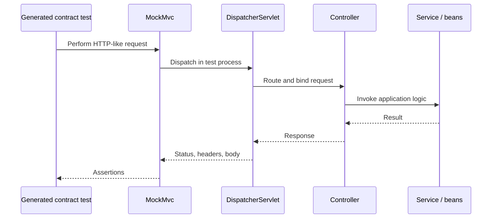
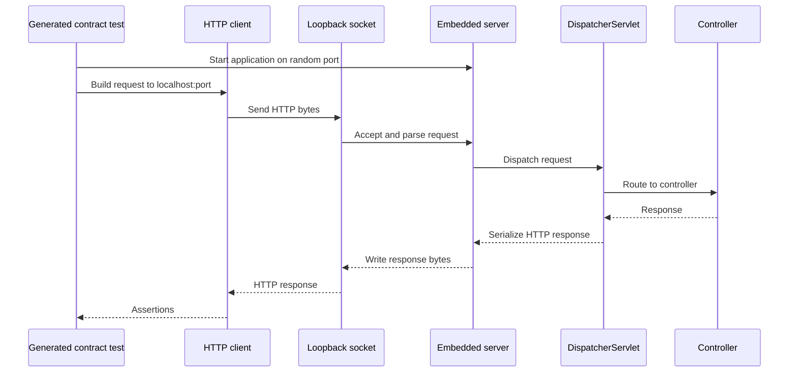
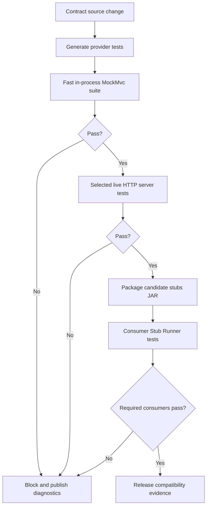

# Choosing In-Process Verifier Execution vs. Against a Running Application

When using **Spring Cloud Contract (SCC)**, the producer can verify contracts either with tests that invoke Spring MVC directly in-process, or by booting the application on an HTTP port and sending requests over loopback networking. Both approaches can verify the same contract, yet they observe different layers of the application.

**In-process verifier execution** typically uses **MockMvc**: tests send requests through Spring MVC test infrastructure without opening an HTTP socket. This approach is fast, convenient for most request/response contracts, and easy to set up fixtures for. **Verifier against a running application** typically starts an embedded server on a random port and sends real HTTP requests via REST Assured or an equivalent client. This approach additionally tests the server/container and the real HTTP path inside the application.

This article belongs to the **Strategy Selection** chapter, with the topic **Choosing In-Process Verifier Execution vs. Against a Running Application**. It helps choose a test mode based on the risks to verify, configure base classes, distinguish the limits of MockMvc versus a live HTTP server, handle WebTestClient, and organize multi-layered CI. The running example is producer **order-producer** providing **GET /api/orders/1001** to **checkout-consumer**.

**There is no single best mode for every contract.** Use the fast mode to verify Spring MVC behavior, and use live server tests for risks that only surface when the application actually listens for HTTP traffic.

## 1. Where do the two verifier approaches differ?

### 1.1. In-process with MockMvc

In MockMvc mode, generated provider tests send requests through Spring MVC test infrastructure:



The request is simulated inside the same JVM. Spring MVC still performs routing, argument binding, validation, controller advice, and web components configured in the test context. However, the request **does not pass through a TCP socket and embedded servlet container like an external HTTP client**.

### 1.2. Live HTTP with an embedded server

In live server mode, the test starts the application with an embedded container, obtains the actual port, and sends requests over HTTP:



The application may still run inside the same JVM as the test; “live” here means **starting the server and sending HTTP over a socket**, not necessarily deploying the application to a separate machine or container.

### 1.3. Quick comparison

| Aspect | In-process MockMvc | Live HTTP server |
| --- | --- | --- |
| Starts Spring context | Yes, per test configuration | Yes |
| Embedded server/socket | No | Yes |
| Passes through DispatcherServlet/controller | Yes | Yes |
| Tests container request parsing | Not completely | Yes |
| Tests port binding | No | Yes |
| Tests serialization through HTTP stack | Via Spring MVC test response | Via HTTP client/server |
| Tests real TLS | No | Only if test server configures TLS |
| Speed | Usually faster | Usually slower |
| Sensitivity to ports/network | Low | Higher |
| Best suited for | High contract counts, fast feedback | Server/HTTP-stack dependent behavior |

Both can test controller behavior. The difference is **how much HTTP infrastructure enters the test**.

## 2. Choose the mode by the question to answer

Start from the concrete risk:

| Question | Usually appropriate mode |
| --- | --- |
| Does the controller return status/body/headers per contract? | MockMvc usually suffices |
| Do Bean Validation and ControllerAdvice work? | MockMvc if test context loads the right components |
| Does the Spring MVC security filter chain block requests? | MockMvc with filters enabled; live server if extra server stack checks are needed |
| Can the app bind a port and accept HTTP requests? | Live HTTP server |
| Do context path, servlet container parsing, or real multipart work? | Live HTTP server |
| Does HTTP client/server serialization work over a socket? | Live HTTP server |
| Does a reverse proxy/gateway rewrite headers/paths properly? | Gateway test or corresponding integrated environment |
| Does the TLS/mTLS handshake work? | HTTPS live server or transport integration test |
| Do broker delivery/ack/retry work? | Messaging/broker integration test, not HTTP verifier mode |

### 2.1. A practical selection rule

- Choose **MockMvc** by default for most provider HTTP contracts when the target is Spring MVC behavior.
- Choose **live HTTP** when contracts or risks depend on the embedded server, request parsing, ports, context paths, or HTTP transport.
- Use **both intentionally** when critical behaviors need verification at both layers.
- Use separate integration tests for gateways, TLS, brokers, and components outside the producer process.

There is no need to run hundreds of contract cases against a live server just to feel “more real.” If they only verify controller responses, startup cost and flakiness may add little meaningful evidence.

## 3. MockMvc is not a controller unit test

A common misconception is equating MockMvc with testing an isolated controller. That depends on the test context.

With **@SpringBootTest** and **@AutoConfigureMockMvc**, the full Spring application context can be loaded; requests go through Spring MVC and invoke real configured beans. If the base test replaces some dependencies with mocks, those dependencies are no longer real implementations.

MockMvc can verify:

- Handler mapping and routing.
- Binding path/query/headers/body into method arguments.
- Jackson conversion per loaded MVC configuration.
- Bean Validation.
- Controller advice and exception mapping.
- Servlet filters registered with MockMvc.
- Spring Security filter chain if the test configures and loads it properly.
- Response status, headers, and body.

MockMvc does not test an embedded server reading bytes off a socket, TCP behavior, TLS handshakes, reverse proxies, or deployment networking.

### 3.1. Sample MockMvc base class

Example base class for generated provider tests:

```java
package com.example.order.contract;

import io.restassured.module.mockmvc.RestAssuredMockMvc;
import org.junit.jupiter.api.BeforeEach;
import org.springframework.beans.factory.annotation.Autowired;
import org.springframework.boot.test.autoconfigure.web.servlet.AutoConfigureMockMvc;
import org.springframework.boot.test.context.SpringBootTest;
import org.springframework.test.web.servlet.MockMvc;

@SpringBootTest
@AutoConfigureMockMvc(addFilters = true)
public abstract class OrderContractBase {

    @Autowired
    private MockMvc mockMvc;

    @BeforeEach
    void configureContractTest() {
        RestAssuredMockMvc.mockMvc(mockMvc);
    }
}
```

This is an example for generated tests using **RestAssuredMockMvc** and JUnit Jupiter. Package/API imports may vary by your project's Spring Boot and SCC versions.

### 3.2. Why enabling filters matters

**@AutoConfigureMockMvc(addFilters = true)** instructs MockMvc to register servlet filters from the application context. If filters are accidentally disabled, provider contract tests can pass even when production requests are blocked by Spring Security or another filter.

However, enabling filters does not automatically verify all production security configuration. Ensure tests load the right SecurityFilterChain, test users/authorities, and related dependencies. For JWT signatures, issuers, audiences, or authorization servers, properly configured security integration tests are still required.

### 3.3. MockMvc does not protect against misconfigured base classes

Generated tests can compile yet fail to use the right MockMvc instance if the base class did not wire the adapter, or if the test context fails to load the needed controller. When a test fails, check whether the generated class extends the right base class, whether lifecycle setup ran, and whether the request reached the right handler.

## 4. Live server: testing the app over real HTTP in tests

Live server tests boot the application with an embedded container. In Spring Boot, a common choice is:

```java
@SpringBootTest(
    webEnvironment = SpringBootTest.WebEnvironment.RANDOM_PORT
)
public abstract class OrderLiveHttpContractBase {
    // Configure the HTTP client for the application's random port.
}
```

A random port avoids port collisions across test processes. The test must retrieve the port assigned by Spring Boot and configure the HTTP client accordingly.

### 4.1. Base class with REST Assured

Illustrative example:

```java
package com.example.order.contract;

import io.restassured.RestAssured;
import org.junit.jupiter.api.BeforeEach;
import org.springframework.boot.test.context.SpringBootTest;
import org.springframework.boot.test.web.server.LocalServerPort;

@SpringBootTest(
    webEnvironment = SpringBootTest.WebEnvironment.RANDOM_PORT
)
public abstract class OrderLiveHttpContractBase {

    @LocalServerPort
    private int port;

    @BeforeEach
    void configureHttpClient() {
        RestAssured.baseURI = "http://localhost";
        RestAssured.port = port;
    }
}
```

The **LocalServerPort** import depends on the Spring Boot version. On older releases, the annotation's package may differ; use the API matching your project's version.

If generated tests use REST Assured explicit HTTP mode, the base class must configure the base URI, port, authentication, or request defaults for your actual setup. Do not assume **@SpringBootTest** automatically informs every generated test of the server port.

### 4.2. What live servers help catch

- Whether the application can boot in the test profile.
- Whether the embedded servlet container binds a port successfully.
- Whether request lines, headers, and bodies are parsed by the container as expected.
- Whether context paths and servlet mappings work.
- Whether compression, multipart, and container-dependent HTTP behaviors work properly.
- Whether an HTTP client sending requests over a socket receives the right status/headers/body.
- Whether filters/interceptors configured in the real app participate in requests.

### 4.3. What live servers still do NOT prove

If tests call **localhost** directly, they still bypass:

- Production API gateways and reverse proxies.
- Service discovery and internal DNS.
- Network policies, firewalls, and ingress.
- TLS termination at load balancers.
- Production identity providers or secret managers.
- External brokers, databases, or dependencies not spun up in tests.

**Live server tests have higher HTTP fidelity than MockMvc, yet are not equivalent to production end-to-end tests.**

## 5. Configuring SCC test mode: check the exact plugin version

SCC supports several generated test styles depending on plugin version and framework. Common modes include:

- **MockMvc:** generated tests use the Spring MockMvc adapter.
- **EXPLICIT:** generated tests invoke a configured HTTP endpoint, usually via REST Assured.
- **WebTestClient:** uses WebTestClient with the corresponding binding.
- **JAX-RS:** uses a JAX-RS adapter in supported configurations.

Mode names, casing, plugin properties, and dependency requirements can vary across SCC generations. Before changing configuration, read the documentation for your **exact SCC plugin version** and inspect the generated test classes.

### 5.1. Maven MockMvc configuration example

Conceptual configuration example:

```xml
<plugin>
    <groupId>org.springframework.cloud</groupId>
    <artifactId>spring-cloud-contract-maven-plugin</artifactId>
    <configuration>
        <testMode>MockMvc</testMode>
        <baseClassForTests>
            com.example.order.contract.OrderContractBase
        </baseClassForTests>
    </configuration>
</plugin>
```

This is an illustrative configuration snippet; plugin version, phases, dependencies, and other properties must match the active build. The goal is for generated provider tests to use MockMvc and extend the prepared base class.

### 5.2. Maven explicit HTTP configuration example

To have generated tests send requests through an HTTP server:

```xml
<plugin>
    <groupId>org.springframework.cloud</groupId>
    <artifactId>spring-cloud-contract-maven-plugin</artifactId>
    <configuration>
        <testMode>EXPLICIT</testMode>
        <baseClassForTests>
            com.example.order.contract.OrderLiveHttpContractBase
        </baseClassForTests>
    </configuration>
</plugin>
```

Explicit mode only generates the matching test client; **the base class and test application still have to start the server, obtain the port, and configure the endpoint**. Inspect generated sources to confirm requests actually go over HTTP rather than an in-process adapter.

### 5.3. With Gradle

The SCC Gradle plugin also supports configuring test modes and base classes, though exact DSL/properties depend on the plugin version. Do not copy Maven property names mechanically into Gradle.

Verification workflow:

1. Identify the SCC Gradle plugin version in use.
2. Read the plugin DSL for that version.
3. Inspect generation tasks and test source sets.
4. Generate one small contract.
5. Open the generated test to confirm the actual adapter.
6. Run the test and check reports to prove it executed.

Task names such as **generateContractTests**, **contractTest**, or stub-packaging tasks can differ across versions/plugin setups. Confirm with **./gradlew tasks --all** instead of guessing.

## 6. A sample contract for comparing the two modes

Groovy DSL:

```groovy
import org.springframework.cloud.contract.spec.Contract

Contract.make {
    description 'Read order 1001'

    request {
        method GET()
        url '/api/orders/1001'
        headers {
            header('Accept', 'application/json')
        }
    }

    response {
        status OK()
        headers {
            contentType(applicationJson())
        }
        body(
            id: 1001,
            status: 'CREATED',
            currency: 'VND'
        )
    }
}
```

Equivalent YAML DSL:

```yaml
description: "Read order 1001"
request:
  method: GET
  url: /api/orders/1001
  headers:
    Accept: application/json
response:
  status: 200
  headers:
    Content-Type: application/json
  body:
    id: 1001
    status: CREATED
    currency: VND
```

The same contract source can generate provider tests in the chosen mode. When comparing, keep the contract, fixtures, and producer revision unchanged; change only the test mode so you know whether differences stem from the adapter or the implementation.

### 6.1. Assertions should match across both modes

- Method and path are correct.
- Request headers are sent.
- Response status is correct.
- Content-Type is correct.
- Body fields and data types are correct.
- Dynamic matchers still execute.
- Critical error responses are still verified.

If MockMvc passes while live HTTP fails, that does not automatically mean the contract is wrong. The server/container, context path, serialization, filters, port, or client setup may differ. Use the same assertion set and isolate which layer introduces the discrepancy.

## 7. WebTestClient: can be in-process or live server

WebTestClient is an HTTP client testing API that can be bound in several ways. Therefore **never classify every WebTestClient test as live server**.

Common binding styles in Spring testing:

| Binding style | Path | Meaning |
| --- | --- | --- |
| bindToController | Web test infrastructure bound directly to controller | Narrow scope |
| bindToApplicationContext | Via WebFlux application context | In-process |
| bindToServer | Sends requests to a running server | Live HTTP |
| bindToServer with baseUrl | Client calls a configured server URL | Live HTTP |

SCC's WebTestClient mode and how generated tests/base classes initialize the client must be checked per plugin version. Seeing a WebTestClient import alone does not tell you whether the test uses a socket.

### 7.1. When is WebTestClient useful?

- The application uses Spring WebFlux.
- Provider tests need a reactive client API.
- Reactive request/response flows need testing.
- Can bind to the application context for fast tests.
- Or bind to a server to test real HTTP transport.

With WebFlux, in-process WebTestClient and live-server WebTestClient still offer different coverage levels. Choose the binding based on the risk under verification.

## 8. Comparing speed, reliability, and scope

| Criterion | MockMvc | Live HTTP |
| --- | --- | --- |
| Startup | Usually lower overhead once context is ready | Must start embedded server |
| Request transport | Mock servlet request/response | HTTP over socket |
| Container behavior | Incomplete | Present |
| Port allocation | No server port needed | Port needed |
| Parallel execution | Fewer port conflicts | Requires dynamic ports and clear lifecycle |
| Request debugging | MockMvc results/logs | HTTP client/server logs, port, and wire behavior |
| TLS | Not a transport test | Can test if HTTPS is configured |
| Proxy/gateway | No | Only when test genuinely traverses proxy/gateway |
| Flakiness | Usually lower | Adds startup/network/timing failures |
| Contract case volume | Well suited for many cases | Should be selective by value |

**Faster does not mean better testing; closer to production does not mean always necessary.** The goal is matching fidelity to each risk.

## 9. Cases where MockMvc is usually enough

MockMvc is usually a sensible choice when:

1. Contracts protect request mapping, body binding, and responses.
2. The producer is a Spring MVC application.
3. Socket/container-specific behavior does not need checking.
4. Required filters and MVC components are loaded.
5. The test base prepares dependencies consistently.
6. You want many generated tests running quickly on every pull request.

For example: consumers depend on status, currency, response status, and Content-Type of GET /api/orders/1001. Because these are produced in the Spring MVC layer, MockMvc usually targets the right level.

### 9.1. Do not use a live server just to look “production-like”

If a test only verifies that a controller returns the right JSON, starting Tomcat/Jetty/Undertow may merely add time. Only add a live server when there is a specific hypothesis that the container/HTTP path could alter the result.

## 10. Cases where live HTTP is worth the investment

Live HTTP pays off when contracts or implementations depend on:

- `server.servlet.context-path` or servlet paths.
- Container request parsing and header limits.
- Real multipart or streaming behavior.
- Compression/chunked transfer when relied upon by the app.
- Port binding and startup configuration.
- HTTP error handling at the server layer.
- Filter/container integrations that cannot be equivalently simulated in MockMvc.
- Client/server socket and connection behavior.
- Embedded server SSL configuration, when tests are designed to verify TLS.

### 10.1. Live servers do not automatically test production ingress

If production uses Nginx, Kubernetes Ingress, an API gateway, or a service mesh, localhost tests bypass all of them. A dedicated integration environment or proxy/gateway tests with matching config are needed.

### 10.2. Select tests by risk, not by volume

You can run all provider contracts under MockMvc and run a focused group of live HTTP smoke contracts for endpoints sensitive to context paths, multipart, or server configuration. This balances fast feedback with infrastructure verification.

## 11. Security filters: an area needing special attention

MockMvc can run servlet filters when configured properly. Yet a base class that accidentally omits filters creates false-green provider verification.

For example:

```java
@SpringBootTest
@AutoConfigureMockMvc(addFilters = true)
public abstract class SecuredOrderContractBase {
    // Load the appropriate SecurityFilterChain and identity fixture.
}
```

Questions to answer:

- Which SecurityFilterChain is loaded?
- Does the request send the Authorization header per contract?
- How are test principals/authorities prepared?
- Does CSRF apply to protected methods?
- Are there tenant/correlation ID filters?
- Are there custom servlet filters registered only in the embedded container?

Live HTTP tests add container integration checks, yet if both modes use the same test profile that disables security, a live server will not save coverage either.

### 11.1. Separate real auth verification from header matchers

An SCC contract with an Authorization header or a WireMock mapping matching a header only proves the request carried a matching header. It does not prove real JWT signatures, issuers, audiences, scopes, or permissions are checked.

For critical auth behavior, write Spring Security integration tests using appropriate test tokens/keys.

## 12. Databases, message brokers, and external dependencies

Whether using MockMvc or live HTTP, provider verification can still mock/stub databases or external dependencies. Thus neither mode by itself determines **how real the dependency graph is**.

| Dependency | Usable in contract verification? | When is a separate integration test needed? |
| --- | --- | --- |
| Internal service beans | Usually real beans | When logic needs deep testing |
| Database | Can use test DB or fixtures | Transactions, locking, SQL, migrations |
| External REST APIs | Can mock/stub | When verifying integration with external providers |
| Kafka/RabbitMQ | Message contracts can use verifiers/test binders | Broker delivery, acks, retries, ordering, DLQ |
| Identity provider | Can use test identities | OIDC/JWKS/network/issuer integration |
| Gateway | Usually outside MockMvc and localhost app tests | Routing, auth, rate limits, rewrites |

Do not equate **live HTTP server** with **live entire system**. The two concepts differ greatly in scope.

## 13. Message contracts are not governed by HTTP test mode

SCC supports both HTTP and message contracts, yet choosing MockMvc/EXPLICIT primarily governs how generated HTTP tests invoke producer endpoints. Message verification has its own lifecycle, triggers, and message verifiers.

Message contract example:

```groovy
import org.springframework.cloud.contract.spec.Contract

Contract.make {
    description 'Producer emits OrderCreated'
    label 'order_created_v1'

    input {
        triggeredBy('publishOrderCreated()')
    }

    outputMessage {
        sentTo('orders.created')
        headers {
            messagingContentType(applicationJson())
        }
        body(
            eventId: 'EVT-1001',
            eventType: 'OrderCreated',
            schemaVersion: 1,
            orderId: 'ORD-1001'
        )
    }
}
```

When choosing how to run the message verifier, check the integration/binder in use and whether tests invoke the real producer trigger. An HTTP live server test does not automatically test broker delivery. If real Kafka/RabbitMQ is needed, build a separate broker integration test.

## 14. Configuring test data and environments for both modes

The same contract should receive the same fixtures/assumptions when comparing both modes:

- Test databases are reset or transactions are managed.
- Clocks/timezones are fixed when contracts involve timestamps.
- Locale and serialization configurations align.
- Authentication fixtures are explicit.
- External dependencies return deterministic responses.
- Random IDs are controlled or matchers reflect dynamic values.
- No production data or real secrets are used.

### 14.1. In-process does not eliminate the need for isolation

MockMvc tests can still share a Spring ApplicationContext, singleton beans, static state, databases, and message listeners. If test A mutates shared state, test B can still fail. Manage fixtures and lifecycles like any other test.

### 14.2. Live HTTP requires port management and cleanup

- Prefer random ports when supported by the test framework.
- Never hardcode the same port across multiple test processes.
- Clients must use the exact assigned port.
- Shut down servers/contexts when tests finish.
- Wait for background requests/retries to finish before cleanup.
- Never call an old base URL after the context has restarted.

## 15. Diagnosing when MockMvc passes but live HTTP fails

This is a valuable signal because the two modes isolated different layers.

| Symptom | Investigation direction |
| --- | --- |
| MockMvc 200, live HTTP 404 | Context path, servlet path, server routes, client URL |
| MockMvc JSON right, live body differs | Message converters, serialization config, response filters |
| MockMvc passes, live 400 | HTTP parsing, content length, content type, request encoding |
| MockMvc passes, live 413 | Container/proxy request size limits |
| MockMvc passes, live timeout | Server startup, thread pools, blocking calls, port/client |
| MockMvc passes, live 401/403 | Differing filter chain/profile/security config |
| MockMvc passes, live redirect | Context path, HTTPS redirects, forwarded headers |
| MockMvc passes, live connection refused | Server not started, wrong port, startup failure |
| Live passes locally, fails in CI | Port collisions, resource limits, environment/profile, parallelism |

### 15.1. Do not change the contract immediately when live tests fail

First verify whether requests carry the same method/path/headers/body in both modes. Then check server logs, resolved ports, profiles, filters, and actual responses.

If the live server returns 404 because context-path is /orders, the contract might be calling the wrong base path or the test client is misconfigured. That does not necessarily mean the API contract must change.

## 16. Diagnosing when both modes pass yet production fails

This happens when both test modes omit a production component:

- Gateways or reverse proxies.
- TLS termination or mTLS.
- Real identity providers.
- External databases or brokers.
- Service discovery.
- Network policies.
- Production-specific profiles/configurations.

MockMvc and live embedded servers can both run under the same test profile with faked external dependencies. Compare **the actual production request path** against the test path, and add integration tests at the missing layer.

## 17. Organizing multi-layered CI

A practical pipeline might look like:



This is one way to organize a pipeline; SCC does not automatically create all jobs.

### 17.1. A two-tier strategy

**Fast pull request feedback:**

- Generate contract tests.
- Run provider verifier with MockMvc.
- Check executed test counts, skipped counts, and failures.
- Build candidate stubs.
- Run mandatory consumer tests against the candidate if time allows.

**CI/release or scheduled pipeline:**

- Run live HTTP tests for embedded-server-dependent behaviors.
- Run separate security/transport/gateway integration tests.
- Run broker/message integration tests.
- Run the full consumer matrix.
- Store GAV/classifier/version/checksum and reports.

### 17.2. Do not run the same suite in live HTTP just to inflate test counts

If a MockMvc suite already verifies controller behavior and there is no corresponding transport risk, re-running the entire suite over sockets can slow down pipelines without meaningfully increasing coverage.

Select live tests based on a **risk register or an explicit list of behaviors**.

## 18. Controlled comparison of results between both modes

When deciding whether to switch modes or add live tests, hold constant:

- Contract source revision.
- Producer source commit.
- Dependency versions.
- Test data/fixtures.
- Security profile.
- External dependency setup.
- Expected assertions.

Change only how generated tests invoke the producer. Then compare:

| Evidence | MockMvc | Live HTTP |
| --- | --- | --- |
| Contract cases discovered | Record actual count | Record actual count |
| Tests executed/skipped | Report | Report |
| Status/header/body assertions | PASS/FAIL | PASS/FAIL |
| Request path observed | MockMvc request | HTTP server request |
| Security filters | Actual configuration | Actual configuration |
| Startup/port | No server port | Server port present |
| Duration | Measure actual time | Measure actual time |
| Unique failures | Classify | Classify |

If live tests fail on behaviors MockMvc cannot observe, that is strong evidence to retain live tests. If both consistently pass and no server-specific risks exist, keep MockMvc in the PR suite and run live smoke checks on a schedule or at release.

## 19. Anti-patterns to avoid

| Anti-pattern | Consequence | Mitigation |
| --- | --- | --- |
| Defaulting to live HTTP for every contract | Slow CI and more environment failures | Select live tests by risk |
| Calling MockMvc a unit test | Misunderstands Spring context scope | Explicitly document test context and filters |
| Disabling filters to make provider tests pass | Misses security behavior | Load filter chain or separate security tests |
| Treating WebTestClient as always live | Misclassifies fidelity level | Inspect actual binding |
| Hardcoding ports | Collisions between tests/processes | Use random ports and pass exact URLs |
| Generated tests not extending the right base class | Client/server setup never runs | Inspect generated sources |
| Generate only, never execute | No verification evidence | Gate on test reports |
| Dropping E2E because MockMvc passes | Misses gateway/network/broker issues | Keep needed integration/E2E smoke tests |
| Assuming live server pass means TLS is tested | Tests may be running plain HTTP | Configure HTTPS and verify handshakes |
| Running message contracts via HTTP mode | Uses wrong verifier lifecycle | Configure separate message verifier/binder |

## 20. Checklist for selecting a service's mode

Before configuring, answer:

1. Does the contract protect controller behavior or HTTP server behavior?
2. Does the application use Spring MVC or WebFlux?
3. Which adapter do generated tests currently use?
4. Does the base class properly wire MockMvc/WebTestClient/REST Assured?
5. Must filters and Spring Security participate?
6. Are there special context paths, servlet paths, or container behaviors?
7. Are socket, HTTPS, or multipart checks required?
8. Is an external gateway/proxy in scope?
9. Can tests allocate dynamic ports and clean up safely?
10. Does CI have enough resources for live server startup?
11. Are there message contracts needing a separate binder/verifier?
12. Do test reports prove generated tests actually executed?

### 20.1. Decision guide

| If the primary goal is… | Pick first |
| --- | --- |
| Verifying Spring MVC mapping, binding, responses | MockMvc |
| Verifying MVC filters in test context | MockMvc with proper filters |
| Verifying embedded container and HTTP sockets | Live HTTP |
| Verifying context paths or server-dependent parsing | Live HTTP |
| Verifying TLS/mTLS | HTTPS transport integration |
| Verifying WebFlux in-process | WebTestClient bound to application context |
| Verifying WebFlux through a server | WebTestClient bound to server |
| Verifying broker delivery | Broker integration tests |
| Verifying gateways/ingress | Gateway/environment integration tests |

## 21. Practice exercise: running the same contract in both modes

Prepare a Spring Boot producer with **GET /api/orders/1001**, the SCC plugin, and JUnit Jupiter. Use the same contract source across two build branches or two separate test configurations.

1. Write a Groovy contract with request **Accept: application/json**.
2. Declare response **200**, **Content-Type**, and **id/status/currency** body.
3. Create a MockMvc base class with **@SpringBootTest** and **@AutoConfigureMockMvc(addFilters = true)**.
4. Configure SCC generated tests to use MockMvc per plugin version.
5. Generate provider tests and confirm the class extends the right base class.
6. Run tests and record executed count, skipped count, and duration.
7. Switch to the explicit/live HTTP test mode supported by the plugin.
8. Use **RANDOM_PORT** and pass the assigned port to the test client.
9. Verify generated tests send requests through a real HTTP client.
10. Keep contract, producer commit, and fixtures unchanged; re-run the suite.
11. Compare statuses, headers, bodies, and test reports across both modes.
12. Add **server.servlet.context-path** in the test profile; verify the live client URL is configured properly.
13. Temporarily disable an important filter on a test branch; identify which tests detect the behavior change.
14. Send a request with a malformed body/content type to compare parsing errors across both modes.
15. If using WebFlux, create one WebTestClient test bound to the application context and one bound to a live server.
16. Identify which tests need HTTPS/mTLS and write a separate transport integration test if needed.
17. Define the **OrderCreated** message contract and configure a separate message verifier/binder.
18. Create a small live HTTP smoke suite for container-dependent behaviors.
19. Measure CI runtime for both suites and record failure modes.
20. Write a decision record specifying default mode, exceptions, and owners.
21. Run candidate stubs/consumer tests to maintain consumer-side compatibility evidence.
22. Retain test reports, plugin version, producer commit, and artifact identity.

### 21.1. Self-assessment table

| Competency | Evidence of achievement |
| --- | --- |
| Distinguish modes | Able to explain MockMvc vs. live HTTP |
| MockMvc | Generated tests invoke the right adapter and filters |
| Live server | Server boots, dynamic port works, HTTP client configured properly |
| Plugin configuration | Confirmed `testMode` for actual version |
| WebTestClient | Distinguished application-context binding from server binding |
| Security | Does not skip critical filter chains |
| Transport | Knows when HTTPS/TLS integration is required |
| Messaging | Does not confuse HTTP mode with message verifiers |
| CI | Tracks test counts, reports, and selective live tests |
| Decision | Chooses mode based on risk and cost |

## 22. Conclusion: pick just enough fidelity for the behavior to protect

**MockMvc** fits most provider contract tests focused on Spring MVC behavior: methods, paths, binding, validation, response statuses, headers, and bodies. It is typically fast, less sensitive to ports/networking, and well suited as default pull request feedback.

**Live HTTP server tests** are worthwhile when verifying embedded containers, request parsing, ports, context paths, HTTP client/server interactions, or configuration that only activates when the application genuinely listens for requests. They carry higher startup and operational costs, so select them by specific risk.

When deciding:

1. **Identify the layer to test:** MVC behavior or HTTP server/transport behavior.
2. **Verify actual generated tests:** do not merely trust plugin configuration; open sources and check the adapter.
3. **Keep base classes accurate:** filters, ports, clients, and fixtures must be configured deliberately.
4. **Separate out-of-scope layers:** gateways, TLS, brokers, databases, and E2E need appropriate tests.
5. **Measure cost and evidence:** keep live tests only when they catch risks in-process tests cannot cover.

A strong pipeline can use **MockMvc for most contract cases, live HTTP for selective behaviors, and integration tests for external transport/infrastructure**. The goal is fast feedback while still verifying what consumers rely on when the producer is deployed for real.
